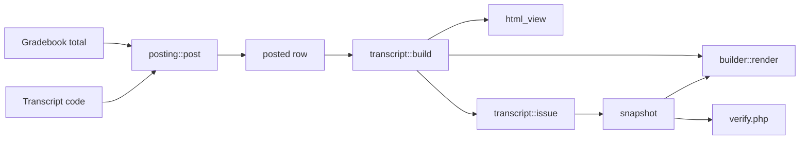

# Academic Transcript code map

This page is the way into the code of `local_academictranscript` 1.4.3, in `local/academictranscript`: what is where, where to start, and a table of every page and every class with its job. Every reference on these pages is a repo path or a symbol, so you can search for it.

## Contents

- [Pages in this guide](#pages-in-this-guide)
- [The plugin at a glance](#the-plugin-at-a-glance)
- [The fastest way into the code](#the-fastest-way-into-the-code)
- [Where to look for a change](#where-to-look-for-a-change)
- [Folder layout](#folder-layout)
- [Every page](#every-page)
- [Every class](#every-class)
- [Core classes](#core-classes)
- [Student Records bridge](#student-records-bridge)
- [PDF classes](#pdf-classes)
- [Import classes](#import-classes)
- [View classes](#view-classes)
- [Forms](#forms)
- [Events and privacy](#events-and-privacy)
- [Command line](#command-line)
- [Language file and styles](#language-file-and-styles)
- [Test support](#test-support)
- [Related pages](#related-pages)

## Pages in this guide

| Page | What it covers |
|---|---|
| [Execution flows](execution-flows.md) | Each flow traced through the code, with its checks, locks, writes and failures |
| [Data model](data-model.md) | All 14 tables, the snapshot, and what is stored outside the tables |
| [Access](access.md) | The capabilities, the guard of each page, and the rules that aren't capabilities |
| [Settings](settings.md) | Every setting and config key, the admin tree, and how to add a setting |
| [Calculations](calculations.md) | GPA, quality points, rounding, repeats, hours, transfer credit |
| [PDF and signing](pdf-and-signing.md) | How PDFs are built, what is frozen, fonts, the QR code, signing |
| [Integration](integration.md) | Moodle APIs, events, callbacks, and the contract with Student Records |
| [Privacy](privacy.md) | What the provider exports and deletes |
| [Extending](extending.md) | How to add things, what is safe to change, which tests to run |

## The plugin at a glance

| | |
|---|---|
| Component | `local_academictranscript` |
| Version | `2026111607`, release 1.4.3 |
| Requires | Moodle 4.5 (`2024100700`), supported `[405, 503]` |
| License | MIT, with no GPL header. Bundled code keeps its own license |
| Size | 22 pages, 36 classes, 14 tables, 8 capabilities, 2 events, 1 command line script |
| Tasks, messages, web services, hooks, templates | None. See [what the plugin doesn't have](integration.md#what-the-plugin-doesnt-have) |

A transcript has two possible sources, and the code branches on them in a few known places:

- Own data: this plugin's tables, for posted grades, student details, transfer credit and its own grading scale.
- Student Records: with the setting `source` on `studentrecords`, for a student with a file there, the data comes from that plugin. A student without a file stays on own data. `srsource` and `srpost` hold the bridge.

## The fastest way into the code

Read these in order. Together they are most of what the plugin does.

1. `transcript::build()` in `local/academictranscript/classes/local/transcript.php`. Every view, PDF and issue starts from the one array it returns.
2. `calculator::compute()` in `local/academictranscript/classes/local/calculator.php`. All sums, in pure PHP.
3. `posting::post()` and `posting::save_posted()` in `local/academictranscript/classes/local/posting.php`. How a final grade gets onto the record.
4. `transcript::issue()`, further down the first file. How an Official transcript is frozen, and where the rules live that hold on every path.
5. `requests::issue_request()` in `local/academictranscript/classes/local/requests.php`. The queue, with its lock and transaction pattern.
6. `builder::render()` in `local/academictranscript/classes/local/pdf/builder.php`. How the data becomes a PDF.
7. `srsource::collect()` in `local/academictranscript/classes/local/srsource.php`. What changes for a student with a file in Student Records.

The path of a grade, from the gradebook to the verify page:



## Where to look for a change

| To change | Start at | Then read |
|---|---|---|
| What a transcript shows | `transcript::build()`, `html_view`, `builder` | [Keys of the snapshot](data-model.md#keys-of-the-snapshot), [add a value](extending.md#add-a-value-to-a-transcript) |
| GPA, hours, repeats | `calculator::compute()` | [Calculations](calculations.md). Open an issue first |
| Who may do something | `access`, `local/academictranscript/db/access.php` | [Access](access.md) |
| Posting and grade changes | `posting`, `local/academictranscript/post.php`, `local/academictranscript/change.php`, `local/academictranscript/approvals.php` | [Posting](execution-flows.md#posting-final-grades) |
| Requests and the queue | `requests`, `request_view`, `local/academictranscript/requests.php` | [The queue](execution-flows.md#the-queue) |
| The look of the PDF | `builder`, `document` | [PDF and signing](pdf-and-signing.md) |
| The digital signature | `signer` | [Signing](pdf-and-signing.md#signing) |
| The wizard and imports | `local/academictranscript/setup.php`, `local/academictranscript/drafts.php`, `drafts`, `ai_extractor`, `csv` | [The wizard](execution-flows.md#the-setup-wizard-and-its-drafts) |
| The grading scale | `scale`, `local/academictranscript/grading.php`, `local/academictranscript/marks.php` | [Data model](data-model.md#school-settings) |
| Course fields and terms | `coursefields`, `terms` | [Custom fields](integration.md#custom-fields) |
| The link to Student Records | `srsource`, `srpost` | [Integration](integration.md) |
| A setting | `local/academictranscript/settings.php` | [Settings](settings.md) |
| Privacy | `provider` | [Privacy](privacy.md) |

## Folder layout

```text
local/academictranscript/
  *.php                top-level pages, plus lib.php, settings.php, version.php
  classes/
    event/             the 2 events
    form/              the 10 Moodle forms
    local/             the logic
      import/          documents, AI, CSV, drafts
      pdf/             builder, document, signer
    privacy/           the privacy provider
  cli/                 set_course_fields.php
  db/                  access.php, install.php, install.xml, uninstall.php, upgrade.php
  fonts/               Clouve Sans and Clouve Serif, in TCPDF's format
  lang/en/             the language file
  lib/pdfparser/       bundled smalot/pdfparser
  styles.css
  tests/               PHPUnit tests, the generator and two lock fixtures
  thirdpartylibs.xml
```

There is no `templates/` folder and no `amd/` folder. `local/academictranscript/templates.php` is a page: the CSV download.

A page is a flat script: guards at the top, then actions, then output with `html_writer` and `html_table`. Logic that needs a test lives in a class under `classes/local/`.

## Every page

"Admin tree" means the page has an entry under the plugin's category. Guards are on [the access page](access.md#the-guard-of-each-page).

| Page | Job | Reached from | Main code |
|---|---|---|---|
| `local/academictranscript/approvals.php` | Approve or reject grade changes, own-data path | Admin tree | `posting::decide()`, `posting::decide_problem()` |
| `local/academictranscript/catalog.php` | Edit the course catalog | Admin tree | `programs::save_course()` |
| `local/academictranscript/change.php` | Request a change to a posted grade | `local/academictranscript/post.php` | `posting::request_change()`, `srpost::request_change()` |
| `local/academictranscript/codes.php` | Hand-entered marks and notes for a course | Course More menu | `posting::marks_for()`, event `code_updated` |
| `local/academictranscript/coursecheck.php` | List courses with a missing code, hours or term | Admin tree | `coursefields::get_resolved()` |
| `local/academictranscript/drafts.php` | Review drafts from documents and CSV files | Admin tree, wizard | `drafts::approve()`, `drafts::reject()` |
| `local/academictranscript/grading.php` | Edit the grading scale | Admin tree, wizard | `scale::replace_grades()`, `scale::validate_rows()` |
| `local/academictranscript/index.php` | The transcript: staff view, My transcript, Unofficial PDF, direct issue, request | Profile, links | `transcript::build()`, `html_view`, `requests::issue_direct()`, `requests::create()` |
| `local/academictranscript/issued.php` | The list of Official transcripts, and with `id` the download | Admin tree, links | `transcript::stored()`, `builder::render()` |
| `local/academictranscript/log.php` | The activity log, 100 entries a page | Admin tree | Reads `local_academictranscript_log` |
| `local/academictranscript/marks.php` | Edit the marks | Admin tree, wizard | `scale::save_marks()` |
| `local/academictranscript/post.php` | Post final grades for a course | Course More menu | `posting::preview()`, `posting::post()` |
| `local/academictranscript/programs.php` | Edit programs | Admin tree, wizard | `programs::save()` |
| `local/academictranscript/record.php` | Edit a student's details | Button on the staff view | Writes `local_academictranscript_student` |
| `local/academictranscript/requests.php` | The registrar's queue | Admin tree, Student Records menu | `requests::issue()`, `requests::cancel()`, `requests::state()` |
| `local/academictranscript/setup.php` | The six-step setup wizard | Admin tree | `form\setup_school`, `form\setup_look`, `ai_extractor`, `csv`, `drafts` |
| `local/academictranscript/students.php` | List students with links to their transcripts | Admin tree, Course More menu | `access::is_admin()` |
| `local/academictranscript/studentterms.php` | Override the term of a course for one student | Button on the staff view | Writes `local_academictranscript_code.termid` |
| `local/academictranscript/templates.php` | Download a CSV template | Wizard | `csv::template()` |
| `local/academictranscript/terms.php` | Edit the term list | Admin tree | `terms::save()` |
| `local/academictranscript/transfer.php` | A student's transfer credit | Button on the staff view | Writes `local_academictranscript_transfer` |
| `local/academictranscript/verify.php` | The public check of a verification code | QR code, printed address | `transcript::clean_code()` |

The other top-level files:

| File | Job |
|---|---|
| `local/academictranscript/lib.php` | The three callbacks. See [callbacks](integration.md#callbacks) |
| `local/academictranscript/settings.php` | The admin tree and the settings page. See [settings](settings.md) |
| `local/academictranscript/version.php` | Version information |

## Every class

Namespaces are `local_academictranscript\local`, `...\local\import`, `...\local\pdf`, `...\form`, `...\event` and `...\privacy`. Moodle autoloads them from `classes/`.

| Class | Job |
|---|---|
| [`access`](#access) | Who may see and issue whose transcript |
| [`calculator`](#calculator) | Pure grade arithmetic |
| [`coursefields`](#coursefields) | The Transcript course custom fields |
| [`logger`](#logger) | The activity log, and the commit that survives a failed send |
| [`posting`](#posting) | Posting, locking the course total, changes to posted grades |
| [`programs`](#programs) | Programs and the course catalog |
| [`requests`](#requests) | Official transcript requests |
| [`scale`](#scale) | The school's grading scale and marks |
| [`settings_menus`](#settings_menus) | Option lists shared by the settings page and the wizard |
| [`terms`](#terms) | Terms and the course Term field |
| [`text`](#text) | Plain text for names |
| [`transcript`](#transcript) | Builds and issues transcripts |
| [`srpost`](#srpost) | Final grades and changes that go to Student Records |
| [`srsource`](#srsource) | Student Records as the source of a transcript |
| [`builder`](#builder) | Lays out the PDF |
| [`document`](#document) | The PDF document: fonts, border, watermark |
| [`signer`](#signer) | Certificates and the digital signature |
| [`ai_extractor`](#ai_extractor) | Reads items out of document text with Moodle's AI subsystem |
| [`csv`](#csv) | CSV templates and CSV import |
| [`document_text`](#document_text) | Plain text from an uploaded document |
| [`drafts`](#drafts) | Items waiting for approval |
| [`html_view`](#html_view) | HTML of the transcript |
| [`request_view`](#request_view) | The request form and the student's requests |
| [`form\catalogcourse`](#formcatalogcourse) | Form of a catalog course |
| [`form\change_request`](#formchange_request) | Form of a grade change |
| [`form\csv_upload`](#formcsv_upload) | Form of a CSV upload |
| [`form\document_upload`](#formdocument_upload) | Form of a document upload |
| [`form\program`](#formprogram) | Form of a program |
| [`form\setup_look`](#formsetup_look) | Wizard step Transcript look |
| [`form\setup_school`](#formsetup_school) | Wizard step School details |
| [`form\student_record`](#formstudent_record) | Form of a student's details |
| [`form\term`](#formterm) | Form of a term |
| [`form\transfer`](#formtransfer) | Form of a transfer row |
| [`event\code_updated`](#eventcode_updated) | A hand-entered code or note changed |
| [`event\official_issued`](#eventofficial_issued) | An Official transcript was issued |
| [`privacy\provider`](#privacyprovider) | The privacy provider |

## Core classes

### `access`

File: `local/academictranscript/classes/local/access.php`. Its methods are on [the access page](access.md#the-access-class).

### `calculator`

File: `local/academictranscript/classes/local/calculator.php`. No database or Moodle call. Constants: `calculator::REPEAT_LATEST`, `calculator::REPEAT_HIGHEST`, `calculator::REPEAT_ALL`. `scale::calculator_for()` builds it.

| Method | Job |
|---|---|
| `calculator::letter()` | Letter for a percentage, or null |
| `calculator::is_letter()` | Whether a grade is a letter of this scale |
| `calculator::knows()` | Whether a grade is a letter or a mark of this scale |
| `calculator::points()` | Grade points of a letter, null for anything else |
| `calculator::in_gpa()` | Whether a grade counts in the GPA |
| `calculator::earns()` | Whether a grade earns the course hours |
| `calculator::gpa()` | GPA text from quality points and hours. Only the tests call it |
| `calculator::compute()` | Every attempt and the totals. Callers: `transcript::build()`, `srsource::transfer()`, and `registration::mark_repeats()` in Student Records |

See [calculations](calculations.md).

### `coursefields`

File: `local/academictranscript/classes/local/coursefields.php`. Constants: `coursefields::CODE`, `coursefields::HOURS`, `coursefields::HOURTYPE`, `coursefields::TERM`.

| Method | Job |
|---|---|
| `coursefields::ensure()` | Creates the category and fields, or restores a field an uninstall kept |
| `coursefields::release()` | Lets go of the fields at uninstall |
| `coursefields::field()`, `coursefields::term_field()` | A field controller by short name |
| `coursefields::get()` | Per course: `code`, `hours`, `unittype`, `termindex` |
| `coursefields::get_resolved()` | The same, with the catalog filling empty `hours` and `unittype` |
| `coursefields::format_hours()` | One decimal, with trailing zeros off |

### `logger`

File: `local/academictranscript/classes/local/logger.php`. Constant: `logger::ACTIONS`, the 16 known actions. `logger::log()` doesn't enforce it.

| Method | Job |
|---|---|
| `logger::log()` | One row in `local_academictranscript_log` |
| `logger::commit()` | Commits a transaction, and logs `after_saving` for a failure that comes after the data is saved. See [locks and transactions](integration.md#locks-and-transactions) |

### `posting`

File: `local/academictranscript/classes/local/posting.php`.

| Method | Job |
|---|---|
| `posting::preview()` | What would be posted now, with any error. See [posting final grades](execution-flows.md#posting-final-grades) |
| `posting::marks_for()` | The marks for a menu, by whether the student has a target |
| `posting::letter()` | Letter for a total, on the right scale |
| `posting::course_percent()` | The course total as a percentage, or null |
| `posting::post()` | Takes the lock when there is a target, saves, locks the total, logs |
| `posting::save_posted()` | Protected. Checks and saves, all or nothing |
| `posting::lock_course_total()` | Regrades when needed, then locks the student's total |
| `posting::title()` | The course name as plain text, without a leading code and separator |
| `posting::request_change()` | Own path: checks, then inserts the change |
| `posting::decide_problem()` | The string key of why the current user can't decide, or `''` |
| `posting::decide()` | Applies or rejects a change |

### `programs`

File: `local/academictranscript/classes/local/programs.php`. Constants: `programs::CREDIT`, `programs::CLOCK`.

| Method | Job |
|---|---|
| `programs::all()` | Programs by name, active only by default |
| `programs::menu()` | `id => name`, active only, escaped, with core `none` first by default |
| `programs::unittype_menu()` | The two unit names |
| `programs::clean_unittype()` | Any text containing `clock` means clock, and everything else credit |
| `programs::unit_label()` | The setting, or the default string |
| `programs::unit_short()` | `col_clock` or `col_cr` |
| `programs::save()` | Add or update, by id, else by name |
| `programs::save_course()` | Add or update a catalog row, by code. Finds the program by id or by name |
| `programs::catalog_by_code()` | Active catalog rows by upper-case code |

### `requests`

File: `local/academictranscript/classes/local/requests.php`. Constants: `requests::TABLE`, `requests::DELIVERY`, `requests::TIMING`, `requests::LOCKWAIT` (10 seconds), `requests::REPEATWINDOW` (60 seconds).

| Method | Job |
|---|---|
| `requests::fee()` | The fee of a delivery |
| `requests::problems()` | Field to string key, for a bad request |
| `requests::holds()` | The holds in force, as text |
| `requests::can_charge()` | Whether a fee can go on the account |
| `requests::waiting()` | Whether a request still waits for grades or the degree |
| `requests::state()` | `pending`, `onhold`, `waiting`, `issued` or `cancelled` |
| `requests::create()` | Validates, then under the lock finds a repeat or saves |
| `requests::issue()` | Issue or Reissue under the lock of the request |
| `requests::issue_direct()` | Issue from a student's page, under the lock of the student |
| `requests::cancel()` | Cancel under the lock of the request |
| `requests::for_user()` | A student's requests, newest first |
| `requests::one_at_a_time()` | Protected. The lock helper |
| `requests::same_request()`, `requests::same_issue()` | Protected. Find a repeat |
| `requests::save_request()`, `requests::issue_request()`, `requests::cancel_request()` | Protected. The work under the lock |

### `scale`

File: `local/academictranscript/classes/local/scale.php`. Constants: `scale::TRANSFER` (`TR`), `scale::INPROGRESS` (`IP`). Rows are cached for the request, and `scale::reset_cache()` forgets them.

| Method | Job |
|---|---|
| `scale::grades()`, `scale::marks()` | Active rows |
| `scale::teacher_marks()` | Active marks that aren't system marks, `code => label`, escaped |
| `scale::calculator()` | A calculator on this plugin's scale |
| `scale::calculator_for()` | A calculator with the plugin's rule and rounding, for any list |
| `scale::letter()` | Letter for a percentage |
| `scale::code_label()` | Label of a mark as plain text, or the code |
| `scale::grade_menu()` | Letters, then teacher marks, for a change request |
| `scale::percent_label()` | The row's label, `belowpercent` for a row starting at 0, else `min-max%` |
| `scale::number()` | Hours or points for print |
| `scale::percent_text()` | A percentage with no trailing zeros |
| `scale::scale_rows()`, `scale::key_rows()` | Rows of the key |
| `scale::standard_preset()`, `scale::standard_marks()` | The standard 4.0 scale and marks |
| `scale::replace_grades()` | Retires the active rows and inserts new ones, in one transaction |
| `scale::save_marks()` | Adds or updates by code |
| `scale::load_defaults()`, `scale::add_missing_standard_marks()` | Used at install and in the wizard |
| `scale::validate_rows()` | Problems with a set of grade rows |

The standard scale, from `scale::standard_preset()`. All rows count in the GPA, and all but F earn the hours.

| Letter | A | A- | B+ | B | B- | C+ | C | C- | D+ | D | D- | F |
|---|---|---|---|---|---|---|---|---|---|---|---|---|
| Minimum | 93 | 90 | 87 | 83 | 80 | 77 | 73 | 70 | 67 | 63 | 60 | 0 |
| Points | 4.0 | 3.7 | 3.3 | 3.0 | 2.7 | 2.3 | 2.0 | 1.7 | 1.3 | 1.0 | 0.7 | 0.0 |

### `settings_menus`

File: `local/academictranscript/classes/local/settings_menus.php`. `settings_menus::repeatrules()`, `settings_menus::pagesizes()` and `settings_menus::signaturemodes()` return option lists for `local/academictranscript/settings.php` and `form\setup_look`.

### `terms`

File: `local/academictranscript/classes/local/terms.php`.

| Method | Job |
|---|---|
| `terms::all()` | Oldest first, by `startdate`, then `id` |
| `terms::menu()` | `id => name`, escaped, with core `none` first by default |
| `terms::options_text()` | The option list of the course Term field, in `optionindex` order. A gap prints `termoptionunused` |
| `terms::save()` | Inserts or updates, then calls `terms::sync_field()` |
| `terms::sync_field()` | Writes the options into the course field |
| `terms::id_for_option()` | Term id for an option number |
| `terms::effective()` | The override on the code row first, then the course field |

### `text`

File: `local/academictranscript/classes/local/text.php`. `text::plain()` gives a name as plain text: filters applied, tags removed, entities decoded, the same with `formatstringstriptags` on or off. The result can hold `<`, `>` and `&`, so it must be escaped where it prints. Tests: `text_test::test_plain_gives_plain_text()`, `text_test::test_plain_gives_the_same_text_when_tags_are_not_stripped()`.

### `transcript`

File: `local/academictranscript/classes/local/transcript.php`. Constants: `transcript::DATA_VERSION` (1), `transcript::STATUSES`.

| Method | Job |
|---|---|
| `transcript::build()` | The whole transcript as an array. See [building the data](execution-flows.md#building-the-transcript-data) |
| `transcript::key_rows()` | Rows of the key, on the scale the transcript was counted on |
| `transcript::posted_outside_student_records()` | Protected. Posted grades missing from a transcript read from Student Records |
| `transcript::stored()` | An issued snapshot in today's layout, or null |
| `transcript::setting()` | A trimmed setting, with a default for empty |
| `transcript::school_name()` | The setting `schoolname`, else the site's full name |
| `transcript::date()` | `strftimedate` in the viewer's time zone, `''` for empty |
| `transcript::shortdate()` | The string `strftimetermdate` |
| `transcript::new_verifycode()` | A new unique code of 24 characters |
| `transcript::format_code()` | Groups of 4 with dashes |
| `transcript::clean_code()` | Upper-cases and keeps A to Z and 0 to 9 |
| `transcript::issue()` | Issues an Official transcript. See [the flow](execution-flows.md#issuing-an-official-transcript-from-the-students-page) |

## Student Records bridge

### `srpost`

File: `local/academictranscript/classes/local/srpost.php`. Constant: `srpost::REG`.

| Method | Job |
|---|---|
| `srpost::active()` | Whether postings go into Student Records |
| `srpost::target()` | Where the next grade goes, or null |
| `srpost::posted_target()` | The registration that got a posted grade, through `srregid` |
| `srpost::has_file()` | Whether a student's transcript comes from there |
| `srpost::problem()` | The error for a target's state, or `''` |
| `srpost::letter()` | Letter on that scale for a percentage or a mark |
| `srpost::with_lock()` | Runs work under the lock on a registration |
| `srpost::post()` | Saves the grade on the registration |
| `srpost::letters()` | The menu of grades for a change |
| `srpost::change_pending()` | Whether a change waits there |
| `srpost::request_change()` | Asks for a change there |

### `srsource`

File: `local/academictranscript/classes/local/srsource.php`. Constants: `srsource::OWN`, `srsource::STUDENTRECORDS`, `srsource::WITHDRAWN`.

| Method | Job |
|---|---|
| `srsource::enabled()` | Whether transcripts are read from Student Records |
| `srsource::menu()` | Options of the setting `source` |
| `srsource::calculator()` | A calculator on that scale |
| `srsource::teacher_marks()` | Marks a teacher can give a student with a file |
| `srsource::key_rows()` | Rows of the key on that scale |
| `srsource::mark_label()` | The footnote of a mark |
| `srsource::attempts()` | Attempts from the rows of `registration::history()` |
| `srsource::transfer()` | Groups, total hours and GPA attempts from transfer rows |
| `srsource::collect()` | Everything a transcript needs from there, or null |
| `srsource::is_state()`, `srsource::scale_rows()`, `srsource::percent()` | Protected helpers |

See [integration](integration.md).

## PDF classes

### `builder`

File: `local/academictranscript/classes/local/pdf/builder.php`. `builder::render()` returns the PDF as a string, and `builder::filename()` the download name. Everything else is protected. See [how render builds a PDF](pdf-and-signing.md#how-render-builds-a-pdf).

### `document`

File: `local/academictranscript/classes/local/pdf/document.php`. Extends core's `pdf`. Public properties `$watermark` and `$accent`. `document::add_fonts()` registers the fonts, `document::Header()` draws the border and the watermark, and `document::Footer()` is empty on purpose.

### `signer`

File: `local/academictranscript/classes/local/pdf/signer.php`. `signer::credentials()` and `signer::selfsigned()` find or make the certificate, and `signer::apply()` calls `setSignature()`. See [certificates](pdf-and-signing.md#certificates).

## Import classes

### `ai_extractor`

File: `local/academictranscript/classes/local/import/ai_extractor.php`. Constants: `ai_extractor::TYPES`, `ai_extractor::CHUNK` (12000 characters).

| Method | Job |
|---|---|
| `ai_extractor::available()` | Whether a provider with Generate text is enabled |
| `ai_extractor::policy_accepted()`, `ai_extractor::accept_policy()` | Core's AI policy, per user |
| `ai_extractor::prompt()` | The prompt for one chunk |
| `ai_extractor::chunks()` | Splits at blank lines, with a hard cut for a longer paragraph |
| `ai_extractor::parse_response()` | Reads the JSON answer and cleans each item |
| `ai_extractor::clean_item()` | Checks and normalises one item, or null. `csv::parse()` uses it too |
| `ai_extractor::extract()` | One AI call per chunk |

### `csv`

File: `local/academictranscript/classes/local/import/csv.php`. Constant: `csv::TEMPLATES`. `csv::template()` gives the template text, and `csv::parse()` turns a file into items. Header names must match in any order, and upper or lower case doesn't matter.

### `document_text`

File: `local/academictranscript/classes/local/import/document_text.php`. Constant: `document_text::ACCEPTED`. See [reading documents](integration.md#reading-documents).

### `drafts`

File: `local/academictranscript/classes/local/import/drafts.php`. Constant: `drafts::FIELDS`.

| Method | Job |
|---|---|
| `drafts::normalise()`, `drafts::quote_found()` | Compare a quote with the document, ignoring case, spacing and most punctuation |
| `drafts::store()` | Inserts items as drafts |
| `drafts::open()`, `drafts::counts()` | Open drafts and their counts |
| `drafts::approve()` | Merges the edits, validates grade rows, and applies them in one transaction |
| `drafts::reject()` | Marks rows rejected |

## View classes

### `html_view`

File: `local/academictranscript/classes/local/html_view.php`. `html_view::transcript()` is `html_view::student_table()`, `html_view::courses()` and `html_view::summary()` in that order. `html_view::scale_table()` prints the key on a page. The `$showdob` parameter exists, and both callers leave it true.

### `request_view`

File: `local/academictranscript/classes/local/request_view.php`. Constant: `request_view::TONES`. `request_view::form()` is the request form, `request_view::mine()` the student's requests, and `request_view::script()` the inline JavaScript. The script shows the field of the chosen delivery, updates the total, and takes a second click off the button. The server doesn't rely on it: without JavaScript both fields show, and `requests::create()` keeps only the one that matches the delivery.

## Forms

All are `\moodleform` classes in `local/academictranscript/classes/form/`. Twelve more forms are built by hand on pages, such as the issue form on `local/academictranscript/index.php`.

### `form\catalogcourse`

Used by `local/academictranscript/catalog.php`. Fields: `id`, `code`, `title`, `hours`, `unittype`, `programid`, `active`. Validation: the trimmed `code` isn't on another row, and `hours` is 0 to 5000.

### `form\change_request`

Used by `local/academictranscript/change.php`. Custom data: `current`, `letters`. Fields: `id`, `current`, `newgrade`, `newnote`, `reason`. `newnote` shows only when `letters` is empty, and `newgrade` offers `letters`, else `scale::grade_menu()`. Validation: `reason` isn't blank.

### `form\csv_upload`

Used by `local/academictranscript/setup.php`. Custom data: `step`, `types`. Fields: `step`, `action`, `itemtype`, `csvfile`. Takes `.csv` and `.txt`.

### `form\document_upload`

Used by `local/academictranscript/setup.php`. Custom data: `step`, `needpolicy`. Fields: `step`, `action`, `documents`, `acceptpolicy`. At most 5 files of 20 MB, of the types in `document_text::ACCEPTED`. Validation: with `needpolicy`, `acceptpolicy` is required.

### `form\program`

Used by `local/academictranscript/programs.php`. Fields: `id`, `name`, `credential`, `unittype`, `totalhours`, `active`. Validation: the trimmed `name` isn't on another row.

### `form\setup_look`

Used by `local/academictranscript/setup.php`. Fields: `step`, `pagesize`, `accentcolor`, `signaturemode`, `roundpercent`, `repeatrule`, `creditlabel`, `clocklabel`. Validation: `accentcolor` matches six hex digits, with or without `#`.

### `form\setup_school`

Used by `local/academictranscript/setup.php`. Fields: `step`, `schoolname`, `address`, `phone`, `email`, `website`, `registrarname`, `registrartitle`, `logo`. `schoolname` is required here, and it isn't on the settings page.

### `form\student_record`

Used by `local/academictranscript/record.php`. Fields: `userid`, `studentid`, `dob`, `programid`, `admitterm`, `status`, `qualification`, `awarddate`. It has no SSN field, on purpose.

### `form\term`

Used by `local/academictranscript/terms.php`. Fields: `id`, `name`, `startdate`, `enddate`. Validation: `name` isn't blank, isn't taken and has no line break, and `enddate` is after `startdate`.

### `form\transfer`

Used by `local/academictranscript/transfer.php`. Fields: `id`, `userid`, `institution`, `coursecode`, `title`, `hours`, `dateaccepted`, `note`, `active`. Validation: `hours` is 0 to 5000.

## Events and privacy

### `event\code_updated`

File: `local/academictranscript/classes/event/code_updated.php`. See [events](integration.md#events).

### `event\official_issued`

File: `local/academictranscript/classes/event/official_issued.php`. See [events](integration.md#events).

### `privacy\provider`

File: `local/academictranscript/classes/privacy/provider.php`. See [privacy](privacy.md).

## Command line

`local/academictranscript/cli/set_course_fields.php` sets the Course code and the Hours of listed courses. It is a dry run unless `--execute` is given. It reads `$_SERVER['argv']` itself, because `cli_get_params()` keeps only the last `--set`.

Each `--set` is `courseid|code|hours`, and an empty part leaves that value as it is. The example is from the docblock of the script:

```bash
php cli/set_course_fields.php --set="2|ACC 502|3" --set="3|ACC 503|" --execute
```

In order, the script:

1. Sets the session user to the site admin, so locked fields can be saved.
2. Checks each `--set`: three parts, a numeric course id, a course that exists, and numeric hours. A later `--set` for a course replaces the earlier one.
3. Checks every code against all other courses, ignoring case and counting the codes in this run.
4. Prints one line per course. With `--execute`, saves through `instance_form_save()`.

It has no `--help`. It doesn't set the Hour type or the Term, and it doesn't check the 0 to 5000 range of the Hours field.

## Language file and styles

`local/academictranscript/lang/en/local_academictranscript.php` holds 636 strings, sorted by key. Three of them run over more than one line: `ai_prompt`, `doctitle_official` and `doctitle_unofficial`. So a script that reads the file must split on `^\$string[`, because a line regex silently drops those.

Many keys are built at run time, such as `logaction_<action>`, `status_<status>`, `req_state_<state>` and `field_<field>`, so a search for a key can miss its use.

`local/academictranscript/styles.css` scopes most rules with `.path-local-academictranscript`, the body class Moodle gives these pages. Colours are custom properties `--srp-*` on `:root`, with dark values under `:root[data-bs-theme="dark"]`. The `sr-` rules repeat the page styles of Student Records, so these pages keep their look on a site without it.

## Test support

The tests are in `local/academictranscript/tests`. Each file is named after the class it tests, in a folder that matches the namespace, and `tests/pages_test.php` runs whole pages. `local_academictranscript_generator` in `tests/generator/lib.php` is reached with `get_plugin_generator('local_academictranscript')`:

| Method | Creates |
|---|---|
| `local_academictranscript_generator::create_term()` | A term, through `terms::save()` |
| `local_academictranscript_generator::create_program()` | A program |
| `local_academictranscript_generator::create_catalog_course()` | A catalog row |
| `local_academictranscript_generator::create_student_record()` | A student row. `userid` is required |
| `local_academictranscript_generator::create_course_with_fields()` | A course with its Transcript fields, from the keys `code`, `hours`, `hourtype`, `termid` |
| `local_academictranscript_generator::create_transfer()` | A transfer row. `userid` is required |
| `local_academictranscript_generator::create_posted_grade()` | A posted row, without the posting code. `userid`, `courseid` and `termid` are required |
| `local_academictranscript_generator::create_code_row()` | A code row. `userid` and `courseid` are required |
| `local_academictranscript_generator::set_course_total()` | A manual grade item out of 100, and the student's grade on it, then a regrade |

See [which tests to run](extending.md#which-tests-to-run).

## Related pages

- [Developer guide](../README.md)
- [Architecture of the three plugins](../architecture.md)
- [Pitfalls](../pitfalls.md)
- [Student Records code map](../student-records/README.md)
