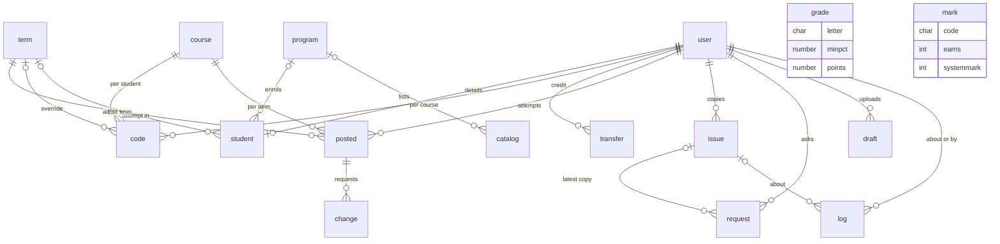

# Data model

This page covers the 14 tables of Academic Transcript, how they relate, what the plugin keeps outside them, and the JSON snapshot in the issue table. The schema is `local/academictranscript/db/install.xml`, and the upgrade steps are in `local/academictranscript/db/upgrade.php`.

## Contents

- [Rules that hold for every table](#rules-that-hold-for-every-table)
- [How the tables relate](#how-the-tables-relate)
- [School settings](#school-settings)
  - [`local_academictranscript_grade`](#local_academictranscript_grade)
  - [`local_academictranscript_mark`](#local_academictranscript_mark)
  - [`local_academictranscript_program`](#local_academictranscript_program)
  - [`local_academictranscript_catalog`](#local_academictranscript_catalog)
  - [`local_academictranscript_term`](#local_academictranscript_term)
- [The student's record](#the-students-record)
  - [`local_academictranscript_student`](#local_academictranscript_student)
  - [`local_academictranscript_code`](#local_academictranscript_code)
  - [`local_academictranscript_transfer`](#local_academictranscript_transfer)
  - [`local_academictranscript_posted`](#local_academictranscript_posted)
  - [`local_academictranscript_change`](#local_academictranscript_change)
- [Official transcripts](#official-transcripts)
  - [`local_academictranscript_issue`](#local_academictranscript_issue)
  - [`local_academictranscript_request`](#local_academictranscript_request)
- [Working tables](#working-tables)
  - [`local_academictranscript_log`](#local_academictranscript_log)
  - [`local_academictranscript_draft`](#local_academictranscript_draft)
- [The snapshot in the issue table](#the-snapshot-in-the-issue-table)
- [What is stored outside the tables](#what-is-stored-outside-the-tables)
- [Upgrade steps](#upgrade-steps)
- [Related pages](#related-pages)

## Rules that hold for every table

- Only the privacy provider deletes rows. The plugin has no other delete: a grade row retires, a mark or a program goes inactive, a transfer row hides, and a draft keeps its status. See [what the provider deletes](privacy.md#what-a-deletion-removes).
- Nothing purges old rows. The log, the decided drafts and the retired grade rows grow for as long as the site runs.
- Every time column holds Unix seconds.
- `usermodified` holds `$USER->id` at the moment of the save. It can be 0 on rows made at install, because `scale::replace_grades()` and `scale::save_marks()` write `$USER->id ?? 0`.
- Moodle turns a `foreign` key in `install.xml` into an index and no database constraint, so the database doesn't protect these references.
- Some columns point at another table with no key in `install.xml`. The diagram below shows the ones between tables of this plugin with the declared keys. They are `local_academictranscript_student.programid`, `local_academictranscript_student.admitterm`, `local_academictranscript_catalog.programid`, `local_academictranscript_code.termid`, `local_academictranscript_posted.termid`, and `local_academictranscript_log.issueid`. The user columns with no key are every `usermodified`, `local_academictranscript_posted.postedby`, `local_academictranscript_change.requestedby`, `local_academictranscript_change.decidedby`, `local_academictranscript_log.userid`, `local_academictranscript_log.studentid`, `local_academictranscript_draft.userid` and `local_academictranscript_draft.decidedby`.
- `tests/schema_test.php` fails when a column name is a reserved word in MySQL, MariaDB or PostgreSQL. `tests/privacy/provider_test.php` fails when a new table or column is neither declared in the privacy metadata nor listed as holding no personal data.

## How the tables relate

The boxes leave out the prefix `local_academictranscript_`. `user` and `course` are Moodle's tables. `grade` and `mark` stand alone: they are looked up by the letter or code stored in other rows, so changing the scale changes every transcript that isn't frozen.

| Group | Tables | Who writes |
|---|---|---|
| School settings | `local_academictranscript_grade`, `local_academictranscript_mark`, `local_academictranscript_program`, `local_academictranscript_catalog`, `local_academictranscript_term` | Holders of `local/academictranscript:configure` and, for terms, `local/academictranscript:managerecords` |
| The student's record | `local_academictranscript_student`, `local_academictranscript_code`, `local_academictranscript_transfer`, `local_academictranscript_posted`, `local_academictranscript_change` | Teachers and records staff |
| Official transcripts | `local_academictranscript_issue`, `local_academictranscript_request` | Staff who issue, and students who ask |
| Working tables | `local_academictranscript_log`, `local_academictranscript_draft` | Every flow, and the setup wizard |

A student with a file in Student Records has a transcript built from that plugin's tables. For that student, this plugin uses none of `local_academictranscript_student`, `local_academictranscript_transfer` or `local_academictranscript_grade` when it builds a transcript. It reads `local_academictranscript_mark` only to borrow the wording of a mark when the scale there has none, and `local_academictranscript_posted` only to look for grades that went missing. See [what changes with Student Records](integration.md#with-and-without-student-records).

## School settings

### `local_academictranscript_grade`

The grading scale. The rows with `active` = 1 are the scale, and `scale::grades()` reads them, highest `minpct` first.

| Column | Type | Null | Default | Meaning |
|---|---|---|---|---|
| `id` | int(10) | no | sequence | Row id. |
| `letter` | char(10) | no | none | The grade as it prints, such as `A-`. `scale::replace_grades()` trims it and cuts it to 10 characters. |
| `minpct` | number(10,4) | no | `0` | Lowest percentage of the row. `calculator::letter()` chooses on this column alone. |
| `maxpct` | number(10,4) | no | `100` | Highest percentage of the row. It prints in the key, and `scale::validate_rows()` checks it. It never chooses a letter. |
| `points` | number(10,2) | no | `0` | Grade points per hour. Quality points are hours times this value. |
| `ingpa` | int(1) | no | `1` | 1 when the letter counts in the GPA. |
| `earns` | int(1) | no | `1` | 1 when the letter earns the course hours. The standard scale has 0 on `F` only. |
| `description` | char(255) | yes | none | Text for the transcript key. Equal descriptions in a run of rows merge into one cell. |
| `percentlabel` | char(50) | yes | none | Text that replaces the percentage range in the key. When it is empty, `scale::percent_label()` works the range out. |
| `active` | int(1) | no | `1` | 1 when the row is part of the scale. 0 is a retired row. Nothing reads a retired row. |
| `usermodified` | int(10) | no | `0` | The user who saved the row. It can be 0 on rows made at install. |
| `timemodified` | int(10) | no | `0` | When the row was saved. |

Keys: `primary` (primary) on `id`.

Indexes: none.

Only `scale::replace_grades()` writes this table. It sets every active row to 0 and inserts the new set, in one transaction. Its callers are `local/academictranscript/grading.php`, step Grading of `local/academictranscript/setup.php`, `drafts::approve()`, and `scale::load_defaults()` at install.

There is no unique index on `letter`, because a letter repeats across retired rows. `scale::validate_rows()` stops two active rows with the same letter, on the two paths that take typed values. Tests: `scale_test::test_replace_grades_retires_old_rows()`, `scale_test::test_validate_rows_reports_problems()`.

### `local_academictranscript_mark`

Marks that stand in place of a letter: P, NP, I, NC, W, TR, IP and any the school adds. `scale::marks()` reads the active ones, by `sortorder`.

| Column | Type | Null | Default | Meaning |
|---|---|---|---|---|
| `id` | int(10) | no | sequence | Row id. |
| `code` | char(10) | no | none | The mark as it prints. `scale::save_marks()` upper-cases it and cuts it to 10 characters. |
| `label` | char(100) | no | none | Short name, shown in menus and used as the footnote of a row. |
| `description` | char(255) | yes | none | Text for the transcript key. When it is empty, the key prints `label`. |
| `earns` | int(1) | no | `0` | 1 when the mark earns the course hours. |
| `systemmark` | int(1) | no | `0` | 1 for `TR` and `IP`. Teachers can't give a system mark. |
| `sortorder` | int(10) | no | `0` | Position in the key and in menus. A new mark goes last. |
| `active` | int(1) | no | `1` | 0 hides the mark. `scale::marks()` reads active marks only, so a grade with a hidden mark stops earning. |
| `usermodified` | int(10) | no | `0` | The user who saved the row. It can be 0 on rows made at install. |
| `timemodified` | int(10) | no | `0` | When the row was saved. |

Keys: `primary` (primary) on `id`.

Indexes: `code` on `code` (unique).

`scale::save_marks()` is the only writer, and it matches on `code`. It leaves `systemmark` and `sortorder` alone on an update. A new row gets `systemmark` 1 when its code is `scale::TRANSFER` or `scale::INPROGRESS`. Test: `scale_test::test_save_marks_updates_by_code_and_keeps_system_flags()`.

### `local_academictranscript_program`

Programs of this plugin. They have nothing to do with the programs in Student Records.

| Column | Type | Null | Default | Meaning |
|---|---|---|---|---|
| `id` | int(10) | no | sequence | Row id. |
| `name` | char(255) | no | none | Program name. Prints on the transcript. |
| `credential` | char(255) | yes | none | The award the program leads to. Copied into the transcript data and into snapshots. No page of a transcript and no PDF prints it. |
| `unittype` | char(10) | no | `credit` | `credit` or `clock`. The student's program decides which hours a transcript shows. |
| `totalhours` | number(10,2) | yes | none | Hours the program needs. Stored and shown on `local/academictranscript/programs.php`. Nothing calculates with it. |
| `active` | int(1) | no | `1` | 0 takes the program out of `programs::menu()`. |
| `usermodified` | int(10) | no | `0` | The user who saved the row. |
| `timemodified` | int(10) | no | `0` | When the row was saved. |

Keys: `primary` (primary) on `id`.

Indexes: `name` on `name` (unique).

`programs::save()` is the only writer. It matches on `id` when it has one, and on `name` otherwise.

### `local_academictranscript_catalog`

Course catalog. A Moodle course with the same course code and no value of its own takes `hours` and `unittype` from here.

| Column | Type | Null | Default | Meaning |
|---|---|---|---|---|
| `id` | int(10) | no | sequence | Row id. |
| `code` | char(50) | no | none | Course code, matched to a course without regard to case. |
| `title` | char(255) | no | none | Course title. Shown on `local/academictranscript/catalog.php` only. A transcript takes the title from the course. |
| `hours` | number(10,2) | no | `0` | Hours that fill a course with no Hours value. |
| `unittype` | char(10) | no | `credit` | `credit` or `clock`. Fills a course with no Hour type value. |
| `programid` | int(10) | yes | none | A row of `local_academictranscript_program`, or null. Counted in the wizard and shown in the list. |
| `active` | int(1) | no | `1` | Only active rows fill a course. |
| `usermodified` | int(10) | no | `0` | The user who saved the row. |
| `timemodified` | int(10) | no | `0` | When the row was saved. |

Keys: `primary` (primary) on `id`.

Indexes: `code` on `code` (unique).

`programs::save_course()` is the only writer, and it matches on `code`. To rename a code, `local/academictranscript/catalog.php` sets the new code on the row first, so that `programs::save_course()` finds it. `programs::catalog_by_code()` reads the active rows, and `coursefields::get_resolved()` is the only caller that fills a course from them.

`programid` has no key in `install.xml`.

### `local_academictranscript_term`

Terms of this plugin. For a student with a file in Student Records the transcript uses that plugin's terms, but a posting still needs a term from this list. See [posting with Student Records](integration.md#posting-to-student-records).

| Column | Type | Null | Default | Meaning |
|---|---|---|---|---|
| `id` | int(10) | no | sequence | Row id. |
| `name` | char(100) | no | none | Term name. Prints as the title of a term block. |
| `startdate` | int(10) | no | `0` | Start of the term. Terms sort by this column, then by `id`. |
| `enddate` | int(10) | no | `0` | End of the term. |
| `optionindex` | int(10) | no | `0` | The option number of this term in the course field `transcript_term`. A new term takes the highest number plus 1, and a number is never reused. |
| `usermodified` | int(10) | no | `0` | The user who saved the row. |
| `timemodified` | int(10) | no | `0` | When the row was saved. |

Keys: `primary` (primary) on `id`.

Indexes: `name` on `name` (unique); `optionindex` on `optionindex` (unique).

`terms::save()` is the only writer. After every save it rewrites the options of the course field with `terms::sync_field()`. A rename keeps `optionindex`, so the option number saved on a course still means the same term. Don't reuse or renumber `optionindex`: the values saved on courses are those numbers. Test: `terms_test::test_save_appends_option_index()`.

## The student's record

### `local_academictranscript_student`

Transcript details of one student. The table comment says it: no SSN is stored. `form\student_record` has no field for one on purpose.

| Column | Type | Null | Default | Meaning |
|---|---|---|---|---|
| `id` | int(10) | no | sequence | Row id. |
| `userid` | int(10) | no | none | The student. The key makes it one row per user. |
| `studentid` | char(100) | yes | none | Student ID. When it is blank, the transcript prints the Moodle ID number (`user.idnumber`). |
| `dob` | int(10) | yes | none | Date of birth, or null. |
| `programid` | int(10) | yes | none | A row of `local_academictranscript_program`, or null. No program means credit hours. |
| `qualification` | char(255) | yes | none | The award as it prints. Any text here prints the Degree box. |
| `awarddate` | int(10) | yes | none | Date of the award, or null. |
| `admitterm` | int(10) | yes | none | A row of `local_academictranscript_term`, or null. It holds a term id, and the name comes from the term. |
| `status` | char(20) | yes | none | One of `transcript::STATUSES`, or null. |
| `usermodified` | int(10) | no | `0` | The user who saved the row. |
| `timemodified` | int(10) | no | `0` | When the row was saved. |

Keys: `primary` (primary) on `id`; `userid` (foreign-unique) on `userid`, to `user`.`id`.

Indexes: none.

`local/academictranscript/record.php` is the only writer. `transcript::build()` reads the row, and `local/academictranscript/students.php` reads `studentid` for its list. `programid` and `admitterm` have no key in `install.xml`.

For a student with a file in Student Records the page still saves these values, and the transcript uses none of them. Only `local/academictranscript/students.php` still shows `studentid`.

### `local_academictranscript_code`

One row per student and course, for three separate things: the hand-entered mark with its reason, the footnote, and the term override.

| Column | Type | Null | Default | Meaning |
|---|---|---|---|---|
| `id` | int(10) | no | sequence | Row id. |
| `userid` | int(10) | no | none | The student. |
| `courseid` | int(10) | no | none | The course. |
| `code` | char(10) | yes | none | The mark a teacher chose, or null. It replaces the letter at posting, and posting sets it back to null. |
| `note` | char(255) | yes | none | Footnote for the course. It moves to the posted row at posting, and posting empties it here. |
| `reason` | char(255) | yes | none | Why the code changed. Not printed. After posting it holds the text of `clearedonpost`. |
| `termid` | int(10) | yes | none | A row of `local_academictranscript_term` that overrides the course's term for this student, or null. |
| `usermodified` | int(10) | no | `0` | The user who saved the row. |
| `timemodified` | int(10) | no | `0` | When the row was saved. |

Keys: `primary` (primary) on `id`; `userid` (foreign) on `userid`, to `user`.`id`; `courseid` (foreign) on `courseid`, to `course`.`id`.

Indexes: `usercourse` on `userid, courseid` (unique).

Three places write it:

- `local/academictranscript/codes.php` writes `code`, `note` and `reason`. The row holds only the current value, so the event `code_updated` in Moodle's log is the only history.
- `local/academictranscript/studentterms.php` writes `termid`. It fires no event, and it logs `termoverride`.
- `posting::save_posted()` clears `code` and `note` and writes the text of `clearedonpost` to `reason`. The row stays, so a later attempt starts clean and keeps any term override.

`termid` has no key in `install.xml`.

### `local_academictranscript_transfer`

Transfer credit from this plugin's own data. For a student with a file in Student Records, transfer credit comes from that plugin.

| Column | Type | Null | Default | Meaning |
|---|---|---|---|---|
| `id` | int(10) | no | sequence | Row id. |
| `userid` | int(10) | no | none | The student. |
| `institution` | char(255) | no | none | The school the credit came from. Rows group by this text. |
| `coursecode` | char(50) | yes | none | Course code at that school. It can be empty. |
| `title` | char(255) | no | none | Course title at that school. |
| `hours` | number(10,2) | no | `0` | Hours accepted. |
| `dateaccepted` | int(10) | yes | none | Date the credit was accepted, or null. It sorts the rows and doesn't print on a transcript. |
| `note` | char(255) | yes | none | Footnote for the row. |
| `active` | int(1) | no | `1` | 1 shows the row on the transcript. 0 hides it. |
| `usermodified` | int(10) | no | `0` | The user who saved the row. |
| `timemodified` | int(10) | no | `0` | When the row was saved. It feeds the Last Entry date. |

Keys: `primary` (primary) on `id`; `userid` (foreign) on `userid`, to `user`.`id`.

Indexes: none.

`local/academictranscript/transfer.php` is the only writer. `transcript::build()` reads the rows with `active` = 1, in `institution`, `dateaccepted` and `id` order.

### `local_academictranscript_posted`

Final grades. One row is one attempt: the student, the course and the term. This is the table a transcript from own data reads.

| Column | Type | Null | Default | Meaning |
|---|---|---|---|---|
| `id` | int(10) | no | sequence | Row id. |
| `userid` | int(10) | no | none | The student. |
| `courseid` | int(10) | no | none | The course. |
| `termid` | int(10) | no | none | A row of `local_academictranscript_term`: the term of this attempt. |
| `coursecode` | char(50) | no | none | Course code when the grade was posted. No page edits it. |
| `coursename` | char(255) | no | none | Course title when the grade was posted, from `posting::title()`. No page edits it. |
| `hours` | number(10,2) | no | `0` | Hours when the grade was posted. No page edits them. |
| `unittype` | char(10) | no | `credit` | `credit` or `clock` of the course. Stored and not read: the transcript uses the student's program. |
| `percent` | number(10,5) | yes | none | Course total when the grade was posted. Null for a hand-entered mark, and cleared when an approved change alters the grade. Nothing reads it. |
| `grade` | char(10) | no | none | The final grade: a letter or a mark. |
| `note` | char(255) | yes | none | Footnote for the course. |
| `postedby` | int(10) | no | none | The user who posted the grade. |
| `timeposted` | int(10) | no | `0` | When the grade was posted. It breaks ties between attempts in one term. |
| `timemodified` | int(10) | no | `0` | When the row last changed. It feeds the Last Entry date. |
| `srregid` | int(10) | yes | none | The Student Records registration that got this grade, or null. `srpost::posted_target()` reads it. |

Keys: `primary` (primary) on `id`; `userid` (foreign) on `userid`, to `user`.`id`; `courseid` (foreign) on `courseid`, to `course`.`id`.

Indexes: `attempt` on `userid, courseid, termid` (unique).

- `posting::save_posted()` inserts the row, and only `posting::decide()` updates it, and then only `grade`, `note`, `percent` and `timemodified`.
- The unique index `attempt` is the last guard against a double posting. `posting::save_posted()` checks first and throws `alreadyposted`.
- A second post in one term is refused. A course that runs in another term makes a new attempt, because `termid` differs. Tests: `posting_test::test_post_twice_in_same_term_fails()`, `transcript_test::test_build_marks_repeated_attempts()`.
- Find the Student Records attempt of a posted row through `srregid`. Never use `srpost::target()` for that: it answers where the next grade goes, and a course can run twice. Test: `srpost_test::test_each_posted_row_finds_its_own_attempt()`.

`termid` has no key in `install.xml`.

### `local_academictranscript_change`

Requests to change a posted grade, on the own-data path only. On the Student Records path the request lives in that plugin's table, the one `academic::CHANGES` names.

| Column | Type | Null | Default | Meaning |
|---|---|---|---|---|
| `id` | int(10) | no | sequence | Row id. |
| `postedid` | int(10) | no | none | The posted grade the request is about. |
| `oldgrade` | char(10) | no | none | The grade when the request was made. |
| `newgrade` | char(10) | no | none | The grade asked for. |
| `oldnote` | char(255) | yes | none | The footnote when the request was made. |
| `newnote` | char(255) | yes | none | The footnote asked for. An approval writes it to the posted row, even when it is empty. |
| `reason` | char(255) | no | none | Why the change was asked for. Not printed. |
| `status` | char(10) | no | `pending` | `pending`, `approved` or `rejected`. |
| `requestedby` | int(10) | no | none | The user who asked. |
| `timerequested` | int(10) | no | `0` | When the request was made. |
| `decidedby` | int(10) | yes | none | The user who decided, or null. |
| `timedecided` | int(10) | yes | none | When it was decided, or null. |
| `decisionnote` | char(255) | yes | none | Note on the decision, or null. |

Keys: `primary` (primary) on `id`; `postedid` (foreign) on `postedid`, to `local_academictranscript_posted`.`id`.

Indexes: `status` on `status` (not unique).

`posting::request_change()` inserts the row and `posting::decide()` updates it. One `pending` row per posted grade is the rule. It is checked in code, and no index enforces it. See [requesting a grade change](execution-flows.md#requesting-a-grade-change).

## Official transcripts

### `local_academictranscript_issue`

One row per Official transcript. No PDF is stored: each download draws the PDF again from `snapshot`.

| Column | Type | Null | Default | Meaning |
|---|---|---|---|---|
| `id` | int(10) | no | sequence | Row id. The transcript number is built from it. |
| `userid` | int(10) | no | none | The student. |
| `verifycode` | char(32) | no | none | 24 characters from `ABCDEFGHJKLMNPQRSTUVWXYZ23456789`, stored without dashes. The column is wider than the code. |
| `issuedby` | int(10) | no | none | The user who issued the transcript. |
| `snapshot` | text | no | none | The transcript as issued, as JSON. See [the snapshot](#the-snapshot-in-the-issue-table). |
| `timecreated` | int(10) | no | `0` | When the transcript was issued. |
| `recipient` | char(255) | yes | none | The Issued To text, cut to 255 characters. From the queue, an email delivery adds ` <address>` to the recipient. |
| `transcriptno` | char(20) | yes | none | `T-<year>-<id>`, with the id in 6 digits, such as `T-2026-000123`. |

Keys: `primary` (primary) on `id`; `userid` (foreign) on `userid`, to `user`.`id`; `issuedby` (foreign) on `issuedby`, to `user`.`id`.

Indexes: `verifycode` on `verifycode` (unique).

`transcript::issue()` is the only writer. It inserts the row with an empty snapshot, because the transcript number needs the id. Then it sets `transcriptno`, fills the snapshot and updates the row, in one transaction. No code changes a row after that. Test: `transcript_test::test_issue_freezes_snapshot_and_code()`.

### `local_academictranscript_request`

Requests for an Official transcript. See [requesting an Official transcript](execution-flows.md#requesting-an-official-transcript).

| Column | Type | Null | Default | Meaning |
|---|---|---|---|---|
| `id` | int(10) | no | sequence | Row id. |
| `userid` | int(10) | no | none | The student. |
| `delivery` | char(10) | no | `email` | `email`, `mail` or `pickup`. |
| `recipient` | char(255) | no | none | The person or office it goes to. |
| `email` | char(255) | yes | none | The address, for email delivery only. Null otherwise. |
| `address` | text | yes | none | The mailing address, for mail delivery only. Null otherwise. |
| `timing` | char(10) | no | `now` | `now`, `grades` or `degree`. |
| `fee` | number(10,2) | no | `0` | The fee on the day of the request. It doesn't follow a later change to the setting. |
| `charged` | int(1) | no | `0` | 1 when the fee went on the Student Records account. |
| `status` | char(10) | no | `pending` | `pending`, `issued` or `cancelled`. The states `onhold` and `waiting` are worked out and never stored. |
| `issueid` | int(10) | yes | none | The latest copy issued for the request, or null. A Reissue overwrites it. |
| `issuedby` | int(10) | yes | none | The user who made the latest copy, or null. A Reissue overwrites it. |
| `timeissued` | int(10) | yes | none | When the latest copy was made, or null. A Reissue overwrites it. |
| `note` | char(255) | yes | none | The reason for a cancellation. |
| `timecreated` | int(10) | no | `0` | When the student asked. |
| `timemodified` | int(10) | no | `0` | When the row last changed. |

Keys: `primary` (primary) on `id`; `userid` (foreign) on `userid`, to `user`.`id`; `issueid` (foreign) on `issueid`, to `local_academictranscript_issue`.`id`; `issuedby` (foreign) on `issuedby`, to `user`.`id`.

Indexes: `status` on `status` (not unique).

`requests::save_request()` inserts the row, `requests::issue_request()` marks it issued and `requests::cancel_request()` marks it cancelled.

A Reissue overwrites `issueid`, `issuedby` and `timeissued`, so the row points to the latest copy only. The older copies stay in `local_academictranscript_issue`, and their codes keep working.

## Working tables

### `local_academictranscript_log`

The activity log, read by `local/academictranscript/log.php`. Every row comes from `logger::log()`.

| Column | Type | Null | Default | Meaning |
|---|---|---|---|---|
| `id` | int(10) | no | sequence | Row id. |
| `action` | char(30) | no | none | One of `logger::ACTIONS`. `logger::log()` doesn't check it, and `local/academictranscript/log.php` needs a `logaction_` string for it. |
| `userid` | int(10) | no | `0` | Who did it, or 0 when nobody was logged in. |
| `studentid` | int(10) | no | `0` | The student it is about, or 0 for a failed verification. |
| `issueid` | int(10) | no | `0` | The issued transcript it is about, or 0. |
| `ip` | char(45) | yes | none | The address from `getremoteaddr()`. |
| `info` | char(255) | yes | none | Details, cut to 255 characters. See [the info of each action](#what-the-log-info-holds). |
| `timecreated` | int(10) | no | `0` | When it happened. |

Keys: `primary` (primary) on `id`.

Indexes: `studentid` on `studentid` (not unique); `timecreated` on `timecreated` (not unique).

None of `userid`, `studentid` or `issueid` has a key in `install.xml`.

#### What the log info holds

| Action | Who writes it | `info` |
|---|---|---|
| `view` | `local/academictranscript/index.php`, on every view | empty |
| `unofficial` | `local/academictranscript/index.php` | empty |
| `issue` | `transcript::issue()` | `to: <recipient>` |
| `redownload` | `local/academictranscript/issued.php` | empty |
| `verify_ok` | `local/academictranscript/verify.php` | empty |
| `verify_fail` | `local/academictranscript/verify.php` | up to 40 characters of the cleaned code |
| `post` | `posting::post()` | `course <id> term <id> grade <grade>`, and ` studentrecords reg <id>` when it went there |
| `change_request` | `posting::request_change()` | `change <id> posted <id> <old> -> <new>` |
| `change_approve`, `change_reject` | `posting::decide()` | `change <id> posted <id> <old> -> <new>` |
| `transfer` | `local/academictranscript/transfer.php` | `transfer <id> <code> <hours> active <0 or 1>` |
| `termoverride` | `local/academictranscript/studentterms.php` | `course <id> term <old> -> <new>` |
| `request` | `requests::save_request()` | `<delivery> <timing>` |
| `request_issued` | `requests::issue_request()` | the request id |
| `request_cancelled` | `requests::cancel_request()` | the request id and the note |
| `after_saving` | `logger::commit()` | the error message |

### `local_academictranscript_draft`

Items read from uploaded documents or CSV files. Nothing reaches the settings tables until someone approves it. See [the setup wizard and its drafts](execution-flows.md#the-setup-wizard-and-its-drafts).

| Column | Type | Null | Default | Meaning |
|---|---|---|---|---|
| `id` | int(10) | no | sequence | Row id. |
| `itemtype` | char(20) | no | none | `grade`, `mark`, `program` or `course`. |
| `data` | text | no | none | The item as JSON. An approval overwrites it with the values as edited. |
| `source` | char(10) | no | `ai` | `ai` or `csv`. |
| `sourcename` | char(255) | yes | none | The name of the uploaded file. |
| `sourcefileid` | int(10) | yes | none | The `id` in core's `files` table of a document, or null for a CSV file. |
| `excerpt` | text | yes | none | The passage the item came from. For a CSV file, the line. |
| `quotefound` | int(1) | no | `0` | 1 when `drafts::quote_found()` found the excerpt in the document, ignoring case, spacing and most punctuation. Always 0 for a CSV file. |
| `status` | char(10) | no | `draft` | `draft`, `approved` or `rejected`. |
| `userid` | int(10) | no | `0` | The user who uploaded the file. |
| `timecreated` | int(10) | no | `0` | When the item was read. |
| `decidedby` | int(10) | yes | none | The user who approved or rejected it, or null. |
| `timedecided` | int(10) | yes | none | When it was decided, or null. |

Keys: `primary` (primary) on `id`.

Indexes: `statustype` on `status, itemtype` (not unique).

`drafts::store()` inserts rows, `drafts::approve()` and `drafts::reject()` decide them, and decided rows stay. `userid` and `decidedby` have no key in `install.xml`.

The shape of `data` follows `drafts::FIELDS`:

| `itemtype` | Keys in `data` |
|---|---|
| `grade` | `letter`, `minpct`, `maxpct`, `points`, `ingpa`, `earns`, `description` |
| `mark` | `code`, `label`, `description`, `earns` |
| `program` | `name`, `credential`, `unittype`, `totalhours` |
| `course` | `code`, `title`, `hours`, `unittype`, `program` (a name, resolved at approval) |

## The snapshot in the issue table

`local_academictranscript_issue.snapshot` is the array from `transcript::build()` plus four keys that `transcript::issue()` adds, as JSON. A later change to the record, the scale or the settings never changes it. How a snapshot becomes a PDF, and what stays live, is on [the PDF page](pdf-and-signing.md#what-is-frozen-and-what-stays-live).

### Keys of the snapshot

| Key | From | Holds |
|---|---|---|
| `version` | `transcript::build()` | `transcript::DATA_VERSION`, which is 1. Written and never read |
| `userid` | `transcript::build()` | The student |
| `fullname` | `transcript::build()` | `fullname()` of the user, or the legal name in Student Records |
| `studentid` | `transcript::build()` | The Student ID, or the Moodle ID number |
| `dob` | `transcript::build()` | Date of birth, or null |
| `program` | `transcript::build()` | Program name, as plain text |
| `credential` | `transcript::build()` | The program's credential |
| `admitterm` | `transcript::build()` | The term's name |
| `status` | `transcript::build()` | The status as text, in the language of whoever issued |
| `qualification` | `transcript::build()` | The award text |
| `awarddate` | `transcript::build()` | Date of the award, or null |
| `unittype` | `transcript::build()` | `credit` or `clock` |
| `unitlabel` | `transcript::build()` | The label from `programs::unit_label()` |
| `unitshort` | `transcript::build()` | `Cr` or `Hrs`, from `programs::unit_short()` |
| `transfer` | `transcript::build()` | List of institution groups |
| `terms` | `transcript::build()` | List of terms |
| `summary` | `transcript::build()` | `institutional`, `transfer` and `overall`, each with `earned`, `gpahours`, `qp`, `gpa` |
| `lastentry` | `transcript::build()` | The newest change to the record, or null |
| `problems` | `transcript::build()` | Always empty: a transcript with problems can't be issued |
| `generated` | `transcript::issue()` | The time of issue, over the time of the build |
| `source` | `transcript::build()` | `studentrecords` for a student with a file, and absent otherwise |
| `recipient` | `transcript::issue()` | The Issued To text |
| `transcriptno` | `transcript::issue()` | The transcript number |
| `key` | `transcript::issue()` | The rows of the key at that moment, from `transcript::key_rows()` |

A term is `name`, `startdate`, `enddate`, `rows`, `earned`, `gpahours`, `qp` and `gpa`. An institution group is `institution`, `rows` and `earned`.

A row, in a term or an institution group, is `code`, `title`, `hours`, `grade`, `points`, `qp`, `ingpa`, `earned`, `notes` (a list of strings) and `posted`.

A row of `key` is `grade`, `points`, `percent`, `description`, `rowspan`, `ismark` and `ingpa`. `scale::key_rows()` builds it.

### Versions of a snapshot

Sites that ran builds from before the first public release hold older snapshots, and the verification codes of those copies still work. `transcript::stored()` brings a stored copy to the layout the builder reads. It looks at the keys, and never at `version`:

| The copy | What `transcript::stored()` does | Result |
|---|---|---|
| Not JSON, or `terms` isn't an array | Returns null | `local/academictranscript/issued.php` throws `issuedoldlayout`, and the copy can't be drawn. `local/academictranscript/verify.php` still confirms it, because it decodes the JSON itself |
| Has `unitshort` | Returns it as it is | Today's layout |
| Has `terms` and no `unitshort` | Takes each row's `hours` from `hours`, else `credits`, in terms and in transfer. Sets `unittype` to credit, `unitlabel` from `calendar` or the credit label, `unitshort`, and `credential` to empty when missing | Today's layout |

Never read the layout from the version number. The number in this repo restarted at 1, and it matches the layout an older build called 3. So a stored 2 is older than a stored 1, and a copy with no `version` at all is the oldest. Tests: `transcript_test::test_stored_returns_a_current_copy_as_it_is()`, `transcript_test::test_stored_brings_an_older_copy_up_to_date()`, `transcript_test::test_stored_refuses_what_it_cannot_draw()`, `builder_test::test_an_older_issued_copy_still_draws()`, `pages_test::test_downloading_a_transcript_too_old_to_draw_explains_itself()`.

To change the layout, see [what is safe to change](extending.md#what-is-safe-to-change-and-what-isnt).

## What is stored outside the tables

### Config

Moodle's `config_plugins` table holds every setting under the plugin name `local_academictranscript`, plus `setupcomplete` and `docbatch`. All of them are on [the settings page](settings.md).

### Files

All files are in the system context, under the component `local_academictranscript`.

| File area | Item id | Holds | Served by `local_academictranscript_pluginfile()` to |
|---|---|---|---|
| `logo` | 0 | The school logo | Any logged-in user |
| `signatureimage` | 0 | The signature image | Holders of `local/academictranscript:managerecords` |
| `sealimage` | 0 | The seal image | Holders of `local/academictranscript:managerecords` |
| `signingcert` | 0 | The `.p12` or `.pfx` signing certificate | Nobody. The callback refuses this area |
| `sourcedocs` | the value of `docbatch` | Documents uploaded in the wizard | Holders of `local/academictranscript:configure` |

Nothing deletes a file in `sourcedocs` except the uninstall. Approving or rejecting a draft, and a privacy deletion, leave the document in place.

### The data folder

`signer::selfsigned()` keeps `selfsigned-cert.pem` and `selfsigned-key.pem` in `<dataroot>/local_academictranscript/signing`. The key file gets mode 0600. `xmldb_local_academictranscript_uninstall()` deletes the whole `local_academictranscript` folder with `fulldelete()`.

### Course custom fields

`coursefields::ensure()` creates four fields in the category Transcript, in Moodle's custom field tables. The values live in core's `customfield_data` table against the field short names, so those names can't change.

| Constant | Short name | Type | Value |
|---|---|---|---|
| `coursefields::CODE` | `transcript_coursecode` | text, required, unique | The course code |
| `coursefields::HOURS` | `transcript_creditunits` | number, 0 to 5000, 1 decimal | Hours |
| `coursefields::HOURTYPE` | `transcript_hourtype` | select | 1 is credit hours, 2 is clock hours |
| `coursefields::TERM` | `transcript_term` | select | The `optionindex` of a term |

All four are locked, so only holders of `moodle/course:changelockedcustomfields` can edit them on the course form. `coursefields::release()` runs at uninstall: it frees the first three and keeps their values, and it deletes the Term field with its values, because those numbers mean nothing without the term list. Tests: `uninstall_test::test_uninstall_keeps_values_and_relaxes_fields()`, `uninstall_test::test_uninstall_deletes_term_field_and_signing_key()`.

### Moodle's log

The events `code_updated` and `official_issued` go to Moodle's own log. `code_updated` is the only record of a code's old value. See [events](integration.md#events).

## Upgrade steps

`xmldb_local_academictranscript_upgrade()` has three savepoints. Each step checks before it acts, so it is safe on a site that already has the change.

| Savepoint | What it does |
|---|---|
| `2026111600` | Creates `local_academictranscript_request` from `install.xml` when it is missing |
| `2026111606` | Adds `srregid` to `local_academictranscript_posted`, after `timemodified`, when it is missing |
| `2026111607` | Drops the columns `program` and `admissiondate` of `local_academictranscript_student`, left by builds from before the first public release, when they hold nothing the other columns don't |

The last step keeps `program` when any row has a program name and no `programid`, and keeps `admissiondate` when any row has a value other than null or 0. Nothing reads those columns. Tests: `upgrade_test::test_upgrade_drops_the_old_student_columns_when_nothing_is_lost()`, `upgrade_test::test_upgrade_keeps_an_old_student_column_that_holds_something()`.

No step touches a snapshot. `transcript::stored()` deals with old copies when one is downloaded.

To add a table or a column, see [extending](extending.md#add-a-table-or-a-column).

## Related pages

- [Code map](README.md)
- [Execution flows](execution-flows.md)
- [PDF and signing](pdf-and-signing.md)
- [Settings](settings.md)
- [Integration](integration.md)
- [Privacy](privacy.md)
