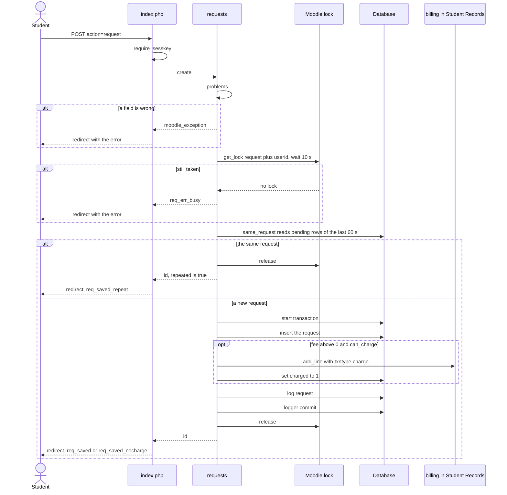
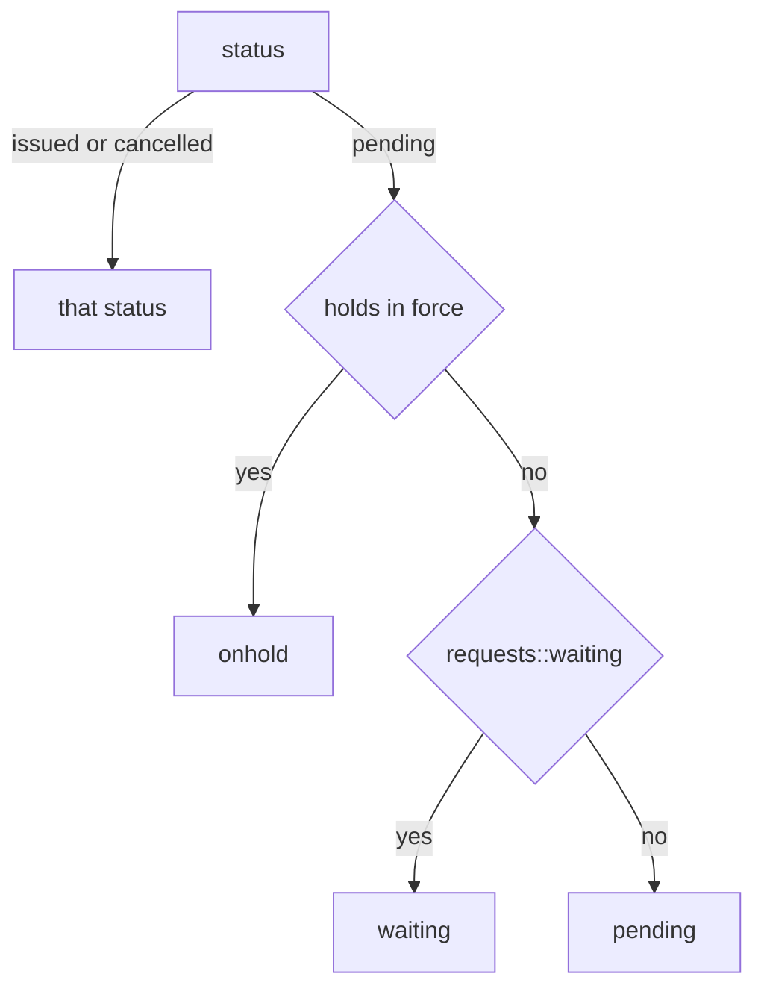
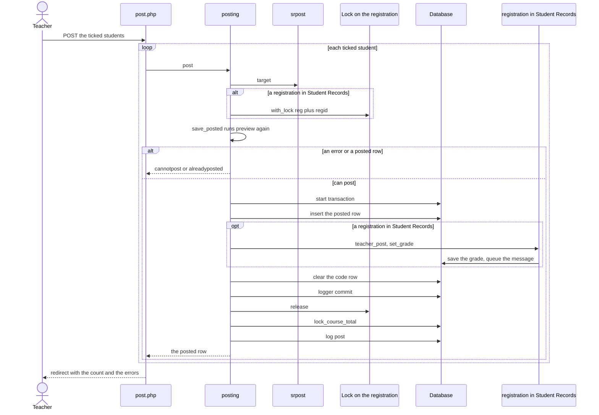

# Execution flows

This page traces each flow of Academic Transcript through the code. Each flow gives the entry point, the checks in order, the path through the classes, where a lock and a transaction start and end, what it writes, what it sends, and what happens on failure.

The plugin sends no mail and runs no task. Every flow starts on a page and ends in the same request. Anything that looks timed, such as the state of a request, is worked out when a page loads.

## Contents

- [How the guards behave](#how-the-guards-behave)
- [Viewing a transcript](#viewing-a-transcript)
- [Building the transcript data](#building-the-transcript-data)
- [The Unofficial PDF](#the-unofficial-pdf)
- [Issuing an Official transcript from the student's page](#issuing-an-official-transcript-from-the-students-page)
- [Downloading an Official PDF](#downloading-an-official-pdf)
- [Requesting an Official transcript](#requesting-an-official-transcript)
- [The queue](#the-queue)
- [Transcript codes](#transcript-codes)
- [Posting final grades](#posting-final-grades)
- [Requesting a grade change](#requesting-a-grade-change)
- [Approving a grade change](#approving-a-grade-change)
- [The setup wizard and its drafts](#the-setup-wizard-and-its-drafts)
- [Verify](#verify)
- [Saving student details, transfer credit and terms](#saving-student-details-transfer-credit-and-terms)
- [Related pages](#related-pages)

## How the guards behave

A refusal looks different depending on the guard. The full table of pages is on [the access page](access.md#the-guard-of-each-page).

| Guard | What the person gets |
|---|---|
| `require_login()` | Moodle's login page. With a course, Moodle's course access rules apply too |
| `require_capability()`, `required_capability_exception` | Moodle's error page with the core string `nopermissions` |
| `admin_externalpage_setup()` | `require_login(null, false)`, then the capability of the admin tree entry. A refusal is the admin string `accessdenied` |
| `require_sesskey()` | Moodle's error page with `invalidsesskey` |
| `data_submitted() && confirm_sesskey()` | No error at all: the post is ignored, and the page shows as on a plain load |
| `access::require_setup()` | A redirect to the wizard, for holders of `local/academictranscript:configure` only, while `setupcomplete` is empty |

A `moodle_exception` that nothing catches ends on Moodle's error page. Moodle's exception handler rolls back any open transaction first.

## Viewing a transcript

Entry point: `local/academictranscript/index.php`, with `userid` (default: the current user) and `view`.

Checks, in order:

1. `require_login(null, false)`.
2. `isguestuser()` throws `moodle_exception('noguest')`.
3. `core_user::get_user($userid, '*', MUST_EXIST)`.
4. `access::can_view()`: the person's own page with `local/academictranscript:viewown`, or `access::can_issue()`. A refusal names `local/academictranscript:issueofficial`, even on one's own page.

The page has two views in one file:

```php
$own = (int)$userid === (int)$USER->id;
$at = 'local_academictranscript';
$twoviews = $own && ($canissue || access::is_admin());
$mine = $own && (!$twoviews || optional_param('view', '', PARAM_ALPHA) === 'mine');
```

That is from `local/academictranscript/index.php`. A person with no staff tools gets My transcript and no tabs. A person with tools gets the staff view on their own page, with a tab for My transcript. On another person's page there is only the staff view.

Path: `transcript::build()`, then `logger::log('view', $userid)`.

- My transcript runs in the system context with the layout `standard`. It prints `html_view::transcript()`, a link to the Unofficial PDF, `request_view::form()`, `request_view::mine()`, and the inline script from `request_view::script()`. With Student Records installed, it also prints `shell::inline_menu()` and a breadcrumb. That test is `class_exists()`, so it doesn't depend on the setting `source`.
- The staff view runs in the student's user context with the layout `report`. In order: tabs, the setup notice, the link to a new copy, the list of `$data['problems']`, `html_view::transcript()`, the action buttons, the issue form or the reason there isn't one, the issued copies, and `html_view::scale_table()`.

Lock and transaction: none.

Writes: one `view` row in `local_academictranscript_log`, on every load, the student's own views included.

Sends: nothing.

Tests: `pages_test::test_my_transcript_is_all_a_user_without_tools_gets()`, `pages_test::test_staff_keep_their_tools_on_their_own_page()`, `pages_test::test_another_students_page_has_no_tabs()`, `pages_test::test_transcript_page_refuses_guests()`.

## Building the transcript data

Every view, every Unofficial PDF and every issue starts with `transcript::build()`, which returns one array. Nothing is cached, and it writes nothing.

1. Reads the user. With `srsource::enabled()` true, calls `srsource::collect()`, which returns null for a student with no file there.
2. Reads `local_academictranscript_student`, the terms (from `srsource::collect()` or `terms::all()`), and the program.
3. Fills `$data` with the header. For a student with a file, `$sr['header']` replaces those values and `$data['source']` is set.
4. Collects the attempts. Own data: posted rows, then courses in progress, with their problems. Student Records: `$sr['attempts']`, plus the problems from `transcript::posted_outside_student_records()`.
5. Runs `calculator::compute()`, on `srsource::calculator()` or `scale::calculator()`. For a student with a file, checks each grade with `calculator::knows()`.
6. Builds the rows and their notes, and groups them by term in term order.
7. Adds transfer credit, and writes `$data['summary']`, `$data['lastentry']` and the rest.

The names in the array are plain text. Whatever prints them escapes them once: `s()` in `html_view` and in `builder`. Keep that rule, or names with an ampersand print as `&amp;amp;`. Tests: `transcript_test::test_build_keeps_names_as_plain_text()`, `html_view_test::test_transcript_html_escapes_names_once()`.

The sums are on [the calculations page](calculations.md), and the keys of the array on [the data model page](data-model.md#keys-of-the-snapshot).

## The Unofficial PDF

Entry point: `local/academictranscript/index.php?action=unofficial`, a plain link. A GET with no sesskey is fine, because it changes nothing but the log.

Checks: the same four as [viewing](#viewing-a-transcript). Problems and holds don't stop it.

Path: `transcript::build()`, `builder::render($data, null)`, `logger::log('unofficial', $userid)`, `send_file()`, `die()`. The file name comes from `builder::filename()`.

Lock and transaction: none.

Writes: one `unofficial` log row, after the render.

Sends: the PDF to the browser, as a download. Nothing is stored.

On failure: an exception in the render reaches Moodle's error page, and no log row is written.

Tests: `builder_test::test_render_unofficial_pdf_for_student_without_courses()`, `builder_test::test_filename_marks_copy_type()`.

## Issuing an Official transcript from the student's page

Entry point: the form on the staff view of `local/academictranscript/index.php`, a POST with `action=issue` and `recipient`. A browser confirm comes first. The form shows only when the person can issue, it isn't their own page, there is no hold and there are no problems.

Checks, in order:

1. The four checks of [viewing](#viewing-a-transcript).
2. `require_sesskey()`.
3. `$canissue` from `access::can_issue()`, else `required_capability_exception`.
4. Recipient empty after trim: redirect with `recipientrequired`.
5. `requests::holds()` not empty: redirect with `issueonhold`.
6. `requests::issue_direct()` takes the lock and looks for a repeat.
7. `transcript::issue()` checks again: recipient, own transcript, hold, then `$data['problems']`.

Path:

1. `requests::issue_direct()` calls `requests::one_at_a_time()` with the resource `direct<userid>`.
2. Under the lock, `requests::same_issue()` looks for a copy for this student and this exact recipient made in the last `requests::REPEATWINDOW` seconds, which is 60. If there is one, it is returned with `$repeated` true, and nothing else runs.
3. Otherwise `transcript::issue()` runs.

`transcript::issue()`, in order:

1. Trims the recipient, and throws `recipientrequired` when it is empty.
2. Throws `issueown` when the student is the current user. Every way of issuing passes through here, so this rule has no way around it.
3. Throws `issueonhold` when `requests::holds()` isn't empty.
4. Runs `transcript::build()`, and throws `cannotissue` when `$data['problems']` isn't empty.
5. Makes a code with `transcript::new_verifycode()`.
6. In one transaction: inserts the row with an empty snapshot, sets `transcriptno` from the new id, adds `generated`, `recipient`, `transcriptno` and `key` to the data, saves the JSON, commits.
7. After the commit: fires `official_issued` and logs `issue`.

Lock and transaction: the lock `direct<userid>` starts before the transaction and ends after the commit, so the second of two clicks sees the first copy. `requests::LOCKWAIT` is 10 seconds. The lock is Moodle's, from `lock_config::get_lock_factory('local_academictranscript')`. It doesn't exclude the queue, which locks on the request.

Writes: a row in `local_academictranscript_issue`, an `issue` log row, and the event in Moodle's log. No PDF.

Sends: nothing. The page redirects to `?issued=<id>`, which shows a link to `local/academictranscript/issued.php`. Staff send the PDF themselves.

On failure: nothing on this path catches a `moodle_exception`. `issueown`, `issueonhold`, `cannotissue` and `req_err_busy` reach Moodle's error page, and the transaction, if open, rolls back. A repeat shows `issuedrepeat` and goes to the first copy.

Things to know:

- A repeat returns before the own, hold and problem checks run again, and it applies whoever clicked. A second staff member who types the same recipient within the minute gets the first copy.
- `requests::same_issue()` compares the exact text. A copy from the queue with an email delivery has ` <address>` in its recipient, so a typed name doesn't match it.
- An Official transcript can be issued with no courses at all. Only the recipient, the rule against issuing one's own transcript, a hold and problems stop it.

Tests: `requests_test::test_the_same_direct_issue_twice_makes_one_copy()`, `requests_test::test_a_direct_issue_that_waited_for_the_lock_finds_the_first_copy()`, `requests_test::test_direct_issue_holds_the_lock_past_the_commit()`, `requests_test::test_direct_issue_makes_nothing_without_the_lock()`, `requests_test::test_a_direct_issue_for_someone_else_makes_a_copy()`, `requests_test::test_the_same_direct_issue_again_later_makes_a_copy()`, `transcript_test::test_issue_freezes_snapshot_and_code()`, `transcript_test::test_issue_refuses_when_problems_exist()`, `transcript_test::test_nobody_issues_their_own_transcript()`, `pages_test::test_issue_form_makes_one_copy_for_a_double_click()`, `pages_test::test_a_hold_stops_issuing_from_the_student_page()`, `pages_test::test_staff_cannot_issue_their_own_transcript()`.

## Downloading an Official PDF

Entry point: `local/academictranscript/issued.php?id=<issue id>`, from the student's page, the queue or the list of issued copies.

Checks, in order: `require_login(null, false)`, the issue row must exist, then `access::can_issue()` for its student or `local/academictranscript:viewissued` at system level. A refusal names `local/academictranscript:viewissued`. A student can't reach this page for their own copy without one of those.

Path: `transcript::stored()`. Null throws `issuedoldlayout`, with a link back to the student. Otherwise `builder::render($data, $issue)`, `logger::log('redownload', ...)`, `send_file()`, `die()`.

Lock and transaction: none.

Writes: one `redownload` log row.

Sends: the PDF, as a download. It is drawn fresh from the frozen data on each download, and the digital signature is new each time. See [what stays live](pdf-and-signing.md#what-is-frozen-and-what-stays-live).

Tests: `pages_test::test_downloading_a_transcript_too_old_to_draw_explains_itself()`, `builder_test::test_render_official_pdf_is_signed()`.

## Requesting an Official transcript

Entry point: the form from `request_view::form()` on My transcript, a POST to `local/academictranscript/index.php` with `action=request`.

Checks, in order:

1. The four checks of [viewing](#viewing-a-transcript).
2. `$own` must be true. On another person's page the action is ignored, and the page shows as usual.
3. `require_sesskey()`.
4. `requests::problems()`, first failure wins: delivery, timing, recipient, email for email delivery, address for mail.

A hold doesn't stop a request. The form says so, and the registrar sends the transcript when the hold ends.



Path:

1. `requests::create()` builds the row: the recipient cut to 255 characters, `email` only for email delivery, `address` only for mail delivery.
2. `requests::one_at_a_time()` takes the lock `request<userid>`.
3. `requests::same_request()` looks for a `pending` request of this student, made in the last 60 seconds, with the same delivery, recipient, timing, email and address.
4. When there is none, `requests::save_request()` works out the fee with `requests::fee()` and inserts the row.
5. When the fee is above 0 and `requests::can_charge()` is true, `billing::add_line()` adds the charge, and `charged` becomes 1. The line has the type `charge`, the description from `req_chargedesc`, `qualified` 0, `refundable` 0, and the note `transcript request <id>`.
6. `logger::log('request', ...)`, then `logger::commit()`.

Lock and transaction: the lock starts before the transaction and ends after the commit. The transaction covers the row, the fee line and the log row, so a failed charge leaves no request. `logger::commit()` runs after the `try` block.

Writes: a row in `local_academictranscript_request`, a `request` log row, and, with billing, a line on the account in Student Records.

Sends: nothing from this plugin.

On failure: a `moodle_exception` redirects to My transcript with its message as an error. Inside the transaction, any `Throwable` rolls back and rethrows.

Tests: `requests_test::test_problems()`, `requests_test::test_create_keeps_the_fields_of_the_delivery()`, `requests_test::test_the_same_request_twice_in_a_moment_is_one_request()`, `requests_test::test_a_request_that_waited_for_the_lock_finds_the_first_one()`, `requests_test::test_create_holds_the_lock_past_the_commit()`, `requests_test::test_create_saves_nothing_without_the_lock()`, `requests_test::test_a_different_request_is_a_new_request()`, `requests_test::test_the_same_request_again_later_is_a_new_request()`, `requests_test::test_the_same_request_after_it_was_acted_on_is_a_new_request()`, `requests_test::test_fee_goes_on_the_student_records_account()`, `requests_test::test_no_charge_with_billing_off_or_no_fee()`, `pages_test::test_request_form_saves_a_double_click_once()`, `pages_test::test_a_student_cannot_request_for_another_student()`.

## The queue

Entry point: `local/academictranscript/requests.php`. The guard is `require_login(null, false)` and `require_capability()` of `local/academictranscript:issueofficial` at system level, so a teacher who holds it only in a course can't open this page.

> Known problem in 1.4.3: the Recently issued loop of `local/academictranscript/requests.php` overwrites the closure `$issue` with the issue record and then calls it, so the page stops with a PHP `Error` at that section once any request has the status `issued`.

The rest of this section describes the page as it is meant to work. The actions run before the drawing, and Pending and On hold draw before that loop, so Issue and Cancel work. Moodle's error box replaces the table under Recently issued and the note at the foot of the page, so Reissue can't be reached there. The Official PDF stays on the student's page and on `local/academictranscript/issued.php`.

### States of a request

The table stores only `pending`, `issued` and `cancelled`. `requests::state()` works out the state a person sees, on each load:



- A hold beats waiting: a request that waits for grades shows On hold while there is a hold.
- `requests::holds()` returns nothing unless `srsource::enabled()` is true and the student has a file. So on a site without Student Records a request is `pending`, `issued` or `cancelled`.
- `requests::waiting()` is false for timing `now`, without Student Records, and for a student with no file. Timing `degree` waits until the status of the student in Student Records is `graduated`. Timing `grades` waits while a registration is `registered` in a term whose start is on or before `timecreated` of the request. If the source goes back to own data, such requests become pending at once.

Tests: `requests_test::test_state_without_student_records()`, `requests_test::test_waits_for_grades()`, `requests_test::test_waiting_for_grades_ignores_later_terms()`, `requests_test::test_waits_for_the_degree()`.

### What the page draws

The page reads every request, oldest first, and works out each state. It has no paging. Then it draws three tiles and three sections:

| Section | Rows | Actions |
|---|---|---|
| Pending | `pending`, then `waiting` | Issue on a pending row, a tag on a waiting row, Cancel request on both. On one's own row, the string `issueown` replaces Issue |
| On hold | `onhold` | A link to the holds of the student in Student Records, and Cancel request |
| Recently issued | the last 20 by request date, newest first | Download, and Reissue. On one's own row, the string `issueown` replaces Reissue |

Cancelled requests appear nowhere on this page. The tile Pending counts pending and waiting together. The tile Issued this month counts requests by `timeissued`, so a direct issue from a student's page isn't in it.

### Issue

Entry point: a POST to `local/academictranscript/requests.php` with `do=issue` and `request`. Every action starts with `require_sesskey()` and `required_param('request', PARAM_INT)`.

Path: `requests::issue()` takes the lock `issue<requestid>` and calls `requests::issue_request()`. That method checks, in order:

1. Status `cancelled`: `req_err_cancelled`.
2. Status `issued` on an Issue: `req_err_issued`.
3. Not ready: `req_err_notready`. For an Issue, ready means `requests::state()` is `pending`. For a Reissue, it means status `issued` and no hold.
4. A Reissue within 60 seconds of `timeissued`: `req_err_justissued`.

Then, in one transaction: `transcript::issue()` with the recipient, plus ` <email>` for email delivery; the update of the request to `issued` with `issueid`, `issuedby` and `timeissued`; and the log `request_issued`. `logger::commit()` runs after the `try` block.

`transcript::issue()` opens its own transaction inside this one, so it commits with the outer one. Its checks run here too: own transcript, hold, problems.

Lock and transaction: the lock starts before the transaction and ends after the commit. A second click, or a second registrar, waits up to 10 seconds, finds the request issued, and makes nothing.

Writes: a row in `local_academictranscript_issue`, the update of the request, the log rows `issue` and `request_issued`, and the event `official_issued`.

Sends: nothing. The note at the foot of the page tells the registrar to send the PDF as the student asked.

On failure: the page catches `moodle_exception` and redirects with its message, as info for `req_err_issued` and `req_err_justissued`, because a second click isn't a failure, and as an error otherwise.

### Reissue

The same as Issue with `do=reissue`. It makes a new transcript with a new number and a new code for the same recipient. It overwrites `issueid`, `issuedby` and `timeissued`, so the request points to the newest copy, and the old code keeps working. A hold stops it with `req_err_notready`, whose wording also talks about waiting for grades.

### Cancel

Path: `requests::cancel()` takes the same lock `issue<requestid>` and calls `requests::cancel_request()`. That method throws `req_err_notcancelled` for an issued request and `req_err_notpending` for anything else that isn't pending. Then it sets `cancelled` and the note, and logs `request_cancelled`.

Lock and transaction: the shared lock means Cancel and Issue can't both go ahead. Whichever comes second changes nothing and says why. There is no transaction, because there is one update and one log row.

Writes: the request and a `request_cancelled` log row. A fee already on the account stays, and nothing here credits it. `$r->charged` makes the form say so.

Tests for the queue: `requests_test::test_issue_and_reissue()`, `requests_test::test_a_double_click_on_issue_issues_once()`, `requests_test::test_an_issue_that_waited_for_the_lock_finds_it_issued()`, `requests_test::test_issue_holds_the_lock_past_the_commit()`, `requests_test::test_issue_makes_nothing_without_the_lock()`, `requests_test::test_a_double_click_on_reissue_makes_one_copy()`, `requests_test::test_a_reissue_that_waited_for_the_lock_finds_the_new_copy()`, `requests_test::test_cancel_takes_the_lock_of_the_request()`, `requests_test::test_a_cancel_that_waited_for_the_lock_finds_it_issued()`, `requests_test::test_an_issue_that_waited_for_the_lock_finds_it_cancelled()`, `requests_test::test_a_failed_issue_leaves_no_open_transaction()`, `requests_test::test_a_hold_blocks_issue_and_reissue()`, `pages_test::test_queue_changes_nothing_on_the_second_of_cancel_and_issue()`, `pages_test::test_queue_cancels_a_request()`, `pages_test::test_the_queue_offers_no_issue_on_ones_own_request()`. No test renders the page with an issued row: every case that issues ends at a redirect.

## Transcript codes

Entry point: `local/academictranscript/codes.php?courseid=<id>`, from the course More menu.

Checks, in order: `require_login($course)`, `require_capability()` of `local/academictranscript:entercodes` in the course, and for a save `data_submitted() && confirm_sesskey()`.

Who is listed: users with a role of the `student` archetype assigned directly in the course, from `get_role_users()`.

Path, for each listed student on a save:

1. Upper-cases the code. A code that isn't in `posting::marks_for()` for this student becomes empty.
2. Cuts the note and the reason to 255 characters.
3. Skips the student when nothing changed.
4. When the code changed and the reason is empty, adds `reasonrequired` to the errors and skips the student.
5. Updates or inserts the row of `local_academictranscript_code`, and fires `code_updated` with the old and new values.

Lock and transaction: none. Each row saves on its own, so with errors the rows that had none are already saved.

Writes: the row and the event. The gradebook is never changed.

Things to know: a saved code shows nowhere on a transcript until posting, and the course stays IP. If a mark goes inactive, the select can't show it, so the next save clears that code for the students who have it. The reason box already holds text, so nothing stops that.

Tests: `pages_test::test_codes_page_escapes_mark_codes_and_labels_once()`, `pages_test::test_the_codes_page_follows_student_records_for_a_student_with_a_file()`.

## Posting final grades

Entry point: `local/academictranscript/post.php?courseid=<id>`, a POST with `post[userid]` for each ticked student. A browser confirm comes first.

Checks, in order:

1. `require_login($course)`.
2. `require_capability()` of `local/academictranscript:postgrades` in the course.
3. `data_submitted() && confirm_sesskey()`.
4. The student must be in the listed students of this course.
5. `posting::preview()`, inside `posting::save_posted()`.



Preview: `posting::preview()` says what would be posted now. `local/academictranscript/post.php` and `local/academictranscript/codes.php` call it to draw the page, and `posting::save_posted()` calls it again under the lock. In order:

1. Reads the course fields, with the catalog filling gaps, the code row, and the effective term.
2. The first of `missingcode`, `missinghours` and `missingterm` is the error. These apply with Student Records too, so a posting there still needs this plugin's fields and a term from this plugin's list.
3. Looks up the posted row for this student, course and term.
4. Calls `srpost::target()`.
5. Picks the grade. A saved code on the student's list of marks becomes the grade. A saved code off the list, with a target, is the error `err_teacherpost_notonscale`. Otherwise the letter comes from the course total, and a total with no matching row gives `noscalematch`. A saved code off the list with no target is ignored, and the course total is posted.
6. No grade and no error gives `nogradetopost`.
7. With a target and a hand-entered mark, `srpost::letter()` checks that the mark is on that scale.
8. With a target and no error, `srpost::problem()` turns the state of the target into the error, and a null grade gives `err_teacherpost_notonscale`.
9. Last, on one's own row, `ownposting` replaces any other error.

> Known problem in 1.4.3: `posting::course_percent()` divides by the course total item's `grademax`, not by the student's own `rawgrademax`. With Moodle's Natural aggregation and an item not graded yet, 92 out of 100 reads as 46%, so a teacher can post a far lower letter. `local/academictranscript/codes.php` shows the same percent.

The page shows a posted row first, whatever the error says. So a person's own posted grade still has the link Request change, and `posting::decide_problem()` stops it later.

Path:

1. `posting::post()` calls `srpost::target()`. With a target it runs `posting::save_posted()` inside `srpost::with_lock()`, and without one it runs it directly.
2. `posting::save_posted()` runs the preview, and throws `cannotpost` on an error and `alreadyposted` on an existing row.
3. It builds the record, with copies of the course code, title, hours and unit.
4. In one transaction: inserts the row, calls `srpost::post()` when there is a target, and clears the code row. Any `Throwable` rolls back and rethrows, because the page goes on to the next student.
5. `logger::commit()` runs after the `try` block.
6. Back in `posting::post()`, after the lock is released: `posting::lock_course_total()`, then the log row `post`.

With a target, `srpost::post()` calls `registration::teacher_post()`. That method checks the target again, inside the transaction. It throws `err_busy` when the target is now another registration, because this request holds no lock on that one. Then `registration::set_grade()` writes the grade with the source `teacher`. The lock is already held in this request, so `registration::with_lock()` doesn't take or release it.

Lock and transaction: with a target, the lock `reg<regid>` of Student Records starts before the transaction and ends after the commit. Start any transaction inside `srpost::with_lock()`, never around it. Held for less, the Registrar could read the registration and write on it while the posting isn't saved yet. Without a target there is no lock, and the unique index `attempt` stops a double posting.

Writes: a row in `local_academictranscript_posted`, the cleared code row, the `post` log row, and the locked flag on the student's course total. With a target, also the registration, its change history and the audit log in Student Records.

Sends: nothing from this plugin. Student Records queues its `gradeposted` message for the ad-hoc task `send_message`, because a transaction is open.

On failure: `local/academictranscript/post.php` catches `moodle_exception` for each student and goes on, so one failure doesn't touch the batch. The errors come back in the redirect message. The result of `posting::lock_course_total()` is ignored, so a total that can't be locked raises nothing. It returns false when the course has no total item, when the student has no grade, when the grade is already locked, or when core refuses because the total still needs a regrade.

Things to know:

- The gradebook is only read and locked. Posting never writes a grade to it.
- With Student Records, a posting stops rather than replaces a grade. The state `posted` means a teacher already posted on this registration, so a course that runs again needs a new registration. `kept` means staff or an approved change set the grade. `frozen` means the term's grade freeze has passed.
- The posted row keeps its copies of the code, title and hours. Later changes to the course don't reach it.

Tests: `posting_test::test_preview_reports_missing_fields()`, `posting_test::test_preview_uses_course_total_letter()`, `posting_test::test_preview_prefers_teacher_code()`, `posting_test::test_preview_without_grade()`, `posting_test::test_post_saves_attempt_locks_total_and_clears_code()`, `posting_test::test_post_twice_in_same_term_fails()`, `posting_test::test_post_without_student_records_needs_no_lock()`, `posting_test::test_nobody_posts_their_own_grade()`, `srpost_test::test_post_saves_on_the_registration()`, `srpost_test::test_grade_freeze_blocks_posting()`, `srpost_test::test_a_grade_staff_set_is_kept()`, `srpost_test::test_a_new_term_never_overwrites_a_finished_attempt()`, `srpost_test::test_the_lock_on_the_registration_outlasts_the_commit()`, `srpost_test::test_a_grade_saved_during_the_wait_for_the_lock_stops_the_posting()`, `srpost_test::test_a_second_teacher_who_waited_for_the_lock_posts_nothing()`, `srpost_test::test_a_registration_that_changes_during_the_wait_stops_the_posting()`, `srpost_test::test_a_failed_post_leaves_the_next_one_alone()`, `srpost_test::test_a_posting_stands_when_its_message_fails()`, `srpost_test::test_a_saved_mark_is_never_swapped_for_the_course_total()`, `pages_test::test_post_page_has_no_box_on_your_own_row()`, `pages_test::test_post_page_refuses_your_own_row()`.

## Requesting a grade change

Entry point: `local/academictranscript/change.php?id=<posted id>`, from the Request change links on `local/academictranscript/post.php`.

Checks, in order:

1. `required_param('id')`, and the posted row must exist.
2. `require_login($course)` for the course of the posted row.
3. `require_capability()` of `local/academictranscript:postgrades` in the course.
4. The form's own rule: a reason that isn't blank.

Nothing here stops a teacher asking about their own grade. That rule is at decision time.

Which path: `srpost::posted_target()` reads `srregid` of the posted row, and it is the only way to find the attempt.

| Case | `$sr` | `$unlinked` | What happens |
|---|---|---|---|
| Linked to a registration | set | false | The request goes to Student Records |
| A student with a file, and no link | null | true | The page refuses with `changeunlinked`: a change here would never print |
| Own data | null | false | The request stays in this plugin |

`$pending` comes from `srpost::change_pending()` on the first path and from `local_academictranscript_change` on the last. With a request waiting, the page shows `changepending` and no form. The history table on this page lists this plugin's rows only.

Path, own data: `posting::request_change()` checks that the new grade is in `scale::grade_menu()`, that the reason isn't blank, and that no request is pending. Then it inserts the row and logs `change_request`.

Path, Student Records: `srpost::request_change()` calls `academic::request_change()`, which takes `reg<regid>`. It refuses a registration that isn't `completed`, a blank reason, a grade off the scale, the same grade, and a request already pending. The form has no footnote field on this path, because that plugin keeps no footnote.

Lock and transaction: none on own data. Two requests at the same moment can both pass the pending check. On Student Records, its lock on the registration.

Writes: a row in `local_academictranscript_change` and a `change_request` log row, or a row in that plugin's table, the one `academic::CHANGES` names.

Sends: nothing.

On failure: on the Student Records path the page catches `moodle_exception` and redirects with a warning. On the own path a `moodle_exception` reaches Moodle's error page.

Tests: `posting_test::test_change_request_and_approval()`, `srpost_test::test_request_change_goes_to_student_records()`, `srpost_test::test_each_posted_row_finds_its_own_attempt()`, `srpost_test::test_a_row_without_a_link_has_no_target()`.

## Approving a grade change

Entry point: `local/academictranscript/approvals.php`, a POST with `changeid` and `decision`. This page lists this plugin's requests only. A change on the Student Records path is decided on `local/studentrecords/gradechange.php`.

Checks, in order:

1. `admin_externalpage_setup('local_academictranscript_approvals')`, which checks `local/academictranscript:approvechanges`.
2. `access::require_setup()`.
3. `require_sesskey()`.
4. `posting::decide()` reads the change with status `pending`, `MUST_EXIST`. A request someone else decided first ends here.
5. `posting::decide_problem()`: `changeownrecord` when it is the current user's grade, then `changeownrequest` when they asked for the change.

`posting::decide()` doesn't check the capability, so a new caller must. The page uses `posting::decide_problem()` to leave out the buttons, and `posting::decide()` checks it again.

Path, in one transaction: on approval, updates `grade`, `note` and `timemodified` of the posted row, and clears `percent` when the grade changed; then sets the change to `approved` or `rejected`, with `decidedby`, `timedecided` and the note. After the commit it logs `change_approve` or `change_reject`.

Lock and transaction: one transaction, no lock.

Writes: the posted row, the change row, one log row. The gradebook stays as it was, locked, with the old total. The transcript reads the posted row, so it shows the new grade.

Sends: nothing.

On failure: the page catches `moodle_exception` and redirects with its message as an error.

Things to know: approving a change with the same grade and a new note is allowed, and it is how a footnote changes. `percent` stays in that case. An approval writes `newnote` even when it is empty.

Tests: `posting_test::test_change_request_and_approval()`, `posting_test::test_nobody_decides_their_own_change()`, `posting_test::test_decide_problem()`, `posting_test::test_rejected_change_keeps_grade()`, `pages_test::test_approvals_page_refuses_a_wrong_sesskey()`, `pages_test::test_approvals_page_decides_with_the_right_sesskey()`, `pages_test::test_approvals_page_has_no_buttons_on_your_own()`, `pages_test::test_approvals_page_refuses_a_decision_on_your_own()`.

## The setup wizard and its drafts

Entry point: `local/academictranscript/setup.php?step=<step>`. The steps are `school`, `grading`, `marks`, `programs`, `look` and `done`, and anything else means `school`.

Checks, in order: `admin_externalpage_setup('local_academictranscript_setup')` and `require_capability()`, both of `local/academictranscript:configure`. One-click actions need `confirm_sesskey()`, and with a wrong key they do nothing.

The page opens no transaction of its own, and no step blocks another: the step list links to every step.

### The steps

| Step | Form or action | Writes |
|---|---|---|
| `school` | `form\setup_school` | `schoolname`, `address`, `phone`, `email`, `website`, `registrarname`, `registrartitle` with `set_config()`, trimmed. The file area `logo` |
| `grading` | `action=preset` runs `scale::replace_grades(scale::standard_preset())`. The page shows `html_view::scale_table()`, a link to `local/academictranscript/grading.php`, and the two sources | The scale, or drafts |
| `marks` | `action=standardmarks` runs `scale::add_missing_standard_marks()`. A link to `local/academictranscript/marks.php`, and the two sources | Marks, or drafts |
| `programs` | Links to `local/academictranscript/programs.php` and `local/academictranscript/catalog.php`, and the two sources | Drafts |
| `look` | `form\setup_look` | `pagesize`, `accentcolor`, `signaturemode`, `roundpercent`, `repeatrule`, `creditlabel`, `clocklabel` |
| `done` | Six checks, then `action=finish` | `setupcomplete` set to 1 |

The wizard's preset button has no browser confirm, while the same action on `local/academictranscript/grading.php` has one. Both replace the scale.

`action=finish` works with any check open, and no screen sets `setupcomplete` back. It redirects to the plugin's admin category.

There's no wizard step for `source`, the fees, the footer, the key text, the signature images or the signing certificate. Those are on the Transcript settings page, which needs a site administrator. See [settings](settings.md#the-admin-tree).

### Reading a document

On steps `grading`, `marks` and `programs`, when `ai_extractor::available()` is true, the page offers `form\document_upload`. The item types per step are in `$steptypes`.

1. A ticked policy box calls `ai_extractor::accept_policy()`.
2. `core_php_time_limit::raise(600)`.
3. The config key `docbatch` goes up by 1, and the new value is the item id in the file area `sourcedocs`. No lock guards it.
4. For each file: `document_text::from_stored_file()`, `ai_extractor::extract()`, `drafts::store()`.
5. A `moodle_exception` for one file adds `<file>: <message>` to the errors, and the next file goes on.
6. A redirect to `local/academictranscript/drafts.php`, with `draftscreated` and the errors.

`ai_extractor::extract()` makes one AI call per chunk of `ai_extractor::CHUNK` characters. A failed call throws `err_ai`, so nothing from that document is kept. `ai_extractor::parse_response()` drops what it can't read, and `ai_extractor::clean_item()` drops an item with no required values.

The documents stay in `sourcedocs`. Their text goes to the site's AI provider through Moodle's AI subsystem. See [the AI subsystem](integration.md#ai-subsystem).

### Reading a CSV file

`form\csv_upload` is on the same three steps, with or without an AI provider. `csv::parse()` checks the header against `csv::TEMPLATES`, runs `ai_extractor::clean_item()` on each row, and uses the line as the excerpt. `drafts::store()` saves the items with `source` `csv`. A missing column stops the file with `err_csvheader`, and a line with missing values is skipped with `err_csvline`.

The file is split on line ends first, so a quoted line break isn't supported.

### Reviewing drafts

Entry point: `local/academictranscript/drafts.php?type=<type>&step=<step>`, guarded by `local/academictranscript:configure`. A post needs `data_submitted() && confirm_sesskey()`.

Reject: `drafts::reject()` sets the ticked rows that are still drafts to `rejected`. It writes `decidedby` and `timedecided` on every ticked row, so a draft that someone else approved first stays approved and names the person who rejected it.

Approve: the page cleans the edited values and calls `drafts::approve()`:

1. Reads each draft with status `draft`, `MUST_EXIST`, and merges the edits over its JSON. A draft someone else decided first ends on Moodle's error page.
2. For grade drafts, runs `scale::validate_rows()`. Errors go back to the page, and nothing is saved.
3. In one transaction: applies the items through `scale::replace_grades()`, `scale::save_marks()`, `programs::save()` or `programs::save_course()`, and marks the drafts `approved` with the edited JSON.

Things to know:

- Approving grade drafts replaces the whole active scale with the ticked rows. `percentlabel` isn't a draft field, so those rows have none.
- Approving a mark draft updates a mark of the same code and sets it active.
- A blank `ingpa` or `earns` cell in a CSV file means no. A default applies only when the key is missing: true for `ingpa`, and for `earns` true when the grade points are above 0, or false for a mark. A CSV file without the column is refused.

Tests: `drafts_test::test_store_saves_drafts_with_quote_flag()`, `drafts_test::test_approve_grade_drafts_replaces_scale()`, `drafts_test::test_approve_with_errors_saves_nothing()`, `drafts_test::test_approve_program_and_course_drafts()`, `drafts_test::test_approve_mark_drafts_saves_marks()`, `drafts_test::test_reject_marks_drafts_rejected()`, `csv_test::test_template_round_trips()`, `csv_test::test_parse_reports_missing_columns()`, `csv_test::test_parse_skips_incomplete_lines()`, `ai_extractor_test::test_extract_merges_items_from_each_chunk()`, `ai_extractor_test::test_extract_reports_provider_failure()`, `pages_test::test_setup_wizard_links_the_term_check_to_the_terms_page()`.

## Verify

Entry point: `local/academictranscript/verify.php`, with `?code=<code>` from the QR code or the form. It has no `require_login()` on purpose, and a `phpcs:ignore` says so. Anyone who holds a code can check it.

Checks: `transcript::clean_code()` upper-cases the input and keeps A to Z and 0 to 9. The code must clean to exactly 24 characters and match `verifycode`. There is no rate limit.

Path:

- A blank load shows the form and logs nothing.
- With no match, or the wrong length, it logs `verify_fail` with no student and up to 40 characters of the cleaned code, and shows `verify_notfound`.
- With a match, it logs `verify_ok` with the student and the issue, and decodes the snapshot itself with `json_decode()`. It shows the student, the type, the date, the transcript number, then the degree or else the program, then the recipient.

It doesn't use `transcript::stored()`, so the oldest copies verify too. It shows no grades and no date of birth. The contact line under the box comes from the settings `email` and `phone`, live.

Things to know: for a request with email delivery the recipient holds the email address, so that address shows to anyone with the code.

Lock and transaction: none.

Writes: one log row when something was typed.

Tests: `pages_test::test_verify_page_confirms_an_issue_without_grades()`, `pages_test::test_verify_page_reports_an_unknown_code()`, `pages_test::test_verify_page_shows_the_typed_code_as_it_was_typed()`, `transcript_test::test_clean_code_normalises_typed_input()`.

## Saving student details, transfer credit and terms

These pages share one shape: `require_login(null, false)`, `require_capability()` of `local/academictranscript:managerecords` at system level, a form, one write, a redirect. None has a lock or a transaction.

| Page | Writes | Logs |
|---|---|---|
| `local/academictranscript/record.php` | `local_academictranscript_student`, one row per user. An empty date, program or admit term becomes null, and a status not in `transcript::STATUSES` becomes null | Nothing |
| `local/academictranscript/transfer.php` | `local_academictranscript_transfer`. An id must belong to the student | `transfer` |
| `local/academictranscript/studentterms.php` | `local_academictranscript_code.termid`, inserting the row when needed. A value not in the term list becomes 0, and 0 is stored as null | `termoverride` |
| `local/academictranscript/terms.php` | `local_academictranscript_term` through `terms::save()`, then `terms::sync_field()`. Its guard is `admin_externalpage_setup()` | Nothing |

For a student with a file in Student Records the first three still save, and the transcript reads none of those values. No page says so. A student's program in `local/academictranscript/record.php` comes from `programs::menu()`, which lists active programs, so editing the details of a student on an inactive program saves "None". The same goes for a catalog row on `local/academictranscript/catalog.php`.

## Related pages

- [Code map](README.md)
- [Access](access.md)
- [Data model](data-model.md)
- [Calculations](calculations.md)
- [PDF and signing](pdf-and-signing.md)
- [Integration](integration.md)
- [Pitfalls](../pitfalls.md)
