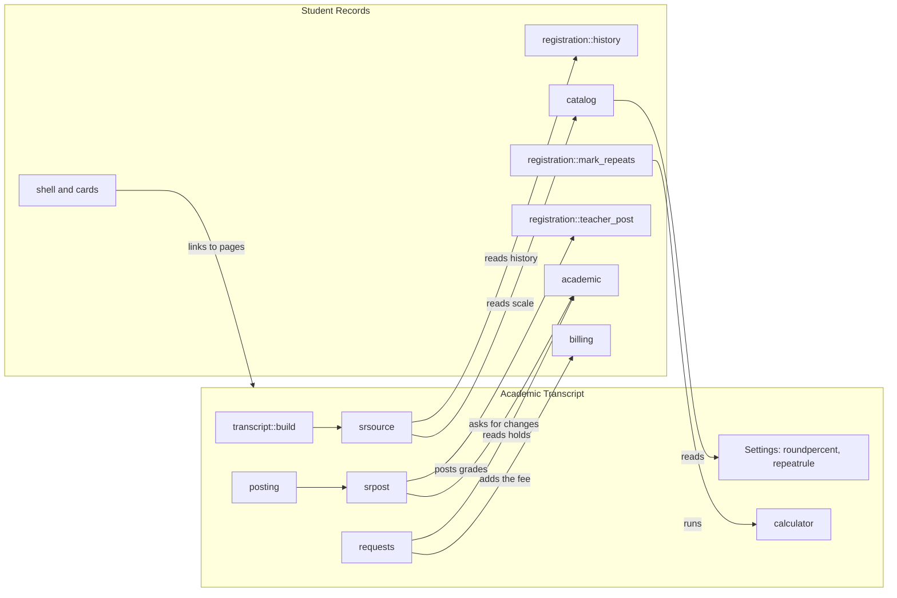

# Integration

This page covers what Academic Transcript uses from outside itself: Moodle's APIs, its events and callbacks, and the whole contract with Student Records, with and without that plugin. Read the contract before you change a method on either side of it.

## Contents

- [What the plugin doesn't have](#what-the-plugin-doesnt-have)
- [The boundary with Student Records](#the-boundary-with-student-records)
- [How the code finds Student Records](#how-the-code-finds-student-records)
- [With and without Student Records](#with-and-without-student-records)
- [Reading a transcript from Student Records](#reading-a-transcript-from-student-records)
- [Posting to Student Records](#posting-to-student-records)
- [Grade changes](#grade-changes)
- [Holds, fees and waiting](#holds-fees-and-waiting)
- [Menus and links](#menus-and-links)
- [What Student Records uses from this plugin](#what-student-records-uses-from-this-plugin)
- [The contract in one list](#the-contract-in-one-list)
- [Gradebook](#gradebook)
- [Custom fields](#custom-fields)
- [File API](#file-api)
- [AI subsystem](#ai-subsystem)
- [Reading documents](#reading-documents)
- [TCPDF and OpenSSL](#tcpdf-and-openssl)
- [Locks and transactions](#locks-and-transactions)
- [Roles and enrolment](#roles-and-enrolment)
- [Events](#events)
- [Callbacks](#callbacks)
- [Related pages](#related-pages)

## What the plugin doesn't have

Look elsewhere for these, because they don't exist here:

- No scheduled or ad-hoc tasks: `db/` has no `tasks.php`, and `classes/` has no `task` folder. Anything timed is worked out when a page loads.
- No messages and no mail: `db/` has no `messages.php`, and nothing calls `email_to_user()` or `message_send()`. The registrar sends a transcript by hand.
- No event observers and no hooks: `db/` has no `events.php` and no `hooks.php`.
- No web services: `db/` has no `services.php`, and there is no `external_api` class.
- No Mustache templates, renderer class or `amd/` folder. Pages use `html_writer` and `html_table`, and `local/academictranscript/templates.php` is the CSV download. The one script is the inline text from `request_view::script()`.

## The boundary with Student Records

Student Records is optional in both directions. `local/academictranscript/version.php` declares no dependency, and either plugin works alone. This release works with Student Records 1.4.6 or later.



The rule: this plugin reads Student Records and never writes its tables directly. A write goes through a method of that plugin: `registration::teacher_post()`, `academic::request_change()` or `billing::add_line()`.

## How the code finds Student Records

| Check | Where | True when |
|---|---|---|
| `srsource::enabled()` | `local/academictranscript/classes/local/srsource.php` | The setting `source` is `studentrecords`, the component directory exists, and the class `\local_studentrecords\local\registration` exists |
| `srpost::active()` | `local/academictranscript/classes/local/srpost.php` | `srsource::enabled()`, and that class has `teacher_post` |
| `class_exists('\\local_studentrecords\\local\\shell')` | `local/academictranscript/index.php`, `local/academictranscript/requests.php` | The plugin is installed, whatever `source` says |
| `method_exists(self::REG, 'with_lock')` | `srpost::with_lock()` | Student Records has the shared lock. An older one runs the work with no lock |
| `method_exists($catalog, 'grade_menu')` | `srpost::letters()` | Student Records has the menu with marks. An older one gives `catalog::letters()` |

Every call into Student Records sits behind one of these, directly or through the state of a row. `local/academictranscript/requests.php` calls `students::get_by_user()` with no check of its own in the On hold section, which can only have rows while `srsource::enabled()` is true.

The setting works per student. A student with a file means a student with a row in that plugin, one that `students::get_by_user()` finds. With the setting on, a student with no file keeps this plugin's data. So "with Student Records" below always means both: the setting is on, and the student has a file.

The test suite skips what needs a sibling: a test calls `markTestSkipped()` when the class isn't there, and the runs with the other plugins installed cover it. Test: `srsource_test::test_not_enabled_by_default()`.

## With and without Student Records

| Place | With Student Records | Without |
|---|---|---|
| `transcript::build()` | Header, terms, attempts, transfer and last entry from `srsource::collect()`. `$data['source']` is `studentrecords` | This plugin's tables |
| Calculator | `srsource::calculator()` | `scale::calculator()` |
| A grade off the scale | `problem_unknowngrade` stops an Official transcript | Silent |
| A posted grade not on the transcript | `problem_postednotinsr` stops an Official transcript | Not checked |
| Key of a transcript | `srsource::key_rows()` | `scale::scale_rows()` |
| Marks for a teacher | `srsource::teacher_marks()` | `scale::teacher_marks()` |
| Letter for a course total | `srpost::letter()` | `scale::letter()` |
| Footnote of a mark | `srsource::mark_label()` | `scale::code_label()` |
| `posting::post()` | Under the lock of the registration, and the grade goes there too. `srregid` is stored | The local row only, with no lock |
| `local/academictranscript/post.php` | `postintrosr`, and `nowinsr` when the grades differ | `postintro` |
| `local/academictranscript/change.php` | The request goes to the Registrar, and an unlinked row is refused | A local change |
| `local/academictranscript/codes.php` | Marks and letters of that scale | This plugin's |
| `requests::holds()` | Each hold in force, as text | Empty |
| `requests::can_charge()` | True with billing on there | False, so the fee is only recorded |
| `requests::waiting()` | Timing `grades` and `degree` can wait | False |
| `request_view::form()` | Timing radios | A hidden `timing=now` |
| `local/academictranscript/grading.php`, `local/academictranscript/marks.php`, `local/academictranscript/setup.php` | The notice `scale_usesstudentrecords` | No notice |

These follow `class_exists()`, so they show as soon as the plugin is installed, whatever `source` says: the menu on My transcript and on `local/academictranscript/requests.php`, and the breadcrumb on My transcript.

Pages that keep working and stop mattering, without a word on the page: for a student with a file, `local/academictranscript/record.php`, `local/academictranscript/transfer.php` and `local/academictranscript/studentterms.php` still save, and the transcript reads none of it. `local/academictranscript/students.php` shows this plugin's Student ID, or Moodle's, even for such a student.

## Reading a transcript from Student Records

`srsource::collect()` returns null for a user with no file. Otherwise it reads, read only:

| From | Fields used |
|---|---|
| `students::get_by_user()` | `id`, `studentid`, `legalfirstname`, `legalmiddlename`, `legallastname`, `dob`, `programid`, `admittermid`, `status`, `awardname`, `awarddate` |
| `registration::history()`, `terms` rows | `id`, `status`, `grade`, `code`, `title`, `hours`, `termid`, `courseid`, `timeregistered`, `timemodified`, `passed`, `points` |
| `registration::history()`, `transfers` rows | `institution`, `extcourse`, `credits`, `note`, `grade`, `points`, `timemodified` |
| The table `local_studentrecords_term` | `id`, `name`, `startdate`, `enddate` |
| The table `local_studentrecords_program` | `name`, `credential`, `unittype` |
| The strings `status_<status>` of that plugin | The status text. A status with no string prints as it is |

It returns `header`, `terms`, `attempts`, `transfer`, `transferearned`, `transfergpa` and `lastentry`. `transcript::build()` merges `header` over its own values, so the name on the transcript is the legal name, and `qualification` is `awardname`.

`srsource::attempts()` sets `note` to empty, so notes don't reach a transcript from Student Records. A hand-entered note is saved on the posted row and never printed for such a student.

`srsource::calculator()` and `srsource::key_rows()` read `catalog::scale()` and `catalog::letters()`. How they count is on [the calculations page](calculations.md#with-student-records-as-the-source). In the key:

- `W`, `IP` and `TR` are always there, because the transcript prints them whatever the scale holds.
- A mark with no description takes this plugin's wording for that code, when this plugin has one.
- `srsource::percent()` gives the range, or `belowpercent` for a row that starts at 0.

An issued transcript stores its key. `transcript::key_rows()` falls back to this plugin's scale when the source is no longer on.

`transcript::posted_outside_student_records()` compares this plugin's posted rows with the attempts other than IP. A row whose `srregid` and course code both match nothing is a problem, because the transcript would leave that grade out without a word.

Tests: `srsource_test::test_transcript_reads_student_records()`, `srsource_test::test_student_without_a_file_uses_own_data()`, `srsource_test::test_last_entry_comes_from_student_records()`, `srsource_test::test_the_key_shows_the_scale_of_student_records()`, `srsource_test::test_a_student_without_a_file_keeps_this_plugins_scale()`, `srsource_test::test_the_key_keeps_the_grade_points_and_the_bottom_row()`, `srsource_test::test_the_key_explains_every_mark()`, `builder_test::test_the_key_comes_from_the_transcript()`.

## Posting to Student Records

The full flow is in [posting final grades](execution-flows.md#posting-final-grades). The contract:

`registration::teacher_post_target()` finds the student's registration in an offering linked to the Moodle course: the open one (`registered`), else the latest completed one. It returns `state`, `regid`, `grade` and `freeze`. `srpost::target()` turns `norecord` into null, so such a student is treated as own data, and `srpost::problem()` turns the other states into the error of the row.

| State | Meaning | String of that plugin |
|---|---|---|
| `norecord` | No file | `err_teacherpost_norecord`, not shown here |
| `noreg` | No registration for this course | `err_teacherpost_noreg` |
| `several` | More than one open registration | `err_teacherpost_several` |
| `own` | The teacher's own grade | `err_teacherpost_own` |
| `kept` | Staff or an approved change set the grade | `err_teacherpost_kept` |
| `posted` | A teacher already posted on this registration | `err_teacherpost_posted` |
| `frozen` | After the term's grade freeze | `err_teacherpost_frozen` |
| `ok` | Can post | none |

A grade off that scale gives `err_teacherpost_notonscale`.

`registration::teacher_post()` takes the course, the user, the percentage, the letter, and the registration whose lock the caller holds. It checks all of this again inside the transaction. The letter comes from `registration::teacher_letter()`: `grading::letter_for_pct()` for a percentage, else the hand-entered mark when `catalog::grade_menu()` has it. On success the registration is `completed`, with `gradesource` `teacher`.

A posting still needs this plugin's Course code, Hours and Term on the course, and a term from this plugin's list, because `posting::preview()` checks them before it asks Student Records. So a school on Student Records still keeps this plugin's term list.

Staff in Student Records can correct a grade until the term's grade freeze. That is by design. A teacher's posting never replaces it: `kept` stops the posting.

## Grade changes

`srpost::posted_target()` finds the registration of a posted row through `srregid`. A row with no link for a student with a file is refused on `local/academictranscript/change.php`. `srpost::request_change()` calls `academic::request_change()`, and `srpost::change_pending()` reads the table `academic::CHANGES`.

`srpost::letters()` gives the menu: `catalog::grade_menu()`, the letters and the marks of that scale.

The change is decided in Student Records, on `local/studentrecords/gradechange.php`. It never appears on `local/academictranscript/approvals.php`. The posted row here keeps the grade it had, and `local/academictranscript/post.php` shows `nowinsr` when the two differ. The transcript reads Student Records, so it shows the new grade.

## Holds, fees and waiting

| Method | Uses | Result |
|---|---|---|
| `requests::holds()` | `students::get_by_user()`, `academic::holds()`, `academic::hold_active()`, the strings `holdtype_<type>` | A list of `Type: reason`. Every hold in force counts, whether or not it blocks registration |
| `requests::can_charge()` | `billing::enabled()`, `students::get_by_user()` | Whether the fee can go on the account |
| `requests::save_request()` | `billing::add_line()` | A `charge` line with `qualified` 0 and `refundable` 0 |
| `requests::waiting()` | `students::get_by_user()`, and the tables `local_studentrecords_reg`, `local_studentrecords_offer` and `local_studentrecords_term` | Whether the request still waits |

The string `req_feenote` sends the student to "My account". That page is `local/studentrecords/account.php`, in the menu of that plugin when billing is on. `req_feenote` prints only when `requests::can_charge()` is true, so the page exists whenever the text does.

## Menus and links

From this plugin to that one:

- `shell::inline_menu()` on My transcript and on `local/academictranscript/requests.php`.
- A breadcrumb on My transcript to `/local/studentrecords/index.php`, with that plugin's `pluginname`.
- The link `queue_viewhold` to `/local/studentrecords/student.php`, with the tab `holds`.

`local/academictranscript/styles.css` repeats the `sr-` page styles of Student Records with the same values, so these pages keep their look on a site without it.

## What Student Records uses from this plugin

| Student Records code | Uses | Without this plugin |
|---|---|---|
| `catalog::round_percent()` | The setting `roundpercent` | Nothing is rounded |
| `catalog::repeat_rule()` | The setting `repeatrule` | Every attempt counts |
| `registration::mark_repeats()` | `srsource::calculator()`, or `scale::calculator()` with an older plugin, and `calculator::compute()` | The method returns at once, because `catalog::repeat_rule()` is `all` |
| `shell::is_sr_path()` | Counts `/local/academictranscript/` as its own, so these pages get its menu | Not applicable |
| `shell`, `cards::transcript_link()`, `homes`, `student_sections`, `local/studentrecords/student.php` | Links to `local/academictranscript/index.php` and `local/academictranscript/requests.php`. The first three check the capabilities `local/academictranscript:viewown` and `local/academictranscript:issueofficial`, and the last two only that this plugin is installed | No links |
| `home::STAFFCAPS` | Counts `local/academictranscript:issueofficial` and `local/academictranscript:configure` as staff permissions | Not applicable |

Those links name the page addresses and the parameters `view=mine` and `userid`, so those are part of the contract. Tests in that plugin: `tests/local/registration_test.php`, `tests/local/degreeaudit_test.php`, `tests/local/standing_test.php`, `tests/local/shell_test.php` and `tests/records_pages_test.php` in `local/studentrecords`.

## The contract in one list

Change one of these only with both plugins open, and run the checks with both plugins installed.

Called by this plugin:

- `registration::history()`, `registration::teacher_post_target()`, `registration::teacher_letter()`, `registration::teacher_post()`, `registration::with_lock()`
- `students::get_by_user()`
- `academic::holds()`, `academic::hold_active()`, `academic::request_change()`, `academic::CHANGES`
- `billing::enabled()`, `billing::add_line()`
- `catalog::scale()`, `catalog::letters()`, `catalog::grade_menu()`
- `shell::inline_menu()`

Read directly by this plugin:

- The tables `local_studentrecords_term`, `local_studentrecords_program`, `local_studentrecords_reg`, `local_studentrecords_offer`, and the table `academic::CHANGES` names.
- The strings `err_teacherpost_<state>`, `holdtype_<type>`, `status_<status>`, `pluginname`.

Called by that plugin:

- `srsource::calculator()`, `scale::calculator()`, `calculator::compute()`
- The settings `roundpercent` and `repeatrule`
- The pages `local/academictranscript/index.php` and `local/academictranscript/requests.php`
- The capabilities `local/academictranscript:viewown`, `local/academictranscript:issueofficial`, `local/academictranscript:configure`

## Gradebook

The plugin reads the course total and locks it. It writes no grade.

| Call | Where | Why |
|---|---|---|
| `grade_item::fetch_course_item()`, `grade_grade::fetch()` | `posting::course_percent()`, `posting::lock_course_total()`, `local/academictranscript/codes.php` | Find the student's course total |
| `grade_grade::standardise_score()` | `posting::course_percent()`, `local/academictranscript/codes.php` | The total as 0 to 100. It doesn't clamp |
| `grade_regrade_final_grades()` | `posting::lock_course_total()` | Regrade when the item needs it, because core refuses to lock otherwise |
| `grade_grade::is_locked()`, `grade_grade::set_locked()` | `posting::lock_course_total()` | Lock the student's total. Grade items stay unlocked, and overrides are neither read nor set |

An approved change leaves the gradebook as it is. Test: `posting_test::test_post_saves_attempt_locks_total_and_clears_code()`.

## Custom fields

`coursefields` is the only class that talks to the custom field API, except `terms::sync_field()`, which rewrites the options of the Term field.

| Call | Where |
|---|---|
| `course_handler::create()`, `get_categories_with_fields()`, `create_category()`, `save_field_configuration()`, `field_controller::create()`, `category_controller::create()` | `coursefields::ensure()` |
| `save_field_configuration()`, `delete_field_configuration()` | `coursefields::apply_settings()`, `coursefields::release()` |
| `get_fields()` | `coursefields::field()` |
| `get_instances_data()` | `coursefields::get()` |
| `instance_form_save()` | `local/academictranscript/cli/set_course_fields.php` |

`coursefields::ensure()` is safe to run again: it finds fields by short name, finds the category by a field it holds, else by name, and only changes `required`, `uniquevalues` and `locked` on a field an uninstall kept. Tests: `install_test::test_install_creates_course_fields()`, `install_test::test_install_again_adds_nothing()`, `uninstall_test::test_install_after_uninstall_locks_fields_again()`, `uninstall_test::test_ensure_saves_only_the_fields_that_differ()`, `coursefields_test::test_get_reads_course_values()`, `coursefields_test::test_get_resolved_fills_gaps_from_catalog()`.

## File API

| Call | Where | Why |
|---|---|---|
| `admin_setting_configstoredfile` | `local/academictranscript/settings.php` | The file settings |
| `file_prepare_draft_area()`, `file_get_submitted_draft_itemid()`, `file_save_draft_area_files()` | `local/academictranscript/setup.php` | The logo and the uploaded documents |
| `get_file_storage()` | `builder::setting_file()`, `signer::credentials()`, `local/academictranscript/setup.php`, `local/academictranscript/drafts.php`, `local_academictranscript_pluginfile()` | Read stored files |
| `send_stored_file()` | `local_academictranscript_pluginfile()` | Serve a stored file |
| `send_file()` | `local/academictranscript/index.php`, `local/academictranscript/issued.php`, `local/academictranscript/templates.php` | Send a made file |
| `make_request_directory()` | `signer::credentials()`, `signer::config_file()`, `document_text::from_pdf()`, `document_text::from_docx()` | Temporary files that die with the request |
| `check_dir_exists()`, `fulldelete()` | `signer::selfsigned()`, `xmldb_local_academictranscript_uninstall()` | The folder of the self-signed key |

## AI subsystem

`ai_extractor` is the only code that uses Moodle's AI subsystem, and only in the setup wizard. It needs a provider with the action Generate text. The plugin itself makes no network call.

| Call | Where |
|---|---|
| `\core\di::get(\core_ai\manager::class)->is_action_available()` | `ai_extractor::available()`. The method is static in 4.5 and an instance method in 5.3, and this call works on both. Any error means false |
| `\core_ai\manager::get_user_policy_status()` | `ai_extractor::policy_accepted()` |
| `\core_ai\manager::user_policy_accepted()` | `ai_extractor::accept_policy()` |
| `new \core_ai\aiactions\generate_text(...)`, `process_action()` | `ai_extractor::extract()` |

The prompt is the string `ai_prompt`, with the wanted JSON shape from `ai_extractor::prompt()` and the text. It asks for JSON only, with a word-for-word `source` quote for each item. That language string runs over several lines, so a line regex over the language file silently drops it.

The answer is untrusted. `ai_extractor::parse_response()` drops a Markdown fence, takes the text from the first `{` to the last `}`, and decodes it. `ai_extractor::clean_item()` checks each item. `drafts::quote_found()` then checks the quote against the document, and a person approves each draft. Nothing from a provider reaches the settings tables without that approval.

Tests: `ai_extractor_test::test_parse_response_reads_json_in_code_fence()`, `ai_extractor_test::test_parse_response_ignores_text_around_json()`, `ai_extractor_test::test_parse_response_drops_invalid_items()`, `ai_extractor_test::test_parse_response_returns_empty_lists_for_non_json()`, `ai_extractor_test::test_clean_item_defaults()`, `ai_extractor_test::test_chunks_split_at_paragraphs()`, `ai_extractor_test::test_prompt_includes_only_requested_shapes()`, `ai_extractor_test::test_available_without_provider_is_false()`, `ai_extractor_test::test_extract_merges_items_from_each_chunk()`, `ai_extractor_test::test_extract_reports_provider_failure()`.

## Reading documents

`document_text::from_stored_file()` picks by the file extension, then runs `document_text::clean()`. Empty text throws `err_notext`.

| Extension | How | Needs |
|---|---|---|
| `pdf` | `document_text::from_pdf()`: Ghostscript, else the bundled parser | Nothing required |
| `docx` | `document_text::from_docx()`: `word/document.xml` of the zip | `ZipArchive`. Without it the text is empty |
| `txt`, `csv`, `md` | The file as it is | Nothing |
| anything else | `document_text::via_converter()`: Moodle's document converters | An enabled converter, else `err_convert` |

The upload form accepts `document_text::ACCEPTED`, which is `.pdf`, `.docx`, `.doc`, `.odt`, `.rtf` and `.txt`. So `.csv` and `.md` are read as text but can't be uploaded this way.

When `$CFG->pathtogs` is executable, `document_text::from_pdf()` runs Ghostscript with `exec()`, with these flags and every path through `escapeshellarg()`:

```php
$cmd = escapeshellarg($CFG->pathtogs) . ' -q -dNOPAUSE -dBATCH -dSAFER -sDEVICE=txtwrite -sOutputFile='
    . escapeshellarg($out) . ' ' . escapeshellarg($path);
```

A failure or empty output falls back to the parser.

`document_text::load_pdfparser()` registers an autoloader for the bundled parser, `Smalot\PdfParser`, from `lib/pdfparser/src/`. It is smalot/pdfparser 2.13.1, under the LGPL, unchanged, and declared in `local/academictranscript/thirdpartylibs.xml`. Its readme is `local/academictranscript/lib/pdfparser/readme_moodle.txt`. Keep it as upstream ships it.

For document converters, `document_text::via_converter()` uses `core_files\converter`: `can_convert_storedfile_to()`, `start_conversion()`, `poll_conversion()`. It polls up to 30 times, one second apart, and throws `err_convert` when no file comes back.

Tests: `document_text_test::test_from_stored_file_reads_pdf_with_bundled_parser()`, `document_text_test::test_from_docx_reads_paragraphs_and_table_cells()`, `document_text_test::test_clean_tidies_whitespace()`, `document_text_test::test_unsupported_format_without_converter_throws()`.

## TCPDF and OpenSSL

`document` extends Moodle's `pdf` class, a wrapper of the TCPDF that comes with Moodle, from `lib/pdflib.php` in core. The plugin bundles no PDF library. It uses `AddFont()`, `writeHTMLCell()`, `MultiCell()`, `Cell()`, `Image()`, `Circle()`, `Rect()`, `Line()`, `SetAlpha()`, `Rotate()`, `setSignature()`, `write2DBarcode()` and `Output()`.

`signer` uses `openssl_pkcs12_read()`, `openssl_pkey_new()`, `openssl_csr_new()`, `openssl_csr_sign()`, `openssl_x509_export()` and `openssl_pkey_export()`. Without `openssl_pkcs12_read()`, Official copies go out unsigned and say so. See [the PDF page](pdf-and-signing.md).

## Locks and transactions

This plugin has its own lock helper, and the posting uses the one of Student Records.

| Lock | Factory | Taken by |
|---|---|---|
| `request<userid>` | `local_academictranscript` | `requests::create()` |
| `issue<requestid>` | `local_academictranscript` | `requests::issue()`, `requests::cancel()` |
| `direct<userid>` | `local_academictranscript` | `requests::issue_direct()` |
| `reg<regid>` | `local_studentrecords` | `posting::post()` through `srpost::with_lock()`, and `academic::request_change()` |

`requests::one_at_a_time()` uses `\core\lock\lock_config::get_lock_factory('local_academictranscript')` and waits `requests::LOCKWAIT` seconds. It doesn't use the lock of Student Records, because this plugin also works without that plugin.

The rules:

- A lock is taken before the transaction and released after the commit. Start a transaction inside the work, never around the call. Tests: `requests_test::test_issue_holds_the_lock_past_the_commit()`, `requests_test::test_create_holds_the_lock_past_the_commit()`, `requests_test::test_direct_issue_holds_the_lock_past_the_commit()`, `srpost_test::test_the_lock_on_the_registration_outlasts_the_commit()`.
- Commit after the `try` block, with `logger::commit()`. Moodle sends held-back messages during the commit, through `\core\message\manager::database_transaction_commited()`, so a failed send comes after the data is saved and must not reach the `catch`. `logger::commit()` writes `after_saving` in that case. A commit that really failed still throws, because a transaction is still open or the error is a `dml_transaction_exception`. Tests: `logger_test::test_commit_logs_a_failure_after_the_data_is_saved()`, `logger_test::test_commit_throws_when_the_database_refuses_it()`, `logger_test::test_commit_of_a_closed_transaction_throws()`.
- `requests::save_request()`, `requests::issue_request()` and `posting::save_posted()` use `logger::commit()`. `transcript::issue()`, `posting::decide()`, `scale::replace_grades()` and `drafts::approve()` use `allow_commit()` directly, because they hold nothing that sends a message.
- `transcript::issue()` opens a transaction of its own. Called from `requests::issue_request()` it nests, and the outer commit decides.

Student Records holds its own mail until cron while a transaction or a lock is open, in `messages`. So nothing in these flows waits on a mail server.

## Roles and enrolment

`access::student_courseids()` reads `role_assignments` for the roles from `get_archetype_roles('student')`. `local/academictranscript/codes.php` and `local/academictranscript/post.php` use `get_role_users()` for the same roles in the course. `local/academictranscript/students.php` reads `role_assignments` too, and `enrol_get_my_courses()` for a teacher.

For a student, enrolment status and course dates play no part anywhere. A custom role based on the `student` archetype counts.

## Events

Neither event has an observer in this plugin.

| Class | CRUD | Level | Table | Context | Fired by | Holds |
|---|---|---|---|---|---|---|
| `\local_academictranscript\event\code_updated` | `u` | `LEVEL_TEACHING` | none | course | `local/academictranscript/codes.php`, once per changed row | `relateduserid`, and in `other` the keys `oldcode`, `newcode`, `oldnote`, `newnote`, which `validate_data()` requires, and `reason` |
| `\local_academictranscript\event\official_issued` | `c` | `LEVEL_OTHER` | `local_academictranscript_issue` | user, the student | `transcript::issue()` | `objectid`, `relateduserid` |

`code_updated` keeps the history of a code, because the table row is overwritten. It doesn't fire for a term override or for the clearing of a code at posting.

`official_issued` fires after the commit of `transcript::issue()`. From the queue that is inside the outer transaction, so Moodle holds it for outside observers until that transaction commits.

## Callbacks

All three are in `local/academictranscript/lib.php`. `access` is imported at the top of the file.

| Function | What it adds |
|---|---|
| `local_academictranscript_myprofile_navigation()` | A node `local_academictranscript` in the `reports` category, with the string `studenttranscript`, to `local/academictranscript/index.php`. Not for a guest's profile, a visitor who isn't logged in, a guest, or when `access::can_view()` is false |
| `local_academictranscript_extend_navigation_course()` | The More menu of a course, and nothing on the site course: `transcriptcodes`, `postgrades` and `studentstranscripts`, each behind its capability in the course |
| `local_academictranscript_pluginfile()` | Serves files at system context from `logo`, `signatureimage`, `sealimage` and `sourcedocs`, after `require_login()`. See [files](data-model.md#files). For the three image areas, when the named file isn't found, the first file of the area is served |

The install, uninstall and upgrade hooks are `xmldb_local_academictranscript_install()` in `local/academictranscript/db/install.php`, `xmldb_local_academictranscript_uninstall()` in `local/academictranscript/db/uninstall.php`, and `xmldb_local_academictranscript_upgrade()` in `local/academictranscript/db/upgrade.php`.

## Related pages

- [Code map](README.md)
- [Execution flows](execution-flows.md)
- [Calculations](calculations.md)
- [PDF and signing](pdf-and-signing.md)
- [Architecture of the three plugins](../architecture.md)
- [Student Records integration](../student-records/integration.md)
