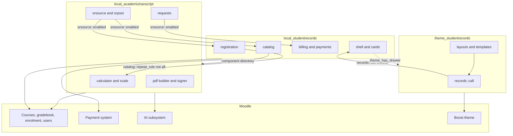
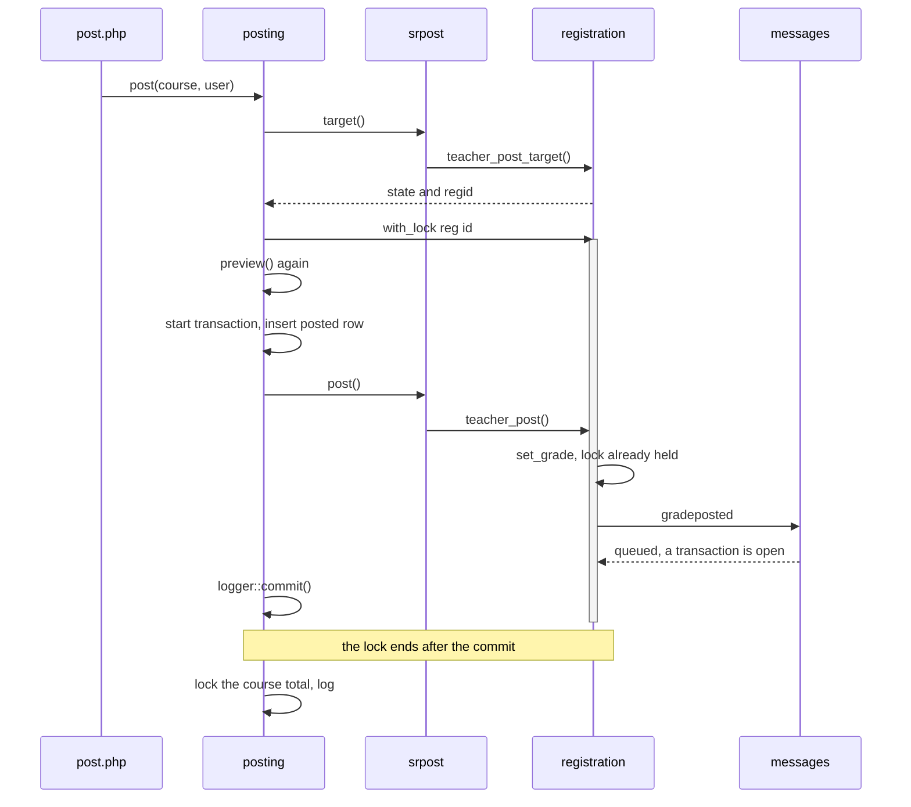

# Architecture

This page says how the three plugins relate: what each owns, which calls which and through what checks, and how each stays optional. Read it before a change that crosses a plugin's edge.

## Contents

- [The three plugins](#the-three-plugins)
- [Plugin boundaries](#plugin-boundaries)
- [What each plugin owns](#what-each-plugin-owns)
- [Who calls whom](#who-calls-whom)
- [How each plugin stays optional](#how-each-plugin-stays-optional)
- [A flow across two plugins](#a-flow-across-two-plugins)
- [The shape of a local plugin](#the-shape-of-a-local-plugin)
- [What the plugins share by design](#what-the-plugins-share-by-design)
- [The contract between the plugins](#the-contract-between-the-plugins)
- [Related pages](#related-pages)

## The three plugins

| Plugin | Component | Folder | Licence | What it is |
|---|---|---|---|---|
| Academic Transcript | `local_academictranscript` | `local/academictranscript` | MIT | Transcripts: grade arithmetic, PDF, Official copies, verification, requests, and final grades from Moodle courses |
| Student Records | `local_studentrecords` | `local/studentrecords` | MIT | A student information system inside Moodle: admissions, the student file, registration, attendance, billing, aid, messages and reports |
| Student Records theme | `theme_studentrecords` | `theme/studentrecords` | GNU GPL 3 or later | A child theme of Boost with the school's name, logo and colour, and places for the menu and cards of Student Records |

All three work on Moodle 4.5 to 5.3 (`$plugin->supported = [405, 503]`). None lists another of them in `$plugin->dependencies`. The theme lists only `theme_boost`. Each has its own version, tag and ZIP, so a site can run any mix of releases.

## Plugin boundaries

A solid arrow is a call, with the check that guards it. The dotted arrow is the plugin looking at the name of the theme in use. Nothing connects the theme and Academic Transcript directly.

## What each plugin owns

| Thing | Owner | Notes |
|---|---|---|
| GPA, quality points, repeats and letters on a transcript | Academic Transcript, `calculator` | Student Records calls it for repeats. See [calculations](academic-transcript/calculations.md) |
| The repeat rule and the rounding setting | Academic Transcript, `repeatrule` and `roundpercent` | Student Records follows them when the plugin is on disk |
| Official transcripts, snapshots, verification codes, signing | Academic Transcript | Tables `local_academictranscript_issue`, `local_academictranscript_request` |
| The Course code, Hours and Hour type course fields | Academic Transcript, `coursefields` | Uninstalling keeps them and their values |
| Own data for a school without Student Records | Academic Transcript | Its terms, programs, catalog, students, transfer credit and scale. 14 tables |
| The student file, admissions, programs, terms and catalog of a school on Student Records | Student Records | 52 tables |
| Registration, seats, waitlists, final grades on a registration, the grade freeze | Student Records, `registration` | |
| The grading scale, for a student with a file | Student Records, `local_studentrecords_grade` | The transcript counts on this scale. See [one scale](pitfalls.md#the-transcript-follows-student-records) |
| Holds, billing, plans, refunds, online payments, aid helpers | Student Records | |
| Automatic messages | Student Records, `messages` | Academic Transcript sends no email |
| The menu by role, the cards, the inline menu | Student Records, `shell` and `cards` | The theme only places them |
| The top bar, the login card, the school's look | The theme, `brand` | |
| The theme's accent colour | The theme, `accentcolor` | The plugins' own accent stays `#416180` in their `styles.css` |

The theme stores no data. It has no `db/` folder.

## Who calls whom

### Academic Transcript to Student Records

Every call sits behind one of these checks.

| Check | Where | True when |
|---|---|---|
| `srsource::enabled()` | `local/academictranscript/classes/local/srsource.php` | The setting `source` is `studentrecords`, the component has a folder, and the class `\local_studentrecords\local\registration` exists |
| `srpost::active()` | `local/academictranscript/classes/local/srpost.php` | `srsource::enabled()`, and that class has `teacher_post` |
| `class_exists('\\local_studentrecords\\local\\shell')` | `local/academictranscript/index.php`, `local/academictranscript/requests.php` | The plugin is on disk, whatever `source` says |
| `method_exists()` | `srpost::with_lock()`, `srpost::letters()` | A newer Student Records. An older one runs the work with no lock, or gives `catalog::letters()` |

| Caller | Calls in Student Records | Behind |
|---|---|---|
| `transcript::build()`, through `srsource::collect()` | `students::get_by_user()`, `registration::history()`, tables `local_studentrecords_term` and `local_studentrecords_program`, `status_*` strings | `srsource::enabled()` |
| `srsource::calculator()`, `srsource::key_rows()`, `srsource::teacher_marks()`, `srsource::mark_label()` | `catalog::scale()`, `catalog::letters()` | `srsource::enabled()`, and a student with a file |
| `posting::preview()`, `posting::post()` | `srpost::target()`, `srpost::letter()`, `srpost::problem()`, `srpost::with_lock()`, `srpost::post()`, reaching `registration::teacher_post_target()`, `registration::teacher_letter()`, `registration::with_lock()`, `registration::teacher_post()` | `srpost::active()` |
| `local/academictranscript/change.php` | `srpost::posted_target()`, `srpost::request_change()`, reaching `academic::request_change()` | `srpost::active()` |
| `requests::holds()` | `students::get_by_user()`, `academic::holds()`, `academic::hold_active()`, `holdtype_*` strings | `srsource::enabled()` |
| `requests::can_charge()`, `requests::save_request()` | `billing::enabled()`, `billing::add_line()` | `srsource::enabled()` |
| `requests::waiting()` | `students::get_by_user()`, tables `local_studentrecords_reg`, `local_studentrecords_offer`, `local_studentrecords_term` | `srsource::enabled()` |
| `local/academictranscript/index.php`, `local/academictranscript/requests.php` | `shell::inline_menu()` | `class_exists()` |

`local/academictranscript/requests.php` calls `students::get_by_user()` with no check of its own in the On hold section. That section has rows only when `requests::holds()` found some, so `srsource::enabled()` was true.

### Student Records to Academic Transcript

| Caller | Uses in Academic Transcript | Check |
|---|---|---|
| `catalog::round_percent()` | The setting `roundpercent` | `get_component_directory('local_academictranscript') !== null` |
| `catalog::repeat_rule()` | The setting `repeatrule` | Same |
| `registration::mark_repeats()` | `srsource::calculator()`, or `scale::calculator()` with an older plugin | Runs only when `catalog::repeat_rule()` isn't `all`, so it needs the plugin on disk. `method_exists()` picks the class |
| `shell::groups()` | Menu items to `/local/academictranscript/index.php` and `/local/academictranscript/requests.php` | The folder, the capability, and for the second `file_exists()` |
| `shell::is_sr_path()` | Counts `/local/academictranscript/` pages as its own | A path test only |
| `cards::transcript_link()`, `homes::student()`, `student_sections::academic()`, `local/studentrecords/student.php` | Links | The folder, and a capability for the first two |
| `home::is_staff_user()` | The capabilities in `home::STAFFCAPS` | `get_capability_info()` skips an unknown capability |

These checks test only that the plugin is there. They don't read its `source` setting. So with Academic Transcript installed and `source` on `own`, Student Records still follows its repeat rule and its rounding.

### The theme and Student Records

The theme calls three functions of `local/studentrecords/lib.php`, through `records::call()`. The plugin learns about the theme in `shell::theme_has_drawer()`. [The theme's integration page](theme/integration.md) has the details.

## How each plugin stays optional

`CONTRIBUTING.md` makes this a rule: check that a sibling is installed before you call it, and keep the plugin working without it.

| Installed | What happens |
|---|---|
| Academic Transcript alone | Own data, own scale, own terms. `srsource::enabled()` is false, so `requests::holds()` is empty, `requests::can_charge()` is false and `requests::waiting()` is false. A fee is only recorded on the request. Its pages have no menu |
| Student Records alone | `catalog::repeat_rule()` is `all`, so every attempt counts. `catalog::round_percent()` is false, so nothing is rounded before a letter is chosen. No menu item or card links to a transcript. No teacher can post a grade, because `registration::teacher_post()` has no caller in this plugin |
| Both, `source` is `own` | The transcript reads its own data. Student Records still follows the repeat rule and the rounding. `local/academictranscript/index.php` and `local/academictranscript/requests.php` show the menu of Student Records |
| Both, `source` is `studentrecords` | The transcript reads Student Records for each student with a file, and its own data for a student without one |
| The theme alone | `records::call()` gives its default for all three calls. The top bar, the login card, the colour and the settings work |
| Either local plugin without the theme | `shell::inline_menu()` prints the menu at the top of the page. No Dashboard strip, no side card, no top bar note |

Three more cases:

- A sibling that is older. The code uses `method_exists()` where it needs a method that older releases lack: `srpost::active()`, `srpost::with_lock()`, `srpost::letters()` and `registration::mark_repeats()`.
- A sibling removed later. `srsource::enabled()` turns false, so the transcript goes back to its own data. Issued transcripts stay, because each keeps its data in its own snapshot.
- A test that needs a sibling. It calls `markTestSkipped()` when the sibling isn't there. Two CI rows install all the plugins, so those tests run there. `bin/check --together` does the same.

## A flow across two plugins

The clearest cross-plugin flow is a teacher posting a final grade with Student Records as the source. The full flow is in [Academic Transcript execution flows](academic-transcript/execution-flows.md).

Three rules show here. The lock is taken before the transaction and released after the commit. The commit comes after the `try` block. The message waits for cron, because a transaction is open. [Pitfalls](pitfalls.md) says why for each.

## The shape of a local plugin

| Part | Where | What it holds |
|---|---|---|
| Pages | Top-level PHP files | One file per page. They check access, read the request, run a form and print. `settings.php`, `lib.php` and `version.php` aren't pages |
| Rules | `classes/local/` | Static methods grouped by subject. `calculator`, `pdf\document` and Student Records' `importer` are the only classes with instances |
| Forms | `classes/form/` | `\moodleform` classes. Academic Transcript also has forms built by hand in pages |
| Tasks | `classes/task/` | Student Records only. Academic Transcript has none |
| Privacy | `classes/privacy/provider.php` | The privacy API |
| Hooks | `classes/hook_callbacks.php`, `db/hooks.php` | Student Records only |
| Payment | `classes/payment/service_provider.php` | Student Records only |
| Database | `db/` | `db/install.xml`, `db/upgrade.php`, `db/access.php`, `db/install.php`, `db/uninstall.php` |
| Callbacks | `lib.php` | Navigation and file serving |
| Styles | `styles.css` | Plain CSS with `sr-` classes and `--srp-` custom properties |
| Strings | `lang/en/` | English only |
| Tests | `tests/` | PHPUnit, a generator and, for Student Records, Behat |

There's no `amd/` folder and no `templates/` folder in either local plugin. Classes such as `html_view`, `request_view`, `student_sections`, `record_view`, `homes` and `shell` make the HTML with `html_writer`.

## What the plugins share by design

The two local plugins don't share code, but they follow the same patterns, so that either works alone:

| Idea | Academic Transcript | Student Records |
|---|---|---|
| Commit after the `try` block | `logger::commit()` | `records::commit()` |
| A lock around read-then-write work | `requests::one_at_a_time()` | `registration::with_lock()`, `billing::one_at_a_time()` |
| An action log | `logger::log()`, table `local_academictranscript_log` | `audit::log()`, table `local_studentrecords_log` |
| Field history | None | `records::save()`, table `local_studentrecords_history` |
| Exact arithmetic in whole numbers | `calculator::compute()` | `registration::totals()`, `billing::times()`, `grading::divide_rounded()` |
| The page styles | `.sr-` rules repeated in `local/academictranscript/styles.css` | `local/studentrecords/styles.css` |

`requests::one_at_a_time()` says why there are two locks: Academic Transcript uses Moodle's lock under its own component, because it also works without Student Records. When it posts to Student Records it takes that plugin's lock through `srpost::with_lock()`.

## The contract between the plugins

Student Records must keep these stable, or a site with an older Academic Transcript breaks. A second list below gives what Academic Transcript must keep stable.

- The row shape of `registration::history()`, including `passed`, `points`, `timemodified` and `transfers`.
- The states of `registration::teacher_post_target()`, and their `err_teacherpost_*` strings.
- `registration::teacher_letter()`, `registration::teacher_post()`, `registration::with_lock()`.
- `catalog::scale()`, `catalog::letters()`, `catalog::grade_menu()`.
- `billing::add_line()`, `billing::enabled()`.
- `academic::holds()`, `academic::hold_active()`, `academic::request_change()`, `academic::CHANGES`.
- `students::get_by_user()`, `shell::inline_menu()`.
- The tables `local_studentrecords_reg`, `local_studentrecords_offer`, `local_studentrecords_term` and `local_studentrecords_program`, and the strings `status_*` and `holdtype_*`.

Academic Transcript must keep these stable for Student Records:

- `srsource::calculator()`, and through it `calculator::compute()` with its `excluded` result.
- The settings `repeatrule` and `roundpercent`.
- The pages `local/academictranscript/index.php` and `local/academictranscript/requests.php`, and the capabilities `local/academictranscript:viewown`, `local/academictranscript:issueofficial` and `local/academictranscript:configure`.

The theme needs the three functions in [the theme's integration page](theme/integration.md#what-to-keep-stable).

If you change a line of this contract, test with `--together` on the oldest and the newest Moodle.

## Related pages

- [Developer docs](README.md)
- [Academic Transcript integration](academic-transcript/integration.md)
- [Student Records integration](student-records/integration.md)
- [Theme integration](theme/integration.md)
- [Pitfalls](pitfalls.md)
- [Decisions](decisions.md)
