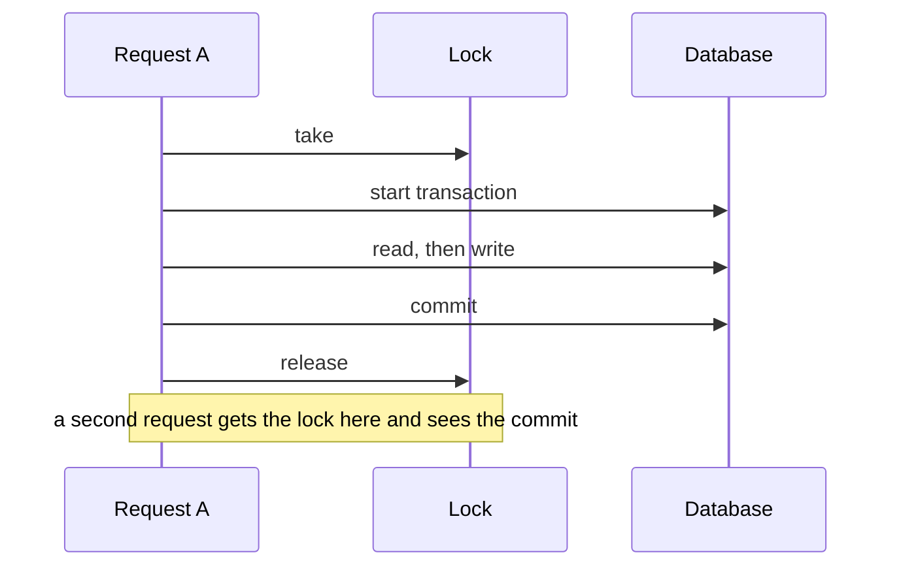

# Pitfalls

This page lists the traps of the repo, and where to take special care. Most of them fail silently: the code runs and a number, a lock or a message is wrong. Each one was checked against the code, and it names the test that protects it where there is one. The plugin pages hold the traps of their own subjects.

## Contents

- [Upgrades](#upgrades)
- [Exact rounding on every PHP version](#exact-rounding-on-every-php-version)
- [Locks that must outlast their commit](#locks-that-must-outlast-their-commit)
- [Commits after the try block](#commits-after-the-try-block)
- [Nothing slow in a transaction or under a lock](#nothing-slow-in-a-transaction-or-under-a-lock)
- [The transcript follows Student Records](#the-transcript-follows-student-records)
- [Earned hours and transfer GPA](#earned-hours-and-transfer-gpa)
- [How each plugin stays optional](#how-each-plugin-stays-optional)
- [Grades in Student Records](#grades-in-student-records)
- [Dates and times](#dates-and-times)
- [Money](#money)
- [Records, history and output](#records-history-and-output)
- [Access](#access)
- [Tests and tools](#tests-and-tools)
- [The theme](#the-theme)
- [Bugs in this release](#bugs-in-this-release)
- [Known and left alone](#known-and-left-alone)
- [Related pages](#related-pages)

## Upgrades

### Keep `$plugin->version` above earlier builds

`$plugin->version` must stay above the builds that schools ran before the first public release: `2026111604` for Academic Transcript, `2026111606` for Student Records and `2026110303` for the theme. A lower number stops those sites from upgrading, because Moodle refuses to go down (`downgrade_exception`).

So the numbers look like future dates on purpose. Don't "correct" `2026111607` to today's date. [Release](release.md#the-floor-under-version) has the rule.

### A raise in Student Records needs a savepoint

`test_version_reaches_the_last_step` asserts that the highest `upgrade_plugin_savepoint()` in `local/studentrecords/db/upgrade.php` equals `$plugin->version`, and it names the number. A release that raises the number needs a step, and that test changes.

### Make upgrade steps safe to run twice

Sites of earlier builds can hold what today's `db/install.xml` holds, or more. Each step checks with `field_exists()`, `table_exists()` or `index_exists()`. The step `2026111607` of Academic Transcript drops the old columns `program` and `admissiondate` only when they hold nothing else. `test_upgrade_drops_the_old_student_columns_when_nothing_is_lost` holds that.

### Never read a snapshot's layout from its version

`local_academictranscript_issue.snapshot` is JSON from the day of the issue, and sites of older builds have older shapes:

- No `version` and no `terms`: it can't be drawn again. `transcript::stored()` returns null, and `local/academictranscript/issued.php` says so. Its verification code keeps working.
- Version 2 is brought up by `transcript::stored()`: rows with `credits` get `hours`, and the unit fields are filled.
- The repo's version 1 (`transcript::DATA_VERSION`) equals an old build's version 3.

`transcript::stored()` tests `terms` and `unitshort`, not the number. Do the same. `test_stored_brings_an_older_copy_up_to_date` and `test_stored_refuses_what_it_cannot_draw` hold it.

### What an uninstall keeps

Uninstalling Academic Transcript keeps the Course code, Hours and Hour type course fields and their values, relaxed so teachers can edit them. It deletes the Term field and the folder of the signing key (`coursefields::release()`, `xmldb_local_academictranscript_uninstall()`). `test_uninstall_keeps_values_and_relaxes_fields` holds that. Installing again makes the fields strict again.

## Exact rounding on every PHP version

GPAs, quality points, letters, hours and money round exactly, half up, on every PHP version. PHP 8.4 dropped the pre-rounding in `round()`, so `round()` on a float product can go the other way. With plain `round()`, 41.7 quality points summed in floats over 12 hours printed 3.47, and 17.9/20 got a B+. The right answers are 3.48 and A-.

Never replace these helpers with `round()`. Never work out an official figure in floats.

| Helper | What it does |
|---|---|
| `calculator::compute()` | Hours in hundredths and quality points in ten-thousandths, as whole numbers. Each total is rounded once from the exact sum |
| `calculator::gpa()` | The GPA from whole numbers. `calculator::divide_rounded()` is private to the class |
| `calculator::letter()` | With rounding, `round(round($percent, 10))`, so 89.499999999999986 reads as 89.5 |
| `grading::letter_for_pct()` | The same for Student Records. `$round` defaults to true, so pass `catalog::round_percent()` |
| `grading::divide_rounded()` | Whole numbers, half away from zero, for official academic figures |
| `billing::divide()` | The same arithmetic, for money |
| `billing::cents()` | `(int)round($amount * 100)`, for an amount with at most 2 decimals |
| `billing::times()` | Amount times hours, or with `$per` 100 a percent of an amount |
| `plans::amounts()` | Shares in whole cents, with the rest on the last payment |
| `registration::totals()` | The record's sums, in the same units as the calculator |
| `standing::measures()`, `attendance::summary()` | Percents through `grading::divide_rounded()` |
| `aid::share_percent()`, `aid::past_sixty()`, `aid::ninety_ten()` | Whole-number arithmetic for the aid helpers |

Tests: `test_half_cent_gpa_rounds_up`, `test_letter_rounds_course_totals_that_end_in_a_half`, `test_totals_are_exact`, `test_times`, `test_measures_are_exact`, `test_rate_is_exact`.

More traps here:

- The cumulative GPA comes from exact quality points, never from an average of term GPAs, and a total is never summed from rounded rows (`test_total_gpa_with_fractional_hours_uses_the_exact_quality_points`).
- `reg.gradepct` keeps four decimals. The letter was chosen from the exact percent before that, so don't work out a letter again from the stored value (`test_letter_from_the_gradebook_uses_the_exact_percentage`).
- `billing::times()` needs factors of at most two decimals. A factor of 33.333 is read as 33.33 at the `billing::cents()` step.
- `round($x, 2)` of a stored money value is fine, and the code does it. The trap is a product or a quotient.
- `reports::rate()` rounds in floats. It's for reports only.
- `scale::number()` prints one decimal, or two when the value has them, so nothing is rounded away.
- `calculator::letter()` and `grading::letter_for_pct()` use the minimums only. `maxpct` plays no part in choosing a letter.

## Locks that must outlast their commit

A lock guards a read followed by a write: seats, a balance, the next number. If the lock ends before the commit, the next request reads the old value and both go ahead. So the lock is taken before the transaction starts, and ends after the commit.

Two ways to get this wrong:

- Calling a locking method from inside your own transaction. The lock ends when the method returns, and your commit comes later. `billing::one_at_a_time()` and `students::save()` both say not to do this.
- Taking a lock inside the transaction, in a method that a caller wraps in a transaction.



| Lock | Guards | Taken by | Test |
|---|---|---|---|
| `offer<id>` | Seats of a section | `registration::add()`, `registration::end()`, `waitlist::join()`, `waitlist::seat_opened()` | `test_a_registration_waits_for_the_lock_on_the_seats` |
| `reg<id>` | The grade and state of a registration | `registration::set_grade()`, `registration::end()`, `academic::request_change()`, `academic::decide_change()`, `payments::grant()`, `srpost::with_lock()` | `test_the_lock_on_the_registration_outlasts_the_commit`, `test_a_drop_holds_the_lock_on_the_registration` |
| `accounts` | Every student account, one at a time | `billing::one_at_a_time()` | `test_course_access_is_given_after_the_lock_on_the_accounts` |
| `studentno` | Automatic student IDs | `students::save()` | `test_automatic_ids_are_given_one_at_a_time` |
| `letterno` | Letter numbers | `letters::issue()` | `test_issue_numbers_one_letter_at_a_time` |
| `request<userid>`, `issue<requestid>`, `direct<userid>` | Transcript requests and issues, in Academic Transcript's own lock type | `requests::one_at_a_time()` | `test_issue_holds_the_lock_past_the_commit`, `test_direct_issue_holds_the_lock_past_the_commit`, `test_create_holds_the_lock_past_the_commit` |

The case that crosses plugins is posting a grade. `posting::post()` has its own transaction, and `registration::set_grade()` takes `reg<id>`, so a lock taken there would end before Academic Transcript commits. Instead, `posting::post()` takes the lock first, through `srpost::with_lock()`, and starts the transaction inside it. `registration::with_lock()` finds the lock already held and runs the work. `registration::teacher_post()` takes `$lockedregid`: a registration that differs from the one locked throws `err_busy`, and the caller can try again (`test_teacher_post_stays_on_the_locked_registration`).

Rules of the locks in Student Records:

- Order: section, then registration, then accounts. Nothing is taken under `accounts`. `registration::end()` says the first step, and `payments::grant()` the second.
- Asking for a lock this request holds runs the work. That's why `waitlist::seat_opened()` is safe inside `registration::end_seat()`.
- A lock that isn't free within `registration::LOCKWAIT`, 10 seconds, throws `err_busy`. Every caller must let that reach the person.
- Under `accounts`, nothing waits on a mail server or enrols anyone. `payments::release()` defers through `billing::after_lock()` and returns 0, and `billing::one_at_a_time()` runs `payments::settle()` once the lock ends. Don't read that 0 as "nothing was waiting".
- `billing::add_line()` takes no lock. Read-then-write work belongs in `billing::one_at_a_time()`.
- `plans::cancel()` and `waitlist::leave()` write without a lock.

Academic Transcript uses Moodle's lock under its own component, because it also works without Student Records. `requests::cancel()` takes the lock of `requests::issue()`, so Cancel and Issue can't both go ahead.

## Commits after the try block

Commit a transaction after its `try` block, never in it. This is `billing::transaction()`:

```php
$transaction = $DB->start_delegated_transaction();
try {
    $result = $work();
} catch (\Throwable $e) {
    $transaction->rollback($e);
}
records::commit($transaction);
return $result;
```

Moodle sends held-back messages during the last commit. A send that fails throws after the data is saved. Inside the `try`, that exception would reach the `catch`, which would try to roll back a finished transaction.

`records::commit()` in Student Records and `logger::commit()` in Academic Transcript do the rest. A failure after the data is saved goes in the log, and the caller carries on. A commit that failed still throws: both rethrow when `$DB->is_transaction_started()` or the error is a `\dml_transaction_exception`.

| Plugin | Helper | What the log says |
|---|---|---|
| Student Records | `records::commit()` | `audit::log()`, `update` of `student`, `after saving: <message>`, even for work that isn't about a student |
| Academic Transcript | `logger::commit()` | Action `after_saving` |

Tests: `test_a_grade_change_stands_when_its_message_fails`, and the same for a conferral, a registration, a drop, attendance, an admission decision and a payment, `test_a_moodle_message_that_fails_at_the_commit_is_only_logged`, `test_a_commit_the_database_refuses_still_throws`, `test_commit_logs_a_failure_after_the_data_is_saved`, `test_a_posting_stands_when_its_message_fails`.

The `catch` matters too. `local/academictranscript/post.php` goes on to the next student after a failure, so `posting::save_posted()` must not leave a transaction open (`test_a_failed_post_leaves_the_next_one_alone`). `records::save()` rolls back for the same reason: the import goes on after a failed save (`test_failed_save_leaves_no_open_transaction`).

Code that calls `allow_commit()` directly has nothing in it that sends a message: `registration::copy_sections()`, `students::erase_personal()`, `drafts::store()`, `scale::replace_grades()`, `transcript::issue()`. Move it to the pattern above if you add one.

## Nothing slow in a transaction or under a lock

Nothing sends mail inside a transaction or a lock. A mail server that hangs would hold the lock with it, and every account waits behind `accounts`.

`messages::deliver()` decides:

```php
if ($DB->is_transaction_started() || registration::holds_lock()) {
```

Then it logs `queued` and queues the ad-hoc task `send_message`. The task is saved with the transaction, so work that's rolled back sends nothing (`test_a_rollback_drops_the_waiting_message`). When it runs, the log goes to `sent` or `failed`, and test mode, the message's switch and the account are read again. Each message goes on its own, so one failure doesn't lose the others.

- A new sender must go through `messages::student()` or `messages::staff()`. Don't call `message_send()` or `email_to_user()` from work that may run under a lock.
- `messages::student()` returns false for a queued message. It doesn't mean failed. Use `messages::last_status()`.
- `aidhelp::send_letter()` reports only `sent` as success, so a queued letter reads as not sent.
- A site with no cron sends almost nothing.
- Enrolling can make Moodle send a course's welcome message at the commit, which is why course access waits until the `accounts` lock ends. See [Known and left alone](#known-and-left-alone) for the section lock.

## The transcript follows Student Records

With `source` on `studentrecords`, the transcript follows Student Records for a student with a file:

- One grading scale, the one in Student Records. `srsource::calculator()` counts on that scale, with `earns` and `points` per attempt from `registration::history()`. The scale of Academic Transcript isn't read for that student, and its pages show `scale_usesstudentrecords`.
- Earned credits, where the minimum passing grade rules of Student Records decide, through `registration::result_passes()`.
- Transfer credit marked "in GPA".
- Terms, program and hour type. `col_cr` or `col_clock` comes from the program there.

So the record and the transcript show the same figures. `test_the_transcript_counts_on_the_scale_of_student_records`, `test_student_records_and_the_transcript_agree_on_repeats` and `test_fractional_hours_agree` hold that, and `test_letter_matches_the_transcript` holds the letters. If you change a figure on one side, change the other, and run both with `--together`.

What can go wrong:

- It works per student. A student without a file stays on own data and own scale, even with `source` on `studentrecords` (`test_a_student_without_a_file_keeps_this_plugins_scale`). So one site can have both.
- `srsource::scale_rows()` splits the scale differently from Student Records. A row is a letter when it has points, counts in the GPA and isn't W or IP. Anything else is a mark, including a row with points kept out of the GPA, which `catalog::marks()` doesn't count as a mark.
- W and IP are states, never letters. `srsource::is_state()` keeps them from earning, whatever the scale says, and the key always explains them. `registration::history()` shows `W` for a withdrawn row. IP exists only in `srsource::attempts()`.
- `calculator::compute()` treats a `points` key that's there differently from one that's missing: null then means out of the GPA. `array_key_exists()` decides, so don't drop the key.
- A posted grade links to its registration through `local_academictranscript_posted.srregid`. To find the attempt of a posted row, use `srpost::posted_target()`. Never use `srpost::target()`, which says where the next posting goes: a course can run twice (`test_each_posted_row_finds_its_own_attempt`).
- A grade posted here that isn't in Student Records gives `problem_postednotinsr`, and stops an Official transcript, so it can't drop off without a word. Changing the source moves no grades.
- A grade not on the scale gives `problem_unknowngrade`, but only with a file. For own data it's silent.
- A posting still needs the Course code, Hours and Term on the course, and a term from this plugin's Terms list. Those are checked before Student Records is asked.
- Notes don't reach a transcript from Student Records: `srsource::attempts()` sets `note` to empty.
- `local/academictranscript/record.php`, `local/academictranscript/transfer.php` and `local/academictranscript/studentterms.php` keep working and saving for a student with a file, and no transcript reads what they save.
- Grade changes on the Student Records path go to the Registrar there, and don't show on `local/academictranscript/approvals.php`.

The other direction: with Academic Transcript on disk, Student Records follows its repeat rule by calling its calculator, in `registration::mark_repeats()`. Without it, every attempt counts. This doesn't depend on `source`. An unset rule means `latest`.

`registration::mark_repeats()` changes the rows it's given, and its result depends on them, so `standing::compute()` calls it again on a subset. Don't pass it transfer rows.

Issued transcripts stay as issued. Transcripts that aren't issued are worked out on each view, from the active scale, so editing a scale changes them at once, old terms included.

## Earned hours and transfer GPA

### Earned hours

Both sides earn a completed attempt unless it failed, and they read the same answer:

1. `registration::result_passes()` answers per attempt. A mark uses its `earns`. A letter uses the rule of the program, through `grading::effective_rule()` and `grading::passes()`. With no rule, a letter with points above zero passes.
2. `registration::history()` stores that as `passed`.
3. `registration::totals()` earns a completed attempt unless `passed === false`.
4. `srsource::attempts()` sets `earns` from the same `passed`, and `calculator::compute()` uses it as given.

Traps:

- `passed` can be null: a grade not on the scale. `registration::totals()` earns it with no points. Only the transcript stops such a grade.
- `grading::passes()` with `minpct` compares the letter's own `minpct` with the rule, not the student's percent. A rule at 75 fails everyone with a letter whose band starts at 70, even a student at 79.
- `earns` is read only for marks. On a letter it does nothing in Student Records.
- A row that passes on the scale and fails the program's rule prints the footnote `footnote_belowminimum` (`test_a_grade_below_the_program_minimum_earns_nothing`).
- A repeat left out earns on neither side.
- `registration::totals()` counts `registered` rows as attempted, and `standing::compute()` takes them out first, so `attempted` differs between the history and a standing.

### Transfer GPA

Transfer credit is in the GPA only when it's marked so and its grade is on the scale:

1. `registration::history()` gives a transfer row `points` only when `ingpa` is set and the grade is on the scale.
2. `srsource::transfer()` prints such a row with its letter and quality points, and also returns it as an attempt with `earns` false.
3. `transcript::build()` adds those attempts to the overall GPA, and never to a term's.
4. The hours are earned once, through `transferearned`.

So the attempt must keep `earns` false, or the hours count twice. `test_transfer_credit_marked_in_gpa_counts_in_the_overall_gpa` and `test_transfer_credit_not_in_gpa_stays_out_of_the_gpa` hold this.

For a student without a file, the plugin's own transfer credit never enters the GPA: it prints TR and earns its hours.

## How each plugin stays optional

[Architecture](architecture.md#how-each-plugin-stays-optional) has the checks. The traps:

- A new call to a sibling goes behind a check. Use the check that says what you mean:

| You need | Use |
|---|---|
| Student Records as the source of data | `srsource::enabled()` |
| Posting into Student Records | `srpost::active()` |
| Only that the sibling is on disk, for a menu or a link | `\core_component::get_component_directory()`, or `class_exists()` |
| A method that older releases lack | `method_exists()` |
| A capability of a sibling | `get_capability_info()` first, as `home::is_staff_user()` does |

- `srsource::enabled()` and `class_exists()` differ. With Student Records installed and `source` on `own`, `local/academictranscript/index.php` and `local/academictranscript/requests.php` already show its menu.
- `catalog::repeat_rule()` and `catalog::round_percent()` test only that Academic Transcript is on disk. They don't read `source`.
- Without Academic Transcript, Student Records doesn't round a course total before it picks a letter (`catalog::round_percent()` is false), and every attempt counts.
- `component_callback()` throws for a plugin that isn't on disk. The theme goes through `records::call()`, which also checks that the plugin is installed, so its tables exist.
- Don't add a sibling to `$plugin->dependencies`. Don't put a sibling's class in a type hint of code that runs without it.
- The theme's `$plugin->dependencies` has only `theme_boost`.
- A test that needs a sibling must skip, not fail. A plain `bin/check` skips it, so it proves nothing about the sibling. Run `--together`.
- A sibling can be older than you think, because each plugin has its own release.

## Grades in Student Records

- Staff can correct a grade until the term's grade freeze. That is a design, and `test_staff_correct_a_grade_until_the_freeze` holds it. The class docblock of `academic` says a grade change is the only way for staff to change a final grade, and the code goes by the test.
- Only `academic::decide_change()` may use the source `change`. `registration::set_grade()` throws a `\coding_exception` when `$viachange` and the source disagree.
- The freeze day itself is open: `registration::is_frozen()` uses `>`.
- `moodle` as a source isn't stopped on a person's own record, because the gradebook is no person.
- A teacher can't post twice: state `posted`. A course that runs again needs a new registration, or a finished attempt would be replaced. The docblock of `registration::teacher_post_target()` leaves this state out.
- `registration::add_seat()` clears `grade`, `gradepct` and `gradesource` when it reuses a dropped or withdrawn row.
- A `completed` row can't be dropped, and a `withdrawn` or `dropped` row takes no grade.
- A mark is a row with `points` NULL (`catalog::marks()`), not a row with `ingpa` 0.
- `gradapp.auditresult` is `incomplete` for a conditional approval. Look at `gradapp.conditional`.
- Prerequisites and academic rules exist only by import. `drafts::link_prereqs()` and `drafts::apply()` write `local_studentrecords_prereq` and `local_studentrecords_policy`, and no page does. Text in a course's `prereqtext` is checked by nothing.

## Dates and times

- `catalog::date_to_time()` is noon in the school's time zone, not midnight, so the date survives a nearby time zone. `catalog::day_start()` is the start of a day.
- Term dates can sit at different times of day: the date form gives the start of a day, and an import gives noon. Compare days through `catalog::time_to_date()`, as `registration::term_days()` does. `outside::nsc_rows()` and `aid::enrollment()` compare `awarddate` with `enddate` raw, so they see the time of day.
- A hold's `enddate` isn't the date given: `academic::place_hold()` moves it to the last second of that day.
- `registration::window_problem()` compares Y-m-d text, and the last day counts. With no add/drop end date, add runs to the end of the term, and drop stops at the term's start.
- `txn.txndate` is when a line counts from, and `txn.timecreated` is when it was added. `plans::paid_toward()` uses `timecreated`, so a backdated payment entered after approval counts toward the plan.
- `refunds::business_days()` knows no holidays.
- `$USER` in a task is the cron user.
- Transcript PDF dates follow the viewer's time zone and language, and `strftimetermdate` is `%m/%d/%y` unless a language pack changes it.

## Money

- Sign: plus adds to what the student owes. A `refund` line is minus, a `payout` line is plus, and a reversal keeps the original `txntype` with the opposite sign. Summing `txntype = 'payment'` includes reversals.
- Account lines are never changed or removed. A mistake is fixed by a reversing line.
- Use `billing::add_line()`. `billing::insert_line()` writes a line and nothing else, so it's only for code that runs `payments::settle()` itself, as `payments::record()` does.
- `billing::parse_amount()` returns null for `1,50`, so a form must validate first.
- Approving a refund lowers the balance and moves no money. The money is a separate `refunds::payout()`, which isn't tied to the refund.
- A return of aid is a `local_studentrecords_refund` row with no registration, and it adds charges, not refunds. Code that reads `regid` must allow null.
- The whole balance decides course access and a plan's total, not the term's.
- A student has one active payment plan at a time, for any term (`test_a_second_active_plan_is_refused_for_any_term`).
- `plans::cancel()` removes nothing: late fees stay, and holds stay.
- No code releases a financial hold when the payment arrives. `academic::release_hold()` has one caller, `local/studentrecords/studentpart.php`.
- `plans::sync()` can reopen a completed plan, and it calls `\core\notification::warning()` when another plan blocks that. It runs from pages and tasks alike.
- `payments::deliver()` returning false records nothing, and `payments::recover()` won't record that payment either.
- A reversal line copies `paymentid`, so test "recorded" with `reverses IS NULL`.
- `recover_payments` works only from `recoverfrom` on, so a site's history is never touched. An older payment with no line is no sign of a lost delivery: Finance may have entered it by hand.

[Money flows](student-records/flows-money.md) has the rest.

## Records, history and output

- `records::save()` drops keys that aren't columns, silently, so a typo isn't an error.
- `records::$lastchanged` is one static flag set by the last save, so read it straight after.
- `records::same()` compares numbers as numbers and text as text: `7.0` and `7` are the same, and `007` and `7` aren't.
- `audit::log()` cuts `info` to 255 characters. `local/studentrecords/log.php` needs an `obj_<type>` string for every object type.
- Viewing a transcript writes a log row each time, for a student's own views too. Nothing purges the logs.
- `catalog::programs()` and `faculty::qualified_courses()` return escaped HTML, so don't run `s()` on them.
- Store a name as plain text and escape it once where it's shown. `text::plain()` makes the plain text in Academic Transcript. A double escape prints `&amp;amp;`, and the page tests look for it.
- Download through `reports::download()`, which makes cells safe.
- `admissions::status_problems()` runs only in the form, so `students::save()` accepts a withdrawal with no dates.
- Static request caches can go stale in one request: `shell::groups()`, `home::is_nolms()`, `admissions::all_docs()`, and `scale::grades()` in Academic Transcript. Tests reset them.

## Access

- Nobody acts on their own record: grade, degree, status, award, program, Student Records transfer rows, substitutions, admission decisions and the Official transcript. Refunds can't be self-approved. The class checks it, so keep it there. The one exception is Student Records transfer rows, which have no class: `local/studentrecords/studentpart.php` refuses them.
- Staff may keep their own transfer credit in Academic Transcript, their own holds and their own standing overrides. The maintainers left those allowed, so don't "fix" them.
- Holds stop issuing an Official transcript on every path. `transcript::issue()` calls `requests::holds()`, because every way of issuing comes through it (`test_a_hold_blocks_issue_and_reissue`).
- "Admin" in Academic Transcript means a holder of `local/academictranscript:managerecords`, not a site administrator.
- `local/academictranscript:issueofficial` is also the right to see a transcript: `access::can_view()` falls back to `access::can_issue()`.
- Moodle loads the `settings.php` of a local plugin for every user. `local/academictranscript/tests/settings_test.php` builds the tree as an ordinary user.

## Tests and tools

- PHPUnit 9 on Moodle 4.5 ignores attributes: a data provider needs `@dataProvider` in the docblock too.
- MySQL's unique index on course codes ignores case, so a test can't make `bio 101` beside `BIO 101`.
- On PostgreSQL a test runs in a transaction, so a message in it waits for cron. Call `preventResetByRollback()` when the test needs the real commit.
- A `die()` in a page ends the whole PHPUnit run with exit 0, and that reads as a pass. See [page tests](testing.md#page-tests).
- `scale::reset_cache()` in `setUp()`, or a cached scale leaks between tests.
- `phpcbf` writes the GPL header into the MIT plugins. Never run it on them.
- The `mustache` step needs Java, so the image of `bin/check` has a JRE. Rebuild `moodle-plugins-ci:<php>` after changing it.
- A language file has multi-line strings, such as `ai_prompt`, so a line regex silently drops them. Split on `^\$string[`.
- With `debugdisplay` on, any debugging output turns a redirect into an interstitial page.
- A form with a field named `action` hides `form.action` from JavaScript.
- A file named `tokenize.py` in a folder shadows Python's own module when a script runs there. That once rewrote both `styles.css` files.
- New language strings must keep A-Z order, and a new capability needs its string (`local/studentrecords/tests/lang_test.php`).
- New user data needs a metadata line (`test_metadata_declares_every_user_column`).

## The theme

- Never call `component_callback()` directly. Use `records::call()`.
- There are two classes named `records`: `\theme_studentrecords\local\records` and `\local_studentrecords\local\records`, and two components named `studentrecords`, a theme and a local plugin.
- `records::call()` hides every failure, so no card can mean an error.
- `brand::accent()` must stay strict, because its value goes into SCSS.
- `shell::theme_has_drawer()` checks the theme, not the page. Inside a course a plugin page has no menu at all under this theme.
- `test_layouts_match_boost` compares with Boost on the Moodle under test, so a change in Boost fails it until the theme follows.
- `test_template_renders_from_its_example` needs the docblock in its exact shape.
- A failed SCSS build falls back to Boost's CSS. Only `theme/studentrecords/tests/scss_test.php` will tell you.

[Extending the theme](theme/extending.md) has the rest.

## Bugs in this release

These are in the code as released, and were found while the docs were written. The docs describe what the code does, and these are for the next release to fix. "Seen" means seen on a running site or in a test, and "read" means found in the code only. The user docs carry a `> Known problem in` line for each one a person meets: `grep -rn '^> Known problem in' docs`.

Pages whose form has a field with the same name as a parameter of the page are where the worst of these came from: the posted value replaces the page's, and no PHPUnit test runs these pages to the end, because they end in `die()`. Walk such a page in a browser after you change it, on save and on cancel.

Academic Transcript 1.4.3:

- `local/academictranscript/requests.php`: `$issue` is the closure that draws the Issue and Reissue buttons. The Recently issued loop assigns the issue record to the same variable and then calls `$issue('reissue', ...)`. So PHP stops with `Error: Object of type stdClass is not callable` on the first issued row. By then the page has drawn the tiles, Pending and On hold, so Issue and Cancel still work. Recently issued, with its Download and Reissue, and the note below it are lost. Seen.
- `local/academictranscript/templates.php` doesn't load `lib/filelib.php`, so every CSV template download stops with "Call to undefined function send_file()" on Moodle 5.3. Seen.
- `posting::course_percent()`, and the same sum in `local/academictranscript/codes.php`, divide the student's course total by the course total item's `grademax`, not by the student's own `rawgrademax`. With Moodle's Natural aggregation and one item not yet graded, 92 out of 100 reads as 46%, so Post final grades would post the wrong letter. Seen.
- `srsource::attempts()`: a grade that isn't on the Student Records scale has `passed` null, so its hours count as earned on screen and on an Unofficial copy. An Official copy is still stopped. Seen in a script.
- `local/academictranscript/grading.php`: a validation error redraws the saved rows, so what was typed is lost. Seen.
- `local/academictranscript/approvals.php`: a footnote that was cleared prints "(Footnote: )". Its table and the one in `issued.php` are wider than the page at 1280 pixels, so Reject and Download sit past the edge. Seen.
- `drafts::reject()` in `classes/local/import/drafts.php` overwrites `decidedby` and `timedecided` on a draft that was already decided, for example from a stale page. Only the status change checks the state. Read.
- `local/academictranscript/codes.php`: a row refused because the reason is missing is drawn again from the saved values, so the code that was chosen is lost. Saving the reason alone then reports success with the old code. Seen.
- `local/academictranscript/record.php` and `local/academictranscript/catalog.php` take the program list from `programs::menu()`, which lists active programs only. Saving a student's details or a catalog row whose program was switched off clears the program, with no warning. Seen.
- `posting::preview()`: on own data, a saved code whose mark was made inactive is ignored, and the letter from the course total is posted with no warning. With Student Records as the source, the same case stops with `err_teacherpost_notonscale`. Seen.
- `builder::split_block()` adds "(continued)" again each time it halves a piece, so a block cut into more than two pieces can print titles such as "Fall 2025 (continued) (continued)". Seen in a script.

Student Records 1.4.6:

- `local/studentrecords/student.php`: "Add student record" and "Add applicant" can't save, for any role. The form posts `userid`, and the page's first lines read it as a request to open that person's existing file, so `students::get_by_user()` finds nothing and the page throws `norecord`. That page is the only caller of `students::save()` outside tests, so no page can create a student record. Picking a person who already has a file gives "Error writing to database" instead. Cancel stops with `norecord` too, once a person with no file is picked. Seen.
- `local/studentrecords/facultyrecord.php`: the credential form's hidden `id` is the credential's, and the page reads `id` as the faculty record's. Add, Edit and Cancel all fail, and nothing saves. Seen.
- `registration::moodle_percent()` has the same `grademax` problem as `posting::course_percent()`, so "Get final grades from Moodle" and Students at risk can show half the real percent. Seen.
- `local/studentrecords/billingsetup.php` asks for the string `editplan`, which doesn't exist, so the heading of the form for editing a payment plan shows a raw key. Seen.
- `local/studentrecords/classes/form/student.php` lists active programs and active faculty only, and `classes/form/offer.php` active faculty only. Saving a student whose program or advisor was switched off, or a section whose teacher was, clears that field with no warning. The Course offerings list shows such a section with "No teacher yet", and a search by the teacher's name misses it. Seen for the program and the teacher.
- `local/studentrecords/offerings.php` leaves the seats held for waitlist offers out of the list, so a section shows "Open" while registration refuses it as full. Seen.
- `local/studentrecords/myregistration.php`: the cart lists a course by its code alone, and its button says "Remove" with the code, so a student with two sections of one course can't tell them apart. Seen.
- `plans::create()` and `plans::due_days()` don't move due dates that have passed, and the plan form's Term opens on the oldest term. A plan given late starts late, and the next `plans::daily()` adds a late fee and a financial hold. Seen.
- `local/studentrecords/account.php`: the schedule previews of a plan use the current term, whatever Term says. Seen.
- `payments::amount_allowed()` refuses a balance under $1.00, though the account offers "Pay online" above zero. Seen.
- `local/studentrecords/account.php`: the Pay online card (`acct_payintro`) says "You get a receipt by email.", and the message that goes, `msgdef_paymentreceived_body`, has no receipt in it. With no plan payment to make, the card offers "your next plan payment (-)". Seen.
- `txn::validation()` in `classes/form/txn.php` refuses a credit with an empty Description, though the form doesn't mark it as needed. So the fallback in `local/studentrecords/account.php`, which names the kind of credit, never runs. Seen.
- `plans::paid_toward()` counts money paid toward a late fee as paid toward the plan, so a plan can complete with a balance left. Seen in a test.
- `payments::release()` runs after a payment, after a line that lowers the balance, and when a plan is given. Nothing runs it when billing is turned off or Course access (`billaccess`) changes to `immediate`, so registrations that already wait for payment keep waiting until one of those happens for the student, or staff give access. The help of Course access says a change leaves earlier registrations alone. Read.
- `refunds::refigure()`: a refund with nothing back that becomes Waiting for approval sends no `staffrefund`. Seen in a test.
- `messages::staff()` picks the people for `staffrefund` by `local/studentrecords:approverefund` and for `stafflate` by `local/studentrecords:managebilling`, but the `staffalerts` provider in `local/studentrecords/db/messages.php` needs `local/studentrecords:viewbilling`. Moodle refuses the message to anyone without `viewbilling`, and the message log says `failed`. The Manager role and the Finance role that the setup page makes hold all three. Seen.
- `local/studentrecords/messages.php` saves a message's text as the school's own unless it equals the default, and the browser sends its line breaks as CR LF, so it never does. After any save, "Own text" says Yes, even when only "On" changed, and a better default in a later release won't reach that message. Seen.
- `refunds::decide()` logs the actions `approve` and `reject`, so the audit log shows refund decisions as "Approved import items" and "Rejected import items". Seen.
- `aidhelp::send_return_locked()`: a return stays approved after its charges are reversed, and `err_returnexists` then refuses a new return for that term. Seen in a test.
- `homes::aid()`: the link of `aid_attn_sap` goes to `local/studentrecords/standing.php`, which the Financial Aid role can't open. Seen.
- `outside::term_load()` adds up a term's course hours whatever their unit. The half-time check of a disbursement run (`aidhelp::hold_reasons()`) and the Enrollment status report (`aid::enrollment()`, `outside::nsc_status()`) then compare clock hours with settings in credit hours, so a clock hour student can show as full time. `moneyreports::half_time()` counts credit courses only. Seen.
- `local/studentrecords/aid.php`: after an award is saved for another award year, the page opens on the default year, so the new award isn't in the list. Seen.
- `academic::apply_decision()` passes a null percentage when "Percentage (optional)" was left empty, so approving a grade change clears the old percentage. Seen.
- `audit::log()` uses `$USER->id`, so under "Log in as" a row names the person logged in as, not the administrator. Seen.
- `letters::pdf()` prints Date of birth, Credential and Admit term, which the preview on `local/studentrecords/letter.php` leaves out. It prints the date of birth even for a student who withheld directory information. Seen.
- `ferpa::release_active()`: a release authorization ends when its Until day starts, because the form saves the start of that day. A hold runs to the end of its last day. Seen.
- `registration::add_seat()` reuses the registration row, so registering again after a withdrawal removes the W. It stays only in the change history, and as the `withdraw` row that `registration::end_seat()` wrote to the audit log. Seen. This may be intended.
- `drafts::fix()` checks nothing, so a badly typed date saves empty, even over a saved date. `drafts::apply()` drops the level of a course, a program or an academic rule approved before its level. A rule goes further: `drafts::existing()` then finds the school-wide rule with the same key, and the import overwrites it. A course approved before its prerequisite never gets the link. `drafts::to_record()` blanks the saved fields that a file with fewer columns leaves out. A Levels item made from a course sheet's Level column has no description, so approving it clears the saved level's description. `drafts::existing()` matches a person by first name, last name and Type, so a row with the other Type makes a second faculty record, which may be intended. Seen.
- `importer::finish_withdraw()` works a term item's last day to withdraw out at 60% of the term when the file has no date and no rule, but approving the item saves the date from the school's saved rule (`catalog::withdraw_time()`). `importer::finish()` turns grade rules in words into pass rules only when the file has a grading scale, and otherwise drops them with no warning. `importer::read_course()` finds a prerequisite only as letters and digits, such as `ENG 101`, so `CS-101` isn't linked, and it links every code joined by "or", so a student needs them all. The item warns that the prerequisite is in words. Seen.
- `importer::level_by_words()` tests for master or graduate before bachelor, associate or undergrad, and the word Undergraduate holds graduate. So a program whose courses give no level, with Undergraduate in its level or credential column, gets the level Graduate or Postgraduate, or none. Seen in a script.
- `sheet_reader::read_csv()` skips an empty line but keeps a line of separators only, such as `,,,`. As the first line it becomes the header row, so the import can't tell what the sheet holds. Seen in a script.
- `classes/form/term.php` checks the last day to withdraw against the new term dates before `local/studentrecords/terms.php` can work a calculated date out again. So moving a term whose old calculated date falls outside the new dates is refused with "This date is outside the term." Seen.
- `registration::has_passed()` counts a completed course whose grade isn't on the scale, and that no pass rule decides, as passed for a prerequisite. This may be intended. Read.
- `outside::save_export()` and `outside::headers()` trim the own column names, so an empty first line is lost and every name moves up one field. The first save of a starter export puts its fields in the order of the form, which moves its columns. Seen.
- `outside::nsc_rows()` gives a past term's Clearinghouse file the status the record has today, so a student who graduated later shows G for that term. This may be intended. Read.
- `local/studentrecords/terms.php` saves form dates at midnight, so moving the school's time zone west shows them a day early. Seen.
- `registration::window_problem()` never reads `term.adddropstart`, so the add window has no start. Read.
- `admissions::record_decision()`: a second submit writes another decision and queues the messages again. `graduation::apply()`, `graduation::review()` and `graduation::confer()` check the state and then write with no lock. Read.
- `local/studentrecords/degreeaudit.php` shows `da_noapp` whenever no application is in the state `applied`, so it also shows for an approved one. The string says that the student or staff apply on the Graduation page, but only staff apply, on the Graduation tab of the file, through `local/studentrecords/studentpart.php`. Seen.
- `local/studentrecords/students.php` searches each field on its own, so a whole name finds nobody. It doesn't search email either, though the box on the Staff home (`home_findstudent`) says it does. Seen.
- `classes/form/register.php`, the program form and the offering form open with the first section or course already picked. Seen.
- The strings `msgdef_aidletter_body` and `aid_lettersent` say a student can accept aid online and follow a link, and no page offers either. `msgplaceholders_desc` lists 5 of the 8 `messages::PLACEHOLDERS`. `noonlinepay` gives the path Site administration > Payments > Payment accounts, which leaves out General. `err_percent` says "Enter a number from 1 to 100.", but the school settings take 0.5, and the plan form takes 0. Read.

Student Records theme 1.0.3:

- Below 576 pixels wide, a tab row stays on one line that scrolls, and "More" opens its menu inside that row, so nothing in it can be used. On a phone held upright, a course's "Post final grades", "Transcript codes", "Students' transcripts" and "Student records" can't be reached. Boost works at that width. Seen.

## Known and left alone

The maintainers looked at these and left them:

- Pages in `die()`: 16 pages of Student Records and 4 of Academic Transcript end a branch in `die()`, so a removed guard could end a PHPUnit run with exit 0.
- Moodle's welcome mail still goes at the commit under the section lock. The deferral in `billing::one_at_a_time()` covers only `accounts`, and `registration::add_seat()` enrols under `offer<id>`.
- A closed plan doesn't reopen by itself after the other plan is cancelled. `plans::cancel()` doesn't call `plans::sync()`, so it waits for the next sync (`test_a_plan_reopens_when_the_other_plan_has_ended`).
- A retake under repeat rule `all` isn't pending for conditional approval.
- A hung-mail run was proved only on PostgreSQL.
- Core's `enrol_fee` raises a privacy error, so the officer gets a notice during a deletion. The docblock of `provider` in Student Records says how the code works around it.
- The Transcript Key contact line shows placeholders until the school edits it (`key_contact_default`).
- Attendance by section stays as it is: a teacher's attendance across linked sections isn't joined up.

## Related pages

- [Decisions](decisions.md)
- [Architecture](architecture.md)
- [Conventions](conventions.md)
- [Testing](testing.md)
- [Debugging](debugging.md)
- [Release](release.md)
