# Student Records data model

All 52 tables and 628 columns of `local_studentrecords`, as `local/studentrecords/db/install.xml` declares them and as the code reads and writes them. If you are about to add a column or change what one holds, read [What is stored how](#what-is-stored-how) and [Changing the schema](#changing-the-schema) first.

## Contents

- [How to read this page](#how-to-read-this-page)
- [What is stored how](#what-is-stored-how)
- [How the tables hang together](#how-the-tables-hang-together)
- [Catalog and grading](#catalog-and-grading)
- [Students and admissions](#students-and-admissions)
- [Faculty and staff](#faculty-and-staff)
- [Offerings, registration and attendance](#offerings-registration-and-attendance)
- [Academic record](#academic-record)
- [FERPA and letters](#ferpa-and-letters)
- [Billing](#billing)
- [Federal aid](#federal-aid)
- [Messages, history and the audit log](#messages-history-and-the-audit-log)
- [Import and saved exports](#import-and-saved-exports)
- [File areas](#file-areas)
- [Links with no declared key](#links-with-no-declared-key)
- [Install, upgrade and uninstall](#install-upgrade-and-uninstall)
- [Changing the schema](#changing-the-schema)
- [Related pages](#related-pages)

## How to read this page

Each table has its own heading with its full name, so you can link to it. The text under it says who writes and reads the table. Short forms drop the prefix: `reg.status` is column `status` of `local_studentrecords_reg`.

The column tables come from `db/install.xml`. Null says whether the column may hold NULL. Default "none" means the XML sets no default. The Meaning column comes from the code. Where an XML comment and the code disagree, the page follows the code and says so.

In the diagrams a solid line is a declared key and a dotted line is a link by value or by convention. Entities use the short names. `user` is Moodle's `{user}` table and `moodlecourse` is Moodle's `{course}` table, because `course` is the plugin's catalog.

## What is stored how

| Kind | How it is stored | Rule |
|---|---|---|
| A moment | Unix timestamp in an int 10 column, from `time()`. The `time*` columns are these. | Show with `userdate()`. |
| A date from code | Timestamp of noon on that day in the school's time zone, from `catalog::date_to_time()`. Noon keeps the date the same when it is shown in a nearby time zone. `student.dob`, `meeting.meetingdate`, `inst.duedate`, a calculated `term.withdrawby`, and term dates from an import are these. | Compare days through `catalog::time_to_date()`, never as timestamps. `catalog::day_start()` gives the start of a day. |
| A date from a form | Timestamp of the start of that day, from Moodle's `date_selector`. The forms for terms, holds, account lines, disbursements, refigures, meetings, transfer credit, the checklist and conferral pass the school's time zone. The student, decision, release, prior education, credential, export and paper FERPA forms use the time zone of the person typing. | The same. A term date can sit at noon or at midnight depending on how it arrived. |
| Money | number 12,2 in US dollars, the only currency (`billing::CURRENCY`). No column holds cents. `billing::MAXAMOUNT` is the largest value. | Work in whole cents with `billing::cents()`, or compare a rounded balance with a 0.004 tolerance. See [calculations](calculations.md). |
| Sign of an account line | Plus adds to what the student owes, minus lowers it. A balance above zero means the student owes. | See [`local_studentrecords_txn`](#local_studentrecords_txn). |
| Hours | number 10,2 for courses, programs and transfer credit (8,2 for `program.residenthours`, 5,2 for meetings and attendance), in the unit that `course.unittype` or `program.unittype` says. | `registration::totals()` adds them as whole hundredths. |
| Percents | number 10,4 for grades, rates and rules, number 5,2 for refund rules. The value is the percent itself, so 75 means 75 percent. | |
| Yes or no | int 1 holding 0 or 1. | |
| Status, kind, type, state | Lower case code in a char column. The allowed values are a PHP constant where there is one, else the literals the code writes, and the database doesn't check them. The label is the language string with a prefix, such as `status_active`. | Add a value to the constant and add its string. |
| Lists | Comma list in a char or text column: `demog.races`, `relauth.scope`, `offer.meetdays`, `stand.reasons`, `export.fields`, `plan.duedates`. | |
| JSON | In a text column: `import.summary`, `draft.data`, `draft.problems`, `refund.details`, `letter.content`, `gradapp.auditsnapshot`. | Read with `json_decode()`. `letter.content` and `gradapp.auditsnapshot` are frozen copies, and a decided `refund.details` is too: never rewrite them. |
| Names | Plain text, escaped once where they are shown. | Use `format_string()` or `s()` on the way out, and `reports::plain()` for a download. |
| Removal | The plugin keeps rows. Lists use `active` 0, a status, or a `timereleased` or `timerevoked` column. | The only rows it deletes are in `local_studentrecords_cart`, `local_studentrecords_wait` and `local_studentrecords_msglog`. See [Privacy](privacy.md). |

Three things catch people out.

- Every `studentid` column except the one in `local_studentrecords_student` holds `local_studentrecords_student`.`id`. The school's own ID is `student.studentid`. Queries alias it as `studentno` or `sid`, but in `attendance::sheet()` and `moneyreports::late()` `sid` is the record id, so check the query.
- `usermodified`, `timemodified` and `timecreated` are bookkeeping. `records::SKIP` keeps them out of the change history, and `records::save()` fills them in. A row written directly with `$DB` gets no history. That goes for `local_studentrecords_grchg`, `local_studentrecords_subst`, `local_studentrecords_admdec`, `local_studentrecords_inst`, `local_studentrecords_txn`, `local_studentrecords_payreq` and `local_studentrecords_letter`, and for the first write of `local_studentrecords_stuplan` and `local_studentrecords_refund`.
- `records::save()` drops keys that aren't columns without saying so. A typo in a field name is not an error.

The `KEYS` of `db/install.xml` record the links between tables. Moodle makes an index for each foreign key and no database constraint, so nothing cascades and nothing stops a bad id. The code keeps the links right.

## How the tables hang together

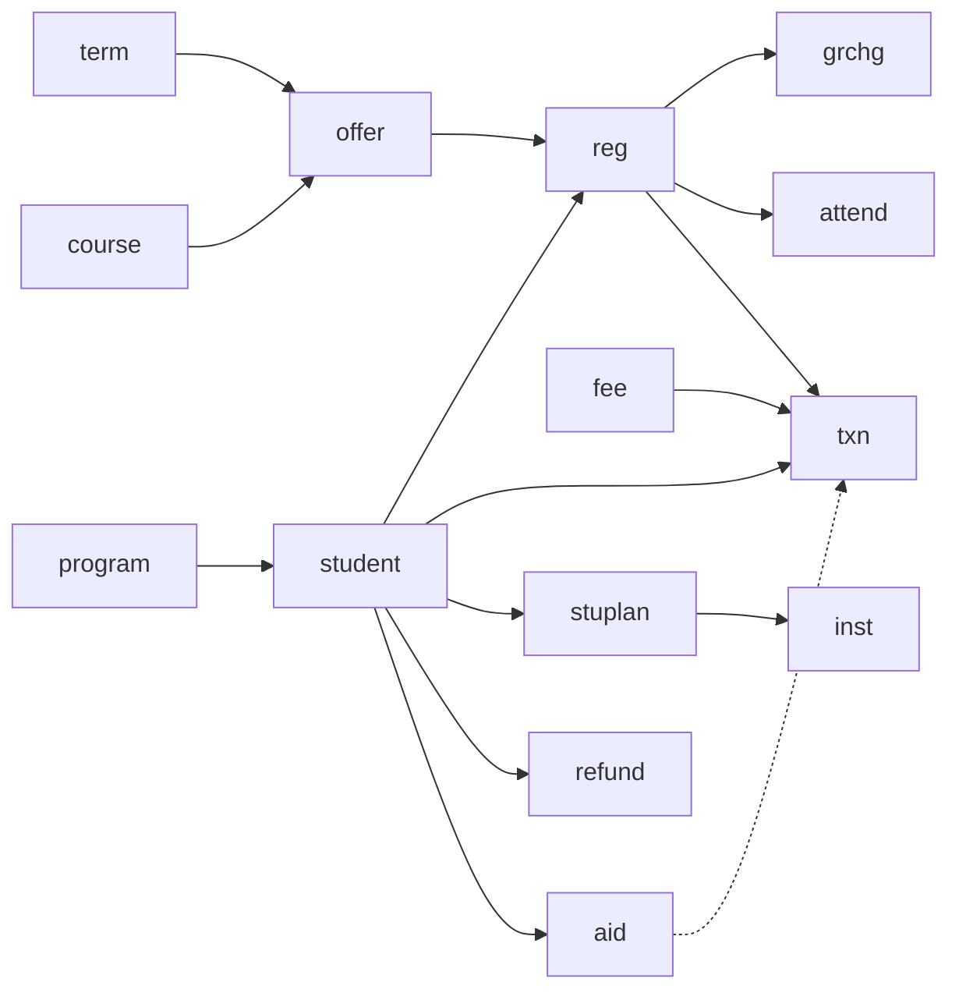

A student has a program and registers in offerings. An offering is a catalog course in a term. Grades live on the registration, and everything about money is a line in `local_studentrecords_txn`, which can point back at the registration, the price list item, the plan, the refund or the aid award behind it.

## Catalog and grading

What the school teaches and how it grades. These tables hold no data about a person: `provider::SETTINGS_TABLES` declares only who last changed each row.

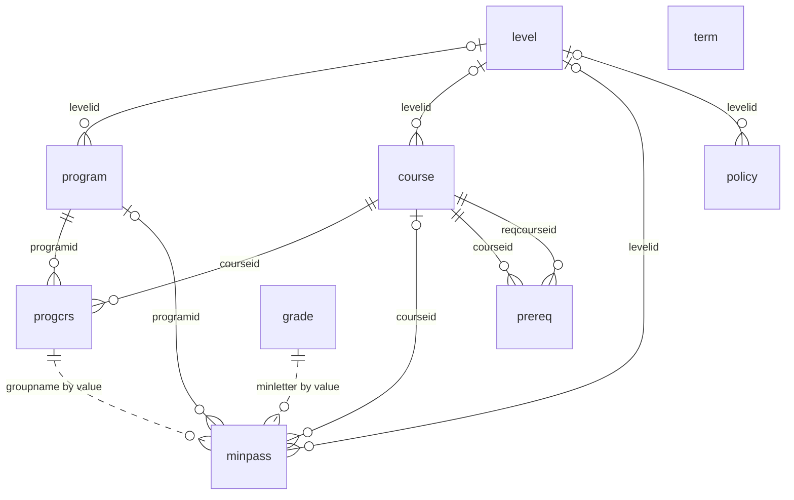

### `local_studentrecords_level`

Academic levels of the school, such as Undergraduate and Graduate. Pass rules, standing rules, prices, plans and the checklist can be scoped to a level. Written by `local/studentrecords/grading.php` and `drafts::apply()`, both through `records::save()`. Read through `catalog::levels()` and `catalog::level_id()`.

| Column | Type | Null | Default | Meaning |
|---|---|---|---|---|
| `id` | int 10 | no | sequence | Primary key. Every `levelid` points here. `fee.scopeid` and `plan.scopeid` do too when `scope` is `level`. |
| `name` | char 100 | no | none | The level as the school words it. Unique. `catalog::level_id()` matches it without regard to case, which is how the import finds a level. |
| `description` | char 255 | yes | none | Free text, shown on `local/studentrecords/grading.php`. |
| `sortorder` | int 10 | no | `0` | Position in lists. A new row gets the row count plus one. No page changes it later. |
| `usermodified` | int 10 | no | `0` | Who last changed the row. `records::save()` sets it. |
| `timemodified` | int 10 | no | `0` | When the row last changed. `records::save()` sets it. |

Keys: primary (`id`).

Indexes: unique (`name`).

### `local_studentrecords_grade`

The school's one grading scale. A row with `points` is a letter, and a row with `points` NULL is a mark (`catalog::marks()`), such as I, P, NP, W or NC. Written by `local/studentrecords/grading.php` and `drafts::apply()`. Read through `catalog::scale()` here, and by `srsource::calculator()` in Academic Transcript when Student Records is its source.

| Column | Type | Null | Default | Meaning |
|---|---|---|---|---|
| `id` | int 10 | no | sequence | Primary key. Nothing points at it: grades are stored as letters. |
| `letter` | char 10 | no | none | The letter or mark as printed, for example `A-` or `P`. Unique. `reg.grade`, `grchg.newgrade` and `xfer.grade` hold this text, not an id. |
| `minpct` | number 10,4 | yes | none | Lowest percent of the range, 0 to 100, as a number with four decimals. NULL means the row has no range, and `grading::letter_for_pct()` skips it. `grading::passes()` compares this value with a rule's `minpct`. |
| `maxpct` | number 10,4 | yes | none | Highest percent of the range. Only `grading::check_scale()` and the transcript's key read it. A letter is picked from `minpct` alone. |
| `points` | number 5,2 | yes | none | Grade points per hour. NULL makes the row a mark, and a mark never carries quality points. |
| `ingpa` | int 1 | no | `1` | 1 = counts in the GPA. `registration::history()` gives points only when this is 1 and `points` is set. The form refuses 1 with no `points`. A row with `points` and 0 here isn't a mark in Student Records, but the transcript treats it as one. |
| `earns` | int 1 | no | `0` | Read only for a mark: 1 = the course hours count as earned, as `registration::result_passes()` decides. On a row with `points` it does nothing. |
| `description` | char 255 | yes | none | Free text, shown on `local/studentrecords/grading.php` and in the transcript's key. |
| `sortorder` | int 10 | no | `0` | First sort key of `catalog::scale()`, then `points` and `minpct`, both highest first. |
| `usermodified` | int 10 | no | `0` | Who last changed the row. `records::save()` sets it. |
| `timemodified` | int 10 | no | `0` | When the row last changed. `records::save()` sets it. |

Keys: primary (`id`).

Indexes: unique (`letter`).

### `local_studentrecords_minpass`

Lowest passing grade for a level, a program, a group of a program's courses, or one course. `grading::effective_rule()` picks the most specific rule, and `registration::result_passes()` applies it. Written by `local/studentrecords/grading.php` and `drafts::apply()`.

| Column | Type | Null | Default | Meaning |
|---|---|---|---|---|
| `id` | int 10 | no | sequence | Primary key. |
| `levelid` | int 10 | yes | none | Scope: a level (rank 1 in `grading::effective_rule()`). The form allows it only without a program or a course. |
| `programid` | int 10 | yes | none | Scope: a program (rank 2), or with `groupname` a group of its courses (rank 3). On a course rule it narrows the rule to that program. |
| `groupname` | char 255 | yes | none | A group of the program outline, matched by value to `progcrs.groupname`. Empty = the whole program. |
| `courseid` | int 10 | yes | none | Scope: one catalog course (rank 4, the most specific). The form asks for a course code and stores its id. |
| `minletter` | char 10 | yes | none | Lowest passing letter. `grading::passes()` reads it first. A value not on the scale gives no answer, and `registration::result_passes()` then passes any letter with points above zero, as with no rule. |
| `minpct` | number 10,4 | yes | none | Lowest passing percent, used when `minletter` is empty. It is compared with the `minpct` of the letter earned, not with the student's percent, so a rule at 75 fails every letter whose band starts at 70. |
| `note` | char 255 | yes | none | Free text. The import keeps the school's wording here. |
| `usermodified` | int 10 | no | `0` | Who last changed the row. `records::save()` sets it. |
| `timemodified` | int 10 | no | `0` | When the row last changed. `records::save()` sets it. |

Keys: primary (`id`); foreign `levelid` to `local_studentrecords_level`.`id`; foreign `programid` to `local_studentrecords_program`.`id`; foreign `courseid` to `local_studentrecords_course`.`id`.

Indexes: none.

### `local_studentrecords_policy`

Academic rules (standing, repeats, maximum time) as the school words them, one row per rule and level. Written only by `drafts::apply()`: `local/studentrecords/grading.php` shows them and has no edit form. Read by `standing::suggestions()`.

| Column | Type | Null | Default | Meaning |
|---|---|---|---|---|
| `id` | int 10 | no | sequence | Primary key. |
| `rulekey` | char 100 | no | none | The rule's title as lower case words joined by `_`, made in `importer::read_policy()`. `standing::rule_from_policies()` matches it with patterns such as `minimum_gpa` and `maximum_time`. |
| `title` | char 255 | no | none | The rule's title in the imported file. |
| `levelid` | int 10 | yes | none | The level the text applies to. NULL = school-wide. |
| `value` | text | yes | none | The rule's text. `standing::rule_from_policies()` reads a number out of it to suggest a standing rule. |
| `sortorder` | int 10 | no | `0` | Position on the page: the row count plus one when added. |
| `usermodified` | int 10 | no | `0` | Who last changed the row. `records::save()` sets it. |
| `timemodified` | int 10 | no | `0` | When the row last changed. `records::save()` sets it. |

Keys: primary (`id`); foreign `levelid` to `local_studentrecords_level`.`id`.

Indexes: (`rulekey`).

### `local_studentrecords_term`

Terms and their deadlines. Written by `local/studentrecords/terms.php`, `drafts::apply()` and upgrade step 2026102202. `registration::term_days()` turns the dates into Y-m-d text for the date rules. Compare term dates as days, through `catalog::time_to_date()`: the form stores the start of a day and the import stores noon.

| Column | Type | Null | Default | Meaning |
|---|---|---|---|---|
| `id` | int 10 | no | sequence | Primary key. |
| `name` | char 100 | no | none | The term's name. Unique, which is how the import finds a term again. |
| `startdate` | int 10 | no | `0` | First day of the term. The add, drop and refund rules read it. |
| `enddate` | int 10 | no | `0` | Last day of the term. With no `adddropend`, adding runs to this day. |
| `adddropstart` | int 10 | yes | none | Start of add and drop. Shown on `local/studentrecords/terms.php`. No rule reads it: `registration::term_days()` leaves it out. |
| `adddropend` | int 10 | yes | none | Last day to add or drop, and the day after it withdrawing starts. The last day counts (`registration::window_problem()`). |
| `withdrawby` | int 10 | yes | none | Last day to withdraw. Noon when calculated by `catalog::withdraw_time()`, the start of the day when staff pick it. |
| `withdrawcalc` | int 1 | no | `0` | 1 = `withdrawby` was calculated from the `withdrawpct` setting, else 60 percent of the term. `local/studentrecords/terms.php` works the date out on save when it is empty, or when this is 1 and staff left the date as it was. The import keeps a date staff picked. |
| `examstart` | int 10 | yes | none | First day of exams. Shown only. |
| `examend` | int 10 | yes | none | Last day of exams. Shown only. |
| `gradefreeze` | int 10 | yes | none | After this day final grades change only through an approved grade change. The day itself is open, because `registration::is_frozen()` uses `>`. NULL = no freeze. The form refuses a date before `enddate`. |
| `notes` | text | yes | none | Holidays and breaks, as free text. Shown only. |
| `active` | int 1 | no | `1` | 1 = in use. `selfreg::open_terms()`, `waitlist::seat_opened()`, `shell::my_offerings()` and `cards::current_term()` look only at active terms. |
| `usermodified` | int 10 | no | `0` | Who last changed the row. `records::save()` sets it. |
| `timemodified` | int 10 | no | `0` | When the row last changed. `records::save()` sets it. |

Keys: primary (`id`).

Indexes: unique (`name`).

### `local_studentrecords_course`

The course catalog. Written by `local/studentrecords/courses.php` and `drafts::apply()`. `catalog::course_id()` finds a row by code.

| Column | Type | Null | Default | Meaning |
|---|---|---|---|---|
| `id` | int 10 | no | sequence | Primary key. |
| `code` | char 50 | no | none | Course code in the form `grading::normalise_code()` gives: upper case, no spaces. Unique, and MySQL's unique index ignores case. |
| `title` | char 255 | no | none | Course title. Plain text, escaped when shown. |
| `hours` | number 10,2 | yes | none | Credit or clock hours of the course, as `unittype` says. NULL counts as 0 in every sum. Hours are the course's, not the offering's: an offering has none of its own. |
| `unittype` | char 10 | no | `credit` | `credit` or `clock`. `billing::fits_unit()` charges an hourly price only on the matching unit. |
| `levelid` | int 10 | yes | none | Level of the course. Shown only. |
| `prereqtext` | text | yes | none | Prerequisites as the school words them. Nothing checks this text. Only `local_studentrecords_prereq` rows stop a registration. |
| `active` | int 1 | no | `1` | 1 = offered in the pick lists of the offering, outline, qualification and transfer forms. A course is never removed. |
| `usermodified` | int 10 | no | `0` | Who last changed the row. `records::save()` sets it. |
| `timemodified` | int 10 | no | `0` | When the row last changed. `records::save()` sets it. |

Keys: primary (`id`); foreign `levelid` to `local_studentrecords_level`.`id`.

Indexes: unique (`code`).

### `local_studentrecords_prereq`

Prerequisite links. All of a course's rows are required (`registration::missing_prereqs()`). Written only by `drafts::link_prereqs()`, so these rows exist only after an import: the course form keeps `course.prereqtext` as text and doesn't touch this table.

| Column | Type | Null | Default | Meaning |
|---|---|---|---|---|
| `id` | int 10 | no | sequence | Primary key. |
| `courseid` | int 10 | no | none | The course that has the prerequisite. |
| `reqcourseid` | int 10 | no | none | The course that must be passed first. `registration::has_passed()` also accepts active transfer credit whose `equivcourseid` is this course. |
| `usermodified` | int 10 | no | `0` | Who last changed the row. `records::save()` sets it. |
| `timemodified` | int 10 | no | `0` | When the row last changed. `records::save()` sets it. |

Keys: primary (`id`); foreign `courseid` to `local_studentrecords_course`.`id`; foreign `reqcourseid` to `local_studentrecords_course`.`id`.

Indexes: unique (`courseid`, `reqcourseid`).

### `local_studentrecords_program`

Programs. `unittype`, `totalhours`, `mingpa` and `residenthours` drive the degree audit, and `levelid` scopes rules and prices. Written by `local/studentrecords/programs.php`, `drafts::apply()` and upgrade step 2026102202.

| Column | Type | Null | Default | Meaning |
|---|---|---|---|---|
| `id` | int 10 | no | sequence | Primary key. `fee.scopeid` and `plan.scopeid` point here when `scope` is `program`. |
| `code` | char 50 | no | none | Program code. Unique. `catalog::program_id()` finds a row by it. |
| `name` | char 255 | no | none | Program name. Plain text, escaped when shown. |
| `school` | char 255 | yes | none | School or department, free text. Shown only. |
| `levelid` | int 10 | yes | none | The program's level, which decides the pass rules, standing rule, prices and plans of its students. |
| `credential` | char 100 | yes | none | The award as printed, for example MBA. `local/studentrecords/graduation.php` offers it at conferral. |
| `credentialtype` | char 20 | yes | none | One of `importer::CREDENTIALS`: `certificate`, `diploma`, `associate`, `bachelor`, `master`, `doctorate`, `other`. `admissions::applies()` matches `reqdoc.credentialtype` to it by value. The Clearinghouse file needs it. |
| `isdegree` | int 1 | no | `1` | 1 = degree program, 0 = non-degree. Shown, and exported as Y or N. |
| `cipcode` | char 10 | yes | none | CIP code. Exports and the Clearinghouse file read it, and `outside::nsc_problems()` asks for it. |
| `delivery` | char 100 | yes | none | Delivery as the catalog words it, free text. Shown, and the import and upgrade step 2026102202 read `deliverymode` out of it with `importer::delivery_mode()`. |
| `deliverymode` | char 20 | yes | none | One of `catalog::DELIVERY`: `online`, `inperson`, `hybrid`, or NULL. The export field `delivery` reads this column. |
| `location` | char 255 | yes | none | Where in-person teaching takes place. Shown only. |
| `duration` | char 100 | yes | none | Program length as free text. Kept by the form and the import. No page shows it outside the form. |
| `maxtime` | char 100 | yes | none | Maximum time as free text. Shown only. The rule that acts is `saprule.maxyears`. |
| `unittype` | char 10 | no | `credit` | `credit` or `clock`. With no outline the audit counts only courses in this unit, and a clock-hour program gets the hours version of the Return of aid worksheet. |
| `totalhours` | number 10,2 | yes | none | Hours the program needs. NULL = no total. Read by `degreeaudit::evaluate()` and `standing::compute()`. |
| `trackhours` | number 10,2 | yes | none | Hours of the one track a student chooses. Shown on the program page, which adds it to the required hours to check `totalhours`, as the import does. |
| `mingpa` | number 5,2 | yes | none | Lowest cumulative GPA to graduate. NULL = none. |
| `graderules` | text | yes | none | Grade rules as the school words them. The import turns clear wording into `minpass` rows with `grading::parse_program_rules()`. Shown on the program page. |
| `residenthours` | number 8,2 | yes | none | Hours that must be earned at the school. NULL = no minimum (`degreeaudit::resident_check()`). |
| `active` | int 1 | no | `1` | 1 = offered in pick lists (`catalog::programs()`). A program is never removed. The student form lists active programs only, so saving that form for a student in a program that is off clears `student.programid`. |
| `usermodified` | int 10 | no | `0` | Who last changed the row. `records::save()` sets it. |
| `timemodified` | int 10 | no | `0` | When the row last changed. `records::save()` sets it. |

Keys: primary (`id`); foreign `levelid` to `local_studentrecords_level`.`id`.

Indexes: unique (`code`).

### `local_studentrecords_progcrs`

The program outline: which courses, in which group, as required, track or elective. Written by `local/studentrecords/programs.php` and `drafts::apply()`. The plugin removes no row. Read by `degreeaudit::run()`.

| Column | Type | Null | Default | Meaning |
|---|---|---|---|---|
| `id` | int 10 | no | sequence | Primary key. |
| `programid` | int 10 | no | none | The program. |
| `courseid` | int 10 | no | none | The catalog course. A course in two groups counts in both. |
| `groupname` | char 255 | no | none | The group's name, as a label and as data: `degreeaudit::group_hours()` reads the hours an elective group needs out of it, for example "(12 credits)". An elective group with no number is complete with nothing in it. |
| `requirement` | char 20 | no | `required` | `required`, `track` or `elective`. A student finishes every required group, one track and the hours of each elective group. `degreeaudit::evaluate()` picks a complete track first, then the one with the most hours met or in progress. |
| `sortorder` | int 10 | no | `0` | Position in the outline: the program's row count plus one when added on the page, or the row's place in the file from the import. |
| `usermodified` | int 10 | no | `0` | Who last changed the row. `records::save()` sets it. |
| `timemodified` | int 10 | no | `0` | When the row last changed. `records::save()` sets it. |

Keys: primary (`id`); foreign `programid` to `local_studentrecords_program`.`id`; foreign `courseid` to `local_studentrecords_course`.`id`.

Indexes: unique (`programid`, `courseid`, `groupname`).

## Students and admissions

The official file and what hangs from it before a student registers. `local_studentrecords_student` is the hub of the plugin: 25 other tables have a `studentid` column that points at it.

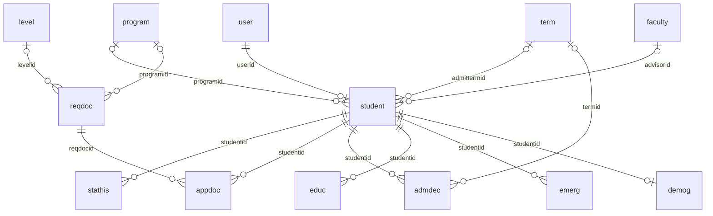

### `local_studentrecords_student`

The official file, one per Moodle user. Written by `students::save()`, `admissions::set_status()`, `admissions::record_decision()` (`admittermid`), `graduation::confer()` (the award), `attendance::fill_last_attended()` (`lastattended`) and `students::erase_personal()`. In 1.4.6 no page can create a file, because "Add student record" on `local/studentrecords/student.php` can't save: see [Pitfalls](../pitfalls.md#bugs-in-this-release).

| Column | Type | Null | Default | Meaning |
|---|---|---|---|---|
| `id` | int 10 | no | sequence | Primary key. Every `studentid` column in the other tables holds this id. It isn't the school's student ID, which is this table's own `studentid` column. Queries alias that one as `studentno` or `sid`. |
| `userid` | int 10 | no | none | The Moodle user. Required and unique, so a person has one file and a file always has an account. `students::write()` keeps it on update. |
| `studentid` | char 50 | no | none | The school's student ID, as text. Unique. Made by `admissions::next_student_id()` when left blank with `idauto` on. `records::same()` keeps `007` and `7` apart. |
| `legalfirstname` | char 100 | no | none | Legal first name. Stays after a privacy deletion. |
| `legalmiddlename` | char 100 | yes | none | Legal middle name. Stays after a privacy deletion. |
| `legallastname` | char 100 | no | none | Legal last name. Stays after a privacy deletion. |
| `preferredname` | char 100 | yes | none | Preferred name. Directory information, hidden by `access::hide_directory()`. A deletion blanks it. |
| `dob` | int 10 | yes | none | Date of birth, noon in the school's time zone. Directory information, but it stays after a deletion. |
| `email` | char 255 | yes | none | The address on the record. Messages go to the Moodle account's address, not this one. Directory information. |
| `phone` | char 50 | yes | none | Phone number. Directory information. |
| `usaddress` | text | yes | none | Address in the United States, free text. The Clearinghouse file and the 1098-T read it first, then `homeaddress`. Directory information. |
| `homeaddress` | text | yes | none | Home address, free text. Directory information. |
| `homecountry` | char 2 | yes | none | Two-letter country code from Moodle's list. Directory information. |
| `programid` | int 10 | yes | none | The student's program. It decides level, pass rules, prices and plans. In `students::DECIDING`: nobody changes it on their own record. See `program.active` for a trap on the edit form. |
| `admittermid` | int 10 | yes | none | Admit term: the cohort in `reports::graduation()` and the population `admitted` of an export. A decision that names another term moves it. |
| `catalogyear` | char 20 | yes | none | Catalog year, free text. Shown and exported. No rule reads it. |
| `status` | char 20 | no | `active` | One of `catalog::STATUSES`: `inquiry`, `applicant`, `waitlisted`, `admitted`, `denied`, `deferred`, `enrolled`, `active`, `graduated`, `withdrawn`, `onleave`. The XML comment leaves out `waitlisted`. Every change also writes `local_studentrecords_stathis`. In `students::DECIDING`. |
| `loadtype` | char 20 | yes | none | `fulltime`, `parttime` or NULL, as staff set it. `outside::nsc_status()` and the 1098-T take `fulltime` whatever the hours say. |
| `advisorid` | int 10 | yes | none | The advisor's row in `local_studentrecords_faculty`. The form lists active records of type `faculty` only, so saving it clears any other advisor. |
| `ferpaoptout` | int 1 | no | `0` | 1 = directory information is withheld from anyone who doesn't manage students, other than the student. |
| `isf1` | int 1 | no | `0` | 1 = F-1 student. The form shows it only with the `f1` module on. `admissions::ipeds_category()` reads 1 as nonresident. |
| `visatype` | char 20 | yes | none | Visa type, free text. Shown only to records staff and the student, with the `f1` module on. A deletion blanks it. |
| `sevisid` | char 20 | yes | none | SEVIS ID. Same as `visatype`. |
| `awardname` | char 255 | yes | none | The credential, then the honors after a comma, written by `graduation::confer()`, or typed on the student form. Academic Transcript prints this text as the qualification. In `students::DECIDING`. |
| `awarddate` | int 10 | yes | none | Conferral date, from `graduation::confer()` or the student form. Clearinghouse status G and the export population `graduated` read it. In `students::DECIDING`. |
| `lastattended` | int 10 | yes | none | Last date of attendance. A date from the form is the start of a day. `attendance::fill_last_attended()` fills an empty one at noon on a withdrawal. |
| `withdrawdate` | int 10 | yes | none | Date of withdrawal. The form asks for it, and for `lastattended`, with status `withdrawn`. `students::save()` doesn't. It dates the status history row of the withdrawal. |
| `residency` | char 20 | yes | none | `instate`, `outofstate`, `international` or NULL. Shown on the profile. A deletion blanks it. |
| `citizenship` | char 20 | yes | none | `citizen`, `permanent`, `other` or NULL. A deletion blanks it. |
| `firstgen` | char 10 | yes | none | `yes`, `no`, `unknown` or NULL: first in the family at college. A deletion blanks it. |
| `highschool` | char 255 | yes | none | High school or equivalent, free text. A deletion blanks it. |
| `hsyear` | int 4 | yes | none | Year completed, 1900 to 2100. A deletion blanks it. |
| `notes` | text | yes | none | Staff notes. Only the edit form and a privacy export show them. A deletion blanks them. |
| `timecreated` | int 10 | no | `0` | When the row was added. |
| `usermodified` | int 10 | no | `0` | Who last changed the row. `records::save()` sets it. |
| `timemodified` | int 10 | no | `0` | When the row last changed. `records::save()` sets it. |

Keys: primary (`id`); foreign unique `userid` to `user`.`id`; foreign `programid` to `local_studentrecords_program`.`id`; foreign `admittermid` to `local_studentrecords_term`.`id`; foreign `advisorid` to `local_studentrecords_faculty`.`id`.

Indexes: unique (`studentid`).

### `local_studentrecords_stathis`

Every change of a student's status, with the date it applies from. Written only by `admissions::add_status_history()`, which `students::write()` and `admissions::set_status()` call, and by upgrade step 2026102204. Read by `admissions::status_history()`.

| Column | Type | Null | Default | Meaning |
|---|---|---|---|---|
| `id` | int 10 | no | sequence | Primary key. |
| `studentid` | int 10 | no | none | The student, `local_studentrecords_student`.`id`. |
| `oldstatus` | char 20 | yes | none | Status before the change. NULL on the first row of a file. |
| `newstatus` | char 20 | no | none | Status after it. Values as `student.status`. |
| `effective` | int 10 | no | `0` | Date the status applies from: the withdrawal date for a withdrawal with one, the decision date or conferral date from those flows, else now. |
| `note` | char 255 | yes | none | Why, up to 255 characters. Cut, not refused. |
| `userid` | int 10 | no | `0` | Who made the change. 0 from the upgrade step. Named in `provider::PEOPLE`. |
| `timecreated` | int 10 | no | `0` | When the row was written. |

Keys: primary (`id`); foreign `studentid` to `local_studentrecords_student`.`id`; foreign `userid` to `user`.`id`.

Indexes: none.

### `local_studentrecords_reqdoc`

The application checklist: documents a program asks for. Written by `local/studentrecords/checklist.php` and `drafts::apply()`. `admissions::all_docs()` reads the active rows once per request.

| Column | Type | Null | Default | Meaning |
|---|---|---|---|---|
| `id` | int 10 | no | sequence | Primary key. |
| `name` | char 255 | no | none | The document's name. |
| `description` | text | yes | none | Free text. |
| `required` | int 1 | no | `1` | 1 = required. 0 = optional: shown, and never counted as missing by `admissions::missing()`. |
| `programid` | int 10 | yes | none | Scope. NULL = any. Every scope set must match (`admissions::applies()`). |
| `levelid` | int 10 | yes | none | Scope, matched to the program's level. NULL = any. |
| `credentialtype` | char 20 | yes | none | Scope, matched by value to `program.credentialtype`. NULL = any. |
| `active` | int 1 | no | `1` | 1 = on the checklist. Rows are switched off, never removed. |
| `sortorder` | int 10 | no | `0` | Position on the checklist. |
| `usermodified` | int 10 | no | `0` | Who last changed the row. `records::save()` sets it. |
| `timemodified` | int 10 | no | `0` | When the row last changed. `records::save()` sets it. |

Keys: primary (`id`); foreign `programid` to `local_studentrecords_program`.`id`; foreign `levelid` to `local_studentrecords_level`.`id`.

Indexes: none.

### `local_studentrecords_appdoc`

A student's state on each checklist document. A row exists only once something was recorded: no row reads as `missing`. Written by `admissions::save_checklist()`. A privacy deletion blanks `note`.

| Column | Type | Null | Default | Meaning |
|---|---|---|---|---|
| `id` | int 10 | no | sequence | Primary key. |
| `studentid` | int 10 | no | none | The student. |
| `reqdocid` | int 10 | no | none | The document. |
| `state` | char 20 | no | `missing` | One of `admissions::DOCSTATES`: `missing`, `received`, `waived`. |
| `statedate` | int 10 | yes | none | Date received or waived. NULL when `missing`. |
| `note` | char 255 | yes | none | Free text. Blanked by a deletion. |
| `usermodified` | int 10 | no | `0` | Who last changed the row. `records::save()` sets it. |
| `timemodified` | int 10 | no | `0` | When the row last changed. `records::save()` sets it. |

Keys: primary (`id`); foreign `studentid` to `local_studentrecords_student`.`id`; foreign `reqdocid` to `local_studentrecords_reqdoc`.`id`.

Indexes: unique (`studentid`, `reqdocid`).

### `local_studentrecords_admdec`

Admission decisions, one row each. Written only by `admissions::record_decision()`. A second submit writes a second row and sends the messages again: nothing guards it.

| Column | Type | Null | Default | Meaning |
|---|---|---|---|---|
| `id` | int 10 | no | sequence | Primary key. |
| `studentid` | int 10 | no | none | The student. |
| `decision` | char 20 | no | none | One of `admissions::DECISIONS`: `admitted`, `waitlisted`, `denied`, `deferred`. The XML comment leaves out `waitlisted`. For a student in `admissions::PIPELINE`, the same word becomes `student.status`. |
| `decisiondate` | int 10 | no | `0` | Date of the decision, from the form. It dates the status history row. |
| `termid` | int 10 | yes | none | Admit term, or for a deferral the new term. When it differs, `student.admittermid` moves to it. |
| `reason` | text | yes | none | Why. The form needs it for a denial. |
| `conditions` | text | yes | none | Conditions of the admission, free text. |
| `decidedby` | int 10 | no | `0` | Who recorded it. Named in `provider::PEOPLE`. |
| `timecreated` | int 10 | no | `0` | When the row was written. |

Keys: primary (`id`); foreign `studentid` to `local_studentrecords_student`.`id`; foreign `termid` to `local_studentrecords_term`.`id`; foreign `decidedby` to `user`.`id`.

Indexes: none.

### `local_studentrecords_educ`

Prior education. Written only by `local/studentrecords/studentpart.php`, part `educ`, through `records::save()`.

| Column | Type | Null | Default | Meaning |
|---|---|---|---|---|
| `id` | int 10 | no | sequence | Primary key. |
| `studentid` | int 10 | no | none | The student. |
| `school` | char 255 | no | none | School name. |
| `credential` | char 255 | yes | none | Credential earned, free text. |
| `completed` | int 10 | yes | none | Date completed or expected. NULL = not given. |
| `country` | char 2 | yes | none | Two-letter country code. |
| `notes` | char 255 | yes | none | Free text. A deletion blanks it. |
| `active` | int 1 | no | `1` | 1 = shown. 0 hides the row and keeps it. |
| `timecreated` | int 10 | no | `0` | When the row was added. |
| `usermodified` | int 10 | no | `0` | Who last changed the row. `records::save()` sets it. |
| `timemodified` | int 10 | no | `0` | When the row last changed. `records::save()` sets it. |

Keys: primary (`id`); foreign `studentid` to `local_studentrecords_student`.`id`.

Indexes: none.

### `local_studentrecords_emerg`

Emergency contacts. Written only by `local/studentrecords/studentpart.php`, part `emerg`. A privacy deletion blanks every value and sets `active` to 0, and the empty row stays.

| Column | Type | Null | Default | Meaning |
|---|---|---|---|---|
| `id` | int 10 | no | sequence | Primary key. |
| `studentid` | int 10 | no | none | The student. |
| `name` | char 255 | yes | none | Contact's name. |
| `relationship` | char 100 | yes | none | Relationship to the student, free text. |
| `phone` | char 50 | yes | none | Phone number. |
| `email` | char 255 | yes | none | Email address. |
| `notes` | char 255 | yes | none | Free text. |
| `active` | int 1 | no | `1` | 1 = shown. 0 hides the row and keeps it. |
| `sortorder` | int 10 | no | `0` | Position in the list: the student's row count plus one when added. |
| `timecreated` | int 10 | no | `0` | When the row was added. |
| `usermodified` | int 10 | no | `0` | Who last changed the row. `records::save()` sets it. |
| `timemodified` | int 10 | no | `0` | When the row last changed. `records::save()` sets it. |

Keys: primary (`id`); foreign `studentid` to `local_studentrecords_student`.`id`.

Indexes: none.

### `local_studentrecords_demog`

IPEDS demographics, at most one row per student. Written only by `local/studentrecords/studentpart.php`, part `demog`, which needs `local/studentrecords:viewdemographics` as well as `local/studentrecords:managestudents`. A privacy deletion blanks the values and leaves the row.

| Column | Type | Null | Default | Meaning |
|---|---|---|---|---|
| `id` | int 10 | no | sequence | Primary key. |
| `studentid` | int 10 | no | none | The student. Unique. |
| `sex` | char 20 | yes | none | One of `admissions::SEX`: `female`, `male`, `another`, `notreported`, or NULL. |
| `hispanic` | char 20 | yes | none | One of `admissions::HISPANIC`: `yes`, `no`, `notreported`, or NULL. |
| `races` | char 255 | yes | none | Comma list of `admissions::RACES` codes (`aian`, `asian`, `black`, `nhpi`, `white`), or `notreported`, or NULL. `admissions::ipeds_category()` turns it into one category. |
| `usermodified` | int 10 | no | `0` | Who last changed the row. `records::save()` sets it. |
| `timemodified` | int 10 | no | `0` | When the row last changed. `records::save()` sets it. |

Keys: primary (`id`); foreign unique `studentid` to `local_studentrecords_student`.`id`.

Indexes: none.

## Faculty and staff

One file per teacher or staff member, with or without a Moodle account.

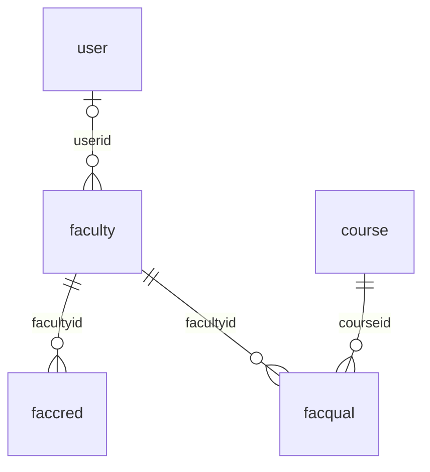

### `local_studentrecords_faculty`

One file per teacher or staff member. No pay or HR data. Written by `faculty::save()`, `drafts::apply()` and `faculty::erase_personal()`.

| Column | Type | Null | Default | Meaning |
|---|---|---|---|---|
| `id` | int 10 | no | sequence | Primary key. `offer.facultyid` and `student.advisorid` point here. |
| `userid` | int 10 | yes | none | The Moodle account, or NULL for a person with none. The form refuses a second record for an account. There is no unique index. |
| `stafftype` | char 20 | no | `faculty` | `faculty` or `staff`. The roster and the instructor pick list hold `faculty` only. |
| `firstname` | char 100 | no | none | First name. |
| `lastname` | char 100 | no | none | Last name. |
| `honorific` | char 20 | yes | none | Title before the name, free text. `catalog::faculty_name()` prints it. |
| `jobtitle` | char 255 | yes | none | Job title, free text. |
| `department` | char 255 | yes | none | Department, free text. |
| `email` | char 255 | yes | none | Email address. A deletion blanks it. |
| `phone` | char 50 | yes | none | Phone number. A deletion blanks it. |
| `employment` | char 20 | yes | none | `fulltime`, `parttime` or NULL. The roster prints it. |
| `active` | int 1 | no | `1` | 1 = in pick lists (`catalog::faculty()`) and on the active roster. Rows are never removed. |
| `nolms` | int 1 | no | `0` | 1 = never uses the LMS. `home::is_nolms()` sends such a person from LMS pages to the home page. Site admins never count, and a row with no account has no effect. |
| `officehours` | char 255 | yes | none | Office hours, free text. A deletion blanks them. |
| `notes` | text | yes | none | Staff notes. A deletion blanks them. |
| `timecreated` | int 10 | no | `0` | When the row was added. |
| `usermodified` | int 10 | no | `0` | Who last changed the row. `records::save()` sets it. |
| `timemodified` | int 10 | no | `0` | When the row last changed. `records::save()` sets it. |

Keys: primary (`id`); foreign `userid` to `user`.`id`.

Indexes: (`lastname`, `firstname`).

### `local_studentrecords_faccred`

Degrees, transcripts, licenses and certifications on file. Uploaded files sit in file area `credential`, with this row's id as the item id. Written by `faculty::save_credential()` and `drafts::apply()`. In 1.4.6 the credential form of `local/studentrecords/facultyrecord.php` saves nothing (see [Pitfalls](../pitfalls.md#bugs-in-this-release)), so rows come only from the import.

| Column | Type | Null | Default | Meaning |
|---|---|---|---|---|
| `id` | int 10 | no | sequence | Primary key, and the item id of file area `credential`. |
| `facultyid` | int 10 | no | none | The person. |
| `credtype` | char 20 | no | `degree` | One of `faculty::CREDTYPES`: `degree`, `transcript`, `license`, `certification`, `other`. The import writes `degree`. |
| `title` | char 255 | no | none | What the credential is. The import writes the text from the file. |
| `subject` | char 255 | yes | none | Subject, free text. |
| `institution` | char 255 | yes | none | Who gave it, free text. |
| `yearawarded` | int 4 | yes | none | Year, four digits. |
| `expires` | int 10 | yes | none | Expiry date. `local/studentrecords/facultyrecord.php` marks an expired one. |
| `verified` | int 1 | no | `0` | 1 = staff checked it. Shown only. |
| `usermodified` | int 10 | no | `0` | Who last changed the row. `records::save()` sets it. |
| `timemodified` | int 10 | no | `0` | When the row last changed. `records::save()` sets it. |

Keys: primary (`id`); foreign `facultyid` to `local_studentrecords_faculty`.`id`.

Indexes: none.

### `local_studentrecords_facqual`

Courses a person may teach. Removal keeps the row with `active` 0, the date and who. Written by `faculty::add_qualifications()`, `faculty::remove_qualifications()` and `drafts::apply()`. `local/studentrecords/classes/form/offer.php` refuses an instructor `faculty::is_qualified()` says no to, unless staff tick `notqualifiedok`.

| Column | Type | Null | Default | Meaning |
|---|---|---|---|---|
| `id` | int 10 | no | sequence | Primary key. |
| `facultyid` | int 10 | no | none | The person. |
| `courseid` | int 10 | no | none | The catalog course. One row per person and course: adding again brings the old row back. |
| `active` | int 1 | no | `1` | 1 = qualified. 0 = removed and kept. |
| `timeremoved` | int 10 | yes | none | When it was removed. Back to NULL if added again. |
| `removedby` | int 10 | yes | none | Who removed it. Back to NULL if added again. |
| `usermodified` | int 10 | no | `0` | Who last changed the row. `records::save()` sets it. |
| `timemodified` | int 10 | no | `0` | When the row last changed. `records::save()` sets it. |

Keys: primary (`id`); foreign `facultyid` to `local_studentrecords_faculty`.`id`; foreign `courseid` to `local_studentrecords_course`.`id`; foreign `removedby` to `user`.`id`.

Indexes: unique (`facultyid`, `courseid`).

## Offerings, registration and attendance

A course in a term, the students in it, and who came to class. `local_studentrecords_offer` joins term and course, and `local_studentrecords_reg` joins student and offering.

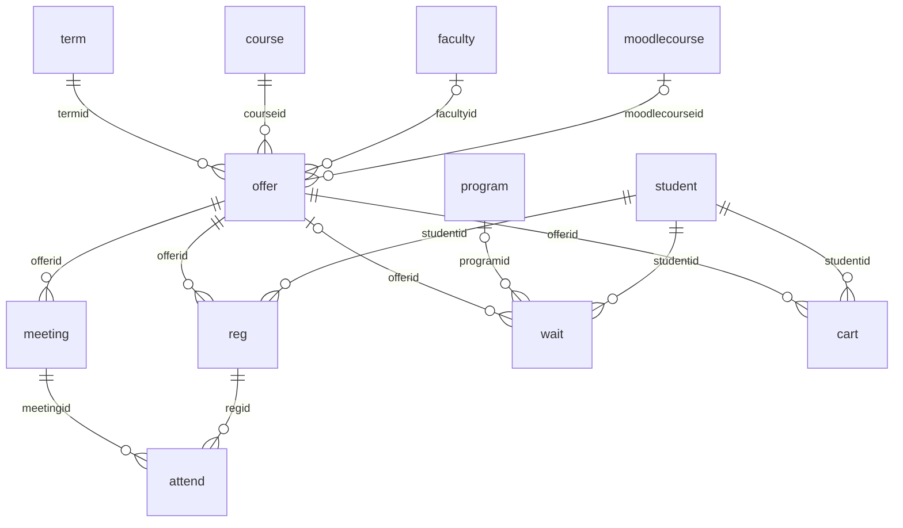

### `local_studentrecords_offer`

Course offerings, called sections on the pages: a catalog course taught in a term. Written by `local/studentrecords/offerings.php` and `registration::copy_sections()`. Read through `registration::offer()`, which joins the course and term, and `registration::offers()`.

| Column | Type | Null | Default | Meaning |
|---|---|---|---|---|
| `id` | int 10 | no | sequence | Primary key. The lock `offer<id>` guards its seats. |
| `termid` | int 10 | no | none | The term. |
| `courseid` | int 10 | no | none | The catalog course. Hours and unit come from there. |
| `section` | char 20 | no | `01` | Section label, text, default `01`. Unique with the term and course. |
| `facultyid` | int 10 | yes | none | The instructor's row in `local_studentrecords_faculty`, or NULL. The form lists active records of type `faculty` only, so saving it clears any other instructor. |
| `capacity` | int 10 | yes | none | Seats. NULL = no limit, and a section with no limit has no waitlist. The form asks for 1 or more. |
| `moodlecourseid` | int 10 | yes | none | The Moodle course students are enrolled in, or NULL. `registration::copy_sections()` doesn't copy it, because each term usually has its own. |
| `status` | char 20 | no | `open` | One of `registration::OFFERSTATUSES`: `open`, `closed`, `cancelled`. Only an `open` section makes seat offers, or takes a registration without a staff override. |
| `notes` | char 255 | yes | none | Free text. Copied with the section. |
| `meetdays` | char 30 | yes | none | Class days: a comma list of `selfreg::DAYS` codes in week order, for example `tue,thu`. NULL = online or not set. |
| `starttime` | char 5 | yes | none | Start time as `HH:MM`, 24 hours, school time. Compared as text by `selfreg::times_clash()`. A class with no valid times never clashes. |
| `endtime` | char 5 | yes | none | End time, in the same form. The form asks for it to be after `starttime`. |
| `room` | char 50 | yes | none | Room, or the word Online, free text. |
| `timecreated` | int 10 | no | `0` | When the row was added. |
| `usermodified` | int 10 | no | `0` | Who last changed the row. `records::save()` sets it. |
| `timemodified` | int 10 | no | `0` | When the row last changed. `records::save()` sets it. |

Keys: primary (`id`); foreign `termid` to `local_studentrecords_term`.`id`; foreign `courseid` to `local_studentrecords_course`.`id`; foreign `facultyid` to `local_studentrecords_faculty`.`id`; foreign `moodlecourseid` to `course`.`id`.

Indexes: unique (`termid`, `courseid`, `section`).

### `local_studentrecords_reg`

Registrations: a student in an offering, with status and final grade. Unique per student and offering, so taking a seat again reuses the row of a dropped or withdrawn registration and clears its grade. A row reused after a withdrawal loses its W, which stays only in the change history. Written by `registration::add_seat()`, `registration::end_seat()`, `registration::write_grade()` and `payments::grant()`.

| Column | Type | Null | Default | Meaning |
|---|---|---|---|---|
| `id` | int 10 | no | sequence | Primary key. The lock `reg<id>` guards its grade and state. |
| `studentid` | int 10 | no | none | The student. |
| `offerid` | int 10 | no | none | The offering. |
| `status` | char 20 | no | `registered` | One of `registration::STATUSES`: `registered`, `dropped`, `withdrawn`, `completed`. `registered` and `completed` (`registration::ACTIVE`) hold a seat. `registration::totals()` counts those and `withdrawn` as attempted. A row becomes `completed` when it gets a grade. |
| `timeregistered` | int 10 | no | `0` | When the seat was taken. A reused row gets the new time. `refunds::figure()` reads it for the `cancel` rule. |
| `timeended` | int 10 | yes | none | When the row was dropped or withdrawn. NULL otherwise. |
| `grade` | char 10 | yes | none | Final letter or mark, as text from `local_studentrecords_grade`. NULL until graded. `registration::history()` shows `W` for a withdrawn row whatever this holds. |
| `gradepct` | number 10,4 | yes | none | Percent behind the grade, rounded to four decimals when stored. The letter was chosen from the exact percent, so don't work a letter out from this column. |
| `gradesource` | char 20 | yes | none | Who set the grade: `moodle` (gradebook pull), `staff`, `teacher` (posted through Academic Transcript) or `change` (an approved grade change), or NULL. `registration::KEPTSOURCES` lists what a gradebook pull leaves alone. A teacher can't write over `staff` or `change`. |
| `override` | int 1 | no | `0` | 1 = staff overrode a date, a section that isn't open, the seats or a prerequisite, with a reason in `note`. The XML comment leaves out the section. A hold can't be overridden. |
| `accesspending` | int 1 | no | `0` | 1 = the Moodle enrolment waits for payment. `payments::pending()` lists these, and `payments::grant()` clears it. |
| `note` | char 255 | yes | none | The reason for an override, a drop or a withdrawal, up to 255 characters. |
| `usermodified` | int 10 | no | `0` | Who last changed the row. `records::save()` sets it. |
| `timemodified` | int 10 | no | `0` | When the row last changed. `records::save()` sets it. |

Keys: primary (`id`); foreign `studentid` to `local_studentrecords_student`.`id`; foreign `offerid` to `local_studentrecords_offer`.`id`.

Indexes: unique (`studentid`, `offerid`).

### `local_studentrecords_wait`

Waitlists. `kind` `section` and `program` share the table. Written by `waitlist::join()`, `waitlist::leave()`, `waitlist::registered()`, `waitlist::seat_opened()`, `waitlist::daily()` and `admissions::record_decision()`. A privacy deletion removes the student's rows.

| Column | Type | Null | Default | Meaning |
|---|---|---|---|---|
| `id` | int 10 | no | sequence | Primary key. |
| `kind` | char 10 | no | `section` | `section` for a full section, `program` for an applicant waiting for a place. Program rows get no seat offers: only a decision ends them. |
| `offerid` | int 10 | yes | none | The section, for kind `section`. |
| `programid` | int 10 | yes | none | The program, for kind `program`. |
| `termid` | int 10 | yes | none | The start term, for kind `program`. |
| `studentid` | int 10 | no | none | The student. |
| `status` | char 10 | no | `waiting` | One of `waitlist::STATUSES`: `waiting`, `offered`, `done`, `left`. `waiting` and `offered` are open. |
| `note` | char 255 | yes | none | Why it ended. `waitlist::daily()` writes the text of the string `wait_lapsed` here. |
| `timeoffered` | int 10 | yes | none | When a seat was offered. `waitlist::offer_held()` holds it for `waitlist::HOLDDAYS` days from this moment. |
| `timeended` | int 10 | yes | none | When it became `done` or `left`. |
| `timecreated` | int 10 | no | `0` | When the student joined. The line order is `timecreated`, then `id` (`waitlist::for_offer()`). |
| `usermodified` | int 10 | no | `0` | Who last changed the row. `records::save()` sets it. |
| `timemodified` | int 10 | no | `0` | When the row last changed. `records::save()` sets it. |

Keys: primary (`id`); foreign `offerid` to `local_studentrecords_offer`.`id`; foreign `programid` to `local_studentrecords_program`.`id`; foreign `termid` to `local_studentrecords_term`.`id`; foreign `studentid` to `local_studentrecords_student`.`id`; foreign `usermodified` to `user`.`id`.

Indexes: (`kind`, `status`).

### `local_studentrecords_cart`

Self-registration cart: classes picked and not registered yet. A row takes no seat, so a class in the cart can be full by the time the student confirms. Written by `selfreg::add()` and `selfreg::remove()`, and cleared by `registration::add_seat()`. A privacy deletion removes the student's rows.

| Column | Type | Null | Default | Meaning |
|---|---|---|---|---|
| `id` | int 10 | no | sequence | Primary key. |
| `studentid` | int 10 | no | none | The student. |
| `offerid` | int 10 | no | none | The offering. |
| `timecreated` | int 10 | no | `0` | When it was picked. Sets the order of `selfreg::cart()`. |

Keys: primary (`id`); foreign `studentid` to `local_studentrecords_student`.`id`; foreign `offerid` to `local_studentrecords_offer`.`id`.

Indexes: unique (`studentid`, `offerid`).

### `local_studentrecords_meeting`

Class meetings of an offering, for attendance. Written only by `attendance::add_meeting()`, which `attendance::add_weekly()` calls. Nothing removes a meeting.

| Column | Type | Null | Default | Meaning |
|---|---|---|---|---|
| `id` | int 10 | no | sequence | Primary key. |
| `offerid` | int 10 | no | none | The offering. |
| `meetingdate` | int 10 | no | `0` | Day of the meeting: noon in the school's time zone. `attendance::add_meeting()` compares this exact time, so after the school's time zone changes, a day can get a second meeting. |
| `hours` | number 5,2 | no | `0` | Length in hours. The most `attend.hours` can hold, and summed as scheduled hours in `attendance::for_reg()`. |
| `topic` | char 255 | yes | none | Free text, up to 255 characters. |
| `usermodified` | int 10 | no | `0` | Who last changed the row. `records::save()` sets it. |
| `timecreated` | int 10 | no | `0` | When the row was added. |
| `timemodified` | int 10 | no | `0` | When the row last changed. `records::save()` sets it. |

Keys: primary (`id`); foreign `offerid` to `local_studentrecords_offer`.`id`; foreign `usermodified` to `user`.`id`.

Indexes: (`offerid`, `meetingdate`).

### `local_studentrecords_attend`

Attendance marks, one per meeting and registration. Written by `attendance::save_marks()`. A blank status is skipped, so a mark can't be cleared.

| Column | Type | Null | Default | Meaning |
|---|---|---|---|---|
| `id` | int 10 | no | sequence | Primary key. |
| `meetingid` | int 10 | no | none | The meeting. |
| `regid` | int 10 | no | none | The registration. Registered, completed and withdrawn rows are on the sheet (`attendance::sheet()`). |
| `studentid` | int 10 | no | none | The student, copied from the registration so the row can be found per student. |
| `status` | char 10 | no | none | One of `attendance::STATUSES`: `present`, `late`, `absent`, `excused`. The rate is present and late out of the meetings marked, with excused ones left out (`attendance::summary()`). |
| `hours` | number 5,2 | no | `0` | Hours attended, for clock-hour programs. 0 for `absent` and `excused`, and never more than `meeting.hours`. |
| `note` | char 255 | yes | none | Free text, up to 255 characters. |
| `usermodified` | int 10 | no | `0` | Who last changed the row. `records::save()` sets it. |
| `timecreated` | int 10 | no | `0` | When the row was added. |
| `timemodified` | int 10 | no | `0` | When the row last changed. `records::save()` sets it. |

Keys: primary (`id`); foreign `meetingid` to `local_studentrecords_meeting`.`id`; foreign `regid` to `local_studentrecords_reg`.`id`; foreign `studentid` to `local_studentrecords_student`.`id`; foreign `usermodified` to `user`.`id`.

Indexes: unique (`meetingid`, `regid`).

## Academic record

What the school decides about a student's progress. Final grades live on `local_studentrecords_reg`.

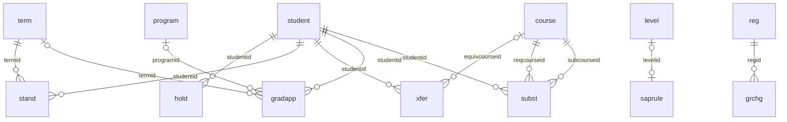

### `local_studentrecords_hold`

Holds on a student. A release keeps the row. Written by `academic::place_hold()` and `academic::release_hold()`. A hold in force with `blocksreg` stops `registration::add_problems()`, and any hold in force stops an Official transcript through `requests::holds()` in Academic Transcript, when Student Records is its source. `academic::hold_active()` says what is in force.

| Column | Type | Null | Default | Meaning |
|---|---|---|---|---|
| `id` | int 10 | no | sequence | Primary key. `inst.holdid` points here for a hold placed by `plans::daily()`. |
| `studentid` | int 10 | no | none | The student. |
| `holdtype` | char 30 | no | none | One of `academic::HOLDTYPES`: `academic`, `financial`, `admissions`, `records`, `conduct`, `other`. `plans::daily()` uses `financial`. |
| `reason` | text | yes | none | Why. Free text. Stays after a privacy deletion. |
| `blocksreg` | int 1 | no | `1` | 1 = blocks registration, and no override gets past it. |
| `startdate` | int 10 | no | `0` | When it starts: the date from the form, or now. |
| `enddate` | int 10 | yes | none | When it ends, or NULL. `academic::place_hold()` moves the date given to the last second of that day in the school's time zone. |
| `placedby` | int 10 | no | `0` | Who placed it. A task stores the cron user. Named in `provider::PEOPLE`. |
| `timeplaced` | int 10 | no | `0` | When the row was written. |
| `releasedby` | int 10 | yes | none | Who released it. Named in `provider::PEOPLE`. |
| `timereleased` | int 10 | yes | none | When it was released. Any value ends the hold. |
| `releasenote` | char 255 | yes | none | Why, up to 255 characters. |

Keys: primary (`id`); foreign `studentid` to `local_studentrecords_student`.`id`; foreign `placedby` to `user`.`id`; foreign `releasedby` to `user`.`id`.

Indexes: none.

### `local_studentrecords_saprule`

Academic standing (SAP) rules. `levelid` NULL is the school-wide rule, and the unique index plus the form keep one rule per level. Written by `local/studentrecords/saprules.php`. Read by `standing::rule()`. Empty measures aren't used.

| Column | Type | Null | Default | Meaning |
|---|---|---|---|---|
| `id` | int 10 | no | sequence | Primary key. |
| `levelid` | int 10 | yes | none | The level. NULL = school-wide, used when a level has no active rule. |
| `mingpa` | number 10,4 | yes | none | Lowest cumulative GPA. |
| `mincompletion` | number 10,4 | yes | none | Lowest completion rate: percent of attempted hours earned. |
| `maxyears` | number 10,4 | yes | none | Most years from the first term, compared with `stand.years`. Past it, `standing::evaluate()` gives `dismissal`. |
| `maxtimeframe` | number 10,4 | yes | none | Most attempted hours, as a percent of `program.totalhours`. Past it gives `dismissal`. |
| `maxtransfer` | number 10,4 | yes | none | Most transfer credit, as a percent of `program.totalhours`. Only `student_sections::transfers()` reads it, and it warns without stopping anything. |
| `active` | int 1 | no | `1` | 1 = in use. |
| `usermodified` | int 10 | no | `0` | Who last changed the row. `records::save()` sets it. |
| `timemodified` | int 10 | no | `0` | When the row last changed. `records::save()` sets it. |

Keys: primary (`id`); foreign `levelid` to `local_studentrecords_level`.`id`.

Indexes: unique (`levelid`).

### `local_studentrecords_stand`

One standing per student and term, with the measures at the run. Written by `standing::run()` and `standing::confirm()`. A confirmed row is never worked out again.

| Column | Type | Null | Default | Meaning |
|---|---|---|---|---|
| `id` | int 10 | no | sequence | Primary key. |
| `studentid` | int 10 | no | none | The student. |
| `termid` | int 10 | no | none | The term. |
| `standing` | char 20 | no | none | One of `standing::LADDER`: `good`, `warning`, `probation`, `dismissal`. Staff can choose another at confirmation. |
| `previous` | char 20 | yes | none | The last confirmed standing of an earlier term, which is the step `standing::evaluate()` moves from. NULL = none. |
| `gpa` | number 10,4 | yes | none | Cumulative GPA of the terms up to this one and all transfer credit, at the run. |
| `completion` | number 10,4 | yes | none | Completion rate over the same rows, in percent. NULL with no attempted hours. |
| `years` | number 10,4 | yes | none | Years from the first term to the end of this term, two decimals. |
| `timeframe` | number 10,4 | yes | none | Attempted hours as a percent of `program.totalhours`. NULL with no total. |
| `reasons` | char 255 | yes | none | Comma list of what fell short: `gpa`, `completion`, `maxtime`. |
| `state` | char 20 | no | `proposed` | `proposed` or `confirmed`. |
| `note` | char 255 | yes | none | Staff note from the confirmation. |
| `computedby` | int 10 | no | `0` | Who ran it. |
| `timecomputed` | int 10 | no | `0` | When it ran. |
| `confirmedby` | int 10 | yes | none | Who confirmed it. |
| `timeconfirmed` | int 10 | yes | none | When it was confirmed. |

Keys: primary (`id`); foreign `studentid` to `local_studentrecords_student`.`id`; foreign `termid` to `local_studentrecords_term`.`id`.

Indexes: unique (`studentid`, `termid`).

### `local_studentrecords_xfer`

Transfer credit accepted from other schools. Written only by `local/studentrecords/studentpart.php`, part `xfer`, through `records::save()`: there is no class for it, so the own-record rule for transfer credit lives on that page. Read by `registration::history()`, `registration::has_passed()` and `degreeaudit::run()`.

| Column | Type | Null | Default | Meaning |
|---|---|---|---|---|
| `id` | int 10 | no | sequence | Primary key. |
| `studentid` | int 10 | no | none | The student. |
| `institution` | char 255 | no | none | The other school. |
| `extcourse` | char 255 | yes | none | The course there, free text. |
| `credits` | number 10,2 | no | `0` | Hours accepted. `registration::history()` counts them as attempted and earned. |
| `grade` | char 10 | yes | none | Grade as given, free text with no check against the scale. Empty prints `TR`. |
| `equivcourseid` | int 10 | yes | none | The equivalent catalog course. It meets a prerequisite and an outline row. |
| `countsprogram` | int 1 | no | `1` | 1 = counts toward the program in the degree audit. |
| `ingpa` | int 1 | no | `0` | 1 = in the GPA, when `grade` is also on the scale. The form's default comes from the `transferingpa` setting. |
| `awarded` | int 10 | yes | none | Date the credit was awarded. Sets the order of the rows. |
| `note` | char 255 | yes | none | Free text. |
| `active` | int 1 | no | `1` | 1 = counts. 0 hides the row and keeps it. |
| `timecreated` | int 10 | no | `0` | When the row was added. |
| `usermodified` | int 10 | no | `0` | Who last changed the row. `records::save()` sets it. |
| `timemodified` | int 10 | no | `0` | When the row last changed. `records::save()` sets it. |

Keys: primary (`id`); foreign `studentid` to `local_studentrecords_student`.`id`; foreign `equivcourseid` to `local_studentrecords_course`.`id`.

Indexes: none.

### `local_studentrecords_grchg`

Grade change requests. Written directly by `academic::add_request()` and `academic::apply_decision()`, so this table has no change history rows: the applied grade does, on `local_studentrecords_reg`. Rows are found by `academic::changes()`.

| Column | Type | Null | Default | Meaning |
|---|---|---|---|---|
| `id` | int 10 | no | sequence | Primary key. |
| `regid` | int 10 | no | none | The registration. It must be `completed`. |
| `oldgrade` | char 10 | yes | none | The grade the requester saw. An approval stops with `err_changestale` when `reg.grade` has moved since. |
| `newgrade` | char 10 | no | none | The grade asked for: a letter or mark of the scale. |
| `newpct` | number 10,4 | yes | none | The new percent, or NULL. An approval writes it to `reg.gradepct` as it is, so NULL clears the old percent. |
| `reason` | text | yes | none | Why. Required. |
| `requestedby` | int 10 | no | `0` | Who asked. They can't decide it. Named in `provider::PEOPLE`. |
| `timerequested` | int 10 | no | `0` | When it was asked. |
| `state` | char 20 | no | `pending` | `pending`, `approved` or `rejected`. Only one `pending` row per registration. |
| `decidedby` | int 10 | yes | none | Who decided. Named in `provider::PEOPLE`. |
| `timedecided` | int 10 | yes | none | When it was decided. |
| `decisionnote` | char 255 | yes | none | Note with the decision, up to 255 characters. |

Keys: primary (`id`); foreign `regid` to `local_studentrecords_reg`.`id`; foreign `requestedby` to `user`.`id`; foreign `decidedby` to `user`.`id`.

Indexes: none.

### `local_studentrecords_gradapp`

Graduation applications. Written by `graduation::apply()`, `graduation::review()`, `graduation::confer()` and `graduation::cancel()`. One open application at a time: `applied` and `approved` are open. `graduation::apply()` checks that with no lock.

| Column | Type | Null | Default | Meaning |
|---|---|---|---|---|
| `id` | int 10 | no | sequence | Primary key. |
| `studentid` | int 10 | no | none | The student. |
| `programid` | int 10 | yes | none | The program when applied, copied from the record. |
| `termid` | int 10 | yes | none | Term the student expects to finish, or NULL. |
| `state` | char 20 | no | `applied` | One of `graduation::STATES`: `applied`, `approved`, `denied`, `conferred`, `cancelled`. |
| `timeapplied` | int 10 | no | `0` | When it was made. |
| `appliedby` | int 10 | no | `0` | Who made it. Staff do, on `local/studentrecords/studentpart.php`. |
| `auditresult` | char 20 | yes | none | `complete` or `incomplete` at review. A conditional approval has `incomplete`: read `conditional` too. |
| `auditsnapshot` | text | yes | none | JSON of `degreeaudit::run()` at review. Not updated when grades change later. |
| `reviewedby` | int 10 | yes | none | Who reviewed. |
| `timereviewed` | int 10 | yes | none | When it was reviewed. |
| `reviewnote` | char 255 | yes | none | Review note, up to 255 characters. Required to approve an audit that isn't complete and isn't conditional. |
| `conferred` | int 10 | yes | none | Conferral date from the form. |
| `credential` | char 255 | yes | none | Credential as printed. |
| `honors` | char 100 | yes | none | Honors text. `local/studentrecords/graduation.php` offers one from the `honors` setting. |
| `conferredby` | int 10 | yes | none | Who conferred it. |
| `timeconferred` | int 10 | yes | none | When it was conferred. |
| `diplomaname` | char 255 | yes | none | Name on the diploma, given when approving on `local/studentrecords/degreeaudit.php`. NULL when not given. |
| `conditional` | int 1 | no | `0` | 1 = approved while classes were in progress. `graduation::confer()` runs the audit again and needs it complete. |
| `note` | char 255 | yes | none | The application's note. A cancellation replaces it with its reason. |
| `usermodified` | int 10 | no | `0` | Who last changed the row. `records::save()` sets it. |
| `timemodified` | int 10 | no | `0` | When the row last changed. `records::save()` sets it. |

Keys: primary (`id`); foreign `studentid` to `local_studentrecords_student`.`id`; foreign `programid` to `local_studentrecords_program`.`id`; foreign `termid` to `local_studentrecords_term`.`id`.

Indexes: none.

### `local_studentrecords_subst`

Approved course substitutions in the degree audit. Written only by `degreeaudit::add_substitution()`, directly, so no change history rows. The plugin removes no row. The substitute has to be a registration, and the audit counts the required course's hours.

| Column | Type | Null | Default | Meaning |
|---|---|---|---|---|
| `id` | int 10 | no | sequence | Primary key. |
| `studentid` | int 10 | no | none | The student. |
| `reqcourseid` | int 10 | no | none | The required course of the outline. |
| `subcourseid` | int 10 | no | none | The course taken instead. Not the same course. |
| `note` | char 255 | yes | none | Why. Required, up to 255 characters. |
| `approvedby` | int 10 | no | `0` | Who approved it. Not the student. |
| `timecreated` | int 10 | no | `0` | When it was approved. |

Keys: primary (`id`); foreign `studentid` to `local_studentrecords_student`.`id`; foreign `reqcourseid` to `local_studentrecords_course`.`id`; foreign `subcourseid` to `local_studentrecords_course`.`id`; foreign `approvedby` to `user`.`id`.

Indexes: none.

## FERPA and letters

What was released, to whom, and what the student agreed to. All of it stays after a privacy deletion.

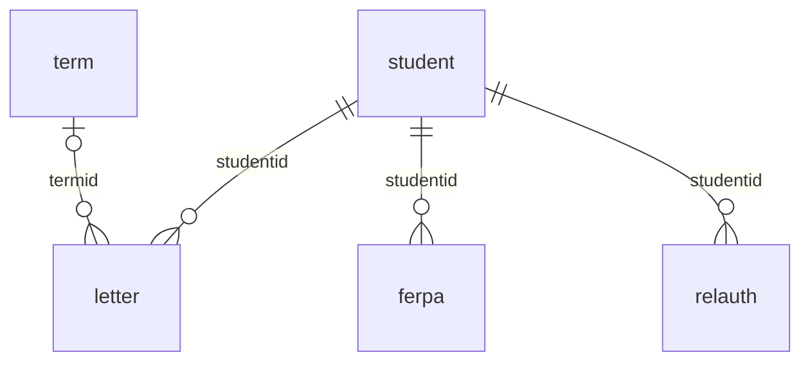

### `local_studentrecords_letter`

Enrollment verification letters issued. Written only by `letters::issue()`. `letters::pdf()` prints from `content`, so a reprint shows what was released. Rows stay after a privacy deletion.

| Column | Type | Null | Default | Meaning |
|---|---|---|---|---|
| `id` | int 10 | no | sequence | Primary key. |
| `studentid` | int 10 | no | none | The student. |
| `letterno` | char 30 | no | none | Letter number `L<year>-00001`, made under the lock `letterno`. Unique. The year is this year in the school's time zone. |
| `recipient` | char 255 | yes | none | Who it is addressed to. Empty prints "to whom it may concern". |
| `termid` | int 10 | yes | none | The term the letter is about, from `letters::pick_term()`. |
| `content` | text | yes | none | JSON of `letters::facts()` when issued: name, student ID, date of birth, program, credential, status, load, admit term, term, term dates, hours, unit, award and award date, and the term's id. |
| `issuedby` | int 10 | no | `0` | Who issued it. |
| `timeissued` | int 10 | no | `0` | When it was issued. |

Keys: primary (`id`); foreign `studentid` to `local_studentrecords_student`.`id`; foreign `termid` to `local_studentrecords_term`.`id`; foreign `issuedby` to `user`.`id`.

Indexes: unique (`letterno`).

### `local_studentrecords_ferpa`

FERPA annual notice acknowledgments, unique per student and academic year. Written by `ferpa::acknowledge()`, which does nothing when this year's row exists.

| Column | Type | Null | Default | Meaning |
|---|---|---|---|---|
| `id` | int 10 | no | sequence | Primary key. |
| `studentid` | int 10 | no | none | The student. |
| `acadyear` | char 9 | no | none | Academic year as `2026-2027`, from `ferpa::academic_year()` and the `yearstart` setting. |
| `acknowledged` | int 10 | no | `0` | When it was acknowledged: now online, or the date staff give for paper. |
| `method` | char 20 | no | `online` | `online` (by the student) or `paper` (recorded by staff). |
| `recordedby` | int 10 | no | `0` | Who recorded it: the student online, staff for paper. |

Keys: primary (`id`); foreign `studentid` to `local_studentrecords_student`.`id`; foreign `recordedby` to `user`.`id`.

Indexes: unique (`studentid`, `acadyear`).

### `local_studentrecords_relauth`

Release authorizations: who may receive which information. Revoking keeps the row. Written by `ferpa::add_release()` and `ferpa::revoke_release()`. `ferpa::release_active()` says what is in force, and `student_sections::release_check()` shows it to staff before a release. The plugin only shows it: nothing blocks on it.

| Column | Type | Null | Default | Meaning |
|---|---|---|---|---|
| `id` | int 10 | no | sequence | Primary key. |
| `studentid` | int 10 | no | none | The student. |
| `recipient` | char 255 | no | none | Who may receive it. |
| `relationship` | char 100 | yes | none | Their relationship to the student, free text. |
| `scope` | char 255 | no | none | Comma list of `ferpa::SCOPES`: `enrollment`, `grades`, `financial`, `conduct`, `all`. `enrollment` when nothing valid was chosen. |
| `details` | char 255 | yes | none | Free text. |
| `fromdate` | int 10 | no | `0` | First day in force. |
| `todate` | int 10 | yes | none | Last day in force, or NULL. |
| `createdby` | int 10 | no | `0` | Who added it. |
| `timecreated` | int 10 | no | `0` | When it was added. |
| `revokedby` | int 10 | yes | none | Who revoked it. |
| `timerevoked` | int 10 | yes | none | When it was revoked. Any value ends it. |
| `usermodified` | int 10 | no | `0` | Who last changed the row. `records::save()` sets it. |
| `timemodified` | int 10 | no | `0` | When the row last changed. `records::save()` sets it. |

Keys: primary (`id`); foreign `studentid` to `local_studentrecords_student`.`id`; foreign `createdby` to `user`.`id`; foreign `revokedby` to `user`.`id`.

Indexes: none.

## Billing

Prices, the student account, plans and refunds. Dotted lines in the diagram are links with no declared key.

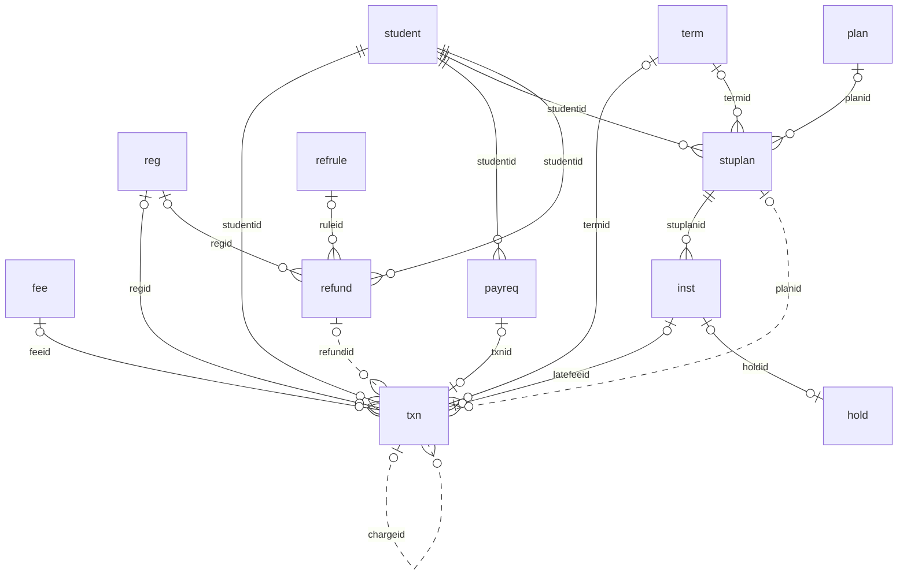

### `local_studentrecords_fee`

The price list. Items are switched off, never removed, and a changed price applies to new charges only. Written by `billing::save_fee()` and upgrade step 2026110401.

| Column | Type | Null | Default | Meaning |
|---|---|---|---|---|
| `id` | int 10 | no | sequence | Primary key. `txn.feeid` points here, and `billing::registration_charges()` uses that link to skip what is already on the account. |
| `name` | char 255 | no | none | Name of the item. It goes in the charge's description. |
| `kind` | char 10 | no | `fee` | One of `billing::KINDS`: `tuition` or `fee`. A registration gets one tuition item (`billing::pick_tuition()`) and every fee item that fits (`billing::auto_fees()`). The form refuses tuition with basis `manual` or `late`. |
| `basis` | char 10 | no | none | One of `billing::BASES`: `credithour`, `clockhour`, `course`, `term`, `program`, `once`, `manual`, `late`. The XML comment lists `hour`, which the code doesn't write. The first six (`billing::AUTO`) are charged on registering. `manual` is only added by staff. A `late` item gives late fee lines their `feeid` and nothing else. |
| `amount` | number 12,2 | no | `0` | Price in US dollars: per hour for `credithour` and `clockhour`, else per charge. For `late` it isn't used: a late fee is `stuplan.latefee`. |
| `scope` | char 10 | no | `all` | One of `billing::SCOPES`: `all`, `level`, `program`. `billing::applies()` tests it. For tuition, program beats level beats all. |
| `scopeid` | int 10 | yes | none | The level or program id, chosen by `scope`. NULL for `all`. |
| `refundable` | int 1 | no | `1` | 1 = refundable. Copied onto each charge. |
| `qualified` | int 1 | no | `1` | 1 = qualified tuition and related expenses for the 1098-T. Copied onto each charge. |
| `active` | int 1 | no | `1` | 1 = in use. 0 switches the item off. |
| `note` | text | yes | none | Free text, shown on the setup page. |
| `usermodified` | int 10 | no | `0` | Who last changed the row. `records::save()` sets it. |
| `timecreated` | int 10 | no | `0` | When the row was added. |
| `timemodified` | int 10 | no | `0` | When the row last changed. `records::save()` sets it. |

Keys: primary (`id`); foreign `usermodified` to `user`.`id`.

Indexes: none.

### `local_studentrecords_txn`

The student account. Lines are written only by `billing::insert_line()`, reached through `billing::add_line()` or `payments::record()`, and are never changed or removed: a mistake gets a reversing line. The one later change is `reversedby`. The balance is the sum of `amount` (`billing::balance()`).

| Column | Type | Null | Default | Meaning |
|---|---|---|---|---|
| `id` | int 10 | no | sequence | Primary key. |
| `studentid` | int 10 | no | none | The student. |
| `txntype` | char 10 | no | none | One of `billing::TYPES`: `charge`, `credit`, `payment`, `refund`, `payout`. A reversal keeps the type of the line it reverses, so summing `payment` lines nets reversals out, and `moneyreports::payments()` counts on that. |
| `amount` | number 12,2 | no | `0` | US dollars, signed. Plus adds to what the student owes: charges, and payouts, which are money paid back. Minus lowers it: credits, payments and refunds. A reversal has the opposite sign. |
| `txndate` | int 10 | no | `0` | Date the line counts from, for statements, reports and the 1098-T year. Staff can give an earlier date. It isn't when the line was added: that is `timecreated`. |
| `description` | char 255 | no | none | Line text, up to 255 characters, cut on write. Plain text that a person reads on the account. |
| `termid` | int 10 | yes | none | The term, or NULL. |
| `regid` | int 10 | yes | none | The registration, for a per-hour or per-course charge and its refund. NULL on a term or one-time charge. |
| `feeid` | int 10 | yes | none | The price list item, or NULL for a charge typed by staff with none. |
| `method` | char 30 | yes | none | Depends on `txntype`. Payment: one of `payments::METHODS`, or `online`. Credit: one of `billing::CREDITKINDS` or `billing::AIDKINDS`. Payout: one of `refunds::PAYOUTS`. NULL on charges and refunds. |
| `receipt` | char 30 | yes | none | Receipt number `R<year>-00001`, on payment lines only, from `payments::next_receipt()` under the lock `accounts`. A reversal has none. |
| `reference` | char 100 | yes | none | Check number or transfer reference, or the gateway name and Moodle payment id on an online payment. |
| `qualified` | int 1 | no | `0` | 1 = counts as qualified tuition and related expenses on the 1098-T. A refund copies it from its charge. |
| `refundable` | int 1 | no | `1` | 1 = refundable. `refunds::percent()` reads it. Plan fees, late fees and return of aid charges are 0. |
| `reverses` | int 10 | yes | none | On a reversing line, the line it reverses. |
| `reversedby` | int 10 | yes | none | On a reversed line, the line that reverses it. Set by `billing::reverse()`, with one history row. The only field that changes after insert. |
| `planid` | int 10 | yes | none | The student's plan (`local_studentrecords_stuplan`), on plan fee and late fee lines. |
| `refundid` | int 10 | yes | none | The refund, on refund lines and on the charges of an approved return of aid. |
| `chargeid` | int 10 | yes | none | On a refund line, the charge it refunds. `billing::reverse()` refuses a charge with refund lines, and `refunds::decide()` works out what is left from them. |
| `aidid` | int 10 | yes | none | The aid award, on a disbursement and its reversal. |
| `paymentid` | int 10 | yes | none | Moodle's `{payments}` row of an online payment. A reversal copies it, so test for a recorded payment with `reverses IS NULL` as well. A privacy deletion can leave it pointing at nothing. |
| `note` | text | yes | none | Free text: a reversal's reason, a staff note. Stays after a privacy deletion. |
| `userid` | int 10 | no | `0` | Who added the line. A task or a provider callback stores whoever the code ran as. Named in `provider::PEOPLE`. |
| `timecreated` | int 10 | no | `0` | When the line was added. `plans::paid_toward()` reads this, not `txndate`, so a payment entered after a plan was approved counts toward it whatever its date. |

Keys: primary (`id`); foreign `studentid` to `local_studentrecords_student`.`id`; foreign `termid` to `local_studentrecords_term`.`id`; foreign `regid` to `local_studentrecords_reg`.`id`; foreign `feeid` to `local_studentrecords_fee`.`id`; foreign `userid` to `user`.`id`.

Indexes: (`txntype`, `txndate`); (`receipt`); (`reverses`); (`chargeid`); (`aidid`); (`paymentid`).

### `local_studentrecords_payreq`

Online payments started by a student through Moodle's payment system, open until the provider confirms. `{payments}`.`itemid` is this table's id when the component is `local_studentrecords` and the area is `account`. Written by `payments::create_request()` and `payments::record_online()`. Nothing closes an unpaid request, and a student can hold several.

| Column | Type | Null | Default | Meaning |
|---|---|---|---|---|
| `id` | int 10 | no | sequence | Primary key, and the item id Moodle's payment system stores. |
| `studentid` | int 10 | no | none | The student. |
| `userid` | int 10 | no | none | The Moodle user who pays. `payments::payment_fits()` needs the payment to be theirs. |
| `amount` | number 12,2 | no | `0` | Amount in US dollars. The line on the account takes this figure, never the amount a caller gives or a surcharge. |
| `accountid` | int 10 | no | none | Moodle payment account at the time, from `payments::account()`. `{payment_accounts}`.`id`, with no declared key. |
| `status` | char 10 | no | `open` | `open` or `paid`. |
| `paymentid` | int 10 | yes | none | Moodle's payment, set when recorded. A privacy deletion can leave it pointing at nothing. |
| `txnid` | int 10 | yes | none | The payment line on the account. |
| `timecreated` | int 10 | no | `0` | When it was started. |
| `timepaid` | int 10 | yes | none | When it was recorded as paid. |

Keys: primary (`id`); foreign `studentid` to `local_studentrecords_student`.`id`; foreign `userid` to `user`.`id`; foreign `paymentid` to `payments`.`id`; foreign `txnid` to `local_studentrecords_txn`.`id`.

Indexes: none.

### `local_studentrecords_plan`

Payment plans the school offers, as templates. Written by `plans::save_template()`. `plans::create()` copies what it needs by value into `local_studentrecords_stuplan` and `local_studentrecords_inst`, so a change never reaches a plan already given.

| Column | Type | Null | Default | Meaning |
|---|---|---|---|---|
| `id` | int 10 | no | sequence | Primary key. |
| `name` | char 255 | no | none | Plan name. |
| `scope` | char 10 | no | `all` | One of `billing::SCOPES`: who can use it, tested by `billing::applies()`. |
| `scopeid` | int 10 | yes | none | The level or program id, chosen by `scope`. NULL for `all`. |
| `downtype` | char 10 | no | `percent` | One of `plans::DOWNTYPES`: `percent` or `amount`. |
| `downvalue` | number 12,2 | no | `0` | The down payment: a percent of the total or US dollars, as `downtype` says. |
| `numpay` | int 3 | no | `1` | Payments after the down payment. The form allows 1 to 24. |
| `frequency` | char 10 | no | `monthly` | One of `plans::FREQUENCIES`: `weekly`, `biweekly`, `monthly`. |
| `duemode` | char 10 | no | `relative` | One of `plans::DUEMODES`: `relative` (days after the term starts) or `fixed` (the dates in `duedates`). |
| `firstdue` | int 5 | no | `0` | Days after the term starts that the first payment is due. It may be below zero. |
| `duedates` | char 255 | yes | none | Fixed dates as comma separated `YYYY-MM-DD`, as many as `numpay`, or NULL. |
| `planfee` | number 12,2 | no | `0` | Plan fee in US dollars, charged once when the plan is given. |
| `latefee` | number 12,2 | no | `0` | Late fee in US dollars, charged once per late payment. |
| `gracedays` | int 3 | no | `0` | Days after a due date before a payment is late. |
| `active` | int 1 | no | `1` | 1 = staff can give it. Plans are switched off, never removed. |
| `note` | text | yes | none | Free text, shown on the setup page. |
| `usermodified` | int 10 | no | `0` | Who last changed the row. `records::save()` sets it. |
| `timecreated` | int 10 | no | `0` | When the row was added. |
| `timemodified` | int 10 | no | `0` | When the row last changed. `records::save()` sets it. |

Keys: primary (`id`); foreign `usermodified` to `user`.`id`.

Indexes: none.

### `local_studentrecords_stuplan`

A plan given to a student. It covers the whole balance, not one term, so a student has one active plan, for any term (`plans::has_active()`). Written by `plans::create()`, `plans::cancel()`, `plans::sync()` and `plans::tell_not_reopened()`.

| Column | Type | Null | Default | Meaning |
|---|---|---|---|---|
| `id` | int 10 | no | sequence | Primary key. |
| `studentid` | int 10 | no | none | The student. |
| `termid` | int 10 | yes | none | The term. It sets due dates and what `plans::plan_ok()` tests, not what the plan covers. |
| `planid` | int 10 | yes | none | The school plan it came from. NULL = custom, which needs a note. |
| `name` | char 255 | no | none | Plan name, copied. |
| `total` | number 12,2 | no | `0` | US dollars covered: the balance when given plus the plan fee. |
| `planfee` | number 12,2 | no | `0` | Plan fee in US dollars, copied. |
| `latefee` | number 12,2 | no | `0` | Late fee in US dollars, copied. `plans::daily()` charges this. |
| `gracedays` | int 3 | no | `0` | Grace days, copied. |
| `status` | char 10 | no | `active` | `active`, `completed` or `cancelled`. `plans::sync()` moves `active` and `completed` both ways. A completed plan doesn't reopen while another plan is active. |
| `note` | text | yes | none | Staff note, required for a custom plan. A cancellation and `plans::tell_not_reopened()` add lines to it. |
| `approvedby` | int 10 | no | `0` | Who gave the plan. |
| `timeapproved` | int 10 | no | `0` | When it was given. `plans::paid_toward()` counts lines added from this moment. |
| `cancelledby` | int 10 | yes | none | Who cancelled it. `{user}`.`id`, with no declared key. |
| `timecancelled` | int 10 | yes | none | When it was cancelled. |
| `usermodified` | int 10 | no | `0` | Who last changed the row. `records::save()` sets it. |
| `timemodified` | int 10 | no | `0` | When the row last changed. `records::save()` sets it. |

Keys: primary (`id`); foreign `studentid` to `local_studentrecords_student`.`id`; foreign `termid` to `local_studentrecords_term`.`id`; foreign `planid` to `local_studentrecords_plan`.`id`; foreign `approvedby` to `user`.`id`.

Indexes: none.

### `local_studentrecords_inst`

The payments of a student's plan, in due order. Written by `plans::create()`, `plans::sync()` and `plans::daily()`.

| Column | Type | Null | Default | Meaning |
|---|---|---|---|---|
| `id` | int 10 | no | sequence | Primary key. |
| `stuplanid` | int 10 | no | none | The student's plan. |
| `seq` | int 3 | no | `0` | 0 = the down payment, due the day the plan is given. Then 1, 2 and so on. `plans::plan_ok()` tests row 0, and row 0 gets no reminder. |
| `duedate` | int 10 | no | `0` | Due date, noon in the school's time zone. |
| `amount` | number 12,2 | no | `0` | Amount in US dollars. Whole cents, with what is left over on the last payment (`plans::amounts()`). |
| `paid` | number 12,2 | no | `0` | Part of the amount paid so far, from `plans::allocate()`. It can go down when a payment is reversed. Money paid toward a late fee counts here too, so a plan can complete with a balance left (see [Pitfalls](../pitfalls.md#bugs-in-this-release)). |
| `status` | char 10 | no | `due` | `due`, `paid` or `late`. `late` starts after the due date plus `stuplan.gracedays` (`plans::is_late()`). |
| `timepaid` | int 10 | yes | none | When it was paid in full. Back to NULL if it no longer is. |
| `reminded` | int 10 | yes | none | When the reminder went. Set in the same transaction as the message, so a second run doesn't send it again. |
| `latefeeid` | int 10 | yes | none | The late fee line on the account. Set means charged. |
| `holdid` | int 10 | yes | none | The financial hold placed for it. Set means placed, so a hold staff released isn't placed again for this payment. |
| `timemodified` | int 10 | no | `0` | When `plans::sync()` last changed the row. |

Keys: primary (`id`); foreign `stuplanid` to `local_studentrecords_stuplan`.`id`; foreign `latefeeid` to `local_studentrecords_txn`.`id`; foreign `holdid` to `local_studentrecords_hold`.`id`.

Indexes: (`status`, `duedate`).

### `local_studentrecords_refrule`

The school's refund rules, tried in `sortorder`: the first active rule that fits the date gives the refund (`refunds::pick_rule()`). Written by `refunds::save_rule()`. A change doesn't reach refunds already figured.

| Column | Type | Null | Default | Meaning |
|---|---|---|---|---|
| `id` | int 10 | no | sequence | Primary key. |
| `sortorder` | int 5 | no | `0` | Order the rules are tried in. |
| `name` | char 255 | no | none | Rule name. Copied to `refund.rulename`. |
| `ruletype` | char 12 | no | none | One of `refunds::RULETYPES`: `cancel`, `beforestart`, `adddrop`, `pctterm`, `days`, `after`. `refunds::rule_fits()` tests it. |
| `value` | number 8,2 | no | `0` | Business days (`cancel`), percent of the term (`pctterm`) or days after the start (`days`). Others ignore it. |
| `tuitionpct` | number 5,2 | no | `0` | Percent of tuition refunded. |
| `feespct` | number 5,2 | no | `0` | Percent of refundable fees refunded. |
| `allfees` | int 1 | no | `0` | 1 = non-refundable charges are refunded too, at the same percents. |
| `active` | int 1 | no | `1` | 1 = in use. |
| `note` | text | yes | none | Free text, shown on the setup page. |
| `usermodified` | int 10 | no | `0` | Who last changed the row. `records::save()` sets it. |
| `timecreated` | int 10 | no | `0` | When the row was added. |
| `timemodified` | int 10 | no | `0` | When the row last changed. `records::save()` sets it. |

Keys: primary (`id`); foreign `usermodified` to `user`.`id`.

Indexes: none.

### `local_studentrecords_refund`

Refunds figured on a drop or withdrawal, and return of aid items, which share the table. Written by `refunds::propose()`, `refunds::refigure()`, `refunds::decide()` and `aidhelp::send_return_locked()`. No row is written when no charge can be refunded. Approving writes account lines and moves no money: that is `refunds::payout()`.

| Column | Type | Null | Default | Meaning |
|---|---|---|---|---|
| `id` | int 10 | no | sequence | Primary key. |
| `studentid` | int 10 | no | none | The student. |
| `termid` | int 10 | yes | none | The term. |
| `regid` | int 10 | yes | none | The registration. NULL on a return of aid, so joins must allow that. |
| `reason` | char 10 | no | none | `drop`, `withdraw` or `aidreturn`. The XML comment leaves out `aidreturn`. |
| `eventdate` | int 10 | no | `0` | The moment the refund is figured on: the drop or withdrawal, or the last date of attendance when the `refundlda` setting says so. Staff can figure it again on another date. On a return of aid, the day the student left. |
| `ruleid` | int 10 | yes | none | The rule that fitted, or NULL. |
| `rulename` | char 255 | yes | none | Its name, copied. On a return of aid, a text with the percent completed. |
| `details` | text | yes | none | JSON list, one entry per charge: `chargeid`, `description`, `net`, `percent`, `refund`. A return of aid has one per fund, with `fund` and `chargeid` 0. |
| `amount` | number 12,2 | no | `0` | Total in US dollars. |
| `status` | char 10 | no | `proposed` | `proposed`, `approved`, `rejected` or `none`. `none` means a charge was looked at and the rule gave 0, so staff can see which rule applied. |
| `duedate` | int 10 | yes | none | Date the money should be paid back by: `eventdate` plus the `refunddays` setting. On a return of aid, 45 days after the date the school determined the withdrawal. |
| `decidedby` | int 10 | yes | none | Who decided. Never the student. |
| `timedecided` | int 10 | yes | none | When it was decided. |
| `decisionnote` | text | yes | none | Note with the decision. |
| `userid` | int 10 | no | `0` | Who the code ran as when it was figured. |
| `timecreated` | int 10 | no | `0` | When it was figured. |
| `timemodified` | int 10 | no | `0` | When it last changed. |

Keys: primary (`id`); foreign `studentid` to `local_studentrecords_student`.`id`; foreign `termid` to `local_studentrecords_term`.`id`; foreign `regid` to `local_studentrecords_reg`.`id`; foreign `ruleid` to `local_studentrecords_refrule`.`id`; foreign `decidedby` to `user`.`id`.

Indexes: (`status`).

## Federal aid

The optional federal aid module. Staff enter these figures, and nothing goes to a federal system. The helpers don't replace the official worksheets.

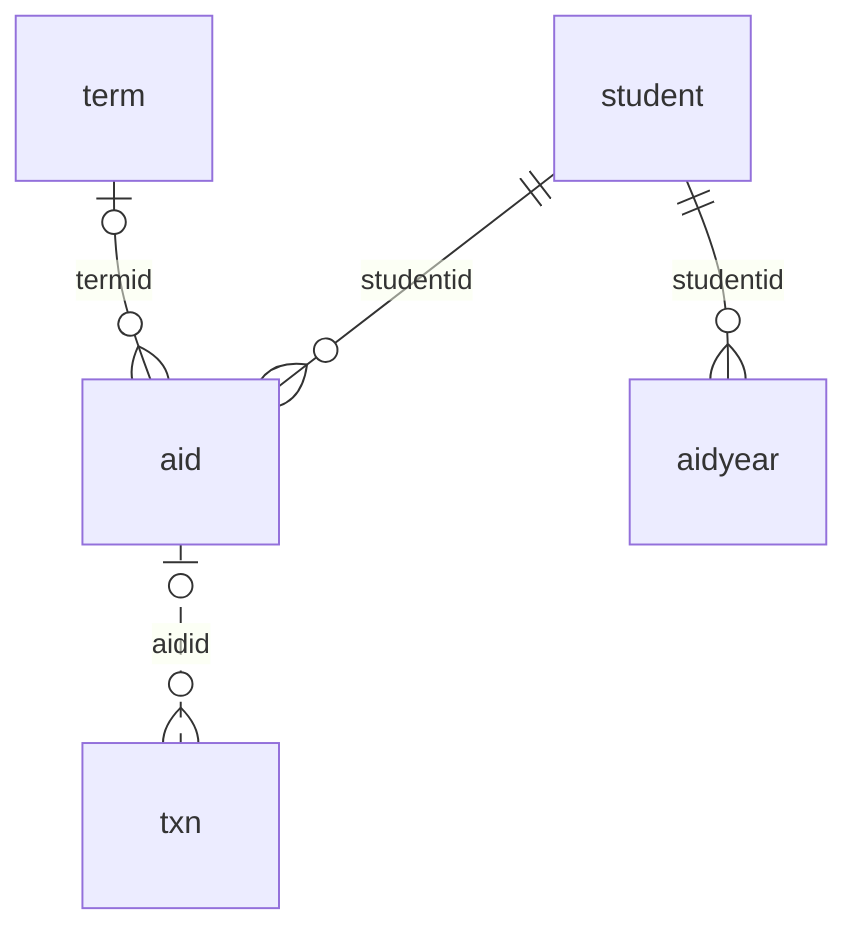

### `local_studentrecords_aid`

Federal aid module: awards. Written by `aid::save_award()`. Nothing here is sent to any federal system.

| Column | Type | Null | Default | Meaning |
|---|---|---|---|---|
| `id` | int 10 | no | sequence | Primary key. `txn.aidid` points here. |
| `studentid` | int 10 | no | none | The student. |
| `awardyear` | char 9 | no | none | Award year as `2026-27`. The form checks that shape. |
| `termid` | int 10 | yes | none | The term. The form needs one for Title IV funds, and `aid::save_award()` doesn't. A worksheet counts by this column, so an award with no term is left out of it. |
| `fund` | char 20 | no | none | A key of `aid::FUNDS`: `pell`, `fseog`, `fws`, `dlsub`, `dlunsub`, `dlplus`, `otherfed`, `state`, `institutional`, `private`. `aid::credit_kind()` says what kind of credit it becomes. `fws` is paid to the student, not to the account, so it has no account line. |
| `amount` | number 12,2 | no | `0` | Award in US dollars. Disbursed amounts are lines with `txn.aidid` set. |
| `status` | char 10 | no | `offered` | One of `aid::STATUSES`: `offered`, `accepted`, `declined`, `cancelled`. Only `accepted` can be disbursed. |
| `note` | text | yes | none | Free text. Stays after a privacy deletion. |
| `usermodified` | int 10 | no | `0` | Who last changed the row. `records::save()` sets it. |
| `timecreated` | int 10 | no | `0` | When the row was added. |
| `timemodified` | int 10 | no | `0` | When the row last changed. `records::save()` sets it. |

Keys: primary (`id`); foreign `studentid` to `local_studentrecords_student`.`id`; foreign `termid` to `local_studentrecords_term`.`id`; foreign `usermodified` to `user`.`id`.

Indexes: none.

### `local_studentrecords_aidyear`

Federal aid module: a student's details for an award year, entered by Financial Aid staff. Written by `aidhelp::save_year()`, which keeps one row per student and year. `aidhelp::year()` gives defaults when there is no row.

| Column | Type | Null | Default | Meaning |
|---|---|---|---|---|
| `id` | int 10 | no | sequence | Primary key. |
| `studentid` | int 10 | no | none | The student. |
| `awardyear` | char 9 | no | none | Award year as `2026-27`. |
| `coa` | number 12,2 | yes | none | Cost of attendance in US dollars, or NULL. |
| `sai` | number 12,2 | yes | none | Student Aid Index, entered by staff, or NULL. |
| `dependency` | char 12 | no | `dependent` | `dependent` or `independent`. Any other value is saved as `dependent`. |
| `gradelevel` | int 2 | no | `1` | 1, 2 or 3, where 3 means third year and up. |
| `verification` | char 10 | no | `none` | `none`, `selected` or `complete`. `selected` holds a disbursement (`aidhelp::hold_reasons()`). |
| `counseling` | int 1 | no | `0` | 1 = loan entrance counseling and promissory note are done. 0 holds a loan. |
| `note` | text | yes | none | Free text. Stays after a privacy deletion. |
| `usermodified` | int 10 | no | `0` | Who last changed the row. `records::save()` sets it. |
| `timecreated` | int 10 | no | `0` | When the row was added. |
| `timemodified` | int 10 | no | `0` | When the row last changed. `records::save()` sets it. |

Keys: primary (`id`); foreign `studentid` to `local_studentrecords_student`.`id`; foreign `usermodified` to `user`.`id`.

Indexes: unique (`studentid`, `awardyear`).

## Messages, history and the audit log

There are three logs. `local_studentrecords_msglog` says what happened to each message, `local_studentrecords_history` keeps old and new values, and `local_studentrecords_log` keeps who did what. History and log rows are soft references: they stay after the row they name changes.

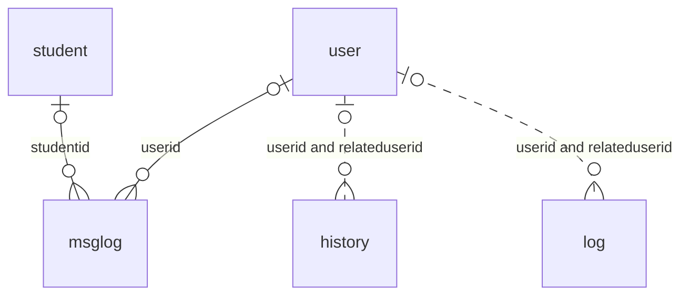

### `local_studentrecords_msglog`

One row per automatic message, sent or not. Written by `messages::log()` and `messages::send_queued()`. Deleted by `students::erase_personal()` and `provider::erase()`. [Tasks and messages](tasks-and-messages.md#log-statuses) lists the statuses.

| Column | Type | Null | Default | Meaning |
|---|---|---|---|---|
| `id` | int 10 | no | sequence | Primary key. The ad-hoc task carries it as `logid`. |
| `msgkey` | char 30 | no | none | A key of `messages::keys()`. |
| `userid` | int 10 | yes | none | Who it was for. NULL for a staff message with nobody to send to, or a student with no account. |
| `studentid` | int 10 | yes | none | The student it is about. NULL for "Send me a test". |
| `subject` | char 255 | yes | none | The subject after filling in, cut to 255 characters. A queued message goes with this subject. |
| `status` | char 10 | no | none | `queued`, `sent`, `failed`, `off`, `nouser`, `testmode`, `testinbox` or `test`. The XML comment lists five. `messages::send_queued()` writes the new status on the same row. |
| `timecreated` | int 10 | no | `0` | When the message was built, which for a queued message isn't when it went. |

Keys: primary (`id`); foreign `userid` to `user`.`id`; foreign `studentid` to `local_studentrecords_student`.`id`.

Indexes: (`timecreated`).

### `local_studentrecords_history`

Field-level change history: one row per changed field. Written by `records::history()`, from `records::save()`, `records::set_setting()`, `billing::reverse()`, `students::erase_personal()` and `faculty::erase_personal()`, and directly by upgrade step 2026102202. `records::SKIP` keeps `id`, `usermodified`, `timemodified` and `timecreated` out of it.

| Column | Type | Null | Default | Meaning |
|---|---|---|---|---|
| `id` | int 10 | no | sequence | Primary key. |
| `tablename` | char 40 | no | none | The table's full name, or `config` for a setting. Cut to 40 characters. |
| `recordid` | int 10 | no | none | The row's id. 0 for a setting. |
| `fieldname` | char 100 | no | none | The column, or the setting's name. `*` marks a privacy deletion. |
| `oldvalue` | text | yes | none | Value before, as text. NULL on a new row. A deletion blanks the values of the fields it removes. |
| `newvalue` | text | yes | none | Value after, as text. |
| `relateduserid` | int 10 | yes | none | The Moodle user the record is about, if any. |
| `userid` | int 10 | no | `0` | Who made the change. 0 from upgrade step 2026102202 and when no user is set. Indexed for privacy requests. |
| `source` | char 20 | no | `form` | Where the change came from: `form`, `import`, `privacy`, `upgrade`, `copy`, `billing`, `registration`, `attendance`, `task`. Free text: the XML comment lists three, and `copy`, `registration` and `task` have no `source_` string, so `history_view::row()` prints them raw. |
| `timecreated` | int 10 | no | `0` | When it was written. |

Keys: primary (`id`).

Indexes: (`tablename`, `recordid`); (`relateduserid`); (`userid`).

### `local_studentrecords_log`

Audit log of actions: who viewed, changed, imported or exported what. Field values are in `local_studentrecords_history`. Written by `audit::log()`. Read by `local/studentrecords/log.php`, `local/studentrecords/outsidereports.php`, `payments::recover()`, `provider::export_user_data()` and `provider::erase_removed_accounts()`.

| Column | Type | Null | Default | Meaning |
|---|---|---|---|---|
| `id` | int 10 | no | sequence | Primary key. |
| `action` | char 30 | no | none | One of `audit::ACTIONS`: `view`, `create`, `update`, `import`, `approve`, `reject`, `export`, `privacyexport`, `privacyerase`. |
| `objecttype` | char 30 | no | none | What the action was on. `local/studentrecords/log.php` prints the string `obj_<type>` and has no fallback, so a new type needs a string. Object type `datarequest` marks a carried out deletion request. |
| `objectid` | int 10 | yes | none | The row of that type. For `datarequest`, a `{tool_dataprivacy_request}` id. |
| `relateduserid` | int 10 | yes | none | The Moodle user it is about, if any. |
| `userid` | int 10 | no | `0` | Who did it, from `$USER`, so under "Log in as" the person logged in as, not the administrator. 0 when no user is set. |
| `info` | char 255 | yes | none | Short note, cut to 255 characters. A privacy deletion blanks it where the person is `relateduserid`. |
| `ip` | char 45 | yes | none | The address the request came from. A privacy deletion blanks it where the person is `userid`. |
| `timecreated` | int 10 | no | `0` | When it was written. |

Keys: primary (`id`).

Indexes: (`relateduserid`); (`userid`); (`timecreated`).

## Import and saved exports

What came in from a file and what goes out to an agency.

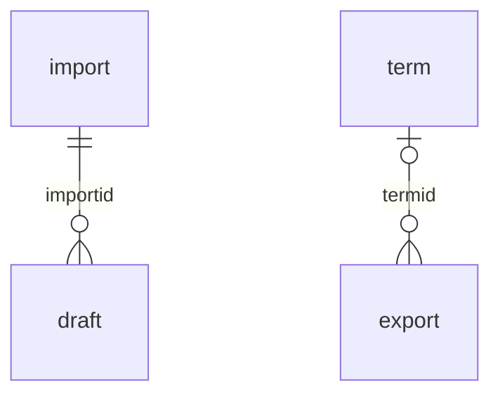

### `local_studentrecords_import`

One row per uploaded spreadsheet or CSV file. The file itself is in file area `importfile`, with this row's id as the item id, saved by `local/studentrecords/import.php`. Written by `drafts::store()`.

| Column | Type | Null | Default | Meaning |
|---|---|---|---|---|
| `id` | int 10 | no | sequence | Primary key, and the item id of file area `importfile`. |
| `filename` | char 255 | no | none | The file's name, up to 255 characters. |
| `summary` | text | yes | none | JSON with `sheets` (each sheet's type and rows) and `gaps` (import-wide notes). |
| `userid` | int 10 | no | `0` | Who uploaded it. Named in `provider::PEOPLE`. |
| `timecreated` | int 10 | no | `0` | When it was uploaded. |

Keys: primary (`id`).

Indexes: none.

### `local_studentrecords_draft`

Imported items waiting for review. Nothing goes live until staff approve it. Written by `drafts::store()`, `drafts::approve()`, `drafts::reject()` and `drafts::fix()`. What a draft holds names no Moodle user, so no privacy request reaches it, though an item about a staff member holds the name, job and email from the file. `decidedby` does name the staff member.

| Column | Type | Null | Default | Meaning |
|---|---|---|---|---|
| `id` | int 10 | no | sequence | Primary key. |
| `importid` | int 10 | no | none | The upload. |
| `itemtype` | char 20 | no | none | One of `importer::TYPES`: `school`, `level`, `grade`, `term`, `course`, `program`, `progcrs`, `minpass`, `policy`, `faculty`, `facqual`, `reqdoc`. That is also the order items are applied in. |
| `itemkey` | char 255 | no | none | What the item is called on the review page, up to 255 characters. |
| `data` | text | no | none | JSON of the item's fields, as `drafts::to_record()` reads them. |
| `source` | char 255 | yes | none | Where it came from, for example a sheet name and row. |
| `problems` | text | yes | none | JSON list of `[severity, language key, value]`. `drafts::has_error()` stops an item with severity `error`. `drafts::fix()` replaces the list with one warning. |
| `state` | char 20 | no | `pending` | `pending`, `approved`, `rejected`, or `same` when it already equals the saved record. |
| `sortorder` | int 10 | no | `0` | Its order in the file. |
| `decidedby` | int 10 | yes | none | Who approved or rejected it. Named in `provider::PEOPLE`. |
| `timedecided` | int 10 | yes | none | When it was decided. |

Keys: primary (`id`); foreign `importid` to `local_studentrecords_import`.`id`.

Indexes: (`itemtype`, `state`).

### `local_studentrecords_export`

Saved outside exports. Written by `outside::save_export()`, and `outside::add_starters()` through it. `outside::run()` turns a row into a table.

| Column | Type | Null | Default | Meaning |
|---|---|---|---|---|
| `id` | int 10 | no | sequence | Primary key. |
| `name` | char 255 | no | none | Name on the page. `outside::add_starters()` finds a starter by it. |
| `purpose` | char 20 | no | `state` | One of `outside::PURPOSES`: `state`, `accreditor`, `other`. |
| `population` | char 20 | no | `all` | One of `outside::POPULATIONS`: `all`, `active`, `term`, `admitted`, `graduated`, `withdrawn`. |
| `termid` | int 10 | yes | none | The term, for populations `term` and `admitted`. It also gives the field `termhours`. |
| `fromdate` | int 10 | yes | none | First day, for populations `graduated` and `withdrawn`. NULL = no lower limit. |
| `todate` | int 10 | yes | none | Last day, included, for those two. NULL = no upper limit. |
| `fields` | text | yes | none | Comma list of `outside::FIELDS`, in column order. A field in `outside::DEMOGRAPHICS` means running the export needs `local/studentrecords:viewdemographics`. |
| `headers` | text | yes | none | The school's own column names, one per line. An empty line keeps the default. |
| `note` | text | yes | none | Free text, shown with the export. |
| `usermodified` | int 10 | no | `0` | Who last changed the row. `records::save()` sets it. |
| `timecreated` | int 10 | no | `0` | When the row was added. |
| `timemodified` | int 10 | no | `0` | When the row last changed. `records::save()` sets it. |

Keys: primary (`id`); foreign `termid` to `local_studentrecords_term`.`id`; foreign `usermodified` to `user`.`id`.

Indexes: none.

## File areas

Files sit in `{files}` with component `local_studentrecords`, in the system context. `access::can_read_file()` decides who reads each area, and `local_studentrecords_pluginfile()` serves them as downloads.

| Area | Item id | Holds | Written by | Who may read |
|---|---|---|---|---|
| `studentdocs` | `local_studentrecords_student`.`id` | A student's documents, up to 20 | `local/studentrecords/student.php` | Staff who manage students, and the student with `local/studentrecords:viewown`. Each read writes an audit row. |
| `credential` | `local_studentrecords_faccred`.`id` | Files of a credential, up to 5 | `local/studentrecords/facultyrecord.php` | `local/studentrecords:viewfaculty` |
| `importfile` | `local_studentrecords_import`.`id` | The uploaded spreadsheet or CSV file | `local/studentrecords/import.php` | `local/studentrecords:import` |
| `logo` | 0 | The school logo, one file | `local/studentrecords/setup.php` | Anyone logged in |

Of these areas, a privacy deletion removes only `studentdocs`. `letters::logo_path()` copies the logo to a temporary file for the PDFs.

## Links with no declared key

These links work in the code and have no entry in `KEYS`. Check them by hand when you change either side.

| From | To | Where the code uses it |
|---|---|---|
| `txn.reverses`, `txn.reversedby` | `local_studentrecords_txn` | `billing::reverse()` |
| `txn.chargeid` | `local_studentrecords_txn`, the charge a refund line refunds | `refunds::decide()` |
| `txn.planid` | `local_studentrecords_stuplan` | `plans::create()`, `plans::daily()` |
| `txn.refundid` | `local_studentrecords_refund` | `refunds::decide()` |
| `txn.aidid` | `local_studentrecords_aid` | `aid::disburse()` |
| `txn.paymentid` | Moodle's `{payments}` | `payments::record_online()` |
| `payreq.accountid` | Moodle's `{payment_accounts}` | `payments::create_request()` |
| `{payments}`.`itemid` | `local_studentrecords_payreq`, when `component` is `local_studentrecords` and `paymentarea` is `account` | `payments::recover()`, `payments::AREA` |
| `fee.scopeid`, `plan.scopeid` | `local_studentrecords_level` or `local_studentrecords_program`, chosen by `scope` | `billing::applies()` |
| `stuplan.cancelledby`, `refund.userid`, `stand.computedby`, `stand.confirmedby`, `gradapp.appliedby`, `gradapp.reviewedby`, `gradapp.conferredby`, `draft.decidedby`, `import.userid`, `history.userid`, `history.relateduserid`, `log.userid`, `log.relateduserid` | Moodle's `{user}` | Read only for names and privacy |
| `refund.details`, each entry's `chargeid` | `local_studentrecords_txn` | `refunds::decide()` |
| `reg.grade`, `xfer.grade`, `grchg.oldgrade`, `grchg.newgrade`, `minpass.minletter` | `grade.letter`, by value | `registration::history()`, `grading::passes()` |
| `reqdoc.credentialtype` | `program.credentialtype`, by value | `admissions::applies()` |
| `minpass.groupname` | `progcrs.groupname`, by value | `grading::effective_rule()` |
| `history.tablename` with `history.recordid` | Any row of the plugin, or `config` and 0 for a setting | `records::get_history()` |
| `log.objecttype` with `log.objectid` | A row of that kind. `datarequest` points at `{tool_dataprivacy_request}` | `local/studentrecords/log.php`, `provider::erase_removed_accounts()` |
| `local_academictranscript_posted.srregid` | `local_studentrecords_reg` | `srpost::posted_target()` in Academic Transcript |

`local_academictranscript_posted.srregid` is the only column of another plugin that points in here. A posted grade reaches its registration through it, and a course can run more than once, so don't work the attempt out any other way.

## Install, upgrade and uninstall

Moodle makes the tables from `db/install.xml`. `xmldb_local_studentrecords_install()` then sets `recoverfrom` to now, and does nothing else: no scale, term, role or other setting. Those come from the setup wizard or the import.

`xmldb_local_studentrecords_upgrade()` in `local/studentrecords/db/upgrade.php` has 21 steps. Each new column is guarded by `field_exists()`, each new table by `table_exists()`, and each new index by `index_exists()`. A new table comes from `install_one_table_from_xmldb_file()`, so `db/install.xml` stays the one definition of it.

| Savepoint | Schema | Data |
|---|---|---|
| 2026102200 | `faculty.nolms` | |
| 2026102202 | `term.withdrawcalc`, `program.deliverymode`, `program.location`, `facqual.active`, `facqual.timeremoved`, `facqual.removedby`, foreign key `removedby` | Terms with no `withdrawby` get the calculated date and `withdrawcalc` 1. Programs with no `deliverymode` get `importer::delivery_mode()` of their `delivery`. Each change goes in the history with source `upgrade` and user 0. |
| 2026102204 | `student.lastattended`, `student.withdrawdate`, tables `local_studentrecords_stathis`, `local_studentrecords_reqdoc`, `local_studentrecords_appdoc`, `local_studentrecords_admdec`, `local_studentrecords_educ`, `local_studentrecords_emerg`, `local_studentrecords_demog` | Each student with no status history gets one row with the current status. |
| 2026102205 | Tables `local_studentrecords_offer`, `local_studentrecords_reg` | |
| 2026102206 | `term.gradefreeze`, tables `local_studentrecords_hold`, `local_studentrecords_saprule`, `local_studentrecords_stand`, `local_studentrecords_xfer`, `local_studentrecords_grchg` | |
| 2026102207 | Table `local_studentrecords_gradapp` | |
| 2026102208 | Tables `local_studentrecords_letter`, `local_studentrecords_ferpa`, `local_studentrecords_relauth` | |
| 2026110300 | Tables `local_studentrecords_fee`, `local_studentrecords_txn` | |
| 2026110400 | `reg.accesspending`, table `local_studentrecords_payreq` | |
| 2026110401 | | Each fee with basis `hour` becomes `clockhour` when its scope is a clock-hour program, else `credithour`, through `records::save()` with source `upgrade`. |
| 2026110500 | Tables `local_studentrecords_plan`, `local_studentrecords_stuplan`, `local_studentrecords_inst` | |
| 2026110600 | `txn.chargeid`, tables `local_studentrecords_refrule`, `local_studentrecords_refund` | |
| 2026110800 | Table `local_studentrecords_msglog` | |
| 2026110900 | Tables `local_studentrecords_meeting`, `local_studentrecords_attend` | |
| 2026111000 | Table `local_studentrecords_export` | |
| 2026111100 | `txn.aidid`, table `local_studentrecords_aid` | |
| 2026111400 | `offer.meetdays`, `offer.starttime`, `offer.endtime`, `offer.room`, tables `local_studentrecords_wait`, `local_studentrecords_cart` | |
| 2026111500 | `student.residency`, `student.citizenship`, `student.firstgen`, `student.highschool`, `student.hsyear`, `program.residenthours`, `gradapp.diplomaname`, `gradapp.conditional`, table `local_studentrecords_subst` | |
| 2026111600 | Table `local_studentrecords_aidyear` | |
| 2026111606 | `grade.earns` | |
| 2026111607 | Indexes on `history.userid`, `txn.reverses`, `txn.chargeid`, `txn.aidid`, `txn.paymentid` | Sets `recoverfrom` to now when it isn't set, and keeps a value that is. |

Steps 2026102202 and 2026110401 call plugin code: `catalog::withdraw_time()`, `importer::delivery_mode()` and `records::save()`. Changing what those methods do changes what an old site's upgrade does.

`xmldb_local_studentrecords_uninstall()` in `local/studentrecords/db/uninstall.php` puts back the start page and removes the Finance and Financial Aid roles when they hold only this plugin's capabilities. Moodle drops the tables, settings, capabilities, tasks, message providers and files. `local/studentrecords/tests/uninstall_test.php` protects it, including `test_runs_twice`.

## Changing the schema

To add a column:

1. Add the `FIELD` to `local/studentrecords/db/install.xml`, after the column the upgrade step names.
2. Raise `VERSION` in that file and `$plugin->version` in `local/studentrecords/version.php`. Never lower that number: see [Release](../release.md).
3. Add a step to `local/studentrecords/db/upgrade.php`, guarded so that it can run twice, ending with `upgrade_plugin_savepoint()`. This one is copied from that file:

   ```php
   if ($oldversion < 2026111606) {
       // 1.4.6 Marks (I, P, NP, W, NC ...): whether a mark without grade points earns the course hours.
       $table = new xmldb_table('local_studentrecords_grade');
       $field = new xmldb_field('earns', XMLDB_TYPE_INTEGER, '1', null, XMLDB_NOTNULL, null, '0', 'ingpa');
       if (!$dbman->field_exists($table, $field)) {
           $dbman->add_field($table, $field);
       }
       upgrade_plugin_savepoint(true, 2026111606, 'local', 'studentrecords');
   }
   ```

4. Decide if it is personal data. A column of the student table, or any column that holds a user id, must go in `provider::get_metadata()`, with a `privacy:metadata:...` string. If a deletion should blank it, add it to `students::PERSONAL` or `students::PERSONALPARTS`. See [Privacy](privacy.md).
5. Add the column to this page. `bin/check-docs` fails until you do.

A new table also needs a line in `provider::get_metadata()`, or an entry in `provider::SETTINGS_TABLES` when it only names who last changed a row.

These tests protect the schema:

| Test | What it holds |
|---|---|
| `test_names` in `local/studentrecords/tests/schema_test.php` | Table names start with `local_studentrecords_` and fit in 28 characters. No column is a reserved word, so `from`, `to`, `order` and the like are out. |
| `test_version_reaches_the_last_step` in `local/studentrecords/tests/upgrade_test.php` | The highest savepoint equals `$plugin->version`. The test names the number, so update it when you raise the version. |
| `test_last_step_adds_the_indexes` in the same file | The last step gives an old site the same indexes as a new one, and can run twice. |
| `test_metadata_declares_every_user_column` in `local/studentrecords/tests/privacy/provider_test.php` | Every column that holds a user is declared, and every string exists. |
| `test_metadata_declares_every_table_about_a_person` in the same file | Every table with `studentid` or `userid` is declared, and so is every column of the student table. |

Don't rename a table or a column. Sites keep data under those names, and Academic Transcript reads some of them directly.

## Related pages

- [Code map](README.md)
- [Access](access.md)
- [Settings](settings.md)
- [Tasks and messages](tasks-and-messages.md)
- [Privacy](privacy.md)
- [Calculations](calculations.md)
- [Flows: money](flows-money.md)
- [Release](../release.md)
