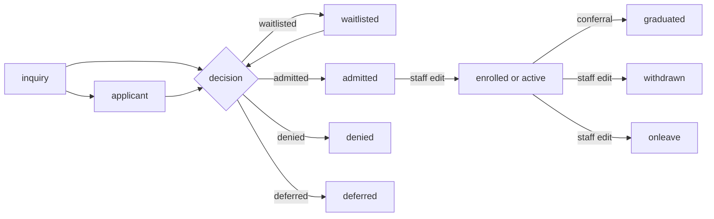

# Admissions and records flows

This page follows a person from first inquiry to student, and through their record: decisions, the checklist, status changes, student numbers, the student file, change history, documents, holds, FERPA, letters, faculty records and import.

## Contents

- [Where to look](#where-to-look)
- [From first inquiry to student](#from-first-inquiry-to-student)
- [A new record](#a-new-record)
- [Student numbers and their collisions](#student-numbers-and-their-collisions)
- [The checklist](#the-checklist)
- [Decisions](#decisions)
- [Waitlists for a program](#waitlists-for-a-program)
- [Status changes](#status-changes)
- [The student file and its sections](#the-student-file-and-its-sections)
- [Change history](#change-history)
- [Documents](#documents)
- [Holds](#holds)
- [FERPA](#ferpa)
- [Enrollment letters](#enrollment-letters)
- [Faculty records](#faculty-records)
- [Import and drafts](#import-and-drafts)
- [Related pages](#related-pages)

## Where to look

| To change | Start in | Tests that protect it |
|---|---|---|
| Decisions, the checklist, IDs, status history | `local/studentrecords/classes/local/admissions.php`, `local/studentrecords/admissions.php` | `local/studentrecords/tests/local/admissions_test.php` |
| Saving a record, what a person may change on their own record | `local/studentrecords/classes/local/students.php`, `local/studentrecords/student.php` | `local/studentrecords/tests/local/students_test.php` |
| Parts of a record: holds, transfer credit, contacts | `local/studentrecords/studentpart.php` | `local/studentrecords/tests/records_pages_test.php`, `local/studentrecords/tests/local/registration_pages_test.php` |
| The student file | `local/studentrecords/classes/local/student_file.php`, `local/studentrecords/classes/local/student_sections.php`, `local/studentrecords/classes/local/record_view.php` | `local/studentrecords/tests/local/page_rules_test.php`, `local/studentrecords/tests/records_pages_test.php` |
| Change history | `local/studentrecords/classes/local/records.php`, `local/studentrecords/classes/local/history_view.php` | `local/studentrecords/tests/local/records_test.php` |
| Holds | `local/studentrecords/classes/local/academic.php` | `local/studentrecords/tests/local/academic_test.php` |
| FERPA | `local/studentrecords/classes/local/ferpa.php`, `local/studentrecords/ferpa.php` | `local/studentrecords/tests/local/ferpa_test.php` |
| Letters | `local/studentrecords/classes/local/letters.php`, `local/studentrecords/letter.php` | `local/studentrecords/tests/local/letters_test.php` |
| Faculty | `local/studentrecords/classes/local/faculty.php`, `local/studentrecords/facultyrecord.php` | `local/studentrecords/tests/local/faculty_test.php` |
| Import | `local/studentrecords/classes/local/importer.php`, `local/studentrecords/classes/local/sheet_reader.php`, `local/studentrecords/classes/local/drafts.php`, `local/studentrecords/import.php` | `local/studentrecords/tests/local/importer_test.php`, `local/studentrecords/tests/local/sheet_reader_test.php`, `local/studentrecords/tests/local/drafts_test.php` |

These changes break things first:

- `students::save()` called inside a transaction lets go of the lock `studentno` before the commit, so two new students can work out one ID.
- A write to a student that skips `students::save()` or `admissions::set_status()` skips the rule on one's own record and the status history.
- A rule added only on a page holds only on that page. `local_studentrecords_xfer` has no class, so its rule on one's own record lives on `local/studentrecords/studentpart.php`.
- A status value is read by name in many places. See [add a student status](extending.md#add-a-student-status).

## From first inquiry to student

`student.status` holds where a person stands, and `catalog::STATUSES` lists the values. `admissions::PIPELINE` is the part before enrolment: `inquiry`, `applicant`, `waitlisted`, `admitted`, `denied` and `deferred`.

Only two things in the code set a status on their own: a decision (`admissions::record_decision()`) and a conferral (`graduation::confer()`). Everything else is staff on the record form. No code moves a person to `enrolled` or `active`, and registering for a course doesn't change the status. A student may register for themselves from `admitted` on: `selfreg::STATUSES`.

Staff may register a person of any status. `registration::add_problems()` doesn't look at it.

## A new record

A student record is one row in `local_studentrecords_student`, linked to one Moodle user. `userid` is required and unique. The plugin makes no Moodle accounts.

- Entry: `local/studentrecords/student.php?edit=1`, with `local/studentrecords:managestudents`. The button on `local/studentrecords/admissions.php` opens the same form. A new record starts as `applicant`, and staff can pick any status.
- Checks, in `local/studentrecords/classes/form/student.php`: the user has no record yet (`err_hasrecord`), and isn't the current user (`err_ownrecord`). The ID isn't in use (`err_duplicate`), and is required unless automatic IDs are on. `admissions::status_problems()` for the status. A real date of birth, not in the future.
- Goes through: `students::save()`. With a blank ID and automatic IDs on, it takes the lock `studentno`. `students::write()` then calls `students::check_own_record()`, which refuses a person making their own record. Next it starts a transaction, gets the ID, calls `records::save()`, and calls `admissions::add_status_history()` when the status changed.
- Lock and transaction: `studentno` around all of `students::write()`, for a blank ID only. The transaction is inside `students::write()`, and `allow_commit()` ends it with no `catch`. `audit::log()` comes after the commit. Never call `students::save()` from inside a transaction, or the lock ends before the commit.
- Then: the page saves the files of the `documents` field to the file area `studentdocs`.
- Writes: `local_studentrecords_student`, its change history, `local_studentrecords_stathis`, the audit log.
- Sends: nothing.
- On failure: the form shows its errors. An error in the class goes to Moodle's error page.

`test_nobody_creates_their_own_record` and `test_save` hold this.

> Known problem in 1.4.6: no page can create a record. The form posts `userid`, and the first lines of `local/studentrecords/student.php` read it as a request to open that person's file, so `students::get_by_user()` finds none and the page throws `norecord` before the form is read. "Add student record" and "Add applicant" save nothing, for any role. Picking a person who already has a file gives "Error writing to database" instead. The tests call `students::save()` directly.

### One's own record

`students::DECIDING` lists what decides a degree: `programid`, `status`, `awardname` and `awarddate`. `students::check_own_record()` refuses a change to any of them on one's own record with `err_ownrecord`. The form freezes them, and `student.php` drops those keys. The rest of one's own record stays open to a person with the right to edit records, by design. `test_nobody_changes_what_decides_a_degree_on_their_own_record` and `test_staff_edit_the_rest_of_their_own_record` hold both sides.

## Student numbers and their collisions

`student.studentid` is text, unique in the table. A school types its own, or turns on automatic IDs with the setting `idauto`.

The format comes from `admissions::format_id()`: `idprefix`, the year (unless `idyear` is `0`), and a sequence padded to `idpadding` digits (default 4), joined by `idseparator` (default `-`, and `none` for no separator). The year is this year in the school's time zone. A result looks like `RVC-2026-0001`.

`admissions::next_student_id()` works out the next one:

1. Reads every ID that starts with the prefix and year, ignoring case.
2. `admissions::next_seq()` takes the highest number that matches the format, and adds 1. An ID typed by hand in the same format counts, so the next automatic ID goes past it.
3. A `do ... while` steps on while the ID exists.

Two guards stop a collision. The lock `studentno`, taken by `students::save()` for a blank ID, makes new records go one at a time, and it outlasts the commit so that the next request sees the new ID. The unique index on `studentid` is the last stop: a second row with the same ID fails, and the transaction rolls back.

| Case | What happens |
|---|---|
| Blank ID, `idauto` on, new record | The lock, then an automatic ID |
| A typed ID, `idauto` on | Used as typed, no lock |
| Blank ID on an existing record | Keeps the ID it has |
| Blank ID, `idauto` off | The form refuses it |
| An ID in use | The form says `err_duplicate`. A race gets past the form and fails on the index |

`local/studentrecords/setup.php` calls `admissions::next_student_id()` to show an example. It saves nothing.

`test_student_ids` and `test_automatic_ids_are_given_one_at_a_time` hold this.

## The checklist

The documents a school asks for are in `local_studentrecords_reqdoc`, and each student's state of them in `local_studentrecords_appdoc`, unique on student and document.

- Set up: `local/studentrecords/checklist.php`, with `local/studentrecords:configure`, or import. A document is switched off, never removed. `admissions::applies()` matches every scope a document names: program, level and credential type. A document with no scope applies to all.
- Entry: `local/studentrecords/studentpart.php`, `part=checklist`, with `local/studentrecords:managestudents`.
- Goes through: `admissions::save_checklist()`. Each item with a state in `admissions::DOCSTATES` (`missing`, `received`, `waived`) goes through `records::save()`. An item still `missing` with no row and no note writes nothing.
- Lock and transaction: no lock. Each row has its own transaction, in `records::save()`.
- Writes: `local_studentrecords_appdoc`, and one audit line with the count of changes.
- Sends: nothing.
- On failure: Moodle's error page, with the rows before it saved.

`admissions::checklist()` lists what applies to a student, and `admissions::missing()` what is required and neither received nor waived. `admissions::missing_counts()` does that for a list of students. The applicants page uses it to sort `applicant` rows into ready and missing.

The checklist stops nothing. A decision can be recorded with documents missing, and a state isn't tied to any uploaded file.

`admissions::all_docs()` keeps the documents for the request. `admissions::reset_cache()` has no caller, so a test or a page that changes the documents and reads them again in one request sees the old list.

## Decisions

`local_studentrecords_admdec` keeps every decision, one row each, with `admissions::DECISIONS`: `admitted`, `waitlisted`, `denied` or `deferred`.

- Entry: `admissions.php`, `decide=`, by POST with sesskey, from the panel of an applicant: `admitted`, `waitlisted` or `denied`, with a note a denial must have (`adm_notedeny`). Or `studentpart.php`, `part=decision`, with the form `local/studentrecords/classes/form/decision.php`, which offers all four and needs a reason for a denial. Both need `local/studentrecords:managestudents`.
- Checks: `admissions::record_decision()` refuses one's own record (`err_ownrecord`). `studentpart.php` refuses it earlier too.
- Goes through, in one transaction:
  1. Inserts the `admdec` row.
  2. For a student whose status is in `admissions::PIPELINE`: `admissions::set_status()` to the decision. A student past the pipeline keeps their status, and the row is still written.
  3. A term given that differs from `student.admittermid` moves it, for any decision.
  4. The [program waitlist](#waitlists-for-a-program).
  5. `audit::log()`.
  6. `messages::student()` with `admdecision`, and `welcome` for `admitted`.
- Lock and transaction: no lock. The transaction runs from the start to `records::commit()`, with no `try` around it. An exception leaves it open, and Moodle's exception handler ends the page and rolls it back. Neither page catches one.
- Writes: `local_studentrecords_admdec`, `local_studentrecords_student`, `local_studentrecords_stathis`, `local_studentrecords_wait`, the audit log.
- Sends: `admdecision` and `welcome`, queued, because a transaction is open.

Nothing guards a second submit: it writes another row and queues the messages again. `test_nobody_decides_their_own_admission` and `test_an_admission_decision_stands_when_its_message_fails` hold the rules that do exist.

The other reports on `admissions.php` (`pipeline`, `missing` and `decisions`) only read, and a download logs `export` of `admissions`.

## Waitlists for a program

A row in `local_studentrecords_wait` with `kind` `program`. A student has one open at a time.

| Decision | With no open row | With an open row |
|---|---|---|
| `waitlisted` | A row with status `waiting`, the student's program, and the decision's term or the admit term | Nothing |
| `admitted` | Nothing | Status `done` |
| `denied`, `deferred` | Nothing | Status `left` |

`local/studentrecords/admissions.php` shows the place in line, by program and in `timecreated` order. That is all a program waitlist does: it gets no offers. `waitlist::offer_seats()` and `waitlist::daily()` look only at `kind` `section`.

## Status changes

| Route | Who calls it | Own-record guard | Status history date |
|---|---|---|---|
| `students::save()` | `student.php`, the record form | `students::check_own_record()` | `withdrawdate` for `withdrawn`, else now |
| `admissions::set_status()` | `admissions::record_decision()`, `graduation::confer()` | `access::is_own()` | The date given |

`local_studentrecords_stathis` keeps each change with old and new status, the effective date, and the note. The form's `statusnote` goes there. `student.status` also gets a row in the change history.

`admissions::status_problems()` runs only in the form: a withdrawal needs `withdrawdate` and `lastattended`, and attendance can't end after the withdrawal. `students::save()` itself accepts a withdrawal with no dates.

A status change touches nothing else. It doesn't end registrations, suspend an enrolment, or add a charge. Other code reads it:

| Reader | What it does with the status |
|---|---|
| `selfreg::status_allows()` | Only `admitted`, `enrolled` and `active` register themselves |
| `aidhelp::run()` | `withdrawn` stops aid with `stopped_withdrawn` |
| `aid::withdrawals()` | `withdrawn` puts a recipient on the list |
| `outside::nsc_status()` | Clearinghouse status, from `graduated`, `onleave` and `withdrawn` |
| `outside::population()` | Which students an export lists |
| `reports::graduation()` | Leaves out `admissions::PIPELINE`, and sorts the rest |
| `requests::waiting()` in Academic Transcript | A request that waits for the degree waits until `graduated` |

## The student file and its sections

`local/studentrecords/student.php` is one page with three views.

- Who gets in, by `access::require_view_student()`: people who see all students, the student with `local/studentrecords:viewown`, or a teacher with `local/studentrecords:viewstudents` in a course where the student is actively enrolled (`access::shared_courses()`). A suspended enrolment after a drop ends that. With `userid=`, the check runs before the record is looked up, so the address doesn't reveal who has a record.
- Logged: every view writes `view` of `student` to the audit log.

| View | Who | Shows |
|---|---|---|
| Tabs | `staffarea::can_open()` for `students`, and no `courseid` | `student_file::header()`, `student_file::tabs()`, and one tab at a time. `student_sections::release_check()` on top for people who manage students |
| Own view | The student | `record_view::render()`, with the details below it in a folded section |
| Other | A teacher, or staff opening with `courseid` | The table of fields, with directory fields withheld by `access::hide_directory()`. A teacher gets no `student_sections::render()` |

`student_file::TABS` lists the tabs. `student_file::pick_tab()` falls back to `profile`.

| Tab | Comes from |
|---|---|
| `profile` | `student_file::profile()`, with `student_sections::emergency()`, `student_sections::demographics()` and `student_file::glance()` |
| `admissions` | `student_sections::checklist()`, `student_sections::decisions()`, `student_sections::status_history()`, `student_sections::education()` |
| `registration` | `student_sections::academic()`, with `student_sections::transfers()` |
| `attendance` | `student_sections::attendance()` |
| `holds` | `student_sections::holds()`, `student_sections::standing_history()` |
| `graduation` | `student_sections::graduation()` |
| `privacy` | `student_sections::ferpa_section()` |
| `documents` | The files of `studentdocs`, for people who manage students |
| `history` | `records::get_history()`, for people who manage students |

`student_sections::render()` prints the sections as one page, for the own view and for staff who open a record with `courseid`. It isn't what staff normally see.

`local/studentrecords/studentpart.php` edits one part at a time, with `local/studentrecords:managestudents`: `decision`, `checklist`, `educ`, `emerg`, `demog` (also needs `local/studentrecords:viewdemographics`), `hold`, `release`, `xfer`, `gradapp`, `relauth`, `revoke` and `ferpapaper`. `xfer` and `decision` refuse one's own record on the page. For `xfer` that is the only guard, because `local_studentrecords_xfer` has no class.

`local/studentrecords/viewas.php` shows `homes::student()` and `record_view::render()` for staff, read only, and logs `view` of `student` with the note `view as student`. It changes nothing about who is logged in. `test_view_as_is_logged_and_read_only` holds this.

## Change history

Two logs answer two questions.

| Log | Table | Written by | Holds |
|---|---|---|---|
| Change history | `local_studentrecords_history` | `records::save()`, `records::history()`, `records::set_setting()` | For each field: who, when, old value, new value, source |
| Audit log | `local_studentrecords_log` | `audit::log()` | Who viewed, changed, imported or exported what, with a short note, on `local/studentrecords/log.php` |

`records::save()` keeps only keys that are columns, and drops others silently, so a typo in a field name is no error. With an `id`, it compares each field with `records::same()`, skips `records::SKIP`, updates only when something changed, and writes one history row per field. `records::same()` compares numbers as numbers, so `7.0` is `7`, and text that only looks like a number stays text, so student ID `007` isn't `7`. `records::$lastchanged` is one static flag set by the last save, so read it straight after.

`history_view` turns stored fields and values into words for the page. It only displays.

`source` says where a change came from. `form`, `import`, `privacy`, `upgrade`, `billing` and `attendance` have strings, and `copy`, `registration` and `task` show as they are.

These tables are written straight to the database, so their rows have no field history: `local_studentrecords_txn`, `local_studentrecords_inst`, `local_studentrecords_grchg`, `local_studentrecords_admdec`, `local_studentrecords_stathis`, `local_studentrecords_subst`, `local_studentrecords_letter`, `local_studentrecords_payreq`, `local_studentrecords_cart`, `local_studentrecords_draft`, `local_studentrecords_import`, `local_studentrecords_msglog`, and the inserts of `local_studentrecords_refund` and `local_studentrecords_stuplan`. Each keeps who and when in its own columns, or says what happened in the audit log.

## Documents

Files on a student's record sit in the file area `studentdocs`, in the system context, with the id of the student record as the item.

- Entry: the filemanager `documents` on the record form, up to 20 files. The student reads theirs on `local/studentrecords/mydocuments.php`, and can't upload.
- Reads: `local_studentrecords_pluginfile()` calls `access::can_read_file()`: people who manage students, or the owner with `local/studentrecords:viewown`. Each read logs `view` of `studentdoc`.
- Other areas: `credential` for `local/studentrecords:viewfaculty`, `importfile` for `local/studentrecords:import`, and `logo` for anyone logged in. No other area is served.

Names are shown only to those who can open the files. `test_can_read_student_documents` and `test_can_read_other_files` hold this.

## Holds

`local_studentrecords_hold`. Types are `academic::HOLDTYPES`.

- Entry: `studentpart.php`, `part=hold` and `part=release`, with `local/studentrecords:managestudents`. The task `billing_daily` places `financial` holds. See [holds from billing](flows-money.md#holds-from-billing).
- Place: `academic::place_hold()` moves `enddate` to the last second of that day, saves with `records::save()`, logs, and sends `holdplaced`.
- Release: `academic::release_hold()` keeps the row, with who, when and a note, and sends `holdreleased`. A second release does nothing.
- Lock and transaction: no lock. The transaction in `records::save()`.
- Writes: `local_studentrecords_hold`, its change history and the audit log.
- Sends: `holdplaced` or `holdreleased`, at once when nothing else is open, and queued from the daily task.
- On failure: Moodle's error page.

`academic::hold_active()` is true when a hold isn't released, has started, and hasn't ended.

| Effect | Through | Which holds |
|---|---|---|
| Stops registration, with no override | `academic::blocking_holds()` in `registration::add_problems()` | In force with `blocksreg` set |
| Stops an Official transcript, when the transcript's source is Student Records | `requests::holds()` in Academic Transcript | Every hold in force, `blocksreg` or not |
| Shows on the student file and home | `student_sections::holds()`, `cards::student_numbers()` | Every hold in force |

A person may place or release a hold on their own record, with the capability. The maintainers left that allowed.

## FERPA

The plugin records what happened and shows it to staff. It decides nothing about what a school may release. These flows are the code's, and a school's own rules and counsel decide how to use them.

### The annual notice

The text is the setting `ferpanotice`. `ferpa::current_year()` works out the academic year from the setting `yearstart`, through `ferpa::year_start()`, which reads forms such as `08-01`, `8/1` and `August 1`, and falls back to July 1.

- Entry: `local/studentrecords/ferpa.php`, for the student, with `ack=1` and sesskey. Staff record a paper one with `studentpart.php`, `part=ferpapaper`. `student_sections::ferpa_prompt()` reminds the student.
- Goes through: `ferpa::acknowledge()` returns when a row for this year exists, else saves one with `records::save()` and logs it.
- Lock and transaction: no lock. The transaction in `records::save()`, and the unique index stops a double click that gets past the check.
- Writes: `local_studentrecords_ferpa`, unique on student and year.
- Sends: nothing.

### Release authorizations

`local_studentrecords_relauth`, through `studentpart.php`, `part=relauth` and `part=revoke`. `ferpa::add_release()` saves the recipient, what it covers from `ferpa::SCOPES`, and the dates. `ferpa::revoke_release()` keeps the row with who and when. `ferpa::release_active()` says whether one is in force on a day and covers a kind of information.

### The release check

`ferpa::release_check()` gathers the opt-out, this year's acknowledgment and the releases in force. `student_sections::release_check()` prints that for people who manage students, on the student file and on `local/studentrecords/letter.php`. It shows and stops nothing: a letter can be issued whatever it says.

### Directory information

`student.ferpaoptout` is the student's opt-out. `access::hide_directory()` is true when it is set, the viewer isn't the student, and the viewer doesn't manage students. The fields in `students::DIRECTORY` are then withheld on the student page, and the preferred name is left out of lists and searches. `test_hide_directory`, `test_course_list_honours_the_opt_out` and `test_search_does_not_reveal_a_hidden_preferred_name` hold this.

## Enrollment letters

- Entry: `letter.php?id=`, with `local/studentrecords:managestudents`. It shows the release check and the facts, and takes a recipient.
- Goes through: `letters::facts()` reads the record now. `letters::pick_term()` chooses the term: the one running, else the next, else the last. `letters::issue()` then works out the number and inserts the row.
- Lock and transaction: `letterno` around the number and the insert. The insert commits by itself, inside the lock.
- Number: `L<year>-00001`, from this year's count plus 1, stepping on while the number exists. `letter.letterno` is unique.
- Writes: `local_studentrecords_letter`, with `content` as JSON of the facts, and the audit log with `export` of `letter`.
- Sends: nothing.
- On failure: `err_busy` or a database error gives Moodle's error page, and no letter.

`letter.php?letter=` prints `letters::pdf()` and logs `view` of `letter`. The facts come from `letter.content`, so a reprint shows what was released. The school's name, address and signer come from the settings at the time of printing. `test_issue` and `test_issue_numbers_one_letter_at_a_time` hold this.

## Faculty records

`local_studentrecords_faculty`, with credentials in `local_studentrecords_faccred` and qualified courses in `local_studentrecords_facqual`. The plugin keeps no pay or HR data. A record may have no Moodle user.

- Entry: `local/studentrecords/faculty.php`, `local/studentrecords/facultyrecord.php` and `local/studentrecords/roster.php`, with `local/studentrecords:viewfaculty`. `local/studentrecords:managefaculty` edits. Import brings in people and qualifications.
- Goes through: `faculty::save()` and `faculty::save_credential()`, on `records::save()`. `faculty::add_qualifications()` adds a course, or brings a removed one back. `faculty::remove_qualifications()` keeps the row, with `active` 0, who and when.
- Lock and transaction: no lock. The transaction in `records::save()`.
- Writes: the three tables, their change history and the audit log.
- Sends: nothing.
- On failure: the form shows its errors.

> Known problem in 1.4.6: the credential form of `local/studentrecords/facultyrecord.php` can't be used. Its hidden `id` is the credential's, and the page reads `id` as the faculty record's. Add and its Cancel stop with `norecord`, Edit and its Cancel with "Can't find data record in database", and nothing is saved. `faculty::save_credential()` itself works.

`faculty::is_qualified()` feeds the check in the offering form, which `notqualifiedok` can pass. `offer.facultyid` names the instructor for lists and has no link to who can take attendance or post grades: those follow Moodle roles in the linked course.

`faculty.nolms` marks staff who never use the LMS. `home::is_nolms()` reads it, `local_studentrecords_after_require_login()` and `hook_callbacks::after_config()` send them back to the home page, and `faculty::save()` calls `home::reset_cache()`. See [integration](integration.md#hooks-and-callbacks).

The file area `credential` holds a credential's files. `faculty::roster()` builds the roster report for a state or accreditor review.

## Import and drafts

Import brings a school's setup in from a spreadsheet, and nothing goes live until someone approves it. It reads what `importer::TYPES` lists: school details, levels, the grading scale, terms, courses, programs, outlines, pass rules, academic rules, faculty, qualifications and checklist documents. It reads no students, registrations or students' grades. A sheet of fees or admission rules is listed as `later` and not read.

`local_studentrecords_prereq` and `local_studentrecords_policy` are written only here. No page edits them.

### Upload

- Entry: `local/studentrecords/import.php`, with `local/studentrecords:import`. Form `local/studentrecords/classes/form/import_upload.php`: `.xlsx` or `.csv`, up to 10 MB.
- Goes through:
  1. `sheet_reader::read_csv()` or `sheet_reader::read_xlsx()`. An `.xlsx` file comes from outside the site, so `sheet_reader` refuses an XML document type declaration, and limits the rows, columns and unpacked size. A file over a limit is refused, and rows are never left out without a word. Formulas aren't recalculated: the saved value is used.
  2. `importer::build()` needs no database. `importer::recognise()` knows a sheet by its headers, not its name. Columns match by common header wordings in `importer::COLUMNS`. Anything unclear becomes a draft with a problem, and the importer never guesses.
  3. `drafts::store()` writes one `local_studentrecords_import` row and one `local_studentrecords_draft` row per item. `drafts::existing()` and `drafts::matches()` mark an item equal to what is saved as `same`, so a repeated import shows only what changed. Term dates count as the same on the same day.
  4. The page keeps the file in the area `importfile`.
- Lock and transaction: no lock. `drafts::store()` has one transaction, ended by `allow_commit()` with no `catch`.
- On failure: a file `sheet_reader` refuses comes back as a message.

### Review

`import.php?id=` shows counts by type and state, and the items of one type.

| Action | Method | What it does |
|---|---|---|
| Approve, or approve all with no errors | `drafts::approve()` | Applies items in the order of `importer::TYPES`, then `drafts::link_prereqs()`, so a course can need one approved later in the batch. A course approved in an earlier batch than its prerequisite never gets the link |
| Reject | `drafts::reject()` | Marks items `rejected`, and keeps them |
| Fix | `drafts::fix()` | Saves new values on a pending item, clears every problem on it, including errors, and leaves the warning `problem_fixedbyadmin`. It checks nothing, so a badly typed date is saved empty when the item is applied, even over a saved date |

`drafts::apply()` works out the record and calls `records::save()` with source `import`. For an outline, a pass rule, a qualification or a checklist document, it first checks that what the item refers to is saved (`err_needparent`). A course, program or academic rule that names a level not saved yet is saved with no level. Such a rule overwrites the school-wide rule with the same key, when there is one, because `drafts::existing()` then looks for `levelid` NULL. A school detail goes through `records::set_setting()`. `drafts::fix()` can't change which setting an item writes. `test_fix_cannot_change_which_setting_is_written` holds this.

- Lock and transaction: no lock, and no transaction around a batch. Each item has its own in `records::save()`.
- On failure: `drafts::approve()` catches `moodle_exception` per item, which includes a `dml_exception`, so a duplicate key leaves that item pending with a message and the others go on. `test_approve_goes_on_after_a_failed_item` holds this.

Applying only adds or updates records and never deletes. An update can still blank a saved field: `drafts::to_record()` writes every field of its type, apart from a program's delivery mode and location, so a file that leaves out a column clears that field.

## Related pages

- [Registration and grades flows](flows-registration-and-grades.md)
- [Money flows](flows-money.md)
- [Data model](data-model.md)
- [Access](access.md)
- [Tasks and messages](tasks-and-messages.md)
- [Privacy](privacy.md)
- [Integration](integration.md)
