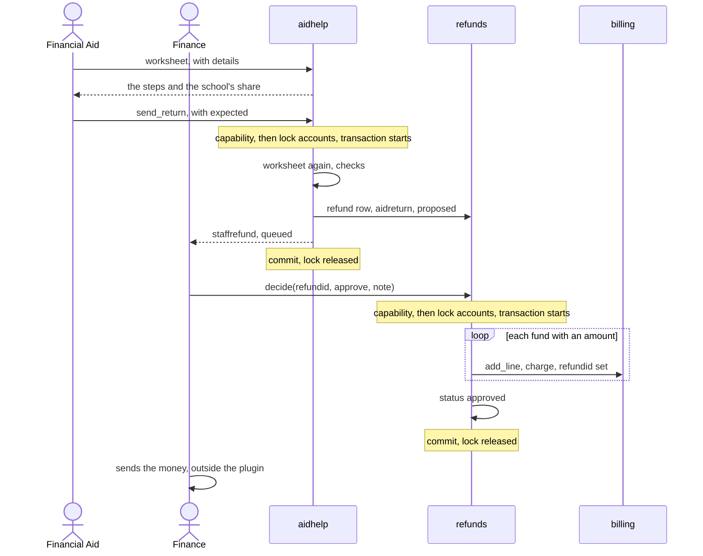

# Federal aid flows

This page covers the optional federal aid module: awards, disbursements and runs, aid lines on the account, reversals, the Return of aid worksheet, the loan checks, the 90/10 worksheet, and what goes to Finance.

The worksheets and checks here are helpers. They don't replace the official federal worksheet, and a school checks each result against that worksheet and the current handbook. This page says what the code does. It gives no aid advice, and it doesn't claim the code matches any rule.

## Contents

- [Where to look](#where-to-look)
- [What the module is](#what-the-module-is)
- [The funds](#the-funds)
- [Awards](#awards)
- [Aid year details and need](#aid-year-details-and-need)
- [Loan checks](#loan-checks)
- [A disbursement](#a-disbursement)
- [Disbursement runs](#disbursement-runs)
- [Aid lines on the account](#aid-lines-on-the-account)
- [Reversals](#reversals)
- [Return of aid worksheet](#return-of-aid-worksheet)
- [Sending a return to Finance](#sending-a-return-to-finance)
- [Approval by Finance](#approval-by-finance)
- [The 90/10 worksheet](#the-9010-worksheet)
- [Aid reports](#aid-reports)
- [Award letters](#award-letters)
- [What to take care with](#what-to-take-care-with)
- [Related pages](#related-pages)

## Where to look

| To change | Start in | Tests that protect it |
|---|---|---|
| Awards, disbursements, the percent of a term, aid reports, the 90/10 figures | `local/studentrecords/classes/local/aid.php` | `local/studentrecords/tests/local/aid_test.php` |
| Need, loan limits, runs, the Return of aid worksheet | `local/studentrecords/classes/local/aidhelp.php` | `local/studentrecords/tests/local/aidhelp_test.php` |
| The pages | `local/studentrecords/aid.php`, `local/studentrecords/aidletter.php` | `local/studentrecords/tests/money_pages_test.php` |
| How Finance decides a return | `refunds::decide()` in `local/studentrecords/classes/local/refunds.php` | `local/studentrecords/tests/local/refunds_test.php` |

## What the module is

The module records and works out. It keeps awards in `local_studentrecords_aid` and aid year details in `local_studentrecords_aidyear`. Numbers are typed by Financial Aid staff from the school's aid software. Nothing is sent to or read from any federal system, and no Social Security number is stored.

- Switch: the school setting `fedaid`. `aid::enabled()` reads it through `catalog::module_on()`, and it is off unless a school turns it on. With it off, `staffarea::can_open()` closes `local/studentrecords/aid.php`, and `aid::require_enabled()` stops `aid::save_award()`, `aid::disburse()` and `local/studentrecords/aidletter.php`.
- Capabilities: `local/studentrecords:viewaid` opens the pages. `local/studentrecords:manageaid` changes anything. `aid::save_award()`, `aid::disburse()`, `aidhelp::save_year()` and `aidhelp::send_return()` check it themselves, not only the page.
- Role: `aid::create_role()` makes the Financial Aid role `aid::ROLE`, with `aid::ROLECAPS`, from `aid.php` with `createrole=1`, sesskey and `moodle/role:manage`. It is separate from the Finance role. A person with only this role can't open the student account, which is why `aid.php` has its own reversal.

## The funds

`aid::FUNDS` lists the funds and whether each is federal Title IV. `aid::credit_kind()` says what kind of credit a disbursement makes.

| Fund | Title IV | `aid::credit_kind()` | In `aidhelp::RETURNORDER` |
|---|---|---|---|
| `dlunsub`, `dlsub`, `dlplus` | Yes | `fedloan` | Yes, in that order, first |
| `pell`, `fseog`, `otherfed` | Yes | `fedgrant` | Yes, in that order, after the loans |
| `fws` | Yes | Null: paid to the student, not to the account | No |
| `state`, `institutional` | No | `grant` | No |
| `private` | No | `scholarship` | No |

`aid::LOANS` holds the three loans. Other federal funds count as grants.

## Awards

- Entry: `aid.php`, `report=students&id=&action=aidaward`, with `local/studentrecords:manageaid`. Form `local/studentrecords/classes/form/aidaward.php`.
- Checks: the form reads the amount with `billing::parse_amount()`, needs an award year like `2026-27`, and asks for a term on a Title IV fund (`err_aidneedsterm`). `aid::save_award()` then checks the module, the capability, and a known fund and status.
- Goes through: `aid::save_award()`, then `records::save()` and `audit::log()`.
- Lock and transaction: no lock. The transaction in `records::save()`.
- Writes: `local_studentrecords_aid`, with status `offered`, `accepted`, `declined` or `cancelled`, and its change history.
- Sends: nothing.
- On failure: the page redirects with the message.

Only the form asks for a term. `aid::save_award()` doesn't need one, and a worksheet counts by `aid.termid`, so aid on an award with no term is left out of every worksheet. It shows only as the warning `noterm`, from `aidhelp::paid_without_term()`.

Nothing stops an award being lowered below what was disbursed. `aid::disburse()` then finds nothing left.

## Aid year details and need

`aidhelp::year()` reads the row of a student and award year, with defaults when there is none. `aidhelp::save_year()` saves it from `aid.php`, `action=aidyear`, with `saveyear=1` and sesskey. The row holds `coa`, `sai`, `dependency`, `gradelevel`, `verification`, `counseling` and `note`. `sai` can be below zero: the page keeps the sign.

`aidhelp::need()` is `max(0, coa - max(0, sai))`, rounded to 2 decimals. The page compares it with what is `offered` or `accepted` and shows a warning when the awards are over it. That warning stops nothing.

`aidhelp::award_year()` turns a date into an award year, July to June, in the school's time zone.

## Loan checks

This check runs on `aid.php`, on the page of one student and award year. It warns and stops nothing. Like the rest of the module, it is a helper: the strings on the page tell staff to check the limits against the current federal handbook.

1. The page sums the loans of awards `offered` or `accepted` in the award year, and collects their terms.
2. `aidhelp::is_graduate()`: the program's level is in the setting `gradlevels`. The page then skips the check and shows `aid_loangraduate`.
3. `aidhelp::enrolled_percent()`:
   - 100 for an award year before `aidhelp::REDUCTIONYEAR`, with full-time hours of 0 or less, or for a clock-hour program.
   - Otherwise, over the terms of the loans with registrations that haven't all ended: `min(100, divide(enrolled * 100, fulltime * terms))`, in hundredths of an hour. A term with no row, or where every row ended, isn't counted.
   - 100 with no term counted.
4. `aidhelp::limits()`: each limit of `aidhelp::LIMITS` times the percent over 100, with `billing::divide()`. Null for an unknown dependency.
5. `aidhelp::loan_check()`: `dlsub` and `dlunsub` only, with 0.001 of slack. Null within the limits. Otherwise `total`, `limit`, `sublimit`, `sub`, `lowerunsubto` and `fund`, the loan to lower: `dlunsub` when the total is over, else `dlsub`.

With a percent below 100, the page shows `aid_loanreduced`. With a result from `aidhelp::loan_check()`, it shows `aid_loanover` or `aid_loansubover` and marks that fund's row.

`aidhelp::LIMITS` holds these values, in whole dollars, as total and subsidized part. The docblock says they are helper values to check against the current federal handbook.

| Dependency | Grade level 1 | Grade level 2 | Grade level 3 and up |
|---|---|---|---|
| `dependent` | 5500, 3500 | 6500, 4500 | 7500, 5500 |
| `independent` | 9500, 3500 | 10500, 4500 | 12500, 5500 |

`test_loan_check`, `test_loan_limits_for_less_than_full_time`, `test_enrolled_percent` and `test_is_graduate` hold what the code does.

## A disbursement

- Entry: `aid.php`, `report=students&id=&action=disburse&item=`, with `local/studentrecords:manageaid`. The form shows what is left and takes a date and an amount.
- Checks, in order, in `aid::disburse()`: the module, the capability, then under the lock: status `accepted` and a credit kind that isn't null (`err_aidnotdisbursable`), and an amount above zero and not above what is left, in cents (`err_aidamount`).
- Goes through: `billing::add_line()` with `txntype` `credit`, `method` the credit kind, minus the amount, `aidid`, the award's `termid`, `txndate` as given, and the description `aiddisbdesc`.
- Lock and transaction: `accounts` around one transaction, through `billing::one_at_a_time()`. What is left is read under the lock, so two people can't both disburse the last of an award.
- After the unlock: the amount is below zero, so plans sync in the transaction and `payments::settle()` runs for the student left by `billing::after_lock()`. Course access waiting for payment can open.
- Sends: nothing of its own.
- On failure: the page redirects with the message.

`test_disburse` and `test_disburse_needs_an_accepted_award_and_manageaid` hold this.

## Disbursement runs

A run looks at one term.

- Entry: `aid.php`, `report=run&termid=`. `send=1`, with sesskey and `local/studentrecords:manageaid`, sends the ready rows.
- Goes through: `aidhelp::run()` takes each `accepted` award of the term with money left, and gives its reasons from `aidhelp::hold_reasons()`. `aidhelp::send_ready()` calls `aid::disburse()` for each row with no reasons that isn't work-study, for what is left, dated now.

`aidhelp::hold_reasons()`, in order:

| Order | When | Reasons returned |
|---|---|---|
| 1 | The student's status is `withdrawn` | `stopped_withdrawn` only |
| 2 | `hours` is given and 0 or less: no class to pay aid for | `held_noclasses` only |
| 3 | `verification` is `selected` | Adds `held_verification` |
| 4 | A loan with no counseling | Adds `held_counseling` |
| 5 | A loan with fewer hours than the setting `halftime` | Adds `held_halftime` |

`aidhelp::run()` always passes `hours`, from `outside::term_load()`. Work-study has `payroll` true and no reasons, and the page shows it as payroll and never sends it.

- Lock and transaction: each award takes `accounts` and a transaction of its own, in `aid::disburse()`. Nothing wraps the run.
- Writes: credit lines, and one audit line `disbursement run term N`, after the loop.
- On failure: the run stops at the row that failed, and rows before it stand. The page has no `catch` there, so Moodle shows the error, and the audit line isn't written. A second run finds only what is still left. `test_send_ready_twice` holds this.

## Aid lines on the account

A disbursement is a `credit` with `aidid` set. The kinds are `fedgrant` and `fedloan` from federal funds, and `grant` and `scholarship` from others. Only an award adds `billing::AIDKINDS`.

| Reader | What it does with aid lines |
|---|---|
| `aid::awards()` | `disbursed` is minus the sum of lines with this `aidid`, so a reversal counts back |
| `aid::lines()` | The aid lines of a student and award year: each disbursement, reversal, and return of aid. A return of aid belongs to the award year of its term |
| `billing::is_aid_line()` | True with `aidid`, with a method in `billing::AIDKINDS`, or with `refundid` of an `aidreturn` refund |
| `local/studentrecords/account.php` | Shows awards and lines to read. Work on them is on `aid.php` |
| `plans::paid_toward()` | A credit counts toward a plan |
| `moneyreports::tax_amounts()` | Reads the kinds through `moneyreports::SCHOLARSHIPS` and `moneyreports::PAIDCREDITS` |

## Reversals

- Entry: `aid.php`, `report=students&id=&action=reverse&item=`, with `local/studentrecords:manageaid`. The page refuses a line of another student, and a line that isn't aid (`err_notaidline`). `account.php` can reverse an aid line too, with both `local/studentrecords:managebilling` and `local/studentrecords:manageaid`.
- Goes through: `billing::reverse()`, as on [the money page](flows-money.md#reversals). The check on `local/studentrecords:manageaid` is inside `billing::reverse()`, so it holds on any page.
- Lock and transaction: `accounts` around one transaction.

The reversing line copies `aidid`, so the award has that money to disburse again, and `aidhelp::paid_out()` nets it. `test_reversing_an_aid_line_needs_manageaid` and `test_aid_page_reverses_a_disbursement` hold this.

## Return of aid worksheet

`aidhelp::worksheet()` gathers the inputs, and `aidhelp::r2t4()` does the steps. The docblock of `aidhelp::r2t4()` names 34 CFR 668.22 and volume 5 of the Federal Student Aid Handbook as what it follows, step by step. The page tells staff that this is a helper and not the final answer, and that they check it against the official federal worksheet before they return funds.

- Entry: `aid.php`, `report=returns`. With a term, `aid::withdrawals()` lists aid recipients who withdrew: status `withdrawn`, or every class of the term ended. `report=returns&termid=&id=` opens one worksheet.
- Details from staff: a GET form with the fields of `aidhelp::WORKSHEETFIELDS`. `aidhelp::worksheet_details()` reads them. Amounts and hours go through `billing::parse_amount()`, days must be digits, and dates go through `plans::valid_ymd()`. Anything else is left out, so the default applies and the page says which details weren't used.
- Lock and transaction: none. The worksheet only reads, until staff send it. It saves nothing staff type: the refund item for Finance holds the result, and the audit line holds the details.

### What the worksheet gathers

| Input | Rule in `aidhelp::worksheet()` |
|---|---|
| Aid paid for the term | `aidhelp::paid_out()`: lines of awards of this term, by fund, Title IV only, with a sum above 0. None paid gives null, and the page says so |
| The day the student left | `aid::left_term()`: the first of these inside the term: the last date of attendance in the term, `student.lastattended`, `student.withdrawdate`, the day their last class of the term ended. A `withdrew` from staff inside the term replaces it. One outside the term goes to `ignored` |
| The day the school determined it | The day they left. A `determined` from staff on or after that day replaces it. An earlier one goes to `ignored` |
| Aid paid by that day | `aidhelp::paid_out()` up to the start of the next day. With no date, all of it. The difference shows as `paidlater` |
| Days in the term | Calendar days, both ends counted |
| Days done | From the start to the day they left, both ends counted, or 0 with no date |
| Breaks | `breakdays` (breaks of five days or more in the term) and `breaksbefore` (those before leaving), from staff. If they don't fit, both go to `ignored` and count as 0 |
| Clock hours | For a program with the unit `clock` (`aidhelp::clock_hours()`): `hoursdone` and `hoursperiod` from staff. Used only when `hoursperiod` is above 0 and `hoursdone` isn't above it. Without them `needshours` is true |
| `done` and `period` | The hours, or `daysdone - breaksbefore` and `daysterm - breakdays` |
| Charges | `charges` from staff, else `aidhelp::charges_when_left()` |
| Could have been disbursed | `couldgrants` and `couldloans` from staff. `aidhelp::not_paid_out()` shows a hint: aid accepted and not paid out. Whether it counts is for staff to decide |

`aidhelp::charges_when_left()` takes `charge` lines of the term with no `refundid`, dated before the day the student left, plus `refund` lines whose refund has an `eventdate` before that day. Charges from that day on come back as `later`, a hint on the page. The method doesn't sort charges by kind: every `charge` line of the term counts, and staff can type another figure.

### The steps

`aidhelp::r2t4()` keeps money in whole cents and percents in tenths, so the arithmetic is exact on every PHP version. The numbers are the ones the page prints.

| Page step | Key | Rule as the code states it |
|---|---|---|
| 1 | `paid` | The sum of aid paid, in cents |
| | `couldhave` | `couldgrants + couldloans` |
| 2 | `pct` | `aid::share_percent()` of `done` over `period`, with `done` held between 0 and `period`. 100 with no period |
| 3 | `earnedpct` | 100 when past the 60% point (`aid::past_sixty()`) or with no period, else `pct` |
| | `earned` | `divide((paid + couldhave) * tenths, 1000)`, with `tenths` the earned percent in tenths |
| 4 | `pwd` | `max(0, earned - paid)`: a post-withdrawal disbursement, and nothing goes back |
| | `unearned` | `max(0, paid - earned)` |
| 5 | `charges` | The charges, in cents |
| 6 | `schoolshare` | `min(unearned, divide(charges * (1000 - tenths), 1000))` |
| | `returns` | `aidhelp::shares()`: the school's share over `aidhelp::RETURNORDER`, each fund up to what it has |
| 7 | `studentshare` | `unearned - schoolshare` |
| | `loansleft` | Loans paid less loans the school returns. They stay on their terms |
| | `grantdue` | `max(0, studentshare - loansleft)` |
| | `grantprotected` | `divide(grants * 50, 100)`: half of grants paid plus `couldgrants` |
| | `grantreturns` | `aidhelp::shares()` of what is left in each grant fund, by `grantdue - grantprotected`, keeping only funds above `aidhelp::GRANTMINIMUM`, 5000 cents |
| | `grantowed` | The sum of `grantreturns` |

`aid::share_percent()` is `divide(intdiv(done * 10000, total), 10) / 10`: the fraction keeps four decimals, what follows them is cut off, and then it is rounded to three. So 38 of 110 is 0.3454, and 34.5%. `aid::past_sixty()` is `done * 10 > total * 6`, in whole numbers, so a student past the point by any amount earns everything, even when the percent prints 60.0%. Exactly 60% doesn't count as past it.

`aidhelp::worksheet()` adds what the page needs: `funds`, `withdrew`, `withdrewday`, `daysterm`, `done`, `period`, `clock`, `needsdate`, `needshours`, `ignored`, `chargesfound`, `chargeslater`, `notpaid`, `paidlater`, `noterm`, `breakdays`, `breaksbefore`, `determined`, `determinedday` and `duedate`. The due date is `aidhelp::RETURNDAYS`, 45 days after the day the school determined it.

### Examples from the tests

These calls and results come from `local/studentrecords/tests/local/aidhelp_test.php`. The docblocks there call them handbook examples.

```php
// test_r2t4_handbook_grants: 11 of 110 days, grants only.
$w = aidhelp::r2t4(['pell' => 1400, 'fseog' => 1200], 11, 110, 1000);

$this->assertSame(10.0, $w['pct']);
$this->assertSame(260.0, $w['earned']);
$this->assertSame(2340.0, $w['unearned']);
$this->assertSame(900.0, $w['schoolshare']);
$this->assertSame(['pell' => 900.0], $w['returns']);
$this->assertSame(1440.0, $w['studentshare']);
$this->assertSame(1300.0, $w['grantprotected']);
$this->assertSame(140.0, $w['grantowed']);
```

```php
// test_r2t4_handbook_post_withdrawal_disbursement: 52 of 110 days, with aid that could have been disbursed.
$w = aidhelp::r2t4(['dlsub' => 1000], 52, 110, 0, 0, 1700);

$this->assertSame(47.3, $w['pct']);
$this->assertSame(1277.1, $w['earned']);
$this->assertSame(277.1, $w['pwd']);
$this->assertSame(0.0, $w['unearned']);
```

`test_r2t4_handbook_loans_first`, `test_r2t4_handbook_clock_hours`, `test_r2t4_rounding_and_the_sixty_percent_point`, `test_r2t4_small_grant_overpayments` and `test_r2t4_loans_come_before_grants_in_the_student_share` cover the other steps.

## Sending a return to Finance

Financial Aid doesn't touch the account here. The worksheet becomes a refund item that Finance decides.



- Entry: `aid.php`, `sendreturn=1`, by POST with sesskey, the details staff typed, and `expected`, the school's share the page showed, in cents. The button shows with `local/studentrecords:manageaid`, a school's share above zero and no missing hours.
- Checks, in order, in `aidhelp::send_return_locked()`:
  1. The worksheet needs a date (`err_returndate`), and a clock-hour program needs hours (`err_returnhours`).
  2. No worksheet, or a school's share of 0 or less: `err_noreturn`.
  3. `expected` differs from the share worked out now: `err_returnchanged`. Staff approved a figure, and the figures moved since.
  4. A return for this student and term that isn't `rejected`: `err_returnexists`.
- Goes through: `aidhelp::send_return()` checks the capability, then runs under `billing::one_at_a_time()`.
- Lock and transaction: `accounts` around one transaction.
- Writes: one `local_studentrecords_refund` row, inserted directly: `regid` null, `reason` `aidreturn`, `eventdate` the day the student left, `rulename` `ret_rulename`, `amount` the school's share, `status` `proposed`, `duedate` from the worksheet. `details` holds one entry per fund with `fund`, `description`, `net`, `percent`, `refund`, and `chargeid` 0. The audit line holds the inputs.
- Sends: `staffrefund` to people with `local/studentrecords:approverefund` who also hold `local/studentrecords:viewbilling`, queued. See [message providers](tasks-and-messages.md#message-providers).
- On failure: the page redirects to the worksheet with the message and what staff typed.

Only the school's share goes to Finance. `grantowed`, what the worksheet says a student pays back, is shown on the page and stored nowhere.

## Approval by Finance

The return waits on `local/studentrecords/refunds.php`, among the refunds. `refunds::can_refigure()` refuses it, so there is no refigure form.

`refunds::decide()` runs as for any refund, with the same capability, the check on one's own account, and `accounts`. For a return it writes, for each entry of `details` with an amount:

- A `charge` with `billing::add_line()`: the amount, the term, `refundid` set, not qualified, not refundable, and the description `ret_chargedesc`.

These put the returned aid back on the student's account. No message goes to the student, and no `refund` line is written. The money itself goes to the Department of Education outside the plugin: `ref_step2_aidopen` tells Finance that, and no payout is offered. `test_an_approved_return_of_aid_is_no_refund_to_the_student` holds this.

The line is an aid line by its `refundid`, so reversing it needs `local/studentrecords:manageaid`, and `aid::lines()` lists it for the award year of its term. `refunds::refundable_charges()` leaves it out, because aid sent back is no school charge. `test_return_of_aid_charge_is_not_refunded` holds this.

An approved row stays `approved` when its charges are reversed. `err_returnexists` still counts it, so a new return for that term is refused.

## The 90/10 worksheet

`aid.php`, `report=ninetyten`, over a date range, with `aid::ninety_ten_worksheet()`. It is one more helper for the school's own work.

| Figure | How |
|---|---|
| `federal` | Minus the sum of `credit` lines with method `fedgrant` or `fedloan`, by `txndate` |
| `other` | Minus the sum of `payment` and `payout` lines, and `credit` lines with method `scholarship`, `grant` or `sponsor` |
| `all` | `federal + other` |
| `percent` | `aid::ninety_ten()`: `divide(cents(federal) * 10000, cents(all)) / 100`, or null with no cash |

Reversals keep their type and method, so they net out. Waivers, discounts and adjustments aren't money and don't count.

## Aid reports

Each of these opens with `local/studentrecords:viewaid`. All but `verification` can be downloaded, through `reports::download()`, and a download logs `export` of `aid`.

| `report` | Method | What it gives |
|---|---|---|
| `recipients` | `aid::recipients()` | Awards of an award year, with what is disbursed |
| `disbursements` | `aid::disbursements()` | Aid lines by date, reversals included |
| `enrollment` | `aid::enrollment()` | Status of a term's recipients, by `outside::nsc_status()` |
| `withdrawals` | `aid::withdrawals()` | Recipients who withdrew, with the dates, the percent of the term, and whether they passed 60% |
| `verification` | Reads `local_studentrecords_aidyear` on the page | Students selected for verification or with no counseling, in an award year |

`aid::withdrawals()` is helper data for the school's own calculation, as its docblock says.

## Award letters

- Entry: `local/studentrecords/aidletter.php`, for the student or with `local/studentrecords:viewaid`. It logs a view, and `print=1` gives the printable layout. The page lists the year's awards that aren't `cancelled`. Only `aid.php` links to it, so no page leads a student there.
- Message: `aid.php`, `action=letter`, with `local/studentrecords:manageaid` and sesskey. `aidhelp::send_letter()` sends `aidletter` and reads `messages::last_status()`. Only `sent` counts as sent. `testinbox`, `queued` and the others come back to staff as not sent. `test_send_letter_says_what_happened` holds this.
- The message's link goes to `account.php`, which shows the awards and can't accept or decline them. `msgdef_aidletter_body` still says the student can accept or decline there, and `aid_lettersent` tells staff the message links to the letter. [Bugs in this release](../pitfalls.md#bugs-in-this-release) lists this.

## What to take care with

- Keep `aidhelp::r2t4()` in whole cents and tenths. Don't move any step to floats or `round()`.
- `aidhelp::LIMITS`, `aidhelp::REDUCTIONYEAR`, `aidhelp::GRANTMINIMUM`, `aidhelp::RETURNDAYS` and `aidhelp::RETURNORDER` are helper values written into the code. A change of rule means a code change and a release, and the tests name the examples they follow.
- A worksheet reads `aid.termid`, `txn.txndate` and the refund's `eventdate`. A change to how any of those is set changes the worksheet.
- The `expected` check in `aidhelp::send_return_locked()` is what stops a stale figure. Keep it.
- A return of aid has `regid` null and `chargeid` 0 in its details, and it adds charges, not refunds. Code that reads `refund.regid` must allow null: `refunds::listing()` uses left joins.

## Related pages

- [Money flows](flows-money.md)
- [Calculations](calculations.md)
- [Data model](data-model.md)
- [Access](access.md)
- [Registration and grades flows](flows-registration-and-grades.md)
