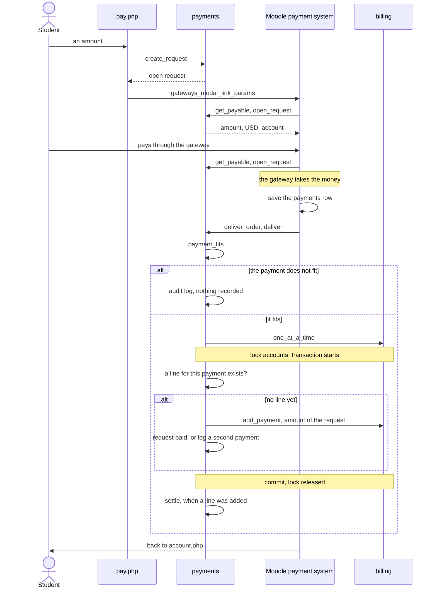
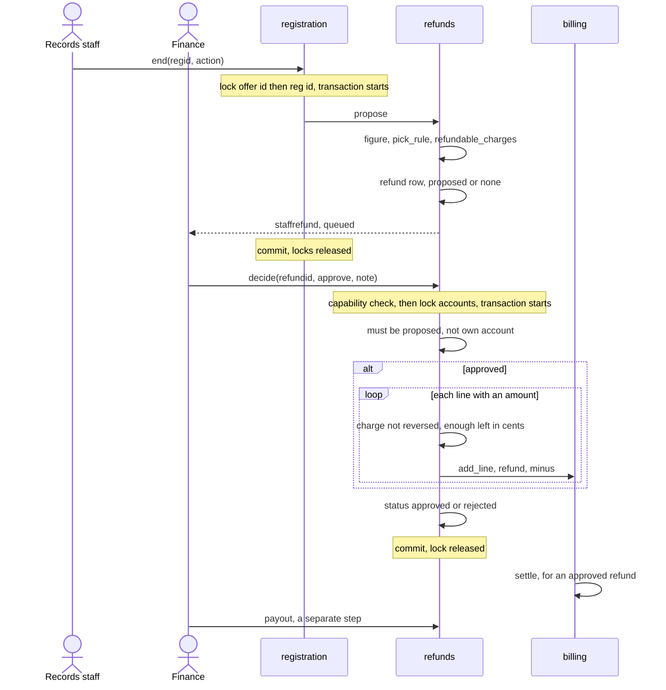

# Money flows

This page follows every money flow of Student Records from start to finish: the price list, charges, credits, payments by staff and online, receipts, statements, reversals, payment plans, late fees, refunds, money paid back and the 1098-T data. It names the class and method at each step, and where each transaction and lock starts and ends.

## Contents

- [Where to look](#where-to-look)
- [How money is stored](#how-money-is-stored)
- [The kinds of account line](#the-kinds-of-account-line)
- [The helpers every flow uses](#the-helpers-every-flow-uses)
- [Where each lock and transaction starts and ends](#where-each-lock-and-transaction-starts-and-ends)
- [The price list](#the-price-list)
- [Charges at registration](#charges-at-registration)
- [Charges and credits by staff](#charges-and-credits-by-staff)
- [Payments recorded by staff](#payments-recorded-by-staff)
- [Online payments](#online-payments)
- [Recovering a lost delivery](#recovering-a-lost-delivery)
- [Course access that waits for payment](#course-access-that-waits-for-payment)
- [Receipts](#receipts)
- [Statements](#statements)
- [Reversals](#reversals)
- [Payment plans](#payment-plans)
- [Refunds](#refunds)
- [Money paid back](#money-paid-back)
- [The transcript fee](#the-transcript-fee)
- [The 1098-T data](#the-1098-t-data)
- [Money reports](#money-reports)
- [Related pages](#related-pages)

## Where to look

| To change | Start in | Tests that protect it |
|---|---|---|
| The price list, account lines, charges, reversals, statements | `local/studentrecords/classes/local/billing.php` | `local/studentrecords/tests/local/billing_test.php` |
| Payments, the online flow, receipts, recovery, course access | `local/studentrecords/classes/local/payments.php`, `local/studentrecords/classes/payment/service_provider.php`, `local/studentrecords/pay.php` | `local/studentrecords/tests/local/payments_test.php`, `local/studentrecords/tests/task/recover_payments_test.php` |
| Plans, reminders, late fees, financial holds | `local/studentrecords/classes/local/plans.php` | `local/studentrecords/tests/local/plans_test.php` |
| Refund rules, refunds, money paid back | `local/studentrecords/classes/local/refunds.php`, `local/studentrecords/refunds.php` | `local/studentrecords/tests/local/refunds_test.php` |
| Money reports, the 1098-T data | `local/studentrecords/classes/local/moneyreports.php`, `local/studentrecords/billingreports.php` | `local/studentrecords/tests/local/moneyreports_test.php` |
| The account page | `local/studentrecords/account.php` | `local/studentrecords/tests/money_pages_test.php` |

Federal aid has [its own page](flows-aid.md). Who may do what is on [the access page](access.md). The arithmetic is on [the calculations page](calculations.md).

These changes break things first:

- `round()` in place of `billing::times()` gives a cent that differs by PHP version.
- `billing::one_at_a_time()` called inside a transaction started some other way lets go of the lock before the commit, so two payments can get one receipt number.
- Work on another lock under `accounts`, such as `payments::grant()`, breaks the lock order. It belongs in `payments::settle()`.
- A change to an existing line makes old statements stop adding up. Lines are never changed or removed.
- `billing::insert_line()` with nothing after it leaves plans and waiting course access out of date.
- A test for a recorded payment on `paymentid` alone also finds a reversal.

## How money is stored

Every amount is a number with 2 decimals in the database: `number(12,2)`, in `txn.amount`, `fee.amount`, `payreq.amount`, `plan.downvalue`, `plan.planfee`, `plan.latefee`, `stuplan.total`, `stuplan.planfee`, `stuplan.latefee`, `inst.amount`, `inst.paid`, `refund.amount`, `aid.amount`, `aidyear.coa` and `aidyear.sai`. `billing::MAXAMOUNT` is the largest amount these hold, and `billing::parse_amount()` refuses more.

The only currency is US dollars, `billing::CURRENCY`.

PHP holds an amount as a float. A float can't hold most cents exactly, so anything that multiplies, divides or compares money works in whole cents.

| What | How | Test |
|---|---|---|
| A line | `billing::insert_line()` rounds the amount to 2 decimals | None of its own |
| The balance | `billing::balance()`: `SUM(amount)` in the database, rounded to 2 decimals. Above zero the student owes, below zero the school owes | `test_payout` |
| A rate times hours, a percent of an amount | `billing::times()`: `billing::cents()` of both, multiplied and divided as whole numbers with `billing::divide()`. A half cent goes up | `test_times` |
| Plan payments | `plans::amounts()`, in whole cents, the leftover on the last payment | `test_amounts_are_exact` |
| A refund | `billing::times()` per charge, and the sum rounded | `test_figure_is_exact` |
| Whether an amount fits | `billing::cents()` on both sides, as in `refunds::decide()`, `refunds::payout()`, `aid::disburse()` and `payments::payment_fits()` | `test_payout`, `test_same_charge_is_refunded_once` |
| Whether a balance is clear | A tolerance of 0.004 on a rounded balance, as in `payments::access_allowed()` and `plans::preview()` | `test_access_allowed` |

`billing::times()` exists because `round()` isn't exact here. The product 2.05 x 1.5 is held a little under 3.075, and PHP 8.4 no longer corrects that, so on PHP 8.4 plain `round()` gives 3.07. `billing::times()` gives 3.08 on every version. Never replace it with `round()`.

`billing::cents()` itself is `(int)round($amount * 100)`. That is safe because it is only for amounts with at most 2 decimals, so the product sits next to a whole number and never near a half. A factor with more decimals loses them at this step: 33.333 reads as 33.33.

Account lines are never changed or removed. A mistake is fixed by a reversing line. `billing::reverse()` holds the only write to an existing line in the plugin: it sets `txn.reversedby`. Lines don't go through `records::save()`, so they have no change history of their own, except that one field. `billing::insert_line()` logs `create` of `account` in the audit log.

## The kinds of account line

`billing::TYPES` lists the kinds, in `txn.txntype`. A positive amount adds to what the student owes.

| `txntype` | Sign | Written by | Columns that matter |
|---|---|---|---|
| `charge` | Plus | `billing::charge_registration()`, `local/studentrecords/account.php`, `plans::create()` (plan fee), `plans::daily()` (late fee), `refunds::decide()` (return of aid), and `requests::create()` in Academic Transcript (transcript fee) | `feeid`, `regid`, `termid`, `qualified`, `refundable`, `planid`, `refundid` |
| `credit` | Minus | `account.php` with `billing::CREDITKINDS`, and `aid::disburse()` with `billing::AIDKINDS` or `scholarship` or `grant` | `method`, `aidid`, `termid` |
| `payment` | Minus | `payments::add_payment()` | `method`, `receipt`, `reference`, `paymentid` |
| `refund` | Minus | `refunds::decide()` | `chargeid`, `refundid`, `regid`, `feeid`, `qualified`, `refundable` |
| `payout` | Plus | `refunds::payout()` | `method`, `reference`, `refundid` when given |

A reversal keeps the `txntype` of the line it reverses, with the opposite amount. So a reversed payment is a positive line of type `payment`, and `moneyreports::payments()` relies on that when it sums `txntype = 'payment'`.

`txn.txndate` is when a line counts from, for statements and the 1098-T data. `txn.timecreated` is when it was added.

## The helpers every flow uses

| Helper | What it does | Use it when |
|---|---|---|
| `billing::insert_line()` | Writes one line and an audit row, and nothing else | Only with `payments::settle()` after it, as `payments::record()` does |
| `billing::add_line()` | `billing::insert_line()` and `plans::sync()` in one transaction when the amount is below zero or the type is `payment` or `credit`. Then `payments::release()` after the commit when the amount is below zero. No lock | Almost always |
| `billing::transaction()` | A delegated transaction: the work, `rollback()` in the `catch`, `records::commit()` after the `try` | Several writes that belong together, when nothing is read first |
| `billing::one_at_a_time()` | `billing::transaction()` inside the lock `accounts`. Then, when the outermost call ends, `payments::settle()` for each student left by `billing::after_lock()` | Anything that reads an account and then writes on it |
| `billing::after_lock()` | Inside `billing::one_at_a_time()`, stores the student and returns true | Inside `payments::release()` only |
| `payments::settle()` | `plans::sync()`, then `payments::release()`, in a `try` that writes any failure to the audit log | After a payment line is saved |
| `payments::release()` | Gives course access to each waiting registration whose term now passes `payments::access_ok()` | Through the helpers above |

```php
// local/studentrecords/classes/local/billing.php, one_at_a_time()
self::$running++;
try {
    $result = registration::with_lock('accounts', fn() => self::transaction($work));
} catch (\Throwable $e) {
    self::$afterlock = [];
    throw $e;
} finally {
    self::$running--;
}
if (!self::$running) {
    $students = self::$afterlock;
    self::$afterlock = [];
    foreach ($students as $student) {
        payments::settle($student);
    }
}
return $result;
```

The lock is outside the transaction, so it outlasts the commit. [The registration page explains why that matters](flows-registration-and-grades.md#which-locks-must-outlast-their-commit). Never call `billing::one_at_a_time()` from inside a transaction started some other way.

`accounts` is one lock for every account, so nothing inside it may wait on a mail server. The plugin's own messages queue for cron. Course access waits until the lock ends, because enrolling can make Moodle send a course's welcome message at the commit.

`billing::add_line()` takes no lock. Read-then-write work must call it inside `billing::one_at_a_time()`.

## Where each lock and transaction starts and ends

| Flow | Entry | Lock held | Transaction | After the commit and the unlock |
|---|---|---|---|---|
| Charge on registering | `billing::charge_registration()` | `offer<id>`, and `reg<id>` for an existing row, from `registration::add()` | The one in `registration::add_seat()` | Nothing |
| Charge or credit by staff | `billing::add_line()` | None | `billing::transaction()` | `payments::release()` when the amount lowers the balance |
| Add a term's missing charges | `billing::charge_term()` | None | One `billing::transaction()` per line | Nothing |
| Payment by staff | `payments::record()` | `accounts` | Inside the lock: `payments::add_payment()` | `payments::settle()` |
| Online request | `payments::create_request()` | None | None: one insert | Nothing |
| Online delivery, recovery | `payments::record_online()` | `accounts`, per payment | Inside the lock: the check, the line, the request | `payments::settle()`, when a line was added |
| Give course access | `payments::grant()` | `reg<id>` | `billing::transaction()` inside the lock | Nothing |
| Reverse a line | `billing::reverse()` | `accounts` | Inside the lock | `payments::settle()` for students left by `billing::after_lock()` |
| Give a plan | `plans::create()` | `accounts` | Inside the lock | `payments::settle()`, then `plans::send_agreement()` from the page |
| Cancel a plan | `plans::cancel()` | None | The one in `records::save()` | Nothing |
| Daily plan work | `plans::daily()` | None | One `billing::transaction()` per step | Nothing |
| Propose a refund | `refunds::propose()` | `offer<id>` and `reg<id>`, from `registration::end()` | Nested in the one in `registration::end_seat()` | Nothing |
| Figure a refund again | `refunds::refigure()` | `accounts` | Inside the lock | Nothing |
| Decide a refund | `refunds::decide()` | `accounts`, after the capability check | Inside the lock | `payments::settle()` for students left by `billing::after_lock()` |
| Pay back | `refunds::payout()` | `accounts` | Inside the lock | Nothing, because the line raises the balance |
| Transcript fee | `requests::create()` in Academic Transcript | The sibling's own lock, none of this plugin's | The sibling's transaction, with `billing::add_line()` nested | Nothing |

## The price list

`local_studentrecords_fee`. An item is switched off with `active`, and never removed. A changed price applies to new charges only, because a line keeps its own amount.

- Entry: `local/studentrecords/billingsetup.php`, `fee=`, with `local/studentrecords:managebilling`.
- Checks, in `local/studentrecords/classes/form/fee.php`: `billing::parse_amount()` must read the amount. A scope of `level` or `program` needs one chosen. A tuition item can't have the basis `manual` or `late` (`err_tuitionbasis`).
- Goes through: `billing::save_fee()`, then `records::save()` and `audit::log()`.
- Lock and transaction: no lock. The transaction in `records::save()`.
- Writes: `local_studentrecords_fee`, its change history and the audit log.
- Sends: nothing.
- On failure: the form shows the error.

| Field | Values | Read by |
|---|---|---|
| `kind` | `billing::KINDS`: `tuition`, `fee` | `billing::pick_tuition()`, `billing::auto_fees()`, `refunds::percent()` |
| `basis` | `billing::BASES`: `credithour`, `clockhour`, `course`, `term`, `program`, `once`, `manual`, `late` | `billing::AUTO` lists the first six, the ones charged by themselves |
| `scope`, `scopeid` | `billing::SCOPES`: `all`, `level`, `program` | `billing::applies()`, against the student's program and its level |
| `refundable` | 0 or 1 | Copied to the line, read by `refunds::percent()` |
| `qualified` | 0 or 1 | Copied to the line, read by `moneyreports::tax_amounts()` |

## Charges at registration

- Entry: `billing::charge_registration()`, from `registration::add_seat()`, inside its transaction. See [staff registration](flows-registration-and-grades.md#staff-registration). With billing off it does nothing.
- Goes through: `billing::registration_charges()`, then `billing::add_line()` for each line.

`billing::registration_charges()`, step by step:

1. Reads the registration and the offering, and the student's program and level.
2. The items: every fee from `billing::auto_fees()`, and in front of them one tuition item from `billing::pick_tuition()`. A registration gets one tuition item: the most specific scope, program before level before all, and on a tie the oldest id. It gets every fee that fits.
3. `billing::fits_unit()` keeps a price per credit hour for credit-hour courses and a price per clock hour for clock-hour courses. A course with an unknown unit gets no hourly price.
4. For each item, `billing::net_charged()` looks for what is on the account already, and skips the item when the net is above zero.
5. `billing::line_amount()` gives the amount. Zero or less is skipped.

| Basis | Amount | Looks for an earlier charge in | `regid` on the line |
|---|---|---|---|
| `credithour`, `clockhour` | `billing::times()` of the rate and the course hours | This registration | Set |
| `course` | The item's amount | This registration | Set |
| `term` | The item's amount | This term | Empty |
| `program`, `once` | The item's amount | The whole account | Empty |

`billing::net_charged()` sums `charge` and `refund` lines of the item. A reversal is a `charge` line with a minus amount, so it brings the net back to 0, and a reversed charge can be charged again. A partly refunded charge keeps a net above zero and can't.

Each line has the description `chargedesc_<basis>`, the offering's `termid`, and `qualified` and `refundable` from the item.

- Writes: `local_studentrecords_txn`.
- Sends: nothing.
- On failure: the exception reaches `registration::add_seat()`, which rolls back the registration too.

Two more entries use the same prices.

| Method | Called from | What it does |
|---|---|---|
| `billing::charge_term()` | `local/studentrecords/billing.php`, `chargeterm=`, with `local/studentrecords:managebilling` and sesskey | Adds what is missing for every active registration of a term, for registrations made before billing was on. It sets no `accesspending`, so students enrolled already stay enrolled |
| `billing::estimate()` | `local/studentrecords/myregistration.php` | Works out the cost of the cart and writes nothing. Per-term and one-time items count once. Hourly items of one price add up into one line |

## Charges and credits by staff

- Entry: `local/studentrecords/account.php`, `action=charge` or `action=credit`, with `local/studentrecords:managebilling`. Form `local/studentrecords/classes/form/txn.php`.
- Checks: an amount above zero, unless a charge from the price list leaves it blank to use the list price. A description for a credit, and for a charge not on the list. A note, always.
- Goes through: `billing::add_line()`. A charge takes `qualified` and `refundable` from the item, or from the form for an item not on the list. A credit is one of `billing::CREDITKINDS` and has a minus amount.
- Lock and transaction: no lock. `billing::transaction()` around the insert and `plans::sync()`, for a credit.
- After the commit: a credit lowers the balance, so `payments::release()` runs.
- Writes: `local_studentrecords_txn`, the audit log, and for a credit the plan rows.
- Sends: `accessopen` for each course that opens, queued, because `payments::grant()` holds a lock and a transaction.
- On failure: the page redirects with the message.

`billing::AIDKINDS` can only come from an award, and the form doesn't offer them.

## Payments recorded by staff

- Entry: `account.php`, `action=payment`, with `local/studentrecords:managebilling`. Form `local/studentrecords/classes/form/payment.php`. Methods are `payments::METHODS`. `online` isn't offered.
- Checks: the form needs `billing::parse_amount()` above zero. `payments::record()` refuses zero or less with `err_amountpositive`.
- Goes through:
  1. `billing::one_at_a_time()` takes `accounts` and starts the transaction.
  2. `payments::add_payment()` gets the number from `payments::next_receipt()` and writes a line with `billing::insert_line()`, with `amount` minus the rounded amount and the description `paymentdesc`.
  3. `messages::student()` queues `paymentreceived`.
  4. The commit, then the lock ends.
  5. `payments::settle()` brings plans up to date and opens any course that may open now.
- Writes: `local_studentrecords_txn`, then `local_studentrecords_inst`, `local_studentrecords_stuplan` and `local_studentrecords_reg` through the settle.
- Sends: `paymentreceived` and `accessopen`, both queued.
- On failure: the line is real money, so a course that can't open never undoes it. `payments::settle()` writes the failure to the audit log with `course access after payment:`, and the course stays on the account page for staff. `test_a_line_stands_when_a_course_cannot_open` and `test_course_problem_does_not_lose_the_payment` hold this.

## Online payments

The plugin has no gateway code. It is a service provider of Moodle's payment system, so any gateway the school turns on for the payment account works. The payment area is `payments::AREA`, `account`, and the item id is the id of a `local_studentrecords_payreq` row.



### Step 1: the request

- Entry: `local/studentrecords/pay.php`, only for the student's own account with `local/studentrecords:viewown` (`err_payownonly`). `payments::online_ready()` must be true: billing on and a usable account from `payments::account()`, which is available and not archived.
- Checks: `local/studentrecords/classes/form/payamount.php` and `payments::create_request()` both use `payments::amount_allowed()`: at least $1.00 and not above the balance. `payments::create_request()` also needs the student to be the current user.
- Writes: an `open` `local_studentrecords_payreq` row with the amount and the account id. No lock and no transaction: one insert. Each submit makes a new request, and nothing closes old ones.

A balance under $1.00 can't be paid online, because no amount passes `payments::amount_allowed()`, though `account.php` shows "Pay online" for any balance above zero.

### Step 2: the button

`pay.php?req=` reads the request by id, student and user, and checks it is `open` and still allowed. `\core_payment\helper::gateways_modal_link_params()` builds the button, and the JavaScript module `core_payment/gateways_modal` opens the window. That helper already calls `service_provider::get_payable()`.

### Step 3: Moodle asks for the amount

`service_provider::get_payable()` refuses another payment area with a `coding_exception`, then calls `payments::open_request()`. This is where a request that may no longer be paid is stopped, because Moodle asks before it takes the money.

| Check | Error |
|---|---|
| Someone is logged in, and it isn't the payer or a site admin | `err_payownonly` |
| Billing is off | `err_noonline` |
| The request isn't `open`, or is over today's balance | `err_paidalready` |

A provider calling back has no one logged in, so the first check doesn't apply. The payer of such a call is checked at delivery.

### Step 4: delivery

The gateway takes the money, Moodle saves a row in `{payments}` and calls `service_provider::deliver_order()`, which calls `payments::deliver()`.

`payments::payment_fits()` must hold, or the audit log says `online payment N does not fit request M: not recorded`, and `payments::deliver()` returns false. The payment must have:

- component `local_studentrecords`, area `account`, and the request as its item;
- the request's user, as the user Moodle names and as the user on the payment;
- the request's account, and the currency `USD`;
- an amount in cents of at least the request's. A gateway surcharge can make it more.

### Step 5: the line

`payments::record_online()` runs under `billing::one_at_a_time()`:

1. A non-reversing line with this `paymentid` exists: nothing is added, and it returns false. One Moodle payment makes one line, however often it is delivered. `test_deliver_is_idempotent` holds this. The test is `reverses IS NULL`, because a reversal copies `paymentid`, and it also means a reversed payment isn't added again.
2. `payments::add_payment()` with method `online`. The amount comes from the request, never from the gateway, so a surcharge stays out of the account. `paymentid` is set. `txndate` is the payment's `timecreated`. `reference` is the gateway's name and `paymentref`, cut to 100 characters.
3. A request still `open` becomes `paid`, with `paymentid`, `txnid` and `timepaid`. Otherwise this is a second payment of one request, from two tabs, and the audit log says `second online payment N of request M`. The line stands, because the money was received, and Finance pays it back. `test_second_payment_of_a_request_is_not_lost` holds this.

After the lock, `payments::settle()` runs when a line was added. Moodle then sends the student to `service_provider::get_success_url()`, which is `account.php?id=<student>&paid=1`.

### What can go wrong

| Failure | What happens |
|---|---|
| The accounts lock is busy at delivery | `payments::deliver()` throws `err_busy`, the money is taken and no line exists. `recover_payments` records it |
| The request dies partway | The transaction rolls back, and `recover_payments` records it |
| The payment doesn't fit | Nothing is recorded, now or by `recover_payments`. The payment stays in `{payments}` with one audit line, and Finance deals with it |
| A course can't open | The line stands. See [payments recorded by staff](#payments-recorded-by-staff) |

Don't test "this payment is recorded" with `paymentid` alone. Use `reverses IS NULL`, as `payments::record_online()` does.

`{payments}` is only read here. Its rows are removed only through `\core_payment\privacy\provider` in the privacy code. See [the privacy page](privacy.md).

## Recovering a lost delivery

Moodle's payment system delivers a payment once and doesn't try again, so a delivery that stopped is lost unless something looks for it.

- Entry: the task `recover_payments`, every 5 minutes, calls `payments::recover()`. It runs with billing off too, because a payment taken while billing was on still counts.
- Start time: the setting `recoverfrom`. `local/studentrecords/db/install.php` and the last step of `local/studentrecords/db/upgrade.php` set it. When it is empty, `payments::recover()` sets it to now, returns 0 and records nothing.
- Finds: rows of `{payments}` for this component and area, from `recoverfrom` on, joined to `local_studentrecords_payreq`, with no non-reversing line.
- For each, in a `try`: `payments::payment_fits()` with the payment's own user. A payment that doesn't fit gets the line `online payment N does not fit request M: not recorded` in the audit log, once. A payment that fits goes through `payments::record_online()`, and the audit log says `online payment N recovered: its delivery did not finish`.
- Lock and transaction: `accounts` and a transaction per payment, in `payments::record_online()`. So a delivery and the recovery can't both add the line.
- Writes and sends: as a delivery (the line, the request, `paymentreceived` queued, and the settle). The line keeps the date of the payment in `txndate`.
- On failure: `err_busy` stops the run, and the next run tries again. Any other error is written with `mtrace()` and the loop goes on.

Until the recovery runs, the balance hasn't moved, so the student can still pay online. The second payment gets its own line, and Finance pays it back.

A payment from before `recoverfrom` with no line is left alone. Finance may have entered that money by hand, and such a line has no link to the payment. So `recoverfrom` must never move back. `test_recover_leaves_payments_from_before_it_started` holds this.

## Course access that waits for payment

The rule is the setting `billaccess`, one of `payments::ACCESS`. `payments::access_rule()` reads it, with `downpayment` as the default.

`payments::access_allowed()`:

| Rule | Allowed when |
|---|---|
| `immediate` | Always |
| `downpayment` | The balance is 0.004 or less, or `plans::plan_ok()` says the student has a plan for the term whose down payment is paid |
| `full` | The balance is 0.004 or less |

`payments::access_ok()` is always true with billing off. It uses the whole balance, not the term's.

A registration that waits has `reg.accesspending` 1, and `payments::pending()` lists it.

`payments::grant()`:

- Entry: `payments::release()`, or `account.php`, `action=access`, where staff give access with a reason.
- Lock and transaction: `reg<id>`. The wait is read again under the lock, so a second call finds it gone and does nothing. The transaction is inside the lock.
- Goes through: `registration::enrol()` when the row is still `registered` and linked, `accesspending` 0 through `records::save()` with source `billing` (or `form` when staff gave a reason), `audit::log()`, and the message `accessopen`.
- Sends: `accessopen`, queued, because the lock and the transaction are open.
- On failure: the transaction rolls back and the wait stays. Staff see the course on the account page.

`payments::release()`:

1. Under `accounts`, `billing::after_lock()` stores the student and the method returns 0. A return of 0 doesn't mean nothing waits. It runs when the lock ends.
2. Otherwise each pending registration whose term passes `payments::access_ok()` gets `payments::grant()` in its own `try`.
3. A failure outside a transaction goes to the audit log, and the next course is tried. `test_one_course_that_cannot_open_does_not_stop_the_others` holds this. A failure inside a transaction is thrown, because that transaction is already undone.

Never call `payments::grant()` under `accounts`. [The lock order](flows-registration-and-grades.md#lock-order) comes first.

Nothing takes access away. A later charge, a reversed payment or a late plan leaves the enrolment alone.

Turning billing off doesn't open waiting courses by itself. `payments::access_ok()` is then true, but `payments::release()` only runs when a line lowers the balance or a plan is given, so staff give access on the account page.

## Receipts

`payments::next_receipt()` gives `R<year>-00001`, from `payments::receipt_number()`. The year is this year in the school's time zone. It counts this year's receipts, adds 1, and steps on while the number exists. It runs only inside `billing::one_at_a_time()`, because `txn.receipt` has no unique index: the lock is the only guard. A reversal has no receipt, so it doesn't count.

`local/studentrecords/receipt.php` needs a `payment` line with a receipt, and `billing::can_view()`: `local/studentrecords:viewbilling`, or the student with `local/studentrecords:viewown`. It logs `export` of `receipt` and sends `payments::receipt_pdf()`. A reversed line prints `receiptreversed`.

## Statements

`local/studentrecords/statement.php`, after `billing::can_view()`. It logs `export` of `statement` and sends `billing::statement_pdf()`.

- Lines come from `billing::lines()`, with a running balance from `billing::with_running()`, in `txndate` and `id` order.
- With a term filter, the lines are the term's, the running balance covers those lines only, and the note `termfilternote` says so. The balance printed at the end is always the whole account.
- The footer prints the settings `payinfo` and `statementnote`.

Both PDFs use Moodle's `\pdf` class and the logo from `letters::logo_path()`.

## Reversals

- Entry: `account.php`, `action=reverse`, with `local/studentrecords:managebilling`, or `local/studentrecords/aid.php`, `action=reverse`, with `local/studentrecords:manageaid`, for aid lines only (`err_notaidline`). Each page checks the line belongs to the student of the page.
- Checks, in order, in `billing::reverse()`:
  1. An aid line needs `local/studentrecords:manageaid`, on any page (`billing::is_aid_line()`).
  2. Already reversed, or a reversal itself: `err_cannotreverse`.
  3. A blank reason: `err_reasonneeded`.
  4. Refund lines on this charge: `err_chargerefunded`. The refund and the reversal would give back the same money.
- Goes through: copies the line without `id`, `userid`, `timecreated`, `reversedby` and `receipt`. The new line has the opposite amount, `txndate` now, `reverses` set, the reason as `note`, and the description `reversaldesc`. `billing::add_line()` writes it. `set_field()` puts `txn.reversedby` on the first line, and `records::history()` keeps that.
- Lock and transaction: `accounts` and one transaction around all of it.
- After the unlock: `payments::settle()`, when the reversal lowered the balance and left a student in `billing::after_lock()`.
- Writes: the new line, `txn.reversedby` on the old one, the change history row, the audit log, and the plan rows that `plans::sync()` changes.
- Sends: nothing of its own.
- On failure: the page redirects with the message.

`paymentid`, `aidid`, `refundid`, `chargeid` and `planid` are copied to the reversing line. So `aid::awards()` sums the reversal into `disbursed`, and `billing::is_aid_line()` sees it as aid. A reversed payment counts back on a plan, through `plans::paid_toward()`.

Either way, money comes back once: `billing::reverse()` refuses a charge with refund lines, and `refunds::decide()` refuses a reversed charge. `test_reverse_of_a_refunded_charge` and `test_approve_after_the_charge_was_reversed` hold both sides.

## Payment plans

A school's plans are in `local_studentrecords_plan`, and a student's plan in `local_studentrecords_stuplan`, with its payments in `local_studentrecords_inst`. Row `seq` 0 is the down payment.

A plan covers the whole balance, not a term's. So a student has one active plan at a time, for any term: a second one would count the same payments again. A plan's `termid` sets the due dates, `plans::plan_ok()`, and the term of its plan fee and late fee lines.

### The school's plans

`billingsetup.php`, `plan=`, and `plans::save_template()`. `plans::templates_for()` offers the active ones that fit the student, by `billing::applies()`. Plans already given don't change.

### Giving a plan

- Entry: `account.php`, `action=plan`, with `local/studentrecords:managebilling`. With an active plan, the page redirects with `err_planexists` before it shows the form. Form `local/studentrecords/classes/form/plan.php`.
- Checks, in order, in `plans::create()`:
  1. A custom plan (no `planid`) needs a note: `err_customnote`.
  2. Under the lock: no active plan, for any term: `err_planexists`.
  3. `plans::preview()`: a balance above 0.004 (`err_noplanbalance`), and as many due dates as payments (`err_plandates`).
- Goes through: `plans::preview()` gives the total, balance plus plan fee, and the rows. The down payment is due today. `plans::due_days()` gives the other dates, and `plans::amounts()` the amounts.
  1. Inserts the `stuplan` row and each `inst` row, with `duedate` at noon. These are direct inserts with no change history.
  2. With a plan fee above zero, `billing::add_line()` adds a charge that isn't qualified or refundable, with `planid` set.
  3. `audit::log()`, `plans::sync()`, and `payments::release()`, which waits for the lock to end.
- Lock and transaction: `accounts` around one transaction.
- After the unlock: `payments::settle()`. Then the page calls `plans::send_agreement()` when asked.
- Writes: `local_studentrecords_stuplan`, `local_studentrecords_inst`, the fee line, and the audit log.
- Sends: `planagreement`, at once, when asked. It holds the first due date and a link, and no amounts.
- On failure: the transaction rolls back, and the page redirects with the message.

`plans::due_days()` doesn't move a date forward. A plan given after a due date has passed starts with that payment late, and the next daily run acts on it.

### Keeping a plan up to date

`plans::sync()` runs from `billing::add_line()`, `payments::settle()`, `plans::create()` and `plans::daily()`. For each `active` or `completed` plan of the student, newest first:

1. `plans::paid_toward()`: payment and credit lines with `timecreated` from `timeapproved` on, less reversals. A reversal counts only when the line it reverses also came after approval. Refunds don't count.
2. `plans::allocate()` shares that among the payments in due order.
3. Each payment: `paid` when full, else `late` by `plans::is_late()` (today after due plus grace days), else `due`. A row is written when something changed.
4. All paid: the plan is `completed`, else `active`.
5. A completed plan no longer paid in full reopens, unless another plan is active. Then `plans::tell_not_reopened()` adds `plan_notreopened` to the plan's note, logs it, and shows `\core\notification::warning()`. This runs from pages and tasks alike.

`plans::paid_toward()` reads `timecreated`, not `txndate`. So a backdated payment entered after approval counts toward the plan. A late fee is a line on the account and no part of the plan's payments, so money paid for it still counts toward the plan, and a plan can complete with a balance left.

### The daily task

`billing_daily` runs at 06:15 and calls `plans::daily()`. With billing off it does nothing.

1. `plans::sync()` for the student of each active plan.
2. For each active plan: a balance of 0.004 or less is skipped, because a refund or a reversal cleared the account, which doesn't count as paying the plan. Nothing is owed, so nothing is late. `test_daily_leaves_a_cleared_account_alone` holds this.
3. For each payment of the plan, three steps follow. Each step and its mark are saved in one `billing::transaction()`, so a task that stops halfway doesn't do a step twice.

| Step | When | Writes | Sends |
|---|---|---|---|
| Reminder | `reminderdays` above 0, default 7. Status `due`, not reminded, `seq` above 0, due from today to today plus the days | `inst.reminded` | `paymentdue` |
| Late fee | Status `late`, no `latefeeid`, plan `latefee` above 0 | A charge with `billing::add_line()`, not qualified, not refundable, and `inst.latefeeid` | Nothing |
| Hold | Status `late`, no `holdid`, no hold of this plan in force | `academic::place_hold()`, and `inst.holdid` | `holdplaced` and `paymentlate` to the student, and `stafflate` to people with `local/studentrecords:managebilling` and `local/studentrecords:viewbilling` |

All these messages are queued, because each step runs in a transaction.

- Lock: none. Moodle runs one copy of a scheduled task at a time, and only this task writes `inst.reminded`, `inst.latefeeid` and `inst.holdid`.
- On failure: the task stops where it is, with each finished step's mark saved. Moodle runs it again, and `test_daily_twice_does_each_thing_once` holds that a second run does each thing once.

The down payment gets no reminder, but it can go late.

### Late fees

The amount is the plan's `stuplan.latefee`. A price list item with the basis `late` gives only the `feeid` of the line: the first active one, when there is one. It is charged once per plan payment.

### Holds from billing

The hold has type `financial`, blocks registration, and its reason is `latehold`, with no amount. No code releases it when the payment arrives: `academic::release_hold()` has one caller, `local/studentrecords/studentpart.php`, so staff release it. A hold staff released isn't placed again for the same late payment, because `inst.holdid` stays set. `test_released_hold_stays_released` holds this. A later payment that goes late can place a new one.

In a task `$USER` is the user cron runs as, so that is who `hold.placedby` names.

### Cancelling

`plans::cancel()`, from `account.php`, `action=cancelplan`, with a reason. Status `cancelled`, who and when, the note added, through `records::save()`. It takes no lock and removes nothing: late fees and holds stay. It sends nothing. An unknown or finished plan fails on `MUST_EXIST`.

A closed plan doesn't reopen by itself after the other plan is cancelled. `plans::cancel()` doesn't call `plans::sync()`, so it waits for the next sync, and the maintainers left that as it is. `test_a_plan_reopens_when_the_other_plan_has_ended` holds this.

## Refunds

Refund rules are in `local_studentrecords_refrule`, tried in `sortorder`. A refund is a `local_studentrecords_refund` row, with status `proposed`, `none`, `approved` or `rejected`. A refund starts with a drop or withdrawal, needs approval, and moves no money by itself.



### Propose

- Entry: `registration::end_seat()` calls `refunds::propose()` in its transaction, under `offer<id>` and `reg<id>`.
- Checks: with billing off it returns null. With no refundable charge at all, it writes no row. The docblock says nothing to refund is kept too, but status `none` needs at least one charge line with a refund of 0.
- Goes through: `refunds::figure()` on the event date: now, or the last date of attendance of that course when the setting `refundlda` is on and one exists.
  1. `refunds::pick_rule()`: the first active rule in `sortorder` that `refunds::rule_fits()` accepts.
  2. `refunds::refundable_charges()`: the course's own charges, and the term's charges when the student has no other active registration left in the term. Each with `net`, what is left after earlier refunds, and `kind`.
  3. `refunds::percent()` and `billing::times()` for each charge.
- Writes: one row, `proposed` for an amount above zero and `none` for zero. `details` is JSON of each charge, percent and refund. `duedate` is the event plus `refunds::refund_days()` days, default 30.
- Sends: `staffrefund`, to people with `local/studentrecords:approverefund` who also hold `local/studentrecords:viewbilling` (see [message providers](tasks-and-messages.md#message-providers)), when the amount is above zero. Queued.

"The term's charges" are all `charge` lines of the term with no `regid` and no `refundid`, not reversed. That holds `term`, `program` and `once` items, and any charge staff added with that term, a plan fee and a late fee. `refunds::percent()` gives 0 for a non-refundable one unless the rule has `allfees`.

### Figure again

- Entry: `local/studentrecords/refunds.php`, the `refigure` form, with `local/studentrecords:managebilling`.
- Checks, in `refunds::can_refigure()`: `proposed` or `none`, never a return of aid.
- Goes through: `refunds::refigure()` runs `refunds::figure()` on another date and saves with `records::save()`, so this table keeps a change history from here on. A `none` row can become `proposed`.
- Lock and transaction: `accounts` around one transaction.
- Sends: nothing, even when a `none` row becomes `proposed`. So nobody is told about that refund.
- On failure: `refunds.php` has no `catch` here, so an error such as `err_busy` gives Moodle's error page. A refund decided before the submit gets no form, so the submit changes nothing.

### Decide

- Entry: `refunds.php`, the decide form, with `local/studentrecords:approverefund`. A person who may not decide sees no form.
- Checks, in order, in `refunds::decide()`: the capability, before the lock. Then under the lock: status `proposed` (`err_refunddecided`, a double click), and the student isn't the current user (`err_refundself`).
- Approving a refund: for each line with a refund above zero, it reads the charge of this student. A reversed charge, or more than is left in cents (`refunds::charge_left()`), gives `err_refundstale`, and the whole decision rolls back. `billing::add_line()` writes a `refund` line with `chargeid`, `refundid`, and the charge's `termid`, `regid`, `feeid`, `qualified` and `refundable`. The description is `refunddesc`.
- Approving a return of aid: one `charge` per fund, not qualified, not refundable, with `refundid` set. See [the federal aid page](flows-aid.md#approval-by-finance).
- Then, for any decision: status `approved` or `rejected` with who, when and the note, through `records::save()`. Message `refundapproved` for an approved refund that isn't a return of aid. Audit action `approve` or `reject`, which `local/studentrecords/log.php` shows as "Approved import items" and "Rejected import items".
- Lock and transaction: `accounts` around one transaction.
- After the unlock: for an approved refund, `payments::settle()`, because a refund line lowers the balance.
- Sends: `refundapproved`, queued, for an approved refund.
- On failure: the rollback leaves nothing, and the page shows the message. `test_out_of_date_refund_comes_back_to_the_page` holds this.

Approving lowers the balance and moves no money. Moodle can't send money back, so the money is the next step.

## Money paid back

- Entry: `account.php`, `action=payout`, with `local/studentrecords:managebilling`. The button shows when the balance is below -0.004. `refunds.php` links to it after an approval. Form `local/studentrecords/classes/form/payout.php`. Methods are `refunds::PAYOUTS`.
- Checks, in `refunds::payout()`: what is owed is minus the balance, read under the lock. The amount must be above zero and not above that in cents (`err_payoutamount`).
- Goes through: `billing::add_line()` with type `payout` and a plus amount, then the message `refundpaid`.
- Lock and transaction: `accounts` around one transaction.
- Writes: `local_studentrecords_txn` and the audit log.
- Sends: `refundpaid`, queued.
- On failure: the page redirects with the message.

This only records the money. A payout isn't tied to its refund: `refunds::payout()` accepts `refundid` in `$extra`, and `account.php` passes none.

## The transcript fee

Academic Transcript charges its fee through this plugin. `requests::create()` calls `billing::add_line()` inside its own transaction, when `requests::can_charge()` is true: Student Records is the source, billing is on, and the student has a file. The line is a charge, not qualified, not refundable, with no term, and `note` is `transcript request <id>`. It raises the balance, so nothing settles. See [integration](integration.md#transcript-request-fees).

## The 1098-T data

`moneyreports::tax1098()` builds a spreadsheet for a school's tax software or tax service. No taxpayer ID is stored, so that column is blank, and nothing is sent to the IRS. It is data for the school's tax adviser to check, and this page describes what the code does, not what a school should report.

- Entry: `local/studentrecords/billingreports.php`, `report=tax1098`, with `local/studentrecords:viewbilling`. A download goes through `reports::download()` and logs `export` of `report`.
- Reads: every line dated before the end of the year, by student, with the date of the line a reversal reverses and the start of the line's term.
- Goes through: `moneyreports::tax_amounts()` for each student. A student with nothing in box 1, 4, 5 or 6 is left out.

`moneyreports::tax_amounts()`:

| Output | How the code works it out |
|---|---|
| `covered(until)` | Over lines dated before `until`: the smaller of qualified `charge` and `refund` lines, and money paid, floored at 0. Money paid is `payment`, `payout` and `credit` lines of `moneyreports::PAIDCREDITS` |
| Box 1 | The rise in `covered` over the year |
| Box 4 | The fall in `covered` over the year |
| Box 5 | Credits of `moneyreports::SCHOLARSHIPS` dated in the year |
| Box 6 | Those lines that reverse a line from before the year |
| Box 7 | A qualified line in the year whose term starts from January to March of the next year, with box 1 above 0 |
| `billed`, `paid`, `paidback` | Qualified charges and refunds, payments, and payouts of the year |

`moneyreports::tax1098()` adds box 8 from `moneyreports::half_time()` and box 9 from the setting `gradlevels`. `test_tax_two_years` and `test_tax_adjustments` hold the boxes.

## Money reports

`billingreports.php`, with `local/studentrecords:viewbilling`. Every download is logged.

| Report | Method | What it gives |
|---|---|---|
| `owed` | `moneyreports::owed()`, `moneyreports::aging()` | Students who owe, with what is left of each charge by whole days since `txndate`. Every line below zero pays the oldest lines above zero first |
| `payments` | `moneyreports::payments()` | Payments by day and method, in the school's time zone, reversals included |
| `refunds` | `moneyreports::refunds()` | Refunds by event date |
| `late` | `moneyreports::late()` | Late payments of active plans |
| `tax1098` | `moneyreports::tax1098()` | See [the 1098-T data](#the-1098-t-data) |

## Related pages

- [Federal aid flows](flows-aid.md)
- [Registration and grades flows](flows-registration-and-grades.md)
- [Calculations](calculations.md)
- [Data model](data-model.md)
- [Access](access.md)
- [Tasks and messages](tasks-and-messages.md)
- [Integration](integration.md)
- [Extending](extending.md)
- [Pitfalls](../pitfalls.md)
