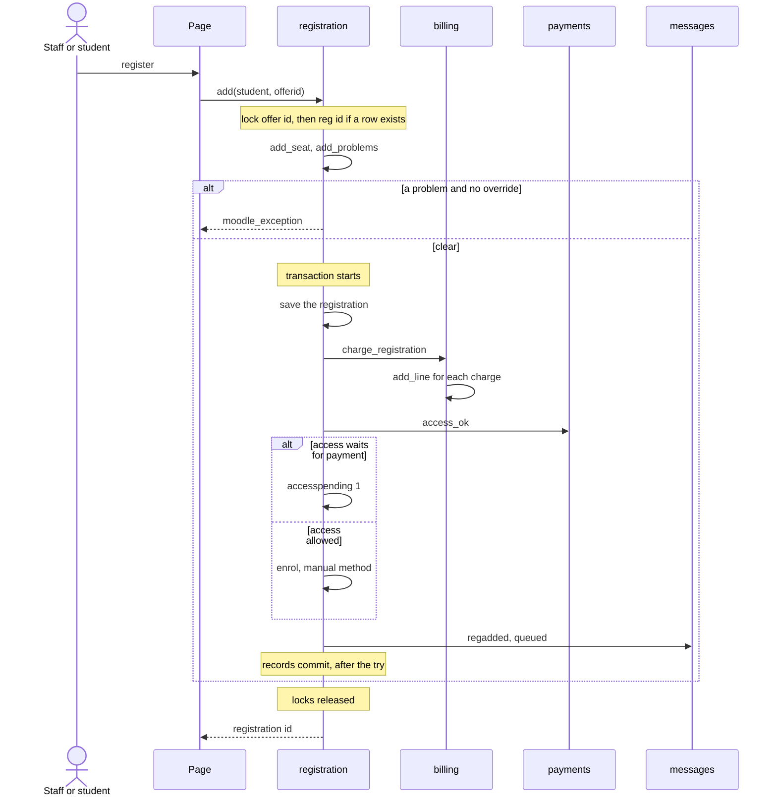
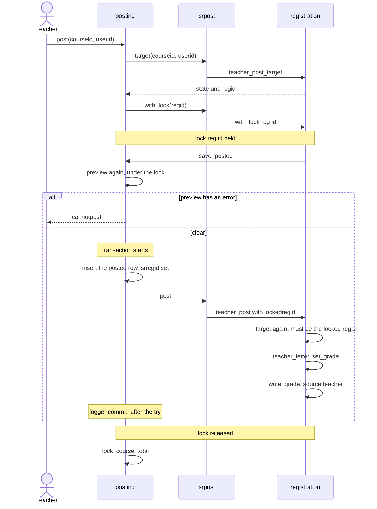

# Registration and grades flows

This page follows a section from its seats to a final grade, and on to attendance, the degree audit, graduation and standing. It says where each lock and transaction starts and ends, and which locks must outlast their commit.

## Contents

- [Where to look](#where-to-look)
- [Locks and transactions](#locks-and-transactions)
- [Offerings](#offerings)
- [Seats](#seats)
- [Staff registration](#staff-registration)
- [Self-registration and the cart](#self-registration-and-the-cart)
- [Section waitlists and offers](#section-waitlists-and-offers)
- [Drop and withdraw](#drop-and-withdraw)
- [The Moodle course and course access](#the-moodle-course-and-course-access)
- [Final grades](#final-grades)
- [The grade freeze](#the-grade-freeze)
- [Grade changes](#grade-changes)
- [Attendance](#attendance)
- [At-risk lists](#at-risk-lists)
- [Degree audit and substitutions](#degree-audit-and-substitutions)
- [Graduation](#graduation)
- [Academic standing](#academic-standing)
- [Related pages](#related-pages)

## Where to look

| To change | Start in | Tests that protect it |
|---|---|---|
| Seats, add and drop rules, enrolment, grades, the academic history | `local/studentrecords/classes/local/registration.php` | `local/studentrecords/tests/local/registration_test.php` |
| The cart | `local/studentrecords/classes/local/selfreg.php`, `local/studentrecords/myregistration.php` | `local/studentrecords/tests/local/selfreg_test.php` |
| Waitlists for sections | `local/studentrecords/classes/local/waitlist.php` | `local/studentrecords/tests/local/waitlist_test.php`, `local/studentrecords/tests/task/waitlist_daily_test.php` |
| Grade changes | `local/studentrecords/classes/local/academic.php`, `local/studentrecords/gradechange.php` | `local/studentrecords/tests/local/academic_test.php` |
| Attendance | `local/studentrecords/classes/local/attendance.php`, `local/studentrecords/attendance.php` | `local/studentrecords/tests/local/attendance_test.php` |
| At-risk list | `homes::atrisk()` in `local/studentrecords/classes/local/homes.php` | `local/studentrecords/tests/local/homes_test.php` |
| Degree audit | `local/studentrecords/classes/local/degreeaudit.php`, `local/studentrecords/degreeaudit.php` | `local/studentrecords/tests/local/degreeaudit_test.php` |
| Graduation | `local/studentrecords/classes/local/graduation.php`, `local/studentrecords/graduation.php` | `local/studentrecords/tests/local/graduation_test.php` |
| Standing | `local/studentrecords/classes/local/standing.php`, `local/studentrecords/standing.php` | `local/studentrecords/tests/local/standing_test.php` |
| The page rules of all of these | The page files | `local/studentrecords/tests/local/registration_pages_test.php` |

How the numbers are worked out is on [the calculations page](calculations.md). Charges and refunds are on [the money flows page](flows-money.md).

These changes break things first:

- A lock taken inside a transaction, instead of around it, lets two requests read the same seat or grade.
- A write to `reg.grade` that doesn't go through `registration::write_grade()` skips the freeze, the rule on one's own record and the kept sources.
- A new step in `registration::add_seat()` or `registration::end_seat()` that throws undoes the whole registration or drop, charges and enrolment included. That is the design, so a step that must not undo it has to run after the commit.
- `registration::history()` feeds the transcript, the audit and standing. A change to a row there changes all three.

## Locks and transactions

Registration, grading and seat steps that read a value and then write on it run under a lock from `registration::with_lock()`. Not every step has one: `graduation::apply()` and `graduation::review()` below read and write with no lock. The lock comes from Moodle's lock factory, for the component `local_studentrecords`. The wait is `registration::LOCKWAIT`, 10 seconds. A lock that doesn't come in time throws `err_busy`. Asking for a lock this request holds runs the work at once.

```php
// local/studentrecords/classes/local/registration.php, with_lock()
if (isset(self::$locks[$resource])) {
    return $work();
}
$lock = \core\lock\lock_config::get_lock_factory('local_studentrecords')->get_lock($resource, self::LOCKWAIT);
if (!$lock) {
    throw new \moodle_exception('err_busy', 'local_studentrecords');
}
self::$locks[$resource] = true;
try {
    return $work();
} finally {
    unset(self::$locks[$resource]);
    $lock->release();
}
```

### The five locks

| Resource | Guards | Taken by |
|---|---|---|
| `offer<id>` | The seats of a section | `registration::add()`, `registration::end()`, `waitlist::join()`, `waitlist::seat_opened()` |
| `reg<id>` | The grade and status of one registration | `registration::add()` when a row exists, `registration::end()`, `registration::set_grade()`, `academic::request_change()`, `academic::decide_change()`, `payments::grant()`, and `srpost::with_lock()` in Academic Transcript |
| `accounts` | Every student account, one at a time | `billing::one_at_a_time()` |
| `studentno` | Automatic student IDs | `students::save()` |
| `letterno` | Enrollment letter numbers | `letters::issue()` |

### Which locks must outlast their commit

All five. A lock is only worth having if the next request, once it has the lock, can see what the last one wrote. A row written in an open transaction is invisible to every other connection until the commit. So the lock is taken first, the transaction starts inside the work, the commit runs, and only then does the lock end. The docblocks of `billing::one_at_a_time()`, `students::save()` and `srpost::with_lock()` each say so.

| Lock | What is read under it | What goes wrong if it ends before the commit |
|---|---|---|
| `offer<id>` | `registration::taken()` and `waitlist::held_seats()`, in `registration::add_problems()` | The next student counts the old seats, and two students take the last seat |
| `reg<id>` | `reg.status`, `reg.gradesource`, `reg.grade`, `grchg.state`, `reg.accesspending` | A grade lands on a course that is being dropped, a staff grade and a posting each read the old source, one request is decided twice, or a posted row in Academic Transcript and the registration end out of step |
| `accounts` | The balance, the last receipt number, whether a payment has a line, what is left of a charge or an award | Two payments get one receipt number, two deliveries add two lines, a payout goes over what is owed. `txn.receipt` has no unique index, so nothing else stops a repeated receipt number |
| `studentno` | The highest ID in use, in `admissions::next_student_id()` | Two new students work out the same ID, and the second save fails on the unique index on `student.studentid` |
| `letterno` | The count of this year's letters, in `letters::issue()` | Two letters work out the same number, and the second fails on the unique index on `letter.letterno` |

`letters::issue()` has no transaction: one `insert_record()` commits by itself, inside the lock. The other four wrap a transaction, and the shape is always the same.

| Lock taken in | Transaction starts in | Commit |
|---|---|---|
| `registration::add()` | `registration::add_seat()`, after the rule checks | `records::commit()` at the end of `registration::add_seat()` |
| `registration::end()` | `registration::end_seat()`, after the rule checks | `records::commit()` at the end of `registration::end_seat()` |
| `registration::set_grade()` | `records::save()` inside `registration::write_grade()` | `records::commit()` inside `records::save()` |
| `academic::decide_change()` | `academic::apply_decision()`, after the checks | `records::commit()` at the end of `academic::apply_decision()` |
| `payments::grant()` | `billing::transaction()` inside the lock | `records::commit()` in `billing::transaction()` |
| `billing::one_at_a_time()` | `billing::transaction()` inside the lock | `records::commit()` in `billing::transaction()` |
| `students::save()` | `students::write()` | `allow_commit()` in `students::write()` |
| `srpost::with_lock()` | `posting::save_posted()` in Academic Transcript | `logger::commit()` in `posting::save_posted()` |

### A lock inside someone else's transaction

Never call any of these from inside a transaction that was started some other way. The lock would end at the close of the call, and the commit would come later. These are the calls that look like that and are safe, because the lock is already held from outside:

- `waitlist::seat_opened()` inside `registration::end_seat()`: `offer<id>` is held by `registration::end()`.
- `registration::set_grade()` inside `academic::apply_decision()`: `reg<id>` is held by `academic::decide_change()`.
- `registration::set_grade()` inside `posting::save_posted()`: `reg<id>` is held by `srpost::with_lock()`, from `posting::post()`.

`registration::teacher_post()` has a parameter for the third case. The caller passes `$lockedregid`, the registration whose lock it holds. If the target worked out under the lock is a different registration, `registration::teacher_post()` throws `err_busy` and writes nothing, because a lock taken at that point would end before the sibling's commit. `test_teacher_post_stays_on_the_locked_registration` in `local/studentrecords/tests/local/registration_test.php` and `test_the_lock_on_the_registration_outlasts_the_commit` in `local/academictranscript/tests/local/srpost_test.php` hold this.

### Lock order

Section first, then registration, then accounts, and nothing is taken under `accounts`. `registration::end()` states the first step in a comment, and the docblock of `payments::grant()` states the second.

`payments::release()` is the step that would break the order, because a payment under `accounts` can open a course, and that takes `reg<id>`. So `billing::after_lock()` stores the student and `billing::one_at_a_time()` runs `payments::settle()` after the lock ended. Three tests hold the order:

- `test_a_drop_holds_the_lock_on_the_registration` and `test_registering_again_holds_the_lock_on_the_registration` in `local/studentrecords/tests/local/registration_test.php`.
- `test_course_access_is_given_after_the_lock_on_the_accounts` in `local/studentrecords/tests/local/payments_test.php`.

They use `recording_lock_factory` from `local/studentrecords/tests/fixtures/recording_lock_factory.php`, which notes each lock and the state of the test when it was taken and released.

### Commit after the try

`records::commit()` runs after the `try` block, never in it. Once a commit has begun, the transaction can't be rolled back, and the last commit is when Moodle sends the messages it held back. A send that fails at that point comes after the data is saved, so it must not reach the `catch`. `records::commit()` writes it to the audit log with the text `after saving:` and lets the caller go on. A commit that doesn't go through still throws.

```php
// local/studentrecords/classes/local/billing.php, transaction()
$transaction = $DB->start_delegated_transaction();
try {
    $result = $work();
} catch (\Throwable $e) {
    $transaction->rollback($e);
}
records::commit($transaction);
return $result;
```

`local/studentrecords/tests/local/records_test.php` holds this for a grade change, a conferral, a registration, a drop, an attendance save, an admission decision and a payment.

### Mail waits for cron

Nothing sends mail inside a transaction or a lock. `messages::deliver()` asks `$DB->is_transaction_started()` and `registration::holds_lock()`. If either is true, it writes a log row with status `queued` and queues the ad-hoc task `send_message`, which goes in the same transaction, so a rollback drops the message too. A mail server that hangs can't hold up a commit or anyone waiting for the lock. `test_a_message_in_a_transaction_waits_for_cron`, `test_any_message_under_a_lock_waits_for_cron` and `test_a_rollback_drops_the_waiting_message` in `local/studentrecords/tests/local/messages_test.php` hold this.

One known exception stays as it is. `registration::enrol()` runs in the transaction of `registration::add_seat()`, under `offer<id>`. If the Moodle course sends a welcome message, Moodle holds it back and sends it at the commit, so a slow mail server holds the section's lock. The maintainers looked at this and left it. The same mail can't hold `accounts`, because course access waits for that lock to end.

## Offerings

An offering is one section of a catalog course in a term. It lives in `local_studentrecords_offer`, and its section is unique for the term and course.

- Entry: `local/studentrecords/offerings.php`, through `staffarea::setup()` with the page key `offerings`, so it needs `local/studentrecords:configure`. Copying a term's sections uses the same page with `copy=1`.
- Checks, in the form `local/studentrecords/classes/form/offer.php`: capacity blank or a whole number of at least 1. Term, course and section not used by another row. Times written `HH:MM`, and the end after the start. A teacher who is qualified for the course (`faculty::is_qualified()`), unless `notqualifiedok` is ticked.
- Goes through: `records::save()`, then `waitlist::seat_opened()`, because more seats or a reopened section go to the waitlist first.
- Lock and transaction: the save has its own transaction in `records::save()` and no lock. `waitlist::seat_opened()` takes `offer<id>` after that.
- Copy from last term: `registration::previous_term()` finds the term that starts last before this one. `registration::sections_to_copy()` leaves out cancelled sections and sections this term has. `registration::copy_sections()` saves them in one transaction, with `moodlecourseid` empty and status `open`.
- Writes: `local_studentrecords_offer`, its change history with source `form` or `copy`, and the audit log.
- Sends: `waitseat`, queued, when a seat goes to a student who waits.
- On failure: the form shows the error. A failed copy ends with an exception from `registration::copy_sections()`, which has no catch.

The form doesn't stop capacity going below the seats taken. Setting a section to `cancelled` or `closed` only stops new registrations (`err_offernotopen`). It does nothing to the students registered in it.

> Known problem in 1.4.6: the form's teacher menu comes from `catalog::faculty()`, which lists active faculty only. Saving a section whose teacher was switched off clears `offer.facultyid`, with no warning.

## Seats

`registration::taken()` counts rows in `registration::ACTIVE`, which is `registered` and `completed`. A `dropped` or `withdrawn` row frees its seat. A blank capacity has no limit.

`registration::add_problems()` lists what stops a registration, in this order:

| Order | Error | Can staff override it |
|---|---|---|
| 1 | `err_hold`: a hold in force with `blocksreg` set, from `academic::blocking_holds()` | No |
| 2 | `err_offernotopen`: the section isn't `open` | Yes |
| 3 | `err_alreadyregistered`: a row with this student and section in `registration::ACTIVE` | No |
| 4 | `err_full`: taken plus seats held for other students reaches the capacity | Yes |
| 5 | `err_prereqs`: `registration::missing_prereqs()`, from `local_studentrecords_prereq` only | Yes |
| 6 | `err_addclosed`: `registration::window_problem()` | Yes |

`local_studentrecords_prereq` rows come only from import, through `drafts::link_prereqs()`. The text in `course.prereqtext` is never checked. `registration::has_passed()` accepts a completed attempt that didn't fail, or active transfer credit with the course as `equivcourseid`.

The add window has an end and no start. `registration::window_problem()` reads `adddropend`, else the term's end date. No rule reads `term.adddropstart`.

## Staff registration



- Entry: `local/studentrecords/register.php`, `action=add`, with `local/studentrecords:managestudents`. Form `local/studentrecords/classes/form/register.php`, with an override box and a note.
- Checks, in order: `registration::add()` takes `offer<id>`, reads the student's row for this section and, if there is one, takes `reg<id>`. `registration::add_seat()` then runs `registration::add_problems()`, outside any transaction. A hold or a second registration stops it whatever the override says. Any other problem stops it without an override. With an override the note must not be blank (`err_overridenote`).
- Goes through:
  1. `records::save()` writes the row. A dropped or withdrawn row of this section is reused, because `reg` is unique on student and section. Its grade, percent and source are cleared and `override` is set when a problem was overridden.
  2. `billing::charge_registration()` adds the charges. See [charges at registration](flows-money.md#charges-at-registration).
  3. With a linked Moodle course: `payments::access_ok()` false sets `accesspending` to 1. True calls `registration::enrol()`.
  4. `audit::log()`, then `waitlist::registered()` marks the student's waitlist entry `done`, and the cart row of this section is deleted.
  5. `messages::student()` queues `regadded`.
- Lock and transaction: both locks from the entry until `registration::add()` returns. The transaction starts after the checks in `registration::add_seat()`, and `records::commit()` runs after the `try`.
- Writes: `local_studentrecords_reg` and its change history, `local_studentrecords_txn` lines, `local_studentrecords_wait`, `local_studentrecords_cart`, the audit log, the message log, and Moodle's enrolment tables.
- Sends: `regadded`, queued.
- On failure: the `catch` rolls everything back, charges and enrolment included, and rethrows. `register.php` shows the message. `test_a_failed_registration_rolls_back` holds this. A section whose course has no working manual method fails with `err_nomanual`, and the student isn't registered.

Registering again in a section after a withdrawal replaces the `withdrawn` row, so the W leaves the record and stays only in the change history.

## Self-registration and the cart

Self-registration is the setting `selfreg`, off by default. Only students in `selfreg::STATUSES` may use it: `admitted`, `enrolled` and `active`.

- Entry: `local/studentrecords/myregistration.php`, with `local/studentrecords:viewown` and a student record. Actions come as `action=add`, `remove`, `wait`, `leave` or `confirm`, each behind `require_sesskey()`. The steps are `choose`, `review` and `done`.
- Before anything: `selfreg::closed_notice()` gives the reason a student can't pick classes: the setting is off, the status isn't allowed, or `selfreg::open_terms()` has no term. An open term is active with no add window problem today. With a notice the page lists the student's classes and lets them take cart items and waitlist places back, because `selfreg::pending()` works in every term.
- Add to the cart: `selfreg::add()` checks `selfreg::require_allowed()`, the term, `selfreg::problems()` (every problem of `registration::add_problems()` but `err_full`) and `selfreg::is_full()`. It inserts a `local_studentrecords_cart` row. No lock, and no seat is taken.
- Review: `selfreg::clashes()` compares the days and times of the cart and the classes already registered. A clash hides the confirm button, and `selfreg::confirm()` refuses it with `err_timeclash`. `billing::estimate()` shows the cost with the same prices as real charges.
- Confirm: `selfreg::confirm()` calls `registration::add()` for each class, one by one, with no override. A class that fails stays in the cart with its message and the next one goes on. `test_a_failed_class_does_not_stop_the_next_one` holds this.
- Lock and transaction: each class has its own locks and transaction, as in [staff registration](#staff-registration). Nothing wraps the whole cart.
- Writes: what a registration writes, plus an audit line with `selfreg::confirmation()`. The confirmation number isn't stored in a column. It lives in the audit log and in `$SESSION->local_studentrecords_regdone` until the `done` step shows it.
- Sends: `regadded` for each class, queued.
- On failure: `selfreg::confirm()` catches `moodle_exception` per class. An error from before the loop, such as `err_timeclash` or `err_regclosed`, reaches the page, which redirects with the message.

The cart holds no seat. A section can fill between adding and confirming, and that class then fails with `err_full`.

## Section waitlists and offers

A row in `local_studentrecords_wait` with `kind` `section`. Its status is `waiting`, `offered`, `done` or `left`. Program waitlists are on [the admissions page](flows-admissions-and-records.md#waitlists-for-a-program).

### Joining

- Entry: `local/studentrecords/myregistration.php`, `action=wait`. `selfreg::wait()` is the only caller of `waitlist::join()`, so staff don't add a student to a section's waitlist.
- Checks, in order: the same as adding to the cart, then a full section (`err_notfull`). Under the lock, `waitlist::add_entry()` gives a student with an open entry that entry back, then needs an `open` section with a capacity, and no active registration.
- Lock and transaction: `offer<id>` around `waitlist::add_entry()`. The transaction in `records::save()`.
- Writes: one `local_studentrecords_wait` row and the audit log.
- Sends: nothing.
- On failure: the page redirects with the message.

### A seat opens

`waitlist::seat_opened()` takes `offer<id>` and calls `waitlist::offer_seats()`. It runs after a drop or withdrawal, when an offering is saved, when an offered student leaves, and in the daily task.

- It offers nothing when self-registration is off, the section isn't `open`, the term isn't active, or the add window is over.
- Free seats: capacity less `registration::taken()` less `waitlist::held_seats()`.
- Order: `waitlist::for_offer()`, by `timecreated` then `id`. A student who can't take the seat is passed over and stays on the list: `selfreg::status_allows()` false, or any of `selfreg::problems()`.
- Each offer: status `offered`, `timeoffered` now, message `waitseat`. The message is queued, because the lock is held.
- Lock and transaction: `offer<id>` around the loop, and the transaction in `records::save()` for each offer. Inside `registration::end_seat()` the lock is held already, and the offers are part of that transaction.
- On failure: the exception goes to the caller. In a drop, that rolls the drop back.

An offer holds the seat for `waitlist::HOLDDAYS`, 2 days. `waitlist::offer_held()` decides, to the second. Once it says no, the seat stops counting as held, before the daily task marks the entry.

### Taking the offer

The student adds the section to the cart and confirms, as any other class. `registration::add_problems()` passes the student's own id to `waitlist::held_seats()`, so their own held seat doesn't count against them. `waitlist::registered()` marks the entry `done`.

### The daily task

`waitlist_daily` runs at 06:30 and calls `waitlist::daily()`:

1. Each `offered` entry whose hold has passed becomes `left`, with the note `wait_lapsed`. The student stays off the list.
2. Every section with someone `waiting` runs `waitlist::seat_opened()`, not only sections with a lapsed offer. So a run that stopped after ending an offer loses nothing, and a second run changes nothing, because a held seat isn't free.
3. A section that fails doesn't stop the others. The first error is thrown at the end, so Moodle runs the task again.

`local/studentrecords/tests/task/waitlist_daily_test.php` holds all of it.

### Leaving

`waitlist::leave()` writes without a lock. Only an `offered` entry passes its seat on, through `waitlist::seat_opened()`.

## Drop and withdraw

Students don't drop or withdraw by themselves. `local/studentrecords/register.php` is the only caller of `registration::end()`.

- Entry: `register.php`, `action=drop` or `action=withdraw`, with `local/studentrecords:managestudents`. Form `local/studentrecords/classes/form/endreg.php`.
- Checks, in order, in `registration::end_seat()`: the row must be `registered` (`err_notregistered`), so a completed course can't be dropped. `registration::window_problem()` gives the window by the term's dates. A window problem stops it without an override, and an override needs a note.

| Action | Allowed | With no add/drop end date | Errors |
|---|---|---|---|
| `drop` | Until `adddropend`, that day included | Until the term's start | `err_dropclosed` |
| `withdraw` | After `adddropend`, until `withdrawby`, that day included | After the term's start | `err_withdrawearly`, `err_withdrawclosed` |

- Goes through:
  1. `records::save()`: status `dropped` or `withdrawn`, `timeended`, `accesspending` 0, the note, and `override` when a window was overridden.
  2. With a linked Moodle course and no other active registration for it (`registration::other_active()`): `registration::suspend()`.
  3. `audit::log()`.
  4. For a withdrawal: `attendance::fill_last_attended()` fills `student.lastattended` when it is empty.
  5. The event date for the refund: with the setting `refundlda` on, the last date of attendance of this course when there is one, else now.
  6. `refunds::propose()`. See [refunds](flows-money.md#refunds).
  7. `messages::student()` queues `regdropped` or `regwithdrawn`.
  8. `waitlist::seat_opened()`.
- Lock and transaction: `offer<id>` then `reg<id>`, from the entry until `registration::end()` returns. The lock on the registration keeps a grade from landing on a course being dropped. The transaction starts after the checks, `refunds::propose()` nests in it, and `records::commit()` runs after the `try`.
- Writes: `local_studentrecords_reg`, `local_studentrecords_student` when the date is filled, `local_studentrecords_refund`, `local_studentrecords_wait` when a seat is offered, the audit log, the message log, and Moodle's enrolment status.
- Sends: the student's message, `staffrefund` to people with `local/studentrecords:approverefund` who also hold `local/studentrecords:viewbilling` (see [message providers](tasks-and-messages.md#message-providers)) when there is an amount, and `waitseat` to the next student. All queued.
- On failure: the `catch` rolls it all back and rethrows, and `register.php` shows the message.

## The Moodle course and course access

The link is `offer.moodlecourseid`. An offering with none has no enrolment step.

| Method | What it does |
|---|---|
| `registration::manual_instance()` | Finds the course's enabled manual enrolment method, else `err_nomanual`. An enrolment through a disabled method gives no access |
| `registration::enrol()` | Reactivates a suspended manual enrolment, or calls `enrol_user()` with the `student` role, else the method's own role |
| `registration::suspend()` | Suspends the manual enrolment, and never removes it. Course work and grades stay. It looks at disabled methods too, and a course with no manual method doesn't stop a drop |
| `registration::other_active()` | True when another active registration of the student uses the same Moodle course, so a drop leaves the enrolment alone |
| `payments::access_ok()` | Always true with billing off. Otherwise `payments::access_allowed()` for the setting `billaccess`, on the whole balance |
| `payments::grant()` | Enrols a waiting registration and clears `accesspending`, under `reg<id>` |

`test_a_drop_suspends_and_never_removes` and `test_a_disabled_manual_method_stops_the_registration` hold the first three. The payment side is in [course access that waits for payment](flows-money.md#course-access-that-waits-for-payment).

Course access only ever opens from here. Nothing suspends an enrolment when a balance rises or a plan goes late. A completed course keeps its enrolment as it is.

## Final grades

A final grade is `reg.grade`, with `reg.gradepct` and `reg.gradesource`. Setting one makes the registration `completed`. A grade comes in three ways: staff enter it, it is pulled from the gradebook, or a teacher posts it. An approved grade change is a fourth source that can replace any of them. Every write goes through `registration::set_grade()` and `registration::write_grade()`.

### The rules of a grade

```php
// local/studentrecords/classes/local/registration.php, write_grade()
if (!$viachange) {
    if (self::frozen((int)$reg->offerid)) {
        throw new \moodle_exception('err_frozen', 'local_studentrecords');
    }
    $kept = $source === 'moodle' ? self::KEPTSOURCES : ($source === 'teacher' ? ['staff', 'change'] : []);
    if (in_array($reg->gradesource, $kept, true)) {
        throw new \moodle_exception('err_gradekept', 'local_studentrecords');
    }
}
```

`registration::KEPTSOURCES` is `staff`, `change` and `teacher`.

| Source | Comes from | On one's own record | After the freeze | Leaves alone a grade from |
|---|---|---|---|---|
| `staff` | `local/studentrecords/register.php`, `action=grade` | Refused, `err_gradeown` | Refused, `err_frozen` | Nothing: it replaces any grade |
| `teacher` | `registration::teacher_post()`, from Academic Transcript | Refused, `err_gradeown` | Refused, `err_frozen` | `staff`, `change` |
| `moodle` | `registration::grades_from_moodle()` | Allowed: the gradebook is no person | Refused, `err_frozen` | `staff`, `change`, `teacher` |
| `change` | `academic::apply_decision()` | Refused there, with `err_changeownrecord` | Allowed | Nothing |

`registration::set_grade()` throws a `coding_exception` unless `$viachange` is true exactly when the source is `change`. So only `academic::decide_change()` can pass the freeze.

Staff can replace a grade until the freeze. The docblock of `academic` says a grade change is the only way for staff to change a final grade, but this is the design: `test_staff_correct_a_grade_until_the_freeze` holds it, and the change history keeps every value. Don't "fix" it.

`registration::write_grade()`, in order:

1. Reads the row. Status must be in `registration::ACTIVE` (`err_gradenotactive`), so a dropped or withdrawn row takes no grade.
2. The rule on one's own record.
3. The freeze and the kept sources, unless this is an approved change.
4. `records::save()`: status `completed`, the letter, `gradepct` rounded to 4 decimals, the source.
5. When something changed (`records::$lastchanged`): `audit::log()` and `messages::student()` with `gradeposted`, queued because the lock is held.

The letter was chosen from the exact percent before this. Don't work a letter out again from the stored `gradepct`.

### Staff enter a grade

- Entry: `register.php`, `action=grade`, with `local/studentrecords:managestudents`. The page refuses one's own record before it shows the form. `student_sections::academic()` shows the link only for `registered` or `completed` rows that aren't frozen and aren't one's own.
- Checks: the form takes a letter or mark from `catalog::grade_menu()` and a percent from 0 to 100. Then `registration::write_grade()`.
- Lock and transaction: `reg<id>` around `registration::write_grade()`. The transaction is the one inside `records::save()`, so the audit line and the message come after it, under the lock.
- Writes: `local_studentrecords_reg`, its change history and the audit log.
- Sends: `gradeposted`, queued, when the grade changed.
- On failure: `register.php` catches `moodle_exception` and shows it.

### Grades from the gradebook

- Entry: `local/studentrecords/offerings.php`, `action=moodlegrades`, with sesskey. The page needs `local/studentrecords:configure` to open, and this action also needs `local/studentrecords:managestudents`.
- Goes through: `registration::grades_from_moodle()`:
  1. No linked course gives four zeros. A frozen term gives `frozen` 1 and the page shows `err_frozen`.
  2. For each row in `registration::ACTIVE`: a kept source adds to `kept`.
  3. `registration::moodle_percent()` reads the course total: `(finalgrade - grademin) / (grademax - grademin) * 100`, not rounded. This plugin only reads the gradebook and never writes it.
  4. `grading::letter_for_pct()` with `catalog::round_percent()`. No percent or no letter adds to `none`.
  5. `registration::set_grade()` with source `moodle`.
- Lock and transaction: each row alone, under its own `reg<id>`. There is no lock on the section and no transaction around the loop.
- Writes and sends: as in [the rules of a grade](#the-rules-of-a-grade), for each row.
- Returns: `[set, kept, none, frozen]`, which the page prints.
- On failure: an error on a row, such as a teacher posting in the same moment, ends the loop with the rows before it saved. The page has no `catch` there.

> Known problem in 1.4.6: `registration::moodle_percent()` divides by the course total item's `grademax`, not by the student's own `rawgrademax`. With Moodle's Natural aggregation and an item not graded yet, 92 out of 100 reads as 46%, so a pull can save a far lower letter. The at-risk list reads the same method.

A grade with source `moodle` isn't kept, so a second pull replaces it.

### Teachers post a grade

Teachers post through Academic Transcript's Post final grades page, and only when Student Records is its source. This is the longest path of a grade, and it crosses the two plugins.



- Entry: `posting::post()`, for each student the teacher posts on `local/academictranscript/post.php`.
- Checks, in order: `srpost::target()` finds the registration, so that `posting::post()` knows which lock to take. Under the lock, `posting::preview()` runs every check again: what was saved during the wait counts. `registration::teacher_post()` works out the target a third time, inside the transaction. It must be `ok`, on the locked registration, with a grade on the scale. `registration::write_grade()` then applies [the rules of a grade](#the-rules-of-a-grade).
- Lock and transaction: `reg<id>` from `srpost::with_lock()` until `posting::save_posted()` returns. The transaction starts in `posting::save_posted()`, inside the lock, and `logger::commit()` runs after the `try`.
- Writes: `local_academictranscript_posted`, with `srregid`, and `local_studentrecords_reg`. After the lock, `posting::lock_course_total()` locks the student's course total in the gradebook. That is Academic Transcript's write, not this plugin's.
- Sends: `gradeposted`, queued.
- On failure: the `catch` in `posting::save_posted()` rolls back the posted row and the grade together, and the page goes on to the next student. `test_a_failed_post_leaves_the_next_one_alone` in `local/academictranscript/tests/local/srpost_test.php` holds this.

`registration::teacher_post_target()` finds the registration: the student's open `registered` one for an offering linked to the course, else the latest `completed` one. It returns one of these states. Each has a string `err_teacherpost_<state>`, except `ok`.

| State | Means |
|---|---|
| `norecord` | The student has no file here. `srpost::target()` gives null and Academic Transcript uses its own data |
| `noreg` | No active registration for an offering linked to the course |
| `several` | More than one open registration for the course |
| `own` | The teacher is the student |
| `kept` | Staff or an approved change set this grade |
| `posted` | A teacher already posted on this registration. A course that runs again needs a new registration, or a finished attempt would be replaced |
| `frozen` | After the term's grade freeze |
| `ok` | The grade can go here |

The docblock of `registration::teacher_post_target()` doesn't list `posted`. The code returns it.

`registration::teacher_letter()` turns a percent into a letter with `grading::letter_for_pct()`, or takes a hand-entered letter or mark when it is in `catalog::grade_menu()`. Null becomes `err_teacherpost_notonscale`.

A posted row links to its registration through `local_academictranscript_posted.srregid`. To find the attempt of a posted row, use `srpost::posted_target()`. Never use `srpost::target()` there: a course can run twice.

## The grade freeze

`term.gradefreeze` is a date, and the form refuses one before the term's end (`err_freezebeforeend`). `registration::is_frozen()` is `$freezeymd !== '' && $today > $freezeymd`, so the freeze day itself is open, and no date means no freeze. `registration::frozen()` compares the days in the school's time zone.

| Place | What the freeze does |
|---|---|
| `registration::write_grade()` | `err_frozen` for every source, unless `$viachange` |
| `registration::grades_from_moodle()` | Returns at once with `frozen` 1 |
| `registration::teacher_post_target()` | State `frozen` |
| `student_sections::academic()` | Hides the grade link |

`test_the_freeze_stops_every_source` holds the first row, and `test_teacher_post_target_states` the third. After the freeze the only way is a grade change.

## Grade changes

`local_studentrecords_grchg` keeps each request. A second person approves it.

### Asking

- Entry: `local/studentrecords/gradechange.php?reg=`, with `local/studentrecords:managestudents`. Teachers ask from Academic Transcript: `local/academictranscript/change.php` calls `srpost::request_change()`, which passes a null percent.
- Checks, in order, in `academic::add_request()`: status `completed` (`err_changenotcompleted`), a reason (`err_changereason`), the new grade on the scale (`err_teacherpost_notonscale`), not the same grade (`err_samegrade`), a percent from 0 to 100 (`err_pct`), no pending request (`err_changepending`).
- Lock and transaction: `reg<id>`, and one insert with no transaction.
- Writes: one `grchg` row in state `pending`, with `oldgrade` as it stands, and the audit log.
- Sends: nothing.
- On failure: `gradechange.php` shows the message on the form.

There is no check on one's own record here. A staff member with a student file asks like anyone else.

### Deciding

- Entry: `gradechange.php`, `action=approve` or `action=reject`, with sesskey. `staffarea::can_open()` lets in anyone with `local/studentrecords:approvegradechange`. A person without `local/studentrecords:managestudents` sees only the requests `academic::can_decide()` allows.
- Checks, in order: `academic::decide_change()` needs the capability. Under the lock, `academic::apply_decision()` checks: state `pending` (`err_changedecided`), the decider didn't ask (`err_changeself`), the decider isn't the student (`err_changeownrecord`), and for an approval the grade is still the one the requester saw (`err_changestale`).
- Goes through: updates the request, then `registration::set_grade()` with source `change`, which finds `reg<id>` held and works inside the transaction.
- Lock and transaction: `reg<id>` from `academic::decide_change()` until it returns. The transaction starts after the checks, and `records::commit()` runs after the `try`.
- Writes: `local_studentrecords_grchg`, and for an approval `local_studentrecords_reg` with source `change`, its change history and the audit log.
- Sends: `gradeposted`, queued, for an approval.
- On failure: the `catch` rolls back the request and the grade together, and the page shows the message. `test_a_failed_approval_rolls_back` holds this.

> Known problem in 1.4.6: `academic::apply_decision()` passes the request's `newpct` as it is, so approving a request with no percent clears `reg.gradepct`. A request from Academic Transcript never has one.

## Attendance

Meetings are in `local_studentrecords_meeting`, and marks in `local_studentrecords_attend`, unique on meeting and registration.

- Entry: `local/studentrecords/attendance.php`, with `offer=` or `meeting=`. From a Moodle course, `course=` lists the offerings linked to it. `attendance::can_take()` allows records staff, or `local/studentrecords:takeattendance` in the linked course.
- Add meetings: `attendance::add_meeting()` keeps one meeting a day. It compares noon timestamps, so after the school's time zone changes, a day can get a second meeting. `attendance::add_weekly()` adds a weekly schedule over the term. No page removes a meeting.
- Save marks: `attendance::save_marks()`, with `savemarks=1` and sesskey.
  1. A meeting after today is refused (`err_futuremeeting`).
  2. `attendance::sheet()` gives the students: `registered`, `completed` or `withdrawn`.
  3. Each student's rate before the save is read.
  4. In one transaction: a row with a status in `attendance::STATUSES` is saved with `records::save()`. A blank status is skipped, so a mark can't be cleared. Absent and excused are 0 hours. Present and late are the hours given, at most the meeting's hours. The page gives the meeting's hours when the box is blank or not a number.
  5. `attendance::fell_under()` compares each rate with the setting `minattendance`, default 80. A rate that this save takes under it queues `lowattendance`, and so does a first rate that starts under it.
- Lock and transaction: no lock. The transaction runs around the marks, the audit line and the warnings, and `records::commit()` runs after the `try`. Two people saving the same new mark at once fail on the unique index, which rolls back the second save.
- Writes: `local_studentrecords_attend`, its change history and the audit log.
- Sends: `lowattendance`, queued.
- On failure: the page redirects with the message.

A student with no marks has no rate yet, so a first mark of Absent counts as going under the minimum and sends the warning. That is by design: `test_fell_under` holds it.

Attendance is kept per section. A teacher's attendance across sections linked to one Moodle course isn't joined up, and the maintainers left it that way.

`attendance::for_reg()` gives the summary of one registration, and the last date of attendance, which also feeds [the refund event date](flows-money.md#refunds) and [the Return of aid worksheet](flows-aid.md#return-of-aid-worksheet). The sums are on [the calculations page](calculations.md#attendance-totals-and-clock-hours).

## At-risk lists

`homes::atrisk()`, at `local/studentrecords/index.php?view=atrisk`. The view is open to whoever has offerings in `shell::my_offerings()`: `local/studentrecords:takeattendance` in the linked course, an active term, and an enrolment there or the right to manage students.

For each `registered` row of those offerings, a student is listed when:

- `record_view::attendance_tone()` isn't empty: the rate is under `minattendance`, or within `record_view::NEAR` (5 points) above it.
- Or `registration::moodle_percent()` is under `catalog::atrisk_percent()`: the setting `atriskgrade`, else 70. With 0, no grade is under it, so grades leave the list.

The list writes nothing and sends nothing.

## Degree audit and substitutions

The audit is worked out each time it is asked for, and it is stored only at a graduation review. [The calculations page](calculations.md#degree-audit) has the rules.

- Entry: `local/studentrecords/degreeaudit.php?id=`, for people who see all students, and for the student with `local/studentrecords:viewown`. `print=1` gives the printable layout.
- Goes through: `degreeaudit::run()`, and `audit::log()` with `view`.
- Writes: only the log line, unless staff act.

The page also shows whether holds and the balance are clear. That row is for reading: `degreeaudit::run()` doesn't look at holds or money, so neither stops `complete`. Staff without `local/studentrecords:viewbilling` see the verdict and no amount.

### Add a substitution

- Entry: `degreeaudit.php`, `subst=1`, with sesskey, for records staff. The form offers required courses not yet met and completed courses that passed, and doesn't show on one's own record.
- Checks: `degreeaudit::add_substitution()` refuses one's own record (`err_ownrecord`), the same course on both sides, a blank note, and an unknown course (`err_substitution`).
- Lock and transaction: none. There is one insert into `local_studentrecords_subst`, and an audit line.
- On failure: the page redirects with the message.

Nothing removes a substitution.

## Graduation

`local_studentrecords_gradapp`, with state `applied`, `approved`, `denied`, `conferred` or `cancelled`.

### Apply

- Entry: `local/studentrecords/studentpart.php`, `part=gradapp`, with `local/studentrecords:managestudents`, so staff apply for a student.
- Checks, in `graduation::apply()`: one open application (`err_gradappopen`), and a program (`err_noprogram`). No lock, so the check and the save aren't one step.
- Writes: one `local_studentrecords_gradapp` row in `records::save()`, and the audit log.
- Sends: nothing.
- On failure: the page redirects with the message.

### Review

- Entry: `local/studentrecords/graduation.php`, `action=review`, or the panel on `local/studentrecords/degreeaudit.php`. Only that panel takes a diploma name.
- Checks, in order, in `graduation::review()`: state `applied` (`err_gradappstate`), not one's own (`err_gradownapp`), then `degreeaudit::run()`. An approval of an audit that isn't complete and isn't complete if passed needs a note (`err_auditincomplete`).
- Writes: state, `auditresult`, `auditsnapshot` (the audit as JSON, not updated later), who, when, `conditional`, `diplomaname`. `conditional` is 1 for an approval that is complete only once the classes in progress pass. `auditresult` is then `incomplete`, so read `gradapp.conditional`.
- Lock and transaction: no lock. The state is read and written with no guard between them, and the only transaction is in `records::save()`.
- Sends: `gradreviewed`, at once, because no lock or transaction is open.
- On failure: the page shows the message.

### Confer

- Entry: `graduation.php`, `action=confer`.
- Checks, in order, in `graduation::confer()`: state `approved`, not one's own, and for a conditional approval `degreeaudit::run()` must now be complete (`err_conditional`). A plain approval isn't audited again.
- Goes through, in one transaction: saves the application, writes `student.awardname` (`credential, honors`) and `student.awarddate`, and calls `admissions::set_status()` with `graduated`, then `audit::log()`.
- Lock and transaction: no lock, and `graduation::confer()` reads the state before the transaction. The transaction starts after the checks, and `records::commit()` runs after the `try`.
- Sends: `conferred`, queued.
- On failure: the `catch` rolls it all back. The page shows the message. `test_a_failed_conferral_rolls_back` holds this.

`student.awardname` is what the transcript prints as the qualification. The page fills in the honors from `graduation::honors_for()`, and staff can change them.

### Cancel

`graduation::cancel()`, from `applied` or `approved`. `graduation.php` skips the check on one's own record for this action on purpose.

## Academic standing

Rules are in `local_studentrecords_saprule`, and standings in `local_studentrecords_stand`, unique on student and term.

- Rules: `local/studentrecords/saprules.php`, with `local/studentrecords:configure`. `saprules.php?action=suggest` makes rules from the academic rules that an import brought in, through `standing::suggestions()`.
- Run: `local/studentrecords/standing.php`, `action=run`, with sesskey and `local/studentrecords:managestudents`. `standing::run()` takes every student with a row in the term that isn't `dropped`. A `confirmed` standing is kept and counted. Each other student gets `standing::compute()` and a `proposed` row, saved with `records::save()`.
- Confirm: `action=confirm`. `standing::confirm()` takes the ticked rows that are `proposed`. Staff may choose another standing from `standing::LADDER`.
- Lock and transaction: none around the loop. Each row is its own `records::save()`.
- Sends: nothing. A standing places no hold and changes no status.
- On failure: rows saved before the error stay. A second run works out every row that is still `proposed` again.

A `confirmed` row is never worked out again, so it keeps the measures of that run. [The calculations page](calculations.md#academic-standing-and-sap) has the rules.

Staff may confirm a standing on their own record. The maintainers left that allowed.

## Related pages

- [Admissions and records flows](flows-admissions-and-records.md)
- [Money flows](flows-money.md)
- [Federal aid flows](flows-aid.md)
- [Calculations](calculations.md)
- [Integration](integration.md)
- [Data model](data-model.md)
- [Access](access.md)
- [Tasks and messages](tasks-and-messages.md)
- [Pitfalls](../pitfalls.md)
