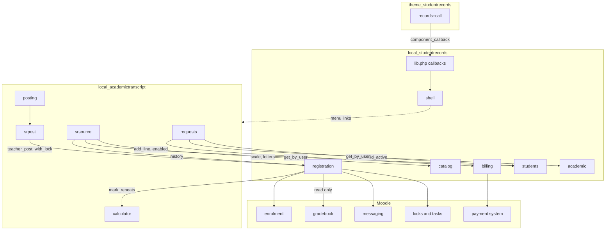

# Integration

This page says how Student Records works with Academic Transcript and the Student Records theme, with and without each of them, and which Moodle APIs it uses. Read it before you change anything another plugin reads.

## Contents

- [The boundaries](#the-boundaries)
- [With and without each plugin](#with-and-without-each-plugin)
- [Where this plugin looks for Academic Transcript](#where-this-plugin-looks-for-academic-transcript)
- [The shared contract](#the-shared-contract)
- [The Student Records theme](#the-student-records-theme)
- [Moodle APIs](#moodle-apis)
- [Hooks and callbacks](#hooks-and-callbacks)
- [What isn't here](#what-isnt-here)
- [Related pages](#related-pages)

## The boundaries

Each plugin stands alone. None of the three names another of them in `version.php`, and each call across a boundary checks first that the other side is there.

The arrows show who calls whom. Student Records calls Academic Transcript in one place, the repeat rule. Academic Transcript does the rest of the calling. The theme calls this plugin and this plugin never calls the theme.

## With and without each plugin

| Feature | Student Records alone | Academic Transcript installed, source `own` | Academic Transcript with source `studentrecords` |
|---|---|---|---|
| Repeat rule | `all`: every attempt counts | Its `repeatrule`, unset means `latest` | The same |
| Rounding a percent to a letter | Off | On unless its `roundpercent` is `0` | The same |
| The transcript's data | No transcript | Its own tables | Student Records, for a student with a file |
| The grading scale | This plugin's | Each plugin has its own | This plugin's, for a student with a file |
| Teachers post final grades | Not available | To Academic Transcript only | To `reg.grade`, through `srpost` |
| Holds stop an Official transcript | No transcript | No | Yes |
| The transcript fee on the account | No | No | Yes, with billing on |
| Menu items for transcripts | None | Yes | Yes |

The repeat rule and rounding apply as soon as the sibling is on disk, whatever its "Source of the transcript" setting says. `catalog::repeat_rule()` and `catalog::round_percent()` test only that the plugin's code is there.

| Feature | Any theme | Student Records theme |
|---|---|---|
| The menu | `shell::inline_menu()` at the top of the page | The left drawer, through `local_studentrecords_theme_drawer()` |
| Cards on the Dashboard and course pages | None | `local_studentrecords_theme_card()` |
| "No LMS access" note in the top bar | None | `local_studentrecords_theme_topbar_note()` |
| The "Student Records" tab in the top menu | `hook_callbacks::primary_extend()` | The same |

The theme works without this plugin too. See [the theme's integration page](../theme/integration.md).

## Where this plugin looks for Academic Transcript

Every use is guarded, so the plugin works without it.

| Place | Check | With it | Without it |
|---|---|---|---|
| `catalog::round_percent()` | `\core_component::get_component_directory()` | Rounds unless `roundpercent` is `0` | No rounding |
| `catalog::repeat_rule()` | The same | `repeatrule`: `highest`, `all`, else `latest` | `all` |
| `registration::mark_repeats()` | `catalog::repeat_rule()` isn't `all`, and `method_exists()` on `srsource::calculator()` | Calls it, or `scale::calculator()` from an older sibling | Returns before it needs the class |
| `shell::groups()`, the student group | The directory, and `local/academictranscript:viewown` | The item `mytranscript` | No item |
| `shell::groups()`, the records group | The directory, `local/academictranscript:issueofficial`, and `requests.php` on disk | The item `transcriptrequests` | No item |
| `shell::is_sr_path()` | A path test | `/local/academictranscript/` pages get the menu | No such pages |
| `cards::transcript_link()` | The directory, the capability, and `requests.php` for staff | A button on the Dashboard strip | Nothing |
| `homes::student()` | The directory, and `local/academictranscript:viewown` | A button | No button |
| `student_sections::academic()` | The directory | A link to the transcript | No link |
| `local/studentrecords/student.php`, the own view | The directory | A link to the transcript | No link |
| `home::STAFFCAPS` | `get_capability_info()` in `home::is_staff_user()` | The two transcript capabilities count as staff | Skipped |

The test `\core_component::get_component_directory('local_academictranscript') !== null` says the code is on disk. Use it before you call the sibling.

## The shared contract

The sibling reads Student Records only when its setting `source` is `studentrecords` and the class exists: `srsource::enabled()`. A student with no file here keeps the transcript from the sibling's own data. Grade arithmetic on the transcript stays in the sibling's `calculator`.

[Academic Transcript's integration page](../academic-transcript/integration.md) has the other side of each of these.

### `srsource`: what the transcript reads

`srsource::collect()` reads `students::get_by_user()`, `registration::history()`, the tables `local_studentrecords_term` and `local_studentrecords_program`, and the strings `status_<status>`. It returns `header`, `terms`, `attempts`, `transfer`, `transferearned`, `transfergpa` and `lastentry`.

`srsource::attempts()` reads these keys of a history row: `status`, `grade`, `code`, `title`, `hours`, `termid`, `timeregistered`, `courseid`, `id`, `passed` and `points`. `srsource::collect()` also reads `timemodified`.

| Row | Grade on the transcript | `earns` |
|---|---|---|
| `completed` with a grade | The grade | True unless `passed` is false |
| `withdrawn` | `W` | False |
| `registered` | `IP` | False |
| `dropped` | Left out | |

### `srpost`: grades posted by teachers

| Method in Academic Transcript | Calls here |
|---|---|
| `srpost::active()` | `method_exists()` on `registration::teacher_post()` |
| `srpost::target()` | `registration::teacher_post_target()`, null for state `norecord` |
| `srpost::problem()` | `get_string('err_teacherpost_' . state, 'local_studentrecords')` |
| `srpost::letter()` | `registration::teacher_letter()` |
| `srpost::with_lock()` | `registration::with_lock()` on `reg<id>` |
| `srpost::post()` | `registration::teacher_post()` with `$lockedregid` |
| `srpost::letters()` | `catalog::grade_menu()` |
| `srpost::change_pending()` | Reads `local_studentrecords_grchg`, through `academic::CHANGES` |
| `srpost::request_change()` | `academic::request_change()` with a null percent |
| `srpost::posted_target()` | Reads `reg.grade`, through `local_academictranscript_posted.srregid` |
| `srpost::has_file()` | `students::get_by_user()` |

[The registration page](flows-registration-and-grades.md#teachers-post-a-grade) follows a posting step by step, with its lock and transaction. `posting::post()` takes the lock first, so it holds through the sibling's commit. `test_the_lock_on_the_registration_outlasts_the_commit` in `local/academictranscript/tests/local/srpost_test.php` holds this.

### `registration::history()`

The row shape of `registration::history()` is the widest part of the contract. `srsource::collect()`, `srsource::attempts()` and `srsource::transfer()` read it, along with `degreeaudit::run()`, `standing::compute()`, `letters::facts()`, `record_view::render()` and `student_sections::academic()`. `calculations.md` has [what each key holds](calculations.md#gpa-quality-points-and-hours). Add keys freely. Don't rename or remove any.

### Earned hours

`registration::totals()` earns a completed attempt unless `passed` is false. `srsource::attempts()` sets `earns` from the same `passed`, and `calculator::compute()` uses it as given. So `registration::result_passes()`, from the minimum passing grade rules, decides both sides. A repeat left out earns on neither side.

Both sides use whole hundredths, the same `passed` and `points` per attempt, and the same rounding, so the record and the transcript agree. `test_a_grade_below_the_program_minimum_earns_nothing` and `test_fractional_hours_agree` in `local/academictranscript/tests/local/srsource_test.php` hold this.

### Transfer GPA

`registration::history()` gives a transfer row `points` only when `ingpa` is set and the grade is on the scale with points in the GPA. `srsource::transfer()` turns such a row into an attempt with `earns` false, and returns it as `transfergpa`. The hours are earned once, through `transferearned`. So the record and the transcript count the same hours in the GPA. `test_transfer_credit_marked_in_gpa_counts_in_the_overall_gpa` and `test_transfer_credit_not_in_gpa_stays_out_of_the_gpa` hold this.

### One grading scale

With Student Records as the source there is one scale to keep, this plugin's. `srsource::calculator()` and `srsource::scale_rows()` read `catalog::scale()`. A row is a letter when `points` isn't null, `ingpa` is set and it isn't a state. Anything else is a mark. A mark with points earns by its points, and a mark without earns by `earns`. `W` and `IP` never earn.

`srsource::teacher_marks()`, `srsource::key_rows()` and `srsource::mark_label()` read the same scale. The sibling's own scale pages show the notice `scale_usesstudentrecords`.

Two readings of a row differ. Here a mark is a row with `points` null, as `catalog::marks()` says. On the transcript a row with points and `ingpa` 0 is a mark too. A letter out of the GPA is covered by `test_a_letter_out_of_the_gpa_is_repeated_like_any_other`.

### The repeat rule call

This is the one place Student Records calls the sibling for a result. `registration::mark_repeats()` calls `srsource::calculator()` and then `calculator::compute()`, whatever the source setting says, and copies `excluded` back to its rows. [The calculations page](calculations.md#repeat-rules) has the rule. `test_student_records_and_the_transcript_agree_on_repeats` holds it.

`scale::calculator()` is the fallback for an older sibling with no `srsource::calculator()`. Keep the `method_exists()` check.

### Transcript request fees

`requests::can_charge()` is true when the source is on, `billing::enabled()` is true and the student has a file. `requests::create()` then calls `billing::add_line()` inside the sibling's own transaction, with a charge that isn't qualified or refundable, has no term, and has `note` `transcript request <id>`. Without that, the fee is only recorded on the request, and the school collects it another way.

### Holds

`requests::holds()` reads `academic::holds()` and `academic::hold_active()`, with the strings `holdtype_<type>`. Every hold in force stops an Official transcript, on every path, whether or not it blocks registration.

### Waiting for grades

`requests::waiting()` reads `local_studentrecords_reg`, `local_studentrecords_offer` and `local_studentrecords_term` directly, and `student.status`, for a request that waits for grades or the degree.

### What must stay stable

| Kept for the sibling | Why |
|---|---|
| The row shape of `registration::history()`, with `passed`, `points`, `timemodified` and `transfers` | The transcript's data |
| The states of `registration::teacher_post_target()` and their strings `err_teacherpost_<state>` | `srpost::problem()` builds the key |
| `registration::teacher_letter()`, `registration::teacher_post()`, `registration::with_lock()` | Posting |
| `catalog::scale()`, `catalog::letters()`, `catalog::grade_menu()` | One scale, and the key on the transcript |
| `billing::add_line()`, `billing::enabled()` | The transcript fee |
| `academic::holds()`, `academic::hold_active()`, `academic::request_change()`, `academic::CHANGES` | Holds and grade changes |
| `students::get_by_user()`, `shell::inline_menu()` | The file, and the menu on the sibling's pages |
| The tables `local_studentrecords_reg`, `local_studentrecords_offer`, `local_studentrecords_term`, `local_studentrecords_program`, and the strings `status_*` and `holdtype_*` | Read directly |

The tests in `local/academictranscript/tests/local/srsource_test.php` and `local/academictranscript/tests/local/srpost_test.php` need both plugins installed. Run them with `bin/check --together`. CI runs that on two combinations.

## The Student Records theme

The plugin never calls the theme. The theme calls the plugin through `component_callback()`, wrapped by `\theme_studentrecords\local\records::call()`, which gives the default for a guest, during an upgrade or install, when the plugin is missing or not installed, and when the callback throws.

| Callback in `local/studentrecords/lib.php` | Called from | Returns |
|---|---|---|
| `local_studentrecords_theme_drawer()` | `theme/studentrecords/layout/drawers.php` | `shell::drawer()`: `heading` and `html`, or null |
| `local_studentrecords_theme_card()` | The same | `cards::for_page()`: HTML or an empty string |
| `local_studentrecords_theme_topbar_note()` | The same | `nolms`, for No LMS staff |

The plugin's one test for the theme is `shell::theme_has_drawer()`: `$PAGE->theme->name` or a parent is `shell::THEME`. With it, `shell::inline_menu()` returns an empty string. Most pages call `shell::inline_menu()`, through `staffarea::header()` or directly, so a page has its menu on any theme. Some don't, so they show no menu on another theme: `local/studentrecords/aidletter.php`, `local/studentrecords/ferpa.php`, `local/studentrecords/pay.php`, a student's own `local/studentrecords/account.php` and `local/studentrecords/degreeaudit.php`, and what a teacher opens in a course: attendance, the course's students and a student's file. `local/studentrecords/staff.php` is itself the list of staff pages. The sibling's pages call it too, when `class_exists()` finds `shell`.

`cards::for_page()` gives a strip on the Dashboard, and a card on course and activity pages. On a page with no card it gives an empty string, and the theme shows nothing.

`local/studentrecords/styles.css` loads on any theme, so a class it defines is safe on any page.

## Moodle APIs

| Area | What is used | Where |
|---|---|---|
| Enrolment | `enrol_get_instances()`, `enrol_get_plugin('manual')`, `enrol_user()`, `update_user_enrol()`, `ENROL_USER_ACTIVE`, `ENROL_USER_SUSPENDED`. The manual method only, with the `student` role | `registration::enrol()`, `registration::suspend()` |
| Enrolment, read | `enrol_get_users_courses()`, `enrol_get_all_users_courses()`, `enrol_get_my_courses()`, `is_enrolled()`, `get_enrolled_users()` | `access::shared_courses()`, `home::shows_courses()`, `local/studentrecords/index.php`, `shell::my_offerings()`, `local/studentrecords/students.php` |
| Gradebook | Read only: `\grade_item::fetch_course_item()`, `\grade_grade::fetch()`. The plugin never writes the gradebook. Academic Transcript locks the course total | `registration::moodle_percent()` |
| Payment | `\core_payment\local\callback\service_provider`, `\core_payment\account`, `\core_payment\helper::gateways_modal_link_params()`, `get_payment_accounts_menu()`, the table `{payments}`, `\core_payment\privacy\provider` | `service_provider`, `payments::account()`, `local/studentrecords/pay.php`, `payments::deliver()`, `payments::recover()`, `provider` |
| Messaging | `\core\message\message`, `message_send()`, `email_to_user()`, `\core_user::get_noreply_user()`. Four providers in `local/studentrecords/db/messages.php` | `messages::send_now()`, and `homes::messages()` reads `{notifications}` |
| Files | The file areas `studentdocs`, `credential`, `importfile` and `logo`, all in the system context. `file_prepare_draft_area()`, `file_save_draft_area_files()`, `get_file_storage()`, `send_stored_file()` | `local/studentrecords/student.php`, `local/studentrecords/facultyrecord.php`, `local/studentrecords/setup.php`, `local/studentrecords/import.php`, `local_studentrecords_pluginfile()` |
| Users | None created. A student record needs an existing user, picked with `core_user/form_user_selector`. Import makes no accounts. A faculty record may have no user. `\core_user::get_user()` reads a user | `local/studentrecords/classes/form/student.php`, `messages::student()` |
| Locks | `\core\lock\lock_config::get_lock_factory()` | `registration::with_lock()` |
| Tasks | `\core\task\scheduled_task`, `\core\task\adhoc_task`, `\core\task\manager::queue_adhoc_task()` | `local/studentrecords/db/tasks.php`, `messages::deliver()` |
| Roles | `create_role()`, `set_role_contextlevels()`, `assign_capability()`, `delete_role()` | `billing::create_finance_role()`, `aid::create_role()`, `local/studentrecords/db/uninstall.php` |
| Downloads | `\core\dataformat::download_data()` | `reports::download()`, which makes every cell safe to open in a spreadsheet |
| PDF | `\pdf` from `lib/pdflib.php` | `billing::statement_pdf()`, `payments::receipt_pdf()`, `letters::pdf()` |
| Other tables read | `{user_lastaccess}`, `{tool_dataprivacy_request}`, `{context}`, `{user}`, `{course}` | `attendance::moodle_last()`, `provider`, `local/studentrecords/classes/form/offer.php` |

### The payment system

The plugin has no gateway code. `service_provider` implements Moodle's callback interface, with the area `payments::AREA`, and an item id that is a `local_studentrecords_payreq` row. [The money page](flows-money.md#online-payments) follows it. Moodle calls `service_provider::get_payable()` before it takes the money, and `service_provider::deliver_order()` once after it. In Moodle's own PayPal gateway a failed delivery is caught and logged, and nothing tries again, which is why `recover_payments` exists.

### What Moodle doesn't get from here

- Groups: not used. There is no `groups_*` call. `groupname` here is a group of courses in a program outline.
- `enrol_fee`: not used. The name appears only in the docblock of `provider`, about an error in core: Moodle's payment privacy code calls `enrol_fee`, which stops with an error on a list with no course context. So a request for this plugin covers its payments too, and the privacy officer gets a notice during a deletion. See [the privacy page](privacy.md).
- The gradebook: read only.
- Events: the plugin observes no Moodle event and raises none. Its record of who did what is `local_studentrecords_log` and `local_studentrecords_history`.

## Hooks and callbacks

### Hooks

`local/studentrecords/db/hooks.php` lists four, with callbacks in `local/studentrecords/classes/hook_callbacks.php`.

| Hook | Callback | What it does |
|---|---|---|
| `\core_user\hook\extend_default_homepage` | `hook_callbacks::extend_default_homepage()` | Adds `home::URL` as a choice of start page |
| `\core\hook\navigation\primary_extend` | `hook_callbacks::primary_extend()` | Adds the top menu tab when `shell::groups()` gives a group. Removes `myhome` and `mycourses` for No LMS staff |
| `\core\hook\navigation\secondary_extend` | `hook_callbacks::secondary_extend()` | Moves the Attendance tab right after Grades |
| `\core\hook\after_config` | `hook_callbacks::after_config()` | Sends No LMS staff home from LMS pages, including pages that don't call `require_login()` |

`test_declared_hooks_exist` and `test_core_classes_exist` in `local/studentrecords/tests/hook_callbacks_test.php` hold that the hooks and the core classes they name exist on the Moodle version under test.

### Callbacks in `lib.php`

| Function | What it does |
|---|---|
| `local_studentrecords_extend_navigation_course()` | Adds Student records and Attendance to a course's navigation, by capability |
| `local_studentrecords_myprofile_navigation()` | Adds a link on a user's profile, when the viewer may see the record |
| `local_studentrecords_after_require_login()` | Sends No LMS staff home from course, Dashboard and My courses pages |
| `local_studentrecords_pluginfile()` | Serves the plugin's files, after `access::can_read_file()` |
| `local_studentrecords_theme_drawer()`, `local_studentrecords_theme_card()`, `local_studentrecords_theme_topbar_note()` | For the theme |

The hooks and callbacks run on every page, so each returns at once when it has nothing to do. `hook_callbacks::primary_extend()` treats a `dml_exception` as no groups, and `home::is_nolms()` treats one as false, so the menu and the redirect don't break a page during an upgrade.

## What isn't here

The plugin has no web services, no event classes, no cache definitions, no output classes and no JavaScript modules of its own. `local/studentrecords/attendance.php` adds a short inline script that counts the marks. The only AJAX is Moodle's own: `core_payment/gateways_modal` in `local/studentrecords/pay.php`, and the user picker `core_user/form_user_selector` in the forms `student` and `faculty`.

## Related pages

- [Academic Transcript integration](../academic-transcript/integration.md)
- [Theme integration](../theme/integration.md)
- [Calculations](calculations.md)
- [Registration and grades flows](flows-registration-and-grades.md)
- [Money flows](flows-money.md)
- [Privacy](privacy.md)
- [Extending](extending.md)
