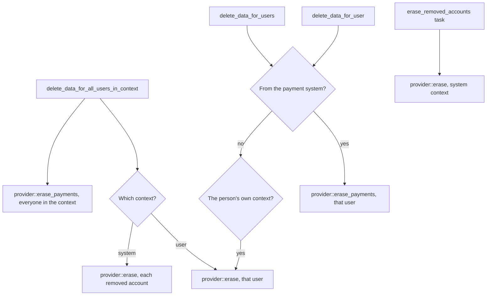

# Student Records privacy

What the privacy provider of `local_studentrecords` declares, exports, deletes and keeps, and how the task `erase_removed_accounts` finishes requests for removed accounts. This page describes the code and gives no legal or FERPA advice: what a school must keep, and for how long, is for the school to decide.

## Contents

- [Where to look](#where-to-look)
- [What the provider declares](#what-the-provider-declares)
- [Who has data here](#who-has-data-here)
- [What an export holds](#what-an-export-holds)
- [What a deletion removes](#what-a-deletion-removes)
- [What stays](#what-stays)
- [Routes into a deletion](#routes-into-a-deletion)
- [Calls from the payment system](#calls-from-the-payment-system)
- [`erase_removed_accounts`](#erase_removed_accounts)
- [Changing this safely](#changing-this-safely)
- [Related pages](#related-pages)

## Where to look

`local/studentrecords/classes/privacy/provider.php`, class `provider`, implements `\core_privacy\local\metadata\provider`, `\core_privacy\local\request\plugin\provider`, `\core_privacy\local\request\core_userlist_provider` and `\core_payment\privacy\consumer_provider`. Its class docblock states the policy, and this page follows the code that carries it out.

The data subject is the student. What the plugin keeps about a student hangs from the student record, and all of it is reported in the student's user context, although the documents sit at system level. A faculty or staff record with a linked account is reported the same way for that person.

Every deletion of a person ends in `provider::erase()`. That calls `students::erase_personal()` and `faculty::erase_personal()`, which hold the lists of what goes.

## What the provider declares

`provider::get_metadata()` declares all 52 tables.

- 35 tables with field lists: every table about a person, and the logs.
- 17 tables in `provider::SETTINGS_TABLES`, with only `usermodified` and `timemodified`: `level`, `grade`, `minpass`, `policy`, `term`, `course`, `prereq`, `program`, `progcrs`, `reqdoc`, `offer`, `saprule`, `fee`, `plan`, `refrule`, `meeting`, `export`. These are the school's settings, catalog and sections. They are nobody's data, so nothing is exported or deleted for the staff member named.
- Subsystem links: `core_files`, `core_message`, `core_payment`.

`test_metadata_declares_every_user_column` fails when a column holding a user id isn't declared, and `test_metadata_declares_every_table_about_a_person` fails when a table with `studentid` or `userid` isn't, or when any column of the student table isn't. `test_metadata_links_files_and_payments` holds the links.

## Who has data here

`provider::PEOPLE` lists the table and field pairs that make a person someone with data:

| Table | Fields |
|---|---|
| `local_studentrecords_student` | `userid` |
| `local_studentrecords_faculty` | `userid` |
| `local_studentrecords_stathis` | `userid` |
| `local_studentrecords_admdec` | `decidedby` |
| `local_studentrecords_hold` | `placedby`, `releasedby` |
| `local_studentrecords_grchg` | `requestedby`, `decidedby` |
| `local_studentrecords_history` | `userid`, `relateduserid` |
| `local_studentrecords_log` | `userid`, `relateduserid` |
| `local_studentrecords_import` | `userid` |
| `local_studentrecords_draft` | `decidedby` |
| `local_studentrecords_txn` | `userid` |
| `local_studentrecords_msglog` | `userid` |

`provider::has_data()` tests these. They aren't every staff column: `letter.issuedby`, `ferpa.recordedby` and `refund.decidedby` aren't there. It works because those actions also write `local_studentrecords_log`, which is. The staff part of an export doesn't list those rows, only their audit entries.

`provider::context_of()` gives the person's user context, or the system context once Moodle has removed it with the account. `provider::get_contexts_for_userid()` returns that one context when the person has data.

`provider::get_users_in_context()` answers by the kind of call:

| Call | Answer |
|---|---|
| From the payment system (`provider::PAYMENTSYSTEM`) | The payers from `provider::payments_in()` |
| System context | `provider::removed_accounts()`: people in `provider::PEOPLE` whose `{user}` row is deleted and who have no user context |
| User context | That user, when they have data |

## What an export holds

`provider::export_user_data()` first exports payments for every context, through `export_payment_data_for_user_in_context()` of Moodle's payment provider. A call from the payment system stops there. Then, for each approved context that is the person's own:

| Part | What it holds |
|---|---|
| Student record | The row, without `id` and `usermodified` |
| Documents | Each file of `studentdocs` |
| Payment plans | Each plan with its payments |
| Grade changes | Rows joined through `local_studentrecords_reg` |
| The rest of the file | Each of `reg`, `xfer`, `stand`, `gradapp`, `letter`, `txn`, `payreq`, `refund`, `attend`, `aid`, `wait`, `cart`, `subst`, `aidyear`, `ferpa`, `relauth`, `hold`, `stathis`, `appdoc`, `admdec`, `educ`, `emerg`, `demog`, without `usermodified` and `studentid` |
| Faculty record | Each record with credentials, qualifications and credential files |
| Message log | Rows where `userid` is the person or `studentid` is their record |
| Change history | `about_you` as full rows, `made_by_you` as table, record id, field and time only |
| Staff actions | Ids of holds placed and released, grade changes requested and decided, account lines added and import items decided, and the names of files imported |
| Admissions actions | Decisions recorded and status changes, as id, value and time |
| Audit log | Action, record, `by_you`, `about_you`, time, and `ip` only for the person's own entries. No `info`. |

So a staff member's export lists what they did as record ids and dates, without the student's data. After the export, `audit::log()` writes `privacyexport`.

`test_export_for_a_student`, `test_export_for_a_staff_member`, `test_export_is_logged`, `test_export_shows_only_the_users_own_ip_address` and `test_export_holds_the_payments` protect this.

## What a deletion removes

`provider::erase()` runs in one transaction, so a failed request can run again:

1. `students::erase_personal()`, in a transaction of its own inside that one.
2. `faculty::erase_personal()`.
3. Deletes the rows of `local_studentrecords_msglog` with this `userid`.
4. Sets `ip` to NULL on `local_studentrecords_log` where the person is `userid`.
5. Sets `info` to NULL on `local_studentrecords_log` where the person is `relateduserid`, because details can name someone a record was released to.
6. `provider::erase_payments()` for this user in this context.

| Where | What happens | From |
|---|---|---|
| `local_studentrecords_student` | NULL in `students::PERSONAL`: `preferredname`, `email`, `phone`, `usaddress`, `homeaddress`, `homecountry`, `visatype`, `sevisid`, `notes`, `highschool`, `hsyear`, `residency`, `citizenship`, `firstgen` | `students::erase_personal()` |
| `local_studentrecords_emerg` | Every value NULL, `active` 0. The empty row stays. | `students::PERSONALPARTS` |
| `local_studentrecords_demog` | Every value NULL. The row stays. | `students::PERSONALPARTS` |
| `local_studentrecords_appdoc` | `note` NULL | `students::PERSONALPARTS` |
| `local_studentrecords_educ` | `notes` NULL | `students::PERSONALPARTS` |
| `local_studentrecords_cart`, `local_studentrecords_wait` | Rows of the student deleted | `students::erase_personal()` |
| `local_studentrecords_msglog` | Rows of the student and rows sent to the person deleted | `students::erase_personal()`, `provider::erase()` |
| File area `studentdocs` | Deleted | `students::erase_personal()` |
| `local_studentrecords_faculty` | NULL in `faculty::PERSONAL`: `email`, `phone`, `officehours`, `notes` | `faculty::erase_personal()` |
| `local_studentrecords_history` | `oldvalue` and `newvalue` NULL for the fields above, and one row with field `*` and source `privacy` for the student record and for each faculty record | `students::erase_personal()`, `faculty::erase_personal()` |
| `local_studentrecords_log` | One `privacyerase` row for each record, then `ip` and `info` as above | Both, and `provider::erase()` |
| Moodle's `{payments}` | The person's payments of this plugin, with what the payment provider keeps about them | `provider::erase_payments()` |

Deleting a student's message log rows also stops their queued messages: `messages::send_queued()` finds no row and ends.

`test_delete_blanks_optional_data`, `test_delete_removes_what_is_not_kept`, `test_delete_blanks_the_audit_details`, `test_delete_removes_the_payments`, `test_delete_touches_only_that_student` and `test_erase_without_a_record` protect this. `test_personal_list_covers_the_reporting_fields` holds the list of reporting fields.

## What stays

The class docblock gives the reason for each group. `provider::erase()` doesn't touch:

- The academic record: legal name, student ID, date of birth, program, terms, status and award, status history, admission decisions, prior education, registrations and grades, grade changes, transfer credit, substitutions, standing, attendance, holds and graduation applications.
- FERPA records: notice acknowledgments, release authorizations, and letters with what they said and to whom.
- The student account: account lines, online payment requests, refunds and plans.
- Aid awards and aid year details.
- Staff names, job details, credentials and qualifications.
- The change history and audit log, without the values, details and IP addresses named above. A deletion request for a staff member leaves the rows of what they did alone, because a school must be able to say who changed an official record.

Two more things follow from that:

- Free text in a row that stays isn't blanked, such as `txn.note`, `hold.reason`, `aid.note`, `aidyear.note` and `admdec.reason`.
- `txn.paymentid` and `payreq.paymentid` stay, pointing at `{payments}` rows that are gone. `payments::recover()` reads from `{payments}`, so this doesn't confuse it.

A faculty record with no account, and what a draft item holds, name no user, so no request reaches them.

`test_delete_keeps_the_permanent_record` and `test_delete_for_a_staff_member_keeps_their_actions` protect this.

## Routes into a deletion

| Method | What it does |
|---|---|
| `provider::delete_data_for_all_users_in_context()` | A user context erases that user. A system context erases each of `provider::removed_accounts()` and nobody else. Then `provider::erase_payments()` for everyone in the context, because a context deletion doesn't say who asks, so it runs once for each component. |
| `provider::delete_data_for_user()` | From the payment system, only that user's payments. Otherwise `provider::erase()`, only when the context is the person's own. |
| `provider::delete_data_for_users()` | The same, for a list of users. |

The check on the context matters. A person with an account is never erased through the system context: `test_a_person_with_an_account_is_not_erased_through_the_system_context` and `test_clearing_the_system_context_erases_only_removed_accounts` protect that, and `test_delete_ignores_other_contexts` and `test_delete_by_context_and_by_list` cover the rest.

## Calls from the payment system

Moodle's payment system asks this provider about the plugin's payments through the same methods as a request for the plugin, with `core_payment` as the component (`provider::PAYMENTSYSTEM`). A call from the payment system touches the payments and nothing else, so that a request isn't carried out twice.

A call for the plugin covers the payments too, because the payment system often never gets here. Its call to the plugin `enrol_fee` stops with an error on a list that has no course context, as the class docblock says. So the privacy officer gets a notice during a deletion, and the request still ends as deleted. The error is in Moodle's code, and the maintainers left it.

`provider::get_contextid_for_payment()` gives the user context of the person who started the request. With the request or the context gone it returns null, and the payment system then uses the system context. `provider::payments_in()` gives the same answer as SQL for many payments at once, so keep the two in step.

`test_payment_is_reported_in_the_students_context`, `test_payment_system_lists_who_paid`, `test_payment_system_call_touches_only_the_payments`, `test_payment_without_a_request_is_in_the_system_context` and `test_request_through_the_privacy_manager` protect this.

## `erase_removed_accounts`

Some time after an account is deleted, Moodle removes its user context. The person's data here stays, so it is then reported in the system context. On a site with data registry defaults, Moodle never approves the system context for a deletion: the request ends as deleted and this plugin isn't called. So the task `erase_removed_accounts`, once an hour, reads the finished requests and carries those out too. `provider::erase_removed_accounts()`:

1. Returns 0 without `\tool_dataprivacy\api`.
2. Reads `{tool_dataprivacy_request}` rows of type `DATAREQUEST_TYPE_DELETE` with status `DATAREQUEST_STATUS_COMPLETE` or `DATAREQUEST_STATUS_DELETED`, whose user is deleted and has no user context, with no audit row of action `privacyerase`, object type `datarequest`, object id the request's id and related user that user.
3. For each request, skips a person with no data, with no mark.
4. Calls `provider::erase()` once per person, with the system context.
5. Writes the audit mark for each request.
6. Returns the number of people erased.

A privacy officer approved each of these requests and Moodle finished it. Data registry defaults make no difference here. The mark keeps a request from being carried out twice, and if something pruned the audit log the requests would run again, which does no harm because `provider::erase()` can run twice.

`test_a_finished_request_for_a_removed_account_is_carried_out`, `test_only_a_finished_deletion_request_erases`, `test_the_task_waits_for_the_user_context_to_go`, `test_the_task_erases_the_person_of_the_request_once`, `test_the_task_needs_data_here_and_erases_a_person_once`, `test_a_live_account_is_never_a_removed_account`, `test_a_removed_account_is_reported_in_the_system_context`, `test_delete_for_a_removed_account_touches_nobody_else` and `test_export_for_a_removed_account` protect this.

[Tasks and messages](tasks-and-messages.md#erase_removed_accounts) has the schedule.

## Changing this safely

- A new column on the student table must be declared in `provider::get_metadata()`, or `test_metadata_declares_every_table_about_a_person` fails. Decide if a deletion should blank it. Optional personal data goes in `students::PERSONAL`, and in another table in `students::PERSONALPARTS`.
- A new column that holds a user id must be declared too. If it should make a person someone with data, add it to `provider::PEOPLE`.
- A new table about a person needs a line in `provider::get_metadata()`, and usually an entry in `$parts` in `provider::export_user_data()`.
- A metadata line needs a string such as `privacy:metadata:student:contact`, in A-Z order.
- Keep `provider::erase()` able to run twice, and keep it in one transaction.
- Blank a value in `local_studentrecords_history` as well as in its own row. `students::blank_history()` does this.
- Moving something from "stays" to "goes" is a policy change, and it can touch a school's duty to keep records. Open an issue first.

## Related pages

- [Data model](data-model.md)
- [Tasks and messages](tasks-and-messages.md)
- [Flows: money](flows-money.md)
- [Access](access.md)
- [Privacy and uninstall, for users](../../user/student-records/privacy-and-uninstall.md)
