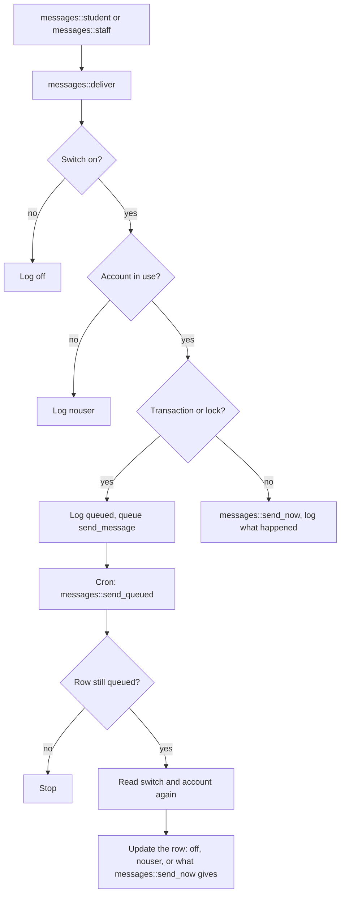

# Student Records tasks and messages

Every scheduled and ad-hoc task of `local_studentrecords`, the four message providers, the 22 automatic messages, and how a message goes from `messages::student()` to a person. Read [Why nothing sends in a transaction or a lock](#why-nothing-sends-in-a-transaction-or-a-lock) before you send anything from new code.

## Contents

- [Tasks at a glance](#tasks-at-a-glance)
- [Scheduled tasks](#scheduled-tasks)
- [The ad-hoc task](#the-ad-hoc-task)
- [Message providers](#message-providers)
- [The 22 messages](#the-22-messages)
- [How a message goes](#how-a-message-goes)
- [Log statuses](#log-statuses)
- [The switch and the text](#the-switch-and-the-text)
- [Test mode](#test-mode)
- [Why nothing sends in a transaction or a lock](#why-nothing-sends-in-a-transaction-or-a-lock)
- [Commit after the try block](#commit-after-the-try-block)
- [Adding a message](#adding-a-message)
- [Adding a task](#adding-a-task)
- [Related pages](#related-pages)

## Tasks at a glance

`local/studentrecords/db/tasks.php` declares the scheduled tasks, all with `blocking` 0. Each class in `local/studentrecords/classes/task/` is a thin shell: `execute()` calls one method, and a scheduled task prints a line with `mtrace()`. The work is in that method, so a test can call it directly.

| Task | Schedule | Runs | Name string |
|---|---|---|---|
| `billing_daily` | 06:15 every day | `plans::daily()` | `task_billingdaily` |
| `waitlist_daily` | 06:30 every day | `waitlist::daily()` | `task_waitlistdaily` |
| `recover_payments` | Every 5 minutes | `payments::recover()` | `task_recoverpayments` |
| `erase_removed_accounts` | Once an hour, at a random minute | `provider::erase_removed_accounts()` | `task_eraseremovedaccounts` |
| `send_message` | Ad-hoc, next cron run | `messages::send_queued()` | None |

A task runs as Moodle's cron user, the site admin, so `$USER` isn't the person who caused the work. `academic::place_hold()` stores that user as `hold.placedby` when `plans::daily()` calls it.

Each task treats an error in its own way:

| Task | On an error |
|---|---|
| `billing_daily` | The run stops where it is. Each step was saved with its mark, so the next run carries on. |
| `waitlist_daily` | A section that fails doesn't stop the others. The first error is thrown at the end, so Moodle runs the task again. |
| `recover_payments` | `err_busy` ends the run, and the next run tries again. Any other error goes to `mtrace()` and the run goes on. |
| `erase_removed_accounts` | The error ends the run. A person's erasure is one transaction, and the request has no mark yet, so the next run does it again. |
| `send_message` | A send that fails writes `failed` in the log row, and the task ends well, so it isn't retried. |

## Scheduled tasks

### `billing_daily`

Sends reminders before plan due dates, and handles late plan payments. `plans::daily()` does this, in order:

1. Returns zero counts when `billing::enabled()` is false.
2. Runs `plans::sync()` for the student of every active plan, so `inst.status` is right for today.
3. Finds the first active price list item with basis `late`. It only gives the late fee line a `feeid`.
4. For each active plan, skips it when the balance is 0.004 or less. A refund or reversal that cleared the account didn't pay the plan, but nothing is owed, so nothing is late.
5. For each payment of the plan, in `seq` order:
   - Reminder: when `reminderdays` is above 0, the status is `due`, `reminded` is empty, `seq` is above 0, and the due date is from today up to `reminderdays` days away. One transaction sets `reminded` and sends `paymentdue`.
   - Late fee: when the status is `late`, `latefeeid` is empty and `stuplan.latefee` is above 0. One transaction adds the charge and sets `latefeeid`.
   - Hold: when the status is `late`, `holdid` is empty and no hold of this plan is in force. One transaction places a `financial` hold with `academic::place_hold()`, sets `holdid`, and sends `paymentlate` and `stafflate`. `academic::place_hold()` also sends `holdplaced`.

| | |
|---|---|
| Reads | `local_studentrecords_stuplan`, `local_studentrecords_inst`, `local_studentrecords_fee`, `local_studentrecords_hold`, `local_studentrecords_txn`, settings `billing` and `reminderdays` |
| Writes | `local_studentrecords_inst`, `local_studentrecords_stuplan`, `local_studentrecords_txn`, `local_studentrecords_hold`, `local_studentrecords_history`, `local_studentrecords_log`, `local_studentrecords_msglog`, ad-hoc tasks |
| What stops it | Billing off. A clear balance skips a plan. `reminderdays` 0 means no reminders. |
| Safe to run twice | Each step and its mark are saved together: `reminded`, `latefeeid`, `holdid`. A task that stops halfway does no step twice. |
| Lock | None: it uses `billing::transaction()`, not `billing::one_at_a_time()`. |
| Tests | `test_daily_twice_does_each_thing_once`, `test_daily_leaves_a_cleared_account_alone`, `test_released_hold_stays_released`, `test_task` in `local/studentrecords/tests/local/plans_test.php` |

A hold that staff released stays released for that payment, because `holdid` is still set. No code releases a financial hold when the money arrives: staff do that on `local/studentrecords/studentpart.php`.

### `waitlist_daily`

Ends seat offers not taken in time, then offers free seats. `waitlist::daily()` does this, in order:

1. Each section entry with status `offered` that `waitlist::offer_held()` no longer holds becomes `left`, with the text of `wait_lapsed` in `note`, through `records::save()` with source `task`.
2. Each section with someone `waiting` gets `waitlist::seat_opened()`, in a `try` of its own. This covers every such section, not only those where an offer lapsed, so a run that stopped after ending an offer loses nothing.
3. If a section failed, the first `moodle_exception` is thrown after all were tried.

| | |
|---|---|
| Reads | `local_studentrecords_wait`, `local_studentrecords_offer`, `local_studentrecords_reg`, `local_studentrecords_term`, and what `selfreg::problems()` reads |
| Writes | `local_studentrecords_wait`, `local_studentrecords_history`, `local_studentrecords_msglog`, ad-hoc tasks |
| What stops it | `waitlist::offer_seats()` offers nothing with self-registration off, a section not open, a term not active, or the add period over, and passes over a student who couldn't take the seat. Lapsing depends on none of these. |
| Safe to run twice | A seat held for a student isn't free, so a second run offers nothing more. |
| Lock | `offer<id>`, one section at a time, through `waitlist::seat_opened()`. |
| Tests | `local/studentrecords/tests/task/waitlist_daily_test.php`: `test_running_twice_offers_the_seat_once`, `test_the_next_run_offers_a_seat_a_stopped_run_left_free`, `test_one_failed_section_does_not_stop_the_others` and five more |

A held seat stops counting at the exact second `waitlist::offer_held()` says, which can be before the next run marks the entry `left`. Seat offers go to `kind` `section` only: program waitlists get none.

### `recover_payments`

Records online payments that reached Moodle's `{payments}` table and never reached the account. Moodle's payment system delivers a payment once and doesn't try again, so this runs every few minutes. `payments::recover()` does this:

1. With no `recoverfrom`, sets it to now and records nothing.
2. Finds rows of `{payments}` with component `local_studentrecords`, area `account`, created from `recoverfrom` on, and no account line that isn't a reversal.
3. For each, tests `payments::payment_fits()`, the same check as a delivery. A payment that doesn't fit gets one audit line and stays off the account.
4. Otherwise calls `payments::record_online()` and writes an audit line.

| | |
|---|---|
| Reads | `{payments}`, `local_studentrecords_payreq`, `local_studentrecords_txn`, `local_studentrecords_log`, the setting `recoverfrom` |
| Writes | `local_studentrecords_txn`, `local_studentrecords_payreq`, `local_studentrecords_log`, and what `payments::settle()` writes |
| What stops it | Nothing about billing: a payment taken while billing was on still counts after it is turned off. Only payments from `recoverfrom` on count, so a site's history is never touched. |
| Safe to run twice | `payments::record_online()` checks for a line and adds it as one step under the lock `accounts`, so a late delivery and the recovery can't both add it. Nothing to do costs one query. |
| Lock | `accounts`, through `billing::one_at_a_time()`. |
| Tests | `test_recover_records_a_delivery_that_found_the_accounts_busy`, `test_recover_leaves_payments_from_before_it_started`, `test_recover_and_a_late_delivery_record_a_payment_once`, `test_recover_leaves_a_reversed_payment_alone`, `test_recover_keeps_the_checks_of_a_delivery`, `test_recover_goes_on_after_a_payment_that_fails` in `local/studentrecords/tests/local/payments_test.php`, and `local/studentrecords/tests/task/recover_payments_test.php` |

[Flows: money](flows-money.md) has the delivery itself.

### `erase_removed_accounts`

Carries out finished deletion requests of accounts Moodle has removed, which Moodle's own task can't reach on a site with data registry defaults. [Privacy](privacy.md#erase_removed_accounts) has the steps.

| | |
|---|---|
| Reads | `{tool_dataprivacy_request}`, `{user}`, `{context}`, `local_studentrecords_log` |
| Writes | What `provider::erase()` writes, and one `local_studentrecords_log` mark per request |
| What stops it | Returns 0 without `\tool_dataprivacy\api`. A request with a mark is skipped. A person with no data here is skipped, with no mark. |
| Safe to run twice | The mark. Anything that prunes the audit log would run those requests again, and that does no harm, because `provider::erase()` can run twice. |
| Lock | None. Each person is one transaction. |
| Tests | `test_a_finished_request_for_a_removed_account_is_carried_out`, `test_the_task_erases_the_person_of_the_request_once`, `test_the_task_is_scheduled` in `local/studentrecords/tests/privacy/provider_test.php` |

## The ad-hoc task

### `send_message`

Sends one message that couldn't go at once. `messages::deliver()` is the only place that queues it, with custom data `logid`, `provider`, `url` and `body`. `execute()` passes that to `messages::send_queued()`.

| | |
|---|---|
| Reads | `local_studentrecords_msglog`, `{user}`, the message's switch, the test settings |
| Writes | `local_studentrecords_msglog`.`status`, on the same row |
| What stops it | A log row that is gone, because a privacy request removed it, or that isn't `queued`. The switch being off gives `off`, and a person who can't be reached gives `nouser`. |
| Safe to run twice | Only a row with status `queued` is sent, and the status changes straight after the send. A process killed between the two could send it again. |
| Tests | `test_a_queued_message_goes_once`, `test_a_rollback_drops_the_waiting_message`, `test_a_failed_message_does_not_lose_the_others`, `test_a_queued_message_checks_again_when_it_goes` |

Each message is its own task, so one failure doesn't stop the others. A failure is written to the log row and the task ends, so a person isn't told twice.

The task row is saved in the open transaction, so work that is rolled back sends nothing and leaves no log row. Under a lock with no transaction, the row is saved at once.

## Message providers

`local/studentrecords/db/messages.php` declares four. Each has `popup` and `email` at `MESSAGE_PERMITTED + MESSAGE_DEFAULT_ENABLED`, and each person can change that in their notification preferences.

| Provider | Language key | Capability | Messages |
|---|---|---|---|
| `billing` | `messageprovider:billing` | None | `paymentreceived`, `paymentdue`, `paymentlate`, `refundapproved`, `refundpaid`, `planagreement`, `aidletter` |
| `registration` | `messageprovider:registration` | None | `regadded`, `regdropped`, `regwithdrawn`, `accessopen`, `waitseat` |
| `records` | `messageprovider:records` | None | `holdplaced`, `holdreleased`, `gradeposted`, `admdecision`, `gradreviewed`, `conferred`, `welcome`, `lowattendance` |
| `staffalerts` | `messageprovider:staffalerts` | `local/studentrecords:viewbilling` | `staffrefund`, `stafflate` |

`messages::STUDENT` maps each student message to its provider. `messages::STAFF` maps each staff message to the capability of the people who get it. The two don't line up for `staffalerts`: its capability is `local/studentrecords:viewbilling`, while `messages::staff()` picks recipients by `local/studentrecords:approverefund` or `local/studentrecords:managebilling`. The Finance role holds all three. Moodle checks the provider's capability for the preferences page, and again in `message_send()`, which refuses the message to a person without it. `get_users_by_capability()` goes by role, so a site admin with no role gets no staff message, and with nobody else the log says `nouser`.

> Known problem in 1.4.6: `messages::staff()` picks a person who holds the recipient capability without `local/studentrecords:viewbilling`, and Moodle's `message_send()` then refuses the message. That person gets nothing, and the log says `failed`.

## The 22 messages

"Goes" says what happens from the usual caller: queued for cron, or at once.

| Key | To | Sent from | Goes | Link |
|---|---|---|---|---|
| `regadded` | Student | `registration::add_seat()` | Queued: `offer<id>` and a transaction | `student.php` |
| `regdropped` | Student | `registration::end_seat()` | Queued: `offer<id>`, `reg<id>` and a transaction | `student.php` |
| `regwithdrawn` | Student | `registration::end_seat()` | Queued, the same | `student.php` |
| `accessopen` | Student | `payments::grant()` | Queued: `reg<id>` and a transaction | `student.php` |
| `paymentreceived` | Student | `payments::add_payment()` | Queued: `accounts` | `account.php` |
| `paymentdue` | Student | `plans::daily()` | Queued: a transaction | `account.php` |
| `paymentlate` | Student | `plans::daily()` | Queued: a transaction | `account.php` |
| `holdplaced` | Student | `academic::place_hold()` | At once from `studentpart.php`, queued from `plans::daily()` | `student.php` |
| `holdreleased` | Student | `academic::release_hold()` | At once | `student.php` |
| `refundapproved` | Student | `refunds::decide()`, not for `aidreturn` | Queued: `accounts` | `account.php` |
| `refundpaid` | Student | `refunds::payout()` | Queued: `accounts` | `account.php` |
| `gradeposted` | Student | `registration::write_grade()`, only when the save changed something | Queued: `reg<id>` | `student.php` |
| `admdecision` | Student | `admissions::record_decision()` | Queued: a transaction | `student.php` |
| `welcome` | Student | `admissions::record_decision()`, for `admitted` only | Queued: a transaction | `student.php` |
| `gradreviewed` | Student | `graduation::review()` | At once | `student.php` |
| `conferred` | Student | `graduation::confer()` | Queued: a transaction | `student.php` |
| `waitseat` | Student | `waitlist::offer_seats()` | Queued: `offer<id>` | `myregistration.php` |
| `lowattendance` | Student | `attendance::save_marks()`, when `attendance::fell_under()` says the rate went under the minimum | Queued: a transaction | `student.php` |
| `planagreement` | Student | `plans::send_agreement()`, from `account.php` after `plans::create()` | At once | `account.php` |
| `aidletter` | Student | `aidhelp::send_letter()` | At once | `account.php` |
| `staffrefund` | Holders of `local/studentrecords:approverefund` and `local/studentrecords:viewbilling` | `refunds::propose()`, `aidhelp::send_return_locked()` | Queued | `refunds.php` |
| `stafflate` | Holders of `local/studentrecords:managebilling` and `local/studentrecords:viewbilling` | `plans::daily()` | Queued: a transaction | `account.php` |

`attendance::fell_under()` counts a student with no rate yet as going under, so a student whose first mark in a class is Absent gets `lowattendance` at once. That is by design: `test_fell_under` holds it.

Most messages are queued, because most are written under a lock or in a transaction. A site with no cron sends almost nothing, and the message log shows "Waiting to send".

The default text is in the strings `msgdef_<key>_subject` and `msgdef_<key>_body`. `msgname_<key>` and `msgwhen_<key>` label it on `local/studentrecords/messages.php`.

## How a message goes



`messages::student()` picks the link: `account.php` for the provider `billing`, `student.php` for the others, `myregistration.php` for `waitseat`. It loads the user with `\core_user::get_user()` and calls `messages::deliver()`. `messages::staff()` calls `get_users_by_capability()` at system level and `messages::deliver()` for each user. With nobody to send to, it writes one row with status `nouser`.

`messages::deliver()`, in order:

1. Fills the values: `school`, `firstname`, `link`, `course`, `term`, `due_date`, `pay_link`, `office_phone`. Values the caller gave win. `due_date` is the next plan payment, from `plans::next_due()`.
2. Builds the subject with `messages::text()` and `messages::fill()`, cut to 255 characters.
3. With the switch off, logs `off`.
4. When `messages::reachable()` says no, because there is no user or the account is deleted or suspended, logs `nouser`.
5. Builds the body.
6. With a transaction open or a lock held, logs `queued` and queues `send_message`.
7. Otherwise calls `messages::send_now()` and logs what it returns.

It returns true only for `sent` and `testinbox`. So false doesn't mean failed: a queued message returns false too. Use `messages::last_status()` to find out, as `aidhelp::send_letter()` does. That method reports only `sent` as sent.

`messages::send_now()` holds everything in one `try`, which turns any `\Throwable` into `failed` with a `debugging()` line:

1. Test mode with a valid test inbox: `messages::email_inbox()` sends to that address only, giving `testinbox` or `failed`.
2. Test mode with no inbox, for an address not ending in `messages::TESTDOMAIN`: gives `testmode`, and nothing is sent.
3. Otherwise a `\core\message\message` goes through `message_send()`, giving `sent` or `failed`. It has `notification` 1, `contexturl` set to the link, a plain text body, and `userfrom` set to a copy of the no-reply user with the school's name. It is a copy because Moodle can keep one no-reply user for the whole request (`test_noreply_user_is_not_changed`).

The body of a queued message is fixed when it is queued and travels in the task's custom data. The subject is in the log row. The switch, test mode and the account are read again when it goes (`test_a_queued_message_checks_again_when_it_goes`, `test_test_mode_counts_when_the_message_goes`).

## Log statuses

`msglog.status` is char 10. Each status has a string `msgstatus_<status>`, and `test_every_status_has_a_name` holds that.

| Status | Meaning | Set by |
|---|---|---|
| `queued` | Waiting for cron | `messages::deliver()` |
| `sent` | `message_send()` said yes | `messages::deliver()`, `messages::send_queued()` |
| `failed` | Not sent, or an exception | `messages::deliver()`, `messages::send_queued()`, `messages::send_test()` |
| `off` | The message's switch is off | `messages::deliver()`, `messages::send_queued()` |
| `nouser` | No Moodle account in use, or no staff with the capability | `messages::deliver()`, `messages::staff()`, `messages::send_queued()` |
| `testmode` | Test mode kept it from a real person | `messages::deliver()`, `messages::send_queued()` |
| `testinbox` | Went to the test inbox | `messages::deliver()`, `messages::send_queued()` |
| `test` | "Send me a test" from `local/studentrecords/messages.php` | `messages::send_test()` |

`messages::recent()` feeds the tab `log` of `local/studentrecords/messages.php`, 300 rows at most. Nothing prunes the table. A privacy deletion removes a person's rows, and a queued message whose row is gone isn't sent.

## The switch and the text

Each message has three settings, described in [Settings](settings.md#message-settings). `messages::is_on()` is true for anything but `0`, so a new message is on with no setting. `messages::text()` gives the school's own text, or the default string when that is empty.

`messages::PLACEHOLDERS` lists the eight placeholders: `{school}`, `{firstname}`, `{course}`, `{term}`, `{link}`, `{due_date}`, `{pay_link}`, `{office_phone}`. `messages::fill()` replaces only those, and anything else, such as `{amount}`, stays as typed. `{firstname}` is the recipient's, so on a staff message it is the staff member's. `{term}` holds the award year on `aidletter`. `{course}` is the course code.

A message says only that there is something new and asks the person to log in. There is no placeholder for a grade or an amount, on purpose: `test_messages_hold_no_amounts_or_grades` runs a plan, a payment, a late fee and a payout, and checks that no dollar sign or figure with cents reaches a message or the custom data of its task. Keep it that way in new default text.

## Test mode

`msgtestmode` holds real people's messages back, for a school setting up or trying the plugin.

| `msgtestmode` | `msgtestinbox` | Address | What happens | Status |
|---|---|---|---|---|
| Off | Any | Any | Sent | `sent` |
| On | Set | Any | Goes to the test inbox only, with a test tag in the subject | `testinbox` |
| On | Empty | Ends in `@example.com` | Sent | `sent` |
| On | Empty | Any other | Nothing sent | `testmode` |

`messages::allowed()` is the rule for the last two rows. `messages::test_inbox()` ignores a value that isn't a valid address. `test_test_mode_with_a_test_inbox` and `test_test_mode_without_a_test_inbox` protect this.

"Send me a test" on `local/studentrecords/messages.php` runs `messages::send_test()`. It ignores the switch and the queue, uses sample values, and sends to the staff member, or to the test inbox in test mode. It logs `test` or `failed` with no student. It runs only from that page, with no lock and no transaction.

## Why nothing sends in a transaction or a lock

Two rules, both for the same reason: a mail server that hangs must not hold anything up.

- A transaction must not wait on mail, because a hung send would hold the commit.
- A lock must not wait on mail, because everyone who needs that lock would wait too. Under `accounts`, that is every student account on the site.

`registration::holds_lock()` is the switch for "nothing slow now". It is true while this request holds any lock taken by `registration::with_lock()`. `messages::deliver()` tests it together with `$DB->is_transaction_started()`.

The only code that sends is `messages::send_now()`, `messages::email_inbox()` and `messages::send_test()`, and `messages::deliver()` is the gate in front of the first. Keep it so: call `messages::student()` or `messages::staff()`, and never `message_send()` or `email_to_user()` from anywhere else.

Moodle's own messages are another matter. During a transaction Moodle holds back whatever `message_send()` is given, and sends it at the last commit, from inside `allow_commit()`. Enrolling a student can do that, with a course's welcome message. The plugin deals with it in two ways:

- Course access waits until the lock on the accounts ends. `payments::release()` hands the student to `billing::after_lock()`, and `billing::one_at_a_time()` runs `payments::settle()` after the lock is gone. `test_course_access_is_given_after_the_lock_on_the_accounts` and `test_course_access_waits_for_the_outer_lock` protect this.
- A failure at the last commit doesn't count as a failure of the work: see the next section.

`registration::add_seat()` enrols under the lock `offer<id>` and in its transaction, so a slow welcome message at the commit still holds that section's lock. The maintainers looked at this and left it.

`test_any_message_under_a_lock_waits_for_cron`, `test_messages_sent_under_a_lock_wait_for_cron`, `test_a_message_in_a_transaction_waits_for_cron`, `test_staff_messages_in_a_transaction_wait_for_cron` and `test_a_message_with_no_transaction_goes_at_once` in `local/studentrecords/tests/local/messages_test.php` protect the rule. The run with a hung mail server was proved only on PostgreSQL.

## Commit after the try block

`records::commit()` runs after the `try`, never in it. Once a commit has begun, the transaction can't be rolled back, and the last commit is when Moodle sends what it held back. So a send that fails there comes after the data is saved, and it must not reach the `catch`. This is the pattern, from `billing::transaction()`:

```php
$transaction = $DB->start_delegated_transaction();
try {
    $result = $work();
} catch (\Throwable $e) {
    $transaction->rollback($e);
}
records::commit($transaction);
return $result;
```

`records::commit()` tells the two failures apart. With a transaction still open, or on a `dml_transaction_exception`, the data isn't saved and it throws. Otherwise the data is saved, so it writes `after saving: ...` to the audit log and the caller carries on. That audit row has action `update` and object type `student`, even for work that isn't about a student file.

`local/studentrecords/tests/local/records_test.php` holds that a grade change, a conferral, a registration, a drop, an attendance save, an admission decision and a payment each stand when their message fails, and that a commit the database refuses still throws. See `test_a_moodle_message_that_fails_at_the_commit_is_only_logged`, `test_a_commit_the_database_refuses_still_throws` and the tests named `..._stands_when_its_message_fails`.

## Adding a message

[Extending](extending.md#add-a-message) has a sample. In short:

1. Pick a key of letters only, up to 30 characters. `local/studentrecords/messages.php` reads it with `PARAM_ALPHA`, and `msglog.msgkey` is char 30.
2. Add it to `messages::STUDENT` with its provider, or to `messages::STAFF` with the capability of the people who get it.
3. Add four strings, in A-Z order: `msgname_<key>`, `msgwhen_<key>`, `msgdef_<key>_subject`, `msgdef_<key>_body`. Use only `messages::PLACEHOLDERS`, and no grades or amounts.
4. Call `messages::student()` from the class that does the work, with `course` and `term` when you have them. It works under a lock or in a transaction, and queues by itself.
5. Test it through `messages::last_status()`, not the return value.

The page lists the message by itself, because it reads `messages::STUDENT` and `messages::STAFF`.

A new provider also needs an entry in `local/studentrecords/db/messages.php`, a `messageprovider:<name>` string, and a raised `$plugin->version` with its savepoint: see [Release](../release.md). A new status needs a `msgstatus_<status>` string and must fit in 10 characters.

## Adding a task

[Extending](extending.md#add-a-task) has a sample. In short:

1. Add the class to `local/studentrecords/classes/task/`, extending `\core\task\scheduled_task`, with a `get_name()` that reads a `task_<name>` string.
2. Put the work in a static method of a class in `classes/local/`, and keep `execute()` to that call and one `mtrace()`.
3. Add it to `local/studentrecords/db/tasks.php` and raise `$plugin->version`, with its savepoint, so Moodle registers it.
4. Make it safe to run twice, and safe to stop halfway. Save each step with a mark, in one transaction. Read the state again rather than trusting what an earlier step left.
5. Decide what an error does, using the table in [Tasks at a glance](#tasks-at-a-glance). Say so in the docblock.
6. Remember that `$USER` is the cron user and that messages queue under a lock.

## Related pages

- [Code map](README.md)
- [Settings](settings.md#message-settings)
- [Flows: money](flows-money.md)
- [Flows: registration and grades](flows-registration-and-grades.md)
- [Privacy](privacy.md)
- [Pitfalls](../pitfalls.md)
- [Messages, for users](../../user/student-records/messages.md)
