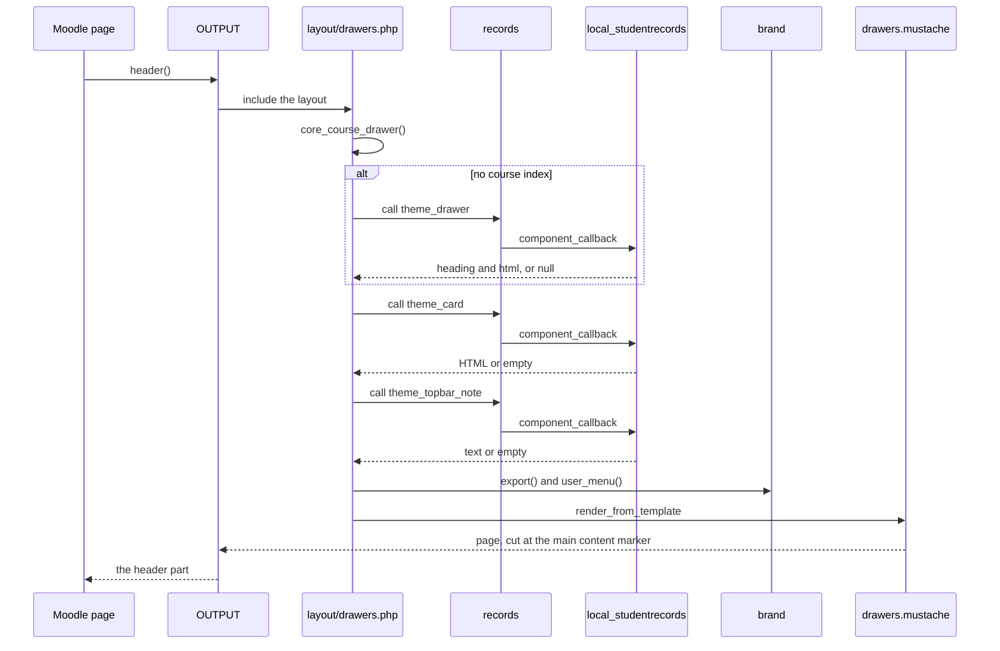

# Student Records theme: code map

This is the map of `theme/studentrecords` (`theme_studentrecords` 1.0.3): every file, layout, template, class and callback, and what each one takes from Boost. Read it before you change the theme.

Paths that start with `<moodle>/` are files of Moodle itself. `<moodle>` is the folder that holds `lib/`: the code root on Moodle 4.5, and `public/` on Moodle 5.1 and later.

## Contents

- [Where to look first](#where-to-look-first)
- [Plugin facts](#plugin-facts)
- [Files](#files)
- [How a page is built](#how-a-page-is-built)
- [Options in config.php](#options-in-configphp)
- [Layouts](#layouts)
- [Layout files](#layout-files)
- [Templates](#templates)
- [Classes](#classes)
- [Callbacks in lib.php](#callbacks-in-libphp)
- [Language strings](#language-strings)
- [Privacy](#privacy)
- [Tests](#tests)
- [Related pages](#related-pages)

## Where to look first

| You want to change | Open | What can break |
|---|---|---|
| The top bar | `theme/studentrecords/templates/navbar.mustache`, `theme/studentrecords/templates/brand.mustache` | One template serves four Moodle versions. See [how to change a template safely](extending.md#change-a-template) |
| The school's name, logo or colour | `theme/studentrecords/classes/local/brand.php` | The accent is written into SCSS, so `brand::accent()` must stay strict. See [the accent colour](settings-and-scss.md#accentcolor) |
| The login page | `theme/studentrecords/templates/login.mustache`, `theme/studentrecords/templates/loginform.mustache`, `theme/studentrecords/classes/output/core_renderer.php` | The form is Moodle's own and differs by version. The theme hides parts of it with CSS |
| The Student Records menu or the cards | `theme/studentrecords/layout/drawers.php`, then `shell` and `cards` in `local/studentrecords/classes/local/` | Most of the logic is in the plugin. See [Student Records and the theme](integration.md) |
| A setting | `theme/studentrecords/settings.php`, `theme/studentrecords/classes/admin/setting_accentcolour.php` | A setting that changes the CSS needs `theme_reset_all_caches` |
| The styles | `theme/studentrecords/scss/studentrecords.scss` | It compiles on top of Boost's SCSS of that Moodle. `theme/studentrecords/tests/scss_test.php` builds it |
| A call into Student Records | `theme/studentrecords/classes/local/records.php` | Never call `component_callback()` directly. See [`records`](#records) |

## Plugin facts

From `theme/studentrecords/version.php`:

| Field | Value |
|---|---|
| `$plugin->component` | `theme_studentrecords` |
| `$plugin->version` | `2026110304` |
| `$plugin->release` | `1.0.3` |
| `$plugin->maturity` | `MATURITY_STABLE` |
| `$plugin->requires` | `2024100700` (Moodle 4.5) |
| `$plugin->supported` | `[405, 503]` |
| `$plugin->dependencies` | `['theme_boost' => 2024100700]` |

The theme is a child of Boost (`$THEME->parents = ['boost']`). It has no `db/` folder, no `amd/` folder and no `renderers.php`, and no page of its own that a browser opens. It keeps no table, no capability, no task and no user preference.

The theme stays under the GNU GPL. The two local plugins are under the MIT License. [Why the theme stays GPL](extending.md#why-the-theme-stays-gpl) says what that means for a change.

## Files

| File or folder | What it holds | Adapted from Boost |
|---|---|---|
| `theme/studentrecords/config.php` | Theme options and the 19 layouts | Yes |
| `theme/studentrecords/lib.php` | Three callbacks | Yes |
| `theme/studentrecords/layout/drawers.php` | The layout of most pages | Yes |
| `theme/studentrecords/layout/login.php` | The layout of the login pages | Yes |
| `theme/studentrecords/templates/drawers.mustache` | The page shell around the drawers | Yes |
| `theme/studentrecords/templates/login.mustache` | The login page shell | Yes |
| `theme/studentrecords/templates/navbar.mustache` | The top bar | Yes |
| `theme/studentrecords/templates/brand.mustache` | Logo or initials, and the school's name | No |
| `theme/studentrecords/templates/loginform.mustache` | The school's heading and help text around Moodle's form | No |
| `theme/studentrecords/classes/` | Five classes | No |
| `theme/studentrecords/scss/studentrecords.scss` | All the theme's styles, in one file | No |
| `theme/studentrecords/settings.php` | Five settings | No |
| `theme/studentrecords/version.php` | Version and dependency | No |
| `theme/studentrecords/lang/en/theme_studentrecords.php` | 21 strings | No |
| `theme/studentrecords/tests/` | 8 PHPUnit files | No |
| `theme/studentrecords/LICENSE` | The full GPL text | |
| `theme/studentrecords/CHANGES.md`, `theme/studentrecords/README.md` | Release notes, and the page a site administrator reads | |

## How a page is built

Entry point: any Moodle page calls `$OUTPUT->header()`. Moodle reads `$PAGE->pagelayout`, finds the layout in `$THEME->layouts`, and looks for its file in this theme first and in Boost next (`theme_config::layout_file()`). It includes that file with `$OUTPUT`, `$PAGE`, `$COURSE`, `$CFG`, `$SITE` and `$USER` in scope, keeps what the file prints, and cuts it in two at the main content marker: what comes before is the header, and what comes after is the footer.

The theme has two layout files of its own. Everything else falls through to Boost's files.

The steps in `theme/studentrecords/layout/drawers.php`, in order:

1. It reads the drawer preferences. `drawer-open-index` defaults to open, and a visitor gets both drawers closed.
2. It renders the blocks of `side-pre` and works out whether the page has any.
3. `core_course_drawer()` gives the course index, or nothing outside a course.
4. With no course index, `records::call('theme_drawer', [$PAGE], null)` asks for the Student Records menu. An array with a non-empty `html` becomes the content of the same drawer, and its `heading` becomes `$srdrawerheading`.
5. It builds the secondary tabs, the tertiary menu, the primary menu and the activity header as Boost's layout does.
6. `records::call('theme_card', [$PAGE], '')` asks for the card. On the `course` and `incourse` layouts the card goes beside the content (`srcardaside`). On any other layout it goes above the content (`srcardtop`).
7. `records::call('theme_topbar_note', [], '')` asks for the top bar note.
8. It renders `theme_studentrecords/drawers`.

`records::call()` catches every failure, so a Student Records bug shows as a missing card and not as a broken page. The theme's part of this flow writes nothing and sends nothing.

### The login page

Entry point: `login/index.php` in Moodle.

1. `$OUTPUT->header()` includes `theme/studentrecords/layout/login.php`, which renders `theme_studentrecords/login`: the bar with the brand, and the card frame around the main content.
2. `$OUTPUT->render($loginform)` reaches `core_renderer::render_login()`.
3. That calls `parent::render_login($form)`, which gives Moodle's own form for this version, and renders `theme_studentrecords/loginform` around it, with `brand::export()` and the two login texts.

Nothing here asks Student Records, and the page works for a visitor. Other pages on the `login` layout, such as `login/forgot_password.php`, get step 1 only: the frame with no school heading.

## Options in config.php

`theme/studentrecords/config.php` starts with `require_once(__DIR__ . '/lib.php')`, so the callbacks exist when Moodle reads the options.

| Option | Value | Compared with `<moodle>/theme/boost/config.php` |
|---|---|---|
| `$THEME->name` | `'studentrecords'` | Own name |
| `$THEME->parents` | `['boost']` | Boost has none |
| `$THEME->sheets`, `$THEME->editor_sheets` | `[]` | Same |
| `$THEME->usefallback` | `true` | Same |
| `$THEME->scss` | A closure that calls `theme_studentrecords_get_main_scss_content()` | Boost's closure calls its own function |
| `$THEME->prescsscallback` | `'theme_studentrecords_get_pre_scss'` | Boost has its own, which still runs first |
| `$THEME->rendererfactory` | `'theme_overridden_renderer_factory'` | Same. This finds `core_renderer` in this theme |
| `$THEME->requiredblocks` | `''` | Same |
| `$THEME->addblockposition` | `BLOCK_ADDBLOCK_POSITION_FLATNAV` | Same |
| `$THEME->iconsystem` | `\core\output\icon_system::FONTAWESOME` | Same |
| `$THEME->haseditswitch`, `$THEME->usescourseindex` | `true` | Same |
| `$THEME->enable_dock` | `false` | Same |
| `$THEME->yuicssmodules` | `[]` | Same |
| `$THEME->activityheaderconfig` | `['notitle' => true]` | Same |
| `$THEME->layouts` | 19 layouts | Same keys and values. `test_layouts_match_boost` checks that |

Three Boost options are left out on purpose, and Moodle still reaches Boost's value through the parent:

| Boost option | What happens here |
|---|---|
| `$THEME->editor_scss` | `theme_config::editor_scss_to_css()` walks up to the parent, so the editor's styles are Boost's (`test_editor_css_comes_from_boost`) |
| `$THEME->extrascsscallback` | `theme_config::get_extra_scss_code()` runs the parent's callback with this theme as `$theme` |
| `$THEME->precompiledcsscallback` | `theme_config::get_precompiled_css_content()` runs each theme's callback once. Setting it here would give Boost's CSS twice (`test_precompiled_css_is_boost_css_once`) |

## Layouts

`$sidepre` in `theme/studentrecords/config.php` is `['file' => 'drawers.php', 'regions' => ['side-pre'], 'defaultregion' => 'side-pre']`.

| Layout | File | Comes from | Regions | Options |
|---|---|---|---|---|
| `base` | `drawers.php` | This theme | None | None |
| `standard` | `drawers.php` | This theme | `side-pre` | None |
| `course` | `drawers.php` | This theme | `side-pre` | `langmenu` |
| `coursecategory` | `drawers.php` | This theme | `side-pre` | None |
| `incourse` | `drawers.php` | This theme | `side-pre` | None |
| `frontpage` | `drawers.php` | This theme | `side-pre` | `nonavbar` |
| `admin` | `drawers.php` | This theme | `side-pre` | None |
| `mycourses` | `drawers.php` | This theme | `side-pre` | `nonavbar` |
| `mydashboard` | `drawers.php` | This theme | `side-pre` | `nonavbar`, `langmenu` |
| `mypublic` | `drawers.php` | This theme | `side-pre` | None |
| `report` | `drawers.php` | This theme | `side-pre` | None |
| `login` | `login.php` | This theme | None | `langmenu` |
| `popup` | `columns1.php` | Boost | None | `nofooter`, `nonavbar`, `activityheader` with `notitle`, `nocompletion`, `nodescription` |
| `frametop` | `columns1.php` | Boost | None | `nofooter`, `nocoursefooter`, `activityheader` with `nocompletion` |
| `print` | `columns1.php` | Boost | None | `nofooter`, `nonavbar` false, `noactivityheader` |
| `embedded` | `embedded.php` | Boost | `side-pre` | None |
| `redirect` | `embedded.php` | Boost | None | None |
| `maintenance` | `maintenance.php` | Boost | None | None |
| `secure` | `secure.php` | Boost | `side-pre` | `activityheader` with `notitle` false |

So 11 layouts use the theme's drawers file, 1 uses its login file, and 7 are Boost's. The 7 Boost layouts show no school name, no school logo and no Student Records card. `secure` keeps Boost's own bar, with the site's short name. All 7 still get the theme's CSS, so the colour reaches them.

## Layout files

### `theme/studentrecords/layout/drawers.php`

Adapted from `<moodle>/theme/boost/layout/drawers.php`. Boost has two forms of that file: one on Moodle 4.5 and 5.1, and one on 5.2 and 5.3. This file follows the 5.2 form on every version.

What it adds to Boost's file:

- The call for the Student Records menu after `core_course_drawer()`.
- The calls for the card and the top bar note.
- `brand::user_menu()` around `$primarymenu['user']`.
- The context keys `srbrand`, `srdrawerheading`, `srnewdrawers`, `srsearchdivider`, `srnote`, `srcardtop` and `srcardaside`.
- It renders `theme_studentrecords/drawers` and not `theme_boost/drawers`.

What it keeps from the 5.2 form on all versions: the tertiary menu is built with `\core\output\select_menu` from what `get_overflow_menu_data()` returns, and `coursefullname` and `courseurl` are in the context.

The two version gates of the theme are here:

| Key | Code | True on |
|---|---|---|
| `srnewdrawers` | `(int)($CFG->branch ?? 0) >= 502` | 5.2, 5.3 |
| `srsearchdivider` | `(int)($CFG->branch ?? 0) < 503` | 4.5, 5.1, 5.2 |

### `theme/studentrecords/layout/login.php`

Adapted from `<moodle>/theme/boost/layout/login.php`. It passes `output`, `bodyattributes` with the extra body class `sr-login`, and `srbrand`, and renders `theme_studentrecords/login`. It drops Boost's `sitename`, and the `leftinstructions` of Boost's file on 5.2 and 5.3, because this login page has no left panel.

Every Moodle page on the `login` layout gets this file, for example `login/forgot_password.php` and `login/signup.php`. Those pages show the top bar and the card frame. Only `login/index.php` gets the school's heading, because that comes from `core_renderer::render_login()`.

## Templates

None of the five overrides a template by name: `theme/studentrecords/templates/` has no `core` folder. The layouts and the renderer ask for each by its `theme_studentrecords/` name.

### `theme_studentrecords/drawers`

`theme/studentrecords/templates/drawers.mustache`, adapted from `theme_boost/drawers`. Rendered by `theme/studentrecords/layout/drawers.php`.

It holds the page shell: the top bar, the left drawer, the block drawer, the two drawer toggles, the header, the secondary tabs, the tertiary menu, the card and the main content, then Boost's footer.

What differs from `theme_boost/drawers` on Moodle 5.3:

- `{{> theme_studentrecords/navbar }}` in place of `theme_boost/navbar`.
- `theme_boost/courseindexdrawercontrols` goes in both `drawerheadercontent` (the block that Moodle 4.5, 5.1 and 5.2 print) and `drawercontrols` (the block that 5.3 prints). Each version prints the block it has, so the controls show once. Neither is filled when `srdrawerheading` is set.
- `drawerheading` prints `` when `srdrawerheading` is set, else `theme_boost/courseindexdrawerheading` when `srnewdrawers` is true.
- The left drawer's close and open labels read `closemenu` and `openmenu` of this theme with the menu, and `closecourseindex` and `opendrawerindex` of core otherwise.
- The toggle buttons have `btn btn-icon icon-size-3` when `srnewdrawers` is true, else `btn icon-no-margin`.
- The toggles carry `data-toggle` and `data-bs-toggle`, `data-placement` and `data-bs-placement`, and their labels `sr-only visually-hidden`, for Bootstrap 4 and Bootstrap 5.
- The icons are `e/sidebar_left` and `e/sidebar_right` when `srnewdrawers` is true, else `t/index_drawer`, `t/blocks_drawer` and `t/blocks_drawer_rtl`.
- The secondary tabs use `core/moremenu` and not `core/secondarymoremenu`.
- `srcardtop` prints in `div.sr-cardtop.d-print-none`. `srcardaside` wraps the main content: `div.sr-withaside`, then `div.sr-aside.d-print-none`, then `div.sr-main`.
- An extra script in `{{#js}}` gives each `.table-responsive` box that overflows when the page loads a `tabindex`, a `role` and a label, so a keyboard can scroll it. The label is the table's caption, or `scrolltable`.

`courseindex`, `srcardtop` and `srcardaside` print as raw HTML with `{{{ }}}`. They come from Moodle and from Student Records, which escape their own text. `srdrawerheading` is escaped.

### `theme_studentrecords/navbar`

`theme/studentrecords/templates/navbar.mustache`, adapted from `theme_boost/navbar`. Used by `theme_studentrecords/drawers`.

The `nav` has the classes `navbar navbar-light sr-topbar fixed-top navbar-expand`. The order inside `#usernavigation`, left to right: `srnote`, the search box and, when `srsearchdivider` is true, a divider, the language menu and a divider, the edit switch, the colour mode menu and a divider, the plugin output and a divider, and the user menu.

What differs from Boost:

- `theme_studentrecords/brand` replaces the `.navbar-brand` link. Boost hides its brand below 768px. The theme shows it at every width. Its link goes to the site root, `new \moodle_url('/')`, where Boost's goes to `config.homeurl`.
- Boost's nav has `bg-white` on 4.5 and `bg-body` from 5.1. Here `.sr-topbar` sets the background.
- The main tabs use `core/moremenu` on all versions. Boost 5.3 uses `core/primarymoremenu`, which React renders. The template's own comment says why: the tabs keep the school's colour.
- `srnote` is new: a span with `sr-topbar-note d-none d-md-inline-flex align-self-center me-2`.
- The edit switch sits before the colour mode menu and the plugin output on every version, as on Boost 5.2. Boost 4.5 and 5.1 put it after the user menu, and Boost 5.3 puts the colour mode menu before it.
- The user menu wrapper is the one of Boost 5.2 and later, on every version.

`theme_boost/primary-drawer-mobile` is Boost's phone menu. Its header shows the site's short name or the compact logo, not the school's name.

### `theme_studentrecords/brand`

`theme/studentrecords/templates/brand.mustache`, new. Used by `theme_studentrecords/navbar` and `theme_studentrecords/login` as `{{#srbrand}}{{> theme_studentrecords/brand }}{{/srbrand}}`. Its data is the array from `brand::export()`.

It prints a link to `homeurl` with the classes `sr-brand navbar-brand d-flex align-items-center m-0 p-0 aabtn` and the label `homelink`. Inside is `img.sr-brand-logo` when there is a `logourl`, else `span.sr-brand-tile` with the `initials`, then `span.sr-brand-name`.

### `theme_studentrecords/login`

`theme/studentrecords/templates/login.mustache`, adapted from `theme_boost/login`. Rendered by `theme/studentrecords/layout/login.php`.

It prints `header.sr-topbar.sr-topbar-login` with the brand only, then `#page.sr-login-page`, `#page-content` and `#region-main.sr-login-card.login-container` around `output.main_content`, then Boost's footer. The card carries `login-container` because Boost scopes the styles of its login form to that class (`test_login_page_uses_the_styles_of_this_moodle`).

Boost's page differs: on 4.5 and 5.1 it has `container-fluid`, `row`, `#region-main-box` and `.login-wrapper`, and on 5.2 and 5.3 it uses the split screen of `core/login_layout`. The theme keeps one card on all versions.

### `theme_studentrecords/loginform`

`theme/studentrecords/templates/loginform.mustache`, new. Rendered by `core_renderer::render_login()`.

Its data is `srbrand`, `srwelcome`, `srhelp` and `form`. It prints `div.sr-login-head` with the logo or tile, `h1` with the school's name, and `p.sr-login-welcome`, then `{{{ form }}}`, which is Moodle's own form unchanged, then `p.sr-login-help` when `srhelp` is set. With an empty `srwelcome` the welcome line is `loginto` of core with the school's name.

## Classes

### `brand`

`\theme_studentrecords\local\brand`, in `theme/studentrecords/classes/local/brand.php`. The school's look, from the theme settings. It keeps no state.

| Member | What it does |
|---|---|
| `brand::DEFAULT_ACCENT` | `#416180` |
| `brand::MIN_CONTRAST` | `4.5` |
| `brand::school_name()` | The `schoolname` setting, else `$SITE->fullname`, through `format_string()` with `escape` false. Plain text |
| `brand::initials()` | Two letters for the tile. It splits on spaces and hyphens, drops anything that isn't a letter or digit, and skips the English words `a an and at for in of on the to`. With fewer than two letters it takes the first two of the name. Upper case |
| `brand::logo_url()` | `$PAGE->theme->setting_file_url('logo', 'logo')` when the setting is saved, else `$OUTPUT->get_compact_logo_url()`, else null |
| `brand::accent()` | The lower-case setting when it is `#rrggbb` and passes the contrast check, else `brand::DEFAULT_ACCENT` |
| `brand::contrast()` | The WCAG contrast ratio of two `#rrggbb` colours, from 1 to 21 |
| `brand::luminance()` | Protected. WCAG relative luminance |
| `brand::user_menu()` | Adds the user's name to the user menu as one more metadata item, and removes `userfirstname`. Without `userfullname` it changes nothing |
| `brand::export()` | `schoolname`, `initials`, `logourl`, `homeurl`, for the templates |

### `records`

`\theme_studentrecords\local\records`, in `theme/studentrecords/classes/local/records.php`. Every call from the theme to Student Records goes through `records::call()`. It isn't the `records` class of Student Records, which saves records with their history.

`records::call()` gives `$default`, and doesn't call the plugin, when any of these holds:

- `$CFG->upgraderunning` is set, or the site is in its first install.
- Nobody is logged in, or the user is a guest.
- The component has no folder, or no `version` in the config, so it isn't installed.

Otherwise it runs `component_callback()` in a `try`. Any `\Throwable` gives `debugging()` at `DEBUG_DEVELOPER` and `$default`.

It checks first because `component_callback()` throws a `coding_exception` for a component that isn't on disk (`component_callback_exists()` in `<moodle>/lib/moodlelib.php`).

### `core_renderer`

`\theme_studentrecords\output\core_renderer`, in `theme/studentrecords/classes/output/core_renderer.php`. It extends `\theme_boost\output\core_renderer` and overrides one method.

`core_renderer::render_login()` renders `theme_studentrecords/loginform` with `brand::export()`, the trimmed `loginwelcome` and `loginhelp` settings, and `parent::render_login($form)` as `form`. Moodle reaches it through `$OUTPUT->render($loginform)` in `login/index.php`.

### `setting_accentcolour`

`\theme_studentrecords\admin\setting_accentcolour`, in `theme/studentrecords/classes/admin/setting_accentcolour.php`. It extends `\admin_setting_configcolourpicker` and overrides `setting_accentcolour::write_setting()`. The steps are in [the accent colour](settings-and-scss.md#accentcolor).

### `provider`

`\theme_studentrecords\privacy\provider`, in `theme/studentrecords/classes/privacy/provider.php`. A `\core_privacy\local\metadata\null_provider`. `provider::get_reason()` gives `privacy:metadata`.

## Callbacks in lib.php

`theme/studentrecords/lib.php` is adapted from `<moodle>/theme/boost/lib.php`.

### `theme_studentrecords_get_main_scss_content()`

Called by the `$THEME->scss` closure each time Moodle builds the CSS. It returns `<moodle>/theme/boost/scss/preset/default.scss`, then a line break, then `theme/studentrecords/scss/studentrecords.scss`. Boost's function picks a preset by setting. This one always takes the default preset.

### `theme_studentrecords_get_pre_scss()`

Called through `$THEME->prescsscallback`, after Boost's own callback. It returns `$primary` and `$sr-accent`, both set to `brand::accent()`.

### `theme_studentrecords_pluginfile()`

Called by Moodle's `pluginfile.php` for a file of the component `theme_studentrecords`. In the system context and the file area `logo`, it sets `cacheability` to `public` unless given and calls `setting_file_serve()` of the theme. Anything else is `send_file_not_found()`.

There is no login check, because the login page shows the logo. The URL holds the theme revision where the item id would be, so purging the caches changes the URL.

## Language strings

`theme/studentrecords/lang/en/theme_studentrecords.php` has 21 strings. `choosereadme` and `pluginname` are read by Moodle only. The others are read by `settings.php`, `setting_accentcolour`, `provider` and the templates. There is no other language folder.

The theme also prints these strings of other components: `closecourseindex`, `opendrawerindex`, `opendrawerblocks`, `closeblockdrawer`, `sidepanel` and `loginto` (core), and `sitemenubar` and `errorsetting` (admin). A test page render fails on a string that a Moodle version lacks, because `render_page` in `theme/studentrecords/tests/pages_test.php` looks for `[[` in the page.

## Privacy

`provider` says the theme stores no personal data. The theme has no table and no user preference of its own, and it saves no user file: the logo is a site file.

`theme/studentrecords/layout/drawers.php` reads the preferences `drawer-open-index` and `drawer-open-block`. Those belong to Boost, whose provider declares and exports them. The card and the note show personal data on screen, but they come from Student Records and the theme doesn't store them.

## Tests

8 PHPUnit files, 47 test methods. Each test has both the docblock annotation and the PHP attribute. There are no Behat features.

| File | Methods | What it protects |
|---|---|---|
| `theme/studentrecords/tests/admin/setting_accentcolour_test.php` | 4 | What the colour setting saves and refuses. `setUp()` saves `#123456` first, so a refusal can be seen to leave it |
| `theme/studentrecords/tests/lib_test.php` | 7 | The pre-SCSS and main SCSS, a hostile saved colour, and which files the logo callback serves |
| `theme/studentrecords/tests/local/brand_test.php` | 9 | Initials, contrast, the accent, the school's name, the export, the logo URL and the user menu |
| `theme/studentrecords/tests/local/records_test.php` | 6 | Every case where `records::call()` gives the default. Theme Boost stands in for the plugin, so these run without it |
| `theme/studentrecords/tests/output/core_renderer_test.php` | 3 | The login card around the real form of this Moodle, and escaping |
| `theme/studentrecords/tests/pages_test.php` | 13 | Every layout for a visitor, a guest and an admin, the match with Boost's layouts, the course index, the top bar, each template from its example |
| `theme/studentrecords/tests/privacy/provider_test.php` | 1 | The null provider and its string |
| `theme/studentrecords/tests/scss_test.php` | 4 | The real CSS builds with the SCSS of this Moodle |

`theme/studentrecords/tests/pages_test.php` is the test to run after any change to a template or a layout. A debugging message fails it, so it also catches a string, a picture or a template that a Moodle version lacks. Run it on Moodle 4.5 and 5.3 at least. [Testing](../testing.md) says how.

`test_student_records_menu_goes_in_the_drawer` is skipped unless Student Records is installed, so it runs only in the two CI rows with the other plugins.

## Related pages

- [Settings and SCSS](settings-and-scss.md)
- [Student Records and the theme](integration.md)
- [Extending the theme](extending.md)
- [Compatibility](../compatibility.md)
- [Architecture](../architecture.md)
