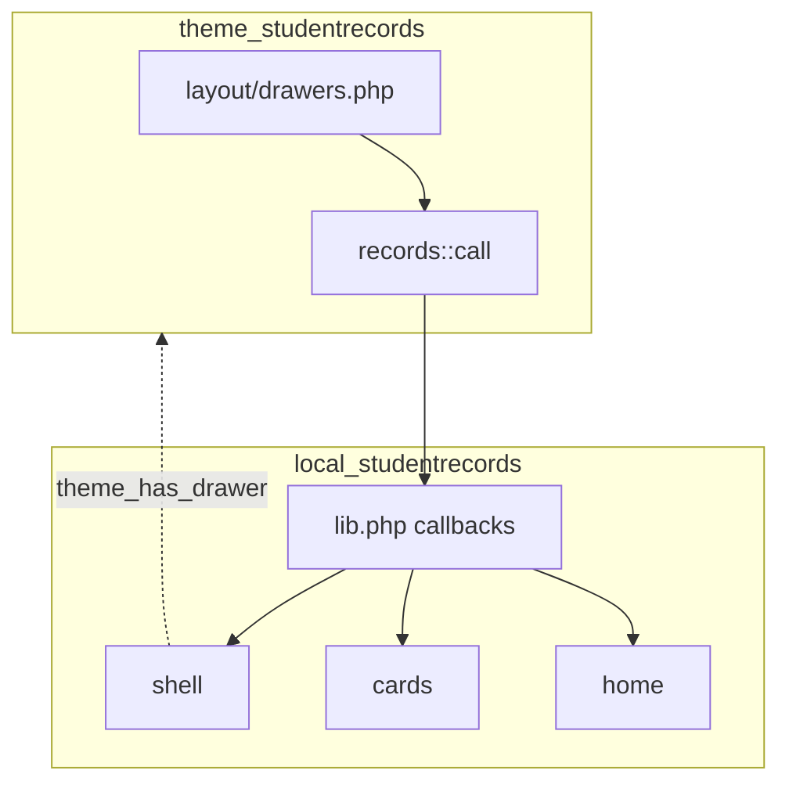

# Student Records theme: integration

This page says how the theme and the Student Records plugin talk, what the menu and the cards show, what Boost and other themes get instead, and what happens without Student Records. Read it before you change the theme side. The plugin side is in [Student Records integration](../student-records/integration.md).

## Contents

- [The rule](#the-rule)
- [The three callbacks](#the-three-callbacks)
- [The menu](#the-menu)
- [The cards](#the-cards)
- [The top bar note](#the-top-bar-note)
- [On Boost and other themes](#on-boost-and-other-themes)
- [Without Student Records](#without-student-records)
- [Academic Transcript](#academic-transcript)
- [What to keep stable](#what-to-keep-stable)
- [Related pages](#related-pages)

## The rule

The theme and the plugin each work alone. Neither has the other in `$plugin->dependencies`.

- The theme asks through `records::call()`, only in `theme/studentrecords/layout/drawers.php`. It holds no Student Records logic and reads no Student Records table.
- The plugin learns about the theme in one place: `shell::theme_has_drawer()`.
- The tab "Student Records" in the main tabs isn't the theme's. It comes from the plugin's hook `hook_callbacks::primary_extend()`, on any theme.

## The three callbacks

The functions are in `local/studentrecords/lib.php`.

| Callback | Arguments | Answer | Theme's default | Where the answer goes |
|---|---|---|---|---|
| `local_studentrecords_theme_drawer()`, calls `shell::drawer()` | `$PAGE` | `['heading' => text, 'html' => menu]` or null | `null` | `$courseindex`, `$srdrawerheading` |
| `local_studentrecords_theme_card()`, calls `cards::for_page()` | `$PAGE` | HTML or `''` | `''` | `srcardtop` or `srcardaside` |
| `local_studentrecords_theme_topbar_note()` | None | Text or `''` | `''` | `srnote` |

`records::call()` gives the default, and doesn't call the plugin, for a visitor, for a guest, during an upgrade or first install, and when the plugin isn't on disk or isn't installed. A callback that throws gives `debugging()` at `DEBUG_DEVELOPER` and the default. So no card can mean an error: turn on developer debugging to see it.

## The menu

Entry point: `theme/studentrecords/layout/drawers.php`, on any page of the 11 drawers layouts.

Checks, in order:

1. `core_course_drawer()` gave nothing. In a course, the course index wins and the menu isn't asked for.
2. `records::call()` lets the call through.
3. `shell::drawer()` finds that `shell::is_sr_url()` is true for `$page->url`: the path below `$CFG->wwwroot` starts with `/local/studentrecords/` or `/local/academictranscript/`.
4. `shell::groups()` isn't empty.

The answer is the first group's heading and `shell::menu()` with `$withheadings` false, which leaves out the first group's heading because the drawer shows it. An array with a non-empty `html` becomes `$courseindex`. Nothing is written, sent or locked.

The HTML goes in the same drawer as a course index, `theme_boost-drawers-courseindex`, with the preference `drawer-open-index`. So closing the menu also closes the course index on the next course page.

`srdrawerheading` is the switch between the menu and the course index in `theme_studentrecords/drawers`. It picks the labels and leaves out the course index controls. A `theme_drawer` answer with `html` and an empty `heading` would show the menu with the course index's labels and controls.

The heading is the first group's, so it isn't always "Student Records": a person whose first group is finance sees "Finance".

### Pages with no menu under this theme

`shell::inline_menu()` gives `''` whenever `shell::theme_has_drawer()` is true, and that test looks at the theme, not at the page. So a page of the plugin has no menu at all when the drawer doesn't show it:

- Pages inside a course, where the course index takes the drawer: `local/studentrecords/attendance.php` with `course`, or for a teacher when the offering is linked to a course, `local/studentrecords/students.php` with `courseid`, `local/studentrecords/student.php` with `courseid`, and `local/academictranscript/change.php`, `local/academictranscript/codes.php`, `local/academictranscript/post.php` and `local/academictranscript/students.php` with a course.
- Pages on a layout without the drawer, such as `print`: `local/studentrecords/aidletter.php` and `local/studentrecords/degreeaudit.php` when printing.

### What the menu lists

`shell::groups()` decides, in this order, for a logged-in user who isn't a guest. A person can have several groups.

| Group | Heading string | Needs |
|---|---|---|
| Student | `pluginname` | A student file, and `local/studentrecords:viewown` at system level |
| Records staff | `pluginname` | `access::sees_all_students()` |
| Grade change approver | `pluginname` | Not records staff, and `staffarea::can_open()` allows `gradechanges` |
| Finance | `nav_finance` | Billing on, and `local/studentrecords:viewbilling` |
| Financial aid | `nav_financialaid` | `aid::enabled()`, and `local/studentrecords:viewaid` |
| Teacher | `nav_teaching` | At least one offering from `shell::my_offerings()` |
| Setup | `nav_setupheading` | At least one setup page that `staffarea::can_open()` allows |

The items of each group are in `shell::groups()`. Two of them link to Academic Transcript, and only when it's on disk and the user holds the capability: "My Transcript" (`nav_mytranscript`) and "Transcript requests" (`nav_transcriptrequests`).

The current page's link gets `active` and `aria-current="page"`, chosen by `shell::current()` and `shell::best_match()`.

## The cards

Entry point: `theme/studentrecords/layout/drawers.php` asks on every drawers page, and `cards::for_page()` decides. Visitors and guests get nothing.

| `$PAGE->pagelayout` | Card | Placed by the theme as |
|---|---|---|
| `mydashboard` | `cards::dashboard_strip()` or `cards::staff_strip()` | `srcardtop` |
| `course`, `incourse`, in a course that isn't the site | `cards::teacher_card()`, else `cards::student_card()` | `srcardaside` |
| Anything else | Nothing | |

Site home and My courses get nothing. `incourse` is a layout, not an activity, so a plugin page on that layout gets the side card too, for example `local/academictranscript/post.php`. Both wrappers have `d-print-none`, so paper shows no card.

### Student strip

`cards::dashboard_strip()`, for a user with a student file and `local/studentrecords:viewown`. It shows the balance with billing on, the next plan payment when one is due, and the holds, separated by " · ". A credit shows as zero, because the balance goes through `max(0, ...)`. Its buttons are the transcript link from `cards::transcript_link()` and "Open Student Records" (`card_open`).

### Staff strip

`cards::staff_strip()`, for anyone else with a menu group, teachers included. It shows the line `card_staffline` and the same buttons, with the staff form of the transcript link.

### Teacher card

`cards::teacher_card()` needs `local/studentrecords:takeattendance` in the course, an offering linked to the course in an active term (the newest term, the first one only), and `attendance::can_take()`. With a meeting today or later it shows `srcard_todayclass` or `srcard_nextclass` and the button `takeattendance`. With no such meeting it shows the code and section and the button `attendance`. Then it counts registered students under the minimum attendance, which is the setting `minattendance`, or 80.

### Student card

`cards::student_card()` needs a student file, `local/studentrecords:viewown`, and a `registered` or `completed` registration in an offering linked to the course. It shows the student's own attendance rate and `srcard_missed` or `srcard_nomarks`.

The teacher card is tried first, so a person who qualifies for both sees the teacher card.

## The top bar note

`local_studentrecords_theme_topbar_note()` gives `nolms` of `local_studentrecords` when `home::is_nolms()` is true: the person's staff record has `nolms` set, and they aren't a site administrator. It shows from 768px up, so a No LMS staff member doesn't see it on a phone.

## On Boost and other themes

`shell::theme_has_drawer()` is true when `$PAGE->theme->name` is `studentrecords`, or `studentrecords` is in its parents. With any other theme `shell::inline_menu()` returns two `
` elements, each with the summary `nav_menu` of `local_studentrecords` and the whole menu with all its group headings:

- `details.sr-inline-menu.sr-inline-menu-wide.mb-3`, open.
- `details.sr-inline-menu.sr-inline-menu-small.mb-3`, folded.

`local/studentrecords/styles.css` hides the small copy, and `@media screen and (max-width: 767.98px)` shows it and hides the wide one. No script is involved. Paper gets the open copy, because the media rule is `screen` only. A user with no menu groups gets `''`. `local/studentrecords/tests/local/shell_inline_menu_test.php` holds all of this, and its `test_student_records_theme_gets_no_menu` is skipped without the theme.

Pages that print the inline menu:

- Through `staffarea::header()`: the staff pages of `local/studentrecords/`.
- Directly: `local/studentrecords/index.php`, `local/studentrecords/mydocuments.php`, `local/studentrecords/myregistration.php`, and `local/studentrecords/student.php` when a student views their own record.
- Behind `class_exists('\\local_studentrecords\\local\\shell')`: `local/academictranscript/index.php` in the `mine` view, and `local/academictranscript/requests.php`.

Pages that don't print it, so on another theme they have no menu: `local/studentrecords/aidletter.php`, `local/studentrecords/ferpa.php`, `local/studentrecords/pay.php`, `local/studentrecords/staff.php`, a student's own `local/studentrecords/account.php` and `local/studentrecords/degreeaudit.php`, `local/studentrecords/attendance.php` for a teacher, `local/studentrecords/students.php` with `courseid`, and the other pages of Academic Transcript.

So with this theme more pages have a menu than on Boost: the drawer needs only the URL, and the inline menu needs each page to print it.

What stays the same on any theme, because it comes from the plugin's hooks and navigation callbacks (`local/studentrecords/db/hooks.php`, `hook_callbacks`, `local/studentrecords/lib.php`):

- The tab "Student Records" in the main tabs for anyone with menu groups.
- No Dashboard or My courses tab for No LMS staff, and their redirect to the Student Records home page.
- The items in the course's More menu, and "Student record" on the profile.

What exists only with this theme: the drawer, the Dashboard strip, the side card and the top bar note. No other code calls `local_studentrecords_theme_card()` or `local_studentrecords_theme_topbar_note()`.

## Without Student Records

`records::call()` gives the default for all three calls, with no exception and no debugging message (`test_call_without_the_plugin_gives_the_default`).

- The left drawer has no menu. Course pages keep the course index, and other pages have no left drawer, because `$courseindex` stays empty.
- `srcard` is `''`, so `sr-cardtop` and `sr-withaside` aren't in the page and the main content prints alone.
- `srnote` is `''`.
- The top bar, the login card, the colour and every setting work the same.

The theme keeps its own look without the plugin: its top bar, with the brand at every width and the user's name beside the picture, its one-card login page, 6px corners, bold outline buttons, underlined links and the `core/moremenu` tabs on 5.3.

The same defaults apply when the plugin is on disk and not installed, during an upgrade, and when a callback throws.

## Academic Transcript

`local/academictranscript` calls nothing in the theme. It reaches the menu in two ways:

- `shell::is_sr_path()` counts `/local/academictranscript/` as a Student Records page, so with Student Records installed its pages get the drawer.
- `local/academictranscript/index.php` in the `mine` view and `local/academictranscript/requests.php` print `shell::inline_menu()` when the class exists.

Without Student Records its pages have no menu on any theme. `local/academictranscript/styles.css` repeats the `sr-` rules it needs, so its pages keep their look without the CSS of Student Records.

## What to keep stable

If you change either side, both of these have to hold:

- The function names `local_studentrecords_theme_drawer()`, `local_studentrecords_theme_card()` and `local_studentrecords_theme_topbar_note()`, their arguments and the shape of the answers. The theme and the plugin are released separately, so a site can run an older one of either.
- `shell::THEME`, the class names of the cards in `local/studentrecords/styles.css`, and the wrappers `sr-cardtop`, `sr-withaside`, `sr-aside` and `sr-main`.

`test_student_records_menu_goes_in_the_drawer` in `theme/studentrecords/tests/pages_test.php` runs both sides together. It's skipped without the plugin, so run it with `--together`, as [Testing](../testing.md#with-the-other-plugins) says.

## Related pages

- [Code map](README.md)
- [Settings and SCSS](settings-and-scss.md)
- [Extending the theme](extending.md)
- [Architecture](../architecture.md)
- [Student Records integration](../student-records/integration.md)
