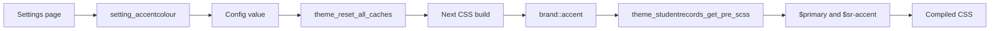

# Student Records theme: settings and SCSS

This page lists every setting of `theme_studentrecords`, follows the colour, the logo and the school's name from the settings page to the screen, and describes `theme/studentrecords/scss/studentrecords.scss`. Read it before you add a setting or a colour.

## Contents

- [The settings page](#the-settings-page)
- [Every setting](#every-setting)
- [How the colour reaches the page](#how-the-colour-reaches-the-page)
- [How the logo reaches the page](#how-the-logo-reaches-the-page)
- [How the school's name reaches the page](#how-the-schools-name-reaches-the-page)
- [The login texts](#the-login-texts)
- [How the CSS is built](#how-the-css-is-built)
- [Sass variables](#sass-variables)
- [CSS custom properties](#css-custom-properties)
- [Rules by area](#rules-by-area)
- [Widths](#widths)
- [Dark mode](#dark-mode)
- [What Boost's settings do here](#what-boosts-settings-do-here)
- [Related pages](#related-pages)

## The settings page

`theme/studentrecords/settings.php` builds one `admin_settingpage` named `themesettingstudentrecords`, inside `if ($ADMIN->fulltree)`. Moodle puts it in the category `themes`, which its menu labels "Custom theme settings" (`themesettingscustom`, admin). The address is `/admin/settings.php?section=themesettingstudentrecords`. The theme's card on the "Themes" page links to it.

## Every setting

| Name | Type | Default | Purges theme caches | Read by |
|---|---|---|---|---|
| `schoolname` | `admin_setting_configtext`, `PARAM_TEXT` | Empty | Yes | `brand::school_name()` |
| `logo` | `admin_setting_configstoredfile`, file area `logo` | None | Yes | `brand::logo_url()` |
| `accentcolor` | `setting_accentcolour` | `brand::DEFAULT_ACCENT` | Yes | `brand::accent()` |
| `loginwelcome` | `admin_setting_configtextarea`, `PARAM_TEXT` | The string `loginwelcome_default` | No | `core_renderer::render_login()` |
| `loginhelp` | `admin_setting_configtextarea`, `PARAM_TEXT` | Empty | No | `core_renderer::render_login()` |

Moodle runs the `theme_reset_all_caches` callback only when the value changed. The two login texts have no callback, because no CSS holds them, and they show at once.

`schoolname` purges the caches although no CSS holds it either. The logo URL holds the theme revision, so a purge is what changes that URL after a new logo.

The theme writes no config of its own in non-test code. The only write is `$this->config_write()` in `setting_accentcolour::write_setting()`.

### `schoolname`

The name in the top bar and on the login card, the source of the initials, and the label of the home link. When it is empty, `brand::school_name()` uses the site's full name. It goes through `format_string()`, so filters and multi-language text work. The browser tab title, the favicon, the footer and emails stay Moodle's.

### `logo`

`admin_setting_configstoredfile` with `maxfiles` 1 and the types `.png`, `.jpg`, `.jpeg`, `.svg` and `.webp`, in the file area `logo` with item id 0. The config value is the file path, for example `/logo.png`.

The description says a small square logo, but the CSS allows a wide one: 120 by 36px in the top bar, 160 by 72px on the login card, 60 by 30px on a phone.

### `accentcolor`

The class `\theme_studentrecords\admin\setting_accentcolour` extends `\admin_setting_configcolourpicker`. `setting_accentcolour::write_setting()` saves only a colour with enough contrast against white. The parent accepts colour names and other forms, but this override doesn't, because the value goes into SCSS.

The steps of `setting_accentcolour::write_setting()`:

1. `strtolower(trim((string)$data))`.
2. An empty value becomes `brand::DEFAULT_ACCENT`, so the setting is never empty after a save.
3. Three hex digits, with or without `#`, are doubled to `#rrggbb`. Six digits without `#` get one.
4. Anything that isn't `#rrggbb` returns `accentcolor_format`.
5. `brand::contrast()` against `#ffffff` below `brand::MIN_CONTRAST` returns `accentcolor_lowcontrast`, with the ratio rounded down to two decimals, so a colour a little under the limit is never reported as meeting it (`test_write_setting_rounds_the_ratio_down`).
6. `config_write()`, or `errorsetting` of admin on failure. An empty string means saved.

`brand::accent()` checks again on read, and it's stricter than the form: a saved `#abc` falls back to the default with no message. A value set outside the form, in the database or in `config.php`, falls back the same way, while the settings page may still show it. That second check is what keeps a hostile value out of the SCSS (`test_get_pre_scss_is_safe_with_a_hostile_value`, `test_accent_refuses_a_bad_saved_colour`). Don't loosen either check.

The default `#416180` has a contrast of 6.47 to 1 with white, worked out with the formula in `brand::contrast()`.

### `loginwelcome`

The line under the school's name on the login card. The default is the string `loginwelcome_default`.

`core_renderer::render_login()` prints the saved value. When that value is empty, or the settings were never saved, the card says `loginto` of core with the school's name. So emptying the box doesn't remove the line.

### `loginhelp`

The line under the form on the login card. Empty shows nothing.

## How the colour reaches the page

Entry point: the settings page. No page HTML holds the colour.

1. `setting_accentcolour::write_setting()` checks the colour and saves it.
2. `theme_reset_all_caches` makes Moodle build the CSS again on the next request for it.
3. `theme_studentrecords_get_pre_scss()` calls `brand::accent()` and returns `$primary: <accent>;` and `$sr-accent: <accent>;`.
4. Those two lines come before Boost's preset, so Boost's own `$primary` takes the value too.

On failure: `brand::accent()` gives `brand::DEFAULT_ACCENT`. A build that fails falls back to Boost's precompiled CSS, without the theme's rules, and says so only through `debugging()` at `DEBUG_DEVELOPER`.

The plugins' pages have their own `--srp-accent` and `--srp-accent-line`, fixed at `#416180` in `local/studentrecords/styles.css` and `local/academictranscript/styles.css`. So `.sr-progress-bar`, `.sr-seg-item.active` and focus lines don't follow the school's colour.

## How the logo reaches the page

1. The settings page stores the file in the component `theme_studentrecords`, file area `logo`, and the file path in the config.
2. On each page `brand::export()` calls `brand::logo_url()`.
3. `brand::logo_url()` calls `$PAGE->theme->setting_file_url('logo', 'logo')`, which gives a protocol-relative pluginfile URL with the theme revision in it.
4. `srbrand.logourl` goes in `theme_studentrecords/brand` and `theme_studentrecords/loginform`.
5. The browser asks `pluginfile.php`, and `theme_studentrecords_pluginfile()` serves it to anyone, because the login page shows it.

Fallback order: the theme's logo, then Moodle's compact logo through `$OUTPUT->get_compact_logo_url()`, then the initials. Moodle's main logo isn't used. On the login form it's hidden by `.sr-login-card #loginlogo`.

`srbrand` is built in three places: `theme/studentrecords/layout/drawers.php`, `theme/studentrecords/layout/login.php` and `core_renderer::render_login()`.

## How the school's name reaches the page

On each page `brand::export()` calls `brand::school_name()` and `brand::initials()`. The name goes in `srbrand.schoolname` and the two letters in `srbrand.initials`. `brand::school_name()` returns plain text and the templates escape it once (`test_templates_escape_the_top_bar_text`).

The small words that `brand::initials()` skips are English only. "Riverside College" gives "RC".

## The login texts

`core_renderer::render_login()` trims `loginwelcome` and `loginhelp` and hands them to `theme_studentrecords/loginform` as `srwelcome` and `srhelp`.

- They don't go through `format_string()`, unlike the school's name. They print as escaped text, so a multi-language tag shows as literal text.
- Each prints in one `
`, so a line break typed in the box doesn't show.
- `PARAM_TEXT` refuses HTML on save.

## How the CSS is built

`theme_config::get_css_content_from_scss()` in Moodle puts these together, in this order:

1. Boost's pre-SCSS, from `theme_boost_get_pre_scss()`.
2. This theme's pre-SCSS, from `theme_studentrecords_get_pre_scss()`.
3. `<moodle>/theme/boost/scss/preset/default.scss`, and then `theme/studentrecords/scss/studentrecords.scss`, from `theme_studentrecords_get_main_scss_content()`.
4. Boost's extra SCSS, from `theme_boost_get_extra_scss()`, called with this theme as `$theme`.

The preset is read from disk on each build, so the base is that Moodle's own Bootstrap and Boost. `theme/studentrecords/scss/studentrecords.scss` has no imports and no partials.

Because the SCSS is compiled, a change to it needs a theme cache purge. The test site's `sync` command purges the caches for you, as [Setup](../setup.md#the-test-site) says.

## Sass variables

| Variable | Value | Can a site change it |
|---|---|---|
| `$sr-accent` | `#416180 !default` | Yes, through `accentcolor` |
| `$sr-accent-dark` | `mix(#000, $sr-accent, 32%)` | Follows the accent |
| `$sr-accent-light` | `mix(#fff, $sr-accent, 90%)` | Follows the accent |
| `$sr-text` | `#1d1f20` | No |
| `$sr-muted` | `#5d5d60` | No |
| `$sr-border` | `#dee2e6` | No |
| `$sr-input-border` | `#858b94` | No |

The pre-SCSS also sets Boost's `$primary`. Only `$sr-accent` has `!default`, because the pre-SCSS sets it first.

The logo tile and the notification count use `$sr-accent-dark`, the accent with 32% black, and not the accent itself, although the description of the setting says the logo square uses the colour.

## CSS custom properties

Declared on `:root`. The dark column is for `[data-bs-theme="dark"]`.

| Property | Light | Dark |
|---|---|---|
| `--sr-accent` | `$sr-accent` | Not changed |
| `--sr-accent-dark` | `$sr-accent-dark` | Not changed |
| `--sr-accent-light` | `$sr-accent-light` | Not changed |
| `--sr-border` | `$sr-border` | `var(--bs-gray-300)` |
| `--sr-input-border` | `$sr-input-border` | `var(--bs-gray-500)` |
| `--sr-link` | `$sr-accent` | `var(--bs-link-color)` |
| `--sr-link-hover` | `$sr-accent-dark` | `var(--bs-link-hover-color)` |
| `--sr-muted` | `$sr-muted` | `var(--bs-gray-600)` |
| `--sr-outline` | `#8f959e` | `var(--bs-gray-500)` |
| `--sr-outline-hover` | `#5d5d60` | `var(--bs-gray-400)` |
| `--sr-page` | `#f8f9fa` | `var(--bs-gray-100)` |
| `--sr-surface` | `#fff` | `var(--bs-white)` |
| `--sr-text` | `$sr-text` | `var(--bs-gray-900)` |
| `--sr-tint` | `#f5f5f8` | `var(--bs-gray-200)` |

`--sr-accent`, `--sr-accent-dark` and `--sr-accent-light` are declared and read by nothing in this repo. The rules use the Sass variables. `test_css_compiles_with_the_accent` looks for `--sr-accent:#1a2b3c` in the build, so removing the declaration fails that test.

## Rules by area

Everywhere:

- `a` and `a:hover` use `--sr-link` and `--sr-link-hover`.
- Links inside text in `#region-main`, in `#page-footer`, in `.logininfo` and in `.sr-login-card` are underlined, so they don't rely on colour alone (WCAG 1.4.1).
- `.btn-outline-secondary` has dark text and weight 600. `.btn-primary` uses `$sr-accent`, and `$sr-accent-dark` on hover.
- `.btn`, `.form-control`, `.form-select`, `.custom-select` and `.card` have a 6px radius. `.custom-select` is the Bootstrap 4 class and `.form-select` the Bootstrap 5 class.

Top bar: `.sr-topbar` has a minimum height of 60px, a surface background and a bottom border. `.sr-brand`, `.sr-brand-tile`, `.sr-brand-logo` and `.sr-brand-name` style the brand. `.sr-topbar .userinitials` uses `$sr-accent-light` and `$sr-accent-dark`. `.sr-topbar-note` has fixed colours.

User name: `brand::user_menu()` adds the name as the last metadata item, which Moodle prints before the picture. `.sr-topbar .userbutton` is `inline-flex`, and `.usertext:nth-last-child(2)` gets `order: 1`, so only the name moves after the picture and a notice such as `loggedinas` of core stays before it. Code that adds metadata after `brand::user_menu()` would move the wrong item.

Tabs: `.navbar.sr-topbar .primary-navigation .navigation .nav-link` and `.secondary-navigation .navigation .nav-tabs .nav-link` use `--sr-text`, and `--sr-link` when active. The second selector matches every secondary tab row, not only course pages.

Cards: `.sr-cardtop` has a bottom margin. `.sr-withaside` is a grid of one column, and from Bootstrap's `lg` breakpoint two, `minmax(0, 1fr) 330px`, with `.sr-aside` in the second. `.sr-aside` comes first in the HTML at every width, so a screen reader or a keyboard reaches the card first.

Login: `body.sr-login` and its `#page-wrapper` and `#page` use `--sr-page`. `.sr-login-card` is at most 440px wide. `.pagelayout-login #region-main.sr-login-card` needs the id because Boost clears the frame of `#region-main` on login pages with a selector that has one (`test_login_card_frame_outranks_boost`).

The theme never edits Moodle's form. It hides parts of it with `display: none !important`: `.sr-login-card #loginlogo`, `.sr-login-card .loginform > h1` and `.sr-login-card .loginform > h1 + .text-muted`. It forces `.sr-login-card .loginform > .d-lg-none` to show, because Moodle 5.2 and later keep the sign-in instructions for wide screens to a side panel that this layout doesn't have. The hidden parts stay in the HTML.

Menu: `.sr-drawer-heading` is the only rule of the menu here. Student Records styles the menu itself in `local/studentrecords/styles.css`, with `.sr-nav`, `.sr-nav-heading`, `.sr-nav-list`, `.sr-nav-link` and `.sr-nav-note`, and the strip and cards with `.sr-strip`, `.sr-sidecard` and `.sr-card`.

## Widths

The theme's phone rules are in `@media (max-width: 575.98px)`, written out, because `media-breakpoint-down(sm)` means 767.98px on Bootstrap 4 and 575.98px on Bootstrap 5. `test_css_compiles_with_the_accent` looks for that rule.

| Width | What changes | Where |
|---|---|---|
| Below 576px | The brand shrinks and cuts a long name at `30vw`. The user navigation doesn't shrink. The login card loses its frame. Every `.secondary-navigation` tab row stops wrapping, scrolls sideways and fades its last 32px | `theme/studentrecords/scss/studentrecords.scss` |
| Below 768px | The phone menu button shows, and the top bar note hides | `theme/studentrecords/templates/navbar.mustache` |
| Below 991px | Boost starts every drawer closed, and doesn't save the state as a preference | `isSmall()` in `<moodle>/lib/amd/src/pagehelpers.js` |
| Below 992px | The side card sits above the content in one column, and the user's name hides | `theme/studentrecords/scss/studentrecords.scss`, `brand::user_menu()` |

The fade on the tab row is always on at phone width, whether or not more tabs are left to scroll to.

The keyboard script for tables in `theme_studentrecords/drawers` runs once, when the page loads, and only for boxes that overflow at that moment. Turning a phone or resizing later doesn't add it. The login page and Boost's layouts don't have it.

## Dark mode

Moodle 5.3 has a dark colour mode, and earlier versions never set `data-bs-theme`. An administrator turns it on in Boost's settings, not in this theme's: Moodle reads `get_config('theme_boost', 'enablecolourmodes')`, and `\theme_boost\colour_mode::is_boost_theme()` accepts child themes.

The `[data-bs-theme="dark"]` block swaps the custom properties to Boost's dark colours. The accent stays on buttons and tiles, where its text is white, and links take Boost's lighter colour.

Two parts of the top bar don't change in dark mode: `.sr-topbar-note` has fixed colours, and `.sr-topbar .userinitials` uses the compiled Sass variables.

`output.colour_mode_menu` is empty before 5.3, so `theme_studentrecords/navbar` needs no gate for it. The login page has no colour menu, because only `theme_studentrecords/navbar` prints it.

## What Boost's settings do here

`theme_boost_get_pre_scss()` and `theme_boost_get_extra_scss()` read `$theme->settings`, and `$theme` here is this theme. This theme has no `brandcolor`, `scsspre`, `scss`, `backgroundimage` or `loginbackgroundimage` setting, so Boost's brand colour, raw SCSS and background images have no effect.

`theme_studentrecords_get_main_scss_content()` always takes the default preset, so Boost's preset choice has no effect either.

Moodle reads `unaddableblocks` from `$this->page->theme->settings`, and this theme has no such setting, so Boost's list of blocks to hide from "Add a block" doesn't apply.

Colour modes are the exception, as [Dark mode](#dark-mode) says.

## Related pages

- [Code map](README.md)
- [Student Records and the theme](integration.md)
- [Extending the theme](extending.md)
- [Compatibility](../compatibility.md)
