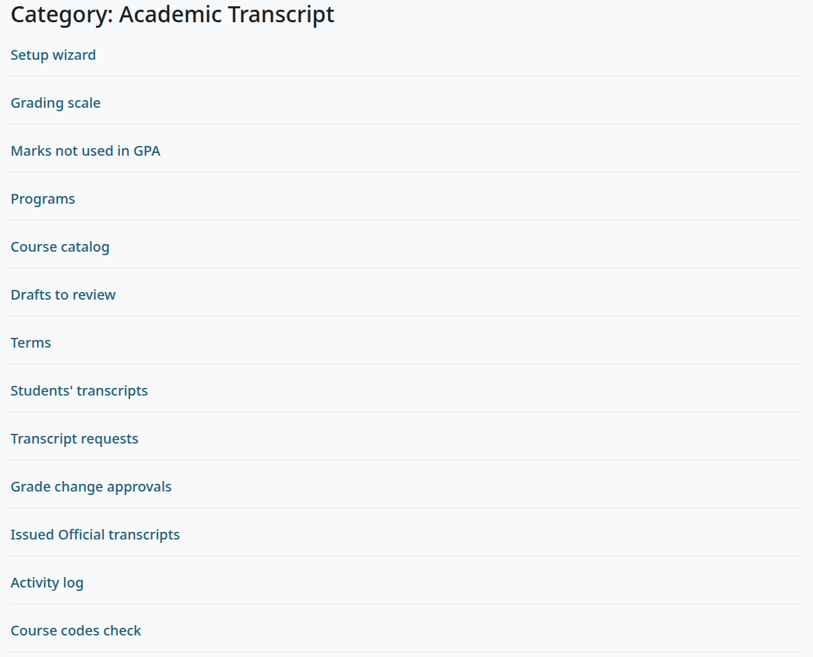

# Academic Transcript

Academic Transcript (`local_academictranscript` 1.4.3) makes academic transcripts from the final grades in your Moodle courses. This manual is for everyone who uses it: site administrators, registrars, teachers, students, and whoever checks a transcript.

## Contents

- [What it does](#what-it-does)
- [What it doesn't do](#what-it-doesnt-do)
- [Where each role starts](#where-each-role-starts)
- [Where things are](#where-things-are)
- [When something goes wrong](#when-something-goes-wrong)
- [The pages of this manual](#the-pages-of-this-manual)
- [Related pages](#related-pages)

## What it does

- Students see their own transcript on My transcript, and download an Unofficial copy: a PDF with a watermark.
- Students request an Official transcript by email, by mail or for pick up, and the registrar works through the requests on one page.
- Teachers enter transcript codes such as P, NP, I, NC or W, post final grades from a course, and ask for a change to a posted grade. Another person must approve a change.
- Teachers and registrars issue Official transcripts for a named recipient. Each one gets a transcript number and a 24-character verification code, is frozen as issued, and is digitally signed.
- Anyone with a code can check it on a public page, or scan the QR code on the transcript. The page shows no grades.
- The school sets its own grading scale, marks, terms, programs and course catalog, and its rule for repeated courses. A setup wizard takes an admin through this, by hand, from CSV files, or with the site's AI provider.
- An activity log records views, downloads, issues, checks, postings, requests and changes.
- With the [Student Records](../student-records/README.md) plugin, the transcript can read its data from there. It works without it.

## What it doesn't do

- It doesn't send anything. Issuing makes the transcript, and the registrar sends it. The plugin sends no email or other message.
- It takes no payment. A fee is recorded on the request, or goes on a student account in Student Records.
- It doesn't change grades in the gradebook. Posting reads the course total and locks it.
- It has no scheduled tasks. A request's state is worked out when a page opens.
- It stores no Social Security numbers.

## Where each role starts

| You are | Start here | You'll use |
|---|---|---|
| A site administrator installing the plugin | [Install and set up](install-and-setup.md) | The setup wizard, [Transcript settings](settings.md) |
| A manager or records officer | [Admin guide](admin-guide.md) | Students' transcripts, Grade change approvals, Issued Official transcripts, Activity log, [Terms and course fields](terms-and-course-fields.md) |
| A registrar | [Registrar guide](registrar-guide.md) | Transcript requests |
| A teacher | [Teacher guide](teacher-guide.md) | The course's More menu |
| A student | [Student guide](student-guide.md) | My transcript |
| Someone who received a transcript | [Verify a transcript](verify.md) | The public verify page |
| Anyone who wants to read a PDF | [Reading a transcript](reading-a-transcript.md) | |

[Roles and permissions](../roles-and-permissions.md) has the capabilities of all the plugins in one place.

## Where things are

Staff find the plugin's pages at Site administration > Plugins > Local plugins > Academic Transcript. Each person sees the pages their capabilities open. Only a site administrator sees Transcript settings.

On Moodle 4.5, staff who aren't site administrators find the same category under Site administration > Plugins.

The Site administration tab needs Moodle's `moodle/site:configview`, which managers have. A role you make from this plugin's capabilities alone, such as a registrar's, doesn't have it. Add it to the role, or open the category at `/admin/category.php?category=local_academictranscript_category`, which lists the pages the person can open. With Student Records, its menu also has Transcript requests.

| Page | What it's for | Capability |
|---|---|---|
| Setup wizard | The six steps of the setup | `local/academictranscript:configure` |
| Transcript settings | Every setting | Site administrators only |
| Grading scale | The letters and percentages | `local/academictranscript:configure` |
| Marks not used in GPA | P, NP, I, NC, W, TR, IP and your own | `local/academictranscript:configure` |
| Programs | Credit-hour and clock-hour programs | `local/academictranscript:configure` |
| Course catalog | Hours for courses that have none | `local/academictranscript:configure` |
| Drafts to review | What was read from files | `local/academictranscript:configure` |
| Terms | The term list | `local/academictranscript:managerecords` |
| Students' transcripts | The list of students | `local/academictranscript:managerecords` or `local/academictranscript:issueofficial` |
| Transcript requests | The registrar's queue | `local/academictranscript:issueofficial` |
| Grade change approvals | Changes to posted grades | `local/academictranscript:approvechanges` |
| Issued Official transcripts | Every Official transcript | `local/academictranscript:viewissued` |
| Activity log | Who did what | `local/academictranscript:viewissued` |
| Course codes check | Courses with fields missing | `local/academictranscript:viewissued` |

Elsewhere:

| Where | What's there |
|---|---|
| A course, under More | "Transcript codes", "Post final grades" and "Students' transcripts", for teachers and managers. |
| A profile, under Reports | "Academic transcript", for the person and for staff who may see it. |
| A student's transcript page | "Edit student details", "Transfer credit" and "Course terms", for holders of `local/academictranscript:managerecords`. |
| `/local/academictranscript/verify.php` | The verify page, for anyone, with no sign-in. |

## When something goes wrong

| What you see | Where to look |
|---|---|
| "Access denied" on Transcript settings | Only a site administrator can open it: see [Transcript settings](settings.md). |
| A page sends you to the wizard with "Please finish the Academic Transcript setup first." | Finish the [setup wizard](install-and-setup.md#step-6-finish). |
| A CSV template link stops with an error | A known problem: see [Use a CSV file](programs-and-catalog.md#use-a-csv-file). |
| Transcript requests stops at Recently issued with an error | A known problem: see [Read the queue](registrar-guide.md#read-the-queue). |
| "Course total" or "Grade to post" is lower than the gradebook | A known problem: see [Post final grades](teacher-guide.md#post-final-grades). |
| A course still shows IP after the term | Nobody has posted the grade: see [Post final grades](teacher-guide.md#post-final-grades). |
| A row on Post final grades has no box | The row says why: see [Post final grades](teacher-guide.md#post-final-grades). |
| The form to issue is missing on a student's page | The page says why: see [What stops an Official transcript](admin-guide.md#what-stops-an-official-transcript). |
| A student isn't on Students' transcripts | Only people with a student role in a course are listed: see [Find a student](admin-guide.md#find-a-student). |
| PDF readers show the signer as not trusted | The signature is self-signed: see [Upload a signing certificate](settings.md#upload-a-signing-certificate). |
| A code isn't found on the verify page | See [If the code isn't found](verify.md#if-the-code-isnt-found). |

## The pages of this manual

| Page | What it covers |
|---|---|
| [Install and set up](install-and-setup.md) | Requirements, installing, the six wizard steps, what to do after them |
| [Transcript settings](settings.md) | Every setting and its default |
| [Grading scale and marks](grading-and-marks.md) | The scale, marks, rounding, repeats, GPA |
| [Programs and the course catalog](programs-and-catalog.md) | Programs, the catalog, CSV files, Drafts to review, AI documents |
| [Terms and course fields](terms-and-course-fields.md) | Terms, course fields, the Course codes check, Course terms, the command line script |
| [Student guide](student-guide.md) | My transcript, the Unofficial PDF, requests |
| [Teacher guide](teacher-guide.md) | Transcript codes, posting, changes, issuing |
| [Registrar guide](registrar-guide.md) | The request queue |
| [Admin guide](admin-guide.md) | Student details, transfer credit, approvals, issued list, log |
| [Verify a transcript](verify.md) | The public page and QR codes |
| [Reading a transcript](reading-a-transcript.md) | Every block of the PDF |
| [With Student Records](with-student-records.md) | What changes with Student Records as the source |
| [Privacy and uninstall](privacy-and-uninstall.md) | What's stored, data requests, removing the plugin |

## Related pages

- [The user manual](../README.md)
- [Student Records](../student-records/README.md)
- [The Student Records theme](../theme/README.md)
- [Troubleshooting](../troubleshooting.md)
- [Glossary](../glossary.md)
