# Admin guide

This page is for the staff who keep the record: student details, transfer credit, grade change approvals, the list of issued transcripts and the activity log.

"Admin" in the plugin's messages doesn't mean a site administrator. It means someone who holds the capability of the page, as each section says. Managers hold all of them by default, and a school can make a role with some of them.

## Contents

- [Who can see what](#who-can-see-what)
- [Find a student](#find-a-student)
- [Read a student's page](#read-a-students-page)
- [What stops an Official transcript](#what-stops-an-official-transcript)
- [Edit student details](#edit-student-details)
- [Add or change transfer credit](#add-or-change-transfer-credit)
- [Grade change approvals](#grade-change-approvals)
- [Issued Official transcripts](#issued-official-transcripts)
- [Activity log](#activity-log)
- [Related pages](#related-pages)

## Who can see what

| Capability | What it opens |
|---|---|
| `local/academictranscript:issueofficial` | A student's transcript page, and issuing. At system level, every student, and Transcript requests. In a course, the students of that course. |
| `local/academictranscript:managerecords` | Terms, Edit student details, Transfer credit, Course terms, and the system-wide Students' transcripts. |
| `local/academictranscript:approvechanges` | Grade change approvals. |
| `local/academictranscript:viewissued` | Issued Official transcripts and any Official PDF, the Activity log, and the Course codes check. |
| `local/academictranscript:configure` | The setup wizard, the grading scale, marks, programs, catalog and drafts. |

Seeing a transcript needs `local/academictranscript:issueofficial`. Someone who holds only `local/academictranscript:managerecords` can open Edit student details, and then gets an error when the page goes back to the transcript. So give a records role both.

Most pages of this guide are in the Site administration tab, which needs Moodle's `moodle/site:configview`. See [Where things are](README.md#where-things-are) for a role that doesn't have it.

Transcript codes, Post final grades and Request change live inside a course. A role at system level holds their capabilities there too, and still has to be able to enter the course: by an enrolment, or with `moodle/course:view` as managers have. Without either, Moodle opens the course's Enrolment options page instead.

## Find a student

Who can do this: anyone who holds `local/academictranscript:managerecords` or `local/academictranscript:issueofficial` at system level.

1. Go to Site administration > Plugins > Local plugins > Academic Transcript > Students' transcripts.
2. On the student's row, select "View transcript" or "Edit student details".

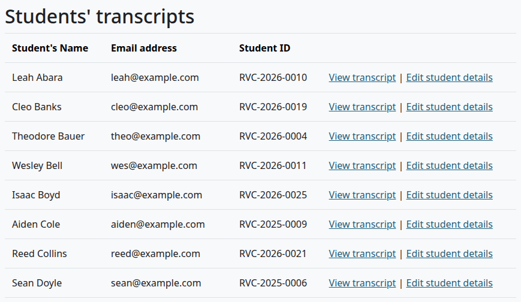

The page lists everyone with a student role in a course, in all courses, with no paging. The "Student ID" is the one on this plugin's student details, or else the ID number of the Moodle account.

Someone with no student role in any course isn't listed, such as a student who finished long ago. To reach them, open their profile and select "Academic transcript" under "Reports", or use the link on [Issued Official transcripts](#issued-official-transcripts).

## Read a student's page

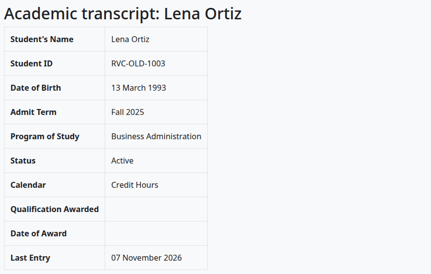

From top to bottom, the page shows:

1. Any list of what stops an Official transcript.
2. The transcript: details, transfer credit, each term, and the summary.
3. Buttons: "Download Unofficial transcript (PDF)", and for holders of `local/academictranscript:managerecords`, "Edit student details", "Transfer credit" and "Course terms".
4. "Issue Official transcript (PDF)", with the form or the reason there's no form.
5. "Official transcripts issued", when there are any, with a "Download" link on each.
6. The Transcript Key.

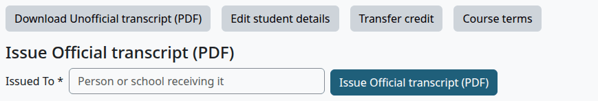

[Course terms](terms-and-course-fields.md#change-the-term-of-a-course-for-one-student) sets another term for one student. [Issue an Official transcript](teacher-guide.md#issue-an-official-transcript) has the steps for the form.

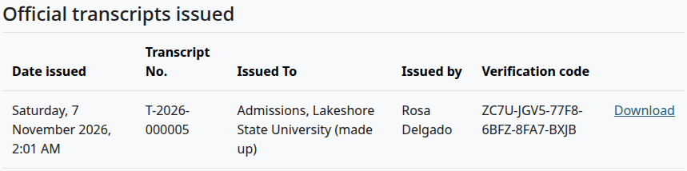

## What stops an Official transcript

The student's page lists these at the top. They stop every way of issuing. An Unofficial copy still works.

For a student on this plugin's own data, they come from the courses the student is taking now, which means any course with no posted grade for its term:

| Message | What to do |
|---|---|
| Course "Name" has no course code. | Fill in the [course fields](terms-and-course-fields.md#fill-in-the-course-fields). |
| Course "Name" has no hours. | Fill in Hours, or add a [catalog course](programs-and-catalog.md#add-or-change-a-catalog-course) with that code. |
| Course "Name" has no term. | Fill in Term, or set one for this student on [Course terms](terms-and-course-fields.md#change-the-term-of-a-course-for-one-student). |
| Course "Name" uses Clock Hours, which does not match the student's program. | Change the course's Hour type, or the student's program. |

A finished course that nobody posted stays in progress, and counts here too. A student with no courses at all can still have an Official transcript.

With Student Records as the source, other things stop it: see [With Student Records](with-student-records.md#what-stops-an-official-transcript).

## Edit student details

Who can do this: anyone who holds `local/academictranscript:managerecords` at system level.

1. On the student's page, select "Edit student details".
2. Fill in the form.
3. Select "Save changes".

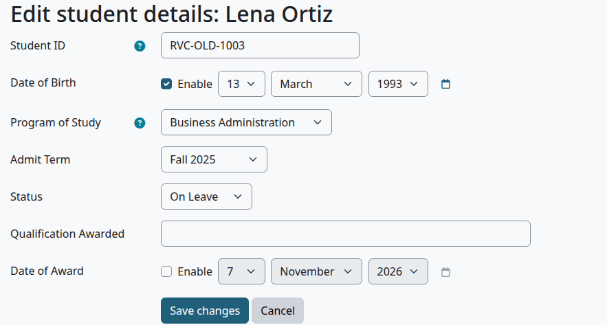

| Field | What it does | Default |
|---|---|---|
| Student ID | Prints on the transcript. Leave it empty to use the ID number from the user's profile. | The ID number from the profile |
| Date of Birth | Tick "Enable", then choose the date. It prints on the transcript and on the Unofficial copy. | Off |
| Program of Study | An active program. It decides whether the transcript shows credit hours or clock hours. | None |
| Admit Term | A term from the Terms page. | None |
| Status | "Active", "Graduated", "Withdrawn" or "On Leave". | Choose... |
| Qualification Awarded | Prints in a box headed "Degree Awarded", and as "Degree" on the verify page, whatever the award is. | Empty |
| Date of Award | Tick "Enable", then choose the date. With a qualification, the box prints "Conferred" with this date and the words "All degree requirements met". Nothing checks that. | Off |

The form has no field for a Social Security number, and the plugin stores none.

Check that:

- The page says "Student details saved." and the transcript shows the new details.

What can go wrong:

- A program that's no longer active isn't in the menu, so the form shows "None", and saving drops it.
- For a student with a file in Student Records, with that source on, these values aren't read. The page doesn't say so.

## Add or change transfer credit

Who can do this: anyone who holds `local/academictranscript:managerecords` at system level.

1. On the student's page, select "Transfer credit".
2. Select "Add transfer credit", or select "Edit" on a row.
3. Fill in the form and select "Save changes".

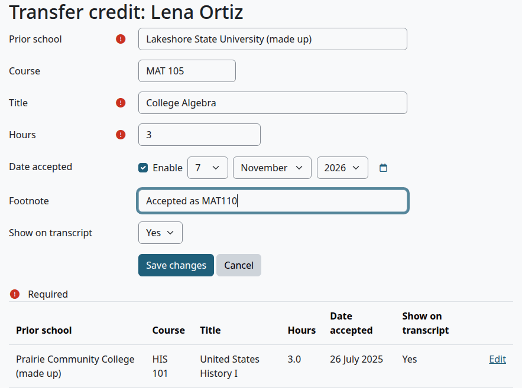

| Field | What it does | Default |
|---|---|---|
| Prior school | Required. The heading of the block on the transcript. | Empty |
| Course | The course code at that school. | Empty |
| Title | Required. | Empty |
| Hours | Required. From 0 to 5000. | Empty |
| Date accepted | Tick "Enable", then choose the date. It sets the order within a school and doesn't print. | Off |
| Footnote | Prints in italics under the title. | Empty |
| Show on transcript | "No" hides the row. There's no delete. | Yes |

Check that:

- The page says "Changes saved", and the row is in the list.
- The transcript has a block "Transfer Credit" for that school, with the grade TR and no quality points.
- The hours count in "Earned" and never in a GPA.
- The Activity log has "Transfer credit saved".

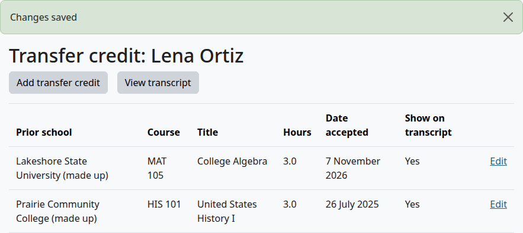

Rows are sorted by school. The list shows hours with one decimal, and a transcript shows two decimals when the hours have them.

For a student with a file in Student Records, with that source on, these rows aren't read.

## Grade change approvals

Who can do this: anyone who holds `local/academictranscript:approvechanges` at system level.

This page holds the requests teachers make with [Request change](teacher-guide.md#request-a-change-to-a-posted-grade), on this plugin's own data. With Student Records as the source, a change for a student with a file goes to Student Records and doesn't come here.

1. Go to Site administration > Plugins > Local plugins > Academic Transcript > Grade change approvals.
2. Read the "Change" and the "Reason (not printed)".
3. Optional: enter a "Note (optional)".
4. Select "Approve" or "Reject".

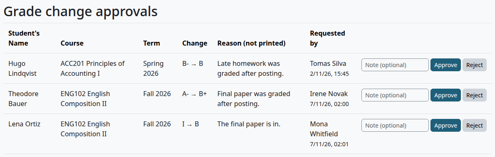

| Column | What it shows |
|---|---|
| Student's Name | The student. |
| Course | The course code and name. |
| Term | The term of the posted grade. |
| Change | The old grade, an arrow and the new grade, and the new footnote when the request changes it. |
| Reason (not printed) | Why the teacher asked. |
| Requested by | Who asked, and when. |

> Known problem in 1.4.3: a request that clears the footnote shows "(Footnote: )", with nothing after the colon. Approving it removes the footnote.

Check that:

- The page says "Change approved. The transcript now shows the new grade." or "Change rejected. The posted grade is unchanged."
- The row moves to "Change history", with the decision, the note and who made it. The table keeps the last 100 decisions.
- An approved grade shows on the transcript. Official transcripts already issued don't change.
- The gradebook stays as it was.

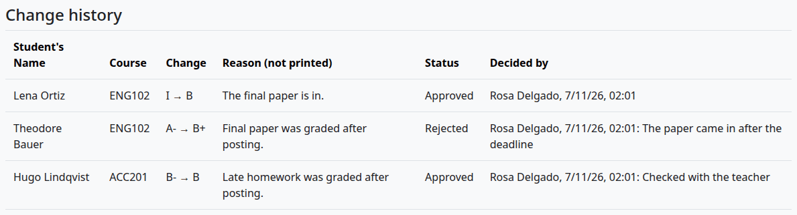

What can go wrong:

The form on a row is replaced with a message in two cases:

- "You asked for this change. Another person must approve or reject it."
- "This is your own grade. Another person must approve or reject the change."

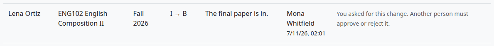

> Known problem in 1.4.3: the table can be wider than the page, for example 1280 pixels wide with the menu drawer open. "Reject" then sits past the right edge of the table. Scroll the table sideways, or close the drawer.

## Issued Official transcripts

Who can do this: anyone who holds `local/academictranscript:viewissued` at system level.

1. Go to Site administration > Plugins > Local plugins > Academic Transcript > Issued Official transcripts.
2. To get a PDF, select "Download" on the row.

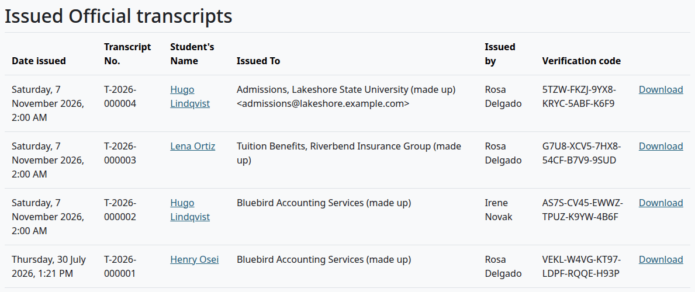

The list has every Official transcript, newest first, with no paging: from the queue and from students' pages. "Student's Name" is a link to the transcript.

A download draws the PDF again from the frozen record, so it has the same grades and code as the first one. [What stays fixed on a copy](reading-a-transcript.md#what-stays-fixed-on-a-copy) says what follows the current settings. The date in the file name is the day of the download.

What can go wrong:

- "This transcript was issued in an older layout, so it cannot be downloaded again. Its verification code still works. To give someone a new copy, issue a new Official transcript." applies only to the oldest copies, from builds before the first public release.

## Activity log

Who can do this: anyone who holds `local/academictranscript:viewissued` at system level.

1. Go to Site administration > Plugins > Local plugins > Academic Transcript > Activity log.
2. To see one student, select their name in the "Student's Name" column. "Show all" goes back.

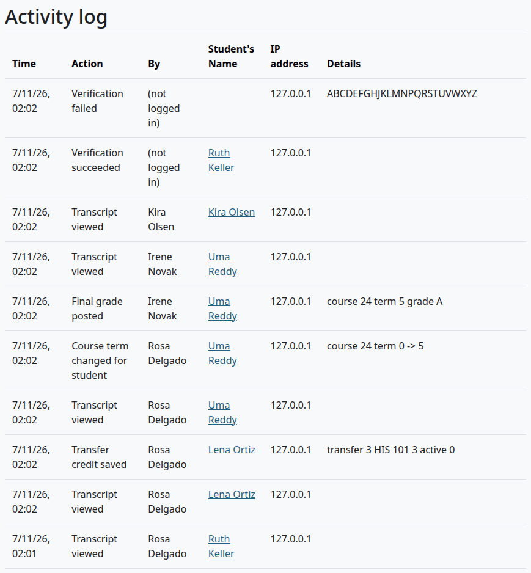

The page shows 100 entries at a time, newest first. Each entry has the time, the action, who did it, the student, the IP address and details.

| Action | When it's written |
|---|---|
| Transcript viewed | Each time a transcript page opens, for students too. |
| Unofficial transcript downloaded | At each download. |
| Official transcript issued | At each issue. Details: who it went to. |
| Official transcript downloaded again | At each download of an issued copy. |
| Verification succeeded | A code matched on the verify page. |
| Verification failed | A code didn't match. Details: what was typed. |
| Final grade posted | At each posting. |
| Grade change requested | At each Request change. |
| Grade change approved | At each approval. |
| Grade change rejected | At each rejection. |
| Transfer credit saved | At each save. |
| Course term changed for student | At each change on Course terms. |
| Official transcript requested | At each request. Details: how and when. |
| Official transcript request issued | At each Issue on the queue. |
| Official transcript request cancelled | At each Cancel. Details: the reason. |
| Saved, but a later step failed | The work was saved, and something after it failed. Details: the error. |

Someone who wasn't signed in shows as "(not logged in)". There's no export, and nothing deletes old entries.

Editing student details writes no entry here. A change to a transcript code goes in Moodle's own logs, under Site administration > Reports > Logs, as "Transcript code updated".

## Related pages

- [Registrar guide](registrar-guide.md)
- [Teacher guide](teacher-guide.md)
- [Terms and course fields](terms-and-course-fields.md)
- [Reading a transcript](reading-a-transcript.md)
- [Privacy and uninstall](privacy-and-uninstall.md)
