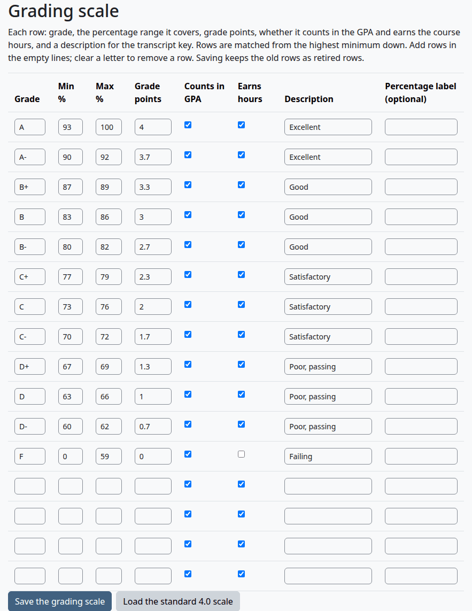
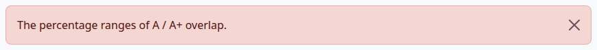
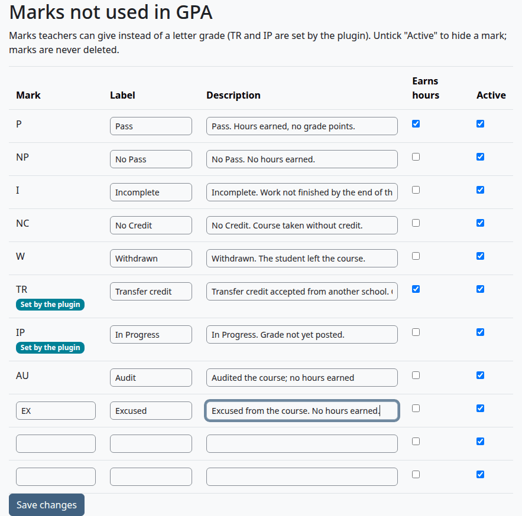

# Grading scale and marks

This page is for whoever sets up a school's grades. It explains how a course total becomes a letter, how to edit the grading scale and the marks, and what the rounding and repeat settings do.

It describes students on this plugin's own data. With Student Records as the source, a student with a file there is counted on the scale in Student Records: see [With Student Records](with-student-records.md).

## Contents

- [How a letter is chosen](#how-a-letter-is-chosen)
- [The standard scale](#the-standard-scale)
- [Load the standard scale](#load-the-standard-scale)
- [Edit the grading scale](#edit-the-grading-scale)
- [What a change to the scale reaches](#what-a-change-to-the-scale-reaches)
- [Marks](#marks)
- [Add, change or hide a mark](#add-change-or-hide-a-mark)
- [Rounding](#rounding)
- [Repeated courses](#repeated-courses)
- [Quality points and GPA](#quality-points-and-gpa)
- [Load a scale or marks from a CSV file](#load-a-scale-or-marks-from-a-csv-file)
- [How AI drafts fit in](#how-ai-drafts-fit-in)
- [Related pages](#related-pages)

## How a letter is chosen

When a teacher posts a final grade with no transcript code, the plugin works out the letter from the course total in the gradebook:

1. It reads the student's course total as a percentage. [Post final grades](teacher-guide.md#post-final-grades) has a known problem with a course that has ungraded items.
2. With "Round to whole percent" on, it rounds the percentage to a whole number. A half rounds up, so 89.5 becomes 90.
3. It goes through the rows of the scale from the highest "Min %" down. The first row whose "Min %" is at or below the percentage gives the letter.

"Max %" plays no part in this. It prints in the Transcript Key and is checked when you save. So a gap between two rows falls to the lower row, and a total above the top row's maximum still gets the top letter.

If no row is at or below the percentage, Post final grades shows "The grading scale has no grade for this percentage" for that student, and there's no box to tick.

## The standard scale

A new install loads this scale. It's a starting point, and you can edit every value.

| Grade | Min % | Max % | Grade points | Counts in GPA | Earns hours | Description |
|---|---|---|---|---|---|---|
| A | 93 | 100 | 4.0 | Yes | Yes | Excellent |
| A- | 90 | 92 | 3.7 | Yes | Yes | Excellent |
| B+ | 87 | 89 | 3.3 | Yes | Yes | Good |
| B | 83 | 86 | 3.0 | Yes | Yes | Good |
| B- | 80 | 82 | 2.7 | Yes | Yes | Good |
| C+ | 77 | 79 | 2.3 | Yes | Yes | Satisfactory |
| C | 73 | 76 | 2.0 | Yes | Yes | Satisfactory |
| C- | 70 | 72 | 1.7 | Yes | Yes | Satisfactory |
| D+ | 67 | 69 | 1.3 | Yes | Yes | Poor, passing |
| D | 63 | 66 | 1.0 | Yes | Yes | Poor, passing |
| D- | 60 | 62 | 0.7 | Yes | Yes | Poor, passing |
| F | 0 | 59 | 0.0 | Yes | No | Failing |

## Load the standard scale

Who can do this: anyone who holds `local/academictranscript:configure`. That's site administrators and managers by default.

You can start again from the standard scale in two places:

- On step 2 of the [setup wizard](install-and-setup.md#step-2-grading), select "Load the standard 4.0 scale". The scale changes at once, with no question first.
- On the Grading scale page, select "Load the standard 4.0 scale". Your browser asks "Replace the current grading scale with the standard 4.0 scale? The current rows are kept as retired rows." Select OK.

Check that:

- The page says "The standard 4.0 scale is loaded. Edit any row to match your policy."

## Edit the grading scale

Who can do this: anyone who holds `local/academictranscript:configure`.

1. Go to Site administration > Plugins > Local plugins > Academic Transcript > Grading scale.
2. Change a value in a row. To add a row, use one of the four empty rows at the bottom. To remove a row, clear its "Grade" box.
3. Select "Save the grading scale".

| Column | What it does |
|---|---|
| Grade | The letter, up to 10 characters. It prints on the transcript. A row with an empty "Grade" is left out when you save. |
| Min % | The lowest percentage for this letter. This is the number that chooses the letter. |
| Max % | The highest percentage. It prints in the Transcript Key. |
| Grade points | The points per credit or clock hour, from 0 to 100. |
| Counts in GPA | Ticked: the hours and quality points of this letter go in the GPA. Unticked: the transcript still prints the quality points, and they add nothing to the GPA. |
| Earns hours | Ticked: a student with this letter earns the course's hours. |
| Description | The wording in the Transcript Key. Rows next to each other with the same description share one cell there. |
| Percentage label (optional) | Text for the Transcript Key in place of the range, such as "Above 92%". Empty means the key prints `90-92%`, or `Below 60%` for a row that starts at 0. |

Both boxes are ticked on an empty row.

Check that:

- The page says "Grading scale saved."
- The Transcript Key on a student's transcript shows the new rows.

What can go wrong:

- The page shows an error and nothing is saved.

> Known problem in 1.4.3: after an error, the rows on the page are the saved rows again, and what you typed is gone. Type your changes once more.

| Message | What it means |
|---|---|
| The grading scale needs at least one row. | Every "Grade" box is empty. |
| Grade A appears twice. | Two rows have the same letter. |
| Grade A: the minimum must not be above the maximum (0 to 1000). | "Min %" is above "Max %", "Min %" is below 0, or "Max %" is above 1000. |
| Grade A: grade points must be between 0 and 100. | The points are out of range. |
| The percentage ranges of A / A+ overlap. | One row's minimum is at or below the maximum of the row under it. Two rows with the same minimum don't count as an overlap. |

## What a change to the scale reaches

Saving replaces the whole scale. The old rows are kept in the database as retired rows, and nothing reads them again.

Transcripts are worked out each time they're viewed, from the scale in use at that moment. So:

- A change reaches every transcript that isn't issued, old terms included.
- Official transcripts already issued keep the grades, points and key they had. See [What stays fixed](reading-a-transcript.md#what-stays-fixed-on-a-copy).
- A posted letter that is no longer on the scale gets no grade points, no GPA hours and no hours earned. The transcript prints the letter again as a note under the course, and nothing warns you. So keep a letter on the scale for as long as a student has it, or change those grades first.

## Marks

Marks are the entries that aren't letter grades and don't count in the GPA. A new install loads these.

| Mark | Label | Description in the key | Earns hours |
|---|---|---|---|
| P | Pass | Pass. Hours earned, no grade points. | Yes |
| NP | No Pass | No Pass. No hours earned. | No |
| I | Incomplete | Incomplete. Work not finished by the end of the term; replaced by a final grade when finished. | No |
| NC | No Credit | No Credit. Course taken without credit. | No |
| W | Withdrawn | Withdrawn. The student left the course. | No |
| TR | Transfer credit | Transfer credit accepted from another school. Counts toward hours earned, not toward GPA. | Yes |
| IP | In Progress | In Progress. Grade not yet posted. | No |

TR and IP are set by the plugin. The Marks page shows them with the badge "Set by the plugin", and teachers can't choose them on [Transcript codes](teacher-guide.md#enter-a-transcript-code). You can still edit their label and description.

A mark's label prints as a note under the course on the transcript, unless the teacher typed a note. Its description prints in the Transcript Key.

## Add, change or hide a mark

Who can do this: anyone who holds `local/academictranscript:configure`.

1. Go to Site administration > Plugins > Local plugins > Academic Transcript > Marks not used in GPA.
2. To add a mark, fill in one of the three empty rows at the bottom. To change a mark, edit its row. To hide a mark, untick "Active".
3. Select "Save changes".

| Column | What it does |
|---|---|
| Mark | The code, up to 10 letters, digits, hyphens or underscores. It's upper-cased. You can't change the code of a saved mark. |
| Label | The name teachers see in the Transcript codes menu, and the note under the course on the transcript. |
| Description | The wording in the Transcript Key. With no description, the key prints the label. |
| Earns hours | Ticked: a student with this mark earns the course's hours. |
| Active | Unticked: the mark is hidden. Marks are never deleted. |

On step 3 of the wizard, "Add the standard marks that are missing" puts back any standard mark whose code isn't in the list at all. It leaves marks you edited or hid as they are.

Check that:

- The page says "Marks saved."
- The new mark shows in the "Transcript code" menu on [Transcript codes](teacher-guide.md#enter-a-transcript-code).

What can go wrong:

- A mark you hide stops earning hours on every transcript that isn't issued, and it leaves the Transcript Key.
- Hiding a mark also takes it out of the Transcript codes menu. If a student has that code, the next person who selects "Save changes" on that page clears it.

> Known problem in 1.4.3: while such a code is still saved, Post final grades ignores it, and offers the letter from the course total with no warning. Show the mark again before anyone posts grades in that course.

## Rounding

The setting "Round to whole percent" is on the [Transcript look](install-and-setup.md#step-5-transcript-look) step of the wizard and on [Transcript settings](settings.md#grades-and-hours). It's on by default.

| Course total | Rounding on | Rounding off |
|---|---|---|
| 89.5% on the standard scale | Rounds to 90, so A- | Stays at 89.5, so B+ |
| 92.4% on the standard scale | Rounds to 92, so A- | Stays at 92.4, so A- |

The text beside the setting gives the example "93.5% becomes 94% = A". That example fits a scale where A starts at 94. On the standard scale, A starts at 93, so 93.5 and 93.9 are both A with rounding on or off.

## Repeated courses

The setting "Repeated courses" decides which attempts of a course count when a student takes it more than once. It's on the [Transcript look](install-and-setup.md#step-5-transcript-look) step and on [Transcript settings](settings.md#grades-and-hours).

| Option | What counts |
|---|---|
| Only the latest attempt counts (the default) | The attempt in the latest term. Within one term, the one posted last. |
| Only the highest grade counts | The attempt with the most grade points. A mark that earns hours, such as P, ranks below every letter. On a tie, the latest wins. |
| All attempts count | Every attempt. |

The rule works on the course code, in upper or lower case. Only attempts with a letter, or with a mark that earns hours, are repeats. So with the standard marks, W, I, NP, NC and IP never make a repeat.

All attempts stay on the transcript. An attempt that doesn't count keeps its row and its printed quality points, adds nothing to the totals, and has the note "Repeated course: not counted in GPA or hours earned (another attempt counts)."

Each Moodle course has a unique course code, so a repeat on this plugin's own data means the same Moodle course in another term. [Repeat a course in the same Moodle course](terms-and-course-fields.md#repeat-a-course-in-the-same-moodle-course) shows how.

What can go wrong:

- The default wording of the "How GPA Is Figured" section of the Transcript Key says "only the latest grade counts in GPA". It doesn't follow this setting. If you choose another rule, change that text on [Transcript settings](settings.md#transcript-key-last-page).

## Quality points and GPA

- Quality points of a course = hours x grade points.
- GPA = total quality points / total GPA hours, printed with two decimals. A half rounds up.
- A course's GPA hours are its hours when its letter has "Counts in GPA" ticked and the attempt counts.
- Marks have no grade points, so the transcript prints `-` for their quality points.
- A term's GPA and the overall GPA each come from their exact sums, not from an average of other GPAs.
- Transfer credit on this plugin's own data prints as TR, adds to the hours earned, and is never in a GPA.

With no GPA hours, the transcript prints `-` for the GPA.

## Load a scale or marks from a CSV file

Who can do this: anyone who holds `local/academictranscript:configure`.

The wizard's Grading and Marks steps can read a CSV file. Each row becomes a draft, and nothing changes until you approve it. [Use a CSV file](programs-and-catalog.md#use-a-csv-file) has the steps, the columns and the sample rows.

What can go wrong:

- Approving grade drafts replaces the whole scale with the rows you ticked, as the warning on the page says. Tick every row you want to keep. Any percentage labels are lost, because a draft has no such field.
- Approving a mark updates the mark with the same code, and makes it active again.

## How AI drafts fit in

The wizard's Grading, Marks and Programs and hours steps can also read your documents with the site's AI provider. The provider proposes grades, marks, programs and courses. They arrive as drafts on the same [Drafts to review](programs-and-catalog.md#drafts-to-review) page as CSV rows, each next to the text it came from. [Read documents with an AI provider](programs-and-catalog.md#read-documents-with-an-ai-provider) has the details.

## Related pages

- [Install and set up](install-and-setup.md)
- [Programs and catalog](programs-and-catalog.md)
- [Transcript settings](settings.md)
- [Teacher guide](teacher-guide.md)
- [Reading a transcript](reading-a-transcript.md)
