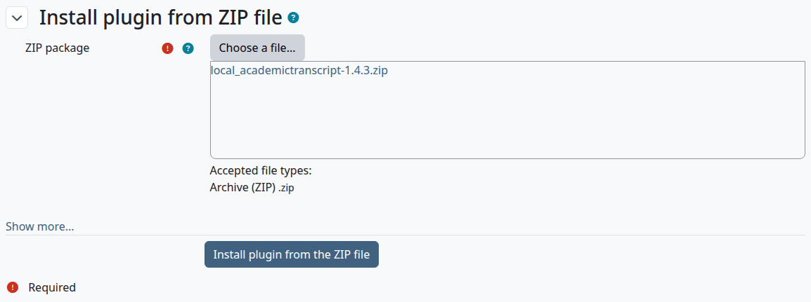
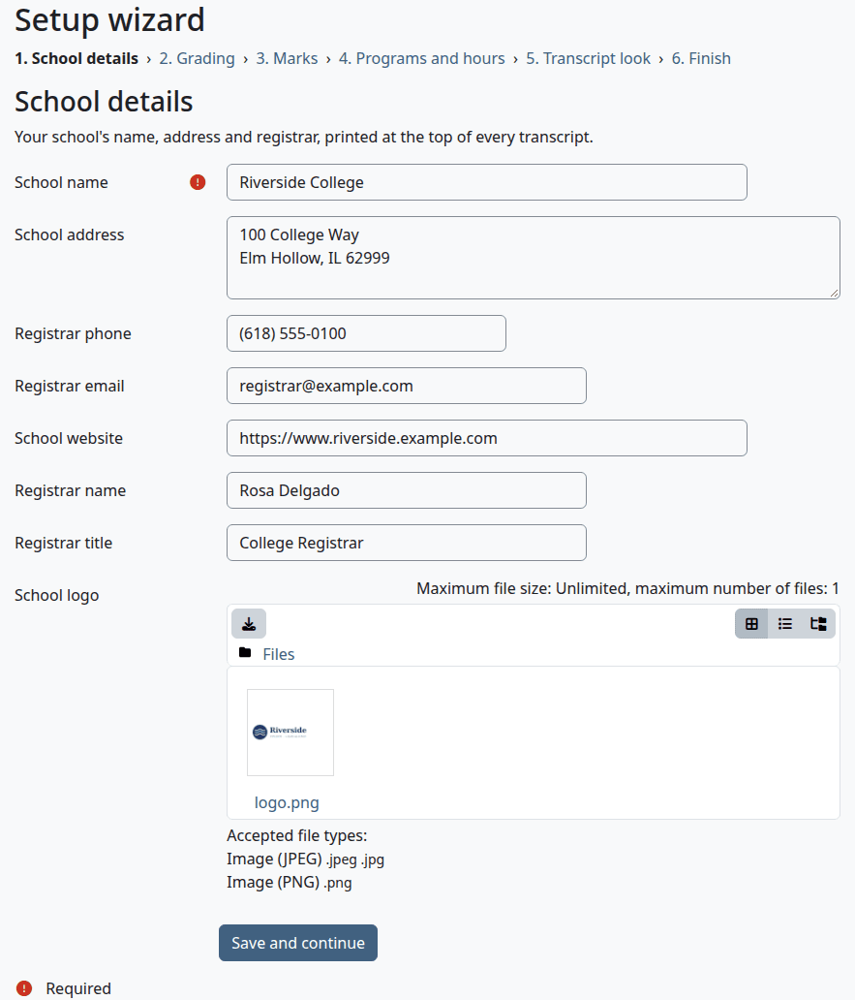
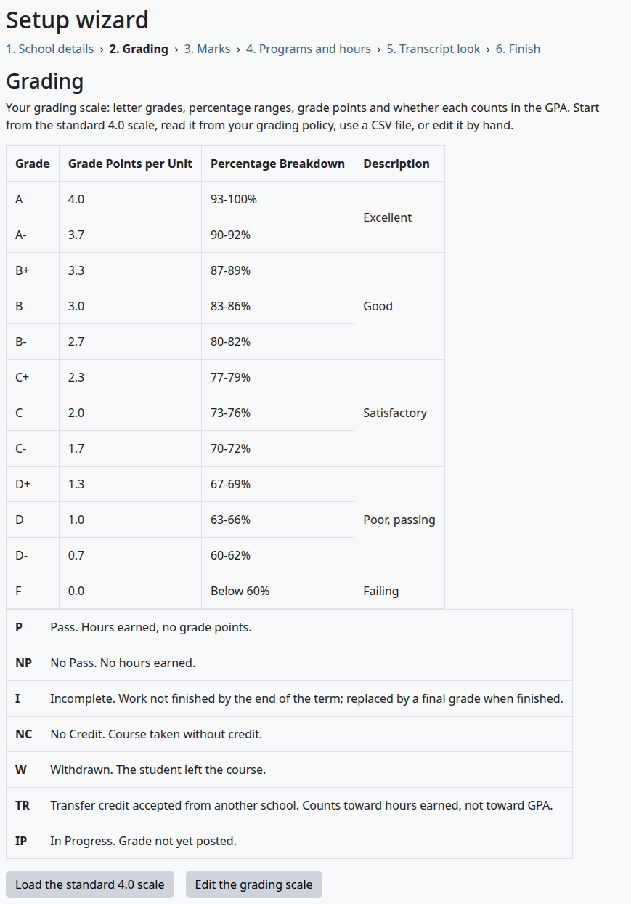
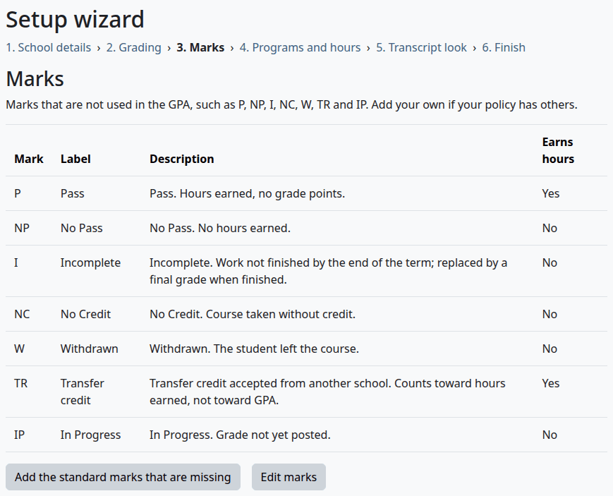
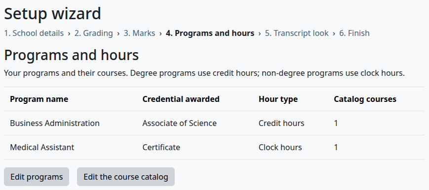
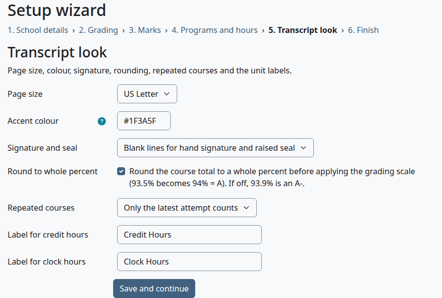
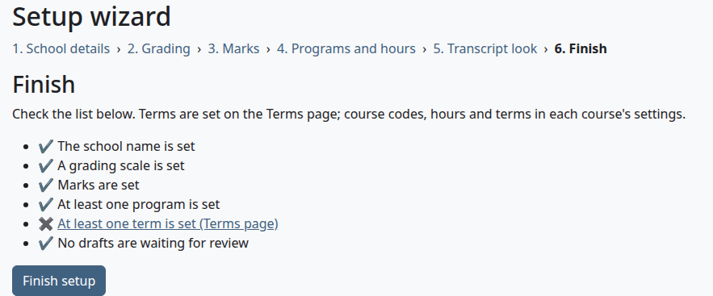

# Install and set up Academic Transcript

This page takes a site administrator from the plugin's ZIP file to a site that's ready for its first term: the requirements, both ways to install, the six steps of the setup wizard, and what to do after it.

## Contents

- [Requirements](#requirements)
- [Install from a ZIP file](#install-from-a-zip-file)
- [Install by hand](#install-by-hand)
- [What the install does](#what-the-install-does)
- [The setup wizard](#the-setup-wizard)
- [Step 1: School details](#step-1-school-details)
- [Step 2: Grading](#step-2-grading)
- [Step 3: Marks](#step-3-marks)
- [Step 4: Programs and hours](#step-4-programs-and-hours)
- [Step 5: Transcript look](#step-5-transcript-look)
- [Step 6: Finish](#step-6-finish)
- [After the wizard](#after-the-wizard)
- [Related pages](#related-pages)

## Requirements

| What | Needed |
|---|---|
| Moodle | 4.5 to 5.3 |
| PHP | 8.1 to 8.4. Moodle 4.5 needs PHP 8.1 or later, Moodle 5.0 and 5.1 need 8.2 or later, and Moodle 5.2 and 5.3 need 8.3 or later. |
| Database | PostgreSQL, MySQL or MariaDB |
| PHP OpenSSL extension | Moodle needs it anyway. The plugin uses it to sign Official transcripts. Without it, Official transcripts are issued unsigned and print "Digital signature not available on this server." |
| AI provider | Optional. A provider with the "Generate text" action, under Site administration > AI > AI providers, reads documents in the wizard. Without one, use the forms or CSV files. |
| Student Records | Optional. `local_studentrecords` 1.4.6 or later. See [With Student Records](with-student-records.md). |

## Install from a ZIP file

Who can do this: site administrators.

Before you start:

- You have a backup of the database and the Moodle data folder.
- You have `local_academictranscript-<release>.zip` from the [releases page](https://github.com/Clouve/moodle-plugins/releases). Don't unzip it.

1. Go to Site administration > Plugins > Install plugins.
2. Drop the ZIP file into "ZIP package", or select "Choose a file..." and upload it. Moodle detects the plugin type, so leave the other fields alone.
3. Select "Install plugin from the ZIP file".
4. Moodle checks the file and says "Validation successful, installation can continue". Select "Continue".
5. Moodle lists the plugin as "To be installed". Select "Upgrade Moodle database now".
6. On the page that reports the install, select "Continue".
7. On the "New settings" page, select "Save changes". You can change every setting later.

> Not walked through: step 4's "Continue" replaces the plugin folder, and the test sites share one code folder, so this step wasn't taken there. The steps before it and after it were.

Check that:

- Site administration > Plugins > Local plugins has a category "Academic Transcript".

What can go wrong:

- If Moodle says the plugin installer is disabled, or that the plugin type location isn't writable, [install by hand](#install-by-hand).

## Install by hand

Who can do this: a site administrator who can write to the Moodle code folder.

1. Unzip the file.
2. Put the folder `academictranscript` in the Moodle code folder: at `public/local/academictranscript` on Moodle 5.1 and later, and at `local/academictranscript` on Moodle 5.0 and earlier.
3. Make sure the web server can read the files.
4. Sign in as a site administrator and go to Site administration > Notifications.
5. On the page with the server checks, select "Continue".
6. Follow steps 5 to 7 of [Install from a ZIP file](#install-from-a-zip-file).

## What the install does

- It adds a section "Transcript" with four fields to the settings of every course. See [Course fields](terms-and-course-fields.md#course-fields).
- It loads the [standard 4.0 grading scale and the standard marks](grading-and-marks.md#the-standard-scale).
- It marks the setup as not finished.

Until the setup is finished, anyone who holds `local/academictranscript:configure` is sent to the wizard from these pages, with the message "Please finish the Academic Transcript setup first.": Students' transcripts, Grade change approvals, Issued Official transcripts, Activity log and Course codes check. A student's transcript shows them a link to the wizard. People without that capability use the pages as usual.

## The setup wizard

Who can do this: anyone who holds `local/academictranscript:configure`. That's site administrators and managers by default.

Go to Site administration > Plugins > Local plugins > Academic Transcript > Setup wizard. On Moodle 4.5, staff who aren't site administrators find the category under Site administration > Plugins.

The wizard has six steps, and a line at the top of each lets you jump to any step. You can come back at any time, even after you finish. It doesn't cover the source of the transcript, the fees, the footer, the Transcript Key, the signature images or the signing certificate: those are on [Transcript settings](settings.md), which needs a site administrator.

## Step 1: School details

These values print at the top of every transcript.

1. Fill in the form.
2. Select "Save and continue".

| Field | What it does | Required |
|---|---|---|
| School name | Prints at the top of the transcript and on the verify page. | Yes |
| School address | Prints under the school name, with its line breaks as commas. | No |
| Registrar phone | Prints under the school name, and on the verify page. | No |
| Registrar email | Prints under the school name, and on the verify page. | No |
| School website | Prints under the school name. | No |
| Registrar name | Prints with the signature. | No |
| Registrar title | Prints with the signature. | No |
| School logo | One PNG or JPG file. Prints at the top left. | No |

What can go wrong:

- "You must supply a value here." under School name means the box is empty.

## Step 2: Grading

This step shows the grading scale and the marks as the Transcript Key prints them.

Choose one way to set the scale, then select "Next step".

| Way | What to do |
|---|---|
| Keep the standard scale | Nothing. It's already loaded. |
| Go back to the standard scale | Select "Load the standard 4.0 scale". The scale changes at once, with no question first. |
| Edit the rows by hand | Select "Edit the grading scale". [Edit the grading scale](grading-and-marks.md#edit-the-grading-scale) has the steps. That page doesn't bring you back, so open the Setup wizard again from the Academic Transcript category. |
| Use a CSV file | Under "From CSV files", upload the file. See [Use a CSV file](programs-and-catalog.md#use-a-csv-file). |
| Read your grading policy with AI | Under "From your documents (AI)", upload the policy. See [Read documents with an AI provider](programs-and-catalog.md#read-documents-with-an-ai-provider). |

A CSV file or a document makes drafts. A yellow box "Review 5 draft(s): Grading scale" links to them until you decide them.

> Not walked through: the rows "with AI" in this step and the next two need a real AI provider, so no test site can show them. The steps come from the code.

## Step 3: Marks

Marks are the entries that don't count in the GPA, such as P, NP, I, NC, W, TR and IP.

| Way | What to do |
|---|---|
| Keep the standard marks | Nothing. They're already loaded. |
| Put back a standard mark | Select "Add the standard marks that are missing". |
| Edit them by hand | Select "Edit marks". See [Add, change or hide a mark](grading-and-marks.md#add-change-or-hide-a-mark). |
| Use a CSV file | Under "From CSV files", upload the file. |
| Read your policy with AI | Under "From your documents (AI)", upload it. |

Select "Next step" when you're done.

## Step 4: Programs and hours

A student's program decides whether the transcript shows credit hours or clock hours. The step lists the active programs, with the number of active catalog courses of each.

| Way | What to do |
|---|---|
| Add programs by hand | Select "Edit programs". See [Add or change a program](programs-and-catalog.md#add-or-change-a-program). |
| Add catalog courses by hand | Select "Edit the course catalog". See [Add or change a catalog course](programs-and-catalog.md#add-or-change-a-catalog-course). |
| Use a CSV file | Under "From CSV files", choose "Programs" or "Courses" and upload the file. Upload the programs first, because a course finds its program by name. |
| Read your catalog with AI | Under "From your documents (AI)", upload it. |

Select "Next step" when you're done.

## Step 5: Transcript look

1. Change what you need.
2. Select "Save and continue".

| Field | What it does | Default |
|---|---|---|
| Page size | "US Letter" or "A4". | US Letter |
| Accent colour | Six hex digits, for the colour of headings, borders and lines. | #1F3A5F |
| Signature and seal | "Blank lines for hand signature and raised seal", or "Print the uploaded signature and seal images". You upload the images on [Transcript settings](settings.md#signature-seal-and-digital-signature). | Blank lines |
| Round to whole percent | The text beside the box says "Round the course total to a whole percent before applying the grading scale (93.5% becomes 94% = A). If off, 93.9% is an A-." With the box ticked, the course total is rounded to a whole percent, a half up, and then the scale gives the letter. With it clear, the scale reads the exact total. The two examples fit only a scale where A starts at 94. On the standard scale A starts at 93, so 93.5 and 93.9 are both A, ticked or not. See [Rounding](grading-and-marks.md#rounding). | On |
| Repeated courses | See [Repeated courses](grading-and-marks.md#repeated-courses). | Only the latest attempt counts |
| Label for credit hours | Prints as "Calendar" on transcripts of credit-hour students. | Credit Hours |
| Label for clock hours | Prints as "Calendar" on transcripts of clock-hour students. | Clock Hours |

What can go wrong:

- "Enter a colour as # and six hex digits, e.g. #1F3A5F." means "Accent colour" isn't six hex digits. The `#` is optional.

## Step 6: Finish

The step checks six things. A cross means that one is open.

| Check | How to close it |
|---|---|
| The school name is set | Step 1. |
| A grading scale is set | Step 2. |
| Marks are set | Step 3. |
| At least one program is set | Step 4. |
| At least one term is set (Terms page) | Select the line, which opens the Terms page. See [Add a term](terms-and-course-fields.md#add-a-term). |
| No drafts are waiting for review | Approve or reject them on [Drafts to review](programs-and-catalog.md#drafts-to-review). |

1. Close what's open.
2. Select "Finish setup".

Check that:

- Moodle opens the Academic Transcript category and says "Setup finished. You can come back to the setup wizard at any time."
- Issued Official transcripts opens, and no longer sends you to the wizard.

What can go wrong:

- "Finish setup" works with a check still open, and no screen undoes it. So read the list first. The pages stay open to you either way, and you can fix what's open afterwards.
- The Terms page needs `local/academictranscript:managerecords`. Someone who holds only `local/academictranscript:configure` gets "Access denied" on that link.

## After the wizard

1. Add your terms on the Terms page, if you haven't yet. See [Add a term](terms-and-course-fields.md#add-a-term).
2. Fill in the Transcript section of each course's settings. The [Course codes check](terms-and-course-fields.md#course-codes-check) lists what's missing, and the [command line script](terms-and-course-fields.md#set-course-fields-from-the-command-line) sets codes and hours for many courses at once.
3. As a site administrator, edit the [Transcript Key](settings.md#transcript-key-last-page) and the [footer](settings.md#look-of-the-transcript). The defaults are templates written for a US school. Replace everything in [brackets], and keep only statements that are true for your school.
4. As a site administrator, set the [fees](settings.md#official-transcript-fees) if you take requests.
5. Optional: as a site administrator, upload a [signing certificate](settings.md#upload-a-signing-certificate). Without one, the plugin signs with a self-signed certificate, and PDF readers show the signer as not trusted.
6. Optional: enter each student's details and any transfer credit. See the [Admin guide](admin-guide.md). A student's program decides whether the transcript shows credit hours or clock hours.
7. To read the transcript from Student Records, see [With Student Records](with-student-records.md).

## Related pages

- [Academic Transcript](README.md)
- [Transcript settings](settings.md)
- [Grading scale and marks](grading-and-marks.md)
- [Programs and catalog](programs-and-catalog.md)
- [Terms and course fields](terms-and-course-fields.md)
- [Privacy and uninstall](privacy-and-uninstall.md)
