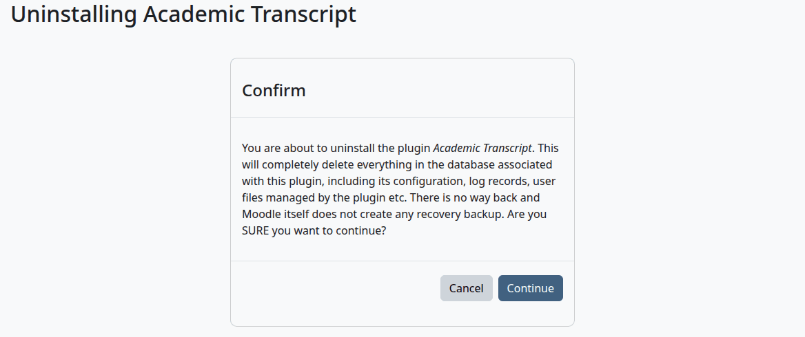

# Privacy and uninstall

This page is for site administrators and data protection staff. It says what the plugin stores, how Moodle's privacy tools treat it, and what happens to the data and the course fields when you remove the plugin.

This manual gives no legal advice, FERPA advice included.

## Contents

- [What the plugin stores](#what-the-plugin-stores)
- [Export or delete a person's data](#export-or-delete-a-persons-data)
- [What a deletion doesn't reach](#what-a-deletion-doesnt-reach)
- [What leaves the site](#what-leaves-the-site)
- [Before you uninstall](#before-you-uninstall)
- [Uninstall the plugin](#uninstall-the-plugin)
- [What stays after an uninstall](#what-stays-after-an-uninstall)
- [Install it again](#install-it-again)
- [Related pages](#related-pages)

## What the plugin stores

The student is the person the data is about. Everything below is stored against the student, except where the table says otherwise.

| What | What it holds |
|---|---|
| Student details | Student ID, date of birth, program, admit term, status, qualification and award date. No Social Security number. |
| Transcript codes | The code, the note, the reason, and any term set for this student. |
| Transfer credit | The school, the course, the hours and the date. |
| Posted grades | One row for each attempt: the course, the term, the hours, the percentage, the grade, the note and who posted it. |
| Grade change requests | The old and new grade, the reason, who asked, who decided, and the decision note. |
| Issued Official transcripts | The verification code, the recipient, the number, and a frozen copy of the whole transcript. |
| Requests | How to send it, the recipient's name, email or address, the timing, the fee and the state. These can hold details of the person who receives the transcript. |
| Activity log | What was done, by whom, about which student, with the IP address and details. It also holds the IP address of anyone who checks a code on the verify page, including people who aren't users. |
| Drafts | Items read from uploaded files. A draft belongs to the person who uploaded the file. |

The grading scale, marks, programs, catalog and terms are the school's settings. They record who last changed them.

Nothing deletes old log entries, drafts or retired scale rows.

## Export or delete a person's data

Who can do this: a site administrator or a privacy officer, in Moodle's privacy tools.

The plugin takes part in Moodle's data requests, under Site administration > Users > Privacy and policies > Data requests. You don't need to do anything for this plugin alone.

> Not walked through: a data request runs in Moodle's own tools. This section says what the plugin hands to them, from the code.

An export or a deletion for a student covers the student's details, codes, transfer credit, posted grades and their change requests, issued Official transcripts, requests, drafts they uploaded, and the log entries about them.

An export includes the frozen copy of each Official transcript. In the log entries about a student, the IP address shows only on entries the student made.

Staff who only acted on a student's rows are named in those rows, and the rows are exported and deleted for the student, not for the staff member.

## What a deletion doesn't reach

- Deleting a student's data deletes their issued transcripts too, so those verification codes stop working.
- Files uploaded to the wizard stay in the Moodle data folder until you uninstall the plugin.
- A change request on another student's grade stays, even if this person asked for it or decided it.
- What a student has in Student Records is that plugin's to export or delete.

## What leaves the site

With an AI provider, the text of the documents you upload to the wizard goes to that provider. The plugin sends nothing else outside the site, and it sends no email.

The verify page shows the student's name, the date, the transcript number, the award or program and the recipient to anyone with the code.

## Before you uninstall

Uninstalling deletes all the plugin's data: the grading scale, marks, programs, catalog, terms, student details, codes and notes, transfer credit, posted grades, change requests, issued Official transcripts, requests, the activity log, drafts, the settings and the uploaded files.

Verification codes printed on Official transcripts stop working, and the QR codes on them lead to a page that no longer exists.

So back up what you need first. There's no export of these records outside Moodle's privacy tools, so download the PDFs you must keep, and back up the database.

## Uninstall the plugin

Who can do this: site administrators.

1. Go to Site administration > Plugins > Plugins overview.
2. Find Academic Transcript under Local plugins, and select "Uninstall".
3. Read the page and select "Continue".
4. Moodle deletes the data and asks "Do you want to remove the plugin folder now?". Select "Continue".
5. If Moodle can't delete the folder, it tells you to remove it by hand. Delete `public/local/academictranscript` from your Moodle code folder on Moodle 5.1 and later, and `local/academictranscript` before that. Don't leave the folder in place, or Moodle offers to install the plugin again.



> Not walked through: step 4's "Continue" and step 5 remove the plugin folder, and the test sites share one code folder, so these weren't done there. The steps before them were.

Check that:

- Academic Transcript is gone from Plugins overview, and its category from Local plugins.

## What stays after an uninstall

- The Course code, Hours and Hour type fields stay, with the values saved on courses. They are no longer required, unique or locked, so courses stay editable.
- The Term field is deleted with its values. They only pointed into the plugin's term list.
- The category Transcript stays. To remove it, go to Site administration > Courses > Default settings > Course custom fields and delete the category. That deletes the fields in it and their values on courses. Move the fields you want to keep to another category first.
- The folder `local_academictranscript` in the Moodle data folder is deleted. It holds the self-signed key that signed Official transcripts.

If Moodle can't delete a file in that folder, it shows no message, and the folder stays with what's left in it. Look for it in the Moodle data folder, which is the `dataroot` setting in `config.php`. Delete it by hand as a user who may delete those files. For example:

```bash
rm -r /var/moodledata/local_academictranscript
```

## Install it again

If you install the plugin again later, it finds the three kept fields by their short names and sets them up as before: the Course code is required and unique, and all three are locked. It creates the Term field again, locked, with an empty term list.

Everything else starts fresh, with the standard scale and marks, and the setup not finished.

The uninstall also took this plugin's capabilities out of every role. A new install gives them back only to Moodle's standard roles, such as Manager and Teacher, so add them again to the roles you made.

## Related pages

- [Install and set up](install-and-setup.md)
- [Transcript settings](settings.md)
- [Verify a transcript](verify.md)
- [Admin guide](admin-guide.md)
- [Student Records: privacy and uninstall](../student-records/privacy-and-uninstall.md)
