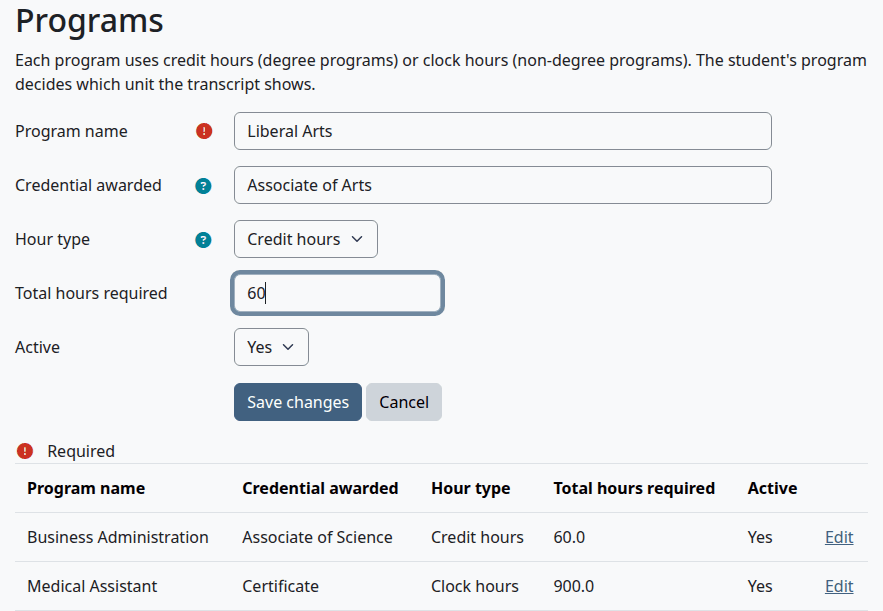
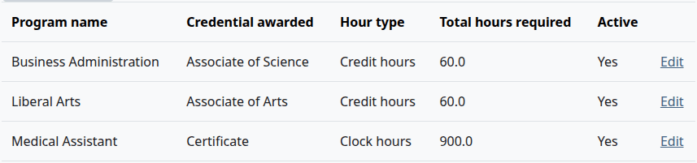
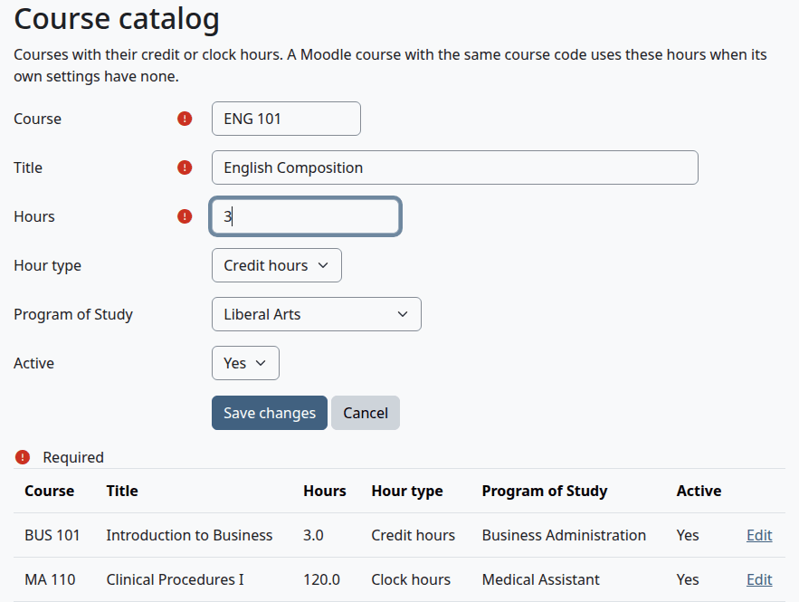
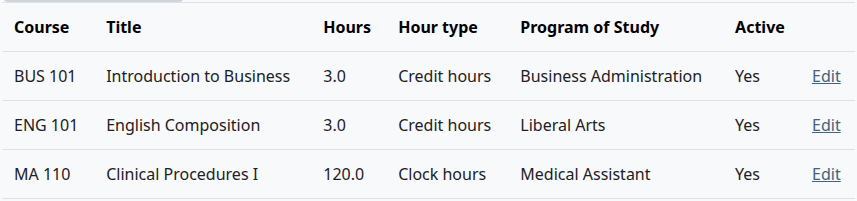
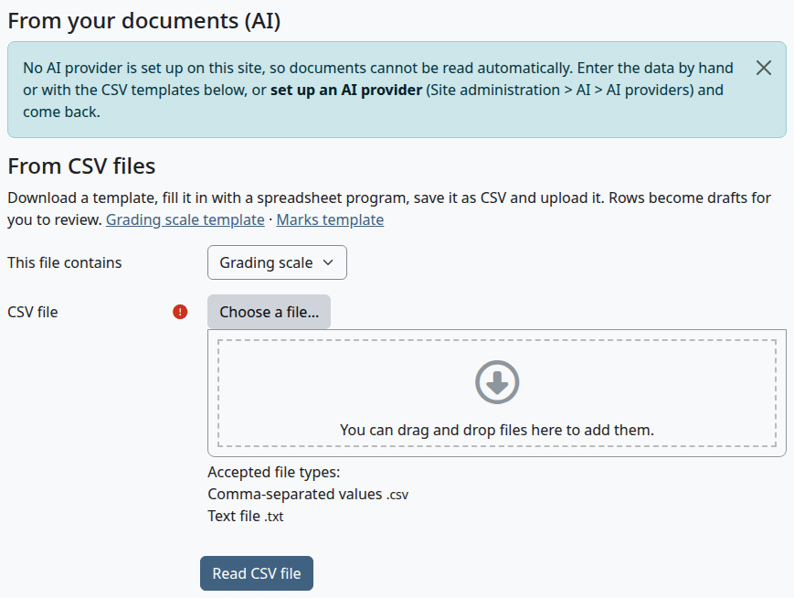
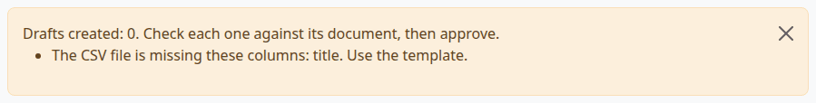
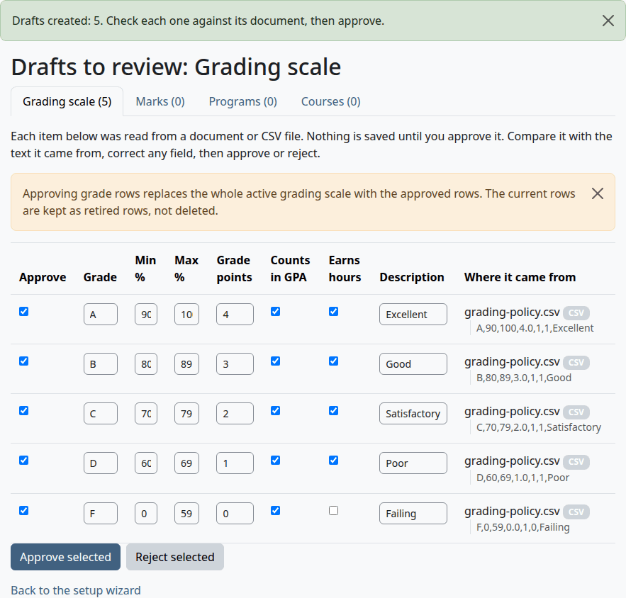
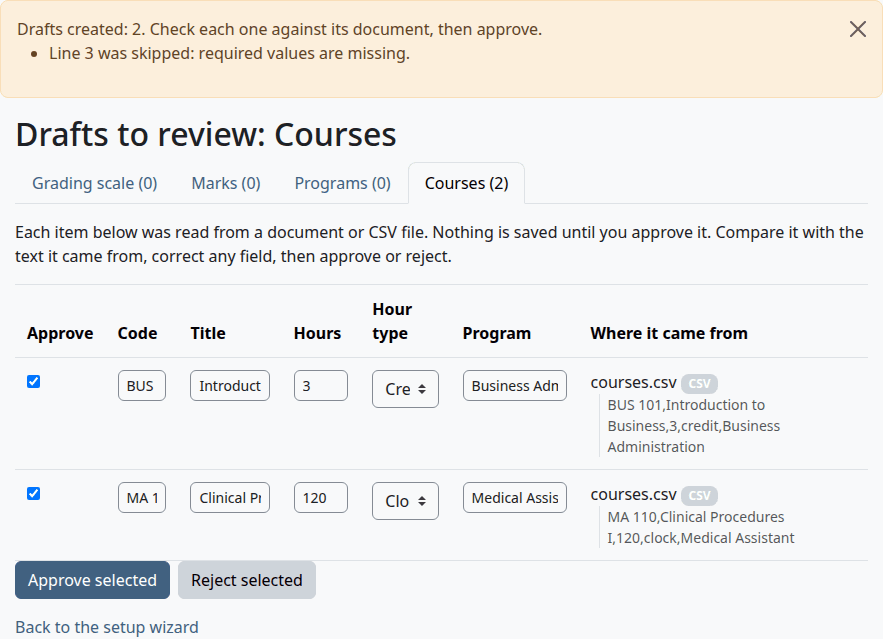

# Programs and the course catalog

This page is for whoever sets up what a school teaches. It covers programs, the course catalog, the CSV templates, and the Drafts to review page, where everything read from a file waits for approval.

Who can do this: everything on this page needs `local/academictranscript:configure`. That's site administrators and managers by default.

## Contents

- [What programs and the catalog do](#what-programs-and-the-catalog-do)
- [Add or change a program](#add-or-change-a-program)
- [Add or change a catalog course](#add-or-change-a-catalog-course)
- [Use a CSV file](#use-a-csv-file)
- [The CSV columns](#the-csv-columns)
- [Drafts to review](#drafts-to-review)
- [Read documents with an AI provider](#read-documents-with-an-ai-provider)
- [Related pages](#related-pages)

## What programs and the catalog do

A program decides one thing on a transcript: whether it shows credit hours or clock hours. A student with no program shows credit hours. The program's name prints as "Program of Study". You choose a student's program on [Edit student details](admin-guide.md#edit-student-details).

The catalog fills gaps in the [course fields](terms-and-course-fields.md#course-fields). A Moodle course with no Hours or Hour type uses the active catalog entry with the same Course code, in upper or lower case.

Some values are stored and shown on these pages, and go no further:

- "Credential awarded" and "Total hours required" of a program print on no transcript. To print an award, use "Qualification Awarded" on [Edit student details](admin-guide.md#edit-student-details).
- The title of a catalog course prints on no transcript. The title on a transcript comes from the full name of the Moodle course, without a leading course code.
- "Program of Study" on a catalog course only feeds the "Catalog courses" count on the wizard's Programs and hours step.

## Add or change a program

1. Go to Site administration > Plugins > Local plugins > Academic Transcript > Programs.
2. Select "Add a program", or select "Edit" on a row.
3. Fill in the form and select "Save changes".



| Field | What it does | Default |
|---|---|---|
| Program name | Required. Must not be the name of another program. Prints as "Program of Study". | Empty |
| Credential awarded | The degree, diploma or certificate the program leads to. | Empty |
| Hour type | "Credit hours" for degree programs, "Clock hours" for non-degree programs. Decides what the student's transcript shows. | Credit hours |
| Total hours required | A number. | Empty |
| Active | "No" hides the program from the menus. There's no delete. | Yes |

Check that:

- The page says "Changes saved", and the program is in the list.



What can go wrong:

- "This already exists." means another program has that name.

> Known problem in 1.4.3: a student or catalog course on a program you set to "No" keeps it until someone edits that record. The program isn't in the menu then, so the form falls back to "None", and saving drops it with no warning. Set the program to "Yes" again before you edit such a record.

## Add or change a catalog course

1. Go to Site administration > Plugins > Local plugins > Academic Transcript > Course catalog.
2. Select "Add a catalog course", or select "Edit" on a row.
3. Fill in the form and select "Save changes".



| Field | What it does | Default |
|---|---|---|
| Course | Required. The course code. It must match the Course code of the Moodle course. | Empty |
| Title | Required. | Empty |
| Hours | Required. From 0 to 5000. | Empty |
| Hour type | "Credit hours" or "Clock hours". | Credit hours |
| Program of Study | "None", or an active program. | None |
| Active | "No" means the entry fills no gaps any more. There's no delete. | Yes |

Check that:

- The page says "Changes saved", and the course is in the list.
- On the [Course codes check](terms-and-course-fields.md#course-codes-check), a Moodle course with this code and no hours of its own shows the catalog's hours.



What can go wrong:

- "This already exists." means another entry has that code.
- "Data submitted is invalid" means the hours are below 0 or above 5000.
- A program that's no longer active isn't in the menu, so the form shows "None", and saving drops it.

## Use a CSV file

The wizard reads CSV files on its Grading, Marks and Programs and hours steps. Each row of the file becomes a draft, so nothing changes until you approve it.

> Known problem in 1.4.3: the links "Grading scale template", "Marks template", "Programs template" and "Courses template" stop with the error "Exception - Call to undefined function send_file()". Make the file yourself, with the columns and sample rows below. Uploading it works.

1. Make a CSV file with a spreadsheet program. The first line holds the [column names](#the-csv-columns).
2. Go to Site administration > Plugins > Local plugins > Academic Transcript > Setup wizard, and open the step for that kind of data.
3. Under "From CSV files", choose the kind of data in "This file contains".
4. Under "CSV file", select "Choose a file...", or drop the file there.
5. Select "Read CSV file".

| Step | "This file contains" offers |
|---|---|
| Grading | Grading scale, Marks |
| Marks | Marks |
| Programs and hours | Programs, Courses |



Check that:

- The Drafts to review page opens and says "Drafts created: 5. Check each one against its document, then approve." with the number of rows it read.

What can go wrong:

- "The CSV file is missing these columns: title. Use the template." means a column name is missing or misspelled. Nothing was read.

  

- A row with a required value missing is skipped, and the message names its line. The other rows become drafts. The line with the column names counts as the first.
- A blank cell under `ingpa` or `earns` means no. To say yes, put `1`.
- A line break inside a quoted cell isn't supported, because the file is read line by line.

## The CSV columns

The column names must all be there, in any order, in upper or lower case. A column the plugin doesn't know is ignored.

| Kind | Columns | Required values |
|---|---|---|
| Grading scale | `letter`, `min`, `max`, `points`, `ingpa`, `earns`, `description` | `letter`, `min` and `points` |
| Marks | `code`, `label`, `description`, `earns` | `code` |
| Programs | `name`, `credential`, `unittype`, `totalhours` | `name` |
| Courses | `code`, `title`, `hours`, `unittype`, `program` | `code` and `hours` |

- `ingpa` and `earns` take `1` for yes and `0` for no.
- `unittype` takes `credit` or `clock`. Any text with the word "clock" in it means clock hours, and anything else means credit hours.
- `program` on a course is the name of a program, as saved on the Programs page.

These are the sample rows of each kind.

```csv
letter,min,max,points,ingpa,earns,description
A,93,100,4.0,1,1,Excellent
B,83,86,3.0,1,1,Good
F,0,59,0.0,1,0,Failing
```

```csv
code,label,description,earns
P,Pass,"Passed; hours earned, no grade points",1
W,Withdrawn,Withdrew from the course,0
```

```csv
name,credential,unittype,totalhours
Business Administration,Associate of Science,credit,60
Medical Assistant,Certificate,clock,900
```

```csv
code,title,hours,unittype,program
BUS 101,Introduction to Business,3,credit,Business Administration
MA 110,Clinical Procedures I,120,clock,Medical Assistant
```

## Drafts to review

Everything read from a CSV file or a document waits here. The page has a tab for each kind, with the number waiting.

1. Go to Site administration > Plugins > Local plugins > Academic Transcript > Drafts to review. The wizard opens this page by itself after a file is read.
2. Compare each row with the text in "Where it came from". Change any field that's wrong.
3. Leave the "Approve" box ticked on the rows you want to act on, and untick the others. Every row starts ticked.
4. Select "Approve selected" to save the ticked rows, or "Reject selected" to throw them away.



| Where it came from | What it means |
|---|---|
| "CSV" | The row came from a CSV file. The line of the file is under the name. |
| "Found in the document" | An AI draft whose quote is in the document, ignoring case and punctuation. |
| "Quote not found: check carefully" | An AI draft whose quote isn't in the document. |

The name of an uploaded document is a link to the file.

What each tab does when you approve:

| Tab | What approving does |
|---|---|
| Grading scale | Replaces the whole active scale with the ticked rows. The page warns you. |
| Marks | Adds a mark, or updates the mark with the same code and makes it active. |
| Programs | Adds a program, or updates the one with the same name. |
| Courses | Adds a catalog course, or updates the one with the same code. A program name that matches no program is left empty. |

Check that:

- The page says "Approved and saved: 2" or "Rejected: 1", with the number of rows.
- From the wizard, approving takes you back to your step. "Back to the setup wizard" does too.
- On step 6 of the wizard, "No drafts are waiting for review" has a tick once every draft is decided.

What can go wrong:

- Grade drafts go through the same checks as the Grading scale page. With an error, nothing is saved. The messages are in [Edit the grading scale](grading-and-marks.md#edit-the-grading-scale). A ticked row with an empty "Grade" also gives "A grade row has no letter."
- Drafts stay in the database after a decision. Nothing cleans them up.



## Read documents with an AI provider

With an AI provider, the wizard's Grading, Marks and Programs and hours steps show the heading "From your documents (AI)" with an upload form. Without one, the page says "No AI provider is set up on this site, so documents cannot be read automatically."

> Not walked through: this needs a real AI provider, so no test site can show it. The steps come from the code.

Before you start:

- An AI provider with the "Generate text" action is set up and enabled under Site administration > AI > AI providers.
- Your documents are PDF, Word (.docx) or text files. Older Word files (.doc), OpenDocument files (.odt) and RTF files also upload, and they need one of Moodle's document converters. The label "Documents (PDF or Word)" shows only the first two.

1. On the wizard step, add up to five files to "Documents (PDF or Word)". Each can be up to 20 MB.
2. The first time, tick "I accept the site's AI policy for sending these documents to the AI provider". Each person accepts once.
3. Select "Read documents". This can take a few minutes: the page allows up to ten.

The plugin reads the text of each file, sends it to the provider in pieces of about 12,000 characters, and keeps what comes back as drafts. PDF text is read with Ghostscript when Moodle has a path to it (Site administration > Server > System paths), and with the bundled parser otherwise.

Check that:

- The [Drafts to review](#drafts-to-review) page opens with the drafts, each next to the quote it came from.

What can go wrong:

- "The AI provider could not read the document" and the provider's message: nothing from that file is kept, and the other files go on.
- "No text could be read from" and the file name: the file has no text the plugin can read, such as a scanned page. The message for a file that needs a converter asks you to save it as PDF or Word (.docx).

The text of your documents goes to the AI provider. The files stay in the Moodle data folder until the plugin is uninstalled. See [Privacy and uninstall](privacy-and-uninstall.md).

## Related pages

- [Install and set up](install-and-setup.md)
- [Grading scale and marks](grading-and-marks.md)
- [Terms and course fields](terms-and-course-fields.md)
- [Admin guide](admin-guide.md)
