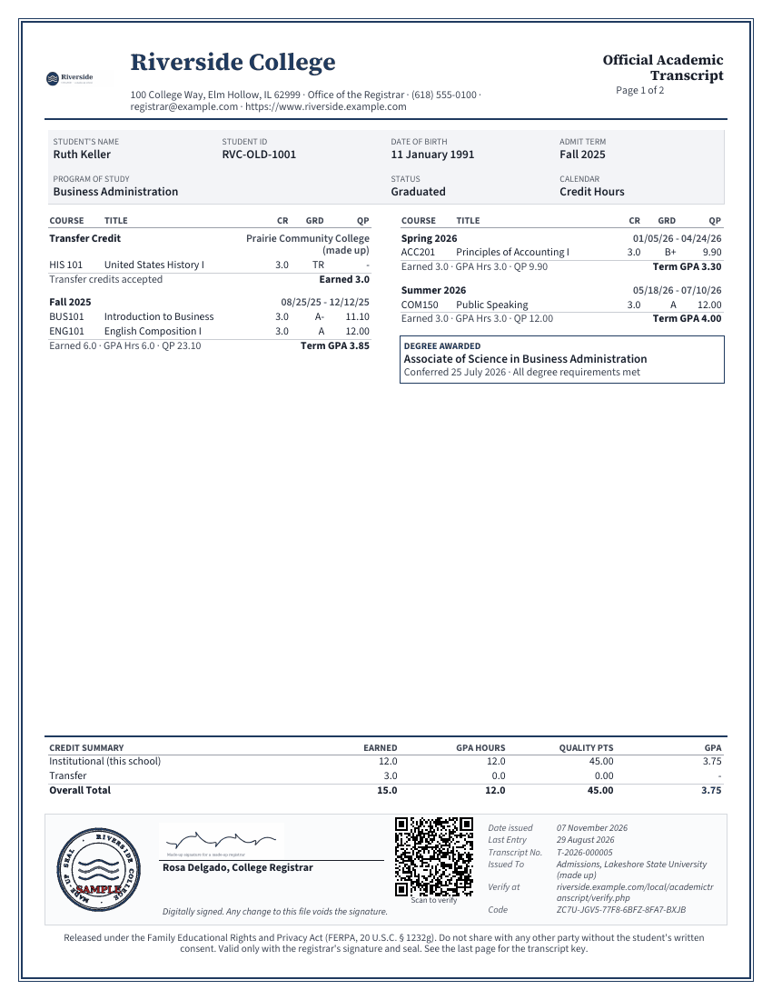
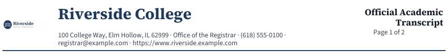
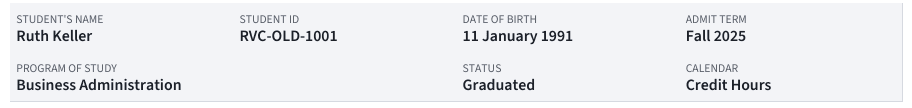
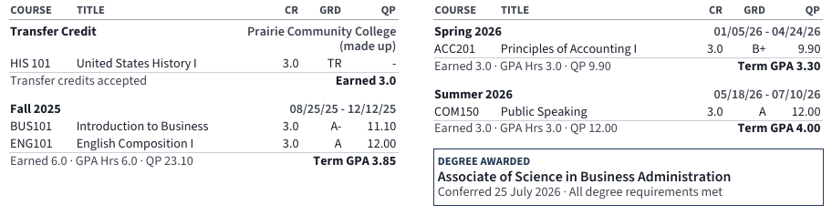
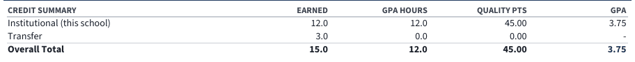
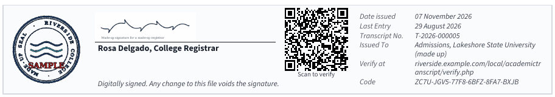
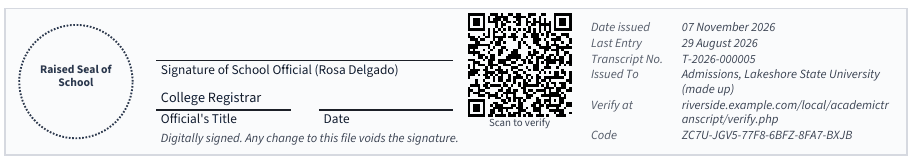
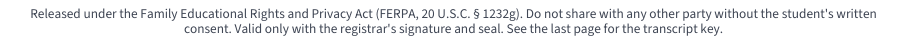
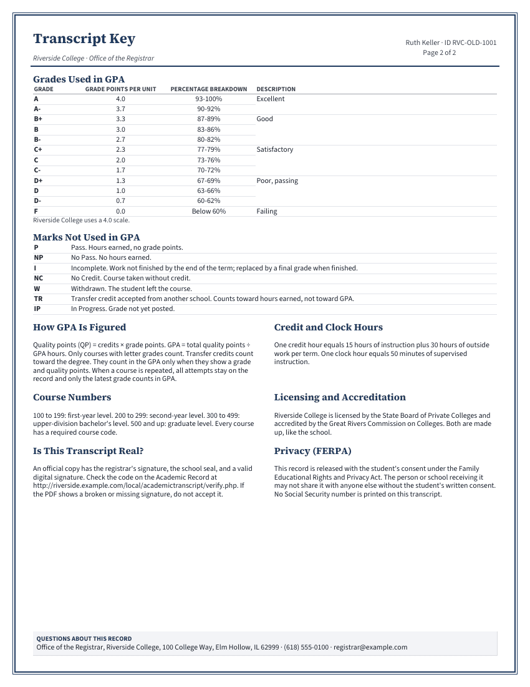
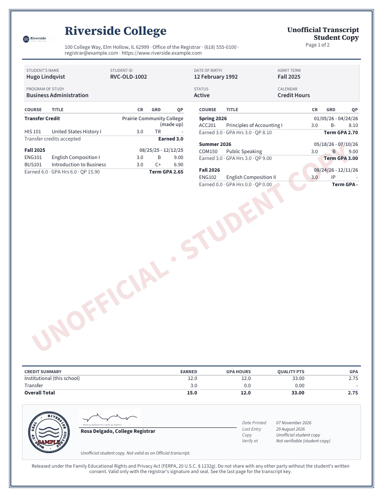

# Reading a transcript

This page goes through a transcript PDF block by block, for students, for staff, and for anyone who receives one. It also says what stays fixed on an Official copy and what doesn't.

## Contents

- [The two kinds of copy](#the-two-kinds-of-copy)
- [The pages](#the-pages)
- [The header](#the-header)
- [The student box](#the-student-box)
- [The academic record](#the-academic-record)
- [Notes under a course](#notes-under-a-course)
- [The degree box](#the-degree-box)
- [The credit summary](#the-credit-summary)
- [The signature block](#the-signature-block)
- [The verify block](#the-verify-block)
- [The footer](#the-footer)
- [The Transcript Key](#the-transcript-key)
- [The watermark on an Unofficial copy](#the-watermark-on-an-unofficial-copy)
- [The digital signature](#the-digital-signature)
- [What stays fixed on a copy](#what-stays-fixed-on-a-copy)
- [Related pages](#related-pages)

## The two kinds of copy

| | Official transcript | Unofficial transcript |
|---|---|---|
| Title | Official Academic Transcript, on two lines | Unofficial Transcript, with Student Copy on the line below |
| Who makes it | Staff, for a named recipient | The student or staff, at any time |
| Data | Frozen when it's issued | Worked out at the moment of the download |
| Watermark | None | "UNOFFICIAL · STUDENT COPY" on every page |
| QR code and verification code | Yes | No |
| Digital signature | Yes, when the server can sign | Never |
| Stopped by problems or holds | Yes | No |

## The pages

Every transcript has one or more record pages, then the Transcript Key. A double border in the school's accent colour runs round every page. The paper size is US Letter or A4.

A long record runs on to more pages. Each of those has the header, and in place of the student box the line "Academic record of Ruth Keller · ID RVC-OLD-1001 (continued)". The courses fill the left column and then the right. A term never splits between pages, unless it's too long for one column: then it's cut, and the later piece has "(continued)" after the term's name.

> Known problem in 1.4.3: a term long enough to be cut more than once can print "(continued)" twice after its name, as in "Fall 2025 (continued) (continued)". Nothing is left out: the courses and the term's totals are all there.

The credit summary and the signature block sit at the bottom of the last record page. When the courses reach too low, they move to a page of their own.

## The header

| Part | Where it comes from |
|---|---|
| Logo | [School logo](settings.md#school-and-registrar), when there is one. |
| School name | School name, or the full name of the site when that's empty. |
| Contact line | The address with its line breaks as commas, then "Office of the Registrar", phone, email and website. Empty ones are left out. |
| Title | "Official Academic Transcript", or "Unofficial Transcript" with "Student Copy" on the line below. |
| Page | "Page 1 of 2". |

## The student box

The box is on page 1 only.

| Label | What it is |
|---|---|
| Student's Name | The full name of the Moodle account. With Student Records, the legal name. |
| Student ID | From the student's details, or the ID number of the Moodle account. |
| Date of Birth | From the student's details. |
| Admit Term | The term of admission. |
| Program of Study | The student's program. |
| Status | Active, Graduated, Withdrawn or On Leave. |
| Calendar | "Credit Hours" or "Clock Hours", or the school's own [labels](settings.md#grades-and-hours). |

An empty value prints `-`.

## The academic record

The record is a list of blocks in two columns: transfer credit first, then each term in date order.

| Column | What it is |
|---|---|
| COURSE | The course code. |
| TITLE | The course title. |
| CR or HRS | The credit hours or the clock hours. |
| GRD | The letter, or a mark such as P or IP. TR means transfer credit. |
| QP | The quality points: hours x grade points. Marks print `-`. |

Each term has its name and its dates, in month, day and year order. Its last line gives what it adds up to: "Earned" hours, "GPA Hrs", "QP" and the "Term GPA". A term with no GPA hours prints `-`.

Each transfer block has "Transfer Credit", the name of the other school, and "Transfer credits accepted" with the hours "Earned".

A course that's still running prints IP, with no quality points. On this plugin's own data, that's any course with no posted grade for its term. A course with no term goes last, under "Term not set".

## Notes under a course

Small italics under a course title print any of these:

| Note | When |
|---|---|
| The teacher's note | A note entered on [Transcript codes](teacher-guide.md#enter-a-transcript-code), or a footnote from a [change](teacher-guide.md#request-a-change-to-a-posted-grade) or on [transfer credit](admin-guide.md#add-or-change-transfer-credit). |
| The label of a mark, such as "Pass" | A mark with no note of its own. |
| Repeated course: not counted in GPA or hours earned (another attempt counts). | This attempt [doesn't count](grading-and-marks.md#repeated-courses). |

## The degree box

The box follows the last term when the student has a qualification. "DEGREE AWARDED" heads it, whatever the award is. The line under it says "Conferred" with the date and "All degree requirements met", whenever there's an award date. The plugin doesn't check those requirements. The staff who enter the award do.

## The credit summary

The heading says CREDIT SUMMARY, or CLOCK HOUR SUMMARY for a clock-hour program.

| Row | What it adds up |
|---|---|
| Institutional (this school) | The courses at this school. An attempt that doesn't count adds nothing. |
| Transfer | Transfer credit. Its GPA always prints `-`. |
| Overall Total | The two together, with the overall GPA. |

| Column | What it means |
|---|---|
| EARNED | Hours earned. |
| GPA HOURS | Hours that count in the GPA. |
| QUALITY PTS | Total quality points. |
| GPA | Quality points / GPA hours. |

The GPA comes from the exact sums, so it may differ slightly from an average of the term GPAs. [Quality points and GPA](grading-and-marks.md#quality-points-and-gpa) has the rules.

## The signature block

The block has the seal, the signature, the QR code on an Official copy, and the issue details.

With the setting "Print the uploaded signature and seal images":

With the setting "Blank lines for hand signature and raised seal":

| Part | What it is |
|---|---|
| Seal | The seal image, or a dashed circle marked "Raised Seal of School" for embossing. |
| Signature | The signature image above a line with the registrar's name and title, or a blank line marked "Signature of School Official" with the registrar's name, and two short lines for "Official's Title" and "Date". |
| QR code | On an Official copy only. It opens the [verify page](verify.md) with the code filled in. "Scan to verify" prints under it. |
| The note in italics | "Digitally signed. Any change to this file voids the signature." on a signed copy, "Digital signature not available on this server." on an unsigned one, and "Unofficial student copy. Not valid as an Official transcript." on an Unofficial copy. |

## The verify block

The right of the signature block has the details of the copy, with the address and the code that check it on the [verify page](verify.md).

| On an Official copy | What it is |
|---|---|
| Date issued | The day it was issued. |
| Last Entry | The date of the last grade or transfer credit. |
| Transcript No. | The number, such as T-2026-000005: the year and a running number. |
| Issued To | Who it was issued to. A request by email adds the email address. |
| Verify at | The address of the verify page. |
| Code | The verification code. |

An Unofficial copy has "Date Printed", "Last Entry", "Copy" with "Unofficial student copy", and "Verify at" with "Not verifiable (student copy)".

## The footer

The text is the setting [Footer of the academic record pages](settings.md#look-of-the-transcript). It prints at the bottom of every record page.

## The Transcript Key

The key is the last page. It explains the grades, the marks and how to read the record.

| Part | Where it comes from |
|---|---|
| Top right | The student's name and ID, and the page number. |
| Grades Used in GPA | The [grading scale](grading-and-marks.md) when the copy was made. The note under it is the setting "Note under the grading scale". |
| Marks Not Used in GPA | The active [marks](grading-and-marks.md#marks) when the copy was made, with their descriptions. |
| How GPA Is Figured, Credit and Clock Hours, Course Numbers, Licensing and Accreditation, Is This Transcript Real?, Privacy (FERPA) | The [Transcript Key settings](settings.md#transcript-key-last-page). |
| Questions About This Record | The contact box, from the same settings. |

Until a school edits them, the text sections hold templates with [brackets] in them, which print as they are.

## The watermark on an Unofficial copy

Every page of an Unofficial copy, the key included, has the words "UNOFFICIAL · STUDENT COPY" across it in pale red, under the content.

## The digital signature

An Official PDF carries a digital signature, which you see in the signature panel of a PDF reader, not on the page. It covers the whole file, so any change to the file breaks it.

| What the reader says | What it means |
|---|---|
| The signature is valid, and the signer is trusted | The file is unchanged, and the school uses a purchased certificate. |
| The signature is valid, and the signer isn't trusted or the issuer is unknown | The file is unchanged, and the school uses the plugin's self-signed certificate. |
| The signature is broken | Someone changed the file. As the key says, don't accept it. |
| There's no signature | The server couldn't sign it, and the page prints "Digital signature not available on this server." |

The signature names the school and the "Office of the Registrar". The signature is made fresh on each download, with whatever certificate is in place at that moment. A site administrator sets the certificate on [Transcript settings](settings.md#upload-a-signing-certificate).

## What stays fixed on a copy

An Official transcript freezes its data when it's issued. No PDF is stored: each download draws the PDF again from that frozen data.

| Frozen at issue | Drawn fresh on each download |
|---|---|
| The student's name, Student ID, date of birth, program and status | The school name, logo, address and contact details |
| Terms, courses, grades, hours, notes and totals | The registrar's name and title |
| The grades and marks of the key | The key's text sections and its note |
| The recipient, the number, the date of issue and the code | The page size, accent colour and footer |
| | The signature option and images |
| | The digital signature |
| | Labels in the language of the person downloading, and dates in their time zone |

So a later grade change never reaches a copy already issued, and a new logo does. To send a newer record, [issue a new Official transcript](teacher-guide.md#issue-an-official-transcript). The older copy keeps its code.

An Unofficial copy has no frozen data. It shows the record of the moment.

## Related pages

- [Verify a transcript](verify.md)
- [Student guide](student-guide.md)
- [Grading scale and marks](grading-and-marks.md)
- [Transcript settings](settings.md)
