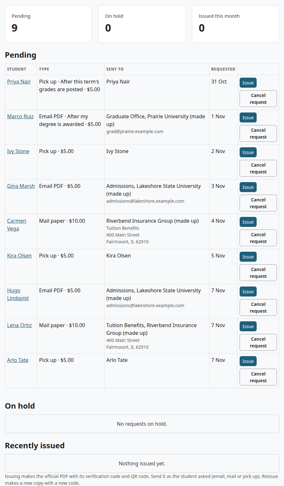
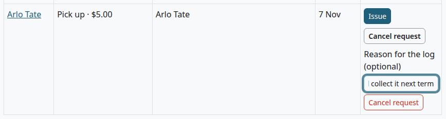
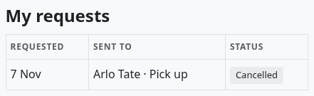
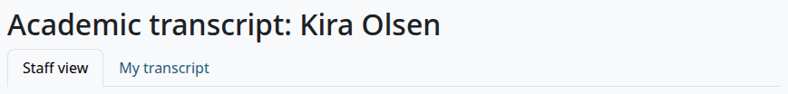
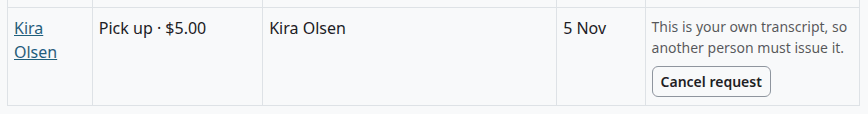

# Registrar guide

This page is for the person who works through students' requests for Official transcripts. It covers the Transcript requests page, what to do with each request, fees and holds, and how staff see their own transcript.

"Registrar" here means whoever holds `local/academictranscript:issueofficial` at system level. Moodle has no Registrar role of its own. Managers hold the capability by default, and a school can make a role for it. A teacher who holds it only in a course can't open this page.

## Contents

- [Open Transcript requests](#open-transcript-requests)
- [Read the queue](#read-the-queue)
- [Issue a request](#issue-a-request)
- [Get the PDF and send it](#get-the-pdf-and-send-it)
- [Reissue a request](#reissue-a-request)
- [Cancel a request](#cancel-a-request)
- [Fees](#fees)
- [Holds and waiting requests](#holds-and-waiting-requests)
- [Double clicks and two people at once](#double-clicks-and-two-people-at-once)
- [Issue without a request](#issue-without-a-request)
- [Your own transcript](#your-own-transcript)
- [Related pages](#related-pages)

## Open Transcript requests

Go to Site administration > Plugins > Local plugins > Academic Transcript > Transcript requests.

With Student Records installed, its menu has a link to this page too.

A role without Moodle's `moodle/site:configview` has no Site administration tab. [Where things are](README.md#where-things-are) says how such a person reaches the pages.

## Read the queue

| Part | What it shows |
|---|---|
| The tiles | "Pending" counts the pending and waiting requests. "On hold" counts those on hold. "Issued this month" counts requests by the date of their last issue. |
| Pending | The requests to work on, oldest first. |
| On hold | Requests whose student has a hold. See [Holds and waiting requests](#holds-and-waiting-requests). |
| Recently issued | The last 20 requests issued, by the date the student asked, with Download and Reissue. See the known problem below. |

The columns of Pending:

| Column | What it shows |
|---|---|
| Student | The student's name, as a link to the transcript. |
| Type | How to send it, when the student asked to wait for something, and the fee. |
| Sent to | Who it goes to, with the email or mailing address. |
| Requested | The day and month of the request. |

> Known problem in 1.4.3: once one request has been issued, Transcript requests stops at the heading "Recently issued" with the error "Exception - Object of type stdClass is not callable". The tiles, Pending and On hold above it still work, so Issue and Cancel go on working. Recently issued is lost, with its Download and Reissue, and so is the note at the foot of the page. To get the PDF of an issued request, use [Issued Official transcripts](admin-guide.md#issued-official-transcripts), as the next sections say.

## Issue a request

Who can do this: anyone who holds `local/academictranscript:issueofficial` at system level. Nobody can issue their own.

Before you start:

- The request is under Pending, with an "Issue" button.

1. Find the row and check "Type" and "Sent to".
2. Select "Issue". There's no question first.

Check that:

- The page says "Transcript issued to Lena Ortiz for Tuition Benefits, Riverbend Insurance Group (made up). Verification code" and the code. The rest of the message sends you to Recently issued, which the known problem above hides.
- The row is no longer under Pending, and "Issued this month" went up.
- The student's request says "Issued" under [My requests](student-guide.md#follow-your-request).
- The transcript is on [Issued Official transcripts](admin-guide.md#issued-official-transcripts).

What can go wrong:

| Message | What it means |
|---|---|
| An Official transcript cannot be issued until these are fixed: and a list | The student's transcript has problems. See [What stops an Official transcript](admin-guide.md#what-stops-an-official-transcript). |
| This is your own transcript, so another person must issue it. | This shows in place of the button on your own row. |
| This request can't be issued yet. There is a hold, or it waits for grades or the degree. | The state of the request changed after the page opened. Reload the page. |

## Get the PDF and send it

Issuing makes the Official transcript and doesn't send it. No email leaves the plugin.

Who can do this: anyone who holds `local/academictranscript:viewissued`. Someone who holds only `local/academictranscript:issueofficial` can't open that list, and uses the student's page instead: select the student's name in the queue, and find "Download" under "Official transcripts issued".

1. Go to Site administration > Plugins > Local plugins > Academic Transcript > Issued Official transcripts.
2. On the transcript's row, select "Download".
3. Send the PDF the way the student asked:

| Type | What to do |
|---|---|
| Email PDF | Attach the PDF to an email to the address under "Sent to". |
| Mail paper | Print it, and mail it to the address under "Sent to". With the blank-lines option of [Signature and seal](settings.md#signature-seal-and-digital-signature), sign and emboss it first. |
| Pick up | Print it for the person named. |

For a request by email, "Issued To" on the transcript holds the name and the email address, and both show on the [verify page](verify.md) to anyone with the code.

## Reissue a request

> Not walked through: the known problem above hides the Reissue button once a request has been issued, so this can't be done in 1.4.3. This section comes from the code.

"Reissue" is meant to sit on each row of Recently issued. It makes a new Official transcript for the same request: with today's record, a new number and a new verification code, for the same recipient. The old code keeps working, and the request then points to the new copy only.

It doesn't work within a minute of the last copy, and a hold stops it. It's a new issue, so nobody can reissue their own.

To give someone a newer copy in 1.4.3, [issue a new Official transcript](teacher-guide.md#issue-an-official-transcript) from the student's page, or ask the student to send a new request.

## Cancel a request

Who can do this: anyone who holds `local/academictranscript:issueofficial` at system level.

You can cancel a request that's pending, waiting or on hold. An issued request can't be cancelled.

1. On the row, select "Cancel request". The row opens.
2. Optional: enter a "Reason for the log (optional)".
3. Select the red "Cancel request".

Check that:

- The page says "Request cancelled."
- The row is gone. Cancelled requests appear nowhere on this page.
- The student's request says "Cancelled" under My requests.
- The [Activity log](admin-guide.md#activity-log) has "Official transcript request cancelled", with the reason.

## Fees

The fees are on [Transcript settings](settings.md#official-transcript-fees), and a request keeps the fee of the day it was made.

The plugin takes no payment. For a student on this plugin's own data, the fee is only recorded on the request and shows under "Type". The school collects it another way.

With Student Records, the fee can go on the student's account, and a cancelled request keeps it there. See [With Student Records](with-student-records.md#fees).

## Holds and waiting requests

Holds and waiting exist only with Student Records as the source. On this plugin's own data, every request is pending. [With Student Records](with-student-records.md#what-the-registrar-sees) shows the On hold section and the tags for a waiting request.

## Double clicks and two people at once

The page guards against doing a thing twice:

- Two clicks on Issue, or two people at once, make one transcript. The second one sees "This request is already issued, so no new copy was made. Use Reissue to make a new copy."
- Cancel and Issue can't both happen to a request. Whichever comes second changes nothing, and says why: "This request was cancelled, so no transcript was made." or "This request is already issued, so it was not cancelled."
- If the last action is still being saved, the page says "The last action on this transcript is still being saved. Wait a moment and reload the page before you try again."

## Issue without a request

You can issue from a student's page at any time, for a person or school you name. The steps are in [Issue an Official transcript](teacher-guide.md#issue-an-official-transcript). Such a transcript has no request, so it isn't in the queue or in "Issued this month". It is on [Issued Official transcripts](admin-guide.md#issued-official-transcripts).

## Your own transcript

Staff who can issue or who hold `local/academictranscript:managerecords` see their own transcript in two tabs:

| Tab | What it is |
|---|---|
| Staff view | The page you see for any student, with its buttons. |
| My transcript | The page a student sees, with the request form. |

The rules for your own record stay the same:

- The staff view says "This is your own transcript, so another person must issue it." in place of the issue form.
- Your row in the queue says the same in place of "Issue". You can still cancel it.
- You can request an Official transcript on My transcript, like any student.
- Post final grades says "You can't post your own grade. Another teacher or an admin must post it." on your row.

## Related pages

- [Admin guide](admin-guide.md)
- [Student guide](student-guide.md)
- [Verify a transcript](verify.md)
- [Transcript settings](settings.md)
- [With Student Records](with-student-records.md)
