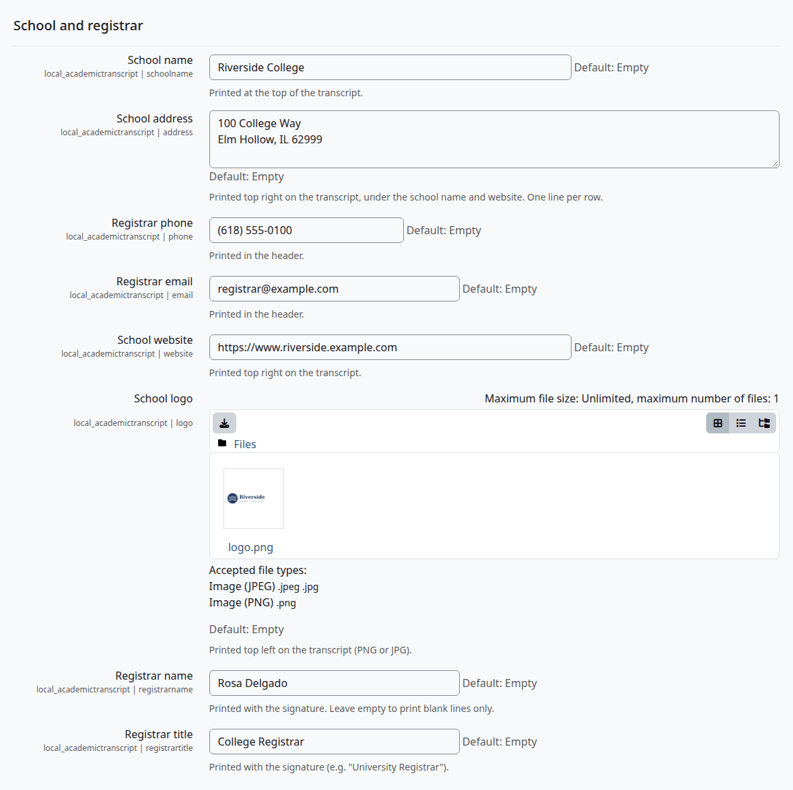
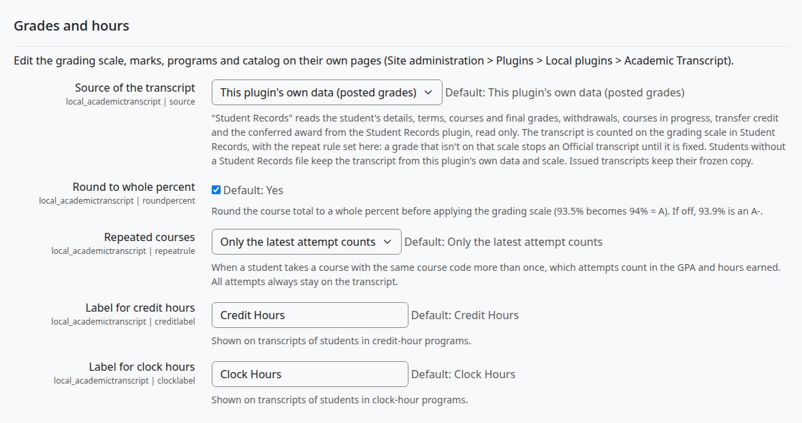
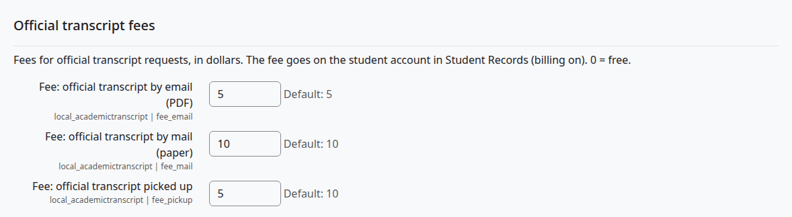
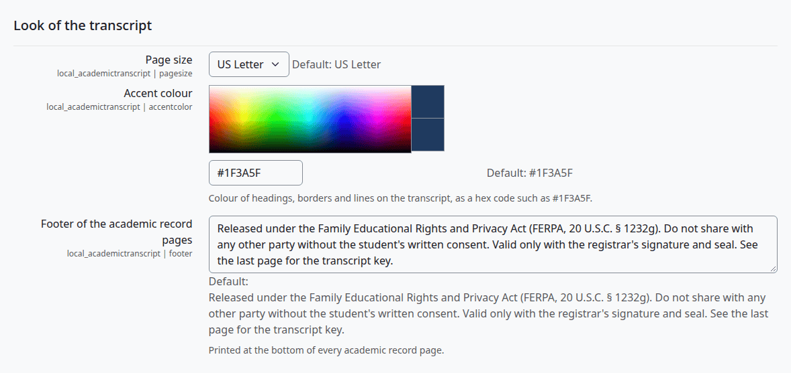
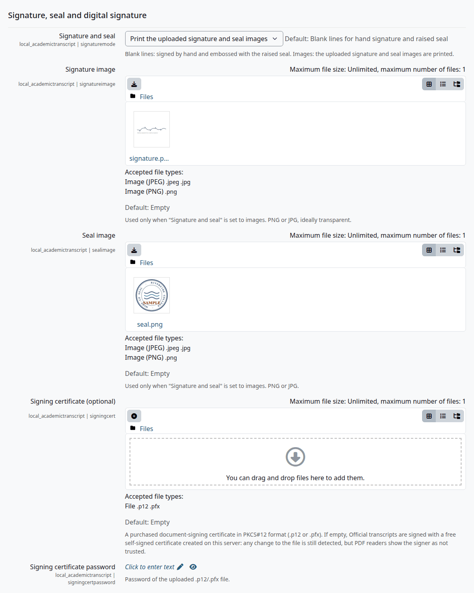
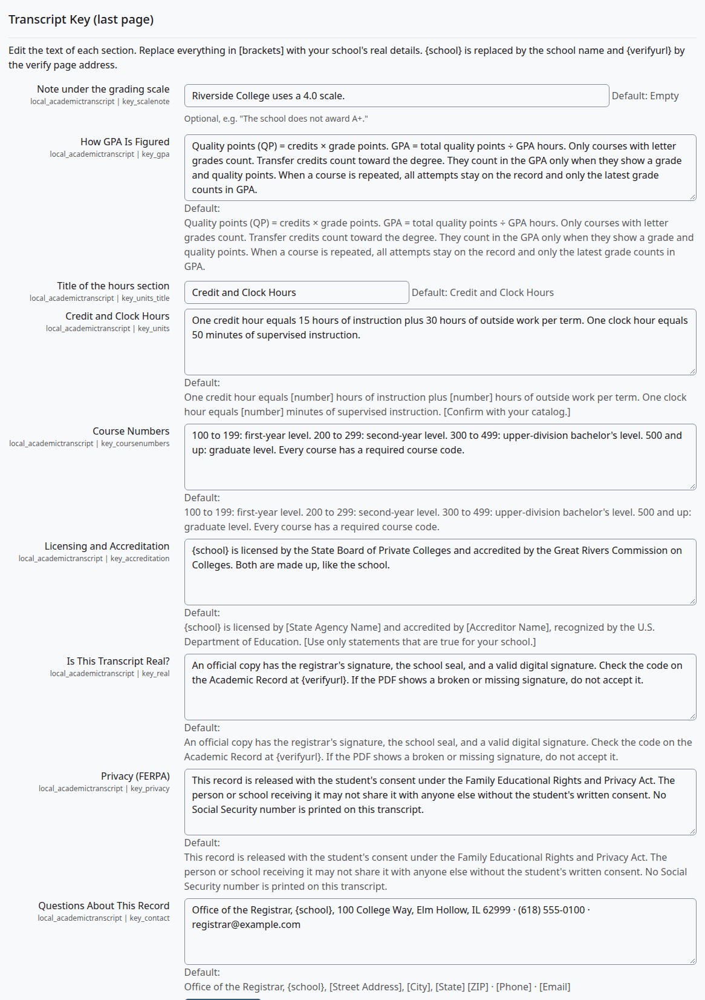

# Transcript settings

This page lists every setting on the Transcript settings page, what it does and its default.

Who can do this: site administrators only. The page needs `moodle/site:config`, which no default role has, so a manager gets "Access denied" there. A manager can change the school details and the seven settings of the wizard's Transcript look step in the [setup wizard](install-and-setup.md#the-setup-wizard).

## Contents

- [Open the page](#open-the-page)
- [School and registrar](#school-and-registrar)
- [Grades and hours](#grades-and-hours)
- [Official transcript fees](#official-transcript-fees)
- [Look of the transcript](#look-of-the-transcript)
- [Signature, seal and digital signature](#signature-seal-and-digital-signature)
- [Upload a signing certificate](#upload-a-signing-certificate)
- [Transcript Key (last page)](#transcript-key-last-page)
- [What a new setting reaches](#what-a-new-setting-reaches)
- [Related pages](#related-pages)

## Open the page

1. Go to Site administration > Plugins > Local plugins > Academic Transcript > Transcript settings.
2. Change what you need.
3. Select "Save changes" at the foot of the page.

Check that:

- The page says "Changes saved".

## School and registrar

The wizard's [School details](install-and-setup.md#step-1-school-details) step sets the same values. The wizard requires a school name, and this page doesn't.

| Setting | What it does | Default |
|---|---|---|
| School name | Prints at the top of the record pages and the key, as the PDF's author, in the digital signature and on the verify page. When empty, the full name of the site is used. | Empty |
| School address | Prints in the line under the school name, with its line breaks as commas. It's also the location in the digital signature. | Empty |
| Registrar phone | Prints in the line under the school name, and on the verify page. | Empty |
| Registrar email | Prints in the line under the school name, on the verify page, and as the contact in the digital signature. | Empty |
| School website | Prints last in the line under the school name. | Empty |
| School logo | PNG or JPG, one file. Prints at the top left of the record pages at 19 x 19 mm. | None |
| Registrar name | Prints with the signature. | Empty |
| Registrar title | Prints with the signature, for example "University Registrar". | Empty |

The text under the address and website settings says they print at the top right. They print at the left, in the line under the school name. The top right holds the document title and the page number. [Reading a transcript](reading-a-transcript.md#the-header) shows the header.

## Grades and hours

| Setting | What it does | Default |
|---|---|---|
| Source of the transcript | Where a transcript's data comes from: "This plugin's own data (posted grades)" or "Student Records". [With Student Records](with-student-records.md) says what changes. The option shows even when Student Records isn't installed, and then it has no effect. | This plugin's own data (posted grades) |
| Round to whole percent | Rounds the course total to a whole percent before the grading scale is applied. See [Rounding](grading-and-marks.md#rounding). | On |
| Repeated courses | "Only the latest attempt counts", "Only the highest grade counts" or "All attempts count". See [Repeated courses](grading-and-marks.md#repeated-courses). | Only the latest attempt counts |
| Label for credit hours | Prints as "Calendar" on transcripts of students in credit-hour programs. | Credit Hours |
| Label for clock hours | Prints as "Calendar" on transcripts of students in clock-hour programs. | Clock Hours |

Student Records reads the rounding and the repeat rule from here too.

## Official transcript fees

These are the fees of a student's [request](student-guide.md#request-an-official-transcript), in dollars. The money sign is fixed.

| Setting | What it does | Default |
|---|---|---|
| Fee: official transcript by email (PDF) | The fee for "Email PDF". | 5 |
| Fee: official transcript by mail (paper) | The fee for "Mail paper". | 10 |
| Fee: official transcript picked up | The fee for "Pick up". | 10 |

- 0 means free. A box can't be left empty: the page says "This value is not valid" and keeps the old fee. It says the same for a fee with a trailing zero or a money sign, such as 12.50 or $5, so type 12.5 or 5.
- A request keeps the fee of the day it was made.
- The plugin takes no payment. For a student on this plugin's own data, the fee is only recorded on the request, and the student is told "The registrar's office will tell you how to pay any fee." The school collects it another way.
- With Student Records as the source, billing on there and a file for the student, the fee goes on the student's account. See [With Student Records](with-student-records.md#fees).

## Look of the transcript

| Setting | What it does | Default |
|---|---|---|
| Page size | "US Letter" or "A4". | US Letter |
| Accent colour | The colour of headings, borders and lines on the transcript, as six hex digits, with or without `#`. A value that isn't six hex digits prints the default. | #1F3A5F |
| Footer of the academic record pages | Prints at the bottom of every record page. When empty, the default text comes back. | See below |

The default footer is: "Released under the Family Educational Rights and Privacy Act (FERPA, 20 U.S.C. § 1232g). Do not share with any other party without the student's written consent. Valid only with the registrar's signature and seal. See the last page for the transcript key."

The default is written for a US school. Keep only what is true for yours. This manual gives no legal advice.

## Signature, seal and digital signature

| Setting | What it does | Default |
|---|---|---|
| Signature and seal | "Blank lines for hand signature and raised seal", to sign and emboss by hand, or "Print the uploaded signature and seal images". [Reading a transcript](reading-a-transcript.md#the-signature-block) shows both. | Blank lines |
| Signature image | PNG or JPG, ideally transparent. Printed only with the images option. | None |
| Seal image | PNG or JPG. Printed at 24 x 24 mm only with the images option. | None |
| Signing certificate (optional) | A purchased document-signing certificate in PKCS#12 format (.p12 or .pfx). See below. | None |
| Signing certificate password | The password of that file. | Empty |

With the images option and no seal image, the transcript prints the dashed circle of the blank lines option.

Every Official transcript is digitally signed when the server can do it. With no certificate here, the plugin makes a self-signed one on the server the first time it needs it, valid for ten years. Any change to the file still breaks the signature, and PDF readers show the signer as not trusted. A purchased certificate makes the signer trusted.

The self-signed certificate keeps the school name of the day it was made, and the plugin doesn't make a new one when it runs out or the name changes. To get a new one, delete the folder `signing` inside `local_academictranscript` in the Moodle data folder. The next download makes a new certificate.

## Upload a signing certificate

Who can do this: site administrators.

Before you start:

- You have the .p12 or .pfx file and its password.

1. On Transcript settings, under "Signing certificate (optional)", add the file.
2. Under "Signing certificate password", enter its password.
3. Select "Save changes".
4. Issue an Official transcript, or download one that's already issued. The signature is made fresh on each download.

Check that:

- The signature in the PDF names your certificate. Open the signature panel of a PDF reader to see it.

What can go wrong:

- A wrong password or an unreadable file gives no message. The plugin signs with the self-signed certificate instead. So always check a PDF after you upload a certificate.

## Transcript Key (last page)

These settings hold the text of the Transcript Key, the last page of every transcript. Replace everything in [brackets] with your school's real details. `{school}` is replaced by the school name, and `{verifyurl}` by the address of the verify page.

| Setting | What it does | Default text |
|---|---|---|
| Note under the grading scale | Optional small print under the grade table. | Empty |
| How GPA Is Figured | A text section. It doesn't follow the "Repeated courses" setting, so change it if you don't use the latest attempt. | "Quality points (QP) = credits × grade points. GPA = total quality points ÷ GPA hours. Only courses with letter grades count. Transfer credits count toward the degree. They count in the GPA only when they show a grade and quality points. When a course is repeated, all attempts stay on the record and only the latest grade counts in GPA." |
| Title of the hours section | The heading of the next section. It's the only section title you can change. | Credit and Clock Hours |
| Credit and Clock Hours | A text section. | "One credit hour equals [number] hours of instruction plus [number] hours of outside work per term. One clock hour equals [number] minutes of supervised instruction. [Confirm with your catalog.]" |
| Course Numbers | A text section. | "100 to 199: first-year level. 200 to 299: second-year level. 300 to 499: upper-division bachelor's level. 500 and up: graduate level. Every course has a required course code." |
| Licensing and Accreditation | A text section. | "{school} is licensed by [State Agency Name] and accredited by [Accreditor Name], recognized by the U.S. Department of Education. [Use only statements that are true for your school.]" |
| Is This Transcript Real? | A text section. | "An official copy has the registrar's signature, the school seal, and a valid digital signature. Check the code on the Academic Record at {verifyurl}. If the PDF shows a broken or missing signature, do not accept it." |
| Privacy (FERPA) | A text section. | "This record is released with the student's consent under the Family Educational Rights and Privacy Act. The person or school receiving it may not share it with anyone else without the student's written consent. No Social Security number is printed on this transcript." |
| Questions About This Record | The contact box at the foot of the key. | "Office of the Registrar, {school}, [Street Address], [City], [State] [ZIP] · [Phone] · [Email]" |

The defaults are templates written for a US school, and the brackets print as they are until you edit them. Use only statements that are true for your school.

You can't remove a section. If you empty a box, the default text comes back. To drop what a section says, reword it.

The grade table and the marks in the key come from the [grading scale and marks](grading-and-marks.md).

## What a new setting reaches

An Official transcript freezes its data at issue, and the PDF is drawn fresh on each download. So these settings reach copies already issued, the next time someone downloads one: the school details, the logo, the page size, the accent colour, the footer, the signature option and images, the key's text sections and note, and the certificate.

[What stays fixed on a copy](reading-a-transcript.md#what-stays-fixed-on-a-copy) has the whole list.

## Related pages

- [Install and set up](install-and-setup.md)
- [Grading scale and marks](grading-and-marks.md)
- [Reading a transcript](reading-a-transcript.md)
- [With Student Records](with-student-records.md)
- [Privacy and uninstall](privacy-and-uninstall.md)
