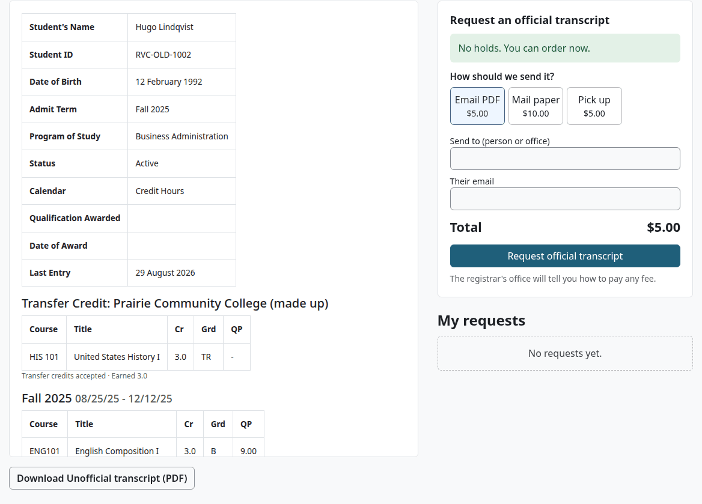
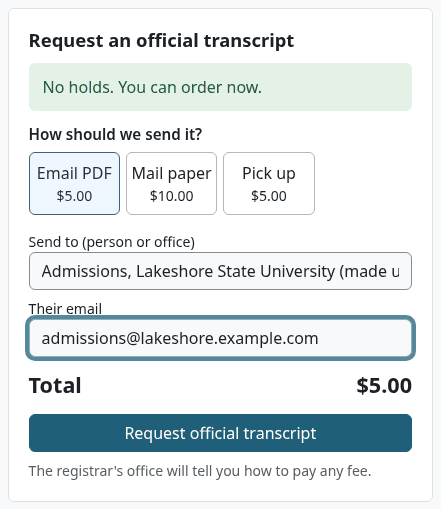
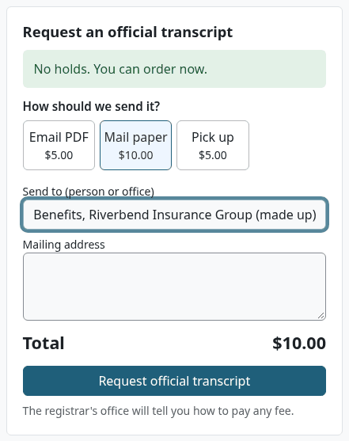
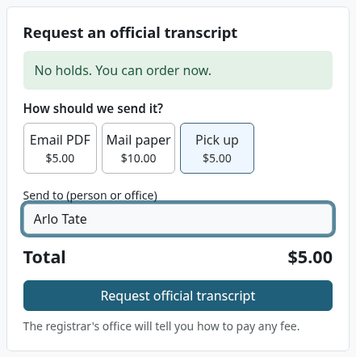
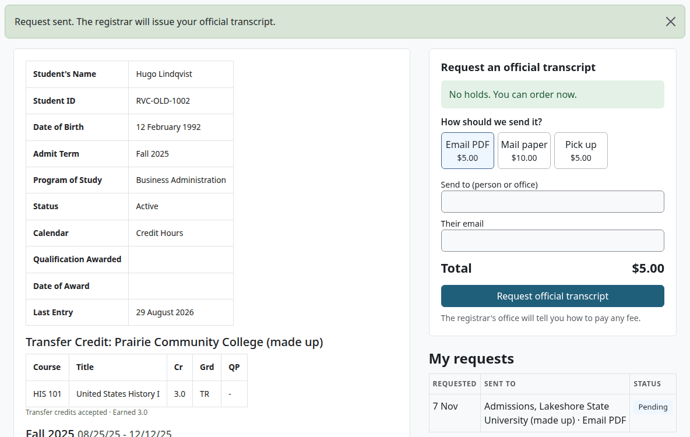
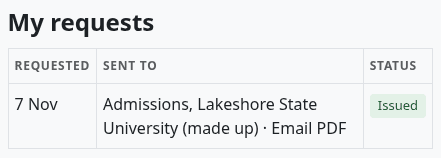
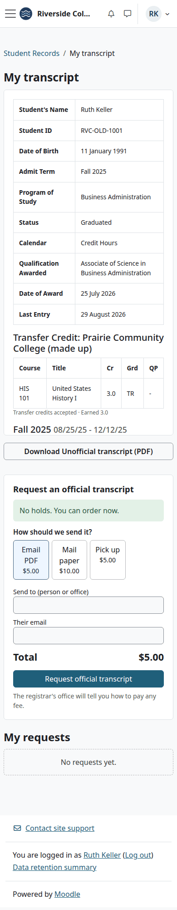

# Student guide

This page is for students. It shows how to see your transcript, download an Unofficial copy, and ask the school for an Official transcript.

Who can do this: any signed-in person who holds `local/academictranscript:viewown`. Every Moodle user does by default. Guests have no transcript.

## Contents

- [Open My transcript](#open-my-transcript)
- [Read My transcript](#read-my-transcript)
- [Download an Unofficial copy](#download-an-unofficial-copy)
- [Request an Official transcript](#request-an-official-transcript)
- [Follow your request](#follow-your-request)
- [On a phone](#on-a-phone)
- [What can go wrong](#what-can-go-wrong)
- [Related pages](#related-pages)

## Open My transcript

1. Select your name at the top right, then "Profile".
2. Under "Reports", select "Academic transcript".

At schools with Student Records, the Student Records menu also has a link to My transcript.

## Read My transcript

The left side shows your transcript as it stands today. It scrolls inside its box.

| Part | What it shows |
|---|---|
| Your details | Your name, Student ID, date of birth, admit term, program, status, whether the school counts credit or clock hours, any award, and the date of the last entry. |
| Transfer Credit | Credit accepted from another school, one table for each school. |
| Each term | Your courses, with their hours, grade and quality points. Under each table are the term's totals and GPA. |
| Credit Summary or Clock Hour Summary | The hours you earned, your GPA hours, quality points and GPA. |

Some entries aren't letter grades:

- IP means In Progress. A course shows IP until your teacher posts your final grade.
- TR means transfer credit.
- P, NP, I, NC and W are marks. They don't count in the GPA.

Your school may have marks of its own. The last page of a PDF copy, the Transcript Key, explains each grade and mark. [Reading a transcript](reading-a-transcript.md) goes through every part of a copy.

## Download an Unofficial copy

You can do this at any time. It costs nothing, and a hold doesn't stop it.

1. Open My transcript.
2. Select "Download Unofficial transcript (PDF)".

Check that:

- You get a PDF named `transcript-<your-name>-unofficial-<date>.pdf`.
- Every page has the watermark "UNOFFICIAL · STUDENT COPY".

An Unofficial copy is for you. It has no digital signature, no QR code and no verification code, so a school or an employer can't verify it. It's made fresh from your record each time.

## Request an Official transcript

Before you start:

- Know who gets it, and how it should reach them.

1. Open My transcript. The form is on the right.
2. Under "How should we send it?", choose "Email PDF", "Mail paper" or "Pick up". Each shows its fee.
3. In "Send to (person or office)", enter who it goes to.
4. For "Email PDF", enter "Their email". For "Mail paper", enter the "Mailing address".
5. Check the "Total".
6. Select "Request official transcript".

The form changes with your choice:

| Choice | The form asks for |
|---|---|
| Email PDF | "Send to (person or office)" and "Their email" |
| Mail paper | "Send to (person or office)" and "Mailing address" |
| Pick up | "Send to (person or office)" |

Check that:

- The page says "Request sent. The registrar will issue your official transcript."
- The request is under "My requests", with the state "Pending".

The line under the button says how you pay. "The registrar's office will tell you how to pay any fee." means the school collects the fee another way. Paying through a student account is in [With Student Records](with-student-records.md#fees).

The plugin doesn't send anything by itself. The registrar's office issues the transcript and sends it the way you asked. You can't download your own Official copy.

## Follow your request

My requests lists your requests, newest first.

| State | What it means |
|---|---|
| Pending | The registrar's office has it. |
| On hold | You have a hold, so the office can't issue it yet. |
| Waiting | It waits for this term's grades or your degree, as you asked. |
| Issued | The office made the Official transcript. |
| Cancelled | The office cancelled the request. |

On hold and Waiting happen only at schools with Student Records. See [With Student Records](with-student-records.md#what-a-student-sees).

To cancel a request, ask the registrar's office. A student can't cancel one.

## On a phone

My transcript works on a phone. The request form moves under the transcript.

## What can go wrong

| Message | What to do |
|---|---|
| Enter who it goes to (a person or office). | Fill in "Send to (person or office)". |
| Enter a valid email address. | Check "Their email". |
| Enter the mailing address. | Fill in "Mailing address". |
| You sent this same request a moment ago, so it was not sent again and there is no second fee. To order another copy, send it again in a minute. | Nothing was charged twice. If you do want a second copy, wait a minute and send it again. |

If a course on your transcript looks wrong, or still shows IP after the term, ask your teacher. If your details are wrong, ask the registrar's office.

## Related pages

- [Reading a transcript](reading-a-transcript.md)
- [Verify a transcript](verify.md)
- [Academic Transcript](README.md)
