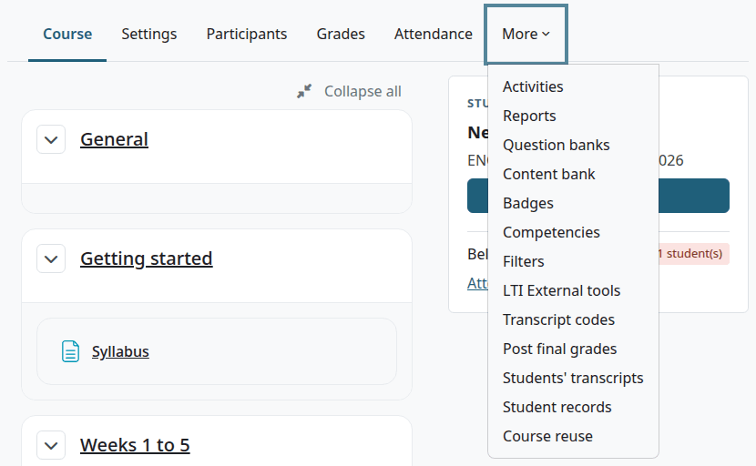
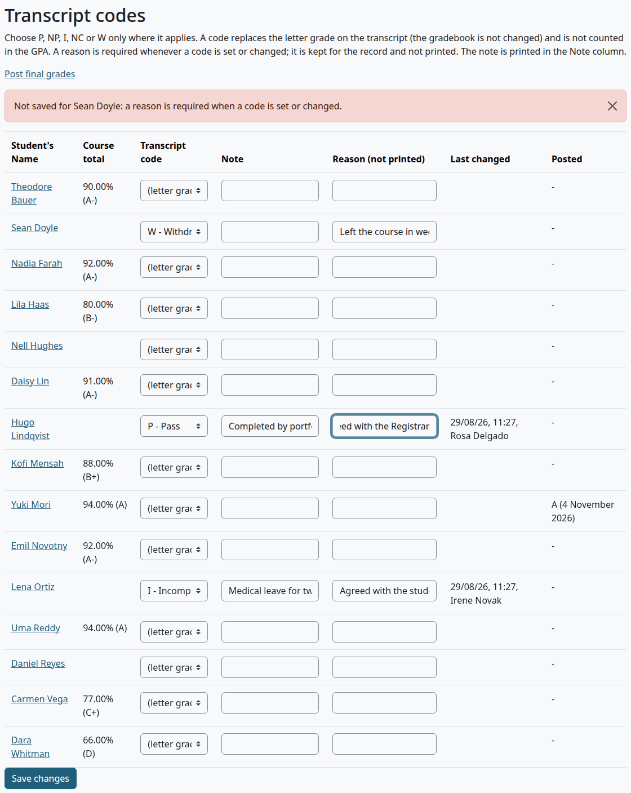
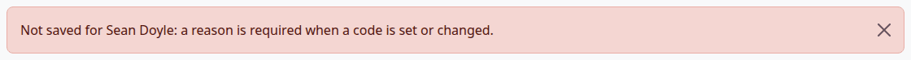
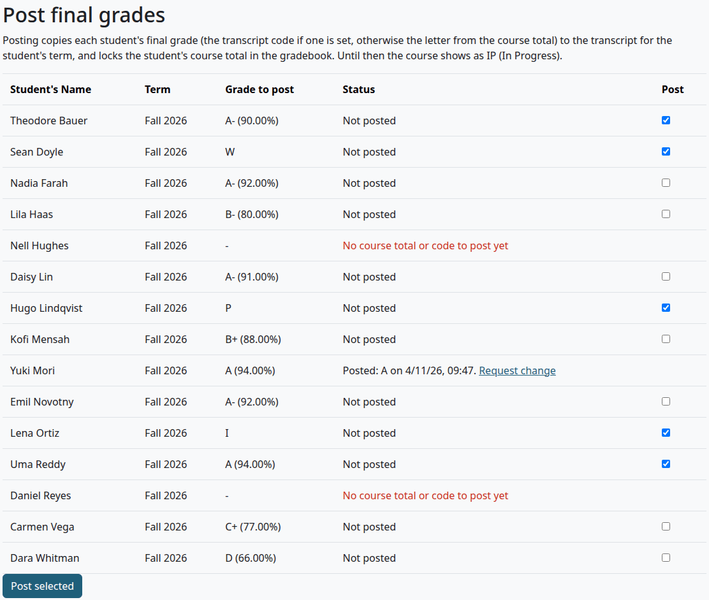
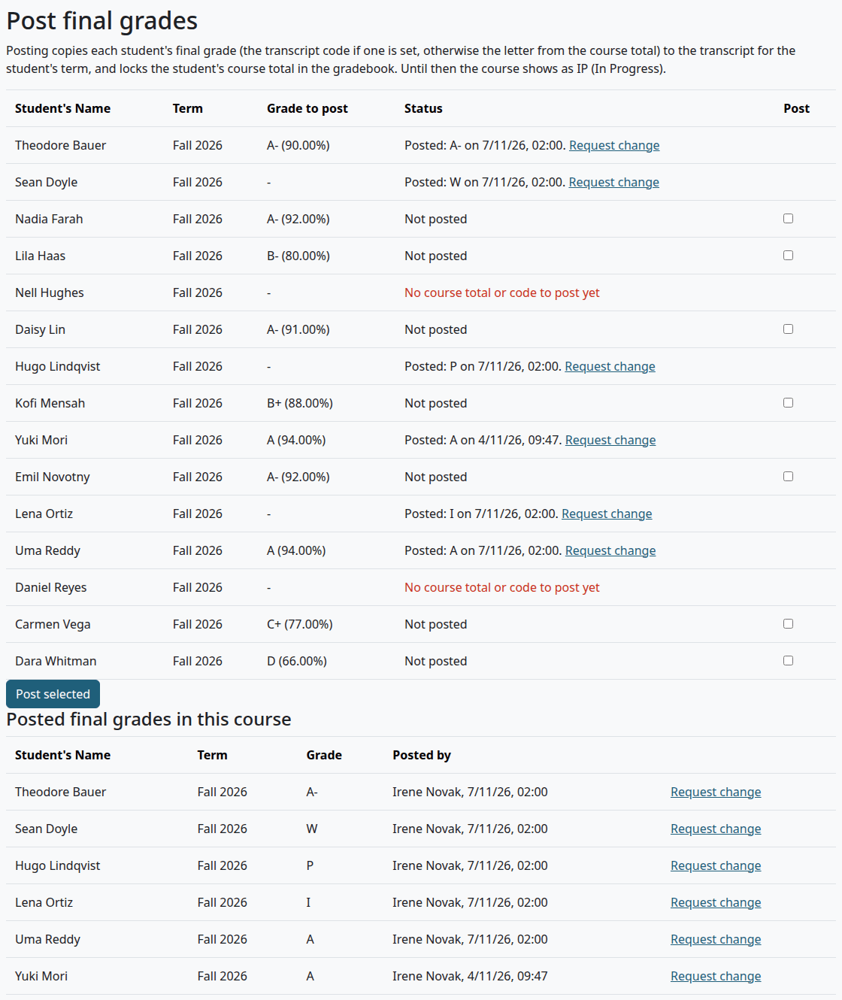
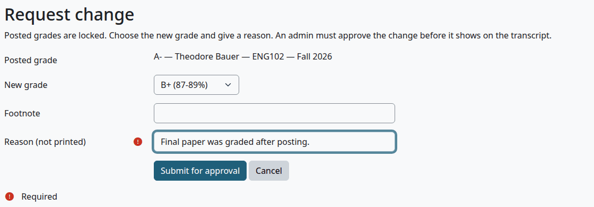
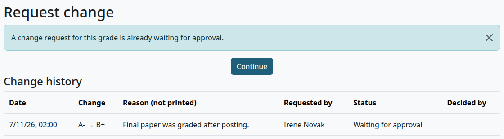
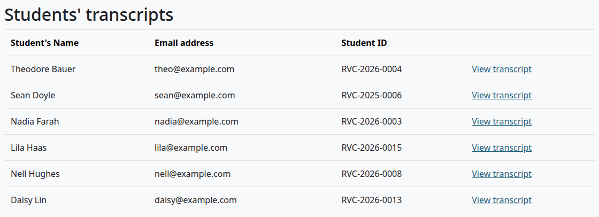
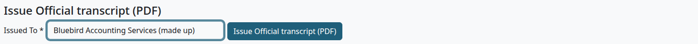
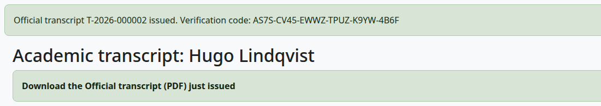

# Teacher guide

This page is for teachers. It follows a term from the first transcript code to the day someone needs an Official transcript.

Moodle's Teacher role holds all the capabilities on this page in its own courses, and so do managers. A non-editing teacher holds none of them.

## Contents

- [A term, step by step](#a-term-step-by-step)
- [Where things are](#where-things-are)
- [Enter a transcript code](#enter-a-transcript-code)
- [Post final grades](#post-final-grades)
- [Request a change to a posted grade](#request-a-change-to-a-posted-grade)
- [See your students' transcripts](#see-your-students-transcripts)
- [Issue an Official transcript](#issue-an-official-transcript)
- [Related pages](#related-pages)

## A term, step by step

1. Before the term, a manager sets the course's [Course code, Hours and Term](terms-and-course-fields.md#course-fields). Until then, your course shows up as a problem on students' transcripts, and you can't post.
2. During the term, you grade in the Moodle gradebook as usual. The course shows as IP (In Progress) on the transcript.
3. For a student who gets a mark such as P, NP, I, NC or W, you [enter a transcript code](#enter-a-transcript-code).
4. When the term is over, you [post the final grades](#post-final-grades). Posting copies them to the transcript and locks each student's course total.
5. To change a posted grade, you [request a change](#request-a-change-to-a-posted-grade), and someone else approves it.

This page describes a transcript on the plugin's own data. With Student Records as the source, the same pages work with some differences: see [With Student Records](with-student-records.md#what-a-teacher-sees).

## Where things are

Open your course and select More. The menu has "Transcript codes", "Post final grades" and "Students' transcripts".

## Enter a transcript code

Who can do this: teachers and managers. It needs `local/academictranscript:entercodes` in the course.

A code replaces the letter from the course total when you post. Use it only where it applies. The gradebook doesn't change.

Before you start:

- The student has a student role in the course.

1. Open the course and select More > Transcript codes.
2. In the student's row, choose a code in "Transcript code".
3. Enter why in "Reason (not printed)".
4. Optional: enter a "Note".
5. Select "Save changes".

| Column | What it does |
|---|---|
| Student's Name | A link to the student's transcript. |
| Course total | The gradebook total, and the letter it would give. |
| Transcript code | "(letter grade)" means no code. The other options are the school's active [marks](grading-and-marks.md#marks), except TR and IP. |
| Note | Up to 255 characters. It's posted with the grade, and prints in small italics under the course title. |
| Reason (not printed) | Why you set the code. It's required when you set or change a code. The box holds the last reason saved, which then counts, so type the new reason over it. It's kept for the record and never prints. |
| Last changed | When the row last changed, and who changed it. |
| Posted | The grade already posted and its date, or `-`. |

Check that:

- The page says "Saved. Entries changed: 2", with the number of rows you changed.
- Post final grades shows the code in "Grade to post".

A saved code doesn't show on the transcript yet. The course stays IP until you post. Posting moves the code to the transcript and clears the row here, so that a later attempt starts clean.

The text at the top of the page speaks of a Note column. There is no such column on a transcript: the note prints under the course title.

What can go wrong:

- "Not saved for Sean Doyle: a reason is required when a code is set or changed." means that row wasn't saved. The other rows were.

  

> Known problem in 1.4.3: after that message, the row shows its saved code again, and the code you chose is gone. Choose the code once more, enter the reason and select "Save changes". If you enter only the reason, the page says it saved, and the row keeps its old code.

## Post final grades

Who can do this: teachers and managers. It needs `local/academictranscript:postgrades` in the course.

Before you start:

- The term is over, and the gradebook has a course total for each student, or the student has a transcript code.
- The course has its Course code, Hours and Term.

1. Open the course and select More > Post final grades.
2. Check "Grade to post" on each row.
3. Tick "Post" for the students you want to post.
4. Select "Post selected".
5. Your browser asks "Post the final grades for the selected students? Posted grades are locked; later changes need admin approval." Select OK.

Check that:

- The page says "Final grades posted: 5", with the number you posted.
- Each posted row says "Posted:" with the grade and the date.
- The grade is on the student's transcript in the right term, and no longer shows IP.
- The student's course total is locked in the gradebook.

The grade to post is the transcript code if there is one, and otherwise the letter from the course total. A posted row keeps a copy of the course code, title and hours from that moment.

You can post students at different times. A row you leave alone stays as it is.

> Known problem in 1.4.3: "Course total" and "Grade to post" can be lower than the gradebook. The plugin divides the student's total by the maximum of the whole course. With the gradebook's Natural aggregation, an item the student has no grade for is left out of the gradebook's own total, and its points still count here. In a course with an ungraded 100-point assignment, 92 out of 100 shows as 46%, and the letter follows it. Before you post, compare the rows with the gradebook. Grade every item, or set "Grade type" to "None" in the settings of an activity that doesn't count.

What can go wrong:

A row with no box says why in red:

| Message | What to do |
|---|---|
| Missing course code | Ask a manager to fill in the course fields. |
| Missing hours | The course and the catalog have no hours. Ask a manager. |
| Missing term | The course has no term, and the student has no term of their own. Ask a manager. |
| No course total or code to post yet | Grade the student in the gradebook, or enter a transcript code. |
| The grading scale has no grade for this percentage | No row of the scale reaches this total. Ask whoever keeps the [grading scale](grading-and-marks.md#how-a-letter-is-chosen). |
| You can't post your own grade. Another teacher or an admin must post it. | This is your own row, for a course you take as a student. |

The list shows the people with a student role in the course. The second table, "Posted final grades in this course", also keeps people who have left it.

## Request a change to a posted grade

Who can do this: teachers and managers. It needs `local/academictranscript:postgrades` in the course.

Posted grades are locked, so a change goes through another person.

1. Open the course and select More > Post final grades.
2. On the student's row, select "Request change".
3. Choose the "New grade".
4. Optional: change the "Footnote". This is the note under the course title on the transcript.
5. Enter why in "Reason (not printed)". It's required.
6. Select "Submit for approval".

Check that:

- The page says "Change requested. An admin must approve it."
- The transcript still shows the old grade.

The request goes to [Grade change approvals](admin-guide.md#grade-change-approvals). Once someone approves it, the transcript shows the new grade. The gradebook stays as it was, locked, with the old total.

To change only a footnote, keep the same grade and change the "Footnote".

"Request change" on the same row shows the state of the request, under "Change history", with the decision and who made it.

What can go wrong:

- "A change request for this grade is already waiting for approval." means there's one already. Only one can wait for each posted grade. When it's decided, you can ask again.

  

- Nobody can approve or reject a change they asked for, or a change to their own grade.

## See your students' transcripts

Who can do this: teachers and managers. It needs `local/academictranscript:issueofficial` in the course.

1. Open the course and select More > Students' transcripts.
2. On a student's row, select "View transcript".

You can see the transcript of anyone with a student role in one of your courses. You find the same link on the student's profile, under "Reports", as "Academic transcript".

The page `/local/academictranscript/students.php`, with no course, lists the students of all your courses.

## Issue an Official transcript

Who can do this: teachers, for a student in one of their own courses, and managers. It needs `local/academictranscript:issueofficial`.

Before you start:

- Every course the student is taking now has its code, hours and term.

1. [Open the student's transcript](#see-your-students-transcripts).
2. Under "Issue Official transcript (PDF)", enter who it goes to in "Issued To".
3. Select "Issue Official transcript (PDF)".
4. Your browser asks "Issue an Official transcript for Hugo Lindqvist? It will be recorded with your name, today's date and a verification code." Select OK.
5. Select "Download the Official transcript (PDF) just issued".
6. Send the PDF to the person named. The plugin doesn't send it.

Check that:

- The page says "Official transcript T-2026-000002 issued. Verification code:" and the code.
- The transcript is under "Official transcripts issued", on the student's page and on [Issued Official transcripts](admin-guide.md#issued-official-transcripts).

The Official transcript freezes the record as it stands now. A later change to a grade doesn't change this copy. To send a newer record, issue a new one: each has its own number and code.

Students ask for Official transcripts on [My transcript](student-guide.md#request-an-official-transcript), and those requests go to the [registrar's queue](registrar-guide.md). A teacher can't open that queue unless their role holds the capability at system level.

What can go wrong:

| What you see | What it means |
|---|---|
| A box with "An Official transcript cannot be issued until these are fixed in the course settings" and a list | [What stops an Official transcript](admin-guide.md#what-stops-an-official-transcript) explains each line. |
| "This is your own transcript, so another person must issue it." | Nobody issues their own. |
| "Enter who the Official transcript is issued to." | "Issued To" is empty. |
| "This Official transcript was issued a moment ago, so no new copy was made" with the number and code | The same recipient within a minute counts as a double click. You get the first copy back. To make a second copy, wait a minute. |

## Related pages

- [Admin guide](admin-guide.md)
- [Registrar guide](registrar-guide.md)
- [Grading scale and marks](grading-and-marks.md)
- [Terms and course fields](terms-and-course-fields.md)
- [With Student Records](with-student-records.md)
