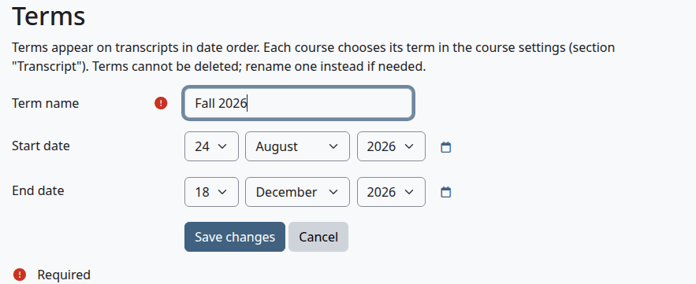
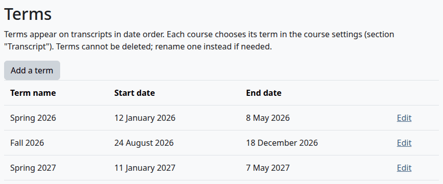
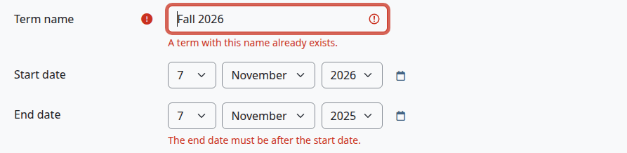
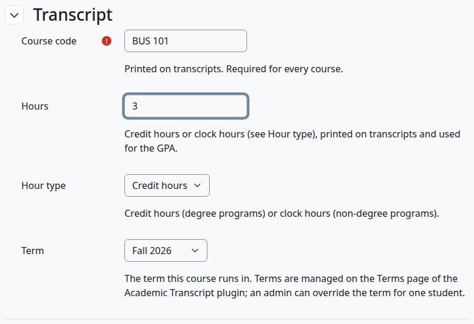
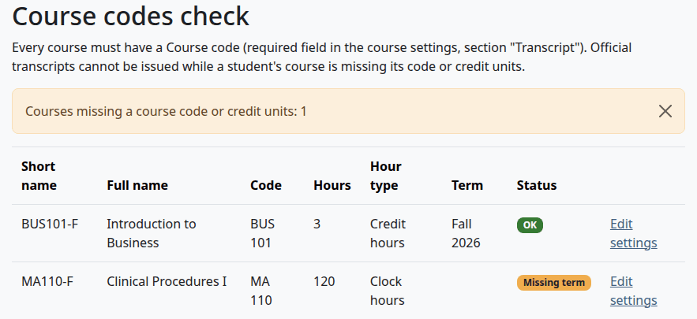
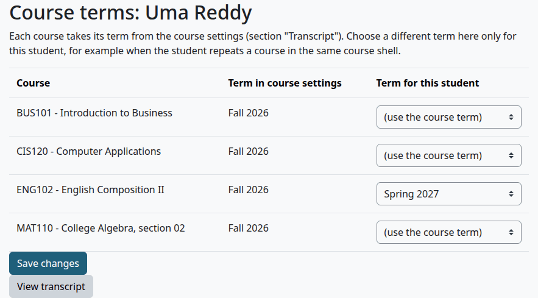
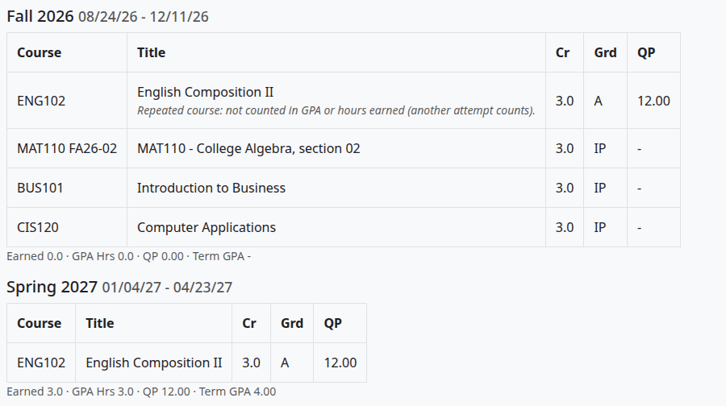

# Terms and course fields

This page is for whoever keeps the school's calendar and course settings up to date. It covers the term list, the four Transcript fields of a course, the Course codes check, the Course terms page and the command line script.

## Contents

- [Terms](#terms)
- [Add a term](#add-a-term)
- [Rename a term or change its dates](#rename-a-term-or-change-its-dates)
- [Course fields](#course-fields)
- [Fill in the course fields](#fill-in-the-course-fields)
- [Course codes check](#course-codes-check)
- [Change the term of a course for one student](#change-the-term-of-a-course-for-one-student)
- [Repeat a course in the same Moodle course](#repeat-a-course-in-the-same-moodle-course)
- [Set course fields from the command line](#set-course-fields-from-the-command-line)
- [Related pages](#related-pages)

## Terms

A term groups courses on a transcript, and terms appear there in date order. Each Moodle course names its term in its course fields, so the term list feeds the options of the course field Term.

Terms can't be deleted. You can rename a term, and its courses stay with it.

With Student Records as the source, a school keeps this list too: a posting still needs a term from it. See [With Student Records](with-student-records.md#what-stays-in-this-plugin).

## Add a term

Who can do this: anyone who holds `local/academictranscript:managerecords`. That's site administrators and managers by default. The page opens before the setup is finished, so that the wizard's last step can be met.

1. Go to Site administration > Plugins > Local plugins > Academic Transcript > Terms.
2. Select "Add a term".
3. Fill in the form and select "Save changes".



| Field | What it does |
|---|---|
| Term name | Required, up to 100 characters. It prints as the heading of the term on transcripts, and it must be unique. |
| Start date | Prints on transcripts, and sets the order of the terms. |
| End date | Prints on transcripts. It must be after the start date. |

Check that:

- The page says "Term saved."
- The term is in the list, oldest first.
- The term is in the menu of the course field Term.



What can go wrong:

- "A term with this name already exists." means the name is taken.
- "The end date must be after the start date." means the dates are the wrong way round, or the same.



## Rename a term or change its dates

Who can do this: anyone who holds `local/academictranscript:managerecords`.

1. On the Terms page, select "Edit" on the row.
2. Change the name or the dates, and select "Save changes".

Check that:

- The course field Term shows the new name on every course that uses it. Courses keep their term.
- Every transcript that isn't issued shows the new name. Official transcripts already issued keep the old one.

## Course fields

The plugin adds a section "Transcript" to the settings of every course, with four fields.

| Field | Short name | What it does |
|---|---|---|
| Course code | `transcript_coursecode` | Required and unique, up to 50 characters. It prints on transcripts, and repeats are matched on it. |
| Hours | `transcript_creditunits` | From 0 to 5000, with one decimal. Credit hours or clock hours, printed on transcripts and used for the GPA. |
| Hour type | `transcript_hourtype` | "Credit hours" or "Clock hours". |
| Term | `transcript_term` | The term the course runs in. The options are the terms on the Terms page. |

The fields are locked, so only people who hold `moodle/course:changelockedcustomfields` can edit them. That's site administrators and managers by default. A teacher doesn't see the section on the course settings page.

If a course has no Hours or Hour type, it uses the [catalog entry](programs-and-catalog.md#add-or-change-a-catalog-course) with the same Course code.

The title on a transcript is the full name of the Moodle course. A leading course code is taken off, so "BUS 101 - Introduction to Business" prints as "Introduction to Business".

## Fill in the course fields

Who can do this: anyone who can edit the course settings and holds `moodle/course:changelockedcustomfields`.

Before you start:

- The term is on the Terms page.

1. Open the course and select Settings.
2. Open the section "Transcript".
3. Fill in the fields and select "Save and display".



Check that:

- The course shows "OK" on the Course codes check.

What can go wrong:

- "You must supply a value here." under Course code means the field is empty. A course can't be saved without one.
- "This value is already used." means another course has that code. Each Moodle course needs its own code, even when the same course runs again in another term. On this plugin's own data, repeats are matched on the code. With the term added to the code, such as `ACC201 FA25`, each run is a different course, and a student who takes it twice has both attempts counted in the GPA and the hours, whatever the "Repeated courses" rule says. So run the course again in the same Moodle course, as [Repeat a course in the same Moodle course](#repeat-a-course-in-the-same-moodle-course) shows. With Student Records as the source, the transcript of a student with a file there prints the codes of Student Records, so such a code does no harm for that student.

## Course codes check

Who can do this: anyone who holds `local/academictranscript:viewissued`. That's site administrators and managers by default.

This page lists every course, with what the transcript will use for it. Hours and Hour type show the catalog's values when the course has none of its own.

1. Go to Site administration > Plugins > Local plugins > Academic Transcript > Course codes check.
2. Read the "Status" column.
3. To fix a course, select "Edit settings" on its row.



| Status | What it means |
|---|---|
| OK | Code, hours and term are all there. |
| Missing course code | The Course code field is empty. |
| Missing hours | Neither the course nor the catalog has hours. |
| Missing term | The Term field is empty. |

The count at the top counts every course with a status other than OK. It says "course code or credit units", and it counts a missing term as well.

For a student on this plugin's own data, a course in progress with one of these problems stops an Official transcript. An hour type that doesn't match the student's program does too, and this page doesn't flag that. The student's transcript page [lists what to fix](admin-guide.md#what-stops-an-official-transcript).

## Change the term of a course for one student

Who can do this: anyone who holds `local/academictranscript:managerecords`.

Each course takes its term from the course settings. This page sets another term for one student, for example when the student repeats a course in the same Moodle course.

1. Open the student's transcript from [Students' transcripts](admin-guide.md#find-a-student).
2. Select "Course terms".
3. In "Term for this student", choose the term. "(use the course term)" goes back to the course settings.
4. Select "Save changes".



Check that:

- The page says "Changes saved".
- On Post final grades, the student's row shows the new term.
- The Activity log has a line "Course term changed for student".

What can go wrong:

- This changes where a grade is posted next. It doesn't move a grade that's already posted, because a posted grade keeps its term. A course with a posted grade in one term and a new term here shows IP in the new term until the teacher posts again.
- With Student Records as the source, the override feeds posting. It doesn't move a course on a transcript read from Student Records.

## Repeat a course in the same Moodle course

Who can do this: a person with the Course terms page and a teacher, together.

Course codes are unique, so on this plugin's own data the second attempt of a course sits in the same Moodle course, in another term. The "Repeated courses" rule then decides which attempt counts.

Before you start:

- The teacher has posted the first attempt, so the student has a posted grade in the first term.

1. On the student's [Course terms](#change-the-term-of-a-course-for-one-student) page, choose the new term for the course.
2. The teacher grades the course and opens More > Post final grades. The student's row shows the new term and the grade to post.
3. The teacher ticks the row and selects "Post selected".

Check that:

- The transcript lists the course in both terms.
- With the default rule, the first attempt keeps its row and has the note "Repeated course: not counted in GPA or hours earned (another attempt counts)."
- The earlier attempt adds nothing to the hours earned, the GPA hours or the quality points.



[Repeated courses](grading-and-marks.md#repeated-courses) lists the three rules.

## Set course fields from the command line

Who can do this: a person who can run commands on the server as the web server user.

`cli/set_course_fields.php` sets the Course code and the Hours of many courses at once. It doesn't set the Hour type or the Term, and it doesn't check the range of the Hours.

Run it in the Moodle folder. On Moodle 5.0 and earlier, the path starts with `local/` in place of `public/local/`.

```bash
sudo -u www-data php public/local/academictranscript/cli/set_course_fields.php \
    --set="2|BUS 101|3.5" --set="3|MA 110|"
```

| Option | What it does |
|---|---|
| `--set="courseid\|code\|hours"` | Repeat it for each course. An empty part leaves that value as it is. A later `--set` for the same course replaces an earlier one. |
| `--execute` | Saves. Without it, the script only prints the plan. |

The script has no `--help`. It prints one line for each course, then says what it did.

```text
course 2 BUS101-F         code: 'BUS 101' -> 'BUS 101'   hours: '3' -> '3.5'
course 3 MA110-F          code: 'MA 110' -> 'MA 110'   hours: '' -> ''
Dry run only - nothing saved. Add --execute to save.
```

With `--execute`, the last line is `Saved.`

What can go wrong:

- `Nothing to do.` means you gave no `--set`.
- The course id is the number in the course's address, after `id=`.
- `Course code 'MA 110' would duplicate course id 3` means the code would belong to two courses. It compares without regard to case, and it counts the codes of this run too. Nothing is saved.
- `Bad --set value:` means the value doesn't have three parts, or the course id isn't a number.
- `Credits must be a number:` means the hours aren't a number.

## Related pages

- [Install and set up](install-and-setup.md)
- [Programs and catalog](programs-and-catalog.md)
- [Grading scale and marks](grading-and-marks.md)
- [Admin guide](admin-guide.md)
- [Teacher guide](teacher-guide.md)
