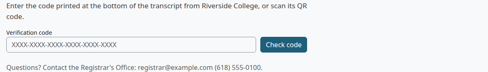
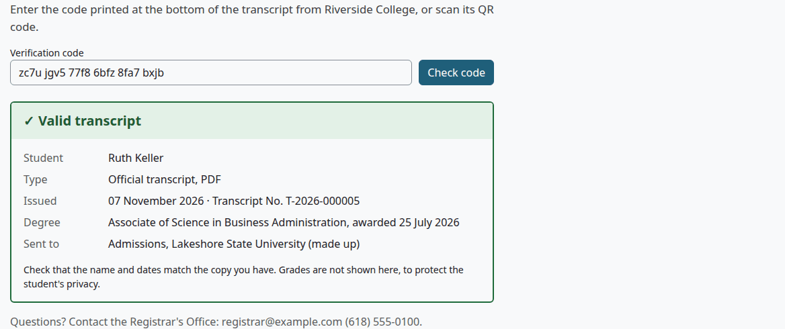
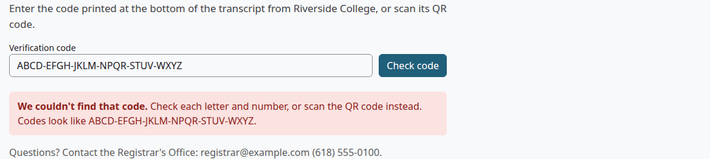

# Verify a transcript

This page is for anyone who receives an Official transcript and wants to check it, and for the staff who answer their questions. The check needs no account.

## Contents

- [Where the code is](#where-the-code-is)
- [Check a code](#check-a-code)
- [What the page shows](#what-the-page-shows)
- [What the page doesn't show](#what-the-page-doesnt-show)
- [If the code isn't found](#if-the-code-isnt-found)
- [What the school can see](#what-the-school-can-see)
- [Related pages](#related-pages)

## Where the code is

Every Official transcript has a verification code of 24 letters and digits, in six groups of four. It prints in the block at the foot of the last record page, next to "Code", under the address of the verify page. The QR code beside it holds the same code. [Reading a transcript](reading-a-transcript.md#the-signature-block) shows the block.

An Unofficial copy has no code and no QR code. It says "Not verifiable (student copy)".

## Check a code

Who can do this: anyone. The page needs no sign-in.

To scan the code, point a phone camera at the QR code and open the link.

To type the code:

1. Open the address printed next to "Verify at" on the transcript. It ends in `/local/academictranscript/verify.php`.
2. Enter the code in "Verification code". Upper or lower case doesn't matter, and spaces and hyphens are ignored.
3. Select "Check code".

Check that:

- A green box says "Valid transcript".
- The name, the date and the number match the copy you have.

## What the page shows

| Line | What it shows |
|---|---|
| Student | The name on the transcript when it was issued. |
| Type | "Official transcript, PDF". |
| Issued | The date of issue and the Transcript No. |
| Degree | The qualification, with "awarded" and the date when there is one. It shows for any award, whatever its kind. |
| Program | The program of study, when there's no qualification. |
| Sent to | Who the transcript was issued to. For a request sent by email, that includes the email address. |

These come from the copy as it was issued, so a later change to the record doesn't touch them.

The line under the box gives the Registrar's Office contact from the current settings, when the school has set an email or a phone.

## What the page doesn't show

The page shows no grades and no date of birth, to protect the student's privacy. To compare grades, use the copy you hold.

The code only proves that the school issued a transcript with these details. It doesn't prove that a PDF is unchanged: for that, open the PDF's signature panel. The Transcript Key says the same in the section "Is This Transcript Real?".

A second copy of a transcript has its own code. An older code keeps working.

## If the code isn't found

"We couldn't find that code." means no transcript has that code. Check each letter and number, or scan the QR code. Codes use the letters A to Z and the digits 2 to 9, and they have no I, O, 0 or 1.

If the code still isn't found, contact the school on the line under the box.

## What the school can see

Who can do this: anyone who holds `local/academictranscript:viewissued`.

Each check goes in the [Activity log](admin-guide.md#activity-log), with the time and the IP address:

- "Verification succeeded", with the student.
- "Verification failed", with what was typed, in capitals and with only its letters and digits, up to 40 characters.

Someone who isn't signed in shows as "(not logged in)". The page has no limit on how many codes a person can try.

Uninstalling the plugin ends every code. Deleting a student's data through Moodle's privacy tools ends that student's codes. See [Privacy and uninstall](privacy-and-uninstall.md).

## Related pages

- [Reading a transcript](reading-a-transcript.md)
- [Registrar guide](registrar-guide.md)
- [Admin guide](admin-guide.md)
