# With Student Records

This page says what changes when Academic Transcript reads from the [Student Records](../student-records/README.md) plugin. It's for site administrators who plan the switch, and for registrars, teachers and students at a school that runs both.

Everything else in this manual stays true, except where this page says otherwise.

## Contents

- [Turn it on](#turn-it-on)
- [Who it reaches](#who-it-reaches)
- [Where the transcript reads from](#where-the-transcript-reads-from)
- [What a student sees](#what-a-student-sees)
- [Fees](#fees)
- [What the registrar sees](#what-the-registrar-sees)
- [What a teacher sees](#what-a-teacher-sees)
- [What stops an Official transcript](#what-stops-an-official-transcript)
- [Grades, hours and transfer credit](#grades-hours-and-transfer-credit)
- [What stays in this plugin](#what-stays-in-this-plugin)
- [Go back to this plugin's own data](#go-back-to-this-plugins-own-data)
- [Related pages](#related-pages)

## Turn it on

Who can do this: site administrators.

Before you start:

- Student Records 1.4.6 or later is installed and set up.
- Grades already posted with this plugin stay here and aren't read from Student Records. Enter those grades in Student Records first, or choose Student Records before any grades are posted. A grade left behind [stops Official transcripts](#what-stops-an-official-transcript) for that student.

1. Go to Site administration > Plugins > Local plugins > Academic Transcript > Transcript settings.
2. Under "Grades and hours", set "Source of the transcript" to "Student Records".
3. Select "Save changes".

Check that:

- The transcript of a student with a file in Student Records shows the details from there.
- Grading scale and Marks not used in GPA say "Students with a file in Student Records are counted on the grading scale there. This page covers students without a file."

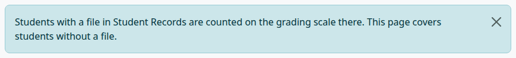

With Student Records merely installed, My transcript and Transcript requests already show its menu, whatever this setting says. The data doesn't change until you pick it.

## Who it reaches

The setting works student by student:

- A student with a file in Student Records has a transcript from there.
- A student without a file keeps the transcript from this plugin's own data and scale, on the same pages.
- Official transcripts already issued keep their frozen copy.

## Where the transcript reads from

For a student with a file, these come from Student Records, read only:

| On the transcript | In Student Records |
|---|---|
| Name | The legal name on the file. |
| Student ID, date of birth, program, admit term, status | The file. |
| Calendar, and the credit or clock column | The hour type of the program. |
| Qualification and award date | The award conferred. |
| Terms and their dates | The terms of Student Records. |
| Courses and final grades | The student's registrations. A completed registration prints its grade, a withdrawal prints W, and an open registration prints IP. A dropped course isn't on the transcript. |
| Transfer credit | The transfer credit on the file. |
| The grades and marks of the key | The grading scale of Student Records. |

The plugin's own student details, transfer credit and course terms aren't read for such a student. Their pages still open and save, and they don't say so.

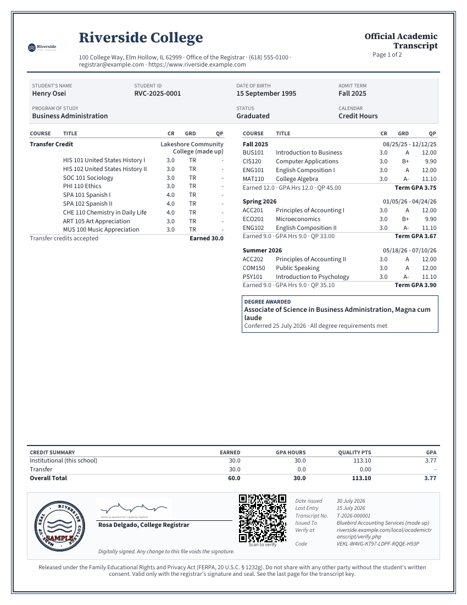

For a certificate program in clock hours, the column is HRS, and the summary is headed CLOCK HOUR SUMMARY.

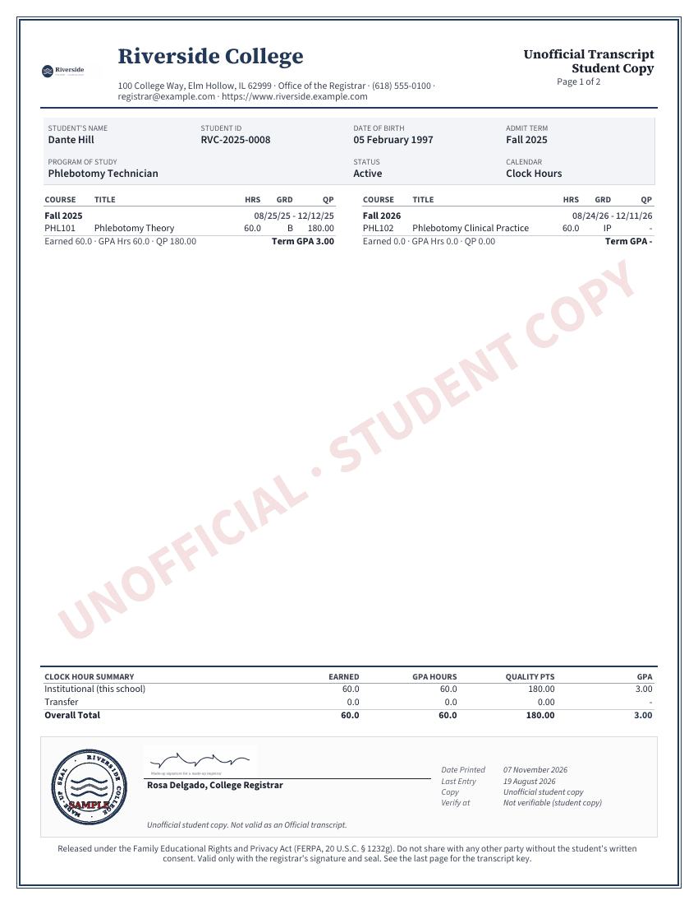

## What a student sees

A student with a file opens My Transcript from the Student Records menu. The page has a few more things.

"When should we send it?" asks when to send the transcript:

| Option | The request waits until |
|---|---|
| Right away | It doesn't wait. |
| After this term's grades are posted | The student has no open registration in a term that had started when they asked. |
| After my degree is awarded | The student's status in Student Records is Graduated. |

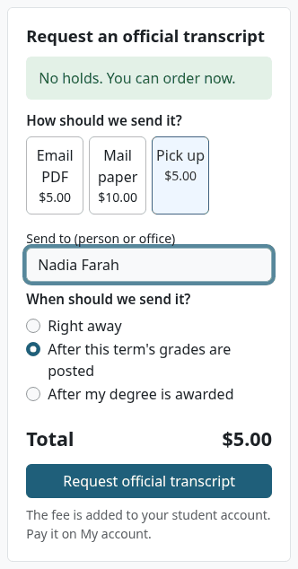

The request's state updates by itself when a page opens. Nothing runs in the background. A request that waits shows "Waiting" under My requests.

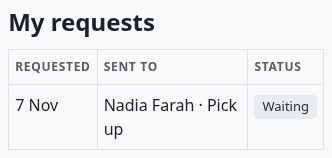

A student with a hold sees it at the top of the form, and can still order. The request then shows "On hold".

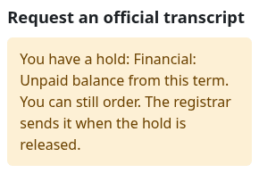

## Fees

With billing on in Student Records, a request from a student with a file puts the fee on the student's account, as a charge named for the delivery. The form says "The fee is added to your student account. Pay it on My account.", and the message after sending is "Request sent. The fee is on your account, and the registrar will issue your official transcript."

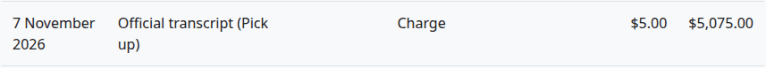

A cancelled request keeps its fee on the account, and the queue says so before you confirm. Staff can credit it in Student Records: see [Student accounts](../student-records/student-accounts.md).

Without billing, or for a student without a file, the fee is only recorded on the request, as [Transcript settings](settings.md#official-transcript-fees) says.

## What the registrar sees

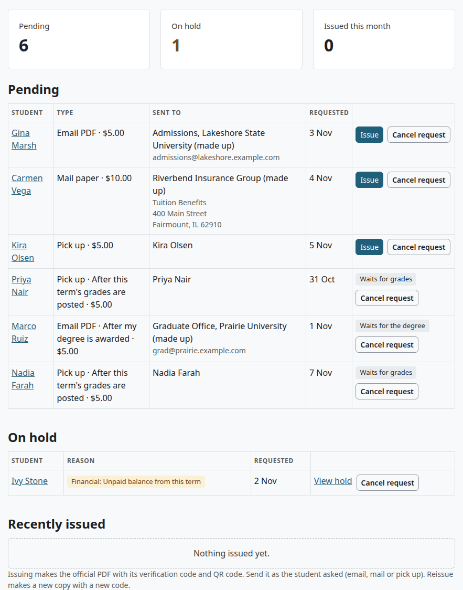

- A request that waits has the tag "Waits for grades" or "Waits for the degree" in place of "Issue". It counts in the "Pending" tile. You can cancel it.
- A request whose student has a hold moves to "On hold", with the reason. "View hold" opens the Holds tab of the student's file. A hold beats waiting. All holds count here, whether or not they block registration.
- When the hold is released or the wait is over, the request is back under Pending with its "Issue" button the next time the page opens.
- "Cancel request" says "The $5.00 fee stays on the student's account." when a fee was charged.

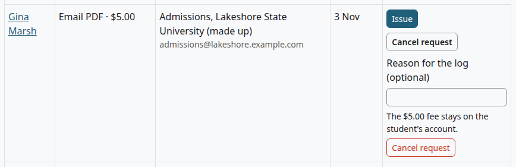

The steps for Issue and Cancel are in the [Registrar guide](registrar-guide.md), and the known problem there applies here too.

## What a teacher sees

The pages are the same, and these things change for a student with a file.

Post final grades:

- The grade goes on the student's registration in Student Records, in the same step. The intro on the page says so.
- The letter comes from the scale in Student Records.
- The course still needs this plugin's Course code, Hours and Term, and the term must be on this plugin's [Terms](terms-and-course-fields.md#terms) page.
- Student Records sends the student its "grade posted" message.

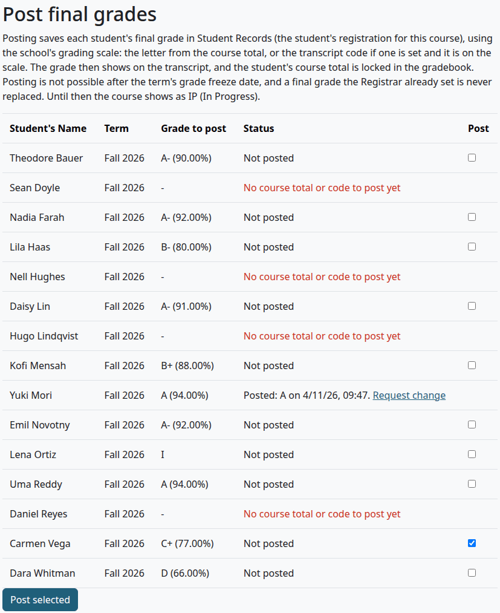

A row with no box can also say:

| Message | What it means |
|---|---|
| The student is not registered for this course in Student Records; ask the Registrar. | The file has no registration in a section linked to this Moodle course. |
| The student has more than one open registration for this course in Student Records; ask the Registrar. | The Registrar must settle which one it is. |
| The grades of this term are frozen in Student Records (after the date); ask the Registrar for a grade change. | The term's grade freeze has passed. |
| The Registrar already set this final grade in Student Records (the grade); it is not changed. Ask the Registrar for a grade change. | A grade the Registrar set is never replaced. |
| A teacher already posted a final grade (the grade) on this registration in Student Records. For a new attempt, ask the Registrar to register the student for this term. | The course runs again and needs a new registration. |
| This grade is not on the school's grading scale in Student Records; ask the Registrar. | The letter, or a saved transcript code, isn't on that scale. |

Transcript codes offers the marks of the scale in Student Records, labelled with their descriptions, without IP and TR. A note typed there is saved and doesn't print, because a transcript from Student Records has no notes from this plugin.

Request change:

- The form offers the grades of the scale in Student Records. It has no "Footnote" field.
- The request goes to the Registrar in Student Records, and the message is "Change requested. The Registrar must approve it in Student Records."
- It doesn't appear on Grade change approvals, or under "Change history" on this page. See [Final grades](../student-records/final-grades.md).
- After the Registrar changes a grade, Post final grades adds "Now B in Student Records." to the row.
- A posted grade with no registration behind it can't be changed here. The page says "This grade is not linked to a registration in Student Records, so a change here would not reach the transcript. Ask the Registrar to change it in Student Records."

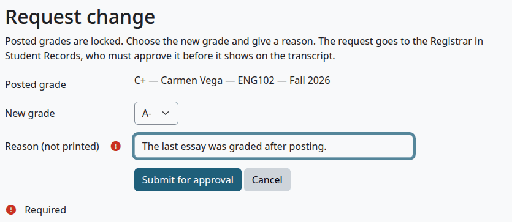

## What stops an Official transcript

For a student with a file, the checks on the course fields aren't made. These stop every way of issuing:

| What you see | What to do |
|---|---|
| An Official transcript cannot be issued while the student has a hold: and the hold | Release the hold in Student Records. |
| The grade D posted for ENG102 is not in Student Records, so the transcript leaves it out. Ask the Registrar to enter it there. | The grade was posted while the source was this plugin, or before the student had a file. Enter it in Student Records. |
| Grade X in ENG102 is not on the grading scale in Student Records, so the transcript cannot count it. Add it to the scale there, or correct the grade. | Add the grade to the scale, or correct it. |

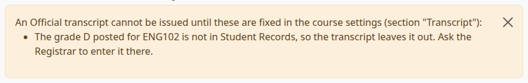

The heading of that list says to fix things in the course settings. For these two problems, the fix is in Student Records.

> Known problem in 1.4.3: a grade that isn't on the grading scale of Student Records still counts its hours as earned, on the student's page and on an Unofficial copy, though the message says the transcript can't count it. Only the GPA leaves it out. Add the grade to the scale, or correct it, before anyone relies on those hours.

## Grades, hours and transfer credit

The transcript is worked out here, on the grading scale of Student Records, so the two plugins show the same figures. The settings "Round to whole percent" and "Repeated courses" stay in this plugin, and Student Records follows them.

- A course earns its hours when Student Records says it passed. A grade below a program's minimum passing grade stays in the GPA and earns no hours. If the grade would pass otherwise, it has the note "Below the program's minimum passing grade: no hours earned."
- A retaken course follows the [repeat rule](grading-and-marks.md#repeated-courses), and the earlier attempt keeps its row with its note.

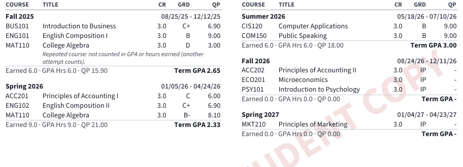

- Transfer credit marked "in GPA" in Student Records prints its letter and quality points, and counts in the overall GPA, not in any term's. Other transfer credit prints TR and adds only to the hours earned.
- W, IP and TR are always in the key. A mark of that scale with no description there takes this plugin's wording for that mark.
- The default text "How GPA Is Figured" of the key speaks of transfer credit and repeats. Check that it fits your school: see [Transcript Key](settings.md#transcript-key-last-page).

## What stays in this plugin

With Student Records as the source, a school still uses these here:

- The [Terms](terms-and-course-fields.md#terms) page and the course fields, because posting needs them.
- The fees, the look of the transcript, the signature and the key on [Transcript settings](settings.md).
- The queue, the issued list, the activity log and the verify page.
- The grading scale, marks, programs and catalog, for students without a file.

The term list here is separate from the terms in Student Records. Keep the two in step.

## Go back to this plugin's own data

Who can do this: site administrators.

1. On Transcript settings, set "Source of the transcript" to "This plugin's own data (posted grades)".
2. Select "Save changes".

Check that:

- A request that waited for grades or the degree is now pending, with its "Issue" button.
- Holds no longer stop anything.
- Transcripts come from this plugin's tables. Grades in Student Records don't move here, so a student's courses show the grades posted here, and IP for the rest.

## Related pages

- [Student Records](../student-records/README.md)
- [Final grades](../student-records/final-grades.md)
- [Holds and standing](../student-records/holds-and-standing.md)
- [Transcript settings](settings.md)
- [Registrar guide](registrar-guide.md)
- [Teacher guide](teacher-guide.md)
