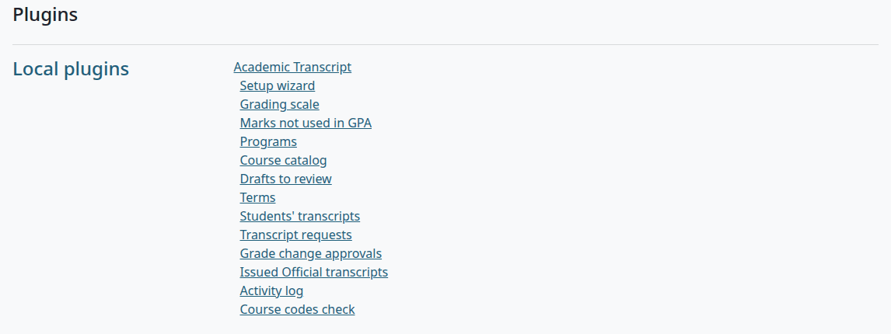
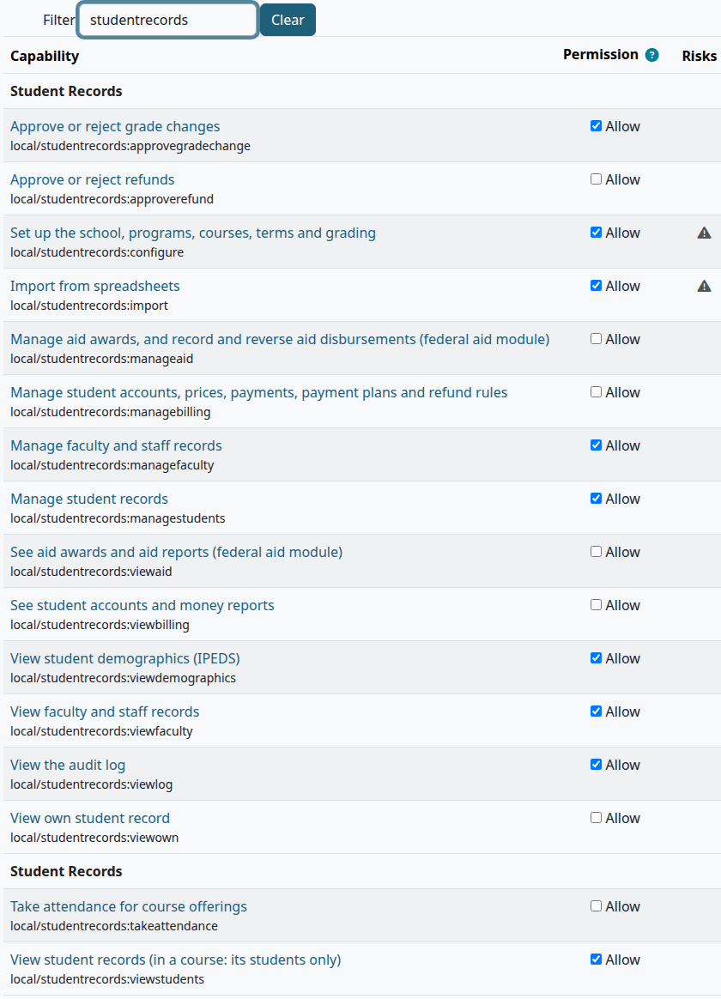
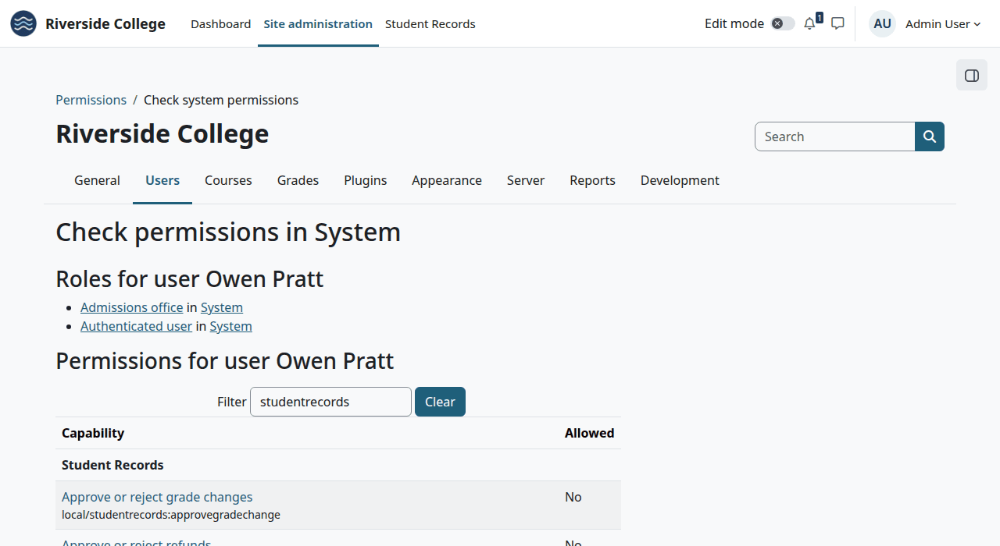
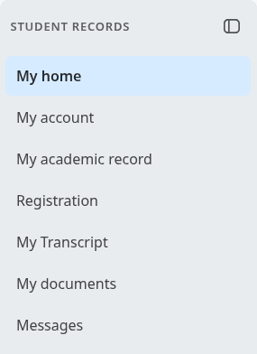
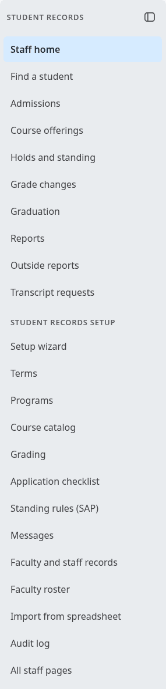
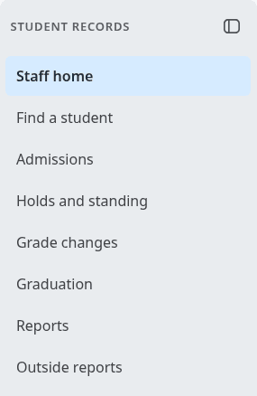
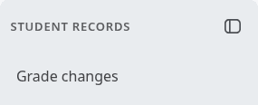
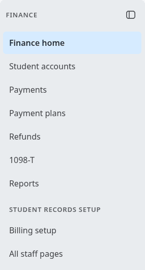
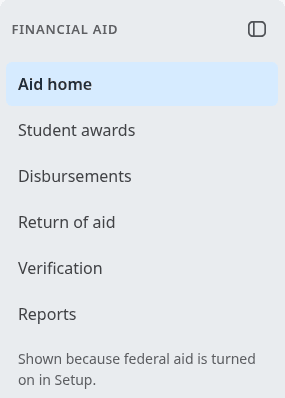
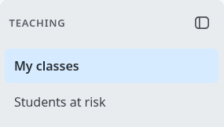

# Roles and permissions

This page says who can do what in Student Records and Academic Transcript: every capability in plain words, the roles the plugins make, how to set up the others, the menu each role sees, and the rules that no role can change. It is for site administrators, and for anyone who wonders why a page says no.

## Contents

- [How access works](#how-access-works)
- [Student Records capabilities](#student-records-capabilities)
- [Academic Transcript capabilities](#academic-transcript-capabilities)
- [The people Moodle already knows](#the-people-moodle-already-knows)
- [The roles the plugins make](#the-roles-the-plugins-make)
- [The roles you make](#the-roles-you-make)
- [Make a role](#make-a-role)
- [Check what a person can do](#check-what-a-person-can-do)
- [The menu of each role](#the-menu-of-each-role)
- [Rules that aren't capabilities](#rules-that-arent-capabilities)
- [What the rules leave open](#what-the-rules-leave-open)
- [What a Manager can't do](#what-a-manager-cant-do)
- [Related pages](#related-pages)

## How access works

Moodle decides what a person may do from capabilities. A capability is one permission, such as `local/studentrecords:viewlog`. A role is a named set of capabilities, and you give a role to a person at a level.

| Level | What it means | How you give it |
|---|---|---|
| System | Everywhere on the site | Site administration > Users > Permissions > Assign system roles |
| Course | In that one course | The course's Participants page |

Three things follow from this:

- A system capability works only from a role given at system level. In a course role it does nothing, whatever the role form says.
- `local/studentrecords:viewstudents` and `local/studentrecords:takeattendance` work at course level. Teachers get them that way, for their own courses. `local/studentrecords:viewstudents` at system level means every student.
- The Student Records menu shows only what a person's capabilities open, so a role is also a menu. See [The menu of each role](#the-menu-of-each-role).

A few rules aren't capabilities, and no role changes them. The main one is that nobody acts on their own record. See [Rules that aren't capabilities](#rules-that-arent-capabilities).

A person's role change works from their next page. They don't need to sign in again.

## Student Records capabilities

The name in quotes is what Moodle's role form shows. Moodle marks most of these with risk icons, because they show personal data or can change records: give them only to people who need them.

| Capability | What it lets a person do | Level | Who has it from the start |
|---|---|---|---|
| `local/studentrecords:viewown`, "View own student record" | See their own record, account, registration, documents and letters, and the Dashboard strip and course card. It opens nothing without a student record linked to the account | System | Every signed-in user |
| `local/studentrecords:viewstudents`, "View student records (in a course: its students only)" | At system level: find and read every student's file and degree audit, and use "View as student". It gives no editing, no document names and no History tab, and it doesn't show directory information a student has withheld. In a course: the list of that course's students, and the files of students in a course they share | Course | Teacher, Non-editing teacher, Manager |
| `local/studentrecords:managestudents`, "Manage student records" | Add and edit files, Admissions, registration, final grades until the freeze, holds, standing, the Grade changes page, Graduation, letters, Reports and Outside reports. Mark attendance in any section. See withheld directory information. It can't be split: anyone with it can do all of this | System | Manager |
| `local/studentrecords:viewdemographics`, "View student demographics (IPEDS)" | Open and edit Demographics on the file, run a saved export with race, ethnicity or sex, and see the Counts grid | System | Manager |
| `local/studentrecords:approvegradechange`, "Approve or reject grade changes" | Decide grade changes. On its own it opens only the Grade changes page, and shows only what the person can decide | System | Manager |
| `local/studentrecords:configure`, "Set up the school, programs, courses, terms and grading" | The setup wizard, Terms, Programs, Course catalog, Grading, Application checklist, Standing rules, Messages and Course offerings. On Outside reports, add and edit saved exports | System | Manager |
| `local/studentrecords:import`, "Import from spreadsheets" | Import from spreadsheet: upload, review, approve and reject | System | Manager |
| `local/studentrecords:viewfaculty`, "View faculty and staff records" | Faculty and staff records, the Faculty roster and credential files | System | Manager |
| `local/studentrecords:managefaculty`, "Manage faculty and staff records" | Add and edit those records, credentials and qualified courses. It needs `local/studentrecords:viewfaculty` to open the pages | System | Manager |
| `local/studentrecords:viewlog`, "View the audit log" | The [Audit log](student-records/audit-log.md) | System | Manager |
| `local/studentrecords:viewbilling`, "See student accounts and money reports" | Student accounts, statements and receipts, the Refunds page and the money reports. The Finance menu shows when billing is on | System | Manager |
| `local/studentrecords:managebilling`, "Manage student accounts, prices, payments, payment plans and refund rules" | Billing setup, and every action on an account: charges, credits, payments, plans and reversals. "Add missing charges for a term", figuring a refund again and "Record money paid back". The holder gets the staff message about late plan payments, but only with `local/studentrecords:viewbilling` too. It needs `local/studentrecords:viewbilling` to open accounts as well | System | Manager |
| `local/studentrecords:approverefund`, "Approve or reject refunds" | Decide refunds. The holder gets the staff message when a refund waits, but only with `local/studentrecords:viewbilling` too. It needs `local/studentrecords:viewbilling` to open the Refunds page as well, so a role that only approves refunds needs both | System | Manager |
| `local/studentrecords:takeattendance`, "Take attendance for course offerings" | In a course linked to a section: the "Attendance" tab, taking attendance, the teacher's side card, and the Teaching menu | Course | Teacher, Non-editing teacher, Manager |
| `local/studentrecords:viewaid`, "See aid awards and aid reports (federal aid module)" | With the module on: the Federal aid pages and the Financial Aid menu | System | Manager |
| `local/studentrecords:manageaid`, "Manage aid awards, and record and reverse aid disbursements (federal aid module)" | Add and edit awards, disburse, run a disbursement, edit aid year details, send the award letter message, reverse aid lines, send a return to Finance. It needs `local/studentrecords:viewaid` to open the pages | System | Manager |

Given alone, `local/studentrecords:managefaculty`, `local/studentrecords:viewdemographics`, `local/studentrecords:approverefund` and `local/studentrecords:manageaid` add no page to the menu. Each one adds to a page another capability opens.

## Academic Transcript capabilities

| Capability | What it lets a person do | Level | Who has it from the start |
|---|---|---|---|
| `local/academictranscript:viewown`, "View own transcript and download an Unofficial copy" | My transcript, the Unofficial PDF and the request form | System | Every signed-in user |
| `local/academictranscript:issueofficial`, "Issue Official transcripts" | See a student's transcript and issue an Official one. In a course: for students of that course, from Students' transcripts. At system level: for everyone, and Transcript requests too | Course | Teacher, Manager |
| `local/academictranscript:entercodes`, "Enter transcript codes (P, NP, I, NC, W) and notes" | "Transcript codes" in a course | Course | Teacher, Manager |
| `local/academictranscript:postgrades`, "Post final grades and request changes" | "Post final grades" in a course, and "Request change" on a posted grade | Course | Teacher, Manager |
| `local/academictranscript:configure`, "Configure the transcript (setup wizard, grading scale, marks, programs, catalog)" | The setup wizard, Grading scale, Marks not used in GPA, Programs, Course catalog and Drafts to review | System | Manager |
| `local/academictranscript:managerecords`, "Edit student details for transcripts" | Terms, the list of students, and "Edit student details", "Transfer credit" and "Course terms" on a student's page. To open that page, the person also needs `local/academictranscript:issueofficial` | System | Manager |
| `local/academictranscript:approvechanges`, "Approve changes to posted grades" | Grade change approvals, on this plugin's own data. With Student Records as the source, changes go to its Grade changes page | System | Manager |
| `local/academictranscript:viewissued`, "View the log of issued Official transcripts" | Issued Official transcripts, with their PDFs, the Activity log and the Course codes check | System | Manager |

"Teacher" here means Moodle's Teacher role. A Non-editing teacher has none of these.

"Transcript settings" isn't on this list. It needs Moodle's `moodle/site:config`, so in practice only a site administrator opens it.

## The people Moodle already knows

These need no new role.

| Person | Role | What they get |
|---|---|---|
| Site administrator | Moodle's site administrator | Every capability, every page, and the Student Records menu. The rules about a person's own record still bind them |
| Manager | Moodle's Manager, at system level | Every capability of both plugins, but see [What a Manager can't do](#what-a-manager-cant-do) |
| Teacher | Moodle's Teacher, in each course | The students of their own courses, attendance, and with Academic Transcript the codes, posting and issuing |
| Non-editing teacher | Moodle's Non-editing teacher, in each course | The students of their own courses, and attendance |
| Student | None. They need a student record linked to their Moodle account | Their own pages |
| Advisor | None. It's a field on the student record, filled from active faculty | "Advisees" on the faculty record. Being an advisor opens nothing. To read an advisee's file, the person needs a shared course or `local/studentrecords:viewstudents` at system level |
| Staff who never use courses | Any staff role, and "No LMS access" ticked on their [staff record](student-records/faculty-and-staff.md) | No Dashboard or My courses tab, and Moodle's course pages send them to Student Records |

## The roles the plugins make

Student Records makes two roles, and only when you ask. Academic Transcript makes none.

| Role | Short name | Capabilities | How to make it |
|---|---|---|---|
| "Finance (Student Records)" | `srfinance` | `local/studentrecords:viewbilling`, `local/studentrecords:managebilling`, `local/studentrecords:approverefund` | Billing setup > "Create the Finance role", then "Give people the Finance role". See [Billing setup](student-records/billing-setup.md) |
| "Financial Aid (Student Records)" | `srfinaid` | `local/studentrecords:viewaid`, `local/studentrecords:manageaid` | Only with the federal aid module on: Staff area > Federal aid > "Create the Financial Aid role", then "Give people the Financial Aid role". See [Federal aid](student-records/federal-aid.md) |

Both are system roles. The buttons need Moodle's `moodle/role:manage` and `moodle/role:assign`, so they are for a site administrator.

What these two can't do, and what to add:

| They need to | Add to the role |
|---|---|
| Finance: open a student's file | `local/studentrecords:viewstudents`. The Finance role reaches a student only through Student accounts |
| Finance: release a hold, such as one placed for a late plan payment | `local/studentrecords:managestudents`, or ask the Registrar to do it |
| Financial Aid: open the student's account | `local/studentrecords:viewbilling` |
| Financial Aid: use the link to students not meeting academic progress, which opens Academic standing | `local/studentrecords:managestudents` |

Think before you add `local/studentrecords:managestudents` to a money role: it opens the whole file. If you add a capability of another plugin to one of these two roles, an uninstall of Student Records leaves the role in place.

## The roles you make

Student Records has no Registrar or Admissions role. You make them, and the code decides by capability, not by the role's name. Start from "No role". The wizard's step Roles and staff suggests a copy of the Manager role limited to the capabilities you need. That works, but the Manager role holds most of Moodle's own course and user rights too, and you would have to take each of them out.

Give each of these roles at system level.

### Registrar

| Capability | Why |
|---|---|
| `local/studentrecords:managestudents` | The work of the office |
| `local/studentrecords:viewstudents` | The "Student records" link in a course the person can open. A system role opens a course only with an enrolment there or Moodle's `moodle/course:view`. Without them, Moodle shows the course's "Enrolment options" page |
| `local/studentrecords:configure` | Course offerings, with rosters and "Get final grades from Moodle", and Terms, Programs, Course catalog, Grading, Application checklist, Standing rules and Messages. Without it, none of these open |
| `local/studentrecords:viewdemographics` | Demographics, the Counts grid, and any saved export with race, ethnicity or sex. All three starter exports have them |
| `local/studentrecords:approvegradechange` | Deciding grade changes. Give it to at least two people, because nobody decides their own request |
| `local/studentrecords:viewfaculty`, `local/studentrecords:managefaculty` | Faculty and staff records |
| `local/studentrecords:viewlog` | The [Audit log](student-records/audit-log.md) |
| `local/studentrecords:import` | Import from spreadsheet |
| `moodle/user:viewalldetails` | The "Moodle user" and "Moodle account" boxes. Without it, they stop with "Sorry, but you do not currently have permissions to do that (View user full information)." |

With Academic Transcript, add these:

| Capability | Why |
|---|---|
| `local/academictranscript:issueofficial` | Transcript requests, and issuing from a student's page |
| `local/academictranscript:viewissued` | Issued Official transcripts, the Activity log and the Course codes check |
| `local/academictranscript:managerecords` | Terms, and a student's details |
| `local/academictranscript:configure` | The transcript's setup, scale, marks, programs and catalog |
| `local/academictranscript:approvechanges` | Only for students on the plugin's own data |
| `moodle/site:configview` | The Site administration tab. Most of Academic Transcript's pages are at Site administration > Plugins > Local plugins > Academic Transcript, and without this capability the tab isn't there. [Where things are](academic-transcript/README.md#where-things-are) says how to reach the pages without it |

To take attendance like a teacher, and to get the Teaching menu with every section in it, add `local/studentrecords:takeattendance`. A Registrar doesn't need it to mark attendance: `local/studentrecords:managestudents` does that.

Neither plugin makes Moodle accounts, and a student record needs one first. Whoever makes accounts needs Moodle's own rights for that.

### Admissions

| Capability | Why |
|---|---|
| `local/studentrecords:managestudents` | Applicants, decisions and the file |
| `local/studentrecords:viewstudents` | As for the Registrar |
| `local/studentrecords:viewdemographics` | Demographics on the file |
| `moodle/user:viewalldetails` | The "Moodle user" box |

The plugin has no capability for admissions alone. So Admissions staff can also do the Registrar's work on files: holds, registration, grades, standing and graduation. If that doesn't suit your school, keep these to a few people. Without `local/studentrecords:configure` they can't open Course offerings or Terms.

### Grade change approver

`local/studentrecords:approvegradechange` alone. The person opens Student Records and sees only Grade changes. Use this for a dean or a second person who does nothing else in records.

### Records reader

`local/studentrecords:viewstudents` alone, at system level. The person finds and reads every student's file and changes nothing. They don't see document names or the History tab, and the directory information of a student who has withheld it shows as "Withheld (FERPA)".

### Others

| Job | Capabilities |
|---|---|
| Setup staff | `local/studentrecords:configure`, with `local/studentrecords:import` for the import. The Billing setup page needs `local/studentrecords:managebilling` |
| Faculty records clerk | `local/studentrecords:viewfaculty`, `local/studentrecords:managefaculty`, and `moodle/user:viewalldetails` for the "Moodle account" box |
| Auditor | `local/studentrecords:viewlog` alone. The person lands on the staff area, and the menu has only "Audit log" and "All staff pages". See [Audit log](student-records/audit-log.md) |
| Transcript office, with no other records work | `local/academictranscript:issueofficial`, `local/academictranscript:viewissued` and `moodle/site:configview` |

## Make a role

Who can do this: a site administrator.

The steps, with pictures, are in [Make a role for the Registrar](student-records/install-and-setup.md#make-a-role-for-the-registrar). For any role on this page, follow them with that role's list. Two things make it quicker:

- In the role form, type `studentrecords` in the "Filter" box above the list of capabilities. The list shrinks to the 16 of Student Records, and you can tick them there. Boxes you ticked stay ticked when you clear the filter. Do the same with `academictranscript`, `viewalldetails` and `configview`.
- `local/studentrecords:takeattendance` and `local/studentrecords:viewstudents` sit at the end of the list, under a second heading Student Records, because they work at course level.

Under "Context types where this role may be assigned", tick "System", or the role won't be offered in Assign system roles.

Check that:

- The person's next page shows the "Student Records" tab, and the menu in [The menu of each role](#the-menu-of-each-role).

What can go wrong:

- The role isn't in the list at Assign system roles. It has no tick at "System" under "Context types where this role may be assigned". Edit the role.
- The person sees "There is nothing here for you yet. If you expected to see your records, please contact the school office." The role was given in a course, not at system level, or it holds no capability that adds to the menu.

## Check what a person can do

Who can do this: a site administrator.

1. Go to Site administration > Users > Permissions > Check system permissions.
2. Select the person, and select "Show this user's permissions".
3. To see only one plugin, type `studentrecords` or `academictranscript` in the "Filter" box.

The page lists the person's roles at that level, and says Yes or No for each capability. To see what a student sees, staff can use "View as student" on the file. See [The student file](student-records/student-file.md).

## The menu of each role

The "Student Records" tab shows for anyone with at least one group in this menu. Each person gets the groups their capabilities open, in this order: student, records staff, finance, financial aid, teaching, setup. On the Student Records theme the menu is in the left drawer, and on other themes it is a [box at the top of the page](theme/README.md#the-menu-on-another-theme).

| Person | Groups and links |
|---|---|
| Student | Student Records: "My home", "My account", "My academic record", "Registration", "My Transcript", "My documents", "Messages" |
| Registrar | Student Records: "Staff home", "Find a student", "Admissions", "Course offerings", "Holds and standing", "Grade changes", "Graduation", "Reports", "Outside reports", "Transcript requests". Student Records setup: "Setup wizard", "Terms", "Programs", "Course catalog", "Grading", "Application checklist", "Standing rules (SAP)", "Messages", "Faculty and staff records", "Faculty roster", "Import from spreadsheet", "Audit log", "All staff pages" |
| Admissions | Student Records: "Staff home", "Find a student", "Admissions", "Holds and standing", "Grade changes", "Graduation", "Reports", "Outside reports" |
| Grade change approver | Student Records: "Grade changes" |
| Records reader | Student Records: "Staff home", "Find a student" |
| Auditor | Student Records setup: "Audit log", "All staff pages" |
| Finance | Finance: "Finance home", "Student accounts", "Payments", "Payment plans", "Refunds", "1098-T", "Reports". Student Records setup: "Billing setup", "All staff pages" |
| Financial Aid | Financial Aid: "Aid home", "Student awards", "Disbursements", "Return of aid", "Verification", "Reports" |
| Teacher, Non-editing teacher | Teaching: "My classes", "Students at risk" |
| Manager, site administrator | All of the above but the student group, with "Billing setup" in the setup group |
| Someone with no staff capability and no student record | No menu and no tab |

Some links have conditions:

- "My account" shows only with billing on, and the Finance group too.
- "My Transcript" and "Transcript requests" need Academic Transcript and its capability.
- The Financial Aid group needs the federal aid module on.
- The Teaching group needs a section of an active term linked to a Moodle course where the person can take attendance. Without `local/studentrecords:managestudents`, they must also be enrolled in that course.
- A staff member with a student record has the student group too, and it comes first. Student Records opens on My home, and they use "Staff home" to get to work.

Each group's heading shows above its links. In the drawer, the first heading sits at the top.

The note under the Financial Aid group says "Shown because federal aid is turned on in Setup."

Pages outside the menu are at "All staff pages", which shows only the pages you can open. Someone with `local/studentrecords:configure` alone finds Course offerings there.

## Rules that aren't capabilities

These hold for everyone, site administrators too. No role turns them off.

### Your own record

| Rule | What you see |
|---|---|
| Nobody changes the program, status, award name or award date on their own record | "This is your own record, so another person must change your program, status and award." The fields are frozen on the form |
| Nobody creates their own record, records their own admission decision, adds their own transfer credit in Student Records, or approves a substitution on their own record | "This is your own record, so another person must make this change." |
| Nobody enters their own final grade | "This is your own grade, so another person must enter it. To change it, request a grade change." |
| Nobody posts their own final grade | "You can't post your own grade. Another teacher or an admin must post it." on the person's own row of Post final grades |
| Nobody decides a grade change they asked for | "You asked for this grade change; another person must approve or reject it." With own data: "You asked for this change. Another person must approve or reject it." |
| Nobody decides a grade change on their own grade | "This is your own grade; another person must approve or reject the change." With own data: "This is your own grade. Another person must approve or reject the change." |
| Nobody reviews or confers their own graduation application | "This is your own graduation application, so another person must review and confer it." |
| Nobody decides a refund on their own account | "You cannot decide a refund on your own account. Ask someone else who approves refunds." |
| Nobody issues their own Official transcript | "This is your own transcript, so another person must issue it." |
| Only the student pays their own account online | "Only the student can pay their own account online." |

### Registration and grades

| Rule | What you see |
|---|---|
| A hold that blocks registration can't be overridden | "A hold blocks registration: .... Release the hold first (it cannot be overridden)." |
| Staff can override any other registration problem, with a reason | "An override needs a reason." |
| Self-registration is only for admitted, enrolled and active students | "Your status is ..., so you cannot register online. Please contact the registrar's office." |
| A freed seat is held for the student offered it, for 2 days | "Seat held for you", then "Seat offer not taken in time" |
| After the grade freeze, only an approved grade change writes a grade | "The grades of this term are frozen; request a grade change instead." |
| The gradebook never replaces a grade from staff, a change or a teacher, and a teacher never replaces one from staff or a change | "A final grade set by staff or by an approved grade change is kept. Request a grade change instead." |
| Two people can't work on the same seats, grade or account at once | "Someone else is working on this record. Try again in a moment." |

### Money

| Rule | What you see |
|---|---|
| A student has one active payment plan, in any term | "This student already has an active payment plan, and a plan covers the whole balance. Finish or cancel that plan first, then give a new one." |
| A line with a refund on it can't be reversed | "This charge has a refund on it. Reverse the refund lines first." |
| A line already reversed, or a reversal, can't be reversed | "This line was already reversed, or it is itself a reversal." |
| Only a holder of `local/studentrecords:manageaid` reverses an aid line | For anyone else the line has no reverse link on the account page |
| A refund is checked again when it is approved | "A charge in this refund was reversed or refunded after the refund was figured. Figure the refund again." |

### Privacy

| Rule | What you see |
|---|---|
| Directory information is hidden from anyone who doesn't manage students, when the student opted out | "Withheld (FERPA)", and "This student withheld directory information (FERPA). Contact details and addresses are not shown." |

### Transcripts

| Rule | What you see |
|---|---|
| With Student Records as the source, a hold stops every way of issuing | "An Official transcript cannot be issued while the student has a hold: ...." |
| Open problems stop every way of issuing | "An Official transcript cannot be issued until these are fixed: ..." |
| An Official transcript names a recipient | "Enter who the Official transcript is issued to." |
| A teacher acts only for a student of their own course | Moodle's message that the person lacks "Issue Official transcripts" |
| The same action twice within 60 seconds counts once | "This Official transcript was issued a moment ago, so no new copy was made: ..., verification code .... To make another copy, issue it again in a minute." |
| A change to a posted grade needs a reason, and one change waits at a time | "You must supply a value here." or "Required" under "Reason", and "A change request for this grade is already waiting for approval." |
| A code needs a reason when it is set or changed | "Not saved for ...: a reason is required when a code is set or changed." |
| Guests have no transcript | Moodle's message that guests can't come here |

## What the rules leave open

The maintainers left these allowed. A school that wants them closed has to do so by its own practice.

- Staff can edit everything else on their own record, such as legal name, date of birth and admit term. Only the four deciding fields are held.
- Staff can keep their own transfer credit in Academic Transcript, their own holds, and their own standing overrides.
- A person can cancel their own graduation application.
- Staff can correct a grade directly until the term's grade freeze, with no second person. After the freeze, a change needs approval.

## What a Manager can't do

Moodle's Manager role holds every capability of both plugins, with `local/studentrecords:viewown` and `local/academictranscript:viewown` from being a signed-in user. Even so:

- A Manager is bound by the rules above, like everyone else.
- A Manager can't open Transcript settings. It needs `moodle/site:config`.
- A Manager sees the Financial Aid pages only with the federal aid module on. With it off, the page says the person has no permission.

## Related pages

- [The user manual](README.md)
- [Install and set up Student Records](student-records/install-and-setup.md)
- [Install and set up Academic Transcript](academic-transcript/install-and-setup.md)
- [Faculty and staff records](student-records/faculty-and-staff.md)
- [Billing setup](student-records/billing-setup.md)
- [Federal aid](student-records/federal-aid.md)
- [Troubleshooting](troubleshooting.md)
