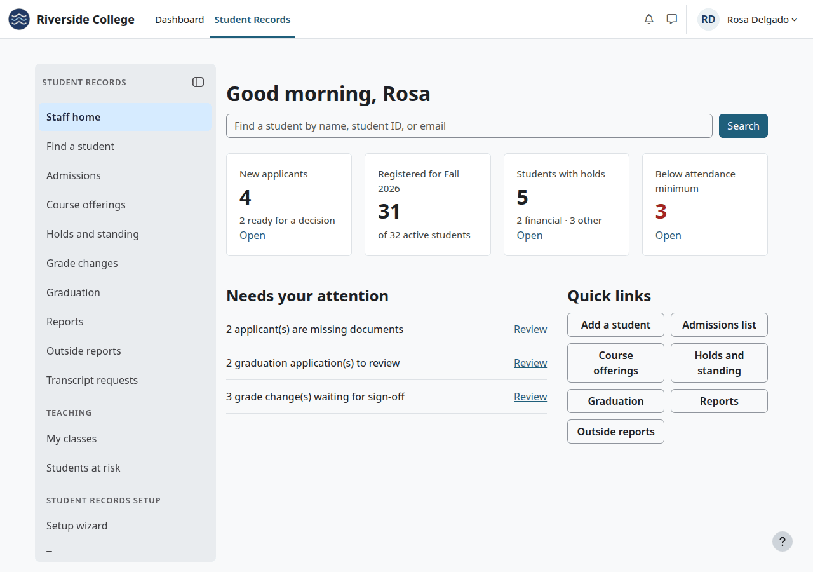

# Student Records

Student Records (`local_studentrecords` 1.4.6) is a student information system that runs inside Moodle. Moodle keeps the teaching and the gradebook, and Student Records keeps the official record. This manual is for everyone who uses it: administrators, registrars, admissions, finance and financial aid staff, teachers and students.

## Contents

- [What it does](#what-it-does)
- [What it doesn't do](#what-it-doesnt-do)
- [Where each role starts](#where-each-role-starts)
- [Where things are](#where-things-are)
- [Setting up a school](#setting-up-a-school)
- [The pages of this manual](#the-pages-of-this-manual)
- [Related pages](#related-pages)

## What it does

Nothing about a particular school is built in. Names, the calendar, grading, rules, programs, courses, prices and refund rules come from the setup wizard, or from the school's own spreadsheet.

| Area | What it does |
|---|---|
| Setup | An 11-step wizard asks for the school's details. Every answer can be changed later |
| Import | Reads the school's catalog, grading and terms from a spreadsheet (.xlsx) or a CSV file. Each item is a draft until staff approve it |
| Terms and catalog | Terms with add, drop, withdraw and freeze dates. Programs in credit hours or clock hours, and a course catalog |
| Student file | One file for each student, from the first inquiry on, with tabs for each part of the record |
| Admissions | Inquiries, applicants, a document checklist, decisions, conditions and waitlists |
| Faculty and staff | Records of degrees and licenses with expiry dates, and the courses each teacher may teach |
| Sections | Course offerings with days, times, rooms and seats, each linked to a Moodle course |
| Registration | Staff register students. A school can also let students register themselves, with a cart, a cost estimate, a time clash check and waitlists |
| Final grades | From the Moodle gradebook or from staff, and from teachers with [Academic Transcript](../academic-transcript/README.md). Staff can correct a grade until the term's grade freeze. After that, a change needs a second person |
| Graduation | Degree audits, applications, and conferral with honors |
| Attendance | Class meetings, present, late, absent or excused, the last date of attendance, and students at risk |
| Holds and standing | Holds, and academic standing from the school's own rules |
| Billing | A price list, charges at registration, accounts and statements, online payments through Moodle's payment providers, receipts, payment plans, late fees, refunds with approval, money reports and a 1098-T spreadsheet. Amounts are in US dollars |
| Messages | 22 automatic messages. They say there is something new and ask the person to log in, with no grades or amounts. Each can be turned off or reworded |
| Letters and FERPA | Enrollment verification letters, the annual notice, withheld directory information and release authorizations |
| Reports | Reports, saved exports for a state agency or accreditor, counts, and a National Student Clearinghouse file |
| Federal aid | An optional module with awards, disbursements to the account, reports, a loan check and a Return of aid worksheet. It is off by default |
| Menus | A menu by role, and a home page for students, records staff, finance, financial aid and teachers |
| No LMS access | Staff who never use courses work in Student Records only |

Each page in this manual says who can do what. [Roles and permissions](../roles-and-permissions.md) has it all in one place.

## What it doesn't do

- It stores no Social Security numbers.
- It sends nothing to outside agencies or the IRS. Staff download the reports.
- It doesn't process federal aid: there is no packaging, COD, NSLDS or ISIR, and no link to any federal system.
- It has no housing, alumni or mobile app features.
- It has no public application form, and it doesn't make Moodle accounts. A student record needs an account first.
- Its import reads no students, registrations or grades, only the school's setup.
- It can't send money back by itself. Staff pay a refund back and record it.
- Terms, programs, courses, grades and rules can't be deleted on any page. Most can be marked inactive.
- It isn't tax or legal advice. The school's advisers check the 1098-T, the loan check, the Return of aid worksheet and state reports.

## Where each role starts

| You are | Start here | You'll use |
|---|---|---|
| A site administrator | [Install and set up](install-and-setup.md) | The [setup wizard](setup-wizard.md), [Roles and permissions](../roles-and-permissions.md) |
| A Registrar or records assistant | [Registrar's guide](registrar.md) | Staff home, Find a student, Course offerings |
| Admissions staff | [Admissions guide](admissions.md) | Admissions |
| Finance staff | [Finance guide](finance.md) | Finance home, Student accounts, Refunds |
| Financial aid staff | [Financial aid guide](financial-aid.md) | Aid home, Student awards, Disbursements |
| A teacher | [Teacher's guide](teacher.md) | My classes, the "Attendance" tab of a course |
| A student | [The student's guide](student.md) | My home, My account, Registration |
| A person who decides grade changes | [Final grades](final-grades.md) | Grade changes |
| A privacy officer | [Privacy and uninstall](privacy-and-uninstall.md) | Moodle's Data requests |

## Where things are

Everyone with a Student Records page has a "Student Records" tab in the top menu. It opens their home page, with the menu. On the [Student Records theme](../theme/README.md) the menu is in the left drawer. On other themes it is a box at the top of the page, folded on small screens.

| Where | What's there |
|---|---|
| The "Student Records" tab | The person's home page. Someone with several homes gets the first of student, staff, finance, financial aid and teacher, and switches with the menu |
| The menu | The pages the person's roles open. See [The menu of each role](../roles-and-permissions.md#the-menu-of-each-role) |
| "All staff pages" in the menu, at `/local/studentrecords/staff.php` | Every staff page the person can open |
| Site administration > Plugins > Local plugins > Student Records staff area | The same page, for site administrators |
| A course, "Attendance" tab | Attendance, for teachers of a course linked to a section |
| A course, More > "Student records" | That course's students, for teachers |
| A profile, "Student record" | The file, for the person and for staff who may see it |
| The Dashboard and course pages | A strip and a side card, on the Student Records theme |
| Site administration > Appearance > Navigation | "Start page for users", which can be Student Records |

Student Records has no settings page in Site administration. The wizard and its own pages hold them all.

## Setting up a school

[Install and set up](install-and-setup.md) lists the steps in order. In short: make the Moodle roles, run the wizard, add the terms, the grading, the programs and courses, and the sections, set up billing if you use it, and then add students.

## The pages of this manual

Guides by role tell a person's job from start to finish, and link to the area pages. The area pages hold every field, option and step.

| Setup | |
|---|---|
| [Install and set up](install-and-setup.md) | Requirements, the install, the Moodle roles, cron, the start page |
| [Setup wizard](setup-wizard.md) | All 11 steps and every question |
| [Import from a spreadsheet](import.md) | Spreadsheets and CSV files, drafts, approving and rejecting |

| Guides by role | |
|---|---|
| [Registrar's guide](registrar.md) | The Registrar's year |
| [Admissions guide](admissions.md) | From inquiry to registered student |
| [Finance guide](finance.md) | Billing, accounts, plans, refunds and the year-end file |
| [Financial aid guide](financial-aid.md) | From the first award to a student who withdraws |
| [Teacher's guide](teacher.md) | Classes, attendance, students at risk, final grades |
| [The student's guide](student.md) | Your record, classes, account and documents |

| The school | |
|---|---|
| [Terms and the calendar](terms-and-calendar.md) | Every date on a term, and what it does |
| [Grading and levels](grading-and-levels.md) | The scale, marks, levels and pass rules |
| [Programs and courses](programs-and-courses.md) | Programs, course lists and the catalog |
| [Course offerings](course-offerings.md) | Sections, rosters and linked Moodle courses |
| [Faculty and staff](faculty-and-staff.md) | Staff records, credentials, qualified courses, the roster |

| Students and records | |
|---|---|
| [The student file](student-file.md) | Every tab and field, history, View as student |
| [Admissions process](admissions-process.md) | The checklist, decisions, conditions, waitlists |
| [Registration](registration.md) | Staff and online registration, waitlists, drops, withdrawals |
| [Final grades](final-grades.md) | Three ways in, the freeze, grade changes |
| [Attendance](attendance.md) | Meetings, marks, students at risk |
| [Holds and standing](holds-and-standing.md) | Holds, standing rules, running standing |
| [Degree audit and graduation](degree-audit-and-graduation.md) | Audits, substitutions, transfer credit, conferral |
| [FERPA and letters](ferpa-and-letters.md) | The annual notice, release authorizations, letters |
| [Documents](documents.md) | Files on a student's file |

| Money and aid | |
|---|---|
| [Billing setup](billing-setup.md) | The price list, plans, refund rules, billing settings |
| [Student accounts](student-accounts.md) | Charges, credits, payments, receipts, statements, reversals |
| [Payment plans](payment-plans.md) | Giving a plan, reminders, late fees and holds |
| [Refunds](refunds.md) | How a refund comes up, is decided and is paid back |
| [Online payments](online-payments.md) | Setting up and using Moodle's payment providers |
| [Money reports](money-reports.md) | Reports, and the 1098-T |
| [Federal aid](federal-aid.md) | Awards, disbursements, runs, letters, reports |
| [Aid helpers](aid-helpers.md) | The loan check and the Return of aid worksheet |

| Running it | |
|---|---|
| [Messages](messages.md) | Each message, test mode, the message log, cron |
| [Reports and exports](reports-and-exports.md) | Reports, saved exports, counts, the Clearinghouse file |
| [Audit log](audit-log.md) | Who did what, what goes in the log, and how to read it |
| [Privacy and uninstall](privacy-and-uninstall.md) | What's stored, data requests, removing the plugin |

## Related pages

- [The user manual](../README.md)
- [Roles and permissions](../roles-and-permissions.md)
- [Academic Transcript](../academic-transcript/README.md)
- [With Student Records](../academic-transcript/with-student-records.md)
- [Student Records theme](../theme/README.md)
- [Troubleshooting](../troubleshooting.md)
- [Glossary](../glossary.md)
