# Admissions process

This page covers every step of admissions: inquiries and applicants, the application checklist, decisions, conditions, deferrals, program waitlists, the Admissions reports and the move to Enrolled and Active. It holds the fields and the steps. For a person's job from start to finish, see the [Admissions guide](admissions.md).

## Contents

- [The path of an applicant](#the-path-of-an-applicant)
- [Set up the application checklist](#set-up-the-application-checklist)
- [Add an inquiry or an applicant](#add-an-inquiry-or-an-applicant)
- [The Admissions page](#the-admissions-page)
- [Track documents](#track-documents)
- [Decide on an application](#decide-on-an-application)
- [Record a decision with its details](#record-a-decision-with-its-details)
- [Defer an application](#defer-an-application)
- [Program waitlists](#program-waitlists)
- [What a decision does](#what-a-decision-does)
- [Move a student to Enrolled and Active](#move-a-student-to-enrolled-and-active)
- [Admissions reports](#admissions-reports)
- [Related pages](#related-pages)

## The path of an applicant

Every person in admissions has a student file, and the file's [status](student-file.md#student-status) says how far they are. A person starts as an Inquiry or an Applicant. A decision moves them to Admitted, Waitlisted, Denied or Deferred. After that, staff move them by hand to Enrolled and Active.

There is no public application form. Staff add each person, and a person needs a Moodle account first.

All the tasks on this page need `local/studentrecords:managestudents` at system level, unless a task says otherwise.

## Set up the application checklist

Who can do this: setup staff. It needs `local/studentrecords:configure` at system level.

The checklist is the list of documents an applicant must send. A document can apply to every program, or to one level, credential type or program.

1. In the Student Records menu, select "Application checklist". You can also fill it in on the Admissions step of the [setup wizard](setup-wizard.md), or bring it in with [Import from spreadsheet](import.md).
2. Select "Add checklist document", or Edit on a row.
3. Fill in the form.
4. Select "Save changes".

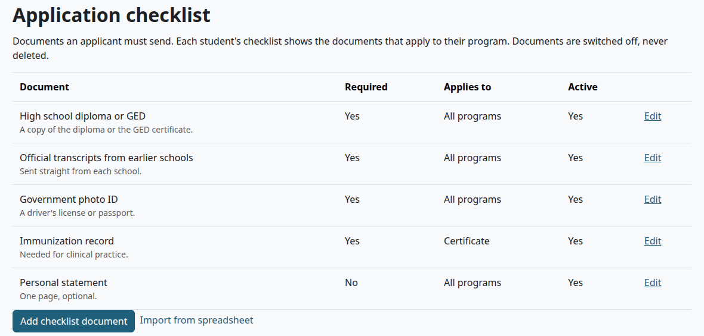

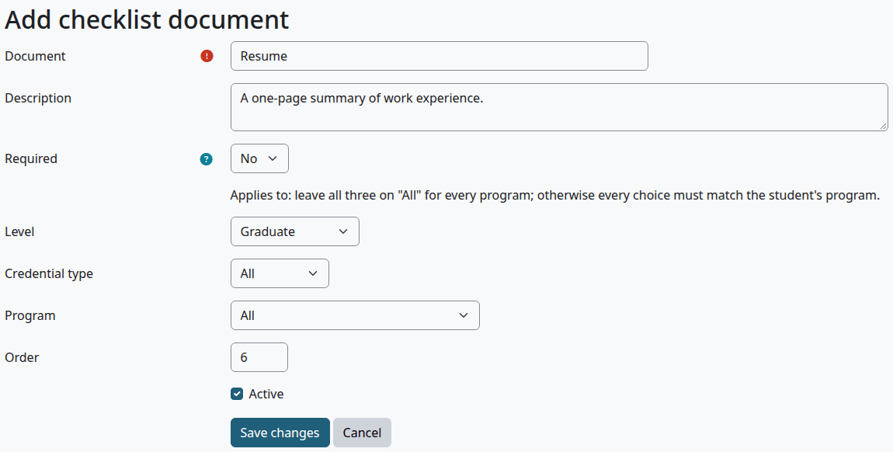

| Field | What it does |
|---|---|
| Document | The name. Required |
| Description | Shown on the Update checklist form |
| Required | Yes (the default) or No. A required document counts as missing until it is received or waived. An optional one is listed and never missing |
| Level, Credential type, Program | Each is All by default. The line above them says "Applies to: leave all three on "All" for every program; otherwise every choice must match the student's program." So a document with a Level and a Credential type applies only to programs of that level with that credential type |
| Order | The place in the list |
| Active | Untick it to switch the document off. No page deletes a document |

Check that:

- The document is in the list, with what it applies to.
- An applicant in a matching program has it on the checklist.

## Add an inquiry or an applicant

Who can do this: records and admissions staff. They also need Moodle's `moodle/user:viewalldetails` at system level, for the Moodle user box.

Before you start:

- The person has a Moodle account.

1. In the Student Records menu, select "Admissions", then "Add applicant".
2. Fill in the form as [Add a student record](student-file.md#add-a-student-record) says, with the program and the admit term.
3. Under Program and status, leave Status on Applicant, or choose Inquiry for someone who hasn't applied yet.
4. Select "Save changes".

> Known problem in 1.4.6: saving this form stops with "There is no record." and no record is made. [Add a student record](student-file.md#add-a-student-record) says what to do instead.

Check that:

- The person is on the Admissions page, under New for an inquiry, or under Missing documents or Ready for decision for an applicant.

## The Admissions page

Who can do this: records and admissions staff. In the Student Records menu, select "Admissions". The page's title is Admissions reports.

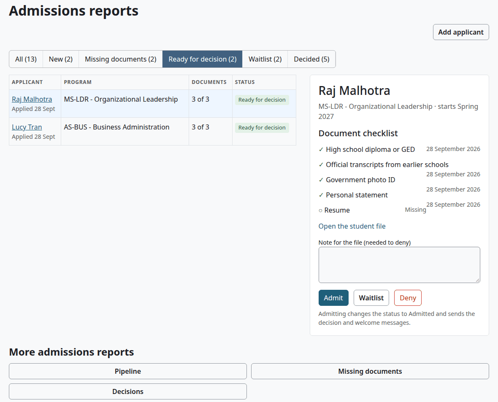

The row of buttons under Add applicant picks who is listed. Each shows a count.

| Button | Who it lists |
|---|---|
| All | Everyone below |
| New | Status Inquiry |
| Missing documents | Status Applicant, with a required document neither received nor waived |
| Ready for decision | Status Applicant, with nothing required missing. The page opens here |
| Waitlist | Status Waitlisted, with the place on the program waitlist |
| Decided | Status Admitted, Denied or Deferred |

The page opens on Ready for decision, so a school with only inquiries sees "No applicants here." at first. Select New or All.

With no checklist documents, every applicant counts as ready.

The table shows the applicant, the date the record was made ("Applied 28 Sept"), the program, how many required documents are in ("3 of 3") and a status tag.

The panel on the right is for the applicant chosen in the list. The first one listed is chosen until you select a name. It shows the program, the admit term and the Document checklist, with a tick for each document received or waived. "Open the student file" opens the Admissions tab of the file.

"Pipeline", "Missing documents" and "Decisions", at the foot of the page, open the [reports](#admissions-reports).

## Track documents

Who can do this: records and admissions staff.

Before you start:

- The applicant's program is set, because the checklist follows the program.

1. On the Admissions page, select "Missing documents", then the applicant, then "Open the student file". Or open the file and its Admissions tab.
2. Select "Update checklist".
3. For each document, choose a State. For Received or Waived, set the date.
4. Add a note if it helps.
5. Select "Save changes".

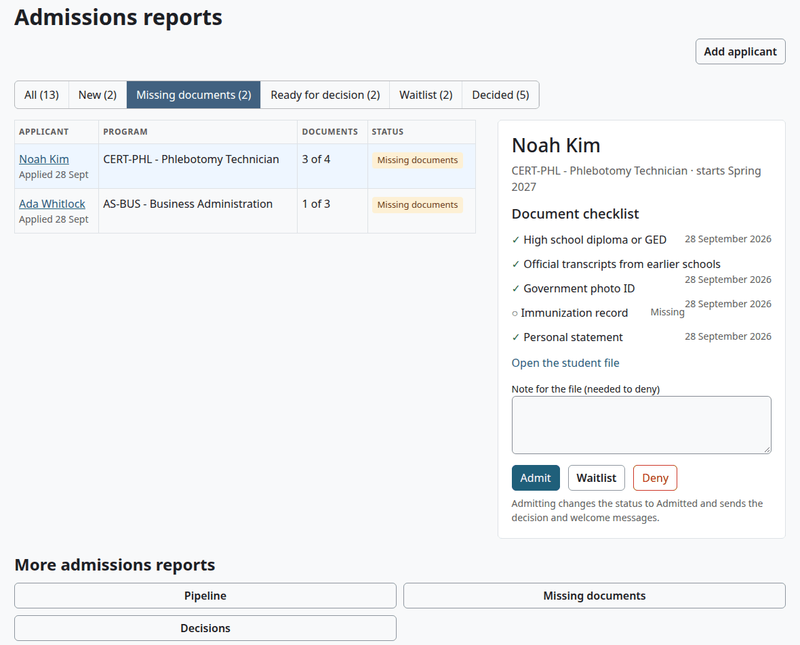

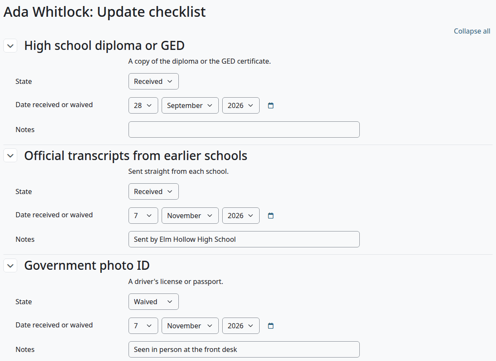

| Field | What it does |
|---|---|
| State | Missing, Received or Waived |
| Date received or waived | Today by default. It is hidden while the state is Missing |
| Notes | Free text, shown on the Admissions tab |

Check that:

- The Admissions tab shows the new states.
- When nothing required is missing, the applicant moves from Missing documents to Ready for decision.

The student sees the checklist too, on My documents and in My details. See [Documents](documents.md#what-a-student-sees).

## Decide on an application

Use this for a plain decision. It records the decision with today's date and the student's admit term. To set a date, a condition or a new term, see [Record a decision with its details](#record-a-decision-with-its-details).

Who can do this: records and admissions staff, but nobody on their own record.

Before you start:

- The status is Inquiry, Applicant or Waitlisted. The panel has no buttons for anyone else.

1. On the Admissions page, select the group, then the applicant's name.
2. To deny, write in "Note for the file (needed to deny)". For the other decisions the note is optional.
3. Select "Admit", "Waitlist" or "Deny". A student already on the waitlist has no "Waitlist" button.

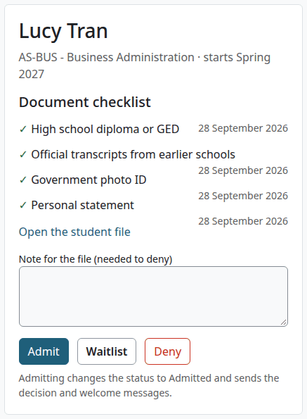

Check that:

- The page says, for example, "Lucy Tran: Admitted."
- The applicant has left that group.
- The Admissions tab of the file lists the decision, with your note as the Reason.

What can go wrong:

- "Please write a note for the file to deny an application." You selected "Deny" with no note.
- Missing documents don't stop a decision. The buttons are there whatever the checklist says, so check it first.
- On your own record the panel says "This is your own record, so another person must make this change."

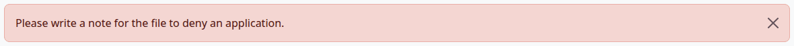

## Record a decision with its details

Use this for a past date, a condition, a deferral or a change of admit term.

Who can do this: records and admissions staff, but nobody on their own record.

1. Open the file, on the Admissions tab.
2. Select "Record a decision".
3. Fill in the form.
4. Select "Record a decision".

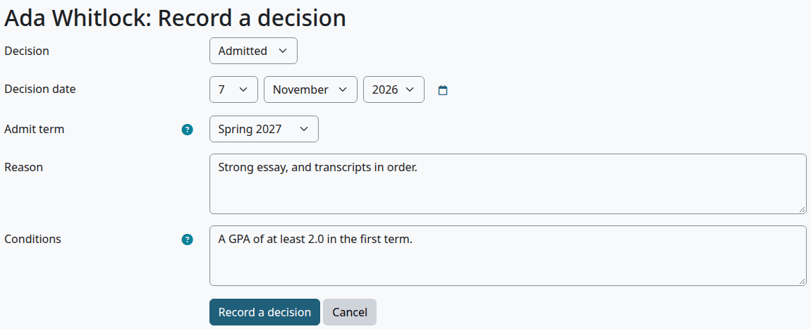

| Field | What it does |
|---|---|
| Decision | Admitted, Waitlisted, Denied or Deferred |
| Decision date | Today by default. It also becomes the From date in Status history |
| Admit term | None, or a term. It starts on the student's admit term. A different term here changes the student's admit term, for any decision |
| Reason | Required for Denied. "A denial needs a reason." |
| Conditions | Conditions of an admission, such as a minimum GPA in the first term or a document still to send |

Conditions are a note on the record. They show on the Admissions tab and in the Decisions report, and nothing checks them later.

Check that:

- The file opens with "Saved."
- Admission decisions on the Admissions tab has the new row.

What can go wrong:

- A decision for a student who is past admissions, such as an Active student, adds the row and sends the messages, and leaves the status alone.

> Known problem in 1.4.6: the form records a new decision each time you save it. Submitting it twice makes two rows and sends the messages twice, and nothing removes the second row. Select "Record a decision" once. If it happened, tell the student.

## Defer an application

Who can do this: records and admissions staff, but nobody on their own record.

Before you start:

- The term the student will start in exists, as [Terms and calendar](terms-and-calendar.md) shows.

1. Open the file, on the Admissions tab.
2. Select "Record a decision".
3. In Decision, choose Deferred.
4. In Admit term, choose the new term.
5. Write the reason, then select "Record a decision".

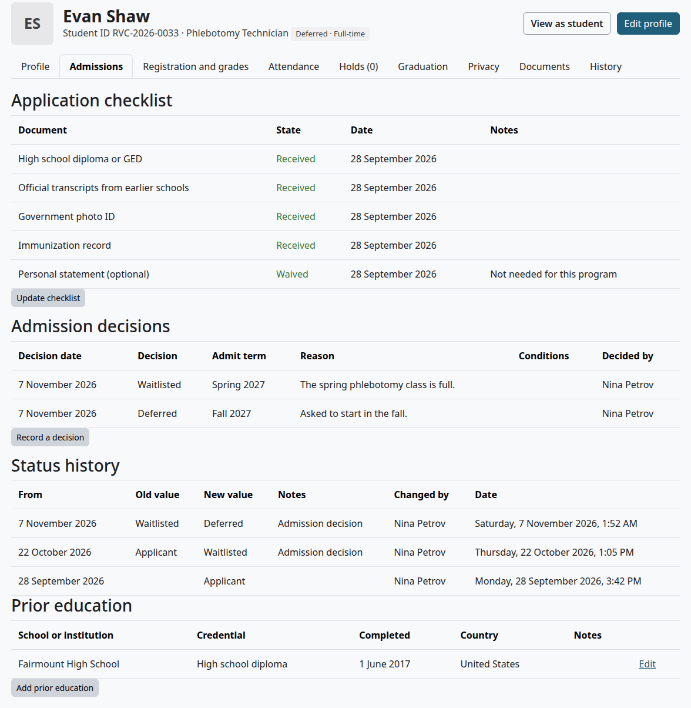

Check that:

- The status is Deferred.
- The file shows the new admit term.
- The student is listed under Decided on the Admissions page. A student who was on the program waitlist has left it.

## Program waitlists

A program waitlist is a list of applicants in order, for one program. Use it when a program has no room for now.

A student joins the list by the decision Waitlisted, on the panel or on the form. The list shows on the Admissions page, under Waitlist, with each place, such as "Waitlist #2". Places go by the date the student joined, among all students waiting for that program.

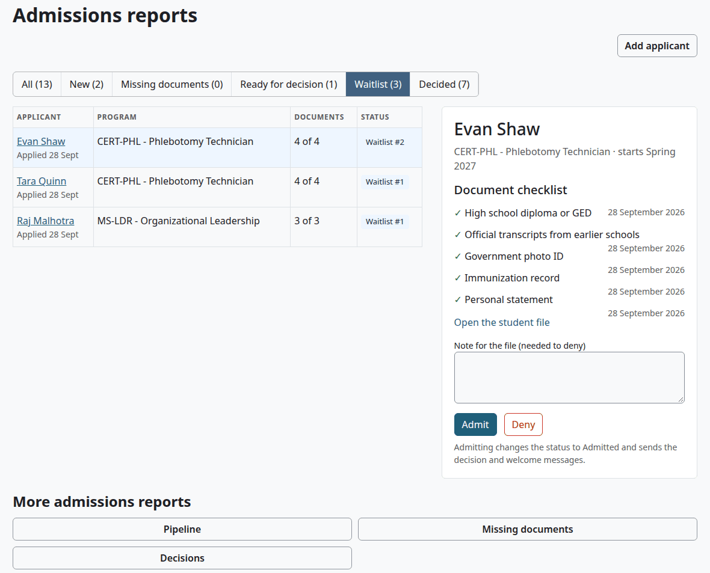

The list is only a list. Nothing offers a place, and no one is admitted by it. When a place opens, decide by hand:

| Decision | What happens to the student's place |
|---|---|
| Admitted | The wait ends as done, and the next student moves up |
| Denied or Deferred | The student leaves the list, and the next student moves up |

A waitlist for a class section is a different list, with seat offers. See [Registration](registration.md#waitlists-and-seat-offers).

## What a decision does

| Decision | Status, while the student is in admissions | Program waitlist | Messages to the student |
|---|---|---|---|
| Admitted | Admitted | The wait ends | Admission decision and Welcome |
| Waitlisted | Waitlisted | Joins the list | Admission decision |
| Denied | Denied | Leaves the list | Admission decision |
| Deferred | Deferred | Leaves the list | Admission decision |

A decision that changes the status also writes a row in Status history, with the note "Admission decision". Each decision writes a line in the audit log.

The messages wait for Moodle's next cron run. They say only that there is news and ask the student to log in, as [Messages](messages.md) shows. They show in the student's Moodle notifications, and they go by email if the person's preferences say so.

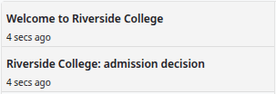

> Not walked through: the email copy of a message needs a real mail server, so no test site can show it. The messages were checked in Moodle's notifications.

An admitted student can register online for classes, if the school allows it. See [Registration](registration.md#register-for-classes-online).

## Move a student to Enrolled and Active

No action does this for you. Registering for classes doesn't change the status.

Who can do this: records and admissions staff, but nobody on their own record.

1. Open the file and select "Edit profile".
2. Under Program and status, set Status to Enrolled, or to Active once classes start.
3. In "Note on the status change", say why.
4. Select "Save changes".

The form is on [Edit a student record](student-file.md#edit-a-student-record).

Check that:

- The tag in the file's header shows the new status.
- Status history on the Admissions tab has the new row and your note.

## Admissions reports

Who can do this: records and admissions staff.

1. On the Admissions page, under "More admissions reports", select "Pipeline", "Missing documents" or "Decisions".
2. Choose the filters, then select "Filter". Admit term and Program are on all three reports, and each starts on All. The Decisions report also has Decision.
3. To save the report, choose a file format under the table and select "Download". The list holds the formats your Moodle has switched on, such as Comma separated values (.csv) and Microsoft Excel (.xlsx). The Applicants list has no download.

The tabs at the top move between the reports, and Applicants goes back to the list.

Pipeline counts students by program and status: the six admissions statuses, Enrolled, Active and a total. A number opens the list of those students.

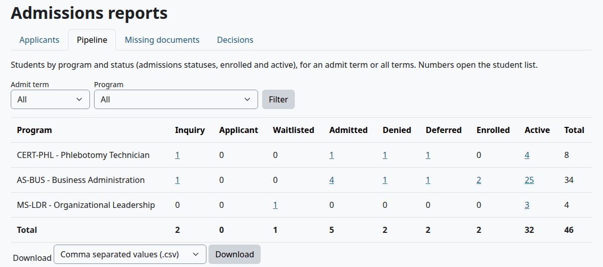

Missing documents lists students in admissions with required documents neither received nor waived. It covers every admissions status, not only Applicant. Its columns are Student ID, Name, Program, Admit term, Status and Missing documents.

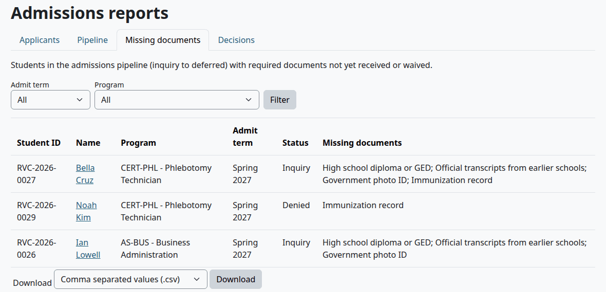

Decisions lists every decision, newest first: Decision date, Student ID, Name, Program, Admit term, Decision, Reason, Conditions and Decided by.

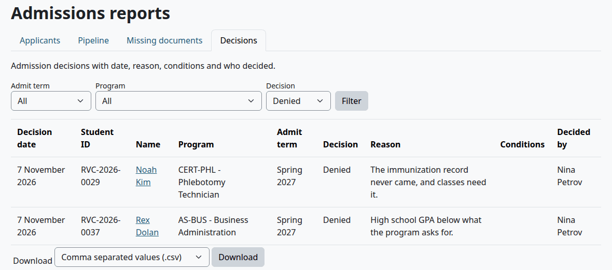

Check that:

- The file downloads with the same columns as the table.
- The audit log has a line for the export.

What can go wrong:

- "Nothing to report." No student matches the filters.
- A count on Pipeline leaves out the statuses Graduated, Withdrawn and On leave.

## Related pages

- [Admissions guide](admissions.md)
- [The student file](student-file.md)
- [Documents](documents.md)
- [Registration](registration.md)
- [Messages](messages.md)
- [Reports and exports](reports-and-exports.md)
