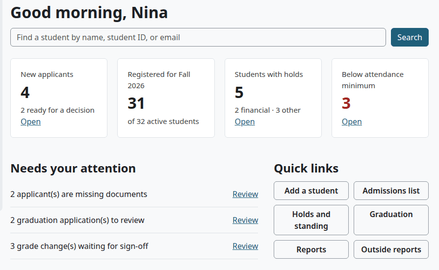

# Admissions guide

This guide follows an admissions officer's work, from a first inquiry to a student who is ready to register. Each step links to [Admissions process](admissions-process.md), which holds the fields and the steps.

## Contents

- [What your role needs](#what-your-role-needs)
- [Your home page](#your-home-page)
- [From inquiry to decision](#from-inquiry-to-decision)
- [After the decision](#after-the-decision)
- [Keeping track](#keeping-track)
- [What the applicant sees](#what-the-applicant-sees)
- [Related pages](#related-pages)

## What your role needs

The plugin has no Admissions role. Your site administrator makes one at Site administration > Users > Permissions > Define roles and assigns it at system level:

| Capability | What it opens |
|---|---|
| `local/studentrecords:managestudents` | Admissions, student files, decisions |
| `local/studentrecords:viewstudents` | Every student's file, to read |
| `local/studentrecords:viewdemographics` | Demographics on the file. Optional |
| `moodle/user:viewalldetails` | The Moodle user box on the student form, which belongs to Moodle |

This role can do everything on a student's file. For Application checklist setup, a person needs `local/studentrecords:configure` too, so the Registrar or setup staff usually keep that list. See [Roles and permissions](../roles-and-permissions.md).

## Your home page

In the top menu, select "Student Records".

For admissions, these parts matter most:

- "New applicants" counts students with the status Applicant, and how many are ready. Inquiries aren't in that count. "Open" opens the Admissions page.
- Under "Needs your attention", "applicant(s) are missing documents" opens the same page.
- "Admissions list" and "Add a student" are under "Quick links".

## From inquiry to decision

1. Make sure the person has a Moodle account. There is no public application form, and Student Records makes no accounts.
2. [Add the person](admissions-process.md#add-an-inquiry-or-an-applicant), as an Inquiry or an Applicant, with the program and the admit term. Read the known problem there first: in 1.4.6 a site administrator has to make new records with a script.
3. When an inquiry applies, set the status to Applicant on [the edit form](student-file.md#edit-a-student-record).
4. As documents come in, [update the checklist](admissions-process.md#track-documents). Add the file itself on the [Documents tab](documents.md#add-documents-to-a-file) if your school keeps it.
5. Add [prior education](student-file.md#add-or-change-prior-education) and [emergency contacts](student-file.md#add-or-change-an-emergency-contact).
6. When the applicant shows under Ready for decision, [decide](admissions-process.md#decide-on-an-application). For a condition or a past date, [record the decision on the file](admissions-process.md#record-a-decision-with-its-details). To put someone off, [defer](admissions-process.md#defer-an-application).

If the program has no room, use the decision Waitlisted, and see [Program waitlists](admissions-process.md#program-waitlists). Nothing moves anyone off that list by itself.

Nobody can record their own decision. If you are also an applicant, another person must do it.

## After the decision

1. The applicant gets the messages at the next cron run. See [What a decision does](admissions-process.md#what-a-decision-does).
2. An admitted student can [register online](registration.md#register-for-classes-online), if your school allows it. Otherwise the Registrar registers them.
3. [Move the student to Enrolled and Active](admissions-process.md#move-a-student-to-enrolled-and-active) when your school's rule says so. No action does it for you.

Conditions on an admission are notes. Nothing checks them, so keep your own list. The Decisions report shows them.

## Keeping track

- The [Admissions page](admissions-process.md#the-admissions-page) sorts everyone by where they are.
- [Pipeline](admissions-process.md#admissions-reports) counts students by program and status.
- [Missing documents](admissions-process.md#admissions-reports) says who still owes what.
- [Decisions](admissions-process.md#admissions-reports) lists every decision, with the reason and who made it.

Each report downloads, for example as a spreadsheet.

## What the applicant sees

An applicant with a record has a Moodle account and sees My home and My academic record, like any student. Under My details are the checklist, the decisions, the status history and the rest of the record. My documents shows the checklist too. The applicant can change nothing. See [The student's guide](student.md).

You can see what they see with "View as student" on the file. See [View as student](student-file.md#view-as-student).

## Related pages

- [Admissions process](admissions-process.md)
- [The student file](student-file.md)
- [Documents](documents.md)
- [Registration](registration.md)
- [Roles and permissions](../roles-and-permissions.md)
