# Aid helpers

The federal aid module has two helpers: a yearly loan check, and a Return of aid worksheet. This page tells financial aid staff what the helpers do and how they work, step by step, as the code does.

The loan check and the Return of aid worksheet follow the federal rules as of the 2026-27 award year, and they are helpers. Check every result against the official worksheet and the current Federal Student Aid Handbook. This page tells you what the code does. It isn't legal or federal aid advice, and it doesn't say what your school should do.

## Contents

- [The loan check](#the-loan-check)
- [The Return of aid worksheet](#the-return-of-aid-worksheet)
- [Open a worksheet](#open-a-worksheet)
- [The details you can change](#the-details-you-can-change)
- [The day the student left](#the-day-the-student-left)
- [The charges](#the-charges)
- [The steps of the worksheet](#the-steps-of-the-worksheet)
- [When nothing goes back](#when-nothing-goes-back)
- [Clock-hour programs](#clock-hour-programs)
- [Send the return to Finance](#send-the-return-to-finance)
- [Related pages](#related-pages)

## The loan check

The loan check runs by itself on a student's aid page, for the award year on the page. It compares the student's Direct Loans with a yearly limit. It only warns: it stops no award and no disbursement.

Who sees it: financial aid staff and managers. It needs the capability `local/studentrecords:viewaid`.

Before you start:

- Fill in Dependency and Grade level in the student's [aid year details](federal-aid.md#enter-aid-year-details). The check reads these two from there. Empty details count as dependent and first year.
- Set "Full-time credit hours per term (Clearinghouse)" in the [Setup wizard](setup-wizard.md#step-3-calendar), and "Graduate levels (1098-T box 9)" in [Billing setup](billing-setup.md#change-the-billing-settings).

The check works in this order:

1. It adds up the Direct Subsidized and Direct Unsubsidized Loans of the award year that are Offered or Accepted. Declined and cancelled awards don't count, and a Direct PLUS Loan isn't checked.
2. If the student's program is at a level marked as graduate, it stops and shows a note. It doesn't check a graduate student against these limits.
3. It finds the student's enrollment as a percent of full time.
4. It takes the yearly limits for the student's dependency and grade level, and multiplies them by that percent.
5. It compares. If the total or the subsidized part is over, it shows a red note and marks that loan's row.

### The yearly limits

These are the helper values in the plugin, in dollars. Each cell has the most in Direct Loans, then the most of that subsidized.

| Dependency | first year | second year | third year and up |
|---|---|---|---|
| dependent | 5,500, of which 3,500 subsidized | 6,500, of which 4,500 subsidized | 7,500, of which 5,500 subsidized |
| independent | 9,500, of which 3,500 subsidized | 10,500, of which 4,500 subsidized | 12,500, of which 5,500 subsidized |

The notes in the code say that a dependent student whose parents are refused a PLUS Loan has the independent limits, and that a parent at the PLUS limit doesn't count. To get those limits for a student, choose independent in the aid year details.

A change of rule needs a new release of the plugin. Check these values against the current handbook.

### The percent of full time

From the 2026-27 award year on, the limits shrink for a student below full time.

1. It looks at the terms of the student's loans.
2. It leaves out a term the student hasn't registered for, and a term the student has left. A term counts when at least one class is registered or completed.
3. It adds up the credit hours of those classes, and divides by the full-time hours times the number of terms.
4. It rounds to a whole percent, and never goes above 100.

It stays at 100 for an award year before 2026-27, for a clock-hour program, when no term counts, and when full-time hours are 0.

For example, a student with 6 credit hours in the one term of their loans, at 12 full-time hours, is at 50%. A first-year dependent student's limits then drop to $2,750.00 and $1,750.00.

### The notes

| Note | When |
|---|---|
| "This student's program is at a graduate level, so this page does not check their loans against a yearly limit. Check them against the federal limits for graduate students." | The program's level is a graduate level, and the student has a Direct Loan |
| "This student is enrolled for 50% of full time, so the yearly limits drop to ..." | The percent is below 100. The note also says that a loan for only part of the academic year takes the term's share of the limit first, and that the page doesn't work that out. |
| "Loans are over the yearly limit. ..." | The total is over the limit. The note says how far to lower the unsubsidized loan, and that row turns red. |
| "The subsidized loan is over its yearly limit. ..." | Only the subsidized part is over. That row turns red. |

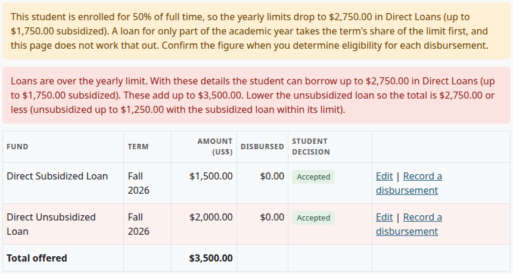

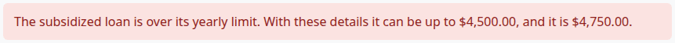

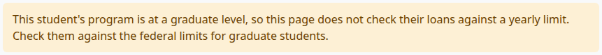

## The Return of aid worksheet

For a student with federal aid who withdrew, the worksheet works out how much aid was earned, and how much the school sends back. It follows the steps of the federal form. It saves nothing by itself: what you type lives in the page's address, and it is gone when you leave. When you send a return, Finance gets the result, and the audit log keeps the details.

Who can do this: financial aid staff and managers. Looking needs `local/studentrecords:viewaid`, and sending needs `local/studentrecords:manageaid`.

## Open a worksheet

Before you start:

- The student has an accepted federal award for the term.
- The student's status is Withdrawn, or every class of the term has ended.

1. Select Return of aid in the left menu.
2. In "Term", choose the term, and select "Show".
3. Select "Open helper" on the student's row.

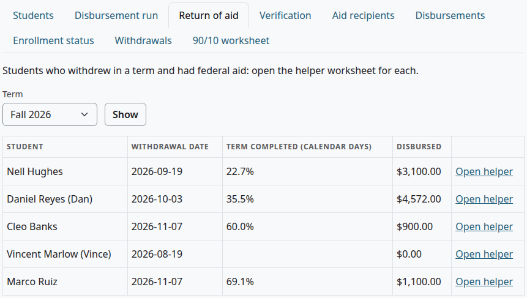

| Column | What it shows |
|---|---|
| Student | The name |
| Withdrawal date | The date on the student's file, or else the day their last class of the term ended |
| Term completed (calendar days) | The percent, from [the day the student left](#the-day-the-student-left), so it can use another date than the one before it. Empty when nothing says. |
| Disbursed | All aid of the term on the account, federal or not |
| Last column | "Open helper" |

The disbursement run has a link to the worksheet too, on a line that says Stopped · withdrew.

The worksheet opens with a line that says when the student withdrew and how long the term is. Then comes this warning, with the date the school must return its share by, 45 days after the date it determined the student withdrew:

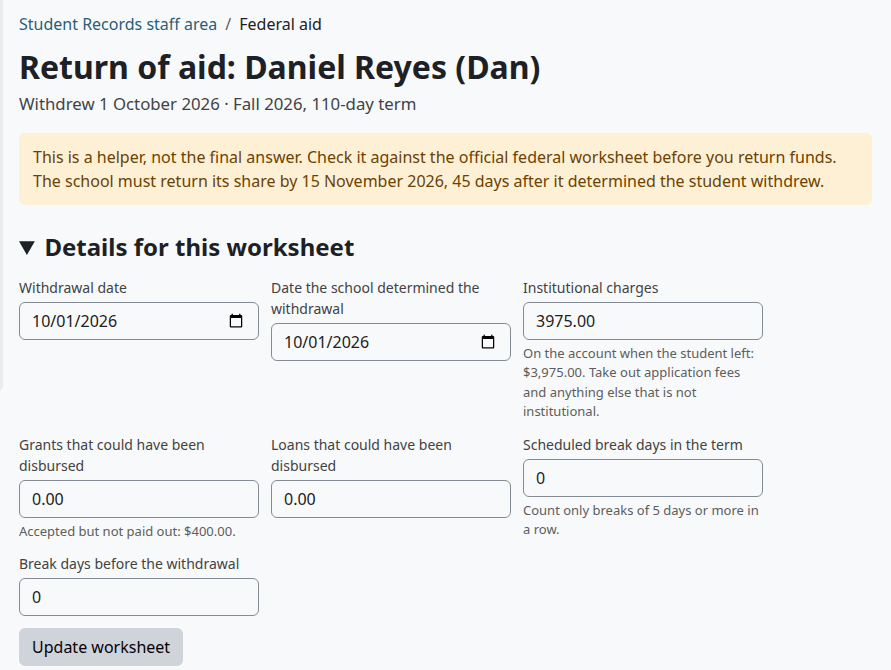

Below the details are the steps, and on the right a card with the result.

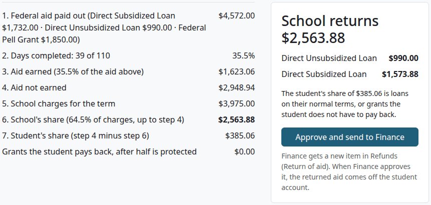

## The details you can change

Under "Details for this worksheet", change what the page can't know, then select "Update worksheet". The figures follow the details.

| Field | Shown | Default | Rule |
|---|---|---|---|
| Withdrawal date | Always | [The day the student left](#the-day-the-student-left) | Must be inside the term |
| Date the school determined the withdrawal | Always | The withdrawal date | Can't be before the withdrawal date |
| Institutional charges | Always | [The charges found](#the-charges) | An amount |
| Grants that could have been disbursed | Always | 0.00 | An amount. The hint shows what was accepted and not paid out. Whether it counts is for you to decide. |
| Loans that could have been disbursed | Always | 0.00 | The same, for loans |
| Scheduled break days in the term | Credit-hour programs | 0 | Count only breaks of 5 days or more in a row |
| Break days before the withdrawal | Credit-hour programs | 0 | Not more than the break days, or the days done |
| Clock hours scheduled up to the withdrawal | Clock-hour programs | Empty | Not more than the hours in the period |
| Clock hours in the period | Clock-hour programs | Empty | Above 0 |

A detail that can't be used is left out, and the default takes its place. The page says so: "These details could not be used, so the worksheet left them out:" and the field.

These notes can show above the steps:

| Note | What it means |
|---|---|
| "... was paid out after the date the school determined the withdrawal, so it is left out." | Aid dated after that date isn't in step 1 |
| "... of federal aid was paid out on awards with no term, so no worksheet counts it. Set the term on the student's awards." | Worksheets count by term, so this aid is in none of them |
| "This is a clock-hour program, so the worksheet needs scheduled hours. ..." | See [Clock-hour programs](#clock-hour-programs) |

Here the same student has a later date of determination, seven break days, and $400.00 of grants that could have been disbursed:

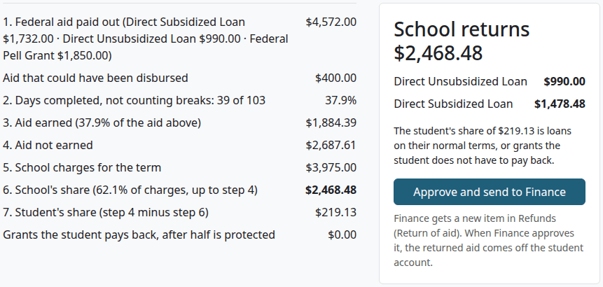

## The day the student left

The page takes the first of these that falls inside the term:

1. The student's last day of attendance in the term
2. The last date of attendance on the student's file
3. The withdrawal date on the student's file
4. The day their last class of the term ended

A date outside the term says nothing about this term. With no date, the page shows only the details, and you enter the date yourself:

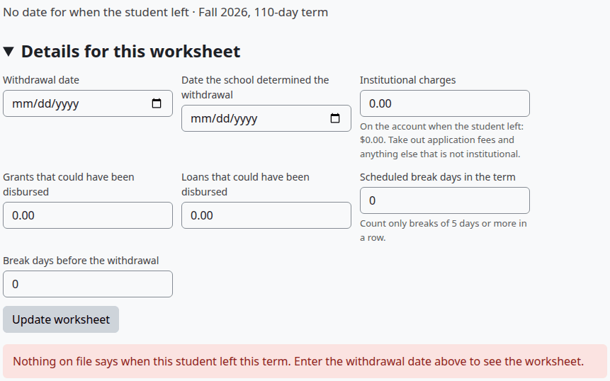

With the setting "Count Moodle course activity as attendance" on, the first date can be later than the last marked day. See [Attendance](attendance.md).

## The charges

The default for "Institutional charges" is what the code finds on the account:

- every charge line of the term dated before the day the student left, with any reversal dated before that day
- less refunds whose date used is before that day, whenever they were approved

A charge from that day on is left out, and the hint says how much: "Charged from that day on and left out:". A charge that a return of aid put on the account doesn't count.

The code doesn't sort charges by kind. Every charge line of the term counts. The hint reminds you: "Take out application fees and anything else that is not institutional." Type your own figure if you need to.

## The steps of the worksheet

The code keeps money in whole cents and percents in tenths. It rounds a half cent up.

| Step on the page | What the code does |
|---|---|
| 1. Federal aid paid out | Adds up federal aid of the term on the account by the date the school determined the withdrawal, fund by fund, less reversals. State, institutional and private aid aren't here. |
| Aid that could have been disbursed | Adds the two fields, when they are above 0 |
| 2. Days completed | Calendar days from the start of the term to the day the student left, both counted, over the days of the term, both counted. Break days in the term come off the days of the term, and break days before the withdrawal come off the days done. The line then says "not counting breaks". |
| The percent in step 2 | Cuts the share off after four decimals, without rounding, then rounds to three. So 38 of 110 is 0.3454, and it shows 34.5%. |
| 3. Aid earned | The percent of step 2 times the aid of step 1, with any aid that could have been disbursed. Past 60% by any amount, the percent earned is 100, and the line says "over 60%: all aid earned". Exactly 60% isn't past it. |
| 4. Aid not earned | Aid paid out less aid earned. When aid earned is more, see [When nothing goes back](#when-nothing-goes-back). |
| 5. School charges for the term | The Institutional charges field |
| 6. School's share | The percent not earned times the charges, but never more than step 4 |
| 7. Student's share | Step 4 less step 6 |
| Grants the student pays back, after half is protected | See below |

The card on the right says "School returns" and the amount, and splits it over the funds in this order, each up to what was paid out from it:

1. Direct Unsubsidized Loan
2. Direct Subsidized Loan
3. Direct PLUS Loan
4. Federal Pell Grant
5. Federal SEOG
6. Other Title IV grant

For the student's share, the code works in this order:

1. Loans left after the school's return stay on their normal terms. They come off the student's share first.
2. What remains is the grant part. Half of the grants, paid out or that could have been, is protected, and comes off.
3. What remains is split over the grant funds in the order above.
4. A fund with $50.00 or less to pay back drops out.

The card then says what the student's share is made of. Only the school's share goes to Finance. The grants the student pays back are shown here and stored nowhere.

For example, the first worksheet on this page has $4,572.00 of aid paid out, and 39 of 110 days done:

| Step | Figure |
|---|---|
| Percent completed | 35.5% |
| Aid earned | 35.5% of $4,572.00 is $1,623.06 |
| Aid not earned | $2,948.94 |
| School's share | 64.5% of $3,975.00 in charges is $2,563.88, which is below step 4 |
| Returned by fund | $990.00 of the unsubsidized loan, then $1,573.88 of the subsidized loan |
| Student's share | $385.06 |
| Grants the student pays back | $0.00: the loans left and the protected half of the grants cover it |

## When nothing goes back

With no federal aid on the account for the term, the page says "No federal aid was paid to this student in this term, so there is nothing to return."

A student past 60% of the term has earned all the aid paid out, so the school returns $0.00, and the page has no button to send.

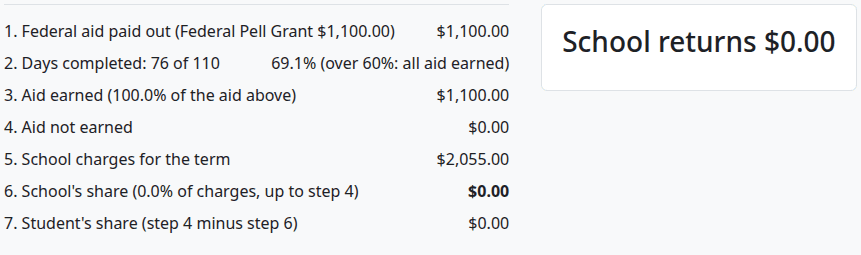

When aid earned is more than was paid out, step 4 changes to "Post-withdrawal disbursement, if the rules allow it". The steps end there, and nothing goes back. The card says "A post-withdrawal disbursement may be due:" and the amount. It adds that whether any of it can be paid depends on the late disbursement rules, so check them first. If your office pays it, use [Record a disbursement](federal-aid.md#record-a-disbursement).

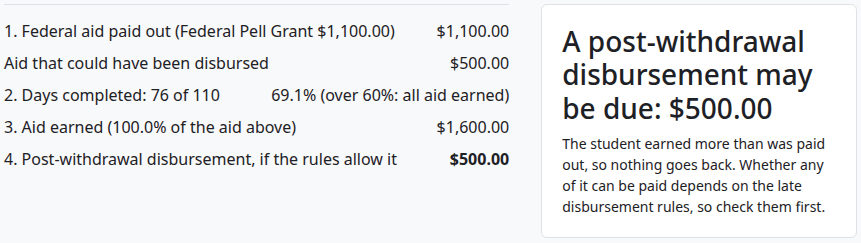

## Clock-hour programs

For a program counted in clock hours, the fields for breaks give way to two fields for hours. Until you enter them, the steps use calendar days, the page says so, and you can't send the worksheet.

With hours entered, step 2 says "Scheduled clock hours:", and the share comes from the hours.

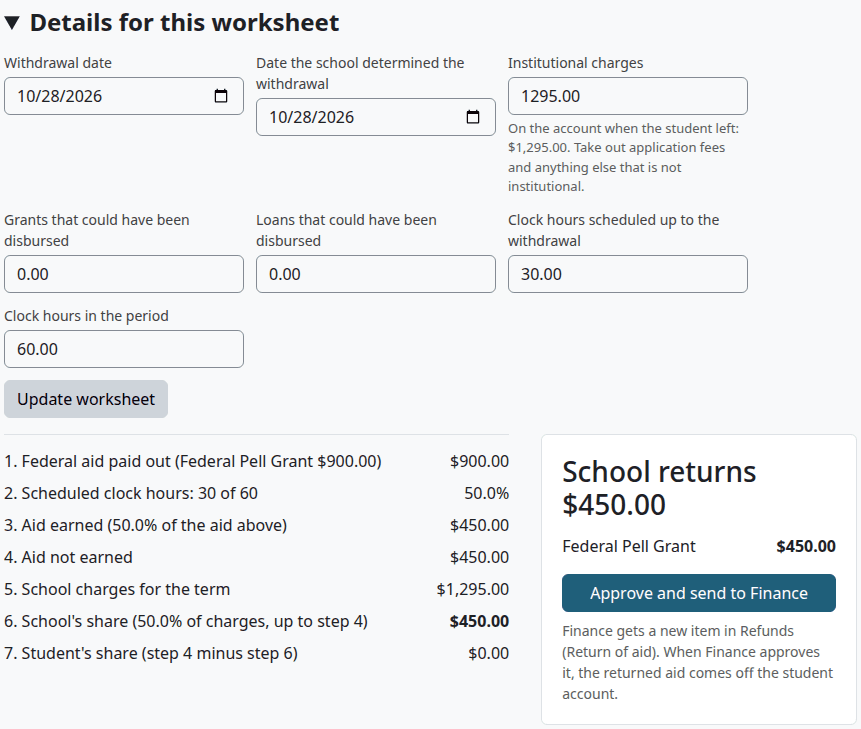

## Send the return to Finance

Financial Aid doesn't change the student's account here. The worksheet becomes an item that Finance approves.

Who can do this: financial aid staff and managers. It needs `local/studentrecords:manageaid`.

Before you start:

- You checked the steps against the official federal worksheet.
- The school's share is above $0.00.
- For a clock-hour program, the hours are in.

1. [Open the worksheet](#open-a-worksheet), and enter the details.
2. Select "Update worksheet", and read the steps.
3. On the card, select "Approve and send to Finance".

Check that:

- You are back on the list, and the page says this:

Finance gets a new item in Refunds, with the reason "Return of federal aid", the amount per fund, and the date to return it by. Everyone with `local/studentrecords:approverefund` and `local/studentrecords:viewbilling` gets the message "Staff: refund waiting for approval". For what happens next, see [Approve a return of aid](refunds.md#approve-a-return-of-aid). The money goes to the Department of Education outside Student Records. The plugin has no link to G5.

The [audit log](audit-log.md) keeps the details: the day the student left, the date of determination, the charges, what could have been disbursed, and the days or hours.

What can go wrong:

| Message | What it means |
|---|---|
| "The figures changed since you opened this worksheet. Check them and send it again." | A charge, a refund or a disbursement changed the school's share while the page was open. Nothing was sent. |
| "A Return of aid item for this student and term is already in Refunds." | One return can go for a student and term. Finance can reject it, and then you can send a new one. |
| "Enter the withdrawal date before you send this worksheet." | The worksheet has no date |
| "Enter the scheduled clock hours before you send this worksheet." | A clock-hour program needs them |
| "The worksheet shows nothing for the school to return." | The school's share is $0.00 |

> Known problem in 1.4.6: a return that Finance approved stays Approved after its "Federal aid returned" charges are reversed. The worksheet then refuses a new return for that student and term, with "A Return of aid item for this student and term is already in Refunds." There is no way to send a second return for that term, so deal with the correction outside Student Records, and tell Finance.

## Related pages

- [Financial aid guide](financial-aid.md)
- [Federal aid](federal-aid.md)
- [Refunds](refunds.md#approve-a-return-of-aid)
- [Attendance](attendance.md)
