# Attendance

This page shows how to set up class meetings, take attendance and follow students who miss class. It is for teachers and for records staff. The last sections say what a student sees.

## Contents

- [How attendance works](#how-attendance-works)
- [Who can take attendance](#who-can-take-attendance)
- [Open a class](#open-a-class)
- [Add a weekly schedule](#add-a-weekly-schedule)
- [Add one class meeting](#add-one-class-meeting)
- [Take attendance](#take-attendance)
- [Students at risk](#students-at-risk)
- [The low attendance warning](#the-low-attendance-warning)
- [What the student sees](#what-the-student-sees)
- [The last date of attendance](#the-last-date-of-attendance)
- [Related pages](#related-pages)

## How attendance works

Attendance belongs to a section. Each section has its own class meetings, at most one a day. A teacher marks each student at each meeting as Present, Late, Absent or Excused, with the hours attended.

The attendance rate of a student in a section is the meetings marked Present or Late, out of the meetings marked. Excused meetings are left out, and so are meetings where the student has no mark. So a student left unmarked isn't counted as absent.

The school's minimum is "Minimum attendance (%)" on the Calendar step of the [setup wizard](setup-wizard.md). With nothing set, it is 80. A rate under the minimum shows as "under minimum". A rate less than 5 points above it shows as "near minimum".

Two sections are counted apart, even when one teacher runs them together.

## Who can take attendance

| Person | What decides it | What they can mark |
|---|---|---|
| Teachers | `local/studentrecords:takeattendance` in the linked Moodle course. Moodle's teacher and non-editing teacher roles hold it | Sections linked to their courses |
| Records staff | `local/studentrecords:managestudents` at system level | Every section |

A section with no linked Moodle course can be marked only by records staff.

## Open a class

Who can do this: anyone in the table above.

Use whichever of these is nearest:

- In the Student Records menu, select "My classes", then "Take attendance" on the class's row. The list holds the sections of active terms whose Moodle course you are enrolled in.
- In a Moodle course, select Attendance in the course menu, then the section.
- With the Student Records theme, select "Take attendance" on the card beside the course.
- As records staff, in the Student Records menu, select "Course offerings", then "Attendance" on the section's row.

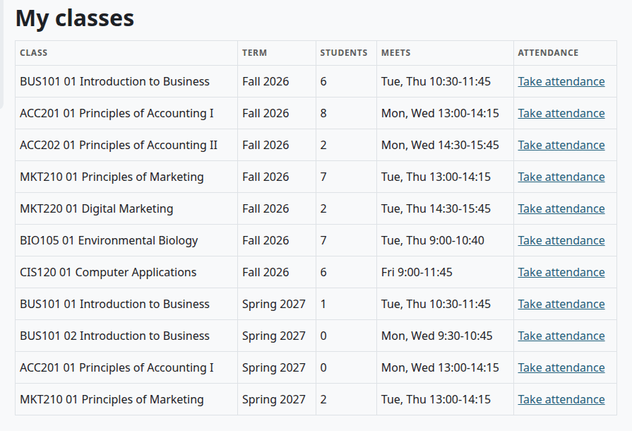

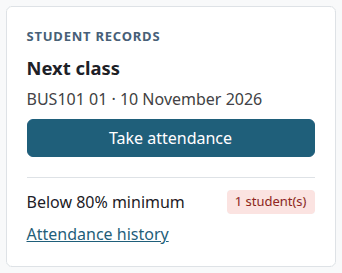

The class's page lists its meetings: Date, Length (hours), Topic and Students marked. A meeting up to today has "Take attendance". A later one says "Not yet". Under the list are the two forms below.

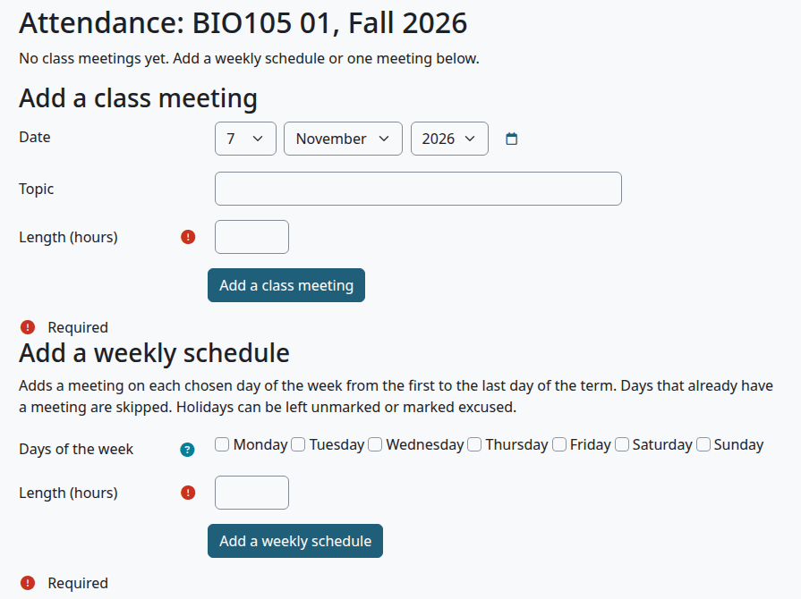

## Add a weekly schedule

Who can do this: anyone who can take attendance for the section.

1. [Open the class](#open-a-class).
2. Under "Add a weekly schedule", tick the days the class meets.
3. In "Length (hours)", type the length of each meeting, such as 1.5.
4. Select "Add a weekly schedule".

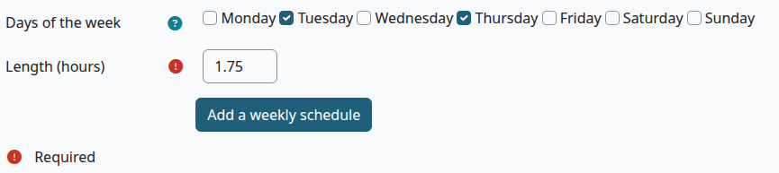

| Field | What it does |
|---|---|
| Days of the week | Tick at least one. "Pick at least one day of the week." |
| Length (hours) | Required. More than 0, up to 24 |

Check that:

- The page says, for example, "32 class meetings added."
- The list has a meeting on each chosen day, from the first to the last day of the term.

The schedule fills every chosen day of the term, holidays too. It skips a day that already has a meeting. On a holiday, leave the students unmarked or mark them Excused. No page changes or deletes a meeting, so check the days and the length before you save.

## Add one class meeting

Who can do this: anyone who can take attendance for the section.

1. [Open the class](#open-a-class).
2. Under "Add a class meeting", set the date.
3. Optional: type a Topic.
4. Type the "Length (hours)".
5. Select "Add a class meeting".

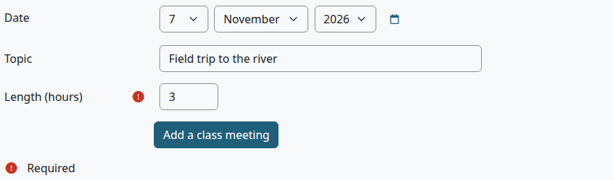

Check that:

- The page says "1 class meetings added."
- The meeting is in the list.

What can go wrong:

- "There is already a meeting that day." A section has at most one meeting a day.

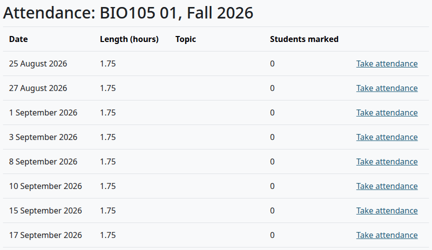

## Take attendance

Who can do this: anyone who can take attendance for the section.

Before you start:

- The meeting is dated today or earlier. A later one says "Attendance can be taken for meetings up to today only."

1. On the class's page, select "Take attendance" on the meeting.
2. Select "Mark everyone present". Nothing is saved yet.
3. Change the students who weren't: select Late, Absent or Excused on their row.
4. For a late arrival or an early leave, type the hours attended.
5. Optional: type a note on the row.
6. Select "Save attendance".

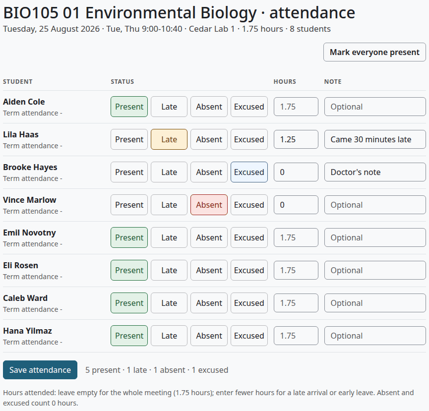

| On the row | What it does |
|---|---|
| Term attendance | The student's rate in this section so far |
| Present, Late, Absent, Excused | The mark. A row left with none isn't saved |
| Hours | Leave it empty for the whole meeting. Fewer hours record a late arrival or an early leave. A number above the meeting's length saves as the length. Absent and Excused save as 0 |
| Note | Optional. It stays with the mark |

The sheet lists students who are registered, have completed or have withdrawn from the section. Students who dropped it aren't listed. A student who withheld directory information shows with the legal first name to a teacher.

Check that:

- The class's page opens with "Saved."
- Students marked shows the number you marked.

To correct a mark, select "Take attendance" on the meeting again, change it and save. Nothing is locked after the end of a term.

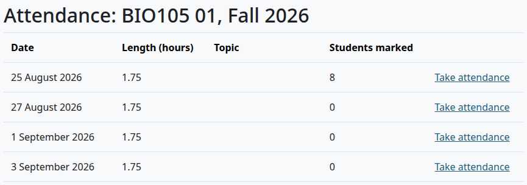

## Students at risk

Who can do this: teachers, and records staff who have classes in My classes.

1. In the Student Records menu, select "Students at risk".

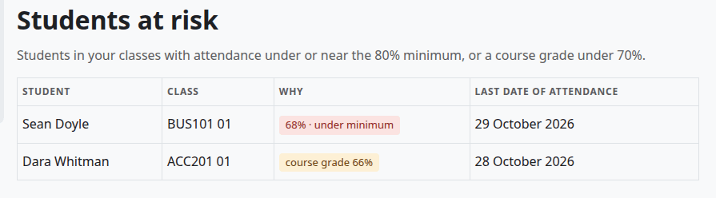

The list covers the registered students of your classes. A student is listed for either of these reasons:

| Why | What it means |
|---|---|
| "62% · under minimum" | The attendance rate is under the school's minimum |
| "83% · near minimum" | The rate is less than 5 points above the minimum |
| "course grade 54%" | The Moodle course total is under "At-risk course grade (%)" on the Calendar step of the setup wizard. With nothing set, that is 70. With 0, grades are left out of the list |

The course grade is the course total against the most the course can give. So a student with an activity not graded yet can show a far lower grade here than in the gradebook, as [the known problem on Course offerings](course-offerings.md#get-final-grades-from-moodle) says.

The list only informs. It doesn't message anyone.

## The low attendance warning

The student gets the message "Low attendance warning" when a save takes the section's rate under the minimum. It goes when the rate falls from the minimum or above, or from no rate at all. So a first meeting marked Absent sends it, because the rate goes from nothing to 0%. It can go again if the rate recovers and falls again.

The message waits for Moodle's next cron run. Teachers aren't told.

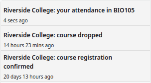

> Not walked through: the email copy of a message needs a real mail server, so no test site can show it. The message was checked in Moodle's notifications.

## What the student sees

A student sees attendance in these places:

| Place | What it shows |
|---|---|
| My home | The tile My attendance, the average of the rates of the student's classes, with "Minimum is 80%" |
| My academic record | The rate of each course, with "under minimum" or "near minimum" |
| My details, on My academic record | The counts for each course, the hours and the last dates |
| Beside a course, with the Student Records theme | "My attendance in BUS101", with "Missed 6 of 20 meetings · minimum is 80%" |

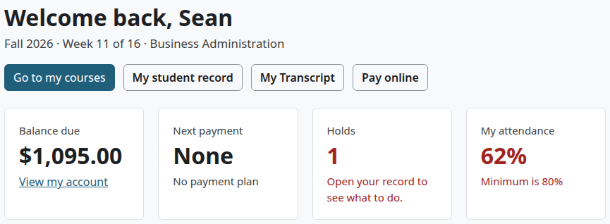

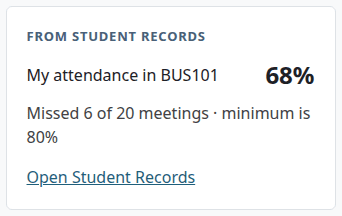

On a phone the card comes first, above the course. Students can't change attendance.

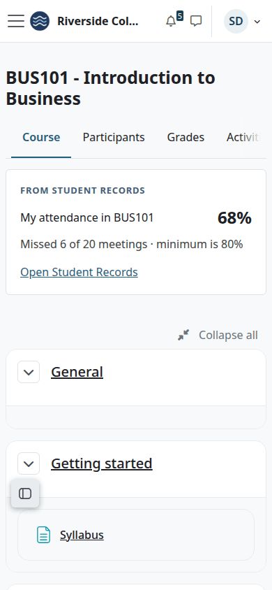

## The last date of attendance

Student Records works out a last date of attendance for each course: the latest day marked Present or Late. With "Count Moodle course activity as attendance" set to Yes on the Calendar step of the setup wizard, it takes the student's last access to the Moodle course if that is later. So that setting can move the date past the last day marked.

The date shows on the [Attendance tab](student-file.md#attendance-tab). It is used in three places:

- A course withdrawal fills in the student's Last date of attendance on the file, when it is empty.
- With "Figure refunds on the last date of attendance" set to Yes, a refund uses it. See [Refunds](refunds.md).
- The Return of aid worksheet uses it. See [Aid helpers](aid-helpers.md).

## Related pages

- [Teacher's guide](teacher.md)
- [The student's guide](student.md)
- [The student file](student-file.md)
- [Reports and exports](reports-and-exports.md)
- [Course offerings](course-offerings.md)
