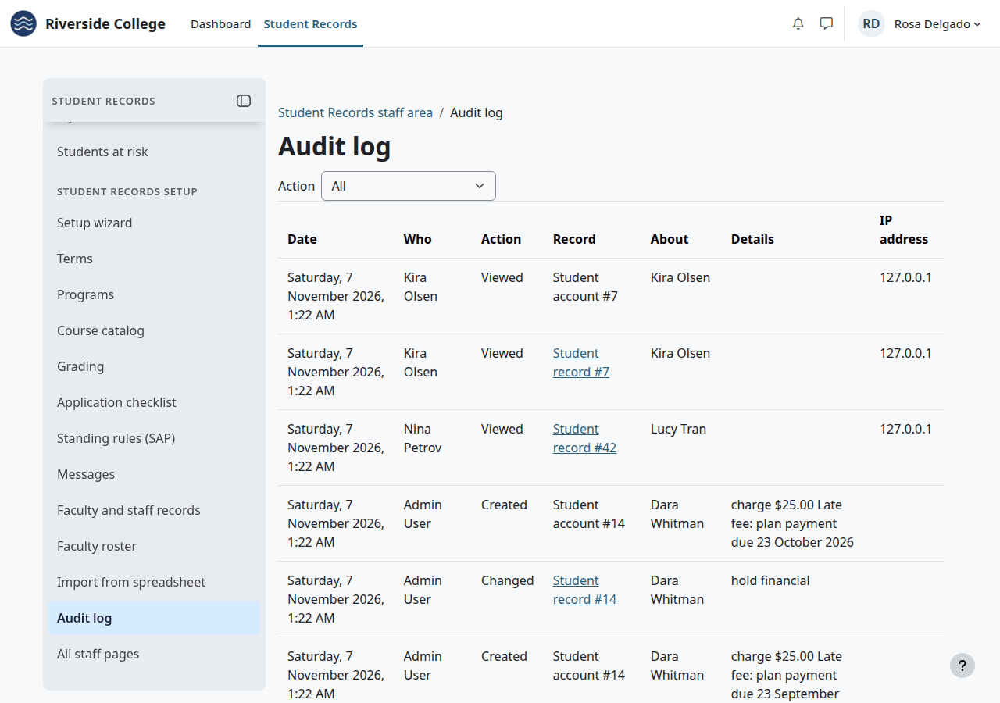
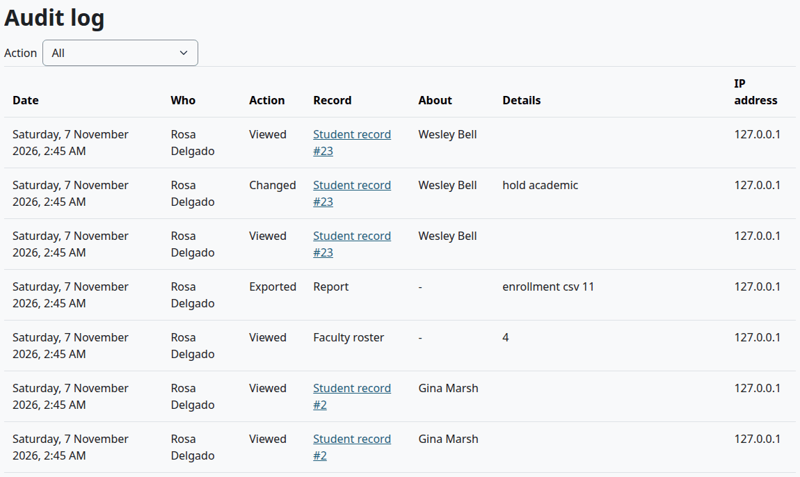
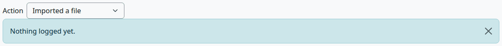
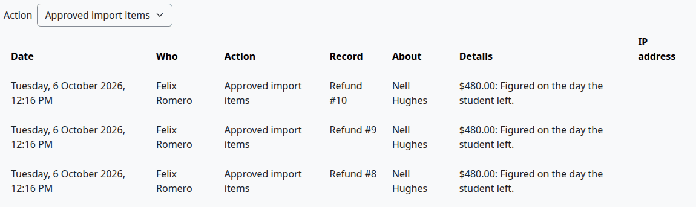
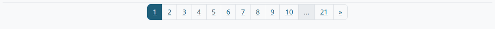
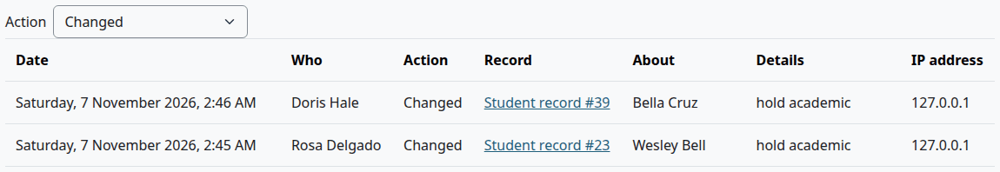
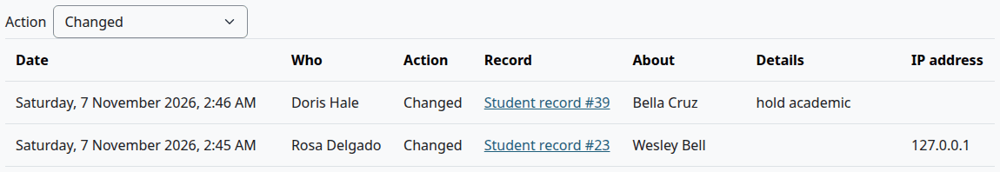
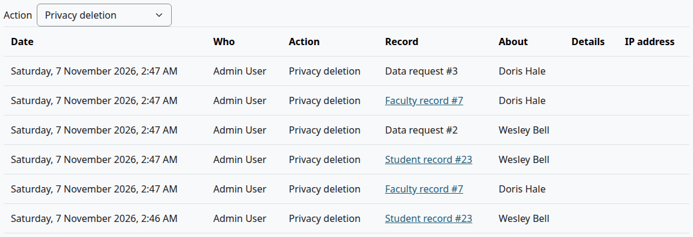

# Audit log

The Audit log lists who viewed, changed, imported or exported what in Student Records, newest first. This page is for the Registrar and anyone else who reads the log. It covers who can open it, its filter and columns, what goes in it, how long it stays, and what a privacy request does to it.

## Contents

- [Open the Audit log](#open-the-audit-log)
- [Read a row](#read-a-row)
- [Filter by action](#filter-by-action)
- [Find who opened a file](#find-who-opened-a-file)
- [What gets logged](#what-gets-logged)
- [What isn't logged](#what-isnt-logged)
- [How long rows stay](#how-long-rows-stay)
- [After a privacy request](#after-a-privacy-request)
- [Download the log](#download-the-log)
- [Related pages](#related-pages)

## Open the Audit log

Who can do this: anyone with the capability `local/studentrecords:viewlog` at system level. Site administrators and Moodle's Manager role have it. A Registrar needs it on their role. See [Moodle roles to make](install-and-setup.md#moodle-roles-to-make). The Finance, Financial Aid and Admissions roles don't have it, and teachers and students don't either.

The log shows names, IP addresses and what was done to each record, so give the capability only to people who need it.

1. In the Student Records menu, under Student Records setup, select "Audit log". You can also select "All staff pages", then "Audit log".

Check that:

- The page's title is Audit log.
- The newest row is at the top. A page holds up to 100 rows.

What can go wrong:

- "Audit log" isn't in your menu, and the page says "Sorry, but you do not currently have permissions to do that (View the audit log)." Your role doesn't have the capability, or it was assigned in a course and not at system level. Ask your site administrator.

Someone who has this capability and no other staff capability gets the "Student Records" tab, which opens the staff area. Their menu has "Audit log" and "All staff pages".

## Read a row

Each row is one action. To give the table more room, close the Student Records menu with the button at its top.

| Column | What it shows |
|---|---|
| Date | When it happened, in your own time zone |
| Who | The person who did it, by the name on their Moodle account. A student who opens their own file is under Who and About |
| Action | The kind of action. See [Filter by action](#filter-by-action) |
| Record | What it was done to, with that record's number when it has one |
| About | The person the record is about. A dash means it isn't about one person, as with a report |
| Details | A short note, such as `hold academic`. Many rows have none |
| IP address | The address the person worked from |

Who isn't always the person at the keyboard:

- A task that cron runs shows Moodle's main site administrator, with no IP address. The late fees of the daily billing task are an example.
- A dash means nobody was signed in. A question mark means Moodle has no such account.

> Known problem in 1.4.6: with Moodle's "Log in as", the row names the person you logged in as, not you. Make changes under your own account. Moodle's own logs, at Site administration > Reports > Logs, show who logged in as whom.

The number in Record is the plugin's own number, not a student ID. For "Student record" and "Student account" it is the number of the file, which shows in the address of the file's page.

A "Student record" or "Faculty record" with a number is a link. Select it to open the record. It opens only if your role may open that record.

Details comes from the plugin, in English, whatever the language of your site. It can hold codes and numbers, such as `checklist 4`, and it stops at 255 characters. [What gets logged](#what-gets-logged) says what each note means.

## Filter by action

Who can do this: anyone who can open the log.

"Action" above the table is the page's only filter. The log has no search, and no filter by person, record or date.

1. In "Action", choose an option. The page reloads at once. With JavaScript off, select "Go".

| Option | What it lists |
|---|---|
| All | Every row. This is the default |
| Viewed | Someone opened a record |
| Created | Someone saved something new, such as a term, a record or a line on an account |
| Changed | Someone saved a change. Most work on a student's file is here |
| Imported a file | Someone read a file with [Import from spreadsheet](import.md) |
| Approved import items | Someone approved items of an import, or a refund |
| Rejected import items | Someone rejected items of an import, or a refund |
| Exported | Someone downloaded a report, opened a receipt or a statement, or issued an enrollment letter |
| Privacy export | Moodle made a data export for a person |
| Privacy deletion | Moodle carried out a data deletion for a person |

Check that:

- Every row shows that action.
- The page numbers under the table keep the filter.

To see every row again, choose "All".

If no row has that action, the page says "Nothing logged yet.", even though the log holds other rows.

> Known problem in 1.4.6: a refund decision shows as "Approved import items" or "Rejected import items". Read Record to tell them apart: "Refund" with a number is a refund, and "Import" is an import.

## Find who opened a file

Who can do this: anyone who can open the log.

The log has no search, so use your browser's own find command.

1. In "Action", choose "Viewed".
2. Use your browser's find command to look for the student's name. It searches the page you are on. The name is under About.
3. If it isn't there, select the next page number under the table, and look again. Each page goes further back.

Check that:

- Who and Date say who opened the file, and when.

Every page of a file writes its own row: each tab, and the file you come back to after you save a form. So one visit can show as several rows.

To see what was done to a file, do the same with "Changed". Details says what kind of change it was. The [History tab](student-file.md#history-tab) of the file has the old and new values of the main record.

## What gets logged

The tables list each row the plugin writes, by Record.

### Student files

| Record | Action | When | Details |
|---|---|---|---|
| Student record | Viewed | Someone opens a page of the file, or My academic record | Empty |
| Student record | Viewed | Someone uses [View as student](student-file.md#view-as-student) | `view as student` |
| Student record | Created, Changed | Someone saves the student form | Empty |
| Student record | Created, Changed | Someone saves transfer credit, prior education or an emergency contact | `transfer credit`, `educ` or `emerg` |
| Student record | Changed | Most other work on a file | See the next table |
| Student document | Viewed | Someone opens a file from the student's documents | Empty |
| Degree audit | Viewed | Someone opens the degree audit | Empty |
| Enrollment letter | Exported | Someone issues a letter | The letter's number, and `to` with the recipient if there is one |
| Enrollment letter | Viewed | Someone opens a letter that was issued | The letter's number |
| Attendance | Created | Someone adds a weekly schedule of meetings. The number is the section's | `weekly meetings 32` |
| Attendance | Changed | Someone saves the marks of a meeting. The number is the meeting's | `marks 3` |
| Academic standing | Changed | Someone runs standing for a term. The number is the term's | `run: 12 proposed` |

The Details of a Changed row on a Student record:

| Details | What happened |
|---|---|
| `status admitted` | The status changed, and this is the new one |
| `checklist 4` | This many items of the application checklist changed |
| `decision admitted` | An admission decision was saved |
| `demographics` | Demographics were saved |
| `registered ENG101 01` | A registration. `(override)` at the end means staff overrode a rule |
| `drop ENG101 01`, `withdraw ENG101 01` | A drop or a withdrawal, with `(override)` when staff overrode the dates |
| `self-registration`, the confirmation and the courses | The student registered online |
| `waitlist COM150 01` | The student joined the waitlist of a section |
| `course access BIO105 (payment received)` | A course that waited for payment opened. `given by staff:` and a reason means staff opened it |
| `course access after payment:` and a message | A course couldn't open after a payment. The payment stands |
| `grade B+` | A final grade was entered or changed |
| `grade change requested B -> B+` | A grade change was requested. `approved` or `rejected` in that place is the decision |
| `hold academic`, `hold released academic` | A hold of this type was placed or released |
| `standing good` | Standing was confirmed for this student |
| `FERPA notice 2026-2027 online` | The FERPA notice was acknowledged, online or on paper |
| `release authorization` and a name, `release authorization revoked` | A release authorization was added or revoked |
| `graduation application`, `graduation approved`, `graduation denied`, `graduation application cancelled` | A step of a graduation application |
| `conferred` and the award | The credential was conferred |
| `substitution 12 for 7` | A course substitution, with the catalog's own numbers of the two courses |
| `after saving:` and a message | The work was saved, and something after it failed, such as a message from Moodle |

### Money

| Record | Action | When | Details |
|---|---|---|---|
| Student account | Viewed | Someone opens the account, the student included | Empty |
| Student account | Created | A line is added: a charge, a credit, a payment, a refund, money paid back or a reversal | The type, the amount and the description, such as `charge $35.00 Application fee` |
| Student account | Changed | An online payment needs a look. See [If a payment doesn't reach the account](online-payments.md#if-a-payment-doesnt-reach-the-account) | `online payment` or `second online payment`, with its number and what happened |
| Receipt | Exported | Someone opens a receipt. The number is the account line's | The receipt number |
| Statement | Exported | Someone opens a statement | `term` and the term's number for a statement of one term, or empty |
| Refund | Created | A drop or a withdrawal proposes a refund, or a return of aid goes to Finance | `drop $1,020.00 (Before the term starts)`, or `return of aid` with the figures of the worksheet |
| Refund | Approved import items, Rejected import items | Someone decides a refund | The amount and the note |
| Payment plan | Created, Changed | Someone saves a plan in Billing setup | The plan's name |
| Payment plan | Created | A student gets a plan | The plan's name and total, and `(custom:` with the note for a plan made for this student |
| Payment plan | Changed | A student's plan is cancelled, or stays closed because another plan is active | `cancelled:` and the reason, or `not reopened: another plan is active` |
| Price | Created, Changed | Someone saves a price | Its name |
| Refund rule | Created, Changed | Someone saves a refund rule | Its name |

> Not walked through: the rows of an online payment need a real payment, so no test site can show them. They come from the code.

### Financial aid

| Record | Action | When | Details |
|---|---|---|---|
| Financial aid | Viewed | Someone opens a student's awards | Empty |
| Financial aid | Viewed | Someone opens an award letter | `award letter 2026-27` |
| Financial aid | Created, Changed | Someone saves an award | The fund's code, the amount and the status, such as `pell $2,000.00 accepted` |
| Financial aid | Changed | An award letter goes to the student | `award letter 2026-27:` and whether it was sent |
| Financial aid | Changed | Someone saves a student's aid year details | `aid year 2026-27` |
| Financial aid | Changed | Someone makes a disbursement run | `disbursement run term`, the term's number, how many, and the total |

### Setup and the catalog

| Record | Action | When | Details |
|---|---|---|---|
| Term, Course, Program, Course offering, Level, Grade, Pass rule, Application checklist document, Standing rule | Created, Changed | Someone saves one on its page | Empty |
| Program | Changed | Someone adds a course to a program | `course added` |
| Course offering | Created | Someone copies a section to another term | `copied from offering` and its number |
| Standing rule | Created | Someone uses the suggestions on Standing rules | `from academic rules:` and how many |
| Faculty record | Viewed | Someone opens a record | Empty |
| Faculty record | Created, Changed | Someone saves a record | Empty |
| Faculty record | Changed | Someone saves a credential, or adds or removes qualified courses | `credential 1`, `qualified +1` or `qualified -1` |
| Faculty roster | Viewed | Someone opens the roster | How many people it lists |
| Saved export | Created, Changed | Someone saves an export on Outside reports | Its name |
| Setup | Changed | Someone saves a step of the setup wizard or the billing settings | The step, such as `school`, or `billing settings` |
| Setup | Changed | Someone changes a message, resets it, sends a test, or changes the test inbox or test mode | `message`, `message text reset`, `message test`, `message test inbox` or `message test mode`, with what changed |
| Setup | Created | Someone makes the Finance or the Financial Aid role | `Finance role` or `Financial Aid role` |
| Import | Imported a file | Someone reads a file | The file's name |
| Import | Approved import items, Rejected import items | Someone decides items of an import | How many, such as `8 items` |

### Downloads of reports

Each of these has what was downloaded, the file type and the number of rows, such as `enrollment csv 11`.

| Record | Action | When |
|---|---|---|
| Report | Exported | Someone downloads a report from [Reports](reports-and-exports.md) or [Money reports](money-reports.md). The 1098-T also has the year |
| Admissions report | Exported | Someone downloads a report from Admissions reports |
| Outside report | Exported | Someone downloads a saved export, a count or the Clearinghouse file. The last 10 show as "Recent downloads" on [Outside reports](reports-and-exports.md) |
| Financial aid | Exported | Someone downloads a report from [Federal aid](federal-aid.md) |
| Faculty roster | Exported | Someone downloads the roster. Details has no report name |

The rows of a privacy request are in [After a privacy request](#after-a-privacy-request).

## What isn't logged

- Lists, and reports on the screen. Only a download of a report writes a row. Searching the student list writes none. The one exception is the Faculty roster, which writes a Viewed row each time it opens.
- The Audit log itself. Opening and filtering it writes nothing.
- Old and new values. Most rows say only what kind of change was made. Some also hold a value, such as a new grade, a status or an amount, as the tables above show. The [History tab](student-file.md#history-tab) has the old and new values of the main record.
- Messages. They have their own [Message log](messages.md#the-message-log).
- The work of Academic Transcript. It has its own [Activity log](../academic-transcript/admin-guide.md#activity-log).

The rows here don't reach Moodle's own logs either. Site administration > Reports > Logs doesn't show them, because the plugin raises no Moodle events.

## How long rows stay

Rows stay for as long as the plugin is installed. No task clears old rows, no setting limits the log, and no page deletes a row. Moodle's own log settings don't touch it.

A privacy deletion keeps the rows, as the next section shows. [Uninstalling the plugin](privacy-and-uninstall.md#uninstall-the-plugin) deletes the whole log with everything else the plugin holds.

## After a privacy request

A privacy officer makes and approves these requests in Moodle. [Privacy and uninstall](privacy-and-uninstall.md) has the steps. This is what you then see in the log.

### An export

An [export](privacy-and-uninstall.md#export-a-persons-data) writes one row: "Privacy export", with "Student record" under Record and no number. Who and About both name the person the data is about, even when a privacy officer asked for it.

The export has a folder Audit log, with every row by or about the person. Each entry has the action, the record, the date, whether it was by them or about them, and the IP address of rows they wrote themselves. It has no Details.

### A deletion

The rows stay, because they show who did what to an official record. A [deletion](privacy-and-uninstall.md#delete-a-persons-data) empties two columns:

| Column | Where it is emptied |
|---|---|
| Details | On every row about the person, whoever wrote it |
| IP address | On every row the person wrote |

Date, Who, Action, Record and About stay. The person's name stays too, because it comes from their Moodle account, and Moodle keeps the name on a deleted account.

Before a deletion for the student Wesley Bell and one for the staff member Doris Hale, two rows look like this:

After the deletions, Doris Hale's row keeps its Details and loses its IP address. The row about Wesley Bell loses its Details and keeps Rosa Delgado's IP address:

The deletion also writes rows of its own, with the action "Privacy deletion". Who shows Moodle's main site administrator, because a task does the work. These rows have no Details and no IP address.

| Record | When |
|---|---|
| "Student record" or "Faculty record", with its number | When cron carries out the request. A person with both records gets a row for each |
| The same row again, and "Data request" with the number of the request | Later, once Moodle has removed the deleted account's user context. The hourly task "Student Records privacy: carry out finished deletion requests of removed accounts" then goes over the person once more |

## Download the log

You can't. The page has no download, and no other page exports the log. A [data export](#an-export) gives one person's rows only.

The rows are in the database table `local_studentrecords_log`, for someone with access to the database.

## Related pages

- [Registrar's guide](registrar.md)
- [The student file](student-file.md)
- [Reports and exports](reports-and-exports.md)
- [Online payments](online-payments.md)
- [Messages](messages.md)
- [Privacy and uninstall](privacy-and-uninstall.md)
- [Roles and permissions](../roles-and-permissions.md)
