# Billing setup

Billing setup is the page where a school sets its prices, payment plans, refund rules and billing settings. This page is for finance staff and for the administrator who sets billing up.

## Contents

- [What to set up, and in what order](#what-to-set-up-and-in-what-order)
- [Open Billing setup](#open-billing-setup)
- [Create the Finance role](#create-the-finance-role)
- [Give people the Finance role](#give-people-the-finance-role)
- [Change the billing settings](#change-the-billing-settings)
- [Turn billing on or off](#turn-billing-on-or-off)
- [Add a price](#add-a-price)
- [How a registration is charged](#how-a-registration-is-charged)
- [Change a price or stop using it](#change-a-price-or-stop-using-it)
- [Add a payment plan](#add-a-payment-plan)
- [Change a payment plan or stop offering it](#change-a-payment-plan-or-stop-offering-it)
- [Add a refund rule](#add-a-refund-rule)
- [Change a refund rule or its order](#change-a-refund-rule-or-its-order)
- [Related pages](#related-pages)

## What to set up, and in what order

Billing stays off until you turn it on, so you can set everything up first. Work in this order:

1. [Create the Finance role](#create-the-finance-role) and [give it to your finance staff](#give-people-the-finance-role).
2. [Add your prices](#add-a-price): tuition first, then each fee.
3. [Add your payment plans](#add-a-payment-plan), if you offer any.
4. [Add your refund rules](#add-a-refund-rule). Without rules every refund is $0.00.
5. To take payments online, [set up a payment account](online-payments.md#set-up-a-payment-account).
6. [Change the billing settings](#change-the-billing-settings): course access, reminders, refund days, 1098-T settings and the text on statements.
7. [Turn billing on](#turn-billing-on-or-off).

Students who registered before billing was on have no charges. To add the charges, see [Add missing charges for a term](student-accounts.md#add-missing-charges-for-a-term).

## Open Billing setup

Who can do this: finance staff and managers. It needs the capability `local/studentrecords:managebilling`.

1. Select the Student Records tab at the top of the page.
2. Select Billing setup in the left menu, under Student Records setup.

The page has the billing settings at the top, then Price list, Payment plans, Refund rules, and a section about the Finance role. The Billing step of the setup wizard has a link to this page. See [Setup wizard](setup-wizard.md#step-8-billing).

## Create the Finance role

The Finance role lets a person see and manage student accounts and approve refunds, without seeing academic records. The plugin doesn't make the role when it is installed. You create it with one button.

Who can do this: a site administrator, or a manager. It needs `local/studentrecords:managebilling` to open the page, and the Moodle capability `moodle/role:manage` for the button.

1. [Open Billing setup](#open-billing-setup).
2. Go to the Finance (Student Records) section at the bottom of the page.
3. Select "Create the Finance role".

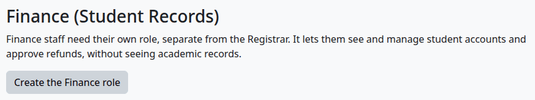

Check that:

- The page says "The Finance role was created. Now give it to your finance staff."
- The section now says "The Finance role exists."

The role is "Finance (Student Records)", with the short name `srfinance`. You can give it at system level only, and it has three capabilities:

| Capability | What it allows |
|---|---|
| `local/studentrecords:viewbilling` | See student accounts and money reports |
| `local/studentrecords:managebilling` | Manage student accounts, prices, payments, payment plans and refund rules |
| `local/studentrecords:approverefund` | Approve or reject refunds |

The Manager role has these capabilities too. See [Roles and permissions](../roles-and-permissions.md).

What can go wrong:

- The section shows no button. Your role doesn't have `moodle/role:manage`. Ask a site administrator.

## Give people the Finance role

Who can do this: a site administrator, or anyone with the Moodle capability `moodle/role:assign`.

Before you start:

- The Finance role exists.

1. [Open Billing setup](#open-billing-setup).
2. In the Finance (Student Records) section, select "Give people the Finance role". Moodle's Assign roles page opens.
3. In Potential users, select the person.
4. Select "Add".

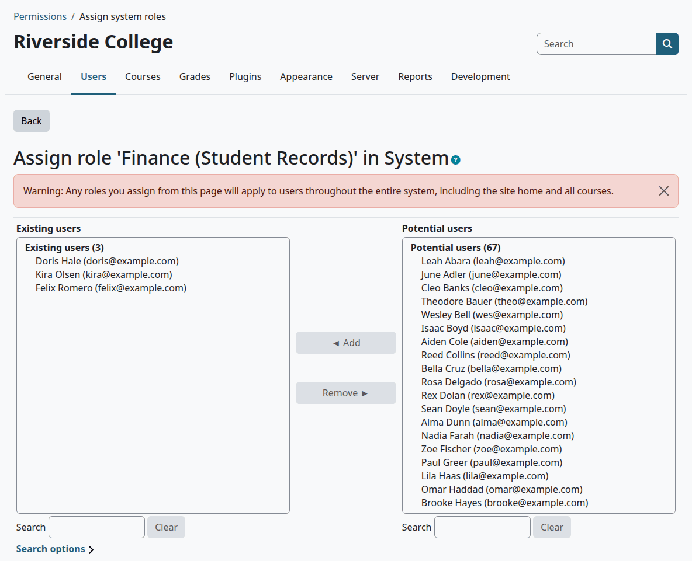

Check that:

- The person is under Existing users.
- When they sign in, they have a Finance group in the left menu, as long as billing is on.

What can go wrong:

- The person sees no Finance menu. Billing is off. The menu shows only with billing on.
- A person with this role can't open a student's academic file. That is by design. Finance reaches a student through [Student accounts](student-accounts.md).

## Change the billing settings

Who can do this: finance staff and managers. It needs `local/studentrecords:managebilling`.

1. [Open Billing setup](#open-billing-setup).
2. Change the settings at the top of the page.
3. Select "Save changes".

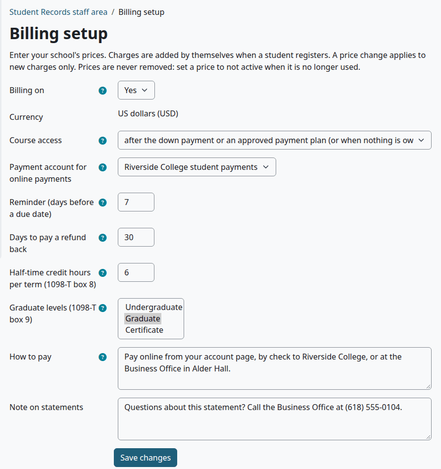

| Setting | What it does | Default |
|---|---|---|
| Billing on | Turns billing on or off for the whole school. See [Turn billing on or off](#turn-billing-on-or-off). | No |
| Currency | Shows "US dollars (USD)". This is the only currency, and you can't change it. | US dollars (USD) |
| Course access | When a registered student gets into the Moodle course. See the options below. | after the down payment or an approved payment plan (or when nothing is owed) |
| Payment account for online payments | The Moodle payment account that students pay through. None means no online payment. See [Online payments](online-payments.md). | None |
| Reminder (days before a due date) | How many days before a plan payment is due the student gets a reminder. 0 means no reminders. A number below 0 is saved as 0. | 7 |
| Days to pay a refund back | Sets the "Pay back by" date of a refund: this many days after the drop or withdrawal. A number below 0 is saved as 0. | 30 |
| Half-time credit hours per term (1098-T box 8) | Credit hours in a term that make a student at least half-time. The 1098-T data uses it for box 8. With the federal aid module on, the [disbursement run](federal-aid.md#run-disbursements-for-a-term) and the [Enrollment status](federal-aid.md#aid-reports) report use it too. | 6 |
| Graduate levels (1098-T box 9) | The levels whose students are graduate students. The 1098-T data uses it for box 9, and the [loan check](aid-helpers.md#the-loan-check) leaves students of these levels out. Press Ctrl or Command to pick more than one. | None |
| How to pay | Shown on accounts that owe money and on statements, for example where to mail a check. | Empty |
| Note on statements | Printed at the end of each statement. | Empty |

Course access has three options:

| Option | A student gets into the Moodle course |
|---|---|
| after the down payment or an approved payment plan (or when nothing is owed) | When the balance is $0.00 or less, or when the student has a plan for that term and its down payment is paid |
| after the balance is paid in full | When the balance is $0.00 or less |
| right away, when they register | At once |

The rule looks at the student's whole balance, not only the term's. Registering adds the charges first, so under the first two options a registration with any charge waits for payment. The rule applies when a student registers. Registrations made before you changed it stay as they are. Finance can always open a course early. See [Give course access now](student-accounts.md#give-course-access-now).

## Turn billing on or off

Who can do this: finance staff and managers. It needs `local/studentrecords:managebilling`.

1. [Open Billing setup](#open-billing-setup).
2. Set "Billing on" to Yes or No.
3. Select "Save changes".

Check that:

- With billing on, a new registration adds its charges, and staff with the Finance role have the Finance menu.
- With billing off, the Student accounts page says "Billing is off: no charges are added when students register."

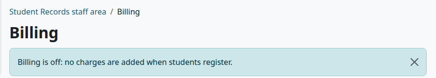

This is what changes with billing off:

| What | With billing off |
|---|---|
| Charges at registration | None are added |
| A drop or withdrawal | No refund is figured |
| The Finance menu, and My account in the student's menu | Gone |
| Online payment | Off |
| Plan reminders, late fees and holds | The daily task does nothing |
| Course access | A new registration doesn't wait for payment |
| Student accounts, Refunds, Money reports and a student's account | They still open by direct link. Student accounts and the account page show the notice above |
| Billing setup | It stays in the Student Records setup menu |

What can go wrong:

> Known problem in 1.4.6: courses that wait for payment still wait after you turn billing off. Turning billing off doesn't open them by itself. A course opens when a line lowers the balance or a plan is given, or when Finance gives access. Use [Give course access now](student-accounts.md#give-course-access-now) for each one.

## Add a price

A price is one line of your price list: a tuition or a fee. Registering a student adds the charges by itself.

Who can do this: finance staff and managers. It needs `local/studentrecords:managebilling`.

1. [Open Billing setup](#open-billing-setup).
2. Under Price list, select "Add a price".
3. Fill in the form. The tables below say what each field does.
4. Select "Save changes".

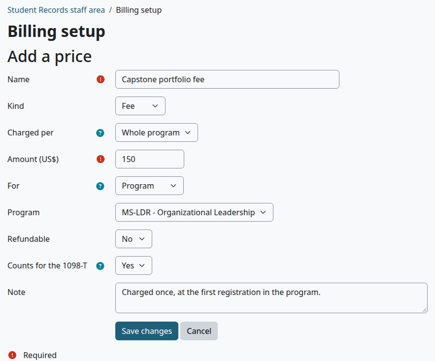

Check that:

- The page says "Saved."
- The price is in the Price list, with Active set to Yes.

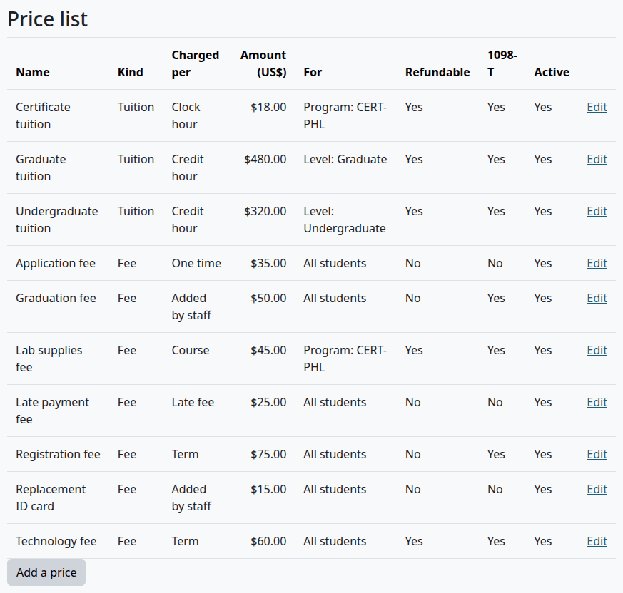

| Field | What to enter | Default |
|---|---|---|
| Name | The name students see on their account, up to 255 characters. Needed. | Empty |
| Kind | Tuition or Fee. See [How a registration is charged](#how-a-registration-is-charged). | Tuition |
| Charged per | How the price is charged. See the next table. | Credit hour |
| Amount (US$) | The price, such as 150 or 1500.00. Needed. | Empty |
| For | All students, Level or Program. Level and Program each show one more list to pick from. | All students |
| Refundable | Whether a refund rule can give this charge back. See [How a refund is figured](refunds.md#how-a-refund-is-figured). | Yes |
| Counts for the 1098-T | Yes if this is tuition or a fee the student must pay to enroll. Ask your tax adviser if you aren't sure. The 1098-T data counts only these charges. | Yes |
| Note | For staff. It shows under the name in the Price list. | Empty |

Charged per has eight options:

| Option | What is charged |
|---|---|
| Credit hour | The price times the course's credit hours, on each registration. Only for courses counted in credit hours. |
| Clock hour | The price times the course's clock hours, on each registration. Only for courses counted in clock hours. |
| Course | The price, on each registration. |
| Term | The price, once a term, at the first registration of that term. |
| Whole program | The price, once, at the student's first registration. The line says "(whole program)". |
| One time | The price, once, at the student's first registration. |
| Added by staff | Nothing by itself. Finance adds it to an account with [Add a charge](student-accounts.md#add-a-charge). |
| Late fee | Nothing by itself. The daily task adds a late fee when a plan payment is late. See the note below. |

A price per hour is worked out to the cent, and a half cent goes up.

A price with the option Late fee needs an amount too, but the late fees that the daily task adds don't use it. The amount of a late fee is the plan's "Late fee (US$)". Late fees work with or without a price of this kind. With one, the late fee line is tied to the first active price of this kind.

What can go wrong:

- "Tuition must be charged per hour, per course, per term or per program." A tuition can't be Added by staff or Late fee. Make it a fee, or choose another option.
- "Enter an amount such as 150 or 1500.00." An amount has digits, at most two decimals, and an optional dollar sign. Commas go only between thousands.

## How a registration is charged

When a student registers, Student Records adds the charges of that registration to the account. The price list decides which ones.

For tuition, one price is used. It is the most specific active price that fits: Program first, then Level, then All students. If two fit equally, the older price is used.

For fees, every active fee that fits is charged. A fee can be for all students, for the student's level, or for the student's program. A student with no program only fits prices for All students.

A price per credit hour fits only a course counted in credit hours, and a price per clock hour fits only a course counted in clock hours. So one school can have credit hour tuition for its degree programs and clock hour tuition for its certificates, as in the Price list above.

Nothing is charged twice. A registration isn't charged again for a price per hour or per course. A student isn't charged twice in a term for a price per term, or twice ever for a price per whole program or one time.

For example, take tuition of $320.00 per credit hour, with a registration fee of $75.00 per term and a technology fee of $60.00 per term. The student's first registration of the term, for a 3 credit hour course, adds three lines: $960.00, $75.00 and $60.00. A second 3 credit hour course in that term adds only $960.00.

The account page lists these lines as "Undergraduate tuition: ENG102 (3 credit hours x $320.00)" and "Registration fee: Fall 2026". See [Student accounts](student-accounts.md#read-an-account).

## Change a price or stop using it

Prices are never removed, and a changed price applies to new charges only. Lines already on an account keep their amount.

Who can do this: finance staff and managers. It needs `local/studentrecords:managebilling`.

1. [Open Billing setup](#open-billing-setup).
2. Select "Edit" on the row of the price.
3. Change the fields. To stop using a price, set "Active" to No. This field shows only when you change a price.
4. Select "Save changes".

Check that:

- The Price list shows the new amount, or No under Active.

A price that isn't active isn't charged at registration, and Add a charge no longer lists it.

## Add a payment plan

These are your school's own plans. Finance gives one of them to a student from the student's account. See [Payment plans](payment-plans.md).

Who can do this: finance staff and managers. It needs `local/studentrecords:managebilling`.

1. [Open Billing setup](#open-billing-setup).
2. Under Payment plans, select "Add a payment plan".
3. Fill in the form. The table below says what each field does.
4. Select "Save changes".

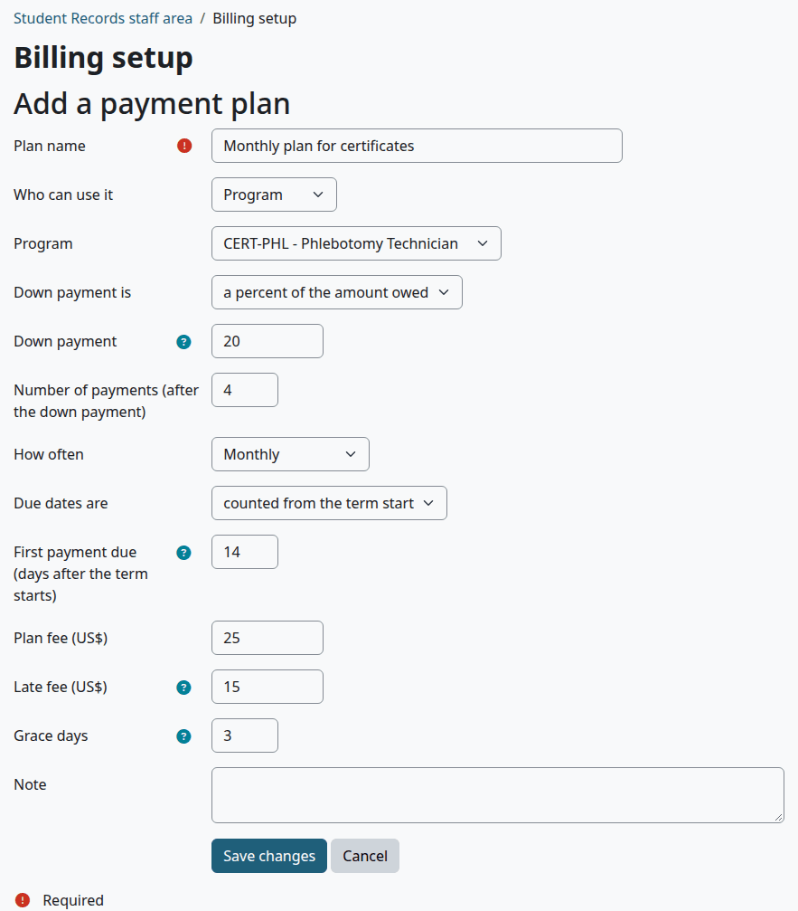

Check that:

- The page says "Saved."
- The plan is in the Payment plans table, with Active set to Yes.

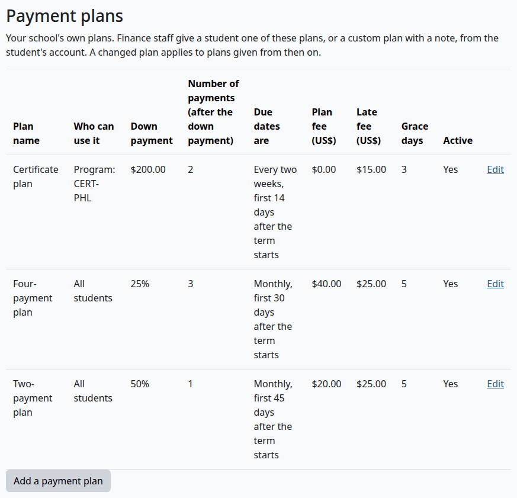

| Field | What to enter | Default |
|---|---|---|
| Plan name | The name students see on their account, up to 255 characters. Needed. | Empty |
| Who can use it | All students, Level or Program. Level and Program each show one more list to pick from. Finance can give a plan only to the students it fits. | All students |
| Down payment is | "a percent of the amount owed" or "an amount (US$)" | a percent of the amount owed |
| Down payment | For example 25 (percent) or 500 (dollars). A percent can't be over 100. Enter 0 for no down payment. | 25 |
| Number of payments (after the down payment) | From 1 to 24 | 3 |
| How often | Weekly, Every two weeks or Monthly. Shows only with due dates counted from the term start. | Monthly |
| Due dates are | "counted from the term start" or "fixed dates" | counted from the term start |
| First payment due (days after the term starts) | For example 30: the first payment after the down payment is due 30 days after the first day of the term. A number below 0 gives a date before the term starts. Shows only with due dates counted from the term start. | 30 |
| Due dates | One date for each payment after the down payment, written year-month-day and separated by commas. Shows only with fixed dates. | Empty |
| Plan fee (US$) | Charged when the plan is given, and part of what the plan covers | 0 |
| Late fee (US$) | Added once for each late payment. 0 means no late fee. | 0 |
| Grace days | Days after a due date before a payment counts as late | 5 |
| Note | For staff. It shows under the name in the table. | Empty |

With fixed dates, the form shows Due dates in place of How often and First payment due:

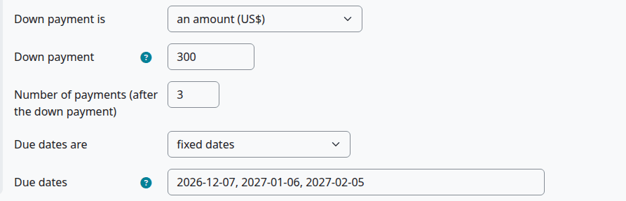

The down payment is always due the day the plan is given. With a monthly plan, each payment falls on the same day of the month. In a shorter month it falls on the last day.

What can go wrong:

- "Enter 3 dates written year-month-day (for example 2027-02-01), separated by commas." The number of dates must match Number of payments, and each must be a real date.
- "Enter a number from 1 to 100." The down payment is a percent, and you entered more than 100.

> Known problem in 1.4.6: that message gives 1 as the lowest percent, but the form takes a down payment of 0 percent too. Enter a percent from 0 to 100.

## Change a payment plan or stop offering it

A changed plan applies to plans given from then on. Plans already given to students don't change.

Who can do this: finance staff and managers. It needs `local/studentrecords:managebilling`.

1. [Open Billing setup](#open-billing-setup).
2. Under Payment plans, select "Edit" on the row of the plan.
3. Change the fields. To stop offering a plan, set "Active" to No. This field shows only when you change a plan.
4. Select "Save changes".

> Known problem in 1.4.6: the heading of this form shows [[editplan]] in place of a title, because a language string is missing. The form works as it should.

Check that:

- The Payment plans table shows the change.

A plan that isn't active is no longer offered in Give a payment plan.

## Add a refund rule

Your refund rules say how much comes back when a student drops or withdraws. Enter them as your state and catalog set them. For each drop or withdrawal, Student Records uses the first active rule, in order, that fits the date. [Refunds](refunds.md) says how each refund is figured and approved.

Who can do this: finance staff and managers. It needs `local/studentrecords:managebilling`.

1. [Open Billing setup](#open-billing-setup).
2. Under Refund rules, select "Add a refund rule".
3. Fill in the form. The tables below say what each field does.
4. Select "Save changes".

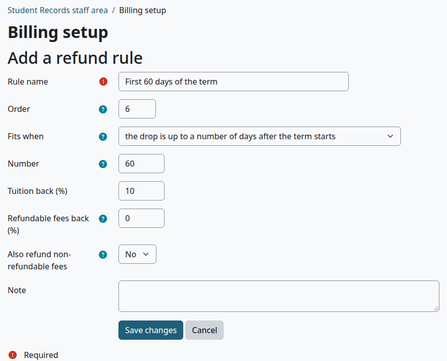

Check that:

- The page says "Saved."
- The rule is in the Refund rules table, at its place in the order.

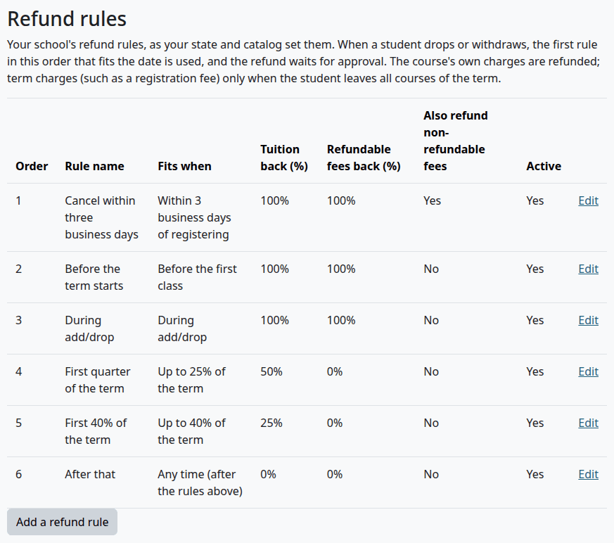

| Field | What to enter | Default |
|---|---|---|
| Rule name | The name staff and the account page show, up to 255 characters. Needed. | Empty |
| Order | Rules are checked in this order, 1 first. Two rules can have the same number, and then the older rule comes first. | The next number |
| Fits when | When the rule is used. See the next table. | the student cancels within a number of business days of registering |
| Number | The number that Fits when asks for. It must be 0 or more, and it is hidden when the option needs none. | 0 |
| Tuition back (%) | Percent of tuition given back, from 0 to 100 | 100 |
| Refundable fees back (%) | Percent of fees marked refundable given back, from 0 to 100 | 100 |
| Also refund non-refundable fees | Yes for a rule that gives everything back, for example when a student cancels within the cancel period. With No, fees marked not refundable are kept. | No |
| Note | For staff. It shows under the name in the table. | Empty |

Fits when has six options:

| Option | Number | The rule fits when |
|---|---|---|
| the student cancels within a number of business days of registering | Business days | The drop is on or after the day the student registered, and at most this many business days after it. Monday to Friday count, and holidays aren't left out. |
| the drop is before the term starts | Hidden | The drop is before the first day of the term |
| the drop is during add/drop (until the end of add/drop) | Hidden | The drop is on or before the term's "Add/drop ends" date. A term with no such date never fits. |
| the drop is up to a percent of the term (calendar days) | Percent | Days from the start of the term to the drop, as a share of the days from start to end, are at most this percent. A drop exactly on the percent fits. |
| the drop is up to a number of days after the term starts | Days | The drop is on or before the start of the term plus this many days |
| any time (use last, for the rest) | Hidden | Always |

Put the option "any time (use last, for the rest)" last. Any rule after it is never reached. With no rule that fits, a refund has the rule name "No rule fits: nothing back" and an amount of $0.00.

What can go wrong:

- "Enter a number from 0 to 100." A percent is out of range.
- "Enter 0 or more days." The Number is below 0.
- A rule you added is never used. Check its Order. The form offers the next number, which puts a new rule after your last rule. Move your "any time" rule to the end. See [Change a refund rule or its order](#change-a-refund-rule-or-its-order).

## Change a refund rule or its order

Refund rules are never removed. A changed rule applies to refunds figured from then on. Refunds already figured don't change.

Who can do this: finance staff and managers. It needs `local/studentrecords:managebilling`.

1. [Open Billing setup](#open-billing-setup).
2. Under Refund rules, select "Edit" on the row of the rule.
3. Change the fields. To put the rule in another place, change Order. To stop using it, set "Active" to No. This field shows only when you change a rule.
4. Select "Save changes".

To put a new rule before your last rule, give the new rule the number of the last rule, then change the last rule to the next number.

Check that:

- The table lists the rules in the order you want.

## Related pages

- [Finance guide](finance.md)
- [Student accounts](student-accounts.md)
- [Payment plans](payment-plans.md)
- [Refunds](refunds.md)
- [Online payments](online-payments.md)
- [Money reports](money-reports.md)
- [Setup wizard](setup-wizard.md)
- [Roles and permissions](../roles-and-permissions.md)
