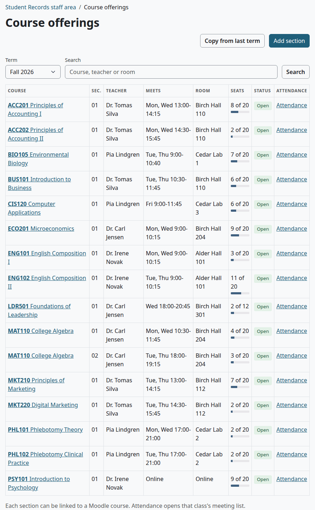
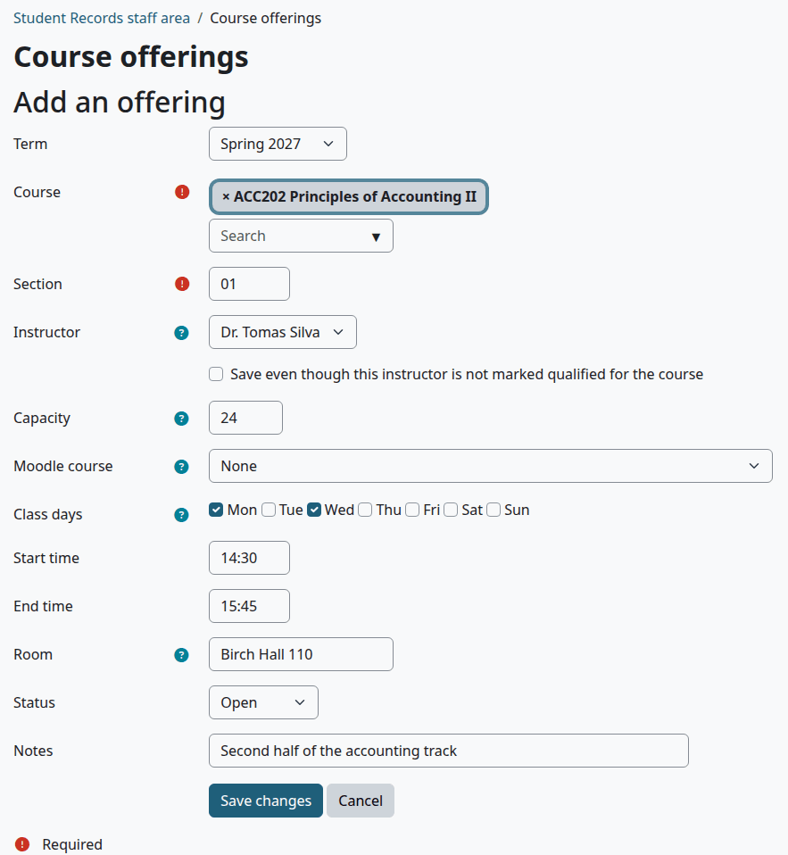
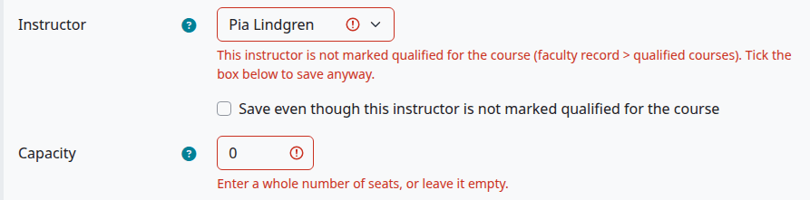
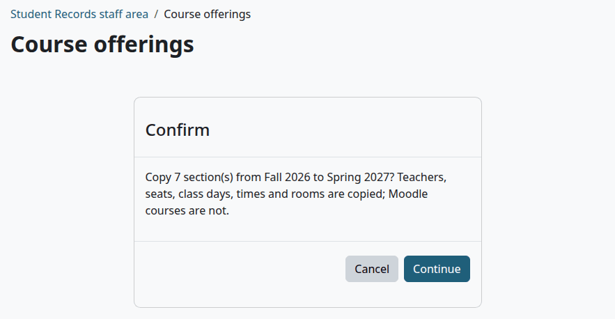
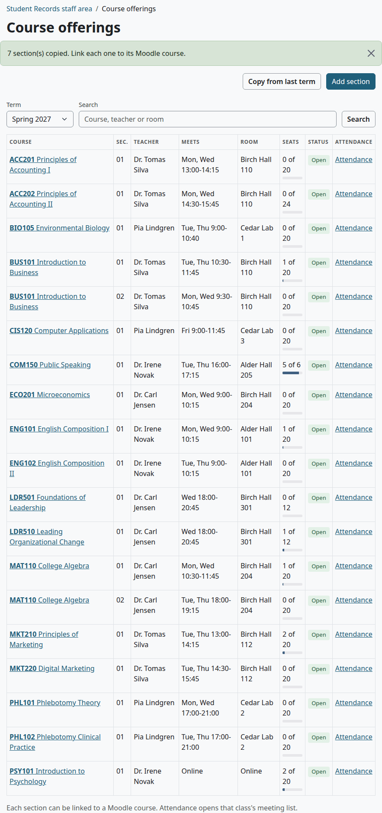
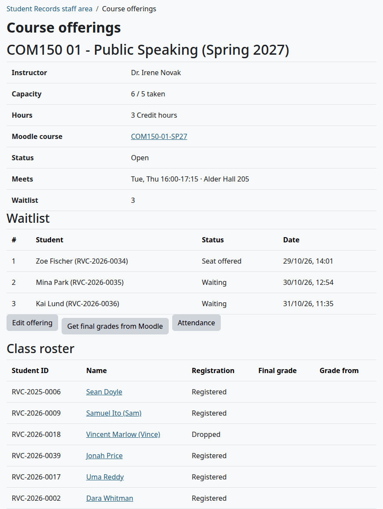
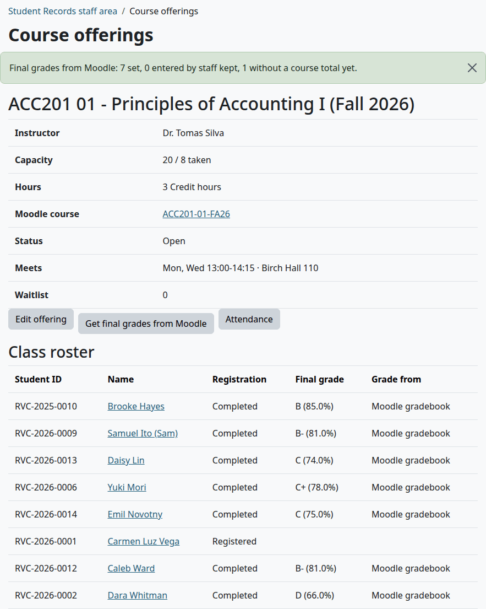

# Course offerings

A course offering is one section of a catalog course in one term. It says who teaches it, when and where it meets, how many seats it has, and which Moodle course it uses. This page is for the Registrar and whoever sets up each term.

## Contents

- [Who can do this](#who-can-do-this)
- [See the sections of a term](#see-the-sections-of-a-term)
- [Add a section](#add-a-section)
- [Link a section to a Moodle course](#link-a-section-to-a-moodle-course)
- [Seats and the waitlist](#seats-and-the-waitlist)
- [Copy from last term](#copy-from-last-term)
- [One section and its roster](#one-section-and-its-roster)
- [Get final grades from Moodle](#get-final-grades-from-moodle)
- [Change, close or cancel a section](#change-close-or-cancel-a-section)
- [Related pages](#related-pages)

## Who can do this

The Course offerings page needs the capability `local/studentrecords:configure`. Site administrators and Managers have it. A Registrar needs it on their role. Without it the page doesn't open, so a Registrar with no `configure` can't reach rosters or "Get final grades from Moodle". See [Install and set up](install-and-setup.md#moodle-roles-to-make).

Two parts of the page need more:

| Part | It needs |
|---|---|
| "Waitlist" and "Class roster" on a section | `local/studentrecords:managestudents`, or `local/studentrecords:viewstudents` at system level. Without them you see only the section's facts |
| "Get final grades from Moodle" | `local/studentrecords:managestudents` |

## See the sections of a term

1. Go to Student Records > Course offerings.
2. Under "Term", choose the term, and select "Search".

The "Search" box looks in the course code and title, the teacher and the room.

| Column | What it shows |
|---|---|
| "Course" | The course. Select it to open the section |
| "Sec." | The section |
| "Teacher" | The instructor, or "No teacher yet" |
| "Meets" | The class days and times. With no days it shows the room, such as Online |
| "Room" | The room |
| "Seats" | Seats taken, of the capacity. With no capacity, only the seats taken |
| "Status" | See below |
| "Attendance" | Opens the section's class meetings. See [Attendance](attendance.md) |

| Status | Meaning |
|---|---|
| "Open" | Open, with a teacher and free seats |
| "Needs teacher" | Open, with no instructor |
| "Full · waitlist 3" | Open, every seat is taken, and the number of people on the waitlist |
| "Closed" or "Cancelled" | The section's own status |

## Add a section

Before you start:

- The term is on the [Terms](terms-and-calendar.md) page.
- The course is in the [catalog](programs-and-courses.md) and active.
- The teacher has a [faculty record](faculty-and-staff.md), marked as qualified for the course.
- The Moodle course exists, if the section uses one. See [Link a section to a Moodle course](#link-a-section-to-a-moodle-course).

1. On the Course offerings page, choose the term, and select "Add section".
2. In "Course", type a code or title, and pick the course.
3. Fill in the rest of the form.
4. Select "Save changes".

> Known problem in 1.4.6: "Course" opens with the first course of the catalog already in it, so a form saved without a pick makes a section of that course. Delete that course before you type, and check the box before you save.

| Field | Default | What it does |
|---|---|---|
| "Term" | The term you chose on the list. With "All", the earliest term | The term of the section |
| "Course" | The first course of the catalog | An active course from the catalog |
| "Section" | 01 | Up to 20 characters. A term can have each course and section only once |
| "Instructor" | None | Active records on the Faculty tab, not the Staff tab. See below |
| "Save even though this instructor is not marked qualified for the course" | Unticked | Tick it to save with a teacher who isn't marked qualified. It's asked again each time you save |
| "Capacity" | Empty | The number of seats, from 1. Empty means no limit |
| "Moodle course" | None | The course students are enrolled in |
| "Class days" | None ticked | The days the section meets. Leave them empty for online or self-paced sections |
| "Start time" and "End time" | Empty | In 24 hours, as `09:00` or `14:30` |
| "Room" | Empty | Up to 50 characters, such as Birch Hall 110 or Online |
| "Status" | "Open" | "Open", "Closed" or "Cancelled" |
| "Notes" | Empty | Kept with the section, and copied with it. Only this form shows them |

Class days, times and rooms show on the list, in the student's schedule, and on the teacher's home. With self-registration on, the time clash check uses them. A section with no days or times never clashes.

"Instructor" is a name on the record. It gives the teacher no access to anything: a teacher reaches a class through their role in the linked Moodle course. Enrol the teacher in the Moodle course yourself.

Check that:

- The section's page opens with the facts you typed.

What can go wrong:

| Message | Cause |
|---|---|
| "This is already used by another record." | The term has this course and section |
| "This instructor is not marked qualified for the course (faculty record > qualified courses). Tick the box below to save anyway." | Mark the teacher as qualified, or tick the box |
| "Enter a whole number of seats, or leave it empty." | "Capacity" is 0 or isn't a whole number |
| "Enter the time as HH:MM in 24 hours, for example 09:00 or 14:30." | Type `14:30`, not `2:30 pm` |
| "The end time must be after the start time." | Fix the times |

## Link a section to a Moodle course

A link does three things:

- A student registered in the section is enrolled in the Moodle course, by manual enrolment with the student role.
- Teachers of the Moodle course get the "Attendance" tab there, and the section shows under "My classes" while its term is active.
- "Get final grades from Moodle" reads that course's gradebook. It only reads, and changes nothing in Moodle.

Before you link:

- The Moodle course has the Manual enrolments method, turned on. Without it, registering a student stops with "The linked Moodle course has no manual enrolment method; add one in the course first."

Add the link before you register students. Enrolling happens at the moment a student registers, so students registered before you add the link aren't enrolled.

A drop or withdrawal suspends the enrolment and removes nothing, so course work and grades stay. The enrolment stays active when the student has another active registration on the same Moodle course. With billing on, the [course access rule](billing-setup.md) can hold back the enrolment until a payment.

## Seats and the waitlist

A student takes a seat when they register, and keeps it through to a final grade. A drop or withdrawal frees it.

With a capacity, a section is full when the seats taken reach it. Staff can go over the capacity with an override and a reason. See [Registration](registration.md).

With "Students register themselves" on, a student can join the waitlist of a full section. When a seat frees up, or when you raise the capacity and save, the seat is offered to the next student who could register. It's held for that student for 2 days, and registration counts it as taken for everyone else. No seat is offered after the term's add period, or in a term that isn't active. With self-registration off, nothing is offered and the list stays as it is.

> Known problem in 1.4.6: the list of sections doesn't count a seat that is held for a student from the waitlist. So a section can show "Open" and a free seat under "Seats", while registration refuses it as full. Open the section: a student marked "Seat offered" in its "Waitlist" table holds that seat for 2 days.

## Copy from last term

Who can do this: the same people.

This copies the sections of the term before into the term you chose.

1. On the Course offerings page, choose the new term and select "Search".
2. Select "Copy from last term".
3. Read the confirmation. It names the two terms and the number of sections.
4. Select "Continue".

Check that:

- The page says, for example, "7 section(s) copied. Link each one to its Moodle course."
- The new sections are on the list.

| | |
|---|---|
| Copied | Course, section, instructor, capacity, class days, times, room and notes |
| Not copied | The Moodle course and the students |
| Left out | Cancelled sections, and any section the new term has already, with the same course and section |
| Set | Every new section is "Open" |

"The term before" is the term that starts last before the chosen one, active or not. After a copy, open each section, select "Edit offering" and pick its Moodle course.

What can go wrong:

- The button isn't there. Choose a term first: with "All" on the list, it doesn't show.
- "There is no earlier term to copy from." The chosen term is the earliest.
- The confirmation says 0 sections. The new term has them all already, or the term before has none to copy. Check the name of the term before in the confirmation.

## One section and its roster

Select a course on the list to open the section.

The page shows:

- The facts: "Instructor", "Capacity" with the seats taken, "Hours", "Moodle course", "Status", "Meets" and "Waitlist".
- "Waitlist", when anyone is on it: each student in order, with their state and the date they joined. A state is "Waiting" or "Seat offered". Students who registered or left the list aren't shown.
- The buttons "Edit offering", "Get final grades from Moodle" and "Attendance". The middle one shows only for a section with a Moodle course.
- "Class roster": every student with a registration in the section, in order of last name. Each has a "Student ID", "Name", "Registration", "Final grade" and "Grade from". The name opens the student's file.

"Registration" is "Registered", "Completed", "Dropped" or "Withdrawn". "Grade from" is "Moodle gradebook", "Entered by staff", "Posted by the teacher" or "Grade change".

To register students, see [Registration](registration.md).

## Get final grades from Moodle

Who can do this: people with both `local/studentrecords:configure` and `local/studentrecords:managestudents`.

Before you start:

- The section has a linked Moodle course.
- The term's grade freeze hasn't passed.
- The grading scale has its percents. See [How a percent becomes a letter](grading-and-levels.md#how-a-percent-becomes-a-letter).
- Each student has a grade for every activity. See the known problem below.

1. Open the section.
2. Select "Get final grades from Moodle".

There is no confirmation: it runs at once.

Check that:

- The page says, for example, "Final grades from Moodle: 7 set, 0 entered by staff kept, 1 without a course total yet."
- The roster shows a letter and percent for each student, with "Completed" and "Moodle gradebook".

| The count | Means |
|---|---|
| set | Students who got a letter from their course total |
| entered by staff kept | Students who already have a grade from staff, a teacher or an approved grade change. Those are never replaced |
| without a course total yet | Students with no course total, or with a percent that no letter of the grading scale covers. Nothing changes for them |

It works on every registered and completed student of the section. Students who dropped or withdrew are left alone. You can press the button again: grades that came from the gradebook are read again.

What it changes:

- A student with a course total becomes "Completed" in that section, whenever you press the button, even in the middle of a term. So press it only when the course is finished.
- A completed course can't be dropped or withdrawn, and nothing sets it back to "Registered". Its letter counts in the student's GPA at once.
- Each student whose grade changed gets the message "Final grade posted".
- Teachers' grades in the Moodle gradebook don't change.

> Known problem in 1.4.6: the percent is the course total against the most the course can give, not against the student's own range. With Moodle's default "Natural" aggregation and "Exclude empty grades", one grade item with no grade for a student is enough: the gradebook shows 84% and this page records 42%, which gives a far lower letter. Grade every item for every student first, or enter the final grade by hand. Compare the roster with the gradebook before you tell students. A wrong letter can be corrected: see [Final grades](final-grades.md).

What can go wrong:

- "The grades of this term are frozen; request a grade change instead." The grade freeze has passed. See [Final grades](final-grades.md).
- The button isn't there. The section has no linked Moodle course, or you don't have `local/studentrecords:managestudents`.

To enter grades another way, see [Final grades](final-grades.md).

## Change, close or cancel a section

1. Open the section and select "Edit offering".
2. Change what you need. To stop registration, set "Status" to "Closed" or "Cancelled".
3. Select "Save changes".

Sections can't be deleted.

A section that isn't open:

- Takes no new registrations. Staff don't find it under "Register for a course", and online registration doesn't list it. A student who already has it in their cart gets "This offering is Closed." when they confirm.
- Keeps its students: changing the status doesn't drop anyone, and they stay "Registered".
- Offers no seats from the waitlist.
- Isn't copied by "Copy from last term", if it's cancelled.

> Known problem in 1.4.6: the "Instructor" list holds only active faculty, so a section whose teacher was turned off shows None, and the list of sections shows "No teacher yet", where a search by the teacher's name doesn't find it. Saving the form then takes the teacher off the section. Pick a teacher each time you edit such a section.

## Related pages

- [Terms and the calendar](terms-and-calendar.md)
- [Programs and courses](programs-and-courses.md)
- [Faculty and staff](faculty-and-staff.md)
- [Registration](registration.md)
- [Attendance](attendance.md)
- [Final grades](final-grades.md)
- [Billing setup](billing-setup.md)
