# Degree audit and graduation

This page covers the degree audit, course substitutions, transfer credit and the steps to a conferred credential: applying, reviewing, approving, sending back and conferring, with honors. It is for the Registrar and other records staff. A student can read their own audit.

## Contents

- [Read the degree audit](#read-the-degree-audit)
- [How the audit decides](#how-the-audit-decides)
- [Add transfer credit](#add-transfer-credit)
- [Approve a course substitution](#approve-a-course-substitution)
- [The Graduation page](#the-graduation-page)
- [Apply for graduation](#apply-for-graduation)
- [Review an application](#review-an-application)
- [Confer the credential](#confer-the-credential)
- [Cancel an application](#cancel-an-application)
- [What a student sees](#what-a-student-sees)
- [Related pages](#related-pages)

## Read the degree audit

Who can do this: staff who see all students, with `local/studentrecords:managestudents` or `local/studentrecords:viewstudents` at system level, and each student on their own record. A teacher with course-level access can't open it.

Before you start:

- The student has a program. Without one, the page says "The student has no program, so there is nothing to audit."

1. Open the file, on the Graduation tab.
2. Select "Degree audit".

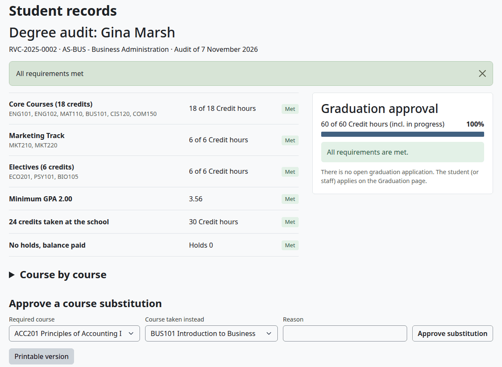

The top of the page says "All requirements met" or "Requirements still open". Each line of the list has a value and a tag:

| Line | What it checks |
|---|---|
| A group of the program's course list, such as Core Courses | The hours met in the group. A track that isn't the counted one is left out |
| Hours toward the program | Only for a program with no course list: the hours earned against the program's total |
| Minimum GPA | The cumulative GPA, when the program sets a minimum |
| Credits taken at the school | Credits earned here, when the program sets a minimum |
| Classes in progress | Hours of courses still running, when there are any |
| No holds, balance paid | For information only. It doesn't count toward "All requirements met" |

| Tag | What it means |
|---|---|
| Met | The line is done |
| Pending grades | The rest of the line is in classes still running |
| Not met | Something is missing or not passed |
| Not set | The program has nothing to check |

The student and staff with `local/studentrecords:viewbilling` see the balance on the last line. Other staff see only the tag and the number of holds.

The panel "Graduation approval" shows the hours done, with classes in progress, and one of these notes:

| Note | What it means |
|---|---|
| "All requirements are met." | The audit is complete |
| "Approve now as conditional. It becomes final when the classes in progress are graded with passing marks." | The audit will be complete if the classes in progress are passed |
| "Not ready: some requirements are not met yet." | Passing the classes in progress wouldn't be enough |
| "Not ready: this program has nothing to check yet." | The program has no course list, total hours or minimum GPA |

"Course by course" opens the detail, with a table for each group: Course, Course title, Hours, Requirement, Final grade and Term. A course shows Met, In progress, Not passed or Not taken. For a program with no course list, this part is "Hours and GPA".

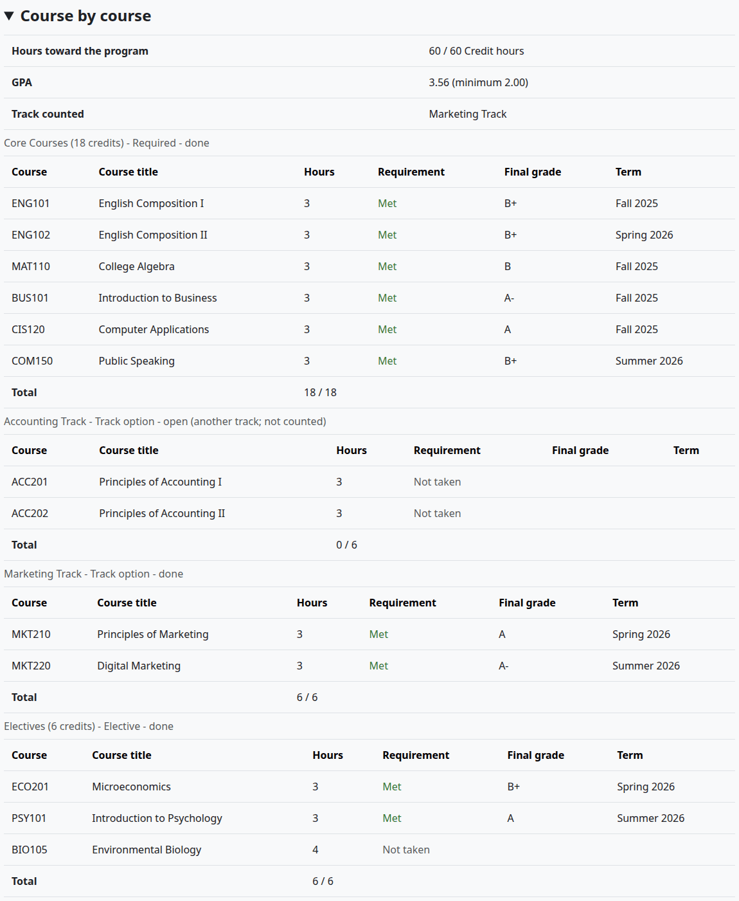

"Still needed", under the detail, lists what is open in words. "Printable version" opens the page without the menu.

## How the audit decides

- A required group needs every course in it, passed.
- An elective group needs the hours in its name, such as "Electives (6 credits)". With no number in the name, the group always counts as done.
- Of the track groups, one counts: the complete one, else the one with the most hours. "Track counted" names it. A track course outside it doesn't count.
- A course counts when it has a passing grade, by the [pass rules](grading-and-levels.md). An attempt left out by the repeat rule doesn't count.
- Transfer credit with "Counts toward the program" ticked adds to the hours. With an equivalent course in the course list, it also meets that course.
- An approved substitution makes another course count for a required one.
- The cumulative GPA has to reach the program's minimum, and the credits taken at the school have to reach the program's minimum.
- The hours toward the program have to reach the program's total hours, when it sets one. With a course list, a course outside the list adds nothing to them. "Still needed" then shows, for example, "54.00 of 60.00 hours".

The audit reads the program as it stands today. It doesn't use the student's catalog year.

[Programs and courses](programs-and-courses.md) shows how to set a program's course list and its minimums.

## Add transfer credit

Who can do this: records and admissions staff, and nobody on their own record. It needs `local/studentrecords:managestudents` at system level.

1. Open the file, on the Registration and grades tab.
2. Select "Add transfer credit", or Edit on a row of the Transfer credit table.
3. Fill in the form.
4. Select "Save changes".

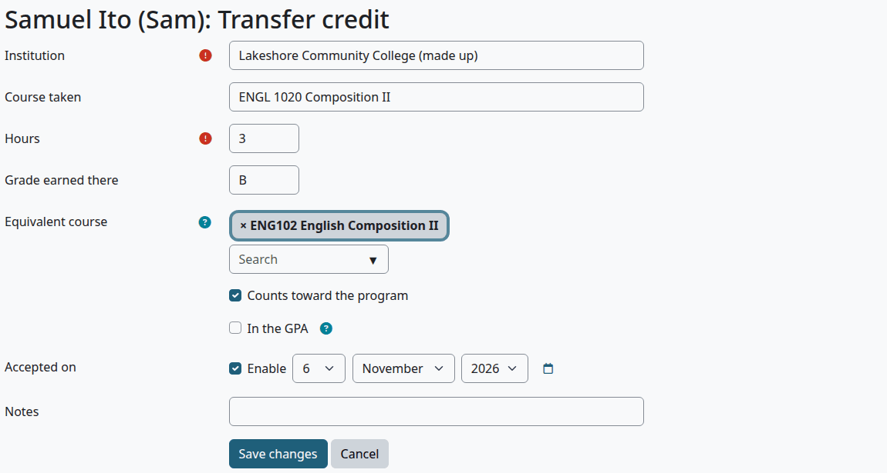

| Field | What it does |
|---|---|
| Institution | Required |
| Course taken | The course at the other school |
| Hours | Required, above 0 |
| Grade earned there | Up to 10 characters. It counts in the GPA only with "In the GPA" ticked and a grade on your scale |
| Equivalent course | The course of your school it replaces. It then counts as passed for prerequisites and, in the audit, for that course. It counts for prerequisites even with "Counts toward the program" unticked |
| Counts toward the program | Ticked by default |
| In the GPA | Starts from the setting "Transfer credit counts in the GPA" on the Admissions step of the setup wizard |
| Accepted on | An optional date |
| Notes | Free text |
| Keep on the record | Only when you edit. Untick it to take the row off the record |

Check that:

- The file opens with "Saved."
- The Transfer credit table has the row, and Cumulative has moved.
- The audit shows the course as "Met (Transfer credit)", when it has an equivalent in the course list.

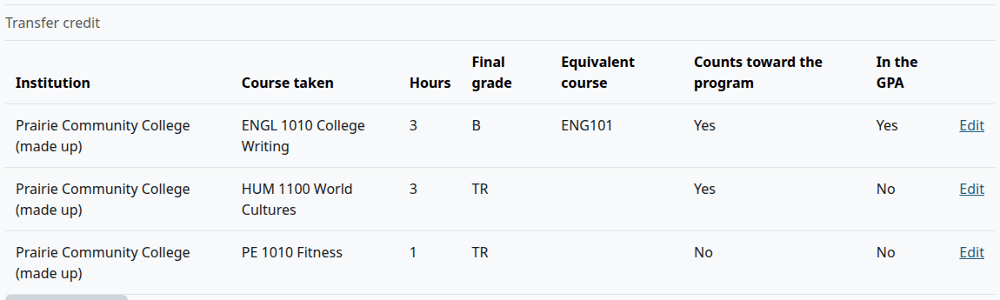

The standing rule of the student's level can set "Maximum transfer credit (% of program)". Above it, the file shows "Transfer credit toward the program is 34; the most allowed is 30 (50% of the program)." It is only a warning: nothing stops the credit, and the audit counts all of it.

## Approve a course substitution

Who can do this: records and admissions staff, and nobody on their own record. It needs `local/studentrecords:managestudents` at system level.

A substitution lets a course the student passed count for a course of the program.

Before you start:

- The audit has a course that isn't met, and the student has passed another course.

1. Open the degree audit.
2. Under "Approve a course substitution", choose the "Required course".
3. Choose the "Course taken instead".
4. In Reason, write why. It is required.
5. Select "Approve substitution".

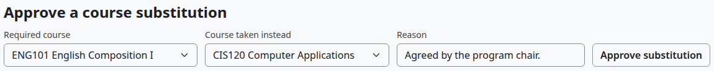

Check that:

- The page says "Substitution approved."
- The required course shows `*` in its group, and the page says "* counted by an approved course substitution."

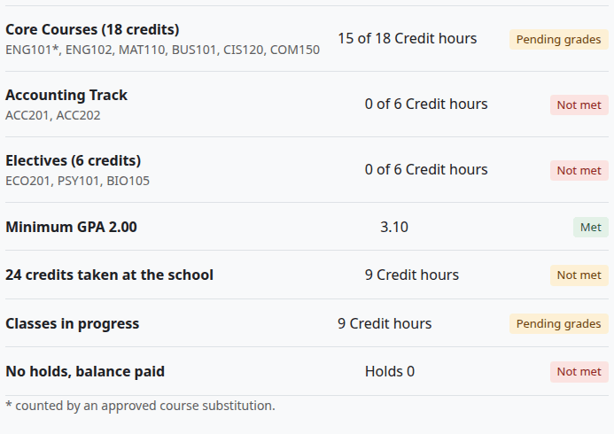

No page lists or removes a substitution once it is approved, so check the two courses before you save.

What can go wrong:

- "Pick two different courses and write the reason."
- The form doesn't show on your own record, or when nothing is open to substitute.

## The Graduation page

Who can do this: records and admissions staff. It needs `local/studentrecords:managestudents` at system level. In the Student Records menu, select "Graduation".

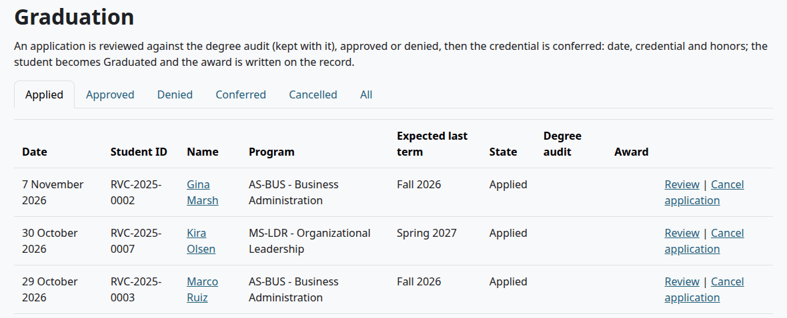

The tabs are Applied (where the page opens), Approved, Denied, Conferred, Cancelled and All. An application moves through these states:

| State | What it means | Next |
|---|---|---|
| Applied | Waiting for review | "Review" or "Cancel application" |
| Approved | Reviewed and accepted | "Confer" or "Cancel application" |
| Denied | Rejected or sent back | Staff can apply for the student again |
| Conferred | The credential is on the record | Nothing more |
| Cancelled | Withdrawn, with a note | Staff can apply for the student again |

## Apply for graduation

Who can do this: records and admissions staff. Students can't apply themselves: staff apply for them on the file. You can apply on your own file, and another person must decide.

> Known problem in 1.4.6: the degree audit says "There is no open graduation application. The student (or staff) applies on the Graduation page." Students can't apply, and staff apply on the Graduation tab of the file, as below. The note also shows when the application is already approved: find it on the Graduation page, under Approved.

1. Open the file, on the Graduation tab.
2. Select "Apply for graduation".
3. Choose the "Expected last term".
4. Optional: add Notes.
5. Select "Apply for graduation".

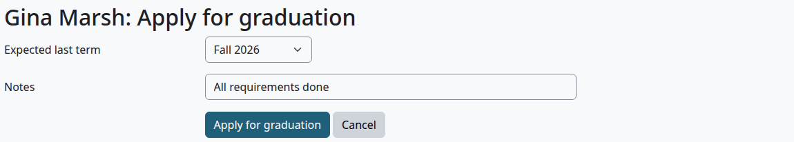

Check that:

- The file opens with "Saved."
- The application is on the Graduation tab, and on the Graduation page under Applied.

What can go wrong:

- "This student already has an open graduation application."
- "The student has no program."

Nothing tells the student that an application was made. The Staff home counts it under "Needs your attention".

## Review an application

Who can do this: records and admissions staff, but not on their own application. "Your own application: another person must decide" shows in its place.

There are two ways. The degree audit shows more, and it is the only place to set the name on the diploma.

On the degree audit:

1. Open the student's degree audit.
2. In the panel, check "Name on diploma". It starts with the legal name. No page shows this name after you save it.
3. Write a note, if you need one.
4. Select "Approve graduation" or "Send back with a note".

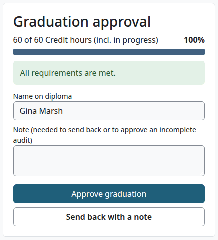

On the Graduation page:

1. On the Applied tab, select "Review".
2. Choose the Decision: Approve or Reject.
3. Write Notes, if you need them.
4. Select "Review".

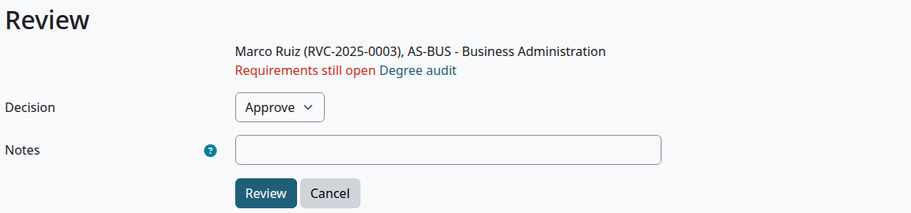

"Send back with a note" and Reject do the same thing: the state becomes Denied. Despite the label on the note box, a note isn't required to send back.

When you approve, the audit is kept with the application, as it stood that day:

| The audit | Approving |
|---|---|
| Complete | Works with no note |
| Open, and it would be complete if the classes in progress are passed | Works with no note, as a conditional approval |
| Open for any other reason | Needs a note. "The degree audit is not complete; approving needs a note." |

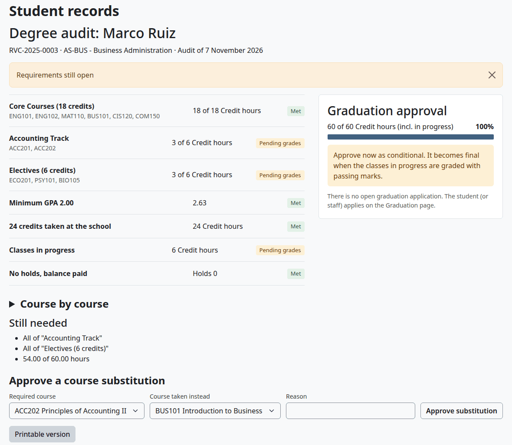

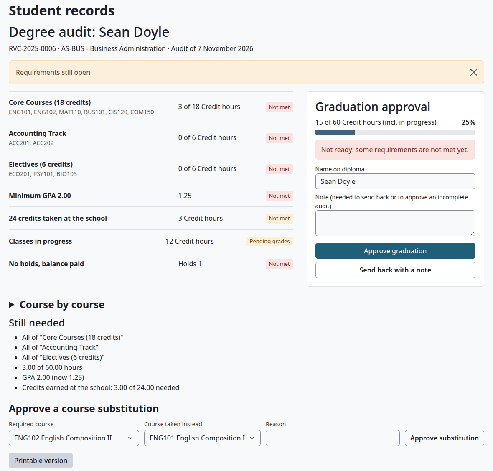

Check that:

- The page says "Graduation approved." or "Sent back with your note." on the audit, or "Saved." on the Graduation page.
- The application is under Approved or Denied.

The student gets the message "Graduation application reviewed" at once.

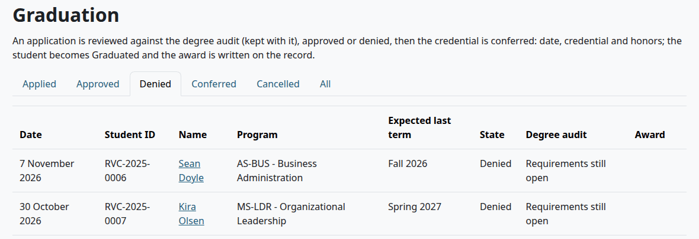

## Confer the credential

Who can do this: records and admissions staff, but not on their own application.

1. On the Graduation page, select the Approved tab.
2. Select "Confer" on the application.
3. Check the fields.
4. Select "Confer".

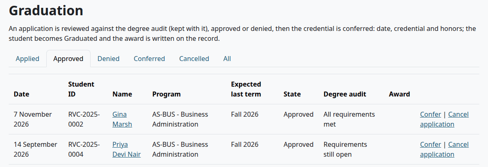

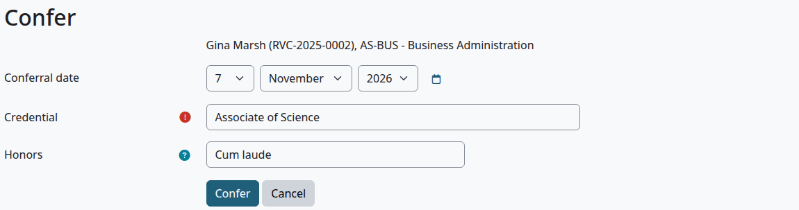

| Field | What it does |
|---|---|
| Conferral date | Today by default |
| Credential | Required. It starts with the program's credential |
| Honors | Suggested from the cumulative GPA and the honors rules on the Admissions step of the setup wizard, such as `3.9 Summa cum laude; 3.7 Magna cum laude`. Leave it empty for none |

Check that:

- The page says "Saved."
- The file's status is Graduated, with the Status history note "Credential conferred".
- "Degree or certificate awarded" on the record holds the credential and the honors, and "Date awarded" the date.

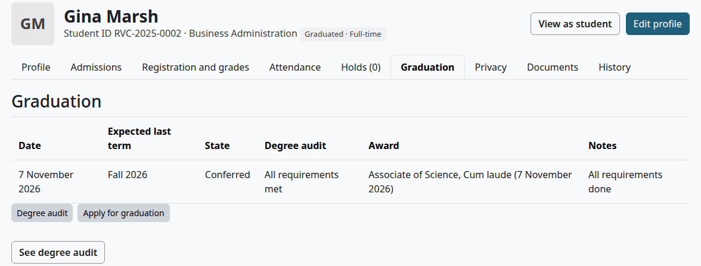

The student gets the message "Degree or certificate conferred" at the next cron run.

What can go wrong:

- "This graduation was approved as conditional: it can be conferred when the degree audit is complete (all grades posted and passed)." Post the last grades, then confer. An approval with a note on an open audit has no such check: it can be conferred at once.

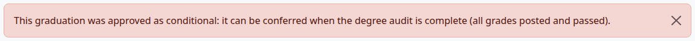

Holds and a balance don't stop a conferral. Check the last line of the audit if your school minds.

## Cancel an application

Who can do this: records and admissions staff. This works on your own application too.

1. On the Graduation page, select "Cancel application" on the row. It is there for Applied and Approved.
2. Write a note. It is required.
3. Select "Cancel application".

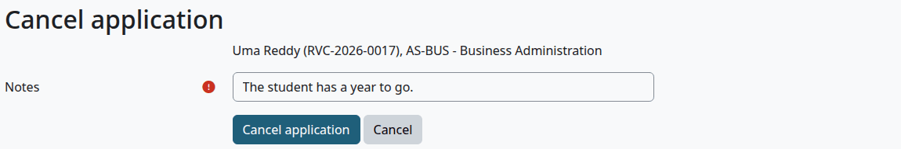

Check that:

- The application is under Cancelled.

Cancelling sends no message.

## What a student sees

The student opens "See degree audit" on My academic record. The page is the same, without the staff forms. Graduation applications show under My details.

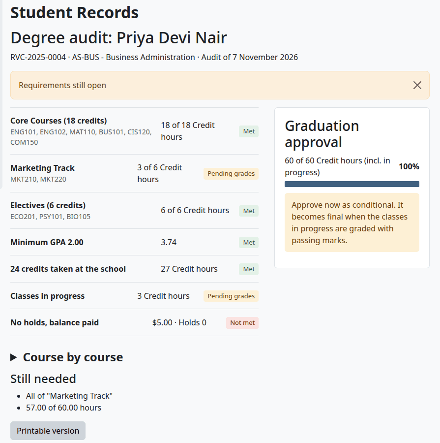

## Related pages

- [Registrar's guide](registrar.md)
- [The student file](student-file.md)
- [Final grades](final-grades.md)
- [Programs and courses](programs-and-courses.md)
- [Holds and standing](holds-and-standing.md)
