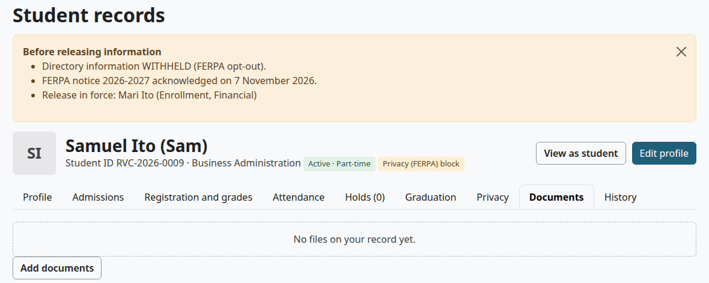
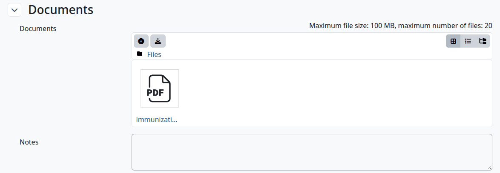
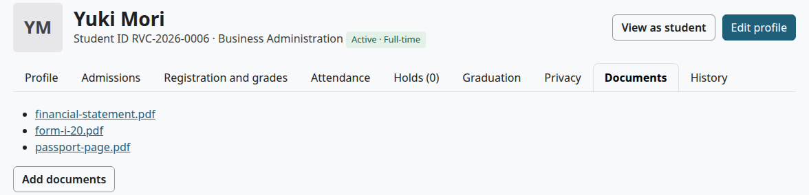
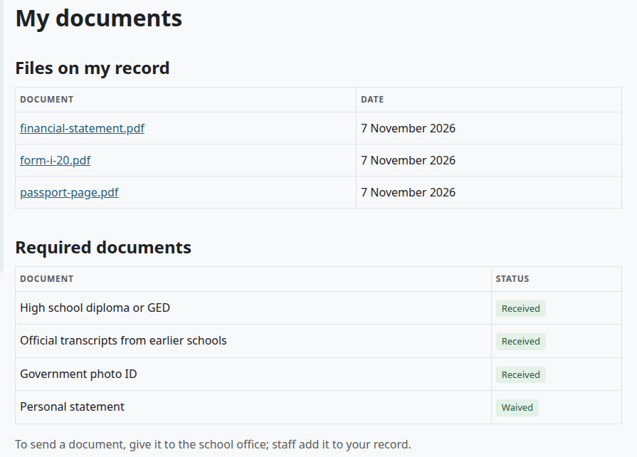

# Documents

A student's file can hold documents, such as an ID or a transcript from another school. This page shows how staff add them and what a student sees. The application checklist is separate: it records which documents came in, and it doesn't hold the files. See [Track documents](admissions-process.md#track-documents).

## Contents

- [Who can see documents](#who-can-see-documents)
- [Add documents to a file](#add-documents-to-a-file)
- [Open or remove a document](#open-or-remove-a-document)
- [What a student sees](#what-a-student-sees)
- [Related pages](#related-pages)

## Who can see documents

| Person | What they get |
|---|---|
| Staff who manage students | The names and the files, on every student |
| The student | The names and the files, on their own record |
| Staff with `local/studentrecords:viewstudents` only | Neither. The Documents tab says "No files on your record yet." even when there are files |
| Teachers | Neither |
| Finance and Financial Aid staff | Neither, without a student capability |

A person who isn't allowed gets an error from the file's link too, so a copied link doesn't open.

## Add documents to a file

Who can do this: records and admissions staff. It needs `local/studentrecords:managestudents` at system level.

Students can't upload. They give a document to the school office, and staff add it.

1. Open the file, on the Documents tab.
2. Select "Add documents". The edit form opens.
3. Open the section Documents.
4. Drag the files onto the box, or select the add button and upload them.
5. Select "Save changes".

A record holds up to 20 files, with no folders. The site's upload limit sets the largest file.

Check that:

- The file opens with "Saved."
- The Documents tab lists the file.

The file doesn't change the application checklist. To mark a document as received, [update the checklist](admissions-process.md#track-documents) as well.

## Open or remove a document

Who can do this: records and admissions staff. It needs `local/studentrecords:managestudents` at system level.

To open a document, select its name on the Documents tab.

To remove one:

1. Open the file and select "Edit profile".
2. In the section Documents, select the file, then "Delete", then "Yes".
3. Select "Save changes".

History doesn't record files. A privacy deletion request removes a student's documents too, as [Privacy and uninstall](privacy-and-uninstall.md) shows.

## What a student sees

Who can do this: students, on their own record.

1. In the Student Records menu, select "My documents".

| Part | What it shows |
|---|---|
| Files on my record | Each file with its date. Selecting a name opens it. With no files: "No files on your record yet." |
| Required documents | The application checklist, when one applies: each document with Missing, Received or Waived |

The page ends with "To send a document, give it to the school office; staff add it to your record."

The same files show under Documents in My details.

## Related pages

- [The student file](student-file.md)
- [Admissions process](admissions-process.md)
- [The student's guide](student.md)
- [Privacy and uninstall](privacy-and-uninstall.md)
