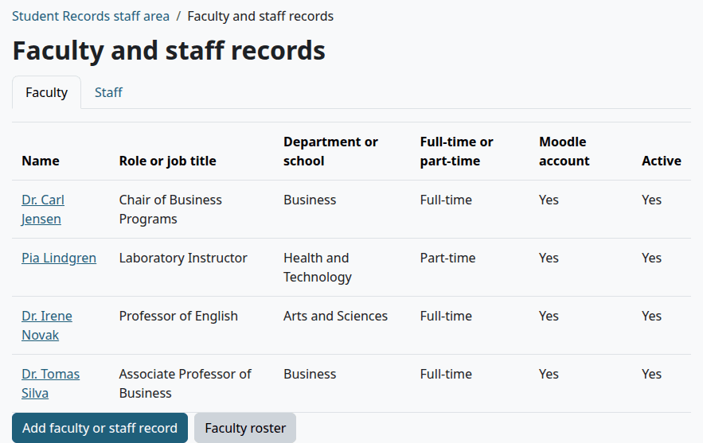
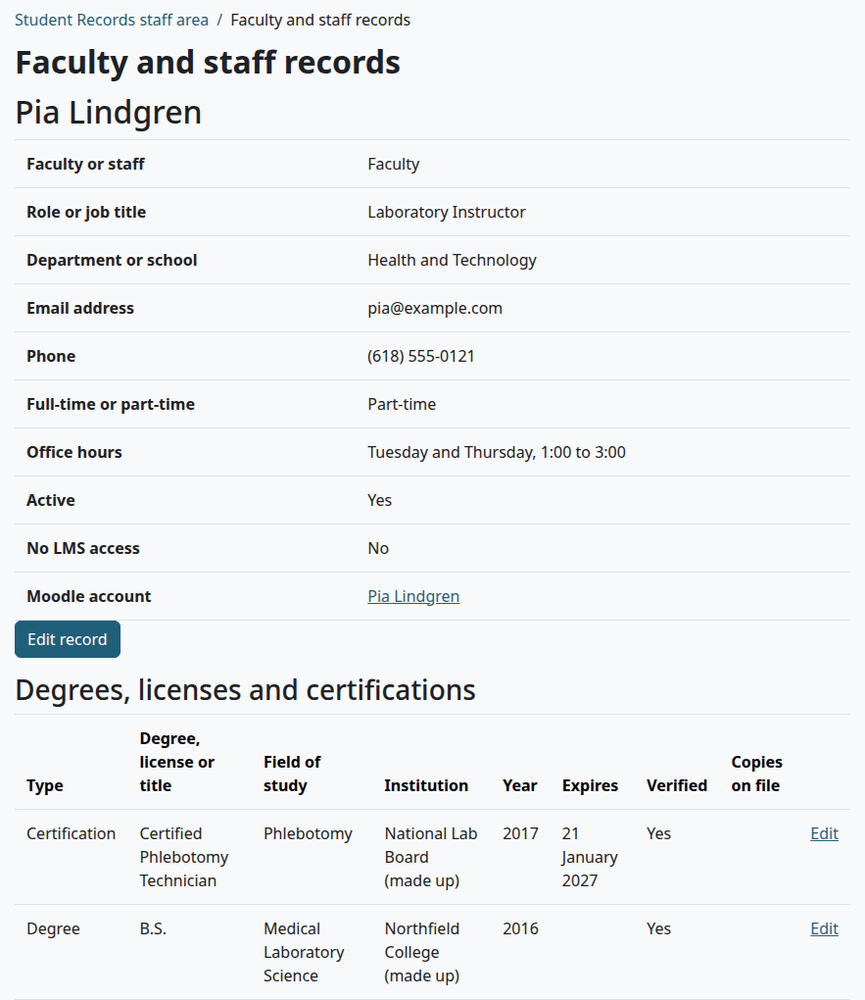
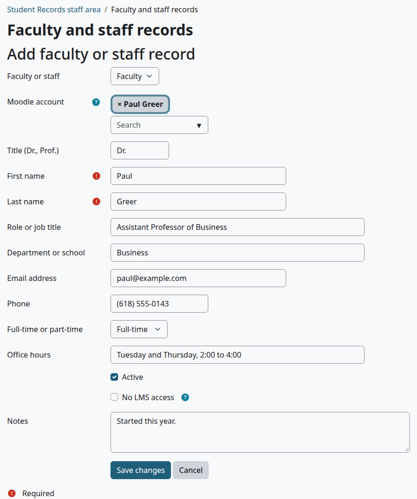
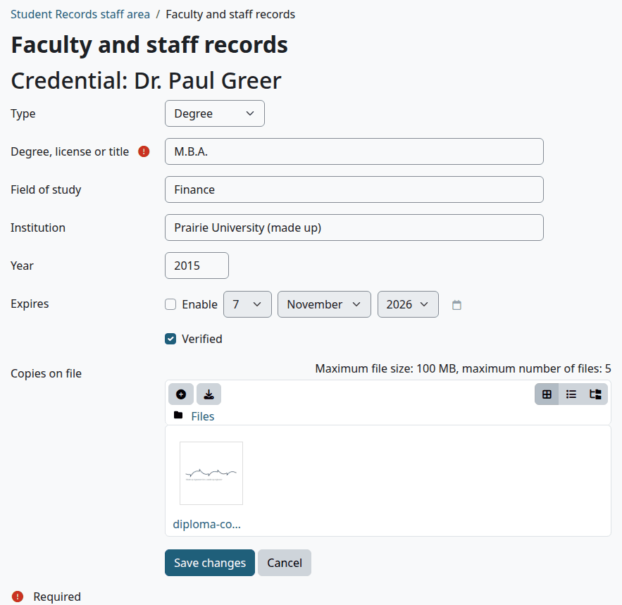
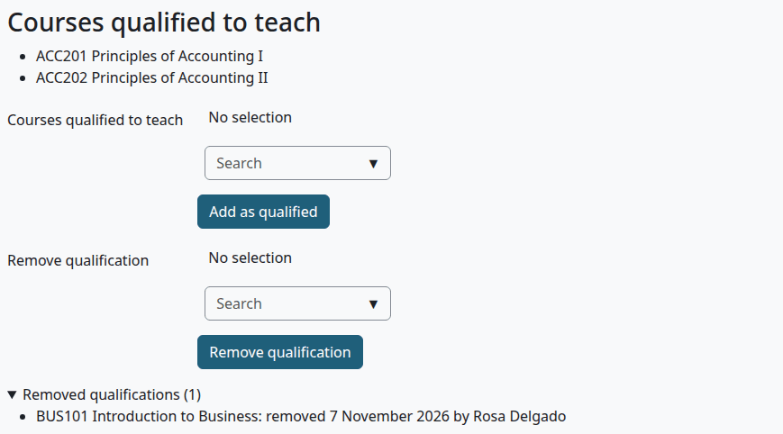
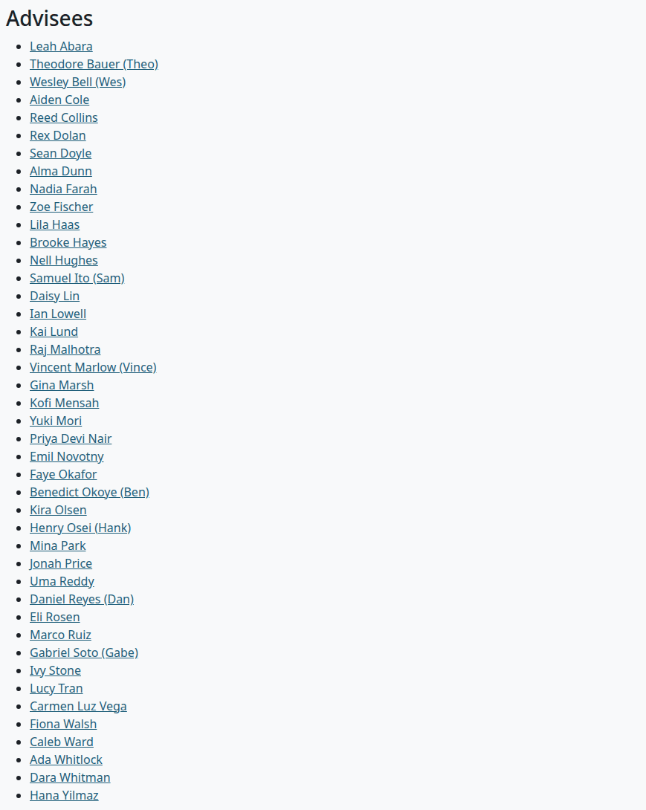
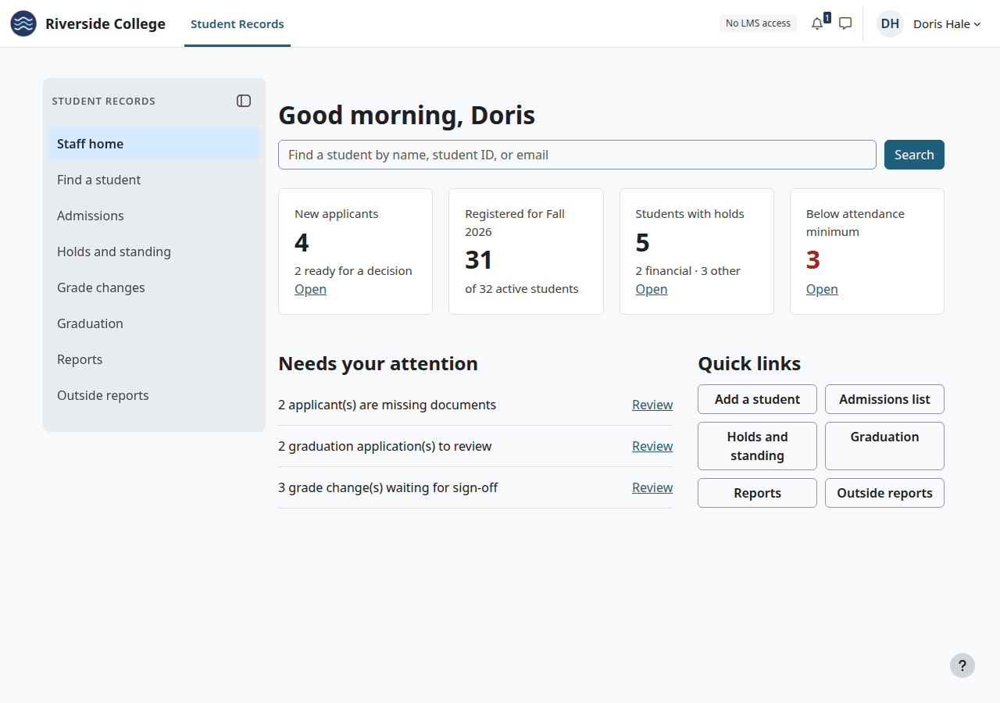
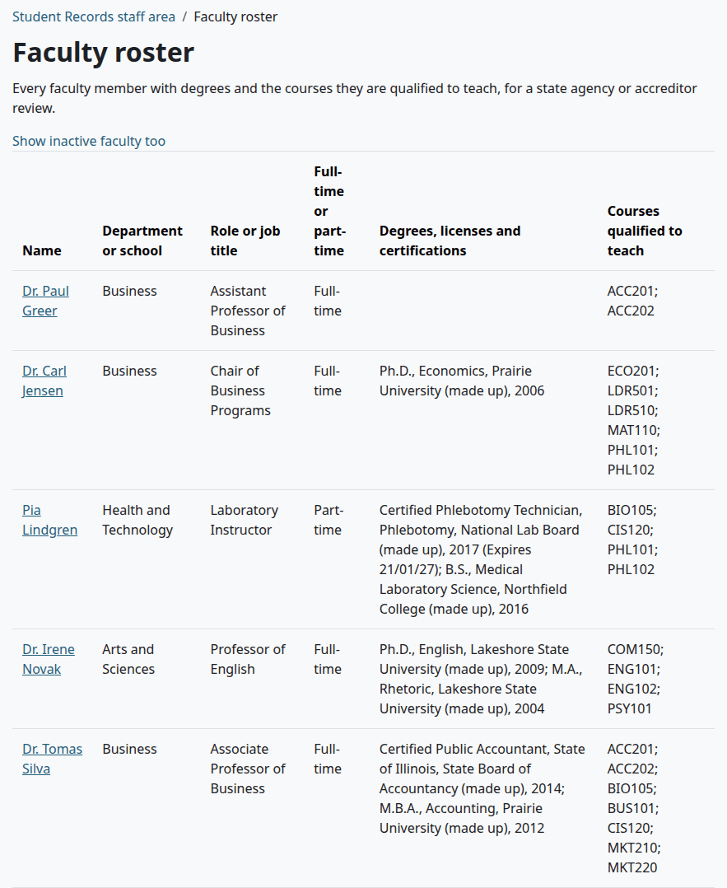
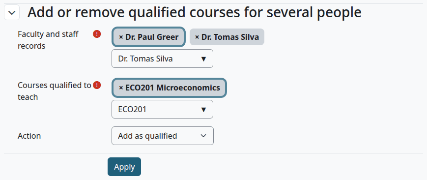

# Faculty and staff

Faculty and staff records hold each person's job details, degrees and licenses, and the courses each teacher may teach. This page is for the Registrar and whoever keeps those records. A record is separate from a Moodle account, and a person can have a record with no account.

## Contents

- [Who can do this](#who-can-do-this)
- [See the records](#see-the-records)
- [Add a record](#add-a-record)
- [Degrees, licenses and certifications](#degrees-licenses-and-certifications)
- [Courses a teacher may teach](#courses-a-teacher-may-teach)
- [Advisees](#advisees)
- [No LMS access](#no-lms-access)
- [The faculty roster](#the-faculty-roster)
- [Related pages](#related-pages)

## Who can do this

| To do this | You need |
|---|---|
| See the records and the roster | `local/studentrecords:viewfaculty` |
| Add and change records, credentials and qualified courses | `local/studentrecords:managefaculty` |
| See a teacher's advisees | `local/studentrecords:managestudents`, or `local/studentrecords:viewstudents` at system level |
| Find a Moodle account in the "Moodle account" box | Moodle's `moodle/user:viewalldetails` at system level. Without it, typing in the box opens a window that says "Sorry, but you do not currently have permissions to do that (View user full information)." |

Site administrators have all of these, and so does Moodle's Manager role by default.

## See the records

1. Go to Student Records > Faculty and staff records.
2. Select the tab "Faculty" or "Staff".

Select a name to open the record.

The record shows the person's facts, "Degrees, licenses and certifications", "Courses qualified to teach", "Advisees" and, with `local/studentrecords:managefaculty`, "Change history". The history lists each change to the facts, with the date, who made it, and the old and new value. Opening a record is written in the audit log.

## Add a record

Who can do this: anyone with `local/studentrecords:managefaculty`.

Before you start:

- For a person who will sign in, the Moodle account exists. Adding a record doesn't make one.

1. Go to Student Records > Faculty and staff records and select "Add faculty or staff record".
2. Fill in the form. Only "First name" and "Last name" are needed.
3. Select "Save changes".

| Field | Default | What it does |
|---|---|---|
| "Faculty or staff" | "Faculty" | Which tab the record is on. Only "Faculty" records can be an instructor or an advisor, and only they are on the roster |
| "Moodle account" | Empty | Links the record to an account. Type to search. A record with no account is kept for the roster only |
| "Title (Dr., Prof.)" | Empty | Shown before the name |
| "First name" and "Last name" | Needed | The person's name |
| "Role or job title" | Empty | Shown on the list and the roster |
| "Department or school" | Empty | Shown on the list and the roster |
| "Email address" | Empty | Shown on the record |
| "Phone" | Empty | Shown on the record |
| "Full-time or part-time" | None | Shown on the list and the roster |
| "Office hours" | Empty | Shown on the record |
| "Active" | Ticked | Unticked: the person is left off the "Instructor" and advisor lists and the roster. Nothing is deleted, and records can't be deleted |
| "No LMS access" | Unticked | See [No LMS access](#no-lms-access) |
| "Notes" | Empty | For staff. Only this form and the record's "Change history" show them |

Check that:

- The record opens, with "Saved." at the top.

To change a record later, open it and select "Edit record".

What can go wrong:

- "This user already has a record." A Moodle account can have only one record.
- The "Moodle account" box opens a window that says "Sorry, but you do not currently have permissions to do that (View user full information)." Your role needs `moodle/user:viewalldetails`.

You can also bring records in from a spreadsheet. See [Import from a spreadsheet](import.md#faculty). Those records have no link to a Moodle account, so add it here.

## Degrees, licenses and certifications

The table on the record lists the person's credentials, with the newest year first. An expiry date shows in red once it has passed. A copy on file opens from its link, for anyone who can see the record.

> Known problem in 1.4.6: the form for a credential can't be used. "Add degree, license or other credential" and "Edit" open it, but "Save changes" stops with the error "There is no record." for a new one and "Can't find data record in database." for an existing one, and nothing is saved. "Cancel" stops with the same error, so leave the form with the browser's back button.

Until that is fixed, the import is the only way to add a credential. It adds the degree's name, with the type Degree and nothing else:

1. Make a CSV file with the headers `Name,Role,Type,Highest degree,Department,Email`.
2. Add a row for the person, with the credential under Highest degree. Under Type, put Faculty or Staff as on their record: with the other one, the import makes a second record.
3. Go to Student Records > Import from spreadsheet, choose the file and select "Read the file". This page needs `local/studentrecords:import`.
4. Select "Approve all pending items without errors".

For a person with a record already, the row must differ from the saved record in some way, or the item counts as "Unchanged" and can't be approved. The values in the row replace the saved ones, and an empty cell empties the saved value. So put the title (such as Dr.) before the name, and copy the department and email from the record. Put the right job title back on the record afterwards if you changed it for this.

The form asks for these:

| Field | What it holds |
|---|---|
| "Type" | "Degree", "Transcript", "License", "Certification" or "Other" |
| "Degree, license or title" | Needed. Such as M.B.A. |
| "Field of study" | Such as Finance |
| "Institution" | Who gave it |
| "Year" | The year, from 1900 to 2100 |
| "Expires" | A date, for a license. Tick "Enable" to set it |
| "Verified" | Tick it when someone checked the credential |
| "Copies on file" | Up to 5 files |

## Courses a teacher may teach

The list "Courses qualified to teach" is what the Course offerings page checks when you pick an instructor. See [Add a section](course-offerings.md#add-a-section).

Who can do this: anyone with `local/studentrecords:managefaculty`.

To add courses:

1. Open the record.
2. In the first "Courses qualified to teach" box, pick one or more courses.
3. Select "Add as qualified".

To remove courses:

1. Open the record.
2. In the "Remove qualification" box, pick the courses.
3. Select "Remove qualification".

Check that:

- The page says, for example, "3 courses added." or "1 qualifications removed (kept as removed, with date and who)."
- A removed course shows under "Removed qualifications", with the date and who removed it. Select that line to open it.

Adding a removed course again brings it back. A section with a teacher who is no longer qualified stays as it is, until someone saves the section. To change many people at once, use [the faculty roster](#the-faculty-roster).

## Advisees

An advisor is a field on the student's record, picked from active faculty. The list "Advisees" on the teacher's record shows those students, with a link to each file.

Being an advisor gives no access to anything. To set a student's advisor, see [The student file](student-file.md).

## No LMS access

For staff who never use courses, such as a registrar or a finance clerk. They work only in Student Records.

Who can do this: anyone with `local/studentrecords:managefaculty`.

Before you start:

- The person's record has a linked Moodle account. Without one, the box does nothing.

1. Open the person's record and select "Edit record".
2. Tick "No LMS access".
3. Select "Save changes".

From then on, the person:

- Lands on the Student Records home page when they sign in.
- Doesn't see Dashboard or My courses in the top menu, or the link "Go to my courses".
- Is sent back to the Student Records home page from Dashboard, My courses, and any course, activity, enrolment or gradebook page.
- Sees "No LMS access" in the top bar, on the Student Records theme.

Site administrators are never affected, whatever their record says.

## The faculty roster

The roster lists every active faculty member with their degrees and the courses they may teach, for a state agency or accreditor review. Records on the "Staff" tab aren't on it.

Who can do this: anyone with `local/studentrecords:viewfaculty`.

1. Go to Student Records > Faculty roster.
2. To add people who aren't active, select "Show inactive faculty too". To go back, select "Show active faculty only".
3. To save it, pick a format under "Download" and select "Download".

The columns are Name, "Department or school", "Role or job title", "Full-time or part-time", "Degrees, licenses and certifications" and "Courses qualified to teach". A credential shows its title, field, institution, year and any expiry date. The file is named `faculty_roster_` and the date, and the formats are the ones your Moodle site allows, such as CSV, Excel and PDF. Each view and download is written in the audit log.

With `local/studentrecords:managefaculty`, the form "Add or remove qualified courses for several people" under the table changes qualified courses for several people at once:

1. Pick the people under "Faculty and staff records". The list holds active faculty.
2. Pick the courses under "Courses qualified to teach".
3. Under "Action", pick "Add as qualified" or "Remove qualification".
4. Select "Apply".

The page says how many were added or removed. It counts each person and course, and leaves out those already in that state.

## Related pages

- [Course offerings](course-offerings.md)
- [Import from a spreadsheet](import.md)
- [Install and set up](install-and-setup.md)
- [The student file](student-file.md)
- [Roles and permissions](../roles-and-permissions.md)
- [Reports and exports](reports-and-exports.md)
