# Federal aid

The federal aid module records aid awards, puts disbursements on student accounts, and gives aid reports. This page holds every field and step, for financial aid staff and for the administrator who turns the module on.

The [Financial aid guide](financial-aid.md) follows the work from start to finish. This page says what the plugin does. It gives no federal aid advice. Your aid office and your advisers decide how the rules apply to your school.

## Contents

- [What the module does and doesn't do](#what-the-module-does-and-doesnt-do)
- [Turn the module on](#turn-the-module-on)
- [Create the Financial Aid role](#create-the-financial-aid-role)
- [Aid home](#aid-home)
- [Find a student](#find-a-student)
- [Read a student's aid page](#read-a-students-aid-page)
- [Enter aid year details](#enter-aid-year-details)
- [Add an award](#add-an-award)
- [Change an award](#change-an-award)
- [Record a disbursement](#record-a-disbursement)
- [Run disbursements for a term](#run-disbursements-for-a-term)
- [Verification](#verification)
- [Send an award letter](#send-an-award-letter)
- [Reverse a disbursement](#reverse-a-disbursement)
- [Aid reports](#aid-reports)
- [Related pages](#related-pages)

## What the module does and doesn't do

Staff type the numbers in from the school's aid software. The module keeps them, checks them against a few helper rules, and puts the money on student accounts as credits.

The module doesn't process federal aid. It has no link to G5, COD, NSLDS or any other federal system. Nothing is sent to them or read from them. It stores no Social Security numbers.

The loan check and the Return of aid worksheet are helpers. Check their results against the official worksheet and the current Federal Student Aid Handbook. See [Aid helpers](aid-helpers.md).

## Turn the module on

The module is off until a school turns it on. It is only for schools approved for Title IV federal aid.

Who can do this: a site administrator, or anyone who can use the setup wizard. It needs the capability `local/studentrecords:configure`.

1. Open the [Setup wizard](setup-wizard.md#step-2-approvals), at the step Approvals.
2. Set "Turn on the federal aid reporting module" to Yes.
3. Select "Save and continue".

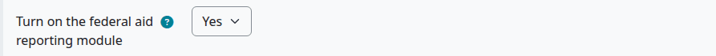

Check that:

- Federal aid is in the staff area, and people with the Financial Aid role have a Financial Aid group in the left menu.
- The School step of the wizard now also asks for the OPEID.

With the module off, the Federal aid page gives Moodle's message that you don't have permission, even to a site administrator. The account page shows no Financial aid section.

## Create the Financial Aid role

The Financial Aid role lets a person see and manage aid awards, record disbursements, and see the aid reports. It is separate from the Finance role. The plugin doesn't make it when it is installed. You create it with one button.

Who can do this: a site administrator, or a manager. It needs `local/studentrecords:viewaid` to open the page, and the Moodle capability `moodle/role:manage` for the button.

Before you start:

- The module is on.

1. Open the Federal aid page: Student Records staff area > Federal aid.
2. Go to the section Financial Aid (Student Records) at the bottom of the page.
3. Select "Create the Financial Aid role".

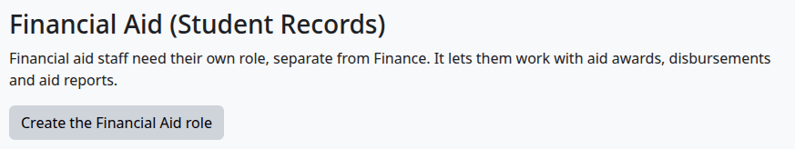

Check that:

- The page says "The Financial Aid role was created. Now give it to your financial aid staff."
- The section says "The Financial Aid role exists."

Then give the role to your staff:

1. In the same section, select "Give people the Financial Aid role". Moodle's Assign roles page opens. This needs `moodle/role:assign`.
2. In Potential users, select the person.
3. Select "Add".

The role is "Financial Aid (Student Records)", with the short name `srfinaid`. You can give it at system level only, and it has two capabilities:

| Capability | What it allows |
|---|---|
| `local/studentrecords:viewaid` | See aid awards and aid reports |
| `local/studentrecords:manageaid` | Manage aid awards, and record and reverse aid disbursements |

A person with only this role can't open the student account or the student's academic file. Everything they need is on the Federal aid page. The Manager role has these capabilities too.

## Aid home

The Financial Aid group in the left menu has these items:

| Menu item | Opens |
|---|---|
| Aid home | The page below |
| Student awards | [Find a student](#find-a-student) |
| Disbursements | [The disbursement run](#run-disbursements-for-a-term) |
| Return of aid | [The Return of aid list](aid-helpers.md#open-a-worksheet) |
| Verification | [Verification](#verification) |
| Reports | [Aid recipients](#aid-reports), with tabs for the other reports |

The menu item Disbursements opens the tab Disbursement run. The tab named Disbursements is a report. The menu shows the note "Shown because federal aid is turned on in Setup."

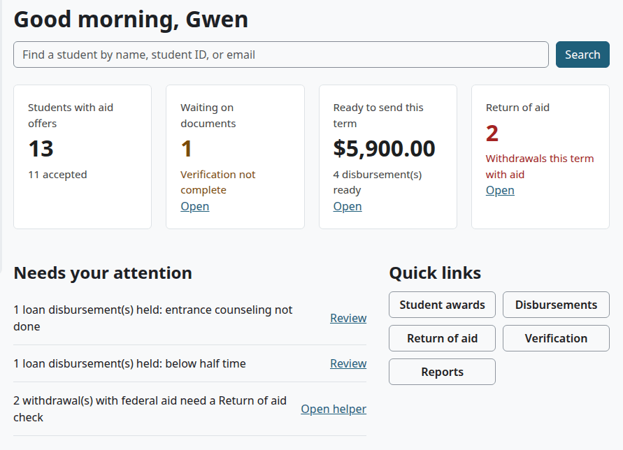

| Tile | What it shows |
|---|---|
| Students with aid offers | Students with an award in the current award year, and how many have an accepted one |
| Waiting on documents | Students selected for verification in the current award year. "Open" goes to Verification. |
| Ready to send this term | What the run of the current term would send. "Open" goes to the run. |
| Return of aid | Withdrawals this term with aid paid out. "Open" goes to the Return of aid list. |

Needs your attention lists loans held for counseling or for being below half time, and withdrawals that need a Return of aid check. When students in the current term aren't meeting academic progress, it says so too.

> Known problem in 1.4.6: the line about students not meeting academic progress links to the Standing page, which the Financial Aid role can't open. Ask the Registrar about those students.

The search box says it finds a student by name, student ID or email. It looks in the student ID and the legal first and last names, not in email.

## Find a student

Who can do this: financial aid staff and managers. It needs `local/studentrecords:viewaid`.

1. Select Student awards in the left menu. The page is Federal aid, on the tab Students.
2. To narrow the list, type part of a name or a student ID, then select "Search".
3. Select the student's name.

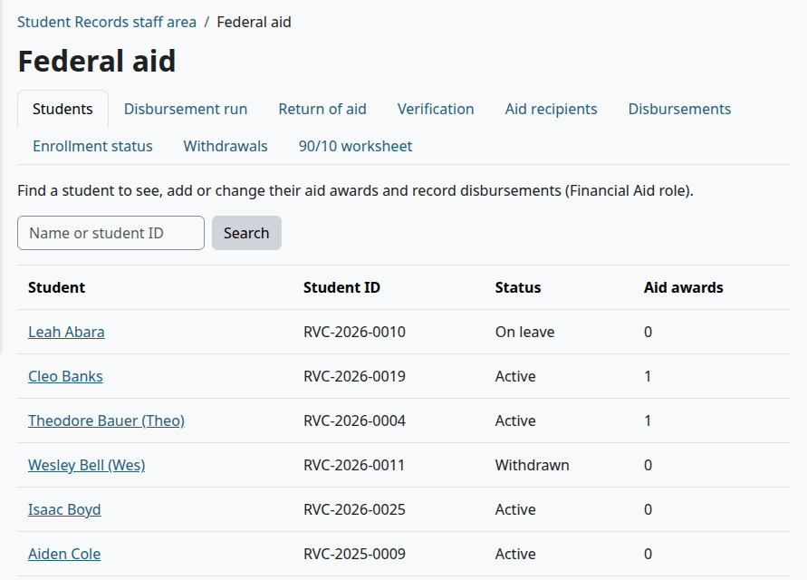

The list shows at most 200 students. The box looks in the student ID and the legal first and last names. A preferred name isn't searched.

## Read a student's aid page

Who can do this: financial aid staff and managers. It needs `local/studentrecords:viewaid`. The buttons and links that change anything need `local/studentrecords:manageaid`.

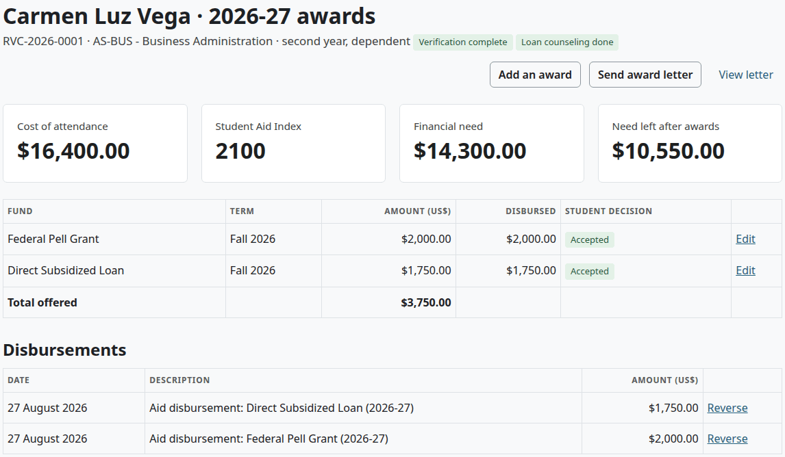

The heading has the student's name and the award year. An award year runs from July 1 to June 30, and is written like 2026-27. The page shows the current award year and has no year picker. To see another year, add `&awardyear=2025-26` to the page's address.

The line under the heading has the student ID, the program, the grade level, the dependency, a tag for verification and a tag for loan counseling.

| Tile | What it shows |
|---|---|
| Cost of attendance | From the aid year details |
| Student Aid Index | From the aid year details |
| Financial need | Cost of attendance less the Student Aid Index, never below 0. A Student Aid Index below 0 counts as 0. |
| Need left after awards | Financial need less the awards that are Offered or Accepted. When awards go over need, the tile turns red and says by how much. This stops nothing. |

The tiles show a dash until the details are saved.

The table lists the awards of this year:

| Column | What it shows |
|---|---|
| Fund | The fund |
| Term | The term of the award |
| Amount (US$) | The award |
| Disbursed | What is on the student's account, less reversals |
| Student decision | Offered, Accepted, Declined or Cancelled |
| Last column | "Edit", and "Record a disbursement" when the award can be disbursed |

The row Total offered adds up Offered and Accepted awards. Under the table, Disbursements lists each disbursement, reversal and return of aid of this award year.

Loan notes may show above the table. See [The loan check](aid-helpers.md#the-loan-check).

## Enter aid year details

Each student has one set of details for each award year. They come from your aid software.

Who can do this: financial aid staff and managers. It needs `local/studentrecords:manageaid`.

1. [Open the student's aid page](#find-a-student).
2. Open "Aid year details" at the bottom of the page. It is open already when nothing is saved yet.
3. Fill in the fields.
4. Select "Save changes".

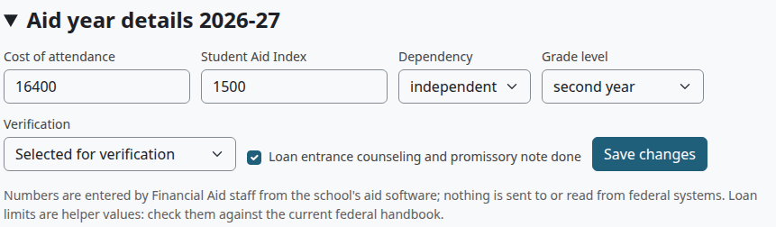

| Field | What to enter | Default | What uses it |
|---|---|---|---|
| Cost of attendance | An amount | Empty | Financial need, and the award letter |
| Student Aid Index | An amount. It can start with a minus sign. | Empty | Financial need |
| Dependency | dependent or independent | dependent | The loan check |
| Grade level | first year, second year, or third year and up | first year | The loan check |
| Verification | Not selected for verification, Selected for verification, or Verification complete | Not selected for verification | Selected holds the student's disbursements in a run |
| Loan entrance counseling and promissory note done | Tick when done | Not ticked | Not ticked holds the student's loans in a run |

Check that:

- The page says "Saved."
- The tiles and the tags under the heading show the new details.

The page says: "Numbers are entered by Financial Aid staff from the school's aid software; nothing is sent to or read from federal systems. Loan limits are helper values: check them against the current federal handbook."

## Add an award

Who can do this: financial aid staff and managers. It needs `local/studentrecords:manageaid`.

1. [Open the student's aid page](#find-a-student).
2. Select "Add an award". The form's heading says "Add an aid award".
3. Fill in the form. The tables below say what each field does.
4. Select "Save changes".

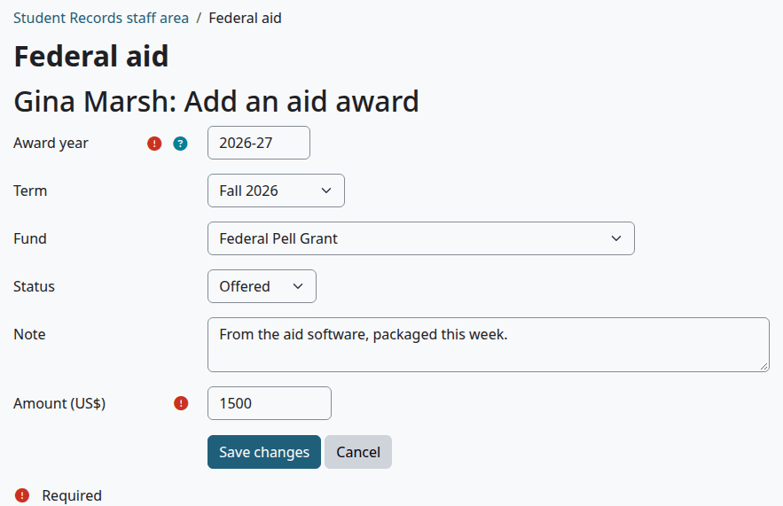

| Field | What to enter | Default |
|---|---|---|
| Award year | Written like 2026-27 (July 1, 2026 to June 30, 2027). You type it each time. Needed. | Empty |
| Term | The term of the award. Needed for every federal fund, because federal aid is counted by term. | None |
| Fund | One of the funds below | Federal Pell Grant |
| Status | Offered, Accepted, Declined or Cancelled | Offered |
| Note | For staff | Empty |
| Amount (US$) | The award. Needed. | Empty |

The fund decides how a disbursement shows on the student's account:

| Fund | Federal | Line on the account |
|---|---|---|
| Federal Pell Grant | Yes | Credit (Federal grant) |
| Federal SEOG | Yes | Credit (Federal grant) |
| Federal Work-Study | Yes | None. It is paid by payroll, so it can't be disbursed here. |
| Direct Subsidized Loan | Yes | Credit (Federal loan) |
| Direct Unsubsidized Loan | Yes | Credit (Federal loan) |
| Direct PLUS Loan | Yes | Credit (Federal loan) |
| Other Title IV grant (TEACH, Iraq and Afghanistan Service) | Yes | Credit (Federal grant) |
| State aid | No | Credit (Grant) |
| Institutional aid | No | Credit (Grant) |
| Private scholarship or loan | No | Credit (Scholarship) |

Check that:

- The page says "Saved."
- The award is in the table, and the tiles and the loan notes follow it.

What can go wrong:

- "Write the award year like 2026-27." The year is written in another format.
- "Choose a term. Federal aid is counted by term." Pick a term. Aid with no term on it isn't counted on any worksheet.

> Known problem in 1.4.6: after you save an award for another award year, the page goes back to the current one, so the award isn't in the table. To see it, open that year as [Read a student's aid page](#read-a-students-aid-page) says.

## Change an award

Use this to record the student's decision, or to correct an award. Students can't accept or decline online. Staff record what the student says.

Who can do this: financial aid staff and managers. It needs `local/studentrecords:manageaid`.

1. [Open the student's aid page](#find-a-student).
2. Select "Edit" on the row of the award.
3. Change the fields. To record a decision, set "Status" to Accepted or Declined.
4. Select "Save changes".

Check that:

- The tag under Student decision shows the new status.
- An accepted award that can be disbursed now has the link "Record a disbursement".

Nothing stops you from lowering an award below what is already disbursed. Reverse the extra money first.

## Record a disbursement

This puts money from one award on the student's account. To send many at once, use [the run](#run-disbursements-for-a-term).

Who can do this: financial aid staff and managers. It needs `local/studentrecords:manageaid`.

Before you start:

- The award's status is Accepted.
- The fund isn't Federal Work-Study.
- The award has money left.

1. [Open the student's aid page](#find-a-student).
2. Select "Record a disbursement" on the row of the award.
3. In "Date", set the date of the disbursement. The default is today.
4. In "Amount (US$)", enter the amount. It can be part of what is left.
5. Select "Save changes".

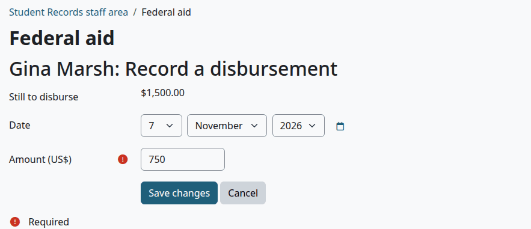

Check that:

- The page says "Saved."
- Disbursed in the table went up.
- Under Disbursements there is a line such as "Aid disbursement: Federal Pell Grant (2026-27)".

The money is a credit on the student's account. It lowers the balance, it counts toward a payment plan, and it can open a course that waits for payment.

This form doesn't check the reasons a run holds a line, such as verification or counseling. Only the run does.

What can go wrong:

- "Enter an amount above zero and not more than what is left to disburse ($1,500.00)." The amount is over what is left.

## Run disbursements for a term

The run looks at every accepted award of a term with money left. It shows which are ready and which are held, and it sends the ready ones.

Who can do this: financial aid staff and managers. Looking needs `local/studentrecords:viewaid`, and sending needs `local/studentrecords:manageaid`.

1. Select Disbursements in the left menu.
2. In "Term", choose the term, and select "Show".
3. Read the tags. Fix what holds a line, then show the term again.
4. Select the button that sends them, such as "Send 4 ready to student accounts ($5,900.00)".

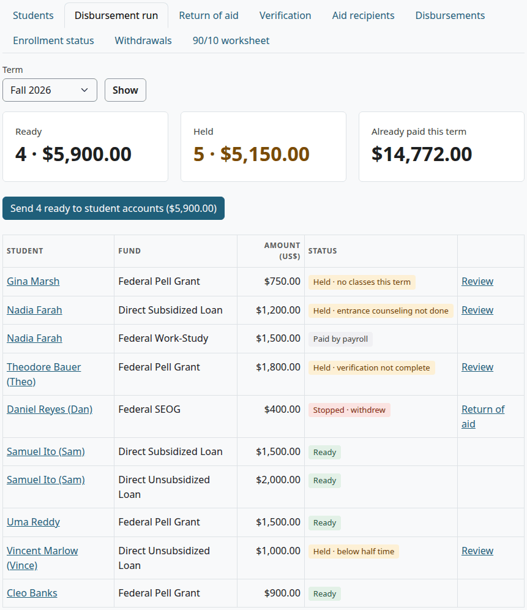

Check that:

- The page says how many disbursements went, and for how much.

- The lines you sent are gone from the list.

The tiles show the number and total of lines Ready and Held, and what is Already paid this term. Held counts the lines with Stopped · withdrew too. The page ends with the note "Sent funds post as credits on the student account. Held lines stay here until the reason is fixed (aid year details or enrollment)."

Each line has one or more tags:

| Tag | When | What to do |
|---|---|---|
| Ready | Nothing holds the line | Send it |
| Paid by payroll | Federal Work-Study | Nothing. It is never sent |
| Held · verification not complete | The aid year details say Selected for verification | Set Verification to Verification complete, when it is |
| Held · entrance counseling not done | A loan, and the counseling box isn't ticked | Tick it, when it is done |
| Held · below half time | A loan, and the student's hours in the term are below "Half-time credit hours per term (1098-T box 8)" | Enrollment has to change. The setting is in [Billing setup](billing-setup.md#change-the-billing-settings) |
| Held · no classes this term | The student has no hours in the term | Enrollment has to change |
| Stopped · withdrew | The student's status is Withdrawn | Open "Return of aid" on the row |

A withdrawn student gets only the last tag. A student with no classes gets only the tag for that. The others can come together. The link "Review" opens the student's aid page.

Hours in the term count classes that are registered or completed, not classes the student left.

> Known problem in 1.4.6: clock hours count the same as credit hours, so a loan of a student in a clock-hour program can miss the tag "Held · below half time". Check the enrollment of those students yourself.

A run sends all that is left of each ready award, dated today. To send part of an award, or to use another date, use [Record a disbursement](#record-a-disbursement). Running it twice sends nothing twice, because a line that was sent has nothing left.

## Verification

This page lists students selected for verification, and students without loan counseling, in the current award year.

Who can do this: financial aid staff and managers. It needs `local/studentrecords:viewaid`.

1. Select Verification in the left menu.
2. Select a student's name to open their aid page.
3. Change the details there. See [Enter aid year details](#enter-aid-year-details).

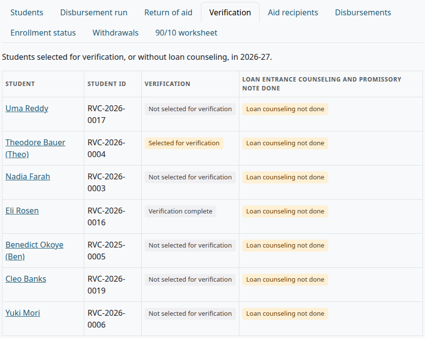

A student with no aid year details saved isn't listed, even with awards. A student with no loans still shows when the counseling box isn't ticked. The tile on Aid home counts only students selected for verification.

## Send an award letter

Who can do this: financial aid staff and managers. It needs `local/studentrecords:manageaid`.

Before you start:

- The student's awards for the year are in.

1. [Open the student's aid page](#find-a-student).
2. Select "Send award letter".
3. Read the notice at the top of the page.

The button sends the message "Financial aid award letter". It has no amounts in it. A notice says what happened:

| Notice | What it means |
|---|---|
| "Award letter message sent to the student (it links to the letter; amounts are not in the message)." | The message went |
| "The award letter message has not reached the student. The message log says:" and a status | It didn't go, for example because test mode kept it back or the message is switched off. See [Messages](messages.md). |

To see the letter, select "View letter". It opens the Financial aid award letter page, and "Printable version" gives the same page ready to print.

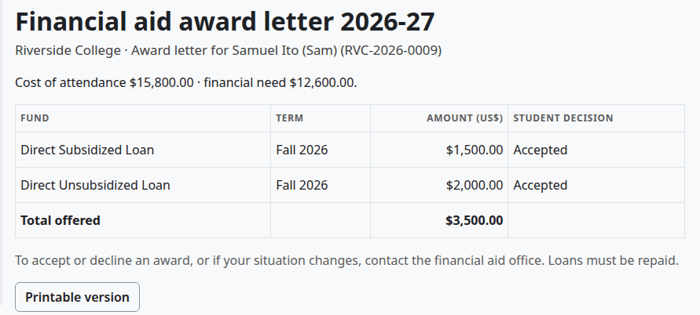

The letter has the school's name, the student's name and ID, the cost of attendance and financial need when they are saved, every award that isn't cancelled, and the total offered. Declined awards are listed and not added to the total. It ends with "To accept or decline an award, or if your situation changes, contact the financial aid office. Loans must be repaid."

Staff with `local/studentrecords:viewaid` can open the letter. The student can open their own.

> Known problem in 1.4.6: the message tells the student to log in to see the letter and to accept or decline their awards. It links to the student's account, not the letter. No page links a student to the letter, and students can't accept or decline online. Tell students how your office takes their decision, and print or send them the letter. You can reword the message. See [Messages](messages.md).

## Reverse a disbursement

Use this for an aid line added by mistake. The line stays, and a new line cancels it. The award then has that money to disburse again.

Who can do this: financial aid staff and managers. It needs `local/studentrecords:manageaid`.

1. [Open the student's aid page](#find-a-student).
2. Under Disbursements, select "Reverse" on the line.
3. In "Reason", say why.
4. Select "Reverse".

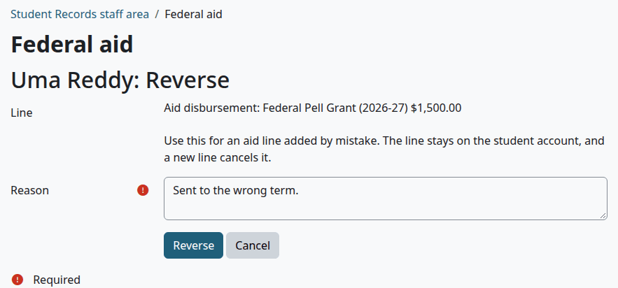

Check that:

- The page says "Saved."
- The line has the tag Reversed, and a new line says "Reversal of line" with the opposite amount.
- Disbursed in the awards table went down, and "Record a disbursement" is back.

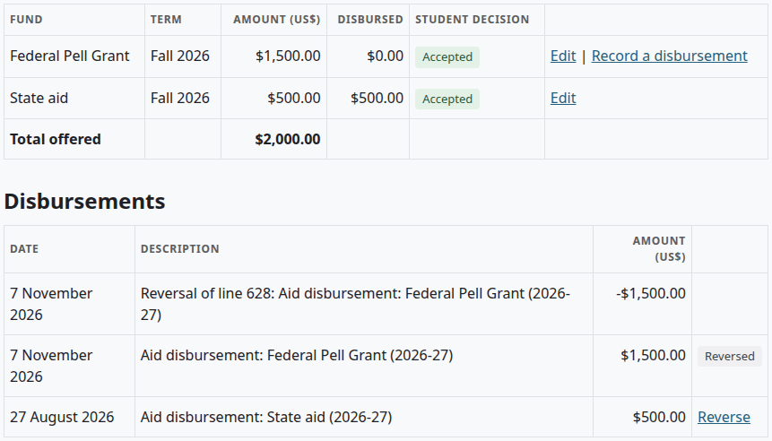

The same link reverses a "Federal aid returned" charge that Finance approved on a [return of aid](refunds.md#approve-a-return-of-aid).

The Finance role can't reverse an aid line, because that needs `local/studentrecords:manageaid`. A person with both capabilities can also do it from the student's account.

## Aid reports

Who can do this: financial aid staff and managers. It needs `local/studentrecords:viewaid`.

1. Select Reports in the left menu, or select a tab on the Federal aid page.
2. Set the filter, and select "Show".
3. To save the report, choose a format under the table, and select "Download".

You can download five of the tabs. The file is named `studentrecords_aid_`, the report, and today's date, and each download goes in the audit log. Disbursement run, Return of aid, Verification and Students have no download.

### Aid recipients

Students with aid awards in an award year, with the amount awarded and disbursed. Every status is listed.

Filter: "Award year". The default is the current one.

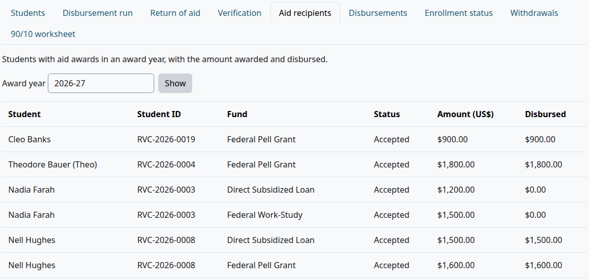

Columns: Student, Student ID, Fund, Status, Amount (US$), Disbursed.

### Disbursements

Aid put on student accounts between two dates, by fund. Reversals count back, as negative amounts.

Filters: "From" and "To". The default is July 1 to June 30 of the current award year.

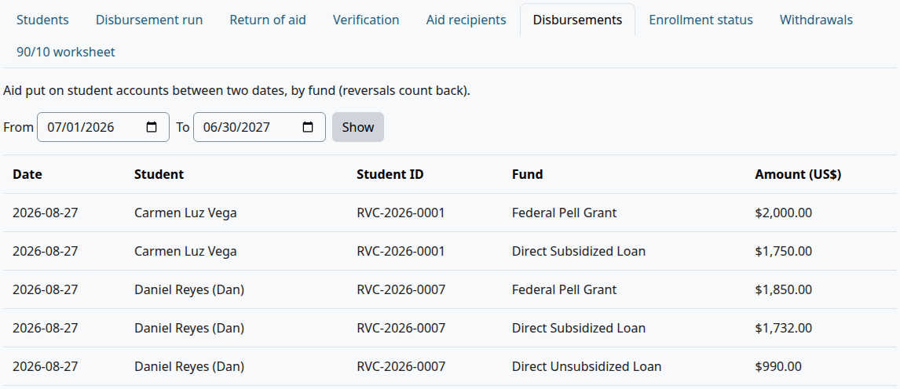

Columns: Date, Student, Student ID, Fund, Amount (US$).

### Enrollment status

The status in a term of students with accepted federal aid for that term.

Filter: the term. The report is empty until you choose one.

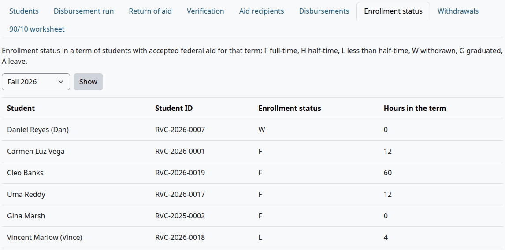

Columns: Student, Student ID, Enrollment status, Hours in the term.

| Letter | Means | When, checked in this order |
|---|---|---|
| G | Graduated | The status is Graduated, or an award date is on or before the end of the term |
| A | Leave | The status is On leave |
| W | Withdrawn | The status is Withdrawn, or every class of the term ended |
| F | Full-time | The load on the student's file is full time, or the hours reach "Full-time credit hours per term (Clearinghouse)" |
| H | Half-time | The hours reach "Half-time credit hours per term (1098-T box 8)" |
| L | Less than half-time | Anything else |

The hours add up every registered or completed class.

> Known problem in 1.4.6: clock hours count too, and are compared with the two credit hour settings. So a student in a clock-hour program can show F or H from clock hours. Check those students yourself.

### Withdrawals

Students with accepted federal aid for a term who withdrew: their status is Withdrawn, or every class of the term ended.

Filter: the term. The report is empty until you choose one.

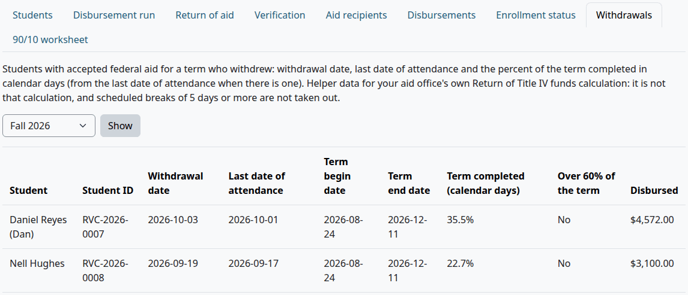

Columns: Student, Student ID, Withdrawal date, Last date of attendance, Term begin date, Term end date, Term completed (calendar days), Over 60% of the term, Disbursed.

The page says this is helper data for your aid office's own calculation, and that scheduled breaks of 5 days or more aren't taken out. The percent comes from the day the student left the term, as the worksheet finds it, so it can use a different day from the Withdrawal date column. See [The day the student left](aid-helpers.md#the-day-the-student-left).

### 90/10 worksheet

For proprietary schools: federal aid cash credited to student accounts, and all cash received for tuition and fees, with the percent. The page says this is a worksheet for your auditor, not the official 90/10 calculation.

Filters: "From" and "To". Set them to your fiscal year. The default is July 1 to June 30 of the current award year.

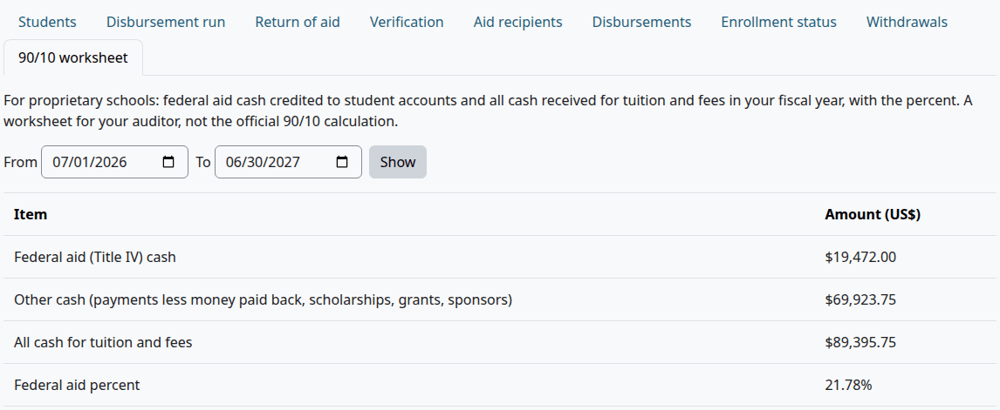

| Row | How the code works it out |
|---|---|
| Federal aid (Title IV) cash | Credits of the kinds Federal grant and Federal loan dated in the range, less reversals |
| Other cash (payments less money paid back, scholarships, grants, sponsors) | Payments, less money paid back, plus credits of the kinds Scholarship, Grant and Sponsor or employer |
| All cash for tuition and fees | The sum of the two rows above |
| Federal aid percent | The first row as a percent of the third |

Waivers, discounts and adjustments aren't cash, so they don't count.

## Related pages

- [Financial aid guide](financial-aid.md)
- [Aid helpers](aid-helpers.md)
- [Refunds](refunds.md#approve-a-return-of-aid)
- [Student accounts](student-accounts.md)
- [Messages](messages.md)
- [Setup wizard](setup-wizard.md)
