# FERPA and letters

This page covers the FERPA tools of Student Records: the annual notice and its acknowledgments, withholding directory information, release authorizations and enrollment verification letters. It is for the Registrar and other records staff, and it says what a student does. It explains how the tools work and gives no legal advice: your school decides what its policy is.

## Contents

- [The FERPA annual notice](#the-ferpa-annual-notice)
- [Acknowledge the notice](#acknowledge-the-notice)
- [Record a paper acknowledgment](#record-a-paper-acknowledgment)
- [Withhold directory information](#withhold-directory-information)
- [Add a release authorization](#add-a-release-authorization)
- [Revoke a release authorization](#revoke-a-release-authorization)
- [Read the release check](#read-the-release-check)
- [Issue an enrollment verification letter](#issue-an-enrollment-verification-letter)
- [Related pages](#related-pages)

## The FERPA annual notice

The school writes its own notice in "FERPA annual notice" on the Approvals step of the [setup wizard](setup-wizard.md). The plugin has no default text. With the box empty, students get no prompt and no button.

Each student acknowledges the notice once per academic year. "Academic year starts (month and day)" on the Calendar step sets when a year begins. With nothing set, it is July 1. On that day, every student's acknowledgment for the new year is open again.

## Acknowledge the notice

Who can do this: students, on their own record.

Before you start:

- The school has entered its notice.

1. In the Student Records menu, select "My academic record".
2. Open "My details". The prompt is under the table of facts and the documents.
3. Select "Please read the FERPA annual notice 2026-2027."
4. Read the notice.
5. Select "I have read this notice".

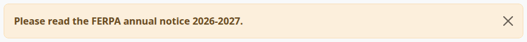

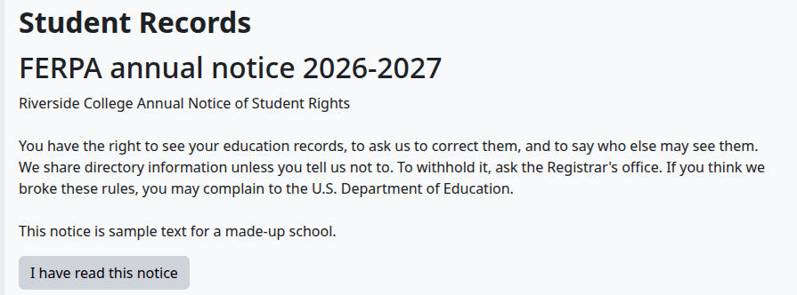

Check that:

- The page says "Thank you; your acknowledgment is saved."
- The prompt is gone. On the notice page, the button is replaced by "You acknowledged this notice on" and the date.

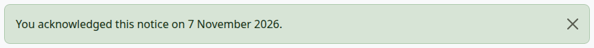

## Record a paper acknowledgment

Who can do this: records and admissions staff. It needs `local/studentrecords:managestudents` at system level.

Use this when a student signs the notice on paper.

1. Open the file, on the Privacy tab.
2. Select "Record paper acknowledgment". The button shows only while this year's notice isn't acknowledged.
3. Set "Date signed". The academic year is filled in for you.
4. Select "Record paper acknowledgment".

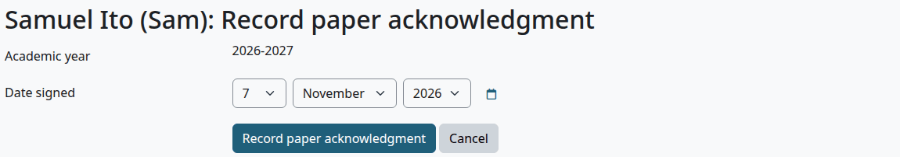

Check that:

- The Privacy tab says, for example, "Notice 2026-2027: acknowledged 7 November 2026 (paper, recorded by staff)".
- The release check says the notice is acknowledged.

An acknowledgment can't be changed or removed on any page. Each year has one.

## Withhold directory information

Who can do this: records and admissions staff. It needs `local/studentrecords:managestudents` at system level. A student can't set it: they ask the Registrar's office.

1. Open the file and select "Edit profile".
2. Under Privacy, tick "Withhold directory information (FERPA)".
3. Select "Save changes".

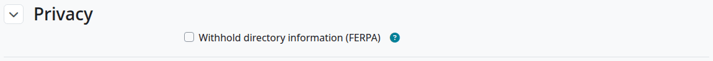

Check that:

- The file's header has the tag "Privacy (FERPA) block".
- The release check is yellow and says "Directory information WITHHELD (FERPA opt-out)."

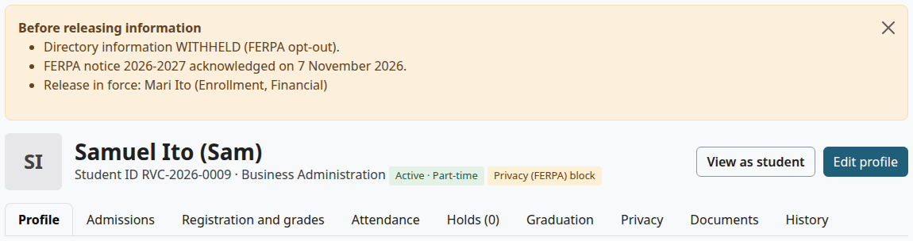

What it hides: preferred name, date of birth, email, phone, both addresses and home country. It hides them from anyone who doesn't manage students and isn't the student. Teachers see "Withheld (FERPA)", as [What a teacher sees](student-file.md#what-a-teacher-sees) shows. Staff who manage students still see everything, and the release check and the tag remind them.

The list of student records doesn't find such a student by preferred name for those people. Attendance sheets and other lists use the legal name for them.

## Add a release authorization

Who can do this: records and admissions staff. It needs `local/studentrecords:managestudents` at system level.

A release authorization records that the student agreed to let someone receive information.

1. Open the file, on the Privacy tab.
2. Select "Add release authorization".
3. Fill in the form.
4. Select "Add release authorization".

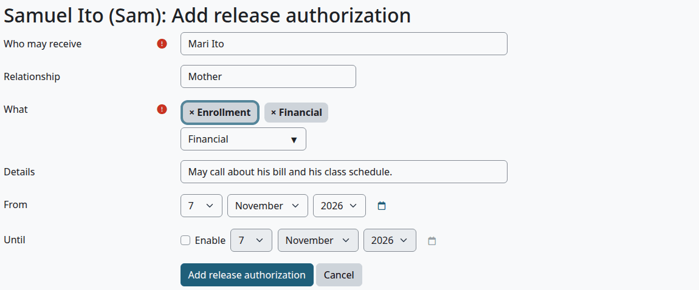

| Field | What it does |
|---|---|
| Who may receive | Required. A person or an organization |
| Relationship | Free text |
| What | Required. One or more of Enrollment, Grades and transcripts, Financial, Conduct, All education records |
| Details | Free text |
| From | Today by default |
| Until | Optional. Tick Enable to set it. With no date, it has no end |

> Known problem in 1.4.6: the authorization stops being in force when its Until day starts, so the day before is the last day it covers. To cover a day, set Until to the day after it.

Check that:

- The Privacy tab lists it, and the release check says "Release in force", with the name and what it covers.

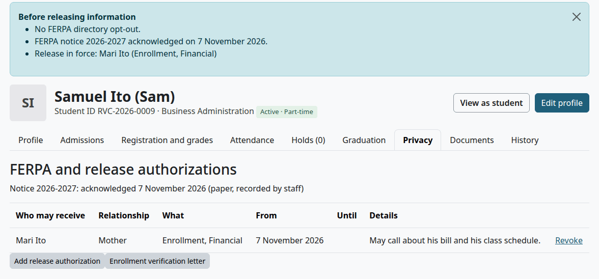

The plugin only records the authorization. It changes no access: the person gets no account, and staff still decide what to release.

## Revoke a release authorization

Who can do this: records and admissions staff. It needs `local/studentrecords:managestudents` at system level.

1. Open the file, on the Privacy tab.
2. Select "Revoke" on the row.
3. Select "Continue".

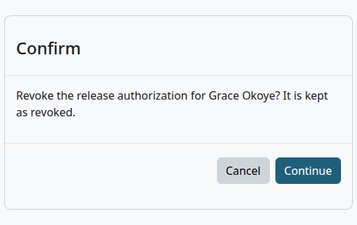

Check that:

- The row stays, with the date and the name of the person who revoked it.
- The release check no longer lists it.

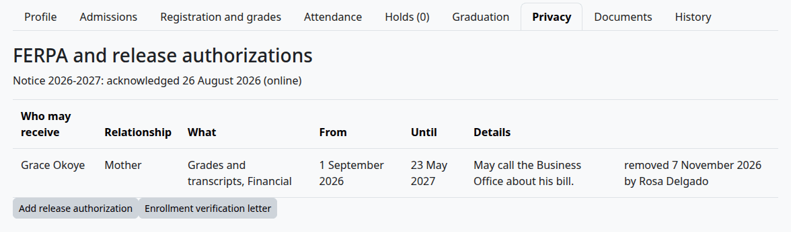

## Read the release check

Staff who manage students see the box "Before releasing information" on every tab of the file and on the letter page. It sums up what the record says, so read it before you tell anyone about a student.

| Line | What it means |
|---|---|
| "No FERPA directory opt-out." | The student hasn't withheld directory information |
| "Directory information WITHHELD (FERPA opt-out)." | The student has. The box is yellow |
| "FERPA notice 2026-2027 acknowledged on 26 August 2026." | The student acknowledged this year's notice |
| "FERPA notice 2026-2027 not acknowledged yet." | The student hasn't |
| "Release in force: Grace Okoye (Grades and transcripts, Financial)" | One line for each authorization in force today |
| "No release authorization in force: release information only to the student, or as FERPA allows without consent." | There is none |

## Issue an enrollment verification letter

Who can do this: records and admissions staff. It needs `local/studentrecords:managestudents` at system level.

1. Open the file, on the Privacy tab.
2. Select "Enrollment verification letter".
3. Read "Before releasing information" and "What the letter will show".
4. In "Addressed to", type the person or organization. Leave it empty for "To whom it may concern:".
5. Select "Issue letter".
6. In the green notice, select "Download PDF".

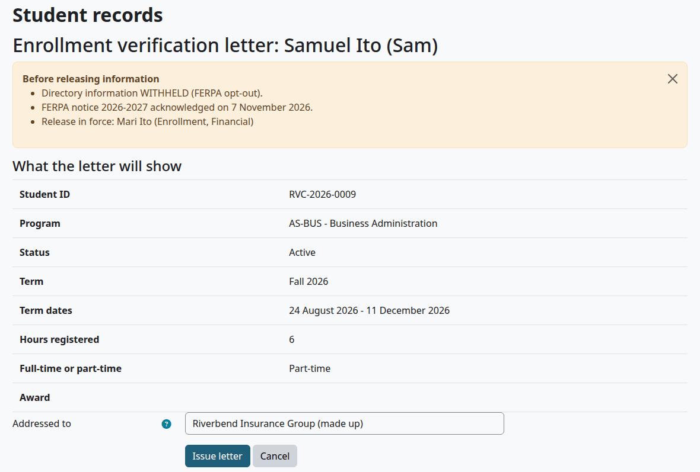

The letter shows the term running today. With none, it shows the next term the student is registered in, and otherwise the last one.

Check that:

- The file says "Letter issued (kept on the record and in the audit log)."
- The letter is under "Letters issued" on the Privacy tab, with its number, date, recipient and who issued it. The number looks like L2026-00003.

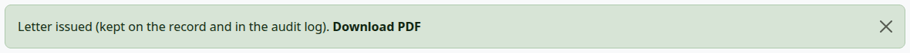

The PDF has the school's logo and address, the date and letter number, the student's details and the Registrar's name. The Registrar's name and title come from the School step of the setup wizard. It has a line to sign by hand.

> Known problem in 1.4.6: the PDF has three rows that "What the letter will show" leaves out: Date of birth, Credential and Admit term. It prints the date of birth even when the student withheld directory information.

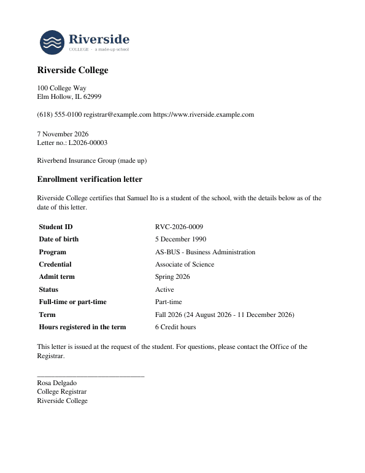

A letter keeps the facts of the day it was issued. Later changes to the record don't change it, and downloading it again gives the same letter. A letter can't be withdrawn. Each download is logged.

## Related pages

- [The student file](student-file.md)
- [Registrar's guide](registrar.md)
- [The student's guide](student.md)
- [Setup wizard](setup-wizard.md)
- [Privacy and uninstall](privacy-and-uninstall.md)
