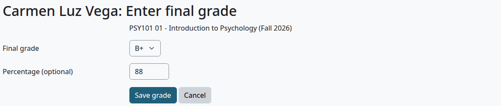
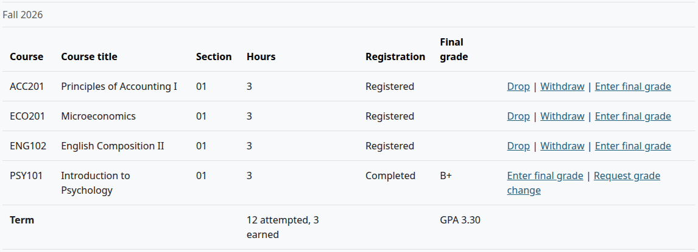
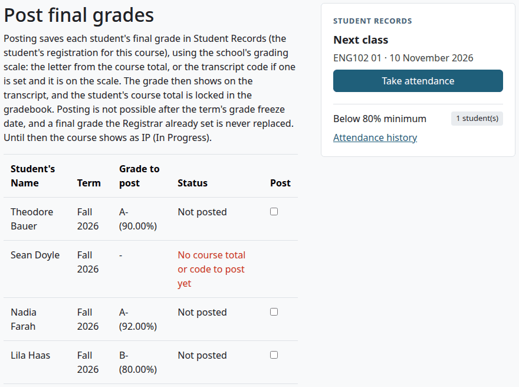
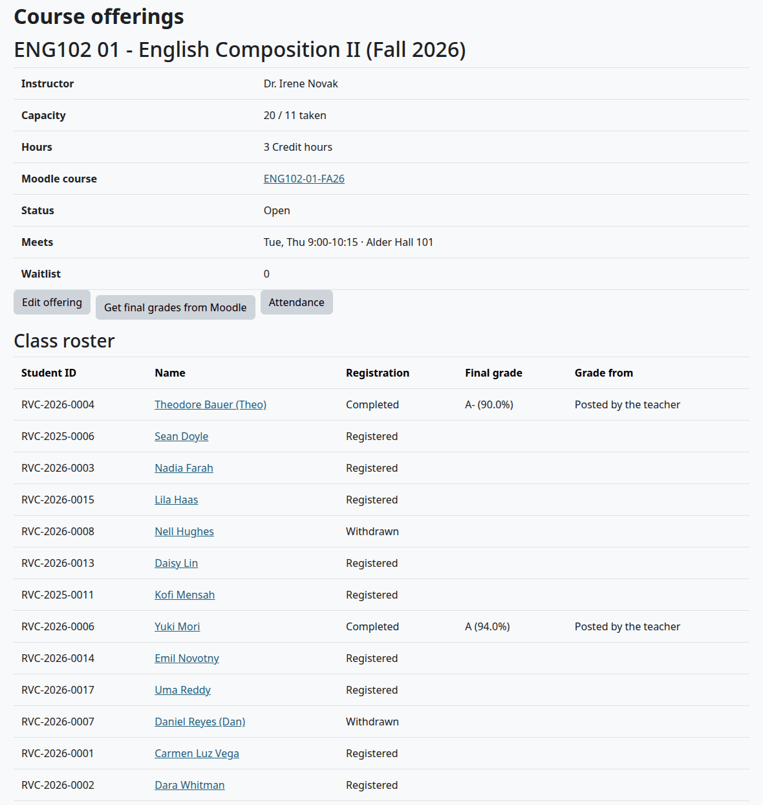
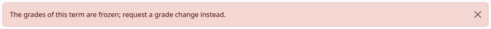
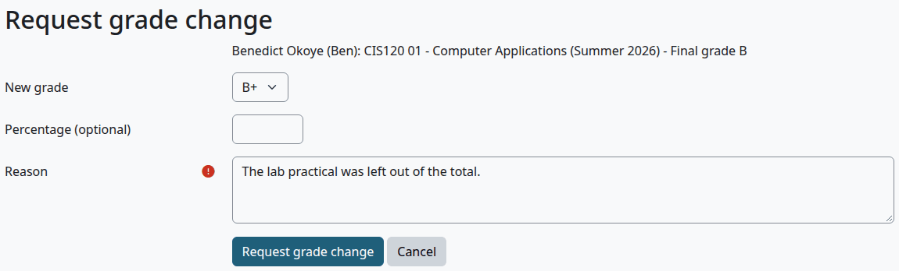
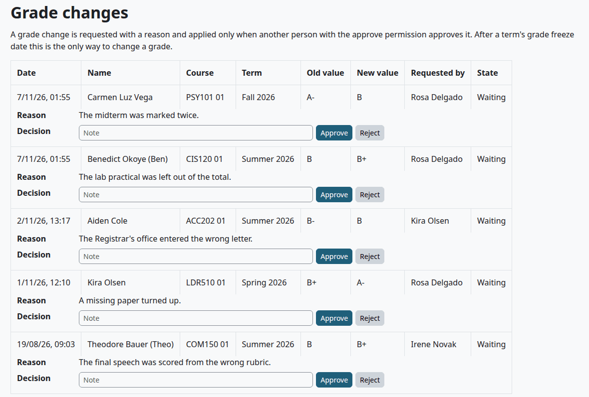
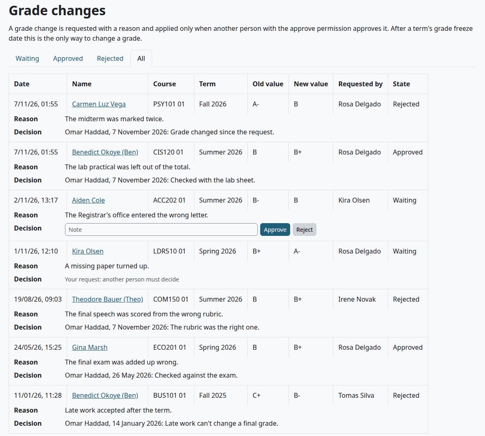
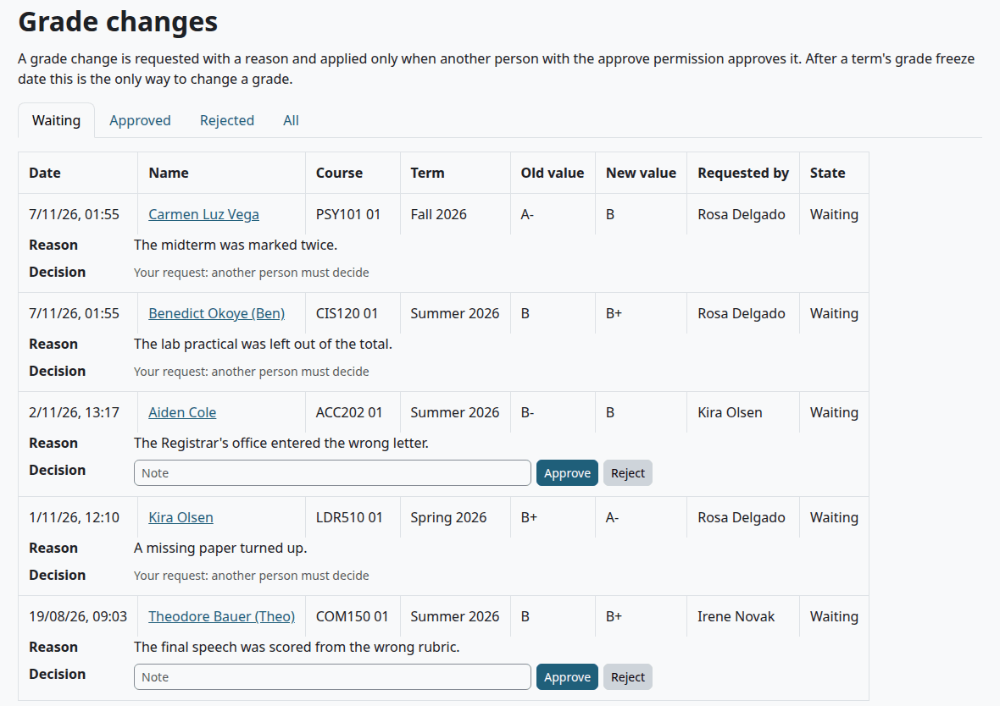
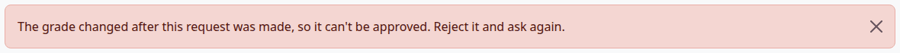

# Final grades

This page shows how a final grade gets on a student's record, what it does there, when grades freeze and how a grade changes afterwards. It is for the Registrar, for the person who approves grade changes, and for teachers who post grades.

## Contents

- [Three ways a grade comes in](#three-ways-a-grade-comes-in)
- [Enter a final grade by hand](#enter-a-final-grade-by-hand)
- [Get final grades from Moodle](#get-final-grades-from-moodle)
- [Grades posted by teachers](#grades-posted-by-teachers)
- [What a final grade does](#what-a-final-grade-does)
- [The grade freeze](#the-grade-freeze)
- [Request a grade change](#request-a-grade-change)
- [Approve or reject a grade change](#approve-or-reject-a-grade-change)
- [Related pages](#related-pages)

## Three ways a grade comes in

| Way | Who does it | "Grade from" on the roster | What it needs |
|---|---|---|---|
| By hand, on the student's file | Records staff | Entered by staff | `local/studentrecords:managestudents` |
| From the Moodle gradebook, for a whole section | Records staff who can open Course offerings | Moodle gradebook | `local/studentrecords:configure`, `local/studentrecords:managestudents`, a linked Moodle course and course totals |
| From the teacher, with Post final grades | Teachers | Posted by the teacher | Academic Transcript installed, with Student Records as its source, and a linked Moodle course |

A fourth source, Grade change, is an [approved grade change](#approve-or-reject-a-grade-change).

A grade from staff outranks one from a teacher, and a grade from a teacher outranks one from the gradebook. This table says what happens when a grade comes in on top of another:

| What comes in | A grade from the gradebook | A grade posted by a teacher | A grade entered by staff or from a grade change |
|---|---|---|---|
| Staff, by hand | Replaces it | Replaces it | Replaces it |
| The gradebook | Replaces it | Keeps the teacher's grade | Keeps the staff grade |
| A teacher | Replaces it | Refused: already posted | Refused: the Registrar's grade is kept |

Nobody can enter or post their own grade, but "Get final grades from Moodle" fills a staff member's own grade from the gradebook like any other. After the [freeze](#the-grade-freeze), only an approved grade change writes a grade.

A section with no linked Moodle course can get grades only from staff. Without Academic Transcript, a teacher has no way to enter a final grade in Student Records.

## Enter a final grade by hand

Who can do this: records staff. It needs `local/studentrecords:managestudents` at system level. Nobody can do this on their own record.

Before you start:

- The course is Registered or Completed on the student's file.
- The term's grades aren't frozen.

1. Open the file, on the Registration and grades tab.
2. On the course's row, select "Enter final grade".
3. In Final grade, choose the grade. The list has the letters of the grading scale, best first, then the marks.
4. Optional: in "Percentage (optional)", type the percentage, from 0 to 100. It doesn't change the grade you chose.
5. Select "Save grade".

Check that:

- The file opens with "Saved."
- The course shows Completed and the grade.
- The term's totals and the cumulative GPA have moved.

To correct a grade before the freeze, select "Enter final grade" again and save the new grade. No request and no second person are needed. The plugin keeps the old value in its stored change history, which no page shows, and the student gets the message "Final grade posted" again.

What can go wrong:

- "This is your own grade, so another person must enter it. To change it, request a grade change."
- "The grades of this term are frozen; request a grade change instead."

## Get final grades from Moodle

Who can do this: records staff with both `local/studentrecords:configure` and `local/studentrecords:managestudents` at system level. Without `configure` you can't open Course offerings. A Registrar role made only of the capabilities that manage students needs it added.

On the section's page under Course offerings, "Get final grades from Moodle" reads the course totals of the linked Moodle course and gives each student a letter from the grading scale. [Get final grades from Moodle](course-offerings.md#get-final-grades-from-moodle) has the steps and what its counts mean. The page reads the gradebook and writes nothing to it.

Before you press it:

- It works at any time, even in the middle of a term. It gives a final grade to every student with a course total and completes the registration, and the student gets the message. Use it only when the term is over. If you pressed it too early, staff can correct each grade until the freeze, but the course stays Completed.
- It keeps grades from staff, from teachers and from approved grade changes. The count "entered by staff kept" counts all three, despite its wording.
- A student with an activity not graded yet can get a far lower letter than the gradebook shows. That page has the known problem, and what to do about it.
- Pressing it again sets the grades that came from the gradebook again, so a changed total replaces the old grade.
- After the freeze it says "The grades of this term are frozen; request a grade change instead."
- A section with no linked Moodle course has no button.

## Grades posted by teachers

Who can do this: teachers with `local/academictranscript:postgrades` in the course, when Academic Transcript is installed and its source is Student Records.

The teacher posts from the course, as [Post final grades](../academic-transcript/teacher-guide.md#post-final-grades) shows. With Student Records as the source, the grade goes on the student's registration, by the school's grading scale, and the Class roster says "Posted by the teacher".

A row can't be posted for these reasons:

| What the teacher sees | Why |
|---|---|
| "The Registrar already set this final grade in Student Records (B); it is not changed. Ask the Registrar for a grade change." | Staff or a grade change set it |
| "A teacher already posted a final grade (B) on this registration in Student Records. For a new attempt, ask the Registrar to register the student for this term." | It was posted before |
| "The grades of this term are frozen in Student Records (after 2026-12-25); ask the Registrar for a grade change." | The freeze has passed |
| "The student is not registered for this course in Student Records; ask the Registrar." | There is no registration for a section linked to this course |
| "The student has more than one open registration for this course in Student Records; ask the Registrar." | Two sections link to one course |
| "You can't post your own grade. Another teacher or an admin must post it." | The teacher is the student |
| "This grade is not on the school's grading scale in Student Records; ask the Registrar." | The scale has no such letter |

A student with no Student Records file is posted to Academic Transcript alone.

To change a posted grade, the teacher requests a change there, and the request lands on the [Grade changes](#approve-or-reject-a-grade-change) page.

## What a final grade does

- The registration becomes Completed. Its Drop and Withdraw links are gone: "Only a registered course can be dropped or withdrawn."
- Hours are earned if the grade passes, by the [pass rules](grading-and-levels.md). A grade under the rule shows "not passed".
- The grade counts in the GPA if the scale says so.
- The course counts toward prerequisites and the [degree audit](degree-audit-and-graduation.md).
- The student gets the message "Final grade posted" at the next cron run. It goes on any change of the row, even a new percentage with the same letter. The message never shows the grade: the student logs in to see it.
- With Academic Transcript, the transcript follows Student Records.

A W is a state, not a grade. It comes from [withdrawing](registration.md#drop-or-withdraw-a-student-from-a-course).

If a course is taken again, the repeat rule of Academic Transcript decides which attempts count. An attempt left out shows "Repeated: not counted". Without Academic Transcript, every attempt counts.

## The grade freeze

The freeze is a date on each term: Grade freeze on the [Terms](terms-and-calendar.md) page. After that day, the term's grades don't change except by an approved grade change. A term with no date never freezes.

| After the freeze | What happens |
|---|---|
| "Enter final grade" | The link is gone from the file. "Request grade change" stays |
| "Get final grades from Moodle" | "The grades of this term are frozen; request a grade change instead." |
| Post final grades | The teacher sees the frozen message above |
| An approved grade change | Applied |

## Request a grade change

Who can do this: records staff, with `local/studentrecords:managestudents` at system level. Teachers ask from Post final grades. Staff can ask on their own grade too, and another person decides.

Use this after the freeze, or when you want a second person on a change before it. It works only on a course with a final grade, and one request can wait on a course at a time.

1. Open the file, on the Registration and grades tab.
2. On the course's row, select "Request grade change".
3. Choose the New grade.
4. Optional: in "Percentage (optional)", type a number from 0 to 100.
5. Write the Reason. It is required.
6. Select "Request grade change".

The percentage goes with the new grade, and New grade alone sets the letter. Grade changes shows the percentage beside the new grade, and after approval the section's Class roster shows it too, such as "C- (71.5%)".

> Known problem in 1.4.6: if "Percentage (optional)" is empty, an approved change clears the old percentage of the course. A teacher's request from Academic Transcript never has one. Type the percentage when you ask. After such an approval, and before the grade freeze, you can [enter the final grade](#enter-a-final-grade-by-hand) again with its percentage.

Check that:

- The file says "Grade change requested; it is applied when another person approves it."
- The grade hasn't changed yet.
- Grade changes has the request under Waiting.

The approver gets no message. The Staff home shows "1 grade change(s) waiting for sign-off" to records staff, and the approver has to look at the page.

What can go wrong:

- "Choose a different grade." The new grade is the same as the old one.
- "Enter a percentage from 0 to 100." The number is out of range, or it isn't a number.
- "There is already a grade change waiting for this course."
- "Only a completed course with a final grade can have a grade change."

## Approve or reject a grade change

Who can do this: a person with `local/studentrecords:approvegradechange` at system level, who didn't ask for this change and isn't the student.

1. In the Student Records menu, select "Grade changes". For a person with only this capability it is the only item in the menu.
2. Read the old and new grade and the reason.
3. Optional: write a note in Note.
4. Select "Approve" or "Reject".

Check that:

- The page says "Grade change approved and applied." or "Grade change rejected."
- After an approval, the file shows the new grade, and the roster says "Grade change".

An approval works after the freeze, and the student gets the message "Final grade posted". The student gets no message for a rejection, and the person who asked gets none for either.

Staff who manage students also see the tabs Waiting, Approved, Rejected and All, with every request and who decided it. A person with only the approve capability sees only the waiting requests they can decide, with no link to the student's file.

Instead of the buttons, a row can say:

| What you see | Why |
|---|---|
| "Your request: another person must decide" | You asked for this change |
| "Your own grade: another person must decide" | The grade is yours |
| "Needs a person with the approve permission" | You manage students, and you don't hold the approve capability |

What can go wrong:

- "The grade changed after this request was made, so it can't be approved. Reject it and ask again." Someone corrected the grade by hand while the request waited. Reject it. Ask again if a change is still needed.

## Related pages

- [Registrar's guide](registrar.md)
- [Teacher's guide](teacher.md)
- [Registration](registration.md)
- [Grading and levels](grading-and-levels.md)
- [Terms and calendar](terms-and-calendar.md)
- [Post final grades in Academic Transcript](../academic-transcript/teacher-guide.md#post-final-grades)
