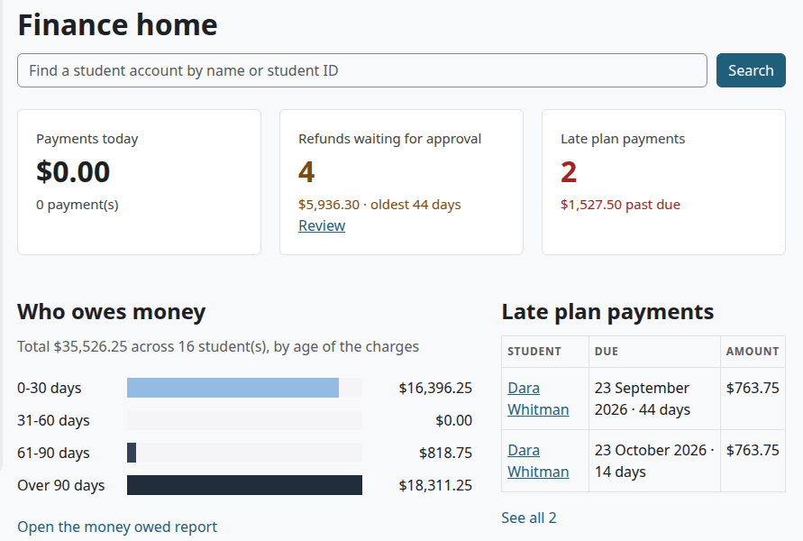

# Finance guide

This guide follows a finance officer's work from start to finish: setting up billing, working with accounts every day, plans, refunds and the year-end file. Each step links to the page that holds the fields and the details.

## Contents

- [Your role](#your-role)
- [Your pages](#your-pages)
- [Before the first term](#before-the-first-term)
- [When students register](#when-students-register)
- [Every day](#every-day)
- [When a student needs time to pay](#when-a-student-needs-time-to-pay)
- [When a student drops or withdraws](#when-a-student-drops-or-withdraws)
- [At the end of the month](#at-the-end-of-the-month)
- [At the end of the year](#at-the-end-of-the-year)
- [If your school has the federal aid module](#if-your-school-has-the-federal-aid-module)
- [What you need someone else for](#what-you-need-someone-else-for)
- [Related pages](#related-pages)

## Your role

You need the role Finance (Student Records). A site administrator [creates it and gives it to you](billing-setup.md#create-the-finance-role). It has three capabilities:

| You can | Capability |
|---|---|
| See student accounts and money reports | `local/studentrecords:viewbilling` |
| Manage accounts, prices, payments, payment plans and refund rules | `local/studentrecords:managebilling` |
| Approve or reject refunds, but never your own | `local/studentrecords:approverefund` |

This role doesn't open a student's academic file. You reach a student through their account. The Registrar and other records staff see a student's balance on the file, as view only, and they can't open the account unless they have this role too.

## Your pages

Select the Student Records tab. Finance home opens, and the left menu has a Finance group:

| Menu item | What it is |
|---|---|
| Finance home | Payments today, refunds waiting, late plan payments and who owes money. See [Finance home](money-reports.md#finance-home). |
| Student accounts | Every account. See [Find an account](student-accounts.md#find-an-account). |
| Payments | The report [Payments by day](money-reports.md#payments-by-day) |
| Payment plans | The report [Late plan payments](money-reports.md#late-plan-payments) |
| Refunds | The refunds that wait. See [Refunds](refunds.md#find-the-refunds-that-wait). |
| 1098-T | The [1098-T data](money-reports.md#1098-t) of a year |
| Reports | The report [Who owes money](money-reports.md#who-owes-money), with tabs for the others |
| Billing setup | Under Student Records setup. See [Billing setup](billing-setup.md). |
| All staff pages | Under Student Records setup. One list of the staff pages you can open: Billing, Refunds, Money reports and Billing setup. |

The Finance menu shows only with billing on. If you also have a student record, you land on My home, and Finance home is in the menu.

## Before the first term

Billing stays off until you turn it on. Work through [What to set up, and in what order](billing-setup.md#what-to-set-up-and-in-what-order):

1. [Add your prices](billing-setup.md#add-a-price), tuition first.
2. [Add your payment plans](billing-setup.md#add-a-payment-plan).
3. [Add your refund rules](billing-setup.md#add-a-refund-rule), with a last rule that fits any time.
4. Ask your administrator to [set up a payment account](online-payments.md#set-up-a-payment-account), then [choose it](online-payments.md#choose-the-account-in-billing-setup).
5. [Change the billing settings](billing-setup.md#change-the-billing-settings): course access, reminders, refund days, 1098-T settings, How to pay and Note on statements.
6. [Turn billing on](billing-setup.md#turn-billing-on-or-off).
7. If students are registered already, [add the missing charges](student-accounts.md#add-missing-charges-for-a-term) of each term.

## When students register

You do nothing here. A registration adds its charges by itself. See [How a registration is charged](billing-setup.md#how-a-registration-is-charged).

Under your course access rule, a student may wait for payment before they get into the Moodle course. They get in by themselves once the rule is met. To open a course sooner, use [Give course access now](student-accounts.md#give-course-access-now).

## Every day

1. Open Finance home, and read the tiles.
2. [Record the payments](student-accounts.md#record-a-payment) that came in by check, cash, card at the office or wire. Online payments [record themselves](online-payments.md#what-happens-after-a-payment).
3. [Add a charge](student-accounts.md#add-a-charge) or [add a credit](student-accounts.md#add-a-credit) when you need one.
4. Fix mistakes with [Reverse a line](student-accounts.md#reverse-a-line). To let a student off paying, add a credit instead.
5. [Print a receipt](student-accounts.md#print-a-receipt) or [a statement](student-accounts.md#print-a-statement) when someone asks.

## When a student needs time to pay

1. Check that the student has no active plan. A student has [one at a time](payment-plans.md#one-active-plan-at-a-time).
2. [Give a payment plan](payment-plans.md#give-a-payment-plan): one of your school's plans, or [a custom plan](payment-plans.md#give-a-custom-plan) with a note. Choose the term with care, and check the dates.
3. Leave the agreement ticked, so the student gets [the message](payment-plans.md#the-plan-agreement).
4. Record the down payment. Under the usual course access rule, the courses of the plan's term then open.

After that the plan runs by itself. The daily task [reminds the student](payment-plans.md#reminders), and [adds late fees and a hold](payment-plans.md#late-payments-late-fees-and-holds) when a payment is late. You get a message when a hold is placed. Check [Late plan payments](money-reports.md#late-plan-payments), and decide with the Registrar what happens next. Nothing drops a student by itself.

## When a student drops or withdraws

A refund comes up by itself. If you approve refunds, you get a message.

1. Open [the refunds that wait](refunds.md#find-the-refunds-that-wait), and select "Review".
2. Read [how it was worked out](refunds.md#how-a-refund-is-figured). If another date should count, [figure it again](refunds.md#figure-a-refund-again).
3. [Approve](refunds.md#approve-a-refund) or [reject](refunds.md#reject-a-refund) it. You can't decide a refund on your own account.
4. Pay the money back outside Moodle, by check, by bank transfer or on the payment company's site.
5. [Record money paid back](refunds.md#record-money-paid-back).

Keep an eye on the "Pay back by" dates. A refund that waits past its date shows Overdue.

## At the end of the month

1. Open [Who owes money](money-reports.md#who-owes-money).
2. Open [Payments by day](money-reports.md#payments-by-day), and set the dates. Compare it with your bank.
3. Open [Refunds](money-reports.md#refunds) and [Late plan payments](money-reports.md#late-plan-payments).
4. [Download](money-reports.md#download-a-report) what you need.

## At the end of the year

1. Check the price settings. Only charges marked "Counts for the 1098-T" count. See [Add a price](billing-setup.md#add-a-price).
2. Open [1098-T](money-reports.md#1098-t), choose the calendar year, and read the notice on the page.
3. Download the spreadsheet, and give it to your tax service. It adds the taxpayer IDs. Student Records stores none, and it sends nothing to the IRS.

Have your tax adviser check the amounts before filing. [How the boxes are worked out](money-reports.md#how-the-boxes-are-worked-out) says what the code does.

## If your school has the federal aid module

Financial Aid staff do the aid work. For you it shows up in three places:

- The account page has a Financial aid table to read, and disbursements arrive as credits. Your role has no Reverse link on an aid line.
- A disbursement lowers the balance, counts toward a plan, and can open a course.
- Financial Aid can send a Return of aid item to Refunds. See [Approve a return of aid](refunds.md#approve-a-return-of-aid). After you approve it, you send the money to the Department of Education outside Student Records.

## What you need someone else for

| You want to | Who does it |
|---|---|
| Create the Finance role, or give it to someone | A site administrator. See [Create the Finance role](billing-setup.md#create-the-finance-role). |
| Set up a Moodle payment account | A site administrator. See [Set up a payment account](online-payments.md#set-up-a-payment-account). |
| Release a billing hold | Someone with `local/studentrecords:managestudents`, such as the Registrar. See [Holds and standing](holds-and-standing.md). |
| Drop or withdraw a student | Someone with `local/studentrecords:managestudents`. See [Registration](registration.md). |
| Decide a refund on your own account | Another person who approves refunds |
| Reverse an aid line | Someone with `local/studentrecords:manageaid`. See [Reverse a disbursement](federal-aid.md#reverse-a-disbursement). |
| Change a message's wording | Someone who can open [Messages](messages.md) |
| Read the audit log | Someone with `local/studentrecords:viewlog`. See [Audit log](audit-log.md). |

## Related pages

- [Billing setup](billing-setup.md)
- [Student accounts](student-accounts.md)
- [Payment plans](payment-plans.md)
- [Refunds](refunds.md)
- [Online payments](online-payments.md)
- [Money reports](money-reports.md)
- [Roles and permissions](../roles-and-permissions.md)
- [Troubleshooting](../troubleshooting.md)
