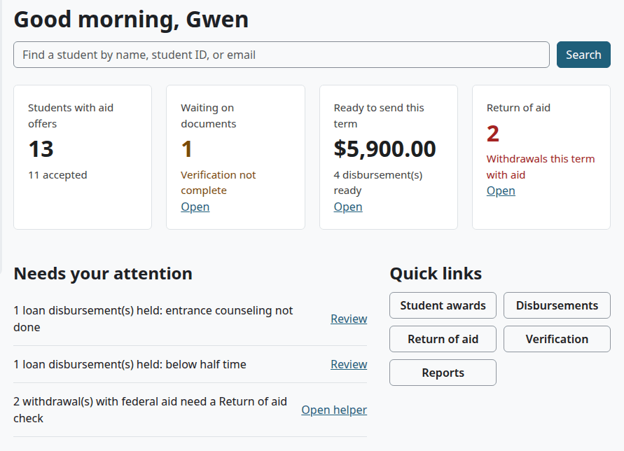

# Financial aid guide

This guide follows a financial aid officer's work, from the first award of the year to a student who withdraws. Each step links to the page that holds the fields and the details.

The federal aid module records what your aid software decided. It has no link to G5, COD, NSLDS or any other federal system. The loan check and the Return of aid worksheet are helpers: check their results against the official worksheet and the current Federal Student Aid Handbook. This guide gives no federal aid advice.

## Contents

- [Your role](#your-role)
- [Your pages](#your-pages)
- [Before the first award](#before-the-first-award)
- [For each student, each year](#for-each-student-each-year)
- [Paying aid out in a term](#paying-aid-out-in-a-term)
- [When something was wrong](#when-something-was-wrong)
- [When a student withdraws](#when-a-student-withdraws)
- [Reports](#reports)
- [What you need someone else for](#what-you-need-someone-else-for)
- [Related pages](#related-pages)

## Your role

You need the role Financial Aid (Student Records). A site administrator [creates it and gives it to you](federal-aid.md#create-the-financial-aid-role) once the module is on. It has two capabilities:

| You can | Capability |
|---|---|
| See aid awards and aid reports | `local/studentrecords:viewaid` |
| Manage awards, and record and reverse disbursements | `local/studentrecords:manageaid` |

This role is separate from Finance. It doesn't open the student account or the academic file. All your work is on the Federal aid page. The student's awards show on the account for Finance and the student to read.

## Your pages

Select the Student Records tab. Aid home opens, and the left menu has a Financial Aid group: Aid home, Student awards, Disbursements, Return of aid, Verification and Reports. See [Aid home](federal-aid.md#aid-home).

If you also have a student record, you land on My home, and Aid home is in the menu.

## Before the first award

Ask your administrator to check these:

1. [The module is on](federal-aid.md#turn-the-module-on).
2. "Full-time credit hours per term (Clearinghouse)" is set in the [Setup wizard](setup-wizard.md). The loan check and the Enrollment status report use it.
3. "Half-time credit hours per term (1098-T box 8)" and "Graduate levels (1098-T box 9)" are set in [Billing setup](billing-setup.md#change-the-billing-settings). The run, the loan check and the reports use them.
4. Terms and students are in place.

## For each student, each year

1. [Find the student](federal-aid.md#find-a-student).
2. [Enter the aid year details](federal-aid.md#enter-aid-year-details) from your aid software: cost of attendance, Student Aid Index, dependency, grade level, verification and counseling.
3. [Add each award](federal-aid.md#add-an-award). Type the award year each time, and choose the term.
4. Read the tiles and [the loan notes](aid-helpers.md#the-loan-check). They warn and stop nothing.
5. [Send the award letter](federal-aid.md#send-an-award-letter). Your office tells the student how to answer, because they can't accept online.
6. When the student decides, [change the award](federal-aid.md#change-an-award) to Accepted or Declined.

The student's aid page shows the current award year only. To see another, add `&awardyear=2025-26` to the address.

## Paying aid out in a term

1. Open [Verification](federal-aid.md#verification), and bring each student's details up to date.
2. Open [the disbursement run](federal-aid.md#run-disbursements-for-a-term), and choose the term.
3. Read the tags, and fix what you can. Enrollment problems go to the Registrar.
4. Select the Send button. The ready lines become credits on the student accounts.

For one award, or for part of an award, use [Record a disbursement](federal-aid.md#record-a-disbursement). That form doesn't check what the run checks.

A disbursement lowers the student's balance. It counts toward a payment plan, and it can open a course that waits for payment.

Federal Work-Study is paid by payroll, so it is never sent to an account.

## When something was wrong

[Reverse the disbursement](federal-aid.md#reverse-a-disbursement). The line stays, a new line cancels it, and the award has the money to disburse again. Finance can't do this for you, and you do it on your own page, not on the account.

## When a student withdraws

The Registrar withdraws the student. Aid home then counts them under Return of aid. Any money left shows in the run as Stopped · withdrew when the student's status is Withdrawn, and as Held · no classes this term when only their classes ended.

1. Open the [Return of aid list](aid-helpers.md#open-a-worksheet), choose the term, and select "Open helper".
2. Check [the details](aid-helpers.md#the-details-you-can-change): the dates, the charges, breaks or clock hours, and aid that could have been disbursed. Select "Update worksheet".
3. Read [the steps](aid-helpers.md#the-steps-of-the-worksheet), and check them against the official federal worksheet.
4. Select "Approve and send to Finance". See [Send the return to Finance](aid-helpers.md#send-the-return-to-finance).
5. Finance approves the item, and sends the money outside Student Records. See [Approve a return of aid](refunds.md#approve-a-return-of-aid).

The worksheet saves nothing until you send it. The page warns about the date to return the money by. When the student earned more than was paid out, see [When nothing goes back](aid-helpers.md#when-nothing-goes-back).

## Reports

The tabs of Federal aid hold [the aid reports](federal-aid.md#aid-reports): Aid recipients, Disbursements, Enrollment status, Withdrawals and the 90/10 worksheet. You can download each one. The Withdrawals report and the 90/10 worksheet are helper data for your own work, not the official calculations.

## What you need someone else for

| You want to | Who does it |
|---|---|
| Turn the module on | Someone who can use the [Setup wizard](setup-wizard.md) |
| Create the Financial Aid role, or give it to someone | A site administrator. See [Create the Financial Aid role](federal-aid.md#create-the-financial-aid-role). |
| Change a student's registration or status | The Registrar. See [Registration](registration.md). |
| Approve a return of aid | Someone with `local/studentrecords:approverefund`, usually Finance |
| See a student's account | Finance. Your role can't open it. |
| See academic standing | The Registrar. Your role can't open the Standing page. |
| Change a message's wording | Someone who can open [Messages](messages.md) |

## Related pages

- [Federal aid](federal-aid.md)
- [Aid helpers](aid-helpers.md)
- [Refunds](refunds.md#approve-a-return-of-aid)
- [Student accounts](student-accounts.md)
- [Roles and permissions](../roles-and-permissions.md)
- [Troubleshooting](../troubleshooting.md)
