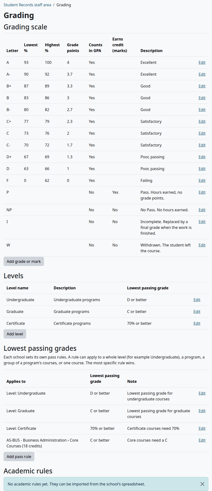
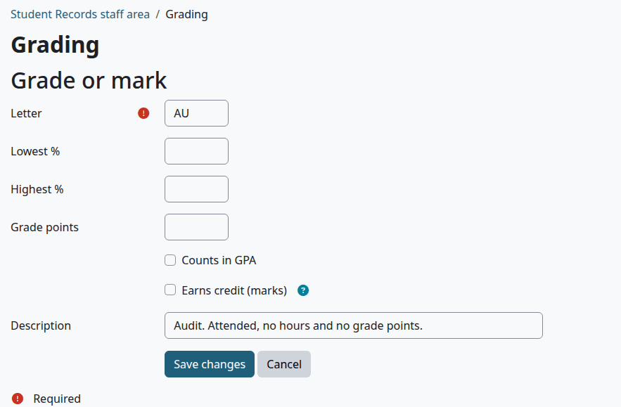
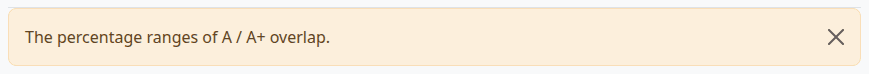
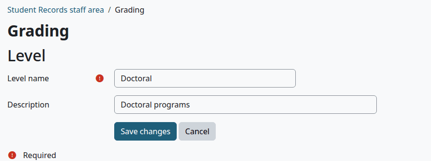
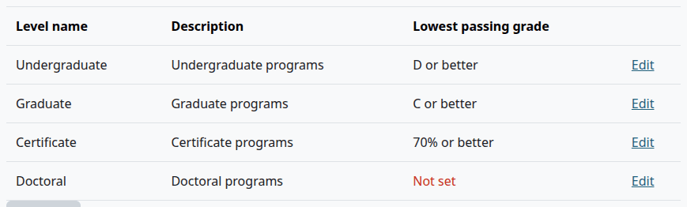
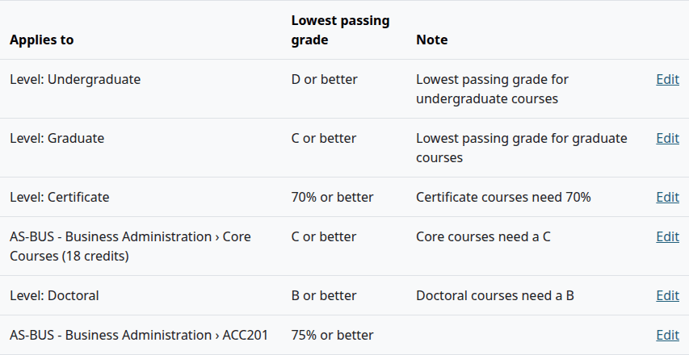
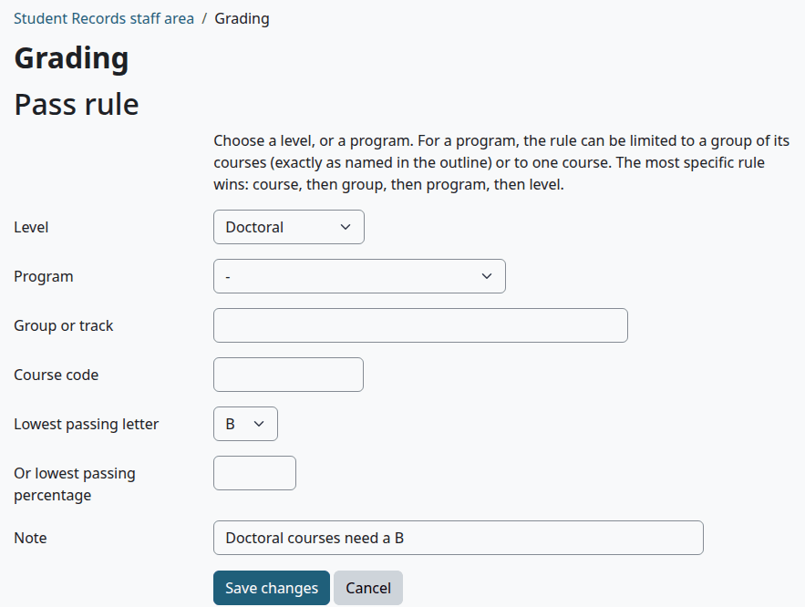

# Grading and levels

The Grading page holds the school's grading scale, its marks, its levels and its pass rules. This page is for the Registrar and whoever sets up the school. Nothing about grades is built in: each school enters its own.

## Contents

- [Open the Grading page](#open-the-grading-page)
- [Grades and marks](#grades-and-marks)
- [Add a grade or a mark](#add-a-grade-or-a-mark)
- [How a percent becomes a letter](#how-a-percent-becomes-a-letter)
- [Levels](#levels)
- [Pass rules](#pass-rules)
- [Add a pass rule](#add-a-pass-rule)
- [How a pass is decided](#how-a-pass-is-decided)
- [Academic rules](#academic-rules)
- [Related pages](#related-pages)

## Open the Grading page

Who can do this: anyone with the capability `local/studentrecords:configure`. Site administrators and Managers have it. A Registrar needs it on their role.

1. Go to Student Records > Grading. The Grading step of the [setup wizard](setup-wizard.md) has a "Manage grading" link to the same page.

The page has four parts: "Grading scale", "Levels", "Lowest passing grades" and "Academic rules". Each row of the first three has an "Edit" link. Nothing on this page can be deleted. To undo a row you added by mistake, edit it.

You can also bring all of this in from a spreadsheet. See [Import from a spreadsheet](import.md).

## Grades and marks

A row with grade points is a grade, such as A or C+. A row with no grade points is a mark, such as P, I or W.

| Column | What it does |
|---|---|
| "Letter" | The grade or mark itself, up to 10 characters. Each one only once |
| "Lowest %" | The lowest course percent that gets this letter. See [How a percent becomes a letter](#how-a-percent-becomes-a-letter). A percent pass rule reads it too |
| "Highest %" | Used to check the scale for gaps and overlaps. With Academic Transcript reading from Student Records, the transcript's key prints it too, as in 93-100% |
| "Grade points" | The points of the letter in the GPA. It also ranks the letters from best to worst. Empty makes the row a mark |
| "Counts in GPA" | Ticked: the row's points count in the GPA. A row with points and this unticked gets no GPA points |
| "Earns credit (marks)" | For a mark only. Ticked: the course hours count as earned, usually only for P. Grades follow the [pass rules](#pass-rules) instead |
| Description | Your own note on the row |

Staff and teachers pick from this list when they enter a final grade: the letters from best to worst, then the marks. New rows go at the bottom of the page.

A student who withdraws from a course shows W on their record, whether or not the scale has a W. To explain W on your scale, add it as a mark.

With Academic Transcript reading from Student Records, the transcript counts on this scale too, so you keep only one. See [With Student Records](../academic-transcript/with-student-records.md).

## Add a grade or a mark

Who can do this: the same people.

1. On the Grading page, select "Add grade or mark".
2. Type the "Letter".
3. For a grade, type its "Lowest %", "Highest %" and "Grade points", and leave "Counts in GPA" ticked.
4. For a mark, leave the percents and "Grade points" empty, and untick "Counts in GPA". Tick "Earns credit (marks)" if the course hours count as earned.
5. Type a "Description" if you want one.
6. Select "Save changes".

Check that:

- The row is at the bottom of the "Grading scale" table.
- No warning shows under the table.

What can go wrong:

- "Grade points" shows "Required". "Counts in GPA" is ticked and "Grade points" is empty. For a mark, untick "Counts in GPA".
- "This is already used by another record." That letter is on the scale.
- "Maximum of 10 characters". The letter is longer than 10 characters.
- "Enter a number." A percent or "Grade points" holds something that isn't a number.

A warning under the table points to a problem with the scale:

| Warning | Cause |
|---|---|
| "The percentage range of ... is not possible." | "Lowest %" is above "Highest %" (an empty "Highest %" counts as 0), or a value is below 0 or above 100 |
| "The percentage ranges of ... overlap." | Two ranges share a percent |
| "Gap in the percentage ranges between ...." | There is more than one percent between two ranges. Ranges such as 90-92 and 93-100 are fine |
| "The letter ... appears more than once." | The same letter is on two rows |
| "The grading scale has no marks that are not used in GPA (for example I, W, P). Add the marks the school uses." | Every row counts in the GPA |

To clear a warning, select "Edit" on the row and fix it. For the last one, add the marks your school uses. The warnings don't stop anything from working.

## How a percent becomes a letter

Student Records turns a percent into a letter when it [gets final grades from Moodle](course-offerings.md#get-final-grades-from-moodle), and when a teacher posts a course total with [Post final grades](final-grades.md#grades-posted-by-teachers). The letter is the best one whose "Lowest %" the percent reaches.

With Academic Transcript installed, its rounding setting applies, and rounding is on unless you turn it off. The percent then becomes a whole number first, and a half rounds up, so 92.5 reaches 93. With rounding off, or without Academic Transcript, the percent stays as it is: 92.5 reaches only 90, the A- on the scale above.

## Levels

A level groups programs and courses, such as Undergraduate or Graduate. A program's level decides which level-wide pass rule its students follow, which [standing rule](holds-and-standing.md) they follow, which prices and checklist documents set for a level apply to them, and how the Counts report groups them.

1. On the Grading page, select "Add level".
2. Type the "Level name". Each name only once, in any mix of capitals.
3. Type a "Description" if you want one.
4. Select "Save changes".

Check that:

- The level is in the "Levels" table.
- "Lowest passing grade" shows "Not set" in red until the level has a pass rule.

The Summary step of the setup wizard lists levels with no pass rule.

## Pass rules

A pass rule says the lowest grade that passes. It can apply to:

- A whole level, such as D or better for Undergraduate.
- A program.
- A group of a program's courses, named exactly as in the program's course list.
- One course in a program.

The most specific rule wins: course, then group, then program, then level. The "Levels" table repeats each level-wide rule.

## Add a pass rule

Who can do this: the same people.

Before you start:

- For a rule on a level, the level exists.
- For a rule on a program, group or course, the program exists and is active. A rule on a group needs the group's name from the program's course list.
- For a rule with a letter, the letter is on the grading scale.

1. On the Grading page, select "Add pass rule".
2. Choose what the rule applies to. Pick a "Level", or a "Program". For a program, you can also type a "Group or track" or a "Course code".
3. Pick a "Lowest passing letter", or type a percent in "Or lowest passing percentage". Use one or the other.
4. Type a "Note" if you want one.
5. Select "Save changes".

The note at the top of the form sums up step 2: "Choose a level, or a program. For a program, the rule can be limited to a group of its courses (exactly as named in the outline) or to one course. The most specific rule wins: course, then group, then program, then level." The outline is the program's [course list](programs-and-courses.md#fill-in-a-programs-course-list).

| Field | What it does |
|---|---|
| "Level" | A rule for a whole level. Leave "Program" on "-" |
| "Program" | A rule for one program |
| "Group or track" | With a program: only the courses of this group. It must match the outline exactly, so `Core Courses (18 credits)` and `Core Courses` are two different groups |
| "Course code" | With a program: only this course |
| "Lowest passing letter" | This letter or better passes |
| "Or lowest passing percentage" | A letter passes when its "Lowest %" is at or above this. At 70, C- with a "Lowest %" of 70 passes and D+ with 67 doesn't |
| "Note" | Your own note |

Check that:

- The rule is in the "Lowest passing grades" table.
- For a level, the "Levels" table shows it, such as "B or better".

What can go wrong:

| Message | Cause |
|---|---|
| "Choose a level, or a program (optionally with a group or a course), not both." | You picked both, or neither, or a group or course with no program |
| "Give either a lowest passing letter or a lowest passing percentage." | You gave both, or neither |
| "No course with this code in the catalog." | Check the "Course code" |
| "Enter a number." | "Or lowest passing percentage" isn't a number |

A group name with a typing mistake saves with no warning, and the rule never applies. Copy it from the program's page.

## How a pass is decided

Student Records decides this for each final grade:

1. A mark passes when it has "Earns credit (marks)" ticked.
2. A letter is held against the most specific rule that fits the student and the course. The level is the level of the student's program, not of the course.
3. With no rule that fits, any letter with grade points above 0 passes.

A pass decides whether the hours count as earned, whether the course meets a requirement in the [degree audit](degree-audit-and-graduation.md), whether it counts as a prerequisite, and how it shows on the Completion rate report. It doesn't change the GPA: a D below a program's rule still counts in the GPA with its grade points, and earns no hours.

A level with no pass rule isn't an error: an F with 0 points fails, and everything above it passes.

## Academic rules

This part of the page lists rules as the school's catalog words them, such as a minimum GPA for good standing. You can't add or edit them here: they come only from an [import](import.md).

Without an import it says "No academic rules yet. They can be imported from the school's spreadsheet."

Rules about good standing, completion and maximum time also show as suggestions on the Standing rules (SAP) page. See [Holds and standing](holds-and-standing.md).

## Related pages

- [Setup wizard](setup-wizard.md)
- [Import from a spreadsheet](import.md)
- [Programs and courses](programs-and-courses.md)
- [Final grades](final-grades.md)
- [Degree audit and graduation](degree-audit-and-graduation.md)
- [Holds and standing](holds-and-standing.md)
