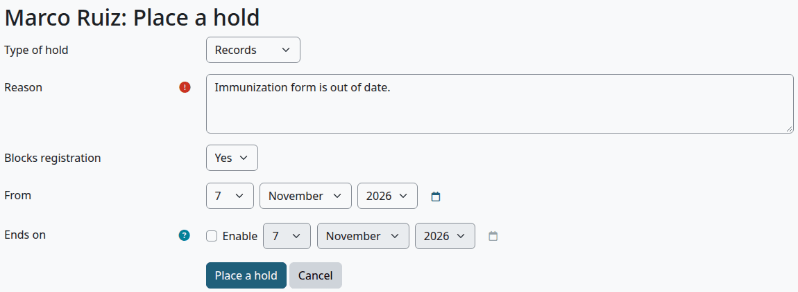
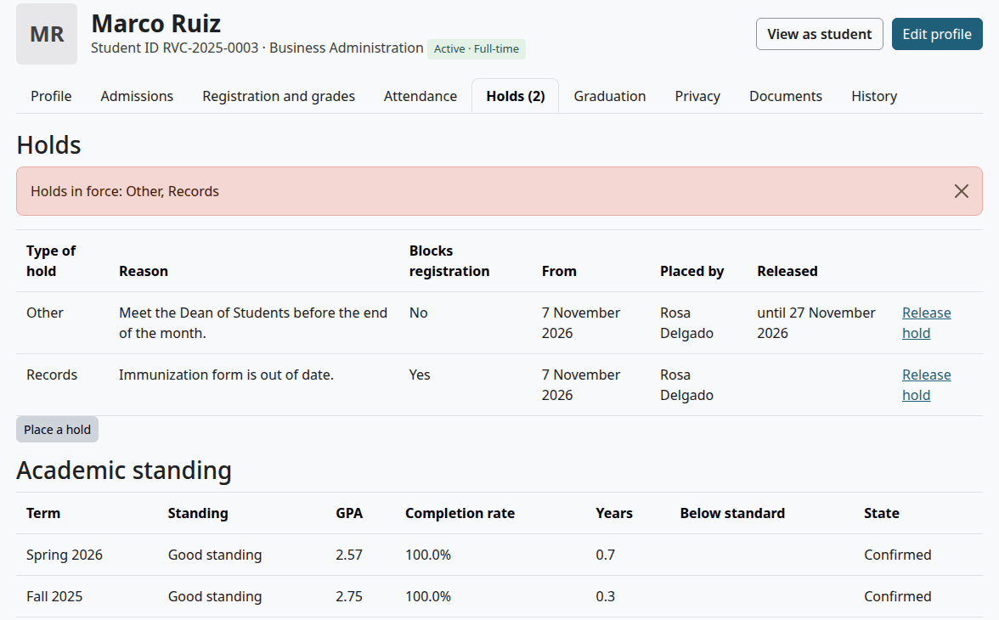
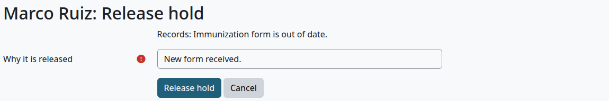
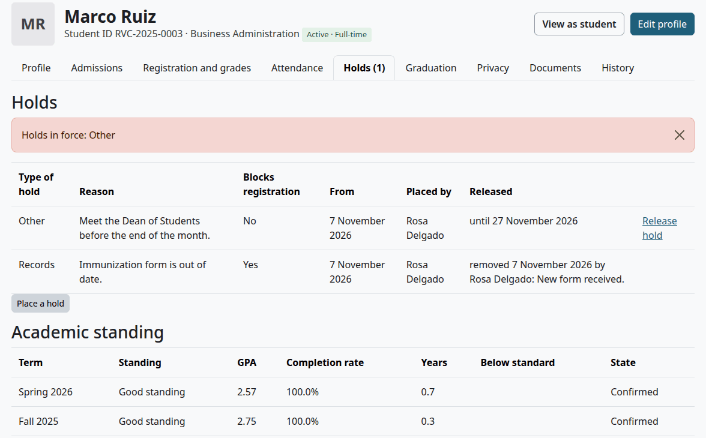
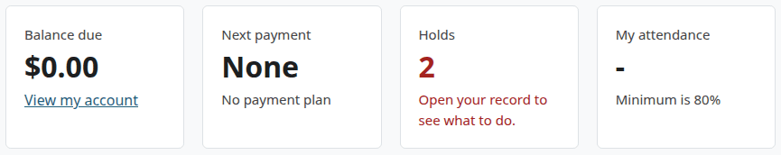
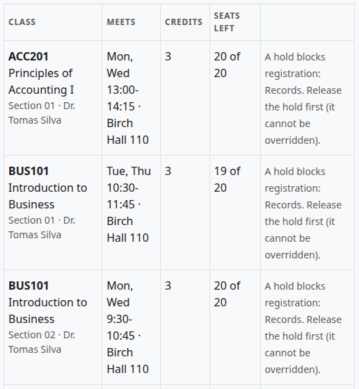
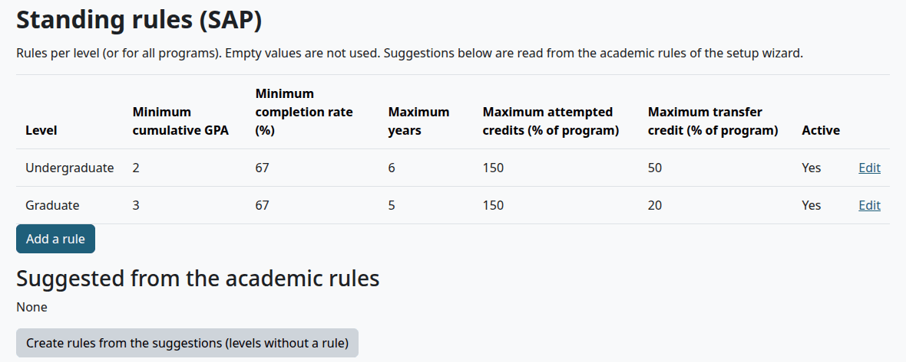
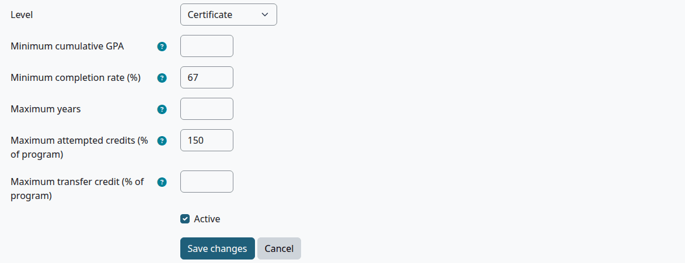
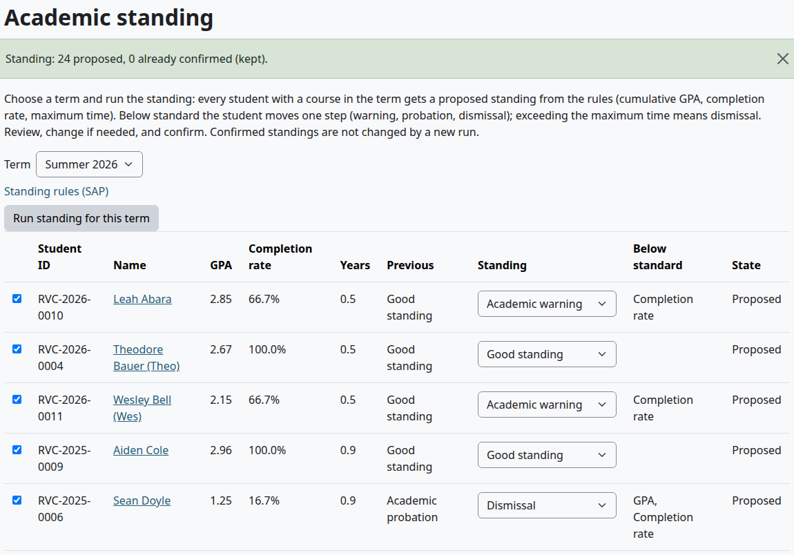
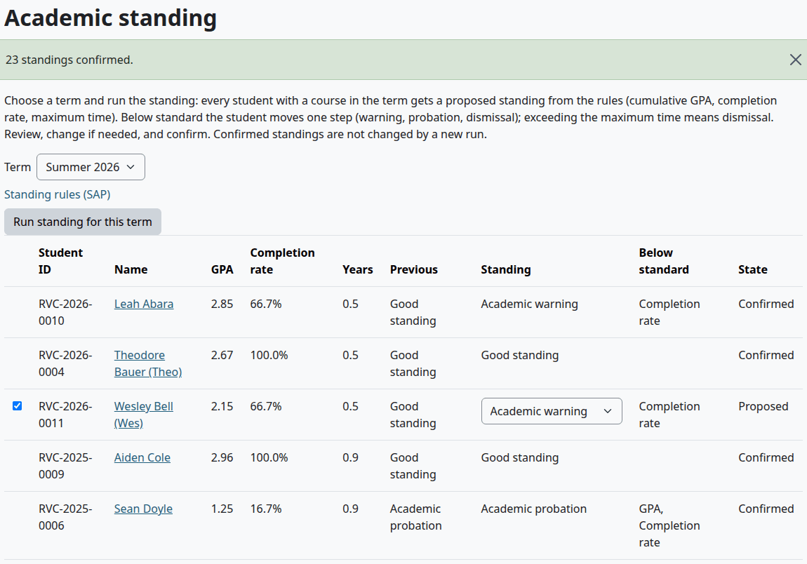

# Holds and standing

This page covers holds on a student's record and academic standing: the Standing rules (SAP), running them for a term and confirming the result. It is for the Registrar and other records staff.

The menu item "Holds and standing" opens the Academic standing page. That page has no holds on it. Holds are on the Holds tab of each student's file. The tile "Students with holds" on the Staff home opens the same page, so go to the student's file to see a hold.

## Contents

- [Place a hold](#place-a-hold)
- [What a hold does](#what-a-hold-does)
- [Release a hold](#release-a-hold)
- [Holds placed by the plugin](#holds-placed-by-the-plugin)
- [What a student sees of a hold](#what-a-student-sees-of-a-hold)
- [Standing rules (SAP)](#standing-rules-sap)
- [How a standing is worked out](#how-a-standing-is-worked-out)
- [Run standing for a term](#run-standing-for-a-term)
- [Confirm standing](#confirm-standing)
- [What a standing does](#what-a-standing-does)
- [Related pages](#related-pages)

## Place a hold

Who can do this: records and admissions staff. It needs `local/studentrecords:managestudents` at system level. Staff can place and release holds on their own record too.

1. Open the file, on the Holds tab.
2. Select "Place a hold".
3. Fill in the form.
4. Select "Place a hold".

| Field | What it does |
|---|---|
| Type of hold | Academic, Financial, Admissions, Records, Conduct or Other |
| Reason | Required. The student can read it, so write it for them |
| Blocks registration | Yes (the default) or No. See [What a hold does](#what-a-hold-does) |
| From | Today by default. The hold is in force from this day |
| Ends on | Optional. Tick Enable to set it. The hold ends by itself after this day, and the Released column says "until" with the date. With no date, it stays until it is released |

The type is a label. It changes nothing but the wording, and the count on the Staff home, which splits holds into financial and other.

Check that:

- The file opens with "Saved."
- The Holds tab has the hold, and its name counts it, such as "Holds (2)".
- A red notice lists the holds in force.

The student gets the message "Hold placed" at once. It says only that a hold was placed.

## What a hold does

| | A hold that blocks registration | A hold that doesn't |
|---|---|---|
| Staff registration | Stops it. "A hold blocks registration: Records. Release the hold first (it cannot be overridden)." Override doesn't help | No effect |
| Online registration | The section shows the same message in place of "Add" | No effect |
| A seat offer from a waitlist | The student is passed over and keeps their place | No effect |
| An Official transcript | Held back | Held back |
| Drop or withdraw | No effect | No effect |
| Conferring a credential | No effect | No effect |

With Academic Transcript installed and Student Records as the transcript's source, any hold in force stops an Official transcript, of any type. See [The request queue](../academic-transcript/registrar-guide.md).

The degree audit lists "No holds, balance paid" as Met or Not met. It is there for information, and it doesn't count toward "All requirements met".

## Release a hold

Who can do this: records and admissions staff. It needs `local/studentrecords:managestudents` at system level. Finance staff without it can't release a hold, even one the plugin placed for a late payment.

1. Open the file, on the Holds tab.
2. Select "Release hold" on the hold's row.
3. In "Why it is released", write the reason. It is required.
4. Select "Release hold".

Check that:

- The file opens with "Saved."
- The Holds tab shows who released the hold, when and why. The row stays on the file.
- The number in the tab's name has gone down.

The student gets the message "Hold released" at once. A hold that ends by its date sends no message, and it keeps its Release hold link.

## Holds placed by the plugin

The daily task places a Financial hold that blocks registration when a plan payment is late. Its reason starts "Late payment on the plan". See [Payment plans](payment-plans.md).

The hold isn't released when the student pays. Someone with `local/studentrecords:managestudents` releases it on the Holds tab. The Finance role doesn't have that capability.

## What a student sees of a hold

- The tile Holds on My home, with "Open your record to see what to do."
- The section Holds under My details on My academic record, with the type, the reason and the dates.
- The message "Hold placed".

A hold that blocks registration also shows on the Registration page, beside each class. See [Registration](registration.md#when-a-student-cant-register-online).

## Standing rules (SAP)

Who can do this: setup staff. It needs `local/studentrecords:configure` at system level.

A rule sets what "good standing" means for a level, or for all programs. A student is measured by the rule of their program's level. With no rule for the level, the rule for all programs applies. With neither, every student is in good standing.

1. In the Student Records menu, select "Standing rules (SAP)".
2. Select "Add a rule", or Edit on a row.
3. Fill in the form. An empty field isn't used.
4. Select "Save changes".

| Field | What it does |
|---|---|
| Level | All programs, or one level. A level can have one rule |
| Minimum cumulative GPA | Below this, the student is below standard |
| Minimum completion rate (%) | Credits earned as a share of credits attempted. Withdrawals and failed courses count as attempted. Below this, the student is below standard |
| Maximum years | Years from the student's first term. Beyond it: dismissal |
| Maximum attempted credits (% of program) | For example 150. Beyond it: dismissal |
| Maximum transfer credit (% of program) | Only shows a warning on the student's transfer credit. It doesn't enter the standing |
| Active | Untick it to switch the rule off. No page deletes a rule |

Check that:

- The rule is in the list.

What can go wrong:

- "This is already used by another record." That level has a rule already, active or not. Edit it instead.

"Suggested from the academic rules" lists values read from the academic rules that [Import from spreadsheet](import.md) brought in. "Create rules from the suggestions (levels without a rule)" makes those rules, and says "2 rules created." With no academic rules imported, the list is empty.

## How a standing is worked out

A run measures each student at the end of the term, with every course up to that term:

| Measure | How it is worked out |
|---|---|
| GPA | The cumulative GPA, with transfer credit that counts in the GPA |
| Completion rate | Hours earned out of hours attempted, with transfer credit. Courses still in progress aren't measured |
| Years | Time from the start of the student's first term to the end of this term |
| Attempted credits | Hours attempted as a share of the program's total hours |

The result follows these rules, in order:

1. Nothing below standard: Good standing.
2. Over the maximum years or the maximum attempted credits: Dismissal.
3. GPA or completion rate below standard: one step down from the last confirmed standing of an earlier term. The steps are Good standing, Academic warning, Academic probation, Dismissal.

The column "Below standard" gives the reason: GPA, Completion rate or Maximum time.

## Run standing for a term

Who can do this: records and admissions staff. It needs `local/studentrecords:managestudents` at system level.

Before you start:

- The term's final grades are in.
- The rules are set.

1. In the Student Records menu, select "Holds and standing".
2. Choose the Term.
3. Select "Run standing for this term".

Check that:

- The page says, for example, "Standing: 21 proposed, 0 already confirmed (kept)."
- The table has a row for every student with a course in the term. Drops don't count.

You can run it again. A proposed row is worked out afresh, and a confirmed row stays as it is.

## Confirm standing

Who can do this: records and admissions staff. It needs `local/studentrecords:managestudents` at system level.

1. On the Academic standing page, choose the term.
2. Read the table. In the Standing column, change a proposed standing if you decide otherwise.
3. Untick anyone you want to leave for now. Every proposed row starts ticked.
4. Optional: write in Notes. The note goes on every row you confirm.
5. Select "Confirm selected".

Check that:

- The page says, for example, "20 standings confirmed."
- Those rows say Confirmed, and their Standing can't be changed any more.

A confirmed standing can't be changed on any page. It counts as "Previous" for the next term's run.

## What a standing does

A standing is a record and nothing else. It shows on the [Holds tab](student-file.md#holds-tab), and on the student's My details. A proposed standing shows there too, marked Proposed, as soon as you run standing for the term. Confirming it sends no message, places no hold and changes no status, even for a Dismissal. If your school acts on a standing, do it by hand: tell the student, place a hold, or change the status.

The Financial Aid home counts students not meeting academic progress from these standings. See [Federal aid](federal-aid.md).

## Related pages

- [Registrar's guide](registrar.md)
- [The student file](student-file.md)
- [Registration](registration.md)
- [Payment plans](payment-plans.md)
- [Grading and levels](grading-and-levels.md)
